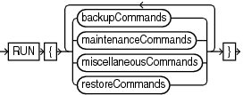
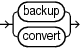
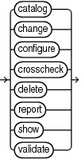
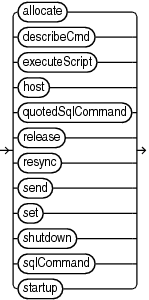
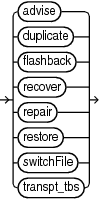

Purpose

Use the `RUN` command to group a series RMAN commands into a block to be executed sequentially. On reading the closing brace of the `RUN` block, RMAN compiles the list of job commands into one or more job steps and then executes the steps immediately.

Prerequisites

Execute this command only at the RMAN prompt. You must precede the list of job commands with an opening brace (`{`) and terminate it with a closing brace (`}`).

Usage Notes

You can use `RUN` to create a scope within which a script can override default configurations. For example, you can override configured channels with the `ALLOCATE CHANNEL` and `RELEASE CHANNEL` commands and other parameters with the `SET` command (as shown in Example 3-55). After executing the commands listed in the `RUN` block, the channels allocated within the `RUN` block are released and settings returned to their values.

As shown in Example 3-56, you must use the `EXECUTE SCRIPT` command within a `RUN` block.

Syntax

run::=



> RUN { {backupCommands | maintenanceCommands | miscellaneousCommands | restoreCommands} \[ {backupCommands | maintenanceCommands | miscellaneousCommands | restoreCommands}\]... }
>
> [  
> Copyright © 2023, 2024, Oracle and/or its affiliates.](https://docs.oracle.com/en/database/oracle/oracle-database/dcommon/html/cpyr.htm)


(backupCommands::=, maintenanceCommands::=, miscellaneousCommands::=, restoreCommands::=)

backupCommands::=



> backup | convert
>
> [  
> Copyright © 2023, 2024, Oracle and/or its affiliates.](https://docs.oracle.com/en/database/oracle/oracle-database/dcommon/html/cpyr.htm)


maintenanceCommands::=



> catalog | change | configure | crosscheck | delete | report | show | validate
>
> [  
> Copyright © 2023, 2024, Oracle and/or its affiliates.](https://docs.oracle.com/en/database/oracle/oracle-database/dcommon/html/cpyr.htm)


miscellaneousCommands::=



> allocate | describeCmd | executeScript | host | quotedSqlCommand | release | resync | send | set | shutdown | sqlCommand | startup
>
> [  
> Copyright © 2023, 2024, Oracle and/or its affiliates.](https://docs.oracle.com/en/database/oracle/oracle-database/dcommon/html/cpyr.htm)


restoreCommands::=



> advise | duplicate | flashback | recover | repair | restore | switchFile | transpt\_tbs
>
> [  
> Copyright © 2023, 2024, Oracle and/or its affiliates.](https://docs.oracle.com/en/database/oracle/oracle-database/dcommon/html/cpyr.htm)


Semantics

Refer to individual command entries for information about commands that you can run from the RMAN prompt.

Examples

Example 3-55 Overriding Configured Settings

Assume that your configured device configuration is as follows:

```
RMAN> SHOW DEVICE TYPE;

RMAN configuration parameters for database with db_unique_name PROD1 are:
CONFIGURE DEVICE TYPE DISK PARALLELISM 1 BACKUP TYPE TO BACKUPSET; # default
CONFIGURE DEVICE TYPE SBT_TAPE PARALLELISM 1 BACKUP TYPE TO BACKUPSET; # default
```

You want to make a backup to a nondefault directory. Instead of changing the configuration, you can override it in the job as follows:

```
RUN
{
  ALLOCATE CHANNEL c1 DEVICE TYPE DISK FORMAT "/disk2/%U";
  BACKUP DATABASE PLUS ARCHIVELOG;
}
```

Example 3-56 Executing an RMAN Script

Assume that you use the `CREATE SCRIPT` command to create a backup script named `backup_db`. This example executes the stored script:

```
RUN { EXECUTE SCRIPT backup_db; }
```