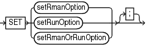
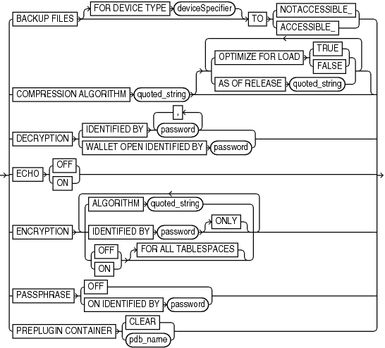
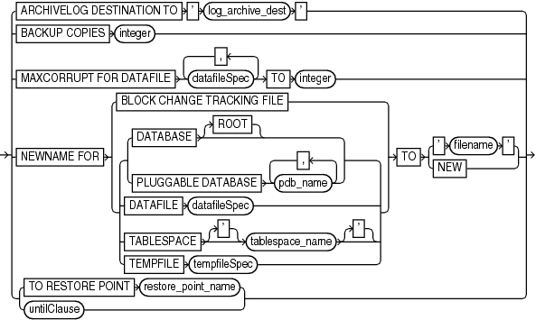
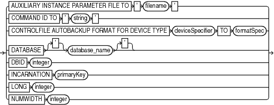

Purpose

Use the `SET` command to control RMAN behavior within a job or session. Use `CONFIGURE` to configure options that persist across sessions.

Prerequisites

You can use the `SET` command either at the RMAN prompt or within a `RUN` block. When used at the RMAN prompt, changes made by `SET` persist until you exit the RMAN client (see setRmanOption). When used inside of a `RUN` block, changes made by `SET` persist until the end of the `RUN` block or the next `SET` command that changes the value of the same attribute (see setRunOption).

Syntax

set::=



> SET \[setRmanOption | setRunOption | setRmanOrRunOption\]
>
> [  
> Copyright © 2023, 2024, Oracle and/or its affiliates.](https://docs.oracle.com/en/database/oracle/oracle-database/dcommon/html/cpyr.htm)


(setRmanOption::=, setRunOption::=)

setRmanOption::=



> BACKUP FILES \[FOR DEVICE TYPE deviceSpecifier\] TO {NOTACCESSIBLE\_ | ACCESSIBLE\_} | COMPRESSION ALGORITHM quoted\_string \[ { {OPTIMIZE FOR LOAD {TRUE | FALSE} | AS OF RELEASE quoted\_string}}...\] | DECRYPTION {IDENTIFIED BY password \[, password\]... | WALLET OPEN IDENTIFIED BY password} | ECHO {OFF | ON} | ENCRYPTION {ALGORITHM quoted\_string | IDENTIFIED BY password \[ONLY\] | {OFF | ON} \[FOR ALL TABLESPACES\]} \[ {ALGORITHM quoted\_string | IDENTIFIED BY password \[ONLY\] | {OFF | ON} \[FOR ALL TABLESPACES\]}\]... | PASSPHRASE {OFF | ON IDENTIFIED BY password} | PREPLUGIN CONTAINER {CLEAR | pdb\_name}


([deviceSpecifier::=](deviceSpecifier.md), [formatSpec::=](formatSpec.md))

setRunOption::=



> ARCHIVELOG DESTINATION TO ' log\_archive\_dest ' | BACKUP COPIES integer | MAXCORRUPT FOR DATAFILE datafileSpec \[, datafileSpec\]... TO integer | NEWNAME FOR {BLOCK CHANGE TRACKING FILE | { {DATABASE \[ROOT\] | PLUGGABLE DATABASE pdb\_name \[, pdb\_name\]...} | DATAFILE datafileSpec | TABLESPACE \['\] tablespace\_name \['\] | TEMPFILE tempfileSpec}} TO {' filename ' | NEW} | {TO RESTORE POINT restore\_point\_name | untilClause}


([deviceSpecifier::=](deviceSpecifier.md), [formatSpec::=](formatSpec.md), [datafileSpec::=](datafileSpec.md), [tempfileSpec::=](tempfileSpec.md), [untilClause::=](untilClause.md))

setRmanOrRunOption::=



> AUXILIARY INSTANCE PARAMETER FILE TO ' filename ' | COMMAND ID TO ' string ' | CONTROLFILE AUTOBACKUP FORMAT FOR DEVICE TYPE deviceSpecifier TO formatSpec | DATABASE \['\] database\_name \['\] | DBID integer | INCARNATION primaryKey | LONG integer | NUMWIDTH integer
>
> [  
> Copyright © 2023, 2024, Oracle and/or its affiliates.](https://docs.oracle.com/en/database/oracle/oracle-database/dcommon/html/cpyr.htm)


([deviceSpecifier::=](deviceSpecifier.md), [formatSpec::=](formatSpec.md))

Semantics

setRmanOption

This subclause specifies `SET` options that are usable outside of a `RUN` block.

| Syntax Element | Description |
| --- | --- |
| `BACKUP FILES` | Specifies the visibility of backups in a Data Guard environment. By default, disk backups are visible only to the database with which the backups are associated. The association is determined by the `DB_UNIQUE_NAME` of the database. |
| `FOR DEVICE TYPE` `device_specifier` | Specifies the device type for which visibility of backups must be modified. |
| `TO NOTACCESSIBLE` | Makes disk backups created on the primary database or standby database available only to the database that created these backups. |
| `TO ACCESSIBLE` | Makes backups created on the primary database or standby database accessible to databases whose `DB_UNIQUE_NAME` is different from that on which the backups were created. |
| `COMPRESSION ALGORITHM` ` '` ``  `algorithm_name` `` `'` | Specifies the compression algorithm for backup sets. This command overrides the current `CONFIGURE` `COMPRESSION ALGORITHM` setting for the current RMAN session.  You can configure the basic compression level, which does not require the Advanced Compression Option, by specifying `BASIC` for the algorithm\_name.  If you have enabled the Advanced Compression Option, you can choose from the following compression levels:  - `HIGH - ` Best suited for backups over slower networks where the limiting factor is network speed - `MEDIUM -` Recommended for most environments. Good combination of compression ratios and speed - `LOW` - Least impact on backup throughput and suited for environments where CPU resources are the limiting factor.  Note: The compression ratio generally increases from `LOW` to `HIGH`, with a trade-off of potentially consuming more CPU resources.  Because the performance of the various compression levels depends on the nature of the data in the database, network configuration, system resources and the type of computer system and its capabilities, universally applicable performance statistics are not available. When deciding which level is best, you must consider how balanced your system is regarding bandwidth into the CPU and the actual speed of the CPU. Oracle recommends that you run tests with the different compression levels on the data in your environment. Choose a compression level based on your environment, network traffic characteristics (workload), and data set. This is the only way to ensure that the backup set compression level can satisfy your organization's performance requirements and any applicable service level agreements.  Note: `V$RMAN_COMPRESSION_ALGORITHM` describes supported algorithms.  See Also: Oracle Database Reference entry for `$RMAN_COMPRESSION_ALGORITHM`. |
| `   OPTIMIZE FOR LOAD` ` {TRUE\|FALSE}` | Specifies whether Oracle performs pre-compression block processing when compressed backups have been requested. `TRUE` is the default and `FALSE` enables pre-compression processing. The default behavior is not to perform pre-compression block processing. Such processing can consume extra CPU resources, and is not needed for blocks that contain all originally loaded data, and have never been the subject of single-row inserts and deletes. Specifying `FALSE` uses additional CPU resources to perform pre-compression block processing which consists of internal block cleanups and defragmentation that can result in improved levels of binary compression.  See Also: Oracle Database Backup and Recovery User's Guide to learn more about this option. |
| `   AS OF RELEASE` `   'version number'` | Specifies the release version. The version number uses the release number format and may use as many as 5 numbers to fully qualify the release. For example, 10.2.0.3.0 and 11.2 are acceptable values. This option ensures compression algorithm stability across future releases. |
| `DECRYPTION IDENTIFIED BY` `password` | Specifies one or more decryption passwords to be used when reading dual-mode or password-encrypted backups.  Password-encrypted backups require the correct password to be entered before they can be restored. When RMAN reads an encrypted backup piece, it tries each password in the list until it finds the correct one to decrypt this backup piece. RMAN signals an error if no specified keys work.  Note: If restoring from a group of backups created with different passwords, then specify all of the required passwords on the `SET DECRYPTION` command. RMAN automatically uses the correct password with each backup set.  See Also: " [Encryption of Backup Sets](BACKUP.md) " |
| `DECRYPTION WALLET OPEN IDENTIFIED BY` `password` | Specifies the password that must be used to open the password-based software keystore. Keystores are used while encrypting backup sets using transparent mode encryption.  If the database or tablespace uses Transparent Data Encryption (TDE) and you have a password-based software keystore, then you must use the `SET DECRYPTION WALLET OPEN IDENTIFIED BY` command to open the keystore before you perform complete recovery, PITR, and database duplication.  When restoring backups that were created by using transparent encryption with a password-based software keystore, you must specify the password that is used to open the keystore. When duplicating a database that is configured to use transparent encryption with a password-based software keystore, the password that is required to open the keystore must be provided to the auxiliary instance by using this command.  The password specified is valid for the session in which the `SET` command is run. Therefore, even if the auxiliary instance is restarted during database duplication, the password required to open the keystore is available to the auxiliary instance. |
| `ECHO {OFF \| ON}` | Controls whether RMAN commands appear in the message log. When reading commands from a command file, RMAN automatically echoes them to the message log. When reading commands from standard input, by default RMAN does not echo these commands to the message log. To force RMAN to echo the commands, run the `SET ECHO ON` command before running your command file. Run `SET ECHO OFF` to disable echoing to the command log.  The command is useful when `stdin` and `stdout` have been redirected. For example, in UNIX you can redirect RMAN's input and output in this manner:  ``` % rman TARGET / < in_file > out_file ```  By including `SET ECHO ON` in the `in_file`, you enable the commands contained in `in_file` to be visible in `out_file`. |
| `ENCRYPTION` | Specifies encryption-related options that apply to `BACKUP` commands that create backup sets for the duration of the RMAN session.  See Also: " [Encryption of Backup Sets](BACKUP.md) " |
| `   ALGORITHM` ` '` `algorithm_name` `'` | Specifies the algorithm used during this RMAN session. Overrides the configured default encryption algorithm specified by `CONFIGURE` `ALGORITHM`. Possible values are listed in `V$RMAN_ENCRYPTION_ALGORITHMS`. |
| ` IDENTIFIED BY` ` password` `[ONLY]` | Specifies whether to employ a user-specified password in backup encryption according to the following rules:  - Omit `IDENTIFIED BY` `password ` clause to specify transparent-mode encrypted backups. - Use `IDENTIFIED BY` `password` `ONLY` to specify password-mode encrypted backups. - Use `IDENTIFIED BY` `password ` without `ONLY` to specify dual-mode encrypted backups.  Create a password that is secure. See [Oracle Database Security Guide](https://docs.oracle.com/pls/topic/lookup?ctx=en/database/oracle/oracle-database/21/rcmrf&id=DBSEG33223) for more information.  If the password is not surrounded by quotes, then it is translated internally into upper case. Thus, the following clauses are all synonyms for `IDENTIFIED BY` `"PASSWORD"`:  - `IDENTIFIED BY` `password` - `IDENTIFIED BY` `Password` - `IDENTIFIED BY` `pAsSwOrD`  Caution: Keystore-based encryption is more secure than password-based encryption because no passwords are involved. Use password-based encryption only when absolutely necessary because your backups must be transportable.  See Also: " [Encryption of Backup Sets](BACKUP.md) " for details on the different encryption modes |
| `   {OFF \| ON}` | Specifies whether to encrypt backup sets. If `ON`, then the default is to encrypt backup sets. If `OFF`, then the default is not to encrypt backup sets.  This option overrides settings made with the `CONFIGURE` `ENCRYPTION FOR` command. If no data files are configured for encryption, then you must explicitly use `ON` to encrypt required data files.  If `FOR ALL TABLESPACES` is not specified, then this setting controls encryption of backups for tablespaces where `CONFIGURE` `ENCRYPTION FOR TABLESPACE` `tablespace_name` has not been used to control encryption behavior. |
| `   FOR ALL TABLESPACES` | Controls encryption for all tablespaces, overriding any `CONFIGURE ENCRYPTION FOR TABLESPACE` `tablespace_name` setting. |
| `PASSPHRASE OFF` | Deletes the passphrase that was set during backup or restore operations involving TDE-encrypted tablespaces from the memory.  It is recommended that you set the passphrase off after you perform a backup or restore of TDE-encrypted tablespaces. |
| `PASSPHRASE ON IDENTIFIED BY` | Specifies the passphrase used to wrap the master key when creating or restoring backups of TDE-encrypted tablespaces. |
| `PREPLUGIN CONTAINER` | Sets the container for RMAN operations that use preplugin backups to `pdb_name`. A CDB may contain preplugin metadata for multiple PDBs. While using preplugin backups, use this command to specify the PDB for which the specified operation must be performed. The operations include listing preplugin backups, changing the status of preplugin backups, cataloging preplugin archived redo log files, restoring preplugin backups, and recovering preplugin backups.  Use the `CLEAR` option to clear the current setting for preplugin container. |

setRunOption

This subclause specifies `SET` options that are usable within a `RUN` block.

| Syntax Element | Description |
| --- | --- |
| `ARCHIVELOG DESTINATION` ` TO '` `log_archive_dest` `'` | Overrides the `LOG_ARCHIVE_DEST_1` initialization parameter in the target database when forming names for restored archived redo log files during subsequent `RESTORE` and `RECOVER` commands. RMAN restores the logs to the destination specified in `'` `log_archive_dest` `'`.  You can use this command to stage archived redo log files to different locations while restoring a database. RMAN knows where to find the newly restored archived redo log files; it does not require them to be in the destination specified by `LOG_ARCHIVE_DEST_1`. For example, if you specify a different destination from the one in the parameter file and restore archived log backups, subsequent restore and recovery operations detect this new location.  Use this parameter to restore archived redo log files that are not on disk. RMAN always looks for logs on disk first before restoring them from backups. |
| `BACKUP COPIES` `integer` | Specifies the number of copies of each backup piece that the channels create: `1`, `2`, `3`, or `4` (see Example 3-59).  RMAN can duplex backups to either disk or tape but cannot duplex backups to tape and disk simultaneously. When backing up to tape, ensure that the number of copies does not exceed the number of available tape devices. Also, if `BACKUP COPIES` is greater than 1, then the `BACKUP_TAPE_IO_SLAVES` initialization parameter must be enabled on the target database.  The `SET BACKUP COPIES` command affects all `BACKUP` commands in the `RUN` block issued after `SET BACKUP COPIES` (but not before) and is in effect until explicitly disabled or changed. The `SET BACKUP COPIES` command affects only `BACKUP` commands, but does not apply to the `BACKUP` `AS COPY` command.  The `SET BACKUP COPIES` command affects all channels allocated in the session. The order of precedence is as follows, with settings higher on the list overriding settings lower on the list:  1. `BACKUP COPIES` 2. `SET` `BACKUP COPIES` 3. `CONFIGURE` `... BACKUP COPIES`  The names of the backup pieces are dependent on the `FORMAT` clause in the `BACKUP` command. You can specify up to four `FORMAT` strings. RMAN uses the second, third, and fourth values only when `BACKUP COPIES`, `SET BACKUP COPIES`, or `CONFIGURE ... BACKUP COPIES` is in effect. When choosing which format to use for each backup piece, RMAN uses the first format value for copy 1, the second format value for copy 2, and so on. If the number of format values exceeds the number of copies, then the extra formats are not used. If the number of format values is less than the number of copies, RMAN reuses the format values, starting with the first one.  Note: `BACKUP COPIES` option is not valid when files are created in fast recovery area. Backups to the fast recovery area cannot be duplexed.  Note: Control file autobackups on disk are a special case and are never duplexed: RMAN always writes one and only copy. |
| `MAXCORRUPT` `FOR DATAFILE` `datafileSpec` ` TO` `integer` | Sets a limit on the number of previously undetected block corruptions that the database permits in a specified data file or group of data files. The default limit is zero, meaning that RMAN tolerates no corrupt blocks.  The `SET MAXCORRUPT` command specifies the total number of physical and logical corruptions permitted in a data file during a backup job. If the sum of physical and logical corruptions detected for a data file is no more than its `MAXCORRUPT` setting, then the `BACKUP` command completes. If more than `MAXCORRUPT` corrupt blocks exist, then RMAN terminates without creating output files.  Whether or not the `MAXCORRUPT` limit is exceeded, RMAN populates the `V$DATABASE_BLOCK_CORRUPTION` view with any corrupt block ranges that it finds. However, a backup or restore job is terminated after `MAXCORRUPT+1` corrupt blocks are found, so in this case RMAN only records `MAXCORRUPT+1` corruptions. Any block corruptions beyond the point at which the backup job terminated are not recorded.  Note: If you specify `CHECK LOGICAL`, then the `MAXCORRUPT` limit applies to the sum of logical and physical corruptions detected. Otherwise, `MAXCORRUPT` only applies to the number of physical block corruptions.  See Also: `datafileSpec` |
| `NEWNAME FOR` `DATABASE` | Sets new default names for all data files and temp files in the specified database that have not been named with the `SET NEWNAME FOR TABLESPACE,` `SET NEWNAME FOR TEMPFILE ` or `SET NEWNAME FOR DATAFILE` command.  This command enables you to change the names for multiple files in the database and provides a quick alternative to naming each file individually (see [Example 2-88](DUPLICATE.md)). This command does not set names for temp files.  When issuing `SET NEWNAME FOR DATABASE`, you must specify at least one of the following substitution variables to avoid name collisions: `%b`, `%f`, and `%U`. See the semantic entry for `TO '` `filename` `'` for descriptions of the possible substitution variables.  The new names are used for all subsequent `DUPLICATE`, `RESTORE`, `SWITCH` commands that affect the files in the database and when using the RMAN TSPITR utility. If you do not issue this command before the restore operation, then RMAN restores the files to their default locations.  You do not have to issue the `SET NEWNAME` commands in any particular order. For example, assume that you run the following series of commands:  ``` SET NEWNAME FOR DATABASE TO '/oradata1/%b'; SET NEWNAME FOR TABLESPACE users TO '/oradata2/%U'; SET NEWNAME FOR DATAFILE 1 TO '+data'; ```  The preceding series of commands is equivalent to the following differently ordered series of commands:  ``` SET NEWNAME FOR DATAFILE 1 TO '+data; SET NEWNAME FOR DATABASE TO '/oradata1/%b'; SET NEWNAME FOR TABLESPACE users TO '/oradata2/%U'; ```  Note: The `SET NEWNAME` command supports ASM disk groups.  See Also: `formatSpec` to learn about substitution variables that are valid in `SET NEWNAME FOR DATABASE` |
| `NEWNAME FOR DATABASE ROOT` | In a CDB, sets new default names for data files and temp files only in the root. Connect to the root as a common user with the `SYSDBA` or `SYSBACKUP` privilege. |
| `NEWNAME FOR PLUGGABLE DATABASE` `pdb_name` | In a CDB, sets new default names for data files and temp files only in the specified PDBs. Connect to the root as a common user with the `SYSDBA` or `SYSBACKUP` privilege. |
| `NEWNAME FOR DATAFILE` `datafileSpec` | Sets the default name for the specified data file.  This command enables you to specify the names of each data file individually (see [Example 2-89](DUPLICATE.md)). The new names are used for all subsequent `DUPLICATE`, `RESTORE`, `SWITCH` commands that affect the files in the database and when using the RMAN TSPITR utility.  If you run `SET NEWNAME FOR DATAFILE` and then restore a data file to a new location, then you can run `SWITCH` to rename the file in the control file to the `NEWNAME`. If you do not run `SWITCH`, then RMAN records the restored file as a data file copy in the RMAN repository.  Note: The `SET NEWNAME` command supports ASM disk groups.  See Also: `datafileSpec` |
| `NEWNAME FOR TABLESPACE` `tablespace_name` | Sets new default names for all the files in the specified tablespace that have not been named with the `SET NEWNAME FOR DATAFILE` command.  This command enables you to change the names for multiple files in the duplicate tablespace and provides an alternative to naming each file of the tablespace individually (see [Example 2-89](DUPLICATE.md)).  When issuing `SET NEWNAME FOR TABLESPACE`, you must specify at least a first three of the following substitution variables to avoid name collisions: `%b`, `%f`, and `%U`. See the semantic entry for `TO '` `filename` `'` for descriptions of the possible substitution variables.  The new names are used for all subsequent `DUPLICATE`, `RESTORE` or `SWITCH` commands that affect the files in the tablespace. If you do not issue this command before the restore operation, then RMAN restores the files to their default locations.  Note: The `SET NEWNAME` command supports ASM disk groups.  See Also: `formatSpec` to learn about substitution variables that are valid in `SET NEWNAME FOR DATABASE` |
| `NEWNAME FOR TABLESPACE ` `pdb-name``:``tablespace_name` | The name of the tablespace in a CDB. Multiple databases can have tablespaces with the same name. A qualifier before the name uniquely identifies the tablespace. `pdb-name` is the name of a PDB. |
| `NEWNAME FOR` `TEMPFILE` `tempfileSpec` | Sets the new temp file name for a subsequent `SWITCH` command that renames the specified temp file to the specified name.  Note: The `SET NEWNAME` command supports ASM disk groups.  See Also: `tempfileSpec` |
| `   TO '` `filename` `'` | Specifies a user-defined file name or ASM disk group for the restored data file or temp file.  When issuing `SET NEWNAME FOR DATABASE` or `SET NEWNAME FOR TABLESPACE`, you must specify substitution variables within `filename` to avoid name collisions. Specify at least a first three of the following substitution variables (the `%I` and `%N` variables are optional):  - `%b` 	Specifies the file name without the fully qualified directory path. For example, the data file name `/oradata/prod/financial.dbf` is transformed to `financial.dbf`. This variable enables you to preserve the names of the data files while you move them to different directory. During backup, you can use it for creating image copies. You cannot use this variable for OMF data files or backup sets. - `%f` 	Specifies the absolute file number of the data file for which the new name is generated. For example, if data file `2` is duplicated, then `%f` generates the value `2`. - `%U` 	Specifies a system-generated unique file name. The name is in the following format: `data-D-` `%d` `_id-` `%I` `_TS-` `%N` `_FNO-` `%f`. The `%d` variable specifies the database name. For example, a possible name might be `data-D-prod_id-22398754_TS-users_FNO-7`. - `%I` 	Specifies the DBID. - `%N` 	Specifies the tablespace name.  Note: Use of other substitution variables defined in [formatSpec](formatSpec.md) is undefined: some yield an error, while others result in zero values and are not supported.  If you set the `NEWNAME` to an ASM disk group for a data file and run `RESTORE`, then RMAN restores the file to the disk group. If you specify a file name for a temp file, then it is the new name of the temp file after the database is recovered and opened. |
| `   TO NEW` | Creates an Oracle-managed file in the directory specified by the `DB_CREATE_FILE_DEST` initialization parameter.  For example, `SET NEWNAME FOR TABLESPACE users TO NEW` sets OMF names for the data files of the `users` tablespace to be created in the `DB_CREATE_FILE_DEST` location (see [Example 2-90](DUPLICATE.md)).  If the original file is an Oracle-managed file or is on an ASM disk group, then RMAN attempts to delete the original file. If you specify `TO NEW` for a temp file, then RMAN creates the temp file in `DB_CREATE_FILE_DEST` when the database is opened.  See Also: [Oracle Database Administrator’s Guide](https://docs.oracle.com/pls/topic/lookup?ctx=en/database/oracle/oracle-database/21/rcmrf&id=ADMIN003) for information about Oracle-managed files |
| `TO RESTORE POINT` `restore_point_name` | Specifies a restore point for a subsequent `RESTORE` or `RECOVER` command, with the SCN at which the restore point was created as the upper, inclusive limit. Because the limit is inclusive, RMAN selects only files that it can use to restore or recover up to and including the SCN corresponding to the restore point.  Note: You can only use `SET TO RESTORE POINT` when the database is mounted, because the defined restore points are recorded in the control file. For example, you cannot use `SET TO RESTORE POINT` to specify the target SCN for a `RESTORE` `CONTROLFILE` operation. |
| `untilClause` | Specifies an end time, SCN, or log sequence number for a subsequent `RESTORE` or `RECOVER` command.  See Also: `untilClause` |

setRmanOrRunOption

This subclause specifies `SET` options that are usable inside or outside of a `RUN` block.

| Syntax Element | Description |
| --- | --- |
| `AUXILIARY INSTANCE PARAMETER` `FILE TO` `'` `filename` `'` | Specifies the path to the parameter file to use in starting the instance. You can use this parameter when customizing TSPITR with an automatic auxiliary instance or when cloning RMAN tablespaces with RMAN.  Note: The `filename` is on the host running the RMAN client. |
| `COMMAND ID TO` `'` `string` `'` | Enters the specified string into the `V$SESSION.CLIENT_INFO` column of all channels. Use this information to determine which database server sessions correspond to which RMAN channels. The `SET COMMAND ID` command applies only to channels that are allocated.  The `V$SESSION.CLIENT_INFO` column contains information for each RMAN server session. The data appears in one of the following formats:  - `id=` `string` - `id=` `string`, `ch=` `channel_id`  The first form appears in the RMAN target database connection. The second form appears in all allocated channels. When the current job is complete, the `V$SESSION.CLIENT_INFO` column is cleared.  See Also: [Oracle Database Reference](https://docs.oracle.com/pls/topic/lookup?ctx=en/database/oracle/oracle-database/21/rcmrf&id=REFRN30223) for more information about `V$SESSION.CLIENT_INFO` |
| `CONTROLFILE AUTOBACKUP` `FORMAT FOR DEVICE TYPE` `deviceSpecifier` `TO` `formatSpec` | Overrides the default file name format for the control file autobackup on the specified device type. You can use this command either in `RUN` or at the RMAN prompt. The order of precedence is as follows:  1. `SET CONTROLFILE AUTOBACKUP` executed within a `RUN` block 2. `SET CONTROLFILE AUTOBACKUP` executed at the RMAN prompt 3. `CONFIGURE` `CONTROLFILE` `AUTOBACKUP` `FORMAT`  The [%F](formatSpec.md) substitution variable is required to be in the new `formatSpec`. No other substitution variable is valid in a control file autobackup `formatSpec`.  See Also: `formatSpec` for the semantics of the `%F` substitution variable |
| `DATABASE` `'` `database_name` `'` | Specifies the name of the database to copy (source database) when duplicating without a connection to the target database. Alternatively, you can use the `DATABASE` clause of the `DUPLICATE` command to specify the source database when you have chosen not to connect to the target database for the duplicate. |
| `DBID` `integer` | Specifies the DBID, which is a unique 32-bit identification number computed when the database is created.  RMAN displays the DBID upon connection to the target database. You can obtain the DBID by querying the `V$DATABASE` view or the `RC_DATABASE` and `RC_DATABASE_INCARNATION` recovery catalog views.  Run the `SET DBID` command only in the following specialized circumstances:  - You are not connected to a recovery catalog and want to restore the control file (see Example 3-60). The same restriction applies when you use the Data Recovery Advisor to restore a control file autobackup. `CONFIGURE` can locate an autobackup and restore it only if `SET DBID` is issued before `ADVISE FAILURE`. 	Starting in Oracle Database 19c, the Data Recovery Advisor (DRA) feature is deprecated. 	The deprecation of DRA includes deprecation of the following Oracle Recovery Manager (RMAN) commands: `LIST FAILURE`, `ADVISE FAILURE`, `REPAIR                     FAILURE`, and `CHANGE FAILURE`. Database administrators will no longer have access to these commands. There is no replacement feature for DRA. - You want to restore the server parameter file (see Example 3-61). - You are connected to the recovery catalog but not the target database and use the `FOR DB_UNIQUE_NAME` option on the `CONFIGURE`, `LIST`, `REPORT`, `SHOW`, or `UNREGISTER` commands. - You are connected to the recovery catalog and want to restore the controlfile but the target database is not mounted and the database name is not unique in the recovery catalog. - You are performing a `DUPLICATE` without a target connection but are not using the `DBID` subclause in the `DUPLICATE` command and the database name specified in `SET DATABASE` or ` DATABASE` clause is not unique in the recovery catalog. |
| `INCARNATION` `primaryKey` | Specifies an orphan incarnation when duplicating without a target connection under the following conditions:  - You have not specified INCARNATION within the DATABASE clause of the DUPLICATE command. - You want to duplicate to an incarnation not in the current incarnation path (orphan incarnation). |
| `LONG` `integer` | Sets the number of characters displayed for LONG columns. The maximum is 4000, the default is 80. |
| `NUMWIDTH` `integer` | Sets the number of characters displayed for NUMBER columns. The default is 10. |

Examples

Example 3-58 Setting the Command ID

This example sets the command ID to `rman`, backs up the database, and then archives the online redo logs. You can use the command ID to query `V$SESSION` with `WHERE CLIENT_INFO LIKE '%rman%'` for job status information.

```
RUN
{
  ALLOCATE CHANNEL d1 DEVICE TYPE DISK FORMAT '/disk1/%U';
  ALLOCATE CHANNEL d2 DEVICE TYPE DISK FORMAT '/disk2/%U';
  SET COMMAND ID TO 'rman';
  BACKUP INCREMENTAL LEVEL 0 DATABASE;
  ALTER SYSTEM ARCHIVE LOG CURRENT;
}
```

Example 3-59 Duplexing a Backup Set

Assume that the current duplexing configuration is as follows:

```
CONFIGURE ARCHIVELOG COPIES FOR DEVICE TYPE sbt TO 3;
CONFIGURE DATAFILE COPIES FOR DEVICE TYPE sbt TO 3;
```

A tape drives goes bad, leaving only two available. The guideline for tape backups is that the number of devices equals the number of copies multiplied by the number of channels. The following example overrides the persistent duplexing configuration with `SET BACKUP COPIES` and writes two copies of a database backup to the two functioning tape drives:

```
RUN
{
  ALLOCATE CHANNEL dev1 DEVICE TYPE sbt
    PARMS 'ENV=(OB_DEVICE_1=stape1,OB_DEVICE_2=stape2)';
  SET BACKUP COPIES 2;
  BACKUP DATABASE PLUS ARCHIVELOG;
}
```

Example 3-60 Setting the Control File Autobackup Format During a Restore

Assume that the disk containing the control file fails. You edit the `CONTROL_FILES` parameter in the initialization parameter file to point to a new location.

In this example, you do not have access to a recovery catalog. The example starts the instance, sets the DBID, and then restores a control file autobackup. After the database is mounted, you can recover the database.

```
CONNECT TARGET /
STARTUP FORCE NOMOUNT
SET DBID 28014364;
RUN
{
  SET CONTROLFILE AUTOBACKUP FORMAT FOR DEVICE TYPE DISK TO '/disk2/cf_%F.bak';
  RESTORE CONTROLFILE FROM AUTOBACKUP MAXSEQ 100;
}
ALTER DATABASE MOUNT;
RECOVER DATABASE;
ALTER DATABASE OPEN RESETLOGS;
```

Example 3-61 Restoring the Server Parameter File

Assume that the database is shut down while maintenance is being performed on the database host. During this time, the server parameter file is accidentally deleted. You start the RMAN client, `CONNECT` as `TARGET` to the database, and connect to the recovery catalog. The following example restores a server parameter file from an autobackup on tape and then restarts the instance.

```
SET DBID 3257174182;  # set dbid so RMAN can identify the database
STARTUP FORCE NOMOUNT # RMAN starts database with a dummy server parameter file
RUN
{
  ALLOCATE CHANNEL t1 DEVICE TYPE sbt;
  RESTORE SPFILE FROM AUTOBACKUP;
}
STARTUP FORCE; # RMAN restarts database with restored server parameter file
```

Example 3-62 Setting NEWNAME and Duplicating Without a Connection to Target Database

Assume that you want to duplicate a database without a connection to the target database and that you want to duplicate to an incarnation that is not in the current incarnation path (`451`). The following example uses the various `SET NEWNAME` commands, sets the `DBID` and duplicates the database to `NEWDB`:

```
SET DATABASE PROD
SET DBID 22398754
SET INCARNATION 451
RUN
{
SET NEWNAME FOR TABLESPACE system TO '/test/oradata/system/%d_%f';
SET NEWNAME FOR TABLESPACE users to '/test/oradata/users/%b';
SET NEWNAME FOR DATAFILE 35 to '/test/oradata/special/%N_%b_%f';
SET NEWNAME FOR DATAFILE 50 to '/test/oradata/special/%N_%b_%f';
SET NEWNAME FOR DATABASE to NEW;
DUPLICATE DATABASE TO newdb
SKIP READONLY
LOGFILE
GROUP 1 ('/test/onlinelogs/redo01_1.f',
'?/test/onlinelogs/redo01_2.f') SIZE 4M,
GROUP 2 ('?/test/onlinelongs/redo02_1.f',
'?/test/onlinelongs/redo02_2.f') SIZE 4M,
GROUP 3 ('?/test/onlinelogs/redo03_1.f',
'?/test/onlinelogs/redo03_2.f') SIZE 4M REUSE;
}
```

Example 3-63 Setting a Compression Level for a Backup

This example assumes that you have a license for Advanced Compression Option (ACO) of the database.

To use the `LOW` compression algorithm for a backup of tablespace `users` that has high volatility:

```
SET COMPRESSION ALGORITHM 'LOW' OPTIMIZE FOR LOAD FALSE;
BACKUP AS COMPRESSED BACKUPSET TABLESPACE USERS;
```