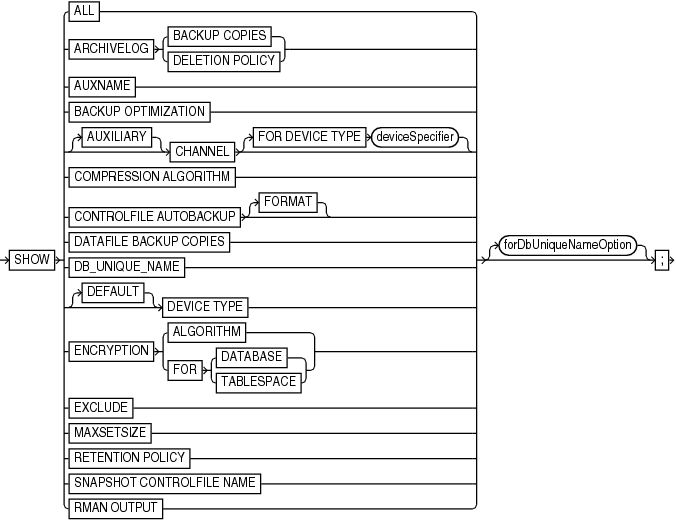

Purpose

Use the `SHOW` command to display the `CONFIGURE` commands used to set the current RMAN configuration for one or more databases. RMAN default configurations are suffixed with `#default`.

Prerequisites

Execute this command only at the RMAN prompt. Either of the following conditions must be met:

- RMAN must be connected to a target database, which must be mounted or open.
- RMAN must be connected to a recovery catalog and `SET` `DBID` must have been run.

Syntax

show::=



> SHOW {ALL | ARCHIVELOG {BACKUP COPIES | DELETION POLICY} | AUXNAME | BACKUP OPTIMIZATION | \[AUXILIARY\] CHANNEL \[FOR DEVICE TYPE deviceSpecifier\] | COMPRESSION ALGORITHM | CONTROLFILE AUTOBACKUP \[FORMAT\] | DATAFILE BACKUP COPIES | DB\_UNIQUE\_NAME | \[DEFAULT\] DEVICE TYPE | ENCRYPTION {ALGORITHM | FOR {DATABASE | TABLESPACE}} | EXCLUDE | MAXSETSIZE | RETENTION POLICY | SNAPSHOT CONTROLFILE NAME | RMAN OUTPUT} \[forDbUniqueNameOption\]


([deviceSpecifier::=](deviceSpecifier.md))

forDbUniqueNameOption::=


> FOR {DB\_UNIQUE\_NAME ALL | DB\_UNIQUE\_NAME \['\] db\_unique\_name \['\]}
>
> [  
> Copyright © 2023, 2024, Oracle and/or its affiliates.](https://docs.oracle.com/en/database/oracle/oracle-database/dcommon/html/cpyr.htm)


Semantics

| Syntax Element | Description |
| --- | --- |
| `ALL` | Shows all user-entered `CONFIGURE` commands and default configurations. |
| `ARCHIVELOG BACKUP COPIES` | Shows the currently configured degree of duplexing for archived redo log backups. |
| `ARCHIVELOG DELETION POLICY` | Shows the `CONFIGURE` `ARCHIVELOG DELETION POLICY` setting. |
| `AUXNAME` | Shows the `CONFIGURE AUXNAME` settings. |
| `BACKUP OPTIMIZATION` | Shows the `CONFIGURE BACKUP OPTIMIZATION` settings: `ON` or `OFF` (default). |
| `[AUXILIARY] CHANNEL` | Shows the `CONFIGURE CHANNEL` settings. You can specify a normal channel or an `AUXILIARY` channel. |
| `   FOR DEVICE TYPE` `deviceSpecifier` | Specifies the device type of the channel. For example, `SHOW CHANNEL FOR DEVICE TYPE DISK` shows only channel settings for disk channels. |
| `COMPRESSION ALGORITHM` | Shows the configured backup compression algorithm. |
| `CONTROLFILE AUTOBACKUP` | Shows the `CONFIGURE CONTROLFILE AUTOBACKUP` settings: `ON` or `OFF`. |
| `   FORMAT` | Shows the format for the control file autobackup file for configured devices. |
| `DATAFILE BACKUP COPIES` | Shows the `CONFIGURE ... BACKUP COPIES` setting for data files: `1`, `2`, `3`, or `4`. |
| `DB_UNIQUE_NAME` | Shows the `DB_UNIQUE_NAME` values known to the recovery catalog. |
| `[DEFAULT] DEVICE TYPE` | Shows the configured device types and parallelism settings. If `DEFAULT` is specified, then `SHOW` displays the default device type and settings. |
| `ENCRYPTION` | Shows currently configured encryption settings for the database or tablespaces within the database, when used with `ALGORITHM` or `FOR {DATABASE \| TABLESPACE}`. |
| `   ALGORITHM` | Shows the configured default algorithm to use for encryption when writing encrypted backup sets. Possible values are listed in `V$RMAN_ENCRYPTION_ALGORITHMS`. |
| `   FOR DATABASE` | Shows current encryption settings for the database. |
| `   FOR TABLESPACE` | Shows current encryption settings for each tablespace. |
| `EXCLUDE` | Shows only the tablespaces that you excluded. |
| `MAXSETSIZE` | Shows the `CONFIGURE MAXSETSIZE` settings. |
| `RETENTION POLICY` | Shows the settings for `CONFIGURE RETENTION POLICY` for the current target database. |
| `SNAPSHOT CONTROLFILE NAME` | Shows the `CONFIGURE SNAPSHOT CONTROLFILE` settings. |
| `forDbUniqueNameOption` | Shows the configuration in the recovery catalog for a uniquely named database even when RMAN is not connected to this database as `TARGET`. You can specify a database with `db_unique_name` or use `ALL` for all uniquely named databases.  The unique name for a database is the value of its `DB_UNIQUE_NAME` initialization parameter setting. The `FOR DB_UNIQUE_NAME` clause is useful for showing the configurations of standby databases in a Data Guard environment.  RMAN must be connected to a recovery catalog. RMAN must be connected to a mounted target database or you must identify the target database with `SET` `DBID`. For example, you could run `SET DBID` with the DBID of the target database and then show the configuration for all standby databases known to the recovery catalog (see [Example 2-57](CONFIGURE.md)).  See Also: `forDbUniqueNameOption` for descriptions of the options in this clause |
| `RMAN OUTPUT` | Shows the currently configured value for RMAN output logging. |

Examples

Example 3-64 Showing All Configurations for a Target Database

Assume that you want to know all persistent RMAN configurations for a target database. You start the RMAN client, `CONNECT` to the target database and recovery catalog, and run the `SHOW` command as follows (sample output included):

```
RMAN> SHOW ALL;
 
RMAN configuration parameters for database with db_unique_name PROD1 are:
CONFIGURE RETENTION POLICY TO REDUNDANCY 1; # default
CONFIGURE BACKUP OPTIMIZATION OFF; # default
CONFIGURE DEFAULT DEVICE TYPE TO DISK; # default
CONFIGURE CONTROLFILE AUTOBACKUP ON;
CONFIGURE CONTROLFILE AUTOBACKUP FORMAT FOR DEVICE TYPE DISK TO '/disk1/oracle/dbs/%F';
CONFIGURE CONTROLFILE AUTOBACKUP FORMAT FOR DEVICE TYPE SBT_TAPE TO '%F'; # defa ult
CONFIGURE DEVICE TYPE DISK PARALLELISM 1 BACKUP TYPE TO BACKUPSET; # default
CONFIGURE DEVICE TYPE SBT_TAPE PARALLELISM 1 BACKUP TYPE TO BACKUPSET; # default
CONFIGURE DATAFILE BACKUP COPIES FOR DEVICE TYPE DISK TO 1; # default
CONFIGURE DATAFILE BACKUP COPIES FOR DEVICE TYPE SBT_TAPE TO 1; # default
CONFIGURE ARCHIVELOG BACKUP COPIES FOR DEVICE TYPE DISK TO 1; # default
CONFIGURE ARCHIVELOG BACKUP COPIES FOR DEVICE TYPE SBT_TAPE TO 1; # default
CONFIGURE CHANNEL DEVICE TYPE 'SBT_TAPE' 
  PARMS "SBT_LIBRARY=/usr/local/oracle/backup/lib/libobk.so";
CONFIGURE MAXSETSIZE TO UNLIMITED; # default
CONFIGURE ENCRYPTION FOR DATABASE ON;
CONFIGURE ENCRYPTION ALGORITHM 'AES128'; # default
CONFIGURE COMPRESSION ALGORITHM 'BASIC' AS OF RELEASE 'DEFAULT' OPTIMIZE FOR LOAD TRUE ; 
  # default
CONFIGURE RMAN OUTPUT TO KEEP FOR 7 DAYS; # default
CONFIGURE ARCHIVELOG DELETION POLICY TO NONE; # default
CONFIGURE SNAPSHOT CONTROLFILE NAME TO '/disk1/oracle/dbs/cf_snap .f'
```