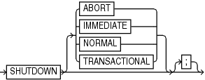

Purpose

Use the `SHUTDOWN` command to shut down the target database without exiting RMAN. This command is equivalent to the SQL\*Plus `SHUTDOWN` statement.

See Also:

[Oracle Database Administrator’s Guide](https://docs.oracle.com/pls/topic/lookup?ctx=en/database/oracle/oracle-database/21/rcmrf&id=ADMIN-GUID-045DE684-6680-4099-A49E-2F5B5FA59670) for information on how to start and shut down a database, and [SQL\*Plus User's Guide and Reference](https://docs.oracle.com/pls/topic/lookup?ctx=en/database/oracle/oracle-database/21/rcmrf&id=SQPUG-GUID-4A4A331C-3974-491D-96EA-933A63E05448) for `SHUTDOWN` syntax

Usage Notes

You cannot use the RMAN `SHUTDOWN` command to shut down the recovery catalog database. To shut down this database, start a SQL\*Plus session and issue a `SHUTDOWN` statement.

If the database operates in `NOARCHIVELOG` mode, then you must shut down the database cleanly and then issue a `STARTUP` `MOUNT` before a making a backup.

Syntax

shutdown::=



> SHUTDOWN \[ ABORT | IMMEDIATE | NORMAL | TRANSACTIONAL \]
>
> [  
> Copyright © 2023, 2024, Oracle and/or its affiliates.](https://docs.oracle.com/en/database/oracle/oracle-database/dcommon/html/cpyr.htm)


Semantics

| Syntax Element | Description |
| --- | --- |
| `ABORT` | Performs an inconsistent shutdown of the target instance, with the following consequences:  - All current client SQL statements are immediately terminated. - Uncommitted transactions are not rolled back until next startup. - All connected users are disconnected. - Instance recovery is performed on the database at next startup. |
| `IMMEDIATE` | Performs an immediate, consistent shutdown of the target database, with the following consequences:  - Current client SQL statements being processed by the database are allowed to complete. - Uncommitted transactions are rolled back. - All connected users are disconnected. |
| `NORMAL` | Performs a consistent shutdown of the target database with normal priority (default option), which means:  - No new connections are allowed after the statement is issued. - Before shutting down, the database waits for currently connected users to disconnect - The next startup of the database does not require instance recovery. |
| `TRANSACTIONAL` | Performs a consistent shut down of the target database while minimizing interruption to clients, with the following consequences:  - Clients currently conducting transactions are allowed to complete, that is, either commit or terminate before shutdown. - No client can start a new transaction on this instance; any client attempting to start a new transaction is disconnected. - After all transactions have either committed or terminated, any client still connected is disconnected. |

Examples

Example 3-65 Shutting Down a Database with the Immediate Option

This example waits for current SQL transactions to be processed before shutting down, then mounts the database:

```
SHUTDOWN IMMEDIATE;
STARTUP MOUNT;
```

Example 3-66 Shutting Down a Database in NOARCHIVELOG Mode

This example backs up a database running in `NOARCHIVELOG` mode:

```
STARTUP FORCE DBA;
SHUTDOWN IMMEDIATE;
STARTUP MOUNT;
# executing the preceding commands ensures that database is in proper state 
# for NOARCHIVELOG backups
BACKUP DATABASE;
ALTER DATABASE OPEN;
```