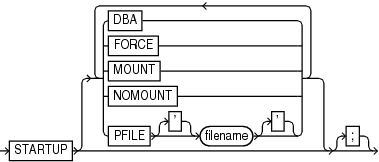

Purpose

Use the `STARTUP` command to start the target database from within the RMAN environment. This command is equivalent to using the SQL\*Plus `STARTUP` command.

Additionally, the RMAN `STARTUP` command can start an instance in `NOMOUNT` mode even if no server parameter file or initialization parameter file exists. This feature is useful when you must restore a lost server parameter file.

See Also:

[Oracle Database Administrator's Guide](https://docs.oracle.com/pls/topic/lookup?ctx=en/database/oracle/oracle-database/21/rcmrf&id=ADMIN-GUID-045DE684-6680-4099-A49E-2F5B5FA59670) to learn how to start and shut down a database, and [SQL\*Plus User's Guide and Reference](https://docs.oracle.com/pls/topic/lookup?ctx=en/database/oracle/oracle-database/21/rcmrf&id=SQPUG-GUID-275013B7-CAE2-4619-9A0F-40DB71B61FE8) for SQL\*Plus `STARTUP` syntax

Prerequisites

RMAN must be connected to a target database. You can only use this command to start the target database.

Usage Notes

The RMAN `STARTUP` command can start an instance in `NOMOUNT` mode even if no server parameter file or initialization parameter file exists. This feature is useful when you must restore a lost server parameter file (see Example 3-74).

Syntax

startup::=



> STARTUP \[ DBA | FORCE | MOUNT | NOMOUNT | { PFILE \[‘\] filename \[‘\] } \]
>
> [  
> Copyright © 2023, 2024, Oracle and/or its affiliates.](https://docs.oracle.com/en/database/oracle/oracle-database/dcommon/html/cpyr.htm)


Semantics

| Syntax Element | Description |
| --- | --- |
| `STARTUP` | If you specify only `STARTUP` with no other options, then the instance starts the instance with the default server parameter file, mounts the control file, and opens the database. |
| `   DBA` | Restricts access to users with the `RESTRICTED SESSION` privilege. |
| `   FORCE` | If the database is open, then `FORCE` shuts down the database with a `SHUTDOWN` `ABORT` statement before re-opening it. If the database is closed, then `FORCE` opens the database. |
| `   MOUNT` | Starts the instance, then mounts the database without opening it |
| `   NOMOUNT` | Starts the instance without mounting the database. If no parameter file exists, then RMAN starts the instance with a temporary parameter file. You can then run `RESTORE` `SPFILE` to restore a backup server parameter file. |
| `   PFILE` `filename` | Specifies the file name of the text-based initialization parameter file for the target database. If `PFILE` is not specified, then the default initialization parameter file name is used. |

Examples

Example 3-73 Mounting the Database While Specifying the Parameter File

This example forces a `SHUTDOWN ABORT` and then mounts the database with restricted access, specifying a nondefault initialization parameter file location:

```
CONNECT TARGET /
STARTUP FORCE MOUNT DBA PFILE=/tmp/initPROD.ora;
```

Example 3-74 Starting an Instance Without a Parameter File

Assume that the server parameter file was accidentally deleted from the file system. The following example starts an instance without using a parameter file, then runs `RESTORE` `SPFILE FROM AUTOBACKUP`. In this example, the autobackup location is the fast recovery area, so `SET DBID` is not necessary.

```
CONNECT TARGET /
STARTUP FORCE NOMOUNT; # RMAN starts instance with dummy parameter file
RESTORE SPFILE TO '?/dbs/spfileprod.ora'
  FROM AUTOBACKUP
  RECOVERY AREA '/disk2' DB_NAME='prod';
STARTUP FORCE; # restart instance with restored server parameter file
```