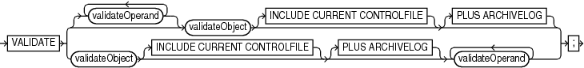
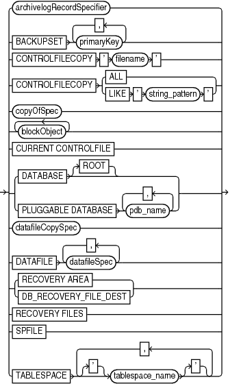
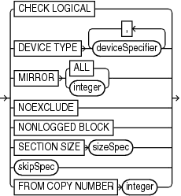

Purpose

Use the `VALIDATE` command to check for corrupt blocks and missing files, or to determine whether a backup set can be restored.

If `VALIDATE` detects a problem during validation, then RMAN displays it and triggers execution of a failure assessment. If a failure is detected, then RMAN logs it into the Automated Diagnostic Repository. You can use `LIST` `FAILURE` to view the failures.

Note:

Starting in Oracle Database 19c, the Data Recovery Advisor (DRA) feature is deprecated.

The deprecation of DRA includes deprecation of the following Oracle Recovery Manager (RMAN) commands: `LIST FAILURE`, `ADVISE FAILURE`, `REPAIR                     FAILURE`, and `CHANGE FAILURE`. Database administrators will no longer have access to these commands. There is no replacement feature for DRA.

Prerequisites

The target database must be mounted or open.

Usage Notes

The options in the `VALIDATE` command are semantically equivalent to options in the `BACKUP` `VALIDATE` command. Unlike `BACKUP VALIDATE`, however, `VALIDATE` can check individual backup sets and data blocks.

The `VALIDATE` command does not skip any blocks during validation. If RMAN does not read a block because of unused block compression, and if the block is corrupt, then RMAN does not detect the corruption. A corrupt unused block is not harmful.

In a physical corruption, the database does not recognize the block at all. In a logical corruption, the contents of the block are logically inconsistent. By default, the `VALIDATE` command checks for physical corruption only. You can specify `CHECK LOGICAL` to check for logical corruption as well. RMAN populates the `V$DATABASE_BLOCK_CORRUPTION` view with its findings.

Block corruptions can be divided into interblock corruption and intrablock corruption. In intrablock corruption, the corruption occurs within the block itself and can be either physical or logical corruption. In interblock corruption, the corruption occurs between blocks and can only be logical corruption. The `VALIDATE` command checks for intrablock corruptions only.

Syntax

validate::=



> VALIDATE {\[ {validateOperand}...\] validateObject \[INCLUDE CURRENT CONTROLFILE\] \[PLUS ARCHIVELOG\] | validateObject \[INCLUDE CURRENT CONTROLFILE\] \[PLUS ARCHIVELOG\] validateOperand \[validateOperand\]...}
>
> [  
> Copyright © 2023, 2024, Oracle and/or its affiliates.](https://docs.oracle.com/en/database/oracle/oracle-database/dcommon/html/cpyr.htm)


(validateObject::=, validateOperand::=)

validateObject::=



> archivelogRecordSpecifier | BACKUPSET primaryKey \[, primaryKey\]... | CONTROLFILECOPY ' filename ' | CONTROLFILECOPY {ALL | LIKE ' string\_pattern '} | copyOfSpec | blockObject \[blockObject\]... | CURRENT CONTROLFILE | {DATABASE \[ROOT\] | PLUGGABLE DATABASE pdb\_name \[, pdb\_name\]...} | datafileCopySpec | DATAFILE datafileSpec \[, datafileSpec\]... | {RECOVERY AREA | DB\_RECOVERY\_FILE\_DEST} | RECOVERY FILES | SPFILE | TABLESPACE \['\] tablespace\_name \['\] \[, \['\] tablespace\_name \['\]\]...


([archivelogRecordSpecifier::=](archivelogRecordSpecifier.md), [copyOfSpec::=](BACKUP.md), [blockObject::=](RECOVER.md), [datafileCopySpec::=](BACKUP.md), [datafileSpec::=](datafileSpec.md))

copyOfSpec::=


> COPY OF { {DATABASE \[ROOT\] | PLUGGABLE DATABASE pdb\_name \[, pdb\_name\]...} | DATAFILE datafileSpec \[, datafileSpec\]... | TABLESPACE \['\] tablespace\_name \['\] \[, \['\] tablespace\_name \['\]\]...}
>
> [  
> Copyright © 2023, 2024, Oracle and/or its affiliates.](https://docs.oracle.com/en/database/oracle/oracle-database/dcommon/html/cpyr.htm)


([datafileSpec::=](datafileSpec.md))

blockObject::=


> CORRUPTION LIST | DATAFILE datafileSpec BLOCK integer \[TO integer\] \[, integer \[TO integer\]\]... | TABLESPACE \[pdb\_name:\] \['\] tablespace\_name \['\] DBA integer \[, integer\]...
>
> [  
> Copyright © 2023, 2024, Oracle and/or its affiliates.](https://docs.oracle.com/en/database/oracle/oracle-database/dcommon/html/cpyr.htm)


([datafileSpec::=](datafileSpec.md))

validateOperand::=



> CHECK LOGICAL | DEVICE TYPE deviceSpecifier \[, deviceSpecifier\]... | MIRROR {ALL | integer} | NOEXCLUDE | NONLOGGED BLOCK | SECTION SIZE sizeSpec | skipSpec | FROM COPY NUMBER integer
>
> [  
> Copyright © 2023, 2024, Oracle and/or its affiliates.](https://docs.oracle.com/en/database/oracle/oracle-database/dcommon/html/cpyr.htm)


([deviceSpecifier::=](deviceSpecifier.md), [sizeSpec::=](sizeSpec.md), skipSpec::=)

skipSpec::=


> SKIP {INACCESSIBLE | OFFLINE | READONLY}
>
> [  
> Copyright © 2023, 2024, Oracle and/or its affiliates.](https://docs.oracle.com/en/database/oracle/oracle-database/dcommon/html/cpyr.htm)


Semantics

validate

This subclause specifies backup sets for validation. Refer to validate::= for syntax.

| Syntax Element | Description |
| --- | --- |
| `validateOperand` | Specifies options that control the validation.  See Also: `validateOperand` |
| `validateObject` | Specifies the files to be validated.  See Also: `validateObject` |
| `  INCLUDE CURRENT` `   CONTROLFILE` | Creates a snapshot of the current control file and validates it. |
| `   PLUS ARCHIVELOG` | Includes archived redo log files in the validation. Causes RMAN to perform the following steps:  1. Run an `ALTER SYSTEM ARCHIVE LOG CURRENT` statement. 2. Run the `VALIDATE ARCHIVELOG ALL` command. If backup optimization is enabled, then RMAN only validates logs that have not yet been backed up. 3. Validate the files specified in the `VALIDATE` command. 4. Run an `ALTER SYSTEM ARCHIVE LOG CURRENT` statement. 5. Validate any remaining archived redo log files. |

validateObject

This subclause specifies database files for validation. Refer to validateObject::= for syntax.

| Syntax Element | Description |
| --- | --- |
| `archivelogRecordSpecifier` | Validates a range of archived redo log files. `VALIDATE ARCHIVELOG` is equivalent to `BACKUP VALIDATE ARCHIVELOG`. |
| `BACKUPSET` `primary_key` | Checks that the backup sets specified by `primary_key` exist and can be restored.  You can obtain the primary keys of backup sets by executing a `LIST` statement or, if you use a recovery catalog, by querying the `RC_BACKUP_SET` recovery catalog view.  The `VALIDATE BACKUPSET` command checks every block in the backup set to ensure that the backup is restorable. If RMAN finds block corruption, then it issues an error and terminates the validation. In contrast, the `CROSSCHECK` command examines the headers of the specified files if they are on disk or queries the media management catalog if they are on tape.  Use `VALIDATE BACKUPSET` when you suspect that one or more backup pieces in a backup set are missing or have been damaged. `VALIDATE BACKUPSET` selects which backups to test, whereas the `VALIDATE` option of the `RESTORE` command lets RMAN choose which backups to validate. For validating image copies, run `RESTORE VALIDATE FROM DATAFILECOPY`.  If you do not have automatic channels configured, then manually allocate at least one channel before executing `VALIDATE BACKUPSET`.  Note: If multiple copies of a backup set exist, then RMAN validates only the most recent copy. The `VALIDATE` command does not support an option to validate a specific copy. If one copy is on a different device from another copy, however, then you can use `VALIDATE DEVICE TYPE` to validate the copy on the specified device. If both copies exists on the same device, then you can use `CHANGE` to make one copy temporarily `UNAVAILABLE` and then reissue `VALIDATE`. |
| `CONTROLFILECOPY` `{'` `filename` `' \| ALL \|` `LIKE '` `string_pattern` `'}` | Validates control file copies. You can specify a control file copy in one of the following ways:  - `'` `filename` `'` specifies a control file copy by file name. - `ALL` specifies all control file copies. - `LIKE` `'` `pattern` `'` specifies a file name pattern that matches one or more control file copies. The percent sign (`%`) is a wildcard matching zero or more characters; an underscore (`_`) is a wildcard matching one character.  The control file copy can be created with the `BACKUP` `AS COPY CURRENT CONTROLFILE` command or the SQL statement `ALTER DATABASE BACKUP CONTROLFILE TO '...'`. |
| `copyOfSpec` | Validates image copies of data files and control files.  See Also: `copyOfSpec` for details. |
| `CURRENT CONTROLFILE` | Validates the current control file. |
| `DATABASE` | Validates the whole CDB. Connect to the root as a common user with the `SYSDBA` or `SYSBACKUP` privilege.  When connected to a pluggable database (PDB), validates the PDB.  RMAN validates all data files and control files. If the database is currently using a server parameter file, then RMAN validates the server parameter file.  Note: The online redo log files and temp files are not validated. |
| `DATABASE ROOT` | Validates only the CDB root. |
| `PLUGGABLE DATABASE` `pdb_name` | In a CDB, validates the specified PDBs. Use a comma-delimited list to specify multiple PDBs. Connect to the root as a common user or local user with the `SYSDBA` or `SYSBACKUP` privilege. |
| `datafileCopySpec` | Validates one or more data file image copies.  When validating data file copies, RMAN checks for block corruption but does not terminate the validation if corruption is discovered. Unlike `VALIDATE BACKUPSET`, RMAN proceeds and reports the number of blocks that are corrupted.  See Also: `datafileCopySpec` for details |
| `DATAFILE` `datafileSpec` | Specifies a list of one or more data files that contain blocks requiring validation.  Note: You do not have to take a data file offline if you are validating it.  See Also: `datafileSpec` |
| `RECOVERY AREA` | Validates recovery files created in the current and all previous fast recovery area destinations. Recovery files are full and incremental backup sets, control file autobackups, archived redo log files, and data file copies. Flashback logs, the current control file, and online redo logs are not validated. |
| `DB_RECOVERY_FILE_DEST` | Semantically equivalent to `RECOVERY AREA`. |
| `RECOVERY FILES` | Validates all recovery files on disk, whether they are stored in the fast recovery area or other locations on disk. Recovery files include full and incremental backup sets, control file autobackups, archived redo log files, and data file copies. Flashback logs are not validated. |
| `SPFILE` | Validates the server parameter file currently used by the database. RMAN cannot validates other copies of the server parameter file, and cannot validate the server parameter file when the instance was started with an initialization parameter file. |
| `TABLESPACE` `tablespace_name` | Validates the specified tablespaces. RMAN translates tablespace names internally into a list of data files, then validates all data files that are currently part of the tablespaces. RMAN validates all data files that are currently members of the specified tablespaces.  When connected to the root in a CDB, refers to tablespaces in the root. Refers to tablespaces in a PDB when connected directly to a PDB. |

validateOperand

This subclause specifies modifiers for the validation. Refer to validateOperand::= for syntax.

| Syntax Element | Description |
| --- | --- |
| `CHECK LOGICAL` | Tests data and index blocks in the files that pass physical corruption checks for logical corruption, for example, corruption of a row piece or index entry. If RMAN finds logical corruption, then it logs the block in the alert log and server session trace file. The RMAN command completes and `V$DATABASE_BLOCK_CORRUPTION` is populated with corrupt block ranges.  Note: `VALIDATE` does not use `MAXCORRUPT`. |
| `DEVICE TYPE` `deviceSpecifier` | Allocates automatic channels for the specified device type only. This option is valid only if you have configured automatic channels and have not manually allocated channels. For example, if you configure automatic disk and tape channels, and run `VALIDATE ...DEVICE TYPE DISK`, RMAN allocates only disk channels.  See Also: `deviceSpecifier` |
| `MIRROR` `ALL\|` `integer` | Validates data files on the specified mirrors.  Use the `MIRROR ALL` option to validate the specified data file on all mirrors. The number of mirrors depends on the maximum number of mirrors supported by the storage system.  Use `MIRROR` `integer` to validate a data file on the specified mirror. The following example validates all blocks of data file 1 in mirror 2 only:  ``` VALIDATE DATAFILE 1 MIRROR 2; ``` |
| `NOEXCLUDE` | When specified on a `VALIDATE DATABASE` or `VALIDATE COPY OF DATABASE` command, RMAN validates all tablespaces, including any for which a `CONFIGURE EXCLUDE` command has been entered. This option does not override `SKIP OFFLINE` or `SKIP READONLY`. |
| `NONLOGGED BLOCK` | Checks whether the entries in `V$NONLOGGED_BLOCK` correspond to the current incarnation of the file to which they belong. If they do not, then the ranges are removed and the entire file is scanned to identify the actual ranges. Otherwise RMAN just scans the blocks identified by the existing `V$NONLOGGED_BLOCK` entries to confirm if they are still invalid and makes required adjustments.  This clause can be used only for a primary database that is mounted or a physical standby database that is mounted or open read-only. Because validation does not correct the object number associated with the entries in `V$NONLOGGED_BLOCK`, standby databases may report nonlogged blocks for objects that have been dropped even after running the `VALIDATE` command.  The results of the validation are displayed in the RMAN output and also stored in the `V$NONLOGGED_BLOCK` view. The details include the data file number validated, the number of nonlogged blocks remaining after the validation, number of blocks skipped, and the status of the validation operation. The trace file contains additional information about any validation failures. |
| `SECTION SIZE ` `sizeSpec` | Parallelizes the validation by dividing each file into the specified section size.  Only specify this parameter when multiple channels are configured or allocated and you want the channels to parallelize the validation, so that multiple channels can validate a single data file. This parameter applies only when validating data files.  If you specify a section size that is larger than the size of the file, then RMAN does not parallelize validation for the file. If you specify a small section size that would produce more than 256 sections, then RMAN increases the section size to a value that results in exactly 256 sections.  See Also: `BACKUP` `SECTION SIZE` to learn how to make multisection backups |
| `skipSpec` | Excludes the specified files from the validation. |
| `FROM COPY NUMBER integer` | Specifies a copy number of the backup piece that will be validated. If the backup was duplexed, then the copy number value ranges from `2` to `4`. If no duplexing was performed, then the copy number is `1`. |

skipSpec

This subclause specifies files to be excluded from the validation.

| Syntax Element | Description |
| --- | --- |
| `SKIP` | Excludes data files or archived redo log files if they are inaccessible, offline, or read-only. |
| `   INACCESSIBLE` | Excludes data files and archived redo log files that cannot be read due to I/O errors.  A data file is only considered inaccessible if it cannot be read. Some offline data files can still be read because they still exist on disk. Others have been deleted or moved and so cannot be read, making them inaccessible. |
| `   OFFLINE` | Excludes offline data files. |
| `   READONLY` | Excludes read-only data files. |

VALIDATE Command Output

Table 3-11 List of Data Files

| Column | Indicates |
| --- | --- |
| `File` | Absolute number of the data file being validated. |
| `Status` | `OK` if no corruption, or `FAILED` if block corruption is found. |
| `Marked Corrupt` | Number of blocks marked corrupt. These blocks were previously marked corrupt by the database. For example, the database may intentionally mark blocks corrupt during a recovery involving a `NOLOGGING` operation. Also, an RMAN backup may contain corrupt blocks permitted by the `SET MAXCORRUPT` command. When this backup is restored, the file contains blocks that are marked corrupt. |
| `Empty Blocks` | Number of blocks that either have never been used. |
| `Blocks Examined` | Total number of blocks in the file. |
| `High SCN` | The highest SCN recorded in the file. |
| `File Name` | The name of the file being validated. |
| `Block Type` | The type of block validated: `Data`, `Index`, or `Other`. |
| `Blocks Failing` | The number of blocks that fail the corruption check. These blocks are newly corrupt. |
| `Blocks Processed` | The number of blocks checked for corruption. |

Table 3-12 List of Control File and SPFILE

| Column | Indicates |
| --- | --- |
| `File TYPE` | Type of file: `SPFILE` or `Control File`. |
| `Status` | `OK` if no corruption, or `FAILED` if block corruption is found. |
| `Blocks Failing` | The number of blocks that fail the corruption check. These blocks are newly corrupt. |
| `Blocks Examined` | Total number of blocks in the file. |

Table 3-13 List of Archived Logs

| Column | Indicates |
| --- | --- |
| `Thrd` | The redo thread number. |
| `Seq` | The log sequence number. |
| `Status` | `OK` if no corruption, or `FAILED` if block corruption is found. |
| `Blocks Failing` | The number of blocks that fail the corruption check. These blocks are newly corrupt. |
| `Blocks Examined` | Total number of blocks in the file. |
| `Name` | The name of the archived redo log file. |

Examples

Example 3-85 Validating a Backup Set

This example lists all available backup sets and then validates them. As the sample output indicates, RMAN confirms that it is possible to restore the backups.

```
RMAN> LIST BACKUP SUMMARY; 
 
List of Backups
===============
Key     TY LV S Device Type Completion Time #Pieces #Copies Compressed Tag
------- -- -- - ----------- --------------- ------- ------- ---------- ---
3871    B  F  A DISK        08-MAR-13       1       1       NO         TAG20130308T092426
3890    B  F  A DISK        08-MAR-13       1       1       NO         TAG20130308T092534
```
```
RMAN> VALIDATE BACKUPSET 3871, 3890;
```
```
Starting validate at 08-MAR-13
using channel ORA_DISK_1
channel ORA_DISK_1: starting validation of datafile backup set
channel ORA_DISK_1: reading from backup piece
 /disk2/PROD/backupset/2013_03_08/o1_mf_nnndf_TAG20130308T092 426_2z0kpc72_.bkp
channel ORA_DISK_1: piece
 handle=/disk2/PROD/backupset/2013_03_08/o1_mf_nnndf_TAG20130308T092426_2z0kpc72_.bkp ta
 g=TAG20130308T092426
channel ORA_DISK_1: restored backup piece 1
channel ORA_DISK_1: validation complete, elapsed time: 00:00:18
channel ORA_DISK_1: starting validation of datafile backup set
channel ORA_DISK_1: reading from backup piece
 /disk2/PROD/autobackup/2013_03_08/o1_mf_s_616670734_2z0krhjv_.bkp
channel ORA_DISK_1: piece
 handle=/disk2/PROD/autobackup/2013_03_08/o1_mf_s_616670734_2z0krhjv_.bkp
 tag=TAG20130308T092534
channel ORA_DISK_1: restored backup piece 1
channel ORA_DISK_1: validation complete, elapsed time: 00:00:00
Finished validate at 08-MAR-13
```

Example 3-86 Validating the Database

This example validates the database and includes sample output. The validation finds one corrupt block in data file `1`. The `VALIDATE` output indicates that more information about the corruption can be found in the specified trace file.

```
RMAN> VALIDATE DATABASE;

Starting validate at 26-FEB-13
using channel ORA_DISK_1
channel ORA_DISK_1: starting validation of datafile
channel ORA_DISK_1: specifying datafile(s) for validation
input datafile file number=00001 name=/disk1/oradata/prod/system01.dbf
input datafile file number=00002 name=/disk1/oradata/prod/sysaux01.dbf
input datafile file number=00003 name=/disk1/oradata/prod/undotbs01.dbf
input datafile file number=00004 name=/disk1/oradata/prod/cwmlite01.dbf
input datafile file number=00005 name=/disk1/oradata/prod/drsys01.dbf
input datafile file number=00006 name=/disk1/oradata/prod/example01.dbf
input datafile file number=00007 name=/disk1/oradata/prod/indx01.dbf
input datafile file number=00008 name=/disk1/oradata/prod/tools01.dbf
input datafile file number=00009 name=/disk1/oradata/prod/users01.dbf
channel ORA_DISK_1: validation complete, elapsed time: 00:01:25
List of Datafiles
=================
File Status Marked Corrupt Empty Blocks Blocks Examined High SCN
---- ------ -------------- ------------ --------------- ----------
1    FAILED 0              4140         57600           498288
  File Name: /disk1/oradata/prod/system01.dbf
  Block Type Blocks Failing Blocks Processed
  ---------- -------------- ----------------
  Data       1              41508
  Index      0              7653
  Other      0              4299
 
File Status Marked Corrupt Empty Blocks Blocks Examined High SCN
---- ------ -------------- ------------ --------------- ----------
2    OK     0              8918         20040           498237
  File Name: /disk1/oradata/prod/sysaux01.dbf
  Block Type Blocks Failing Blocks Processed
  ---------- -------------- ----------------
  Data       0              2473
  Index      0              2178
  Other      0              6471
 
File Status Marked Corrupt Empty Blocks Blocks Examined High SCN
---- ------ -------------- ------------ --------------- ----------
3    OK     0              36           2560            498293
  File Name: /disk1/oradata/prod/undotbs01.dbf
  Block Type Blocks Failing Blocks Processed
  ---------- -------------- ----------------
  Data       0              0
  Index      0              0
  Other      0              2524
 
File Status Marked Corrupt Empty Blocks Blocks Examined High SCN
---- ------ -------------- ------------ --------------- ----------
4    OK     0              1            1280            393585
  File Name: /disk1/oradata/prod/cwmlite01.dbf
  Block Type Blocks Failing Blocks Processed
  ---------- -------------- ----------------
  Data       0              0
  Index      0              0
  Other      0              1279
 
File Status Marked Corrupt Empty Blocks Blocks Examined High SCN
---- ------ -------------- ------------ --------------- ----------
5    OK     0              1            1280            393644
  File Name: /disk1/oradata/prod/drsys01.dbf
  Block Type Blocks Failing Blocks Processed
  ---------- -------------- ----------------
  Data       0              0
  Index      0              0
  Other      0              1279
 
File Status Marked Corrupt Empty Blocks Blocks Examined High SCN
---- ------ -------------- ------------ --------------- ----------
6    OK     0              1            1280            393690
  File Name: /disk1/oradata/prod/example01.dbf
  Block Type Blocks Failing Blocks Processed
  ---------- -------------- ----------------
  Data       0              0
  Index      0              0
  Other      0              1279
 
File Status Marked Corrupt Empty Blocks Blocks Examined High SCN
---- ------ -------------- ------------ --------------- ----------
7    OK     0              1            1280            393722
  File Name: /disk1/oradata/prod/indx01.dbf
  Block Type Blocks Failing Blocks Processed
  ---------- -------------- ----------------
  Data       0              0
  Index      0              0
  Other      0              1279
 
File Status Marked Corrupt Empty Blocks Blocks Examined High SCN
---- ------ -------------- ------------ --------------- ----------
8    OK     0              1            1280            393754
  File Name: /disk1/oradata/prod/tools01.dbf
  Block Type Blocks Failing Blocks Processed
  ---------- -------------- ----------------
  Data       0              0
  Index      0              0
  Other      0              1279
 
File Status Marked Corrupt Empty Blocks Blocks Examined High SCN
---- ------ -------------- ------------ --------------- ----------
9    OK     0              1272         1280            393785
  File Name: /disk1/oradata/prod/users01.dbf
  Block Type Blocks Failing Blocks Processed
  ---------- -------------- ----------------
  Data       0              0
  Index      0              0
  Other      0              8
 
validate found one or more corrupt blocks
See trace file /disk2/oracle/log/diag/rdbms/prod/prod/trace/prod_ora_10609.trc for details
channel ORA_DISK_1: starting validation of datafile
channel ORA_DISK_1: specifying datafile(s) for validation
including current control file for validation
including current SPFILE in backup set
channel ORA_DISK_1: validation complete, elapsed time: 00:00:01
List of Control File and SPFILE
===============================
File Type    Status Blocks Failing Blocks Examined
------------ ------ -------------- ---------------
SPFILE       OK     0              2
Control File OK     0              506
Finished validate at 26-FEB-13
```