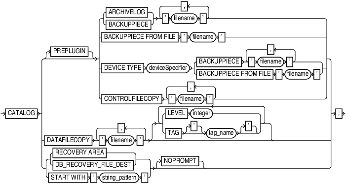

### 1.1 RMAN Syntax Diagrams

Syntax descriptions are provided in this book for RMAN command-line constructs in graphic form or Backus Naur Form (BNF).

This section explains RMAN conventions exclusively. See [Oracle Database SQL Language Reference](https://docs.oracle.com/pls/topic/lookup?ctx=en/database/oracle/oracle-database/21/rcmrf&id=SQLRF018) for general information about how to interpret syntax diagrams and BNF notation.

Recovery Manager syntax diagrams use lines and arrows to show syntactic structure, as shown in the following example for the `CATALOG` command.

catalog::=



> CATALOG {\[PREPLUGIN\] { {ARCHIVELOG | BACKUPPIECE} ' filename ' \[, ' filename '\]... | BACKUPPIECE FROM FILE ' filename ' | DEVICE TYPE deviceSpecifier {BACKUPPIECE ' filename ' \[, ' filename '\]... | BACKUPPIECE FROM FILE ' filename '} | CONTROLFILECOPY ' filename ' \[, ' filename '\]...} | DATAFILECOPY ' filename ' \[, ' filename '\]... \[ { {LEVEL integer | TAG \['\] tag\_name \['\]}}...\] | { {RECOVERY AREA | DB\_RECOVERY\_FILE\_DEST} | START WITH ' string\_pattern '} \[NOPROMPT\]}


This section describes the components of syntax diagrams and gives examples of how to write RMAN commands. Syntax diagrams are made up of these items:

#### 1.1.1 Keywords in RMAN Syntax

Keywords have special meanings in Recovery Manager syntax.

In the syntax diagrams, keywords appear in rectangular boxes and an uppercase font, like the word `CATALOG` in the example diagram. When used in text and code examples, RMAN keywords appear in uppercase, monospace font, for example, `CATALOG` `DATAFILECOPY`. You must use keywords in RMAN statements exactly as they appear in the syntax diagram, except that they can be either uppercase or lowercase.

#### 1.1.2 Placeholders in RMAN Syntax

Placeholders in syntax diagrams indicate non-keywords.

In the syntax diagrams, placeholders appear in ovals, as in the word integer in the example diagram. When described in text, RMAN placeholders appear in lowercase italic, for example, `'` `filename` `'`.

Placeholders are usually:

- Names of database objects (tablespace\_name)
- Oracle data type names (date\_string)
- Subclauses (datafileSpec)

When you see a placeholder in a syntax diagram, substitute an object or expression of the appropriate type in the RMAN statement. For example, to write a `DUPLICATE TARGET DATABASE TO` 'database\_name' command, use the name of the duplicate database you want to create, such as `dupdb`, for the database\_name placeholder in the diagram.

The only system-independent, valid environment variables in RMAN quoted strings are a question mark (`?`) for the Oracle home and an at-sign (`@`) for the SID. However, you can use operating system-specific environment variables on the target system within quoted strings. The environment variables are interpreted by the database server and not the RMAN client.

The following table shows placeholders that appear in the syntax diagrams and provides examples of the values you might substitute for them in your statements.

| Placeholder | Description | Examples |
| --- | --- | --- |
| Quoted strings such as `'` `filename` `'`, `'` `tablespace_name` `'`, `'` `channel_name` `'`, `'` `channel_parms` `'` | A string of characters contained in either single or double quotes. A quoted string may contain white space, punctuation, and RMAN and SQL keywords. | `"?/dbs/cf.f"`  `'dev1'` |
| Nonquoted strings such as `channel_id`, `tag_name`, `date_string` | A sequence of characters containing no white space and no punctuation characters and starting with an alphabetic character. | `ch1` |
| `integer` | Any sequence of only numeric characters. | `67843` |

#### 1.1.3 Quotes in RMAN Syntax

RMAN syntax diagrams contain some placeholder values that are enclosed in required or optional quotes.

The syntax diagrams show single quotes, though in all cases double quotes are also valid in RMAN syntax. For example, you may specify either `'` `filename` `'` or `"` `filename` `"`.

### 1.2 Format of RMAN Commands

The RMAN language is free-form. Keywords must be separated by at least one white space character (such as a space, tab, or line break).

An RMAN command starts with a keyword corresponding to a command described in [RMAN Commands: @ (at sign) to QUIT](rman-commands-at-sign-to-quit.md), followed by arguments and ending with a semicolon, as shown in the syntax diagrams.

The following example shows an RMAN backup command:

```
BACKUP DATABASE;
```

A command can span multiple lines. For example, you can rewrite each keyword in the preceding command on a separate line as follows:

```
BACKUP
  DATABASE
;
```

The maximum length for an RMAN command in a single line is 4000 characters. When a command exceeds this length, you can either split the command into multiple commands or use multiple lines for the command (use the Enter key to make the command span multiple lines). For example, if a `BACKUP` command that backs up multiple data files exceeds 4000 characters, then you can either split this command into two separate `BACKUP` commands or make the single `BACKUP` command span multiple lines.

You can insert a comment by using a pound (`#`) character at any point in a line. After the `#` character, the remainder of the line is ignored. For example:

```
# run this command once each day
BACKUP INCREMENTAL LEVEL 1 
  FOR RECOVER OF COPY      # using incrementally updated backups
  WITH TAG "DAILY_BACKUP"  # daily backup routine
  DATABASE;
```

### 1.3 About RMAN Reserved Words

The RMAN language contains reserved words, which are or have been used in RMAN commands. In general, avoid using reserved words in ways that conflict with their primary meaning in the RMAN command language.

If you must use a reserved word as an argument to an RMAN command (for example, as a file name, tablespace name, tag name, and so on), then surround it with single or double quotes. Otherwise, RMAN cannot parse your command correctly and generates an error. Example 1-1 shows correct and incorrect usage of RMAN reserved words in RMAN commands.

Example 1-1 Using Reserved Words as Arguments to RMAN Commands

```
ALLOCATE CHANNEL backup DEVICE TYPE DISK;         # incorrect
ALLOCATE CHANNEL "backup" DEVICE TYPE DISK;       # correct
BACKUP DATABASE TAG full;                         # incorrect
BACKUP DATABASE TAG 'full';                       # correct
```

See Also:

[RMAN Reserved Words](rman-reserved-words.md) for a list of all the current reserved words

### 1.4 Summary of RMAN Commands

RMAN commands can be executed at the RMAN prompt, within a `RUN` command, or both.

All commands from previous RMAN releases work with the current release, although some commands and options are now deprecated (see [Deprecated RMAN Syntax](deprecated-rman-syntax.md)). For command-line options for the RMAN client, refer to `RMAN`. Table 1-1 provides a functional summary of the RMAN commands.

Table 1-1 Recovery Manager Commands

| Command | Purpose |
| --- | --- |
| `@ (at sign)` | Run a command file. |
| `@@ (double at sign)` | Run a command file in the same directory as another command file that is currently running. The `@@` command differs from the `@` command only when run from within a command file. |
| `ADVISE FAILURE` | Display repair options. |
| `ALLOCATE CHANNEL` | Establish a channel, which is a connection between RMAN and a database instance. |
| `ALLOCATE CHANNEL FOR MAINTENANCE` | Allocate a channel in preparation for issuing maintenance commands such as `DELETE`. |
| `BACKUP` | Back up database files, copies of database files, archived logs, or backup sets. |
| `CATALOG` | Add information about file copies and user-managed backups to the repository. |
| `CHANGE` | Mark a backup piece, image copy, or archived redo log as having the status `UNAVAILABLE` or `AVAILABLE`; remove the repository record for a backup or copy; override the retention policy for a backup or copy; update the recovery catalog with the `DB_UNIQUE_NAME` for the target database. |
| `CONFIGURE` | Configure persistent RMAN settings. These settings apply to all RMAN sessions until explicitly changed or disabled. |
| `CONNECT` | Establish a connection between RMAN and a target, auxiliary, or recovery catalog database. |
| `CONVERT` | Convert data file formats for transporting tablespaces and databases across platforms. |
| `CREATE CATALOG` | Create the schema for the recovery catalog. |
| `CREATE SCRIPT` | Create a stored script and store it in the recovery catalog. |
| `CROSSCHECK` | Determine whether files managed by RMAN, such as archived logs, data file copies, and backup pieces, still exist on disk or tape. |
| `DELETE` | Delete backups and copies, remove references to them from the recovery catalog, and update their control file records to status `DELETED`. |
| `DELETE SCRIPT` | Delete a stored script from the recovery catalog. |
| `DESCRIBE` | List the column definitions of a table or view. |
| `DROP CATALOG` | Remove the schema from the recovery catalog. |
| `DROP DATABASE` | Delete the target database from disk and unregisters it. |
| `DUPLICATE` | Use backups of the target database to create a duplicate database that you can use for testing purposes or to create a standby database. |
| `EXECUTE SCRIPT` | Run an RMAN stored script. |
| `EXIT` | Quit the RMAN executable. |
| `FLASHBACK DATABASE` | Return the database to its state at a previous time or SCN. |
| `GRANT` | Grant privileges to a recovery catalog user. |
| `HOST` | Invoke an operating system command-line subshell from within RMAN or run a specific operating system command. |
| `IMPORT CATALOG` | Imports the metadata from one recovery catalog into a different recovery catalog. |
| `LIST` | Produce a detailed listing of backup sets or copies. |
| `PRINT SCRIPT` | Display a stored script. |
| `QUIT` | Exit the RMAN executable. |
| `RECOVER` | Apply redo log files and incremental backups to data files or data blocks restored from backup or data file copies, to update them to a specified time. |
| `REGISTER DATABASE` | Register the target database in the recovery catalog. |
| `RELEASE CHANNEL` | Release a channel that was allocated with an `ALLOCATE CHANNEL` command or `ALLOCATE CHANNEL FOR MAINTENANCE` command. |
| `REPAIR FAILURE` | Repair one or more failures recorded in the automated diagnostic repository. |
| `REPLACE SCRIPT` | Replace an existing script stored in the recovery catalog. If the script does not exist, then `REPLACE` `SCRIPT` creates it. |
| `REPORT` | Perform detailed analyses of the content of the recovery catalog. |
| `RESET DATABASE` | Inform RMAN that the SQL statement `ALTER DATABASE OPEN RESETLOGS` has been executed and that a new incarnation of the target database has been created, or reset the target database to a prior incarnation. |
| `RESTORE` | Restore files from backup sets or from disk copies to the default or a new location. |
| `RESYNC CATALOG` | Perform a full resynchronization, which creates a snapshot control file and then copies any new or changed information from that snapshot control file to the recovery catalog. |
| `REVOKE` | Revoke privileges from a recovery catalog user. |
| `RMAN` | Start RMAN from the operating system command line. |
| `RUN` | Execute a sequence of one or more RMAN commands, which are one or more statements executed within the braces of `RUN`. |
| `SEND` | Send a vendor-specific quoted string to one or more specific channels. |
| `SET` | Set the value of various attributes that affect RMAN behavior for the duration of a RUN block or a session. |
| `SHOW` | Display the current `CONFIGURE` settings. |
| `SHUTDOWN` | Shut down the target database. This command is equivalent to the SQL\*Plus `SHUTDOWN` command. |
| `SPOOL` | Write RMAN output to a log file. |
| `SQL` | Execute a SQL statement or PL/SQL procedures from within Recovery Manager. |
| `SQL (Quoted)` | Execute a SQL statement from within Recovery Manager. See the SQL command for improved syntax. |
| `STARTUP` | Start the target database. This command is equivalent to the SQL\*Plus `STARTUP` command. |
| `SWITCH` | Specify that a data file copy is now the **current data file**, that is, the data file pointed to by the control file. |
| `TRANSPORT TABLESPACE` | Create transportable tablespace sets from backup for one or more tablespaces. |
| `UNREGISTER` | Unregister a database from the recovery catalog. |
| `UPGRADE CATALOG` | Upgrade the recovery catalog schema from an older version to the version required by the RMAN executable. |
| `VALIDATE` | Examine a backup set and report whether its data is intact. RMAN scans all of the backup pieces in the specified backup sets and looks at the checksums to verify that the contents can be successfully restored. |

### 1.5 Summary of RMAN Subclauses

RMAN subclauses are used in multiple commands.

Subclauses are documented in a separate chapter to avoid unnecessary duplication. The descriptions of commands that use these subclauses include a cross-reference to the subclause entry in [RMAN Subclauses](rman-subclauses.md). Table 1-2 summarizes the RMAN subclauses.

Table 1-2 Recovery Manager Subclauses

| Subclause | Specifies... |
| --- | --- |
| `allocOperandList` | Channel control options such as `PARMS` and `FORMAT` |
| `archivelogRecordSpecifier` | A range of archived redo log files |
| `completedTimeSpec` | A time range during which the backup or copy completed |
| `connectStringSpec` | The user name, password, and net service name for connecting to a target, recovery catalog, or auxiliary database. The connection is necessary to authenticate the user and identify the database |
| `datafileSpec` | A data file by file name or absolute file number |
| `dbObject` | A database or part of a database. |
| `deviceSpecifier` | The type of storage device for a backup or copy |
| `fileNameConversionSpec` | Patterns to transform source to target file names during `BACKUP AS COPY`, `CONVERT` and `DUPLICATE` |
| `forDbUniqueNameOption` | All databases in a Data Guard environment or a database with the specified `DB_UNIQUE_NAME` |
| `foreignFileSpec` | Names of database objects to be recovered and the backup sets that contain these objects |
| `foreignlogRecordSpecifier` | A range of foreign archived redo log files |
| `formatSpec` | A file name format for a backup or copy |
| `keepOption` | A backup or copy is or is not exempt from the current retention policy |
| `listObjList` | Items to be displayed by the `LIST` command |
| `maintQualifier` | Additional options for maintenance commands such as `DELETE` and `CHANGE` |
| `maintSpec` | Files operated on by maintenance commands such as `CHANGE`, `CROSSCHECK`, and `DELETE` |
| `obsOperandList` | Backups that are obsolete according to specified criteria |
| `recordSpec` | Objects that the maintenance commands operate on |
| `sizeSpec` | Size of the data |
| `tempfileSpec` | A temp file by path or by file number |
| `untilClause` | An upper limit by time, SCN, or log sequence number. This clause is usually used to specify the desired point in time for an incomplete recovery |