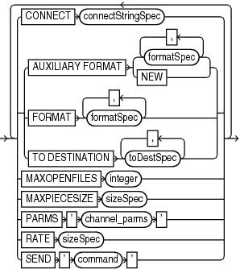

Purpose

Use the `allocOperandList` subclause to control options on a **channel**, which is a connection between RMAN and a database instance.

Syntax

allocOperandList::=



> {CONNECT connectStringSpec | {AUXILIARY FORMAT { formatSpec \[, formatSpec\]... | NEW} | FORMAT formatSpec \[, formatSpec\]... | TO DESTINATION toDestSpec \[, toDestSpec\]...} | MAXOPENFILES integer | MAXPIECESIZE sizeSpec | PARMS ' channel\_parms ' | RATE sizeSpec | SEND ' command '} \[ {CONNECT connectStringSpec | {AUXILIARY FORMAT { formatSpec \[, formatSpec\]... | NEW} | FORMAT formatSpec \[, formatSpec\]... | TO DESTINATION toDestSpec \[, toDestSpec\]...} | MAXOPENFILES integer | MAXPIECESIZE sizeSpec | PARMS ' channel\_parms ' | RATE sizeSpec | SEND ' command '}\]...


([connectStringSpec::=](connectStringSpec.md), [formatSpec::=](formatSpec.md), [sizeSpec::=](sizeSpec.md), [toDestSpec::=](toDestSpec.md))

Semantics

allocOperandList

| Syntax Element | Description |
| --- | --- |
| `CONNECT` `connectStringSpec` | Specifies a connect string to the database instance where RMAN conducts the backup or restore operations. Use this parameter to spread the work across different instances in an Oracle RAC configuration.  If you do not specify this parameter, and if you did not specify the `AUXILIARY` option, then RMAN conducts all operations on the target database instance specified by the command-line `CONNECT` parameter or `CONNECT` command. Typically, do not use the `CONNECT` parameter with the `AUXILIARY` option.  See Also: `connectStringSpec` and `RMAN` |
| `AUXILIARY FORMAT` | Specifies the format of image copies created on an auxiliary instance.  RMAN must be connected to the auxiliary instance with `CONNECT` `AUXILIARY` and have access to auxiliary channels. |
| `formatSpec` | Specifies a pattern for image copy names on an auxiliary instance.  The path must be valid on the auxiliary host.  See Also: `formatSpec` for valid substitution variables |
| `   NEW` | Creates an image copy in the directory specified by the `DB_CREATE_FILE_DEST` initialization parameter of the auxiliary instance.  The image copy name is in an Oracle Managed Files format. |
| `FORMAT` `formatSpec` | Specifies the format to use for the names backup pieces or image copies created on this channel. Example 4-1 illustrates this technique.  The `FORMAT` parameter is useful if you allocate multiple disk channels and want each channel to write to a different directory. The `FORMAT` parameter specified in `CONFIGURE` `CHANNEL` or `ALLOCATE CHANNEL` is semantically equivalent to the `FORMAT` parameter specified in the `BACKUP` command (not the `DATAFILECOPY FORMAT` parameter in [forRecoveryOfSpec](BACKUP.md)). If you specify the `FORMAT` parameter in the `BACKUP` command, then it overrides the `FORMAT` parameter specified in `CONFIGURE CHANNEL` or `ALLOCATE CHANNEL`.  If you do not specify `FORMAT`, then RMAN uses `%U` by default, which guarantees a unique name for the names of the backup files. If the fast recovery area is configured, then RMAN creates the backup files in the default disk location. Otherwise, the default disk location is operating system-specific (for example, `?/dbs` on Solaris).  You can specify up to four `FORMAT` strings. RMAN uses the second, third, and fourth values only when `BACKUP COPIES`, `SET BACKUP COPIES`, or `CONFIGURE ... BACKUP COPIES` is in effect. When choosing which format to use for each backup piece, RMAN uses the first format value for copy 1, the second format value for copy 2, and so forth. If the number of format values exceeds the number of copies, then the extra formats are not used. If the number of format values is less than the number of copies, then RMAN reuses the format values, starting with the first one.  Because the channels correspond to server sessions on the target database, the `FORMAT` string must use the conventions of the target host, not the client host. For example, if the RMAN client runs on a Windows host and the target database runs on a Linux host, then the `FORMAT` string must adhere to the naming conventions of a Linux file system or raw device.  See Also: `formatSpec` for available `FORMAT` parameters |
| `TO DESTINATION` toDestSpec | Specifies the directory where the backup is created. This parameter is valid for disk and not SBT channels. The backup files are created in an Oracle Managed Files (OMF) directory. Backup skips the files only when backups do not exist in the specified `TO DESTINATION`. |
| `MAXOPENFILES` `integer` | Controls the maximum number of input files that a `BACKUP` command can have open at any given time (the default is 8). Use this parameter to prevent "Too many open files" error messages when backing up a large number of files into a single backup set. |
| `MAXPIECESIZE` `sizeSpec` | Specifies the maximum size of each backup piece created on this channel. Example 4-2 illustrates this technique. Specify the size in bytes, kilobytes (`K`), megabytes (`M`), or gigabytes (`G`). The default setting is in bytes and is rounded down into kilobytes. For example, if you set `MAXPIECESIZE` to 5000, RMAN sets the maximum piece size at 4 kilobytes, which is the lower kilobyte boundary of 5000 bytes.  Note: You cannot use `BACKUP ... SECTION SIZE` with `MAXPIECESIZE`. |
| `PARMS` `'` `channel_parms` `'` | Specifies parameters for the `sbt` channel. Example 4-3 illustrates this technique. Do not use this port-specific string if you have specified `DEVICE TYPE DISK`.  You can use the following formats for the channel parameters:  - `'ENV=(``var1=val1``, ``var2=val2``,...)'` 	Specifies one or more environment variables required by the media manager in the server session corresponding to this RMAN client. Because RMAN is a client program, you can use the `ENV` parameter to set server session-specific variables that perform operations on behalf of the RMAN client, for example, `PARMS 'ENV=(OB_DEVICE_1=tape1)'`. 	Note: On Windows, Oracle recommends that you use the `SBT_PARMS` parameter to specify the environment variables, instead of the `ENV` parameter. For example, `PARMS 'SBT_PARMS=(OB_DEVICE_1=tape1)' 'SBT_LIBRARY=lib_name'.` - `'SBT_LIBRARY=` `lib_name` `'` 	In cases where the media management library supports it, (for example, the OSB Cloud Module) and on the Windows platform, you must use the `SBT_PARMS` parameter to specify environment variables. In all other scenarios, you use the `ENV` variable. 	Specifies which media library is used on this `sbt` channel, for example, `PARMS="SBT_LIBRARY=/oracle/lib/mmv.so"`. The default library is operating system-specific (for example, `libobk.so` on Linux and `ORASBT.DLL` on Windows.  See Also: [Oracle Database Backup and Recovery User's Guide](https://docs.oracle.com/pls/topic/lookup?ctx=en/database/oracle/oracle-database/21/rcmrf&id=BRADV132) to learn how to integrate media management libraries  Note: On Windows, Oracle recommends that you use the `SBT_PARMS` parameter to specify the environment variables, instead of the `ENV` parameter. For example, `PARMS 'SBT_PARMS=(OB_DEVICE_1=tape1)' 'SBT_LIBRARY=lib_name'.` |
| `RATE` `sizeSpec` | Sets the maximum number of bytes (default), kilobytes (`K`), megabytes (`M`), or gigabytes (`G`) that RMAN reads each second on this channel. This parameter sets an upper limit for bytes read so that RMAN does not consume too much disk bandwidth and degrade performance. |
| `SEND` `'` `command` `'` | Sends a vendor-specific command string to all allocated channels. For example, you could specify an Oracle Secure Backup media family with `SEND 'OB_MEDIA_FAMILY datafile_mf'`.  On Windows, to send command strings to the SBT library, it is recommended that you use the `SEND` option instead of using `ENV` in the `PARAMS` option.  See Also: Your media manager documentation to determine whether this feature is supported and when to use it. |

toDestSpec

This subclause specifies either a directory or an Automated Storage Management (ASM) disk group for a backup piece or image copy. Refer to [toDestSpec::=](toDestSpec.md) for the syntax diagram.

Examples

Example 4-1 Specifying the Default Location for Disk Backups

This example allocates a disk channel that specifies a nondefault format, and then backs up the database to the nondefault location.

```
RUN
{
  ALLOCATE CHANNEL d1 DEVICE TYPE DISK FORMAT = '/disk1/bkup_%U';
  BACKUP DATABASE;
}
```

Example 4-2 Setting the Maximum Size of a Backup Piece

This example manually allocates an SBT channel, which specifies an Oracle Secure Backup tape drive, and makes a whole database backup. The `MAXPIECESIZE` parameter specifies that no backup piece written to tape can exceed 800 MB.

```
RUN
{
  ALLOCATE CHANNEL c1 DEVICE TYPE sbt 
    PARMS 'SBT_LIBRARY=/usr/local/oracle/backup/lib/libobk.so, ENV=(OB_DEVICE_1=stape1)'
    MAXPIECESIZE 800M;
  BACKUP DATABASE;
}
```

Example 4-3 Setting SBT Channel Parameters

This example configures the default SBT channel to use the Oracle Secure Backup tape drive named `stape1` and makes a database backup with the default channel:

```
CONFIGURE DEFAULT DEVICE TYPE TO sbt;
CONFIGURE CHANNEL DEVICE TYPE sbt PARMS 'ENV=(OB_DEVICE_1=stape1)';
BACKUP DATABASE;
```

Later you decide to back up the database to drive `stape2`. The following examples uses a manually allocated SBT channel to back up the database to `stape2`.

```
RUN
{
  ALLOCATE CHANNEL st2 DEVICE TYPE sbt 
    PARMS 'ENV=(OB_DEVICE_1=stape2)';
  BACKUP DATABASE;
}
```