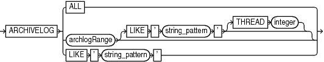

Purpose

Use the archivelogRecordSpecifier subclause to specify a set of archived redo log files for use in RMAN operations.

Syntax

archivelogRecordSpecifier::=



> ARCHIVELOG {ALL | archlogRange \[LIKE ' string\_pattern ' \[THREAD integer\]\] | LIKE ' string\_pattern '}
>
> [  
> Copyright © 2023, 2024, Oracle and/or its affiliates.](https://docs.oracle.com/en/database/oracle/oracle-database/dcommon/html/cpyr.htm)


archlogRange::=


> { {FROM SCN | SCN BETWEEN integer AND | UNTIL SCN} integer | {FROM SEQUENCE | SEQUENCE | SEQUENCE BETWEEN integer AND | UNTIL SEQUENCE} integer \[THREAD integer\] | {FROM TIME | TIME BETWEEN ' date\_string ' AND | UNTIL TIME} ' date\_string '} \[INCARNATION {ALL | CURRENT | integer}\]


Semantics

archivelogRecordSpecifier

This subclause specifies either all archived redo log files or logs with file names that match a specified pattern.

| Syntax Element | Description |
| --- | --- |
| `ALL` | Specifies all available archived logs. |
| `LIKE` `'` `string_pattern` `'` | Specifies all archived logs that match the specified `string_pattern`. You can use the same pattern matching characters that are valid in the `LIKE` operator in the SQL language to match multiple files.  See Also:[Oracle Real Application Clusters Administration and Deployment Guide](https://docs.oracle.com/pls/topic/lookup?ctx=en/database/oracle/oracle-database/21/rcmrf&id=RACAD-GUID-A02120B2-BE62-4172-B402-BF034566E471) to learn about using RMAN in an Oracle RAC configuration |

archlogRange

This subclause specifies a range of archived redo log files by SCN, time, restore point (which is a label for a timestamp or SCN), or log sequence number. This subclause is useful for identifying the point to which you want the database to be recoverable.

RMAN queries the `V$ARCHIVED_LOG` or `RC_ARCHIVED_LOG` view to determine which logs to include in the range. When you specify a time, SCN, or restore point, RMAN determines the range according to the contents of the archived redo log files, not when the logs were created or backed up. When you specify the range by log sequence number, then RMAN uses the sequence number to determine the range.

Table 4-1 explains how RMAN determines which logs are in the range. The columns `FIRST_TIME`, `NEXT_TIME`, and so on refer to columns in `V$ARCHIVED_LOG`. Additionally, the column `INCARNATION ` corresponds to the incarnation column in the `v$database_incarnation` table which is joined with `v$archived_log` on the `resetlogs_change# ` and `resetlogs_time ` columns.

For example, if you specify `FROM SCN 1000 UNTIL SCN 2000`, then RMAN includes all logs whose `V$ARCHIVED_LOG.NEXT_SCN` value is greater than 1000 and whose `V$ARCHIVED_LOG.FIRST_SCN` value is less than or equal to 2000.

Table 4-1 Determining Logs for Inclusion in the Range

| Subclause | FIRST\_TIME | NEXT\_TIME | FIRST\_SCN | NEXT\_SCN | SEQUENCE# | INCARNATION# |
| --- | --- | --- | --- | --- | --- | --- |
| `FROM TIME t1` | n/a | Later than t1 | n/a | n/a | n/a | n/a |
| `FROM TIME t1 UNTIL TIME t2` | Earlier than or equal to t2 | Later than t1 | n/a | n/a | n/a | n/a |
| `UNTIL TIME t2` | Earlier than or equal to t2 | n/a | n/a | n/a | n/a | n/a |
| `FROM SCN s1` | n/a | n/a | n/a | Greater than s1 | n/a | n/a |
| `FROM SCN s1 UNTIL SCN s` 2 | n/a | n/a | Less than or equal to s2 | Greater than s1 | n/a | n/a |
| `UNTIL SCN s2` | n/a | n/a | Less than or equal to s2 | n/a | n/a | n/a |
| `FROM SEQUENCE q1` | n/a | n/a | n/a | n/a | Between q1 and the maximum sequence (inclusive) | n/a |
| `FROM SEQUENCE q1 UNTIL SEQUENCE q2` | n/a | n/a | n/a | n/a | Between q1 and q2 (inclusive) | n/a |
| `UNTIL SEQUENCE q2` | n/a | n/a | n/a | n/a | Between 0 and q2 (inclusive) | n/a |
| `INCARNATION ALL` | n/a | n/a | n/a | n/a | n/a | `ANY` |
| `INCARNATION CURRENT` | n/a | n/a | n/a | n/a | n/a | Active incarnation number |
| `INCARNATION i` | n/a | n/a | n/a | n/a | n/a | Equals i |

The time must be formatted according to the Globalization Technology date format specification currently in effect. If your current Globalization settings do not specify the time, then string dates default to 00 hours, 00 minutes, and 00 seconds.

The `date_string` can be any SQL expression of type `DATE`, such as `SYSDATE`. You can use `TO_DATE` to specify hard-coded dates that work regardless of the current Globalization Technology settings. `SYSDATE` always has seconds precision regardless of the Globalization settings. Thus, if today is March 15, 2013, then `SYSDATE-10` is not equivalent to `05-MAR-13` or `TO_DATE('03/15/2013','MM/DD/YYYY')-10`.

Specifying a sequence of archived redo log files does not guarantee that RMAN includes all redo data in the sequence. For example, the last available archived log file may end before the end of the sequence, or an archived log file in the range may be missing from all archiving destinations. RMAN includes the archived redo log files it finds and does not issue a warning for missing files.

Note:

If the database is open when you run `BACKUP ARCHIVELOG`, and if the `UNTIL` clause is specified, then RMAN does not run `ALTER SYSTEM ARCHIVE LOG CURRENT`.

See Also:

[Oracle Database Reference](https://docs.oracle.com/pls/topic/lookup?ctx=en/database/oracle/oracle-database/21/rcmrf&id=REFRN-GUID-FC23EEEE-AA9F-4B3C-8CBB-888C9C0CA27F) to learn how to use the `NLS_LANGUAGE` and `NLS_DATE_FORMAT` environment variables to specify time format

| Syntax Element | Description |
| --- | --- |
| `FROM SCN` `integer` | Specifies the beginning SCN for a range of archived redo log files. If you do not specify the `UNTIL SCN` parameter, then RMAN includes all available log files beginning with SCN specified in the `FROM SCN` parameter. |
| `SCN BETWEEN` `integer` `AND` `integer` | Specifies the beginning and ending SCN for a range of logs. This syntax is semantically equivalent to `FROM SCN` `integer1` `UNTIL SCN` `integer2`. |
| `UNTIL SCN` `integer` | Specifies the ending SCN for a range of archived redo log files (see Table 4-1 for the rules determining the range). |
| `FROM SEQUENCE` `integer` | Specifies the beginning log sequence number for a sequence of archived redo log files (see Table 4-1 for the rules determining the range).  Note: You can specify all log sequence numbers in a thread by using the syntax shown in Example 4-6. |
| `SEQUENCE` `integer` | Specifies a single log sequence number. |
| `SEQUENCE BETWEEN` `integer` `AND` `integer` | Specifies a range of log sequence numbers. This syntax is semantically equivalent to `FROM SEQUENCE` `integer1` `UNTIL SEQUENCE` `integer2`. |
| `UNTIL SEQUENCE` `integer` | Specifies the terminating log sequence number for a sequence of archived redo log files (see Table 4-1 for the rules determining the range). |
| `   THREAD` `integer` | Specifies the thread containing the archived redo log files you want to include. This parameter is only necessary if the database is in an Oracle RAC configuration.  Although the `SEQUENCE` parameter does not require that `THREAD` be specified, a given log sequence always implies a thread. The thread defaults to `1` if not specified. Query `V$ARCHIVED_LOG` to determine the thread number for a log. |
| `     INCARNATION` `ALL\|CURRENT\|` `integer` | Specifies the database incarnation for archived redo logs for the `BACKUP`, `RESTORE` and `LIST` commands. `INCARNATION` enables you to designate either current archive redo logs, archive redo logs from a previous incarnation of the database or all redo logs. `CURRENT` is the default.  Note: The `INCARNATION` subclause is not valid for foreign archived redo log files that are received by a logical standby database for a LogMiner session. Unlike normal archived redo log files, foreign archived redo log files have a different `  DBID  ` and cannot be backed up or restored on a logical standby database. |
| `FROM TIME` `'` `date_string` `'` | Specifies the beginning time for a range of archived redo log files (see Table 4-1 for the rules determining the range). Example 4-5 shows `FROM TIME` in a [LIST](LIST.md) command. |
| `TIME BETWEEN 'date_string' AND 'date_string'` | Specifies a range of times. This syntax is semantically equivalent to `FROM TIME 'date_string' UNTIL TIME 'date_string'`. |
| `UNTIL TIME 'date_string'` | Specifies the end time for a range of archived redo log files (see Table 4-1 for the rules determining the range). Example 4-4 shows `UNTIL TIME` in a [BACKUP](BACKUP.md) command. |

Examples

Example 4-4 Specifying Records by Recovery Point-in-Time

Assume that you want to be able to recover the database to a point in time 5 days before now. You want to back up a range of archived redo log files that makes this point-in-time recovery possible.

You can use the `UNTIL TIME 'SYSDATE-5'` clause to specify that all logs in the range have a first time (shown by `V$ARCHIVED_LOG.FIRST_TIME`) that is earlier than or equal to `SYSDATE-5`. This function resolves to a time with seconds precision five days before now.

```
CONNECT TARGET /
BACKUP ARCHIVELOG UNTIL TIME 'SYSDATE-5';
```

Example 4-5 Listing Archived Log Backups by Time

As shown in Table 4-1, when you specify `date_string` for a range of archived redo log files, you are not specifying the backup time or creation time of the log. Assume that archived log 32 has a next time of March 6.

```
SQL> SELECT SEQUENCE#, NEXT_TIME
  2  FROM V$ARCHIVED_LOG
  3  WHERE SEQUENCE#='32';
 
 SEQUENCE# NEXT_TIME
---------- ---------
        50 06-MAR-13
```

On March 8 you run the following `BACKUP` and `LIST` commands:

```
RMAN> BACKUP ARCHIVELOG SEQUENCE 32;
 
Starting backup at 08-MAR-13
allocated channel: ORA_SBT_TAPE_1
channel ORA_SBT_TAPE_1: SID=109 device type=SBT_TAPE
channel ORA_SBT_TAPE_1: Oracle Secure Backup
channel ORA_SBT_TAPE_1: starting archived log backup set
channel ORA_SBT_TAPE_1: specifying archived log(s) in backup set
input archived log thread=1 sequence=32 RECID=125 STAMP=616528547
channel ORA_SBT_TAPE_1: starting piece 1 at 08-MAR-13
channel ORA_SBT_TAPE_1: finished piece 1 at 08-MAR-13
piece handle=6kic3fkm_1_1 tag=TAG20130308T111014 comment=API Version 2.0,MMS Version 10.1.0.3
channel ORA_SBT_TAPE_1: backup set complete, elapsed time: 00:00:25
Finished backup at 08-MAR-13
 
Starting Control File and SPFILE Autobackup at 08-MAR-13
piece handle=c-28014364-20130308-08 comment=API Version 2.0,MMS Version 10.1.0.3
Finished Control File and SPFILE Autobackup at 08-MAR-13
 
RMAN> LIST BACKUP OF ARCHIVELOG FROM TIME 'SYSDATE-1';
```

Because the next time of log 32 is earlier than the range of times specified in the `FROM TIME` clause, the preceding `LIST BACKUP` command does not show the backup of archived log 32.

Example 4-6 Crosschecking All Logs in a Redo Thread

Assume that you are managing an Oracle RAC database with two threads of redo. This example crosschecks all archived redo log files in thread `1` only.

```
CROSSCHECK ARCHIVELOG FROM SEQUENCE 0 THREAD 1;
```