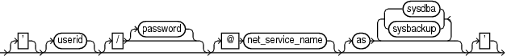

Purpose

Use the `connectStringSpec` subclause to specify the user name, password, and net service name for connecting to a target, recovery catalog, or auxiliary database. The connection is necessary to authenticate the user and identify the database.

Prerequisites

You must have `SYSBACKUP` or `SYSDBA` privilege to `CONNECT` to a target or auxiliary database.

Do not connect to the recovery catalog database as the `SYS` user or a user with the `SYSDBA` or `SYSBACKUP` privilege.

Usage Notes

RMAN connections to a database are specified and authenticated in the same way as SQL\*Plus connections to a database. The only difference is that RMAN connections to a target or auxiliary database require the `SYSBACKUP` or `SYSDBA` privilege.

`SYSBACKUP` grants the minimum privileges needed for backup and recovery. It grants `SELECT` privileges on database catalog views and dynamic performance views, but it does not grant privileges on user tables and views, such as `SELECT ANY TABLE`. If you connect to RMAN as a privileged user (such as `OE` with the `SYSBACKUP` privilege), your user name for the session is `SYSBACKUP`. Thus, you do not have privileges on the tables and views owned by `OE` or any other user.

When you connect by specifying `AS SYSBACKUP` in the connect string, the default mode used is `SYSBACKUP`, the session user name is `SYSBACKUP`, and the default schema is `SYS`. In all other cases, the default mode `SYSDBA`, the session user name is `SYS` and the default schema is `SYS`.

See Also:

- [Oracle Database Administrator’s Guide](https://docs.oracle.com/pls/topic/lookup?ctx=en/database/oracle/oracle-database/21/rcmrf&id=ADMIN-GUID-7842AF72-DA25-4559-A8E7-9883D0C63BF2) to learn about database connection options when using SQL\*Plus
- [Oracle Database Backup and Recovery User’s Guide](https://docs.oracle.com/pls/topic/lookup?ctx=en/database/oracle/oracle-database/21/rcmrf&id=BRADV8123) to learn about using the `SYSBACKUP` or `SYSDBA` administrative privilege

Caution:

Good security practice requires that passwords are not be entered in plain text on the command line. Enter passwords in RMAN only when requested by an RMAN prompt. See [Oracle Database Security Guide](https://docs.oracle.com/pls/topic/lookup?ctx=en/database/oracle/oracle-database/21/rcmrf&id=DBSEG0032) to learn about password protection.

Syntax

connectStringSpec::=



> \['\] \[userid\] \[/ \[password\]\] \[@ net\_service\_name\] \[as { {sysdba | sysbackup}}\] \['\]
>
> [  
> Copyright © 2023, 2024, Oracle and/or its affiliates.](https://docs.oracle.com/en/database/oracle/oracle-database/dcommon/html/cpyr.htm)


Semantics

| Syntax Element | Description |
| --- | --- |
| `/` | If you do not specify a user ID or password when connecting to a target database, then a slash establishes a connection using the `SYSDBA` privilege by using operating system authentication (see Example 4-12).  In a multitenant container database (CDB), a connection is established with the root using the `SYSDBA` privilege.  Note: The slash depends on platform-specific environment variables. |
| `userid` | Establishes a connection to the database for the specified user.  To connect to the root in a CDB, the user must be a common user with the common `SYSBACKUP` or `SYSDBA` privilege.  To connect to a pluggable database (PDB), the user must be one of the following:  - a common user with the common `SYSBACKUP` or `SYSDBA` privilege - a common user with `SYSBACKUP` or `SYSDBA` privilege in the specified PDB - a local user defined in the PDB and granted the `SYSBACKUP` or `SYSDBA` privilege  See [Oracle Database Backup and Recovery User’s Guide](https://docs.oracle.com/pls/topic/lookup?ctx=en/database/oracle/oracle-database/21/rcmrf&id=BRADV-GUID-E07231B2-F213-4F8F-8D02-E410A6DAE94C) for examples on connecting to CDBs and PDBs.  Do not use a privileged account such as `SYSDBA` when connecting to a recovery catalog.  Note: The connect string must not contain any white space, but it can contain punctuation characters such as a slash (`/`) and an at sign (`@`). |
| `/` `password` | Establishes a connection for the specified user by using a password. If the target database is not open, then a password file must exist.  Caution: Passwords entered in plain text on the command line are a security vulnerability. Instead, omit the password from the command line and enter it in response to the prompt (see Example 4-11). |
| `@` `net_service_name` | Establishes a connection to the database through an optional Oracle Net net service name (see Example 4-10). |
| `AS {SYSDBA \| SYSBACKUP}` | Invokes the administrative privileges that have been granted to `/` or `userid`. This clause is unnecessary for connecting with the default privileges. For tablespace point-in-time recovery (TSPITR), use the same mode as the connection to the target database. When this clause is omitted, the `SYSDBA` is used as the default.  Do not use this clause when connecting to a recovery catalog. |

Examples

Example 4-10 Connecting to a Target Database Without a Recovery Catalog

This example starts RMAN without specifying a database connection. The `CONNECT` command connects to a target database by using the Oracle Net service name `PROD` in the default `NOCATALOG` mode. `sbu` is a user who is granted the `SYSBACKUP` privilege. The `sbu` password is entered in response to a prompt.

```
% rman 
RMAN> CONNECT TARGET "sbu@prod AS SYSBACKUP"

target database Password: password
connected to target database: PROD (DBID=39525561)
```

Example 4-11 Connecting to a Target Database at the Operating System Command Line

This example connects to the target database as user `SBU` at the operating system command line, but without specifying a password. RMAN prompts for the password.

```
% rman TARGET SBU

Recovery Manager: Release 12.1.0.1.0 - Production on Fri Jan 11 09:15:53 2013
 
Copyright (c) 1982, 2013, Oracle and/or its affiliates.  All rights reserved.

target database Password: password
```

Example 4-12 Connecting to a Target Database with Operating System Authentication

This example starts RMAN and then connects to the target database `PROD` using operating system authentication. The example also connects to the recovery catalog database `CATDB` using a net service name.

```
% rman
RMAN> CONNECT TARGET /

connected to target database: PROD (DBID=39525561)

RMAN> CONNECT CATALOG rco@catdb

recovery catalog database Password: password
connected to recovery catalog database
```