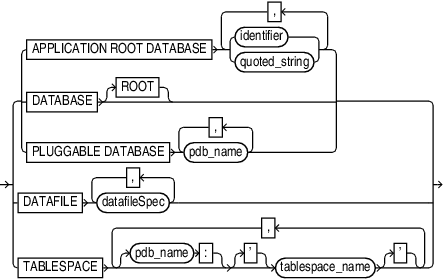

Purpose

Use the `dbObject` subclause to identify a database or a subset of a database.

Syntax

dbObject::=

> {APPLICATION ROOT DATABASE {identifier | quoted\_string} \[, {identifier | quoted\_string}\]... | DATABASE \[ROOT\] | PLUGGABLE DATABASEpdb\_name \[, pdb\_name\]...} | DATAFILEdatafileSpec \[, datafileSpec\]... | TABLESPACE \[pdb\_name:\] \['\] tablespace\_name \['\] \[, \[pdb\_name:\] \['\] tablespace\_name \['\]\]...
>
> [  
> Copyright © 2023, 2024, Oracle and/or its affiliates.](https://docs.oracle.com/en/database/oracle/oracle-database/dcommon/html/cpyr.htm)

([datafileSpec::=](datafileSpec.md))

Semantics

| Syntax Element | Description |
| --- | --- |
| `DATABASE` | Specifies the entire database. In a multitenant container database (CDB), specifies the whole CDB. |
| `DATABASE ROOT` | Specifies only the root in a CDB. |
| `PLUGGABLE DATABASE` `pdb_name` | Specifies one or more pluggable databases (PDBs) in a CDB. Use a comma-delimited list to specify multiple PDBs. |
| `DATAFILE` `datafileSpec` | Specifies a list of one or more data files by either file name or absolute data file number.  See Also: `datafileSpec` |
| `TABLESPACE` `tablespace_name` | Specifies one or more tablespaces. |
| `TABLESPACE ` `pdb_name``:``tablespace_name` | Specifies the name of a tablespace in a PDB. Use a comma-delimited list to specify multiple tablespaces. Multiple PDBs can have tablespaces with the same name. A qualifier before the name uniquely identifies the tablespace. `pdb-name` is the name of the PDB that contains `tablespace_name`. If `pdb_name` is omitted, root is used as the default container. |