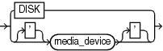

Purpose

Use the `deviceSpecifier` subclause to specify the type of storage for a backup.

Syntax

deviceSpecifier::=



> DISK | \['\] media\_device \['\]
>
> [  
> Copyright © 2023, 2024, Oracle and/or its affiliates.](https://docs.oracle.com/en/database/oracle/oracle-database/dcommon/html/cpyr.htm)


Semantics

| Syntax Element | Description |
| --- | --- |
| `DISK` | Specifies a disk storage device (see Example 4-16). |
| `media_device` | Specifies a sequential I/O device or access method for storage (see Example 4-15).  The `media_device` variable specifies a case-insensitive name for a media manager. The syntax and semantics of sequential I/O device types are platform-specific. The most common value is `sbt` or `sbt_tape` (which are synonymous values).  Note: RMAN stores the value `sbt` in the recovery catalog as `sbt_tape` for backward compatibility. |

Examples

Example 4-15 Allocating a Tape Channel

This example allocates a maintenance channel for a media management device:

```
ALLOCATE CHANNEL FOR MAINTENANCE DEVICE TYPE sbt;
CROSSCHECK BACKUP;
RELEASE CHANNEL;
```

Example 4-16 Backing Up the Database to Disk

This example backs up the multitenant container database (CDB) to disk:

```
BACKUP DEVICE TYPE DISK DATABASE;
```