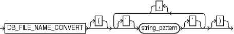

Purpose

Use the `fileNameConversionSpec` subclause to specify one or more patterns to be used in generating new file names based on old file names. Used with `BACKUP`, `CONVERT`, and `DUPLICATE` as one way of generating output file names.

Usage Notes

The rules for string patterns and how they affect file naming equal those for the initialization parameter `DB_FILE_NAME_CONVERT`. In parentheses, provide an even number of string patterns.

When RMAN generates a new file name based on an old one, it compares the original file name to the first member of each pair of string patterns. The first time that RMAN finds a pattern that is a substring of the original file name, RMAN generates the new file name by substituting the second member of the pair for the substring that matched.

The pattern does not have to match at the beginning of the file name. The following command creates an image copy of data file `/disk1/dbs/users.dbf` as `/disk1/newdbs/users.dbf`:

```
BACKUP AS COPY
    DB_FILE_NAME_CONVERT = ('dbs','newdbs');
    TABLESPACE users;
```

When multiple possible matches exist for a given file name being converted, RMAN uses the first match in the list of patterns to generate the new file name. The following command has the same effect as the previous example because the pattern `dbs` matches the file name, so that the file name is never compared to the second pattern `/disk1`:

```
BACKUP AS COPY
    DB_FILE_NAME_CONVERT = ('dbs','newdbs','/disk1','/newdisk')
    TABLESPACE users;
```

For the `CONVERT` `TABLESPACE`, `CONVERT DATABASE`, and `BACKUP` `AS COPY` commands, if the source files for these operations are Oracle-managed files, then you cannot use `fileNameConversionSpec` to convert the source file names into new output file names. For Oracle-managed files, either in Automated Storage Management (ASM) or in ordinary file system storage, the database must be allowed to generate the file names for the output files. For example, an OMF file name for a data file in non-ASM storage might be of the following form:

```
/private/boston/datafile/01_mf_system_ab12554_.dbf
```

An OMF file name in ASM storage might be of the following form:

```
+DISK/boston/datafile/system.256.4543080
```

Only the database can generate and manage OMF file names. Typically, substituting the name of a different disk group or a different OMF location into an OMF file name does not produce a valid file name in the new destination. To convert OMF file names for storage in another OMF location, use an alternative such as a `FORMAT` clause with these commands to specify the new output location and allow the database to manage the specific output file names.

Syntax

fileNameConversionSpec::=



> DB\_FILE\_NAME\_CONVERT \[ {\] {\['\] string\_pattern \['\]}/ \[,\] \[}\]
>
> [  
> Copyright © 2023, 2024, Oracle and/or its affiliates.](https://docs.oracle.com/en/database/oracle/oracle-database/dcommon/html/cpyr.htm)


Semantics

| Syntax Element | Description |
| --- | --- |
| `string_pattern` | Specifies pairs of strings used to convert the file names. For example, you could set the string pattern to a value such as:  `DB_FILE_NAME_CONVERT = ('str1','str2','str3', 'str4' ...)`  In this example, `str1` is a pattern matching the original file name, `str2` is the pattern replacing `str1` in the generated file name, `str3` is a pattern matching the original file name, and `str4` is the pattern replacing `str3` in the generated file name.  Note: You can specify multiple pairs of primary and standby replacement strings for this parameter, however, starting with Oracle Database 12c Release 2 (12.2), Oracle recommends that you limit the number of pairs to 99. |

Examples

Example 4-17 Using DB\_FILE\_NAME\_CONVERT with a Single Conversion Pair

In this example, the tablespace `users` contains data files in directory `/disk1/oradata/prod/`, whereas tablespace `tools` contains data files in `/disk1/oradata/prod/`. For each data file to be converted, if `disk1/oradata/prod` is a substring of the data file name, then the image copy name is created by replacing the string with `disk2`.

```
BACKUP AS COPY 
  DB_FILE_NAME_CONVERT = ('disk1/oradata/prod','disk2')
  TABLESPACE users, tools;
```

Example 4-18 Using DB\_FILE\_NAME\_CONVERT with Multiple Conversion Pairs

This example creates image copies of the same data files described in Example 4-17. The first string in each pair specifies a pattern to match in the name of the source data files. The second string in each pair is the substitution pattern to use when generating the names of the image copies.

```
BACKUP AS COPY 
    DB_FILE_NAME_CONVERT=('/disk1/oradata/prod/users','/disk2/users',
                          '/disk1/oradata/prod/tools','/tmp/tools')
    TABLESPACE tools, users;
```

The following sample output for this command demonstrates how RMAN uses the conversion pairs to name the output image copies:

```
Starting backup at 08-MAR-13
using channel ORA_DISK_1
channel ORA_DISK_1: starting datafile copy
input datafile file number=00027 name=/disk1/oradata/prod/tools01.dbf
output file name=/tmp/tools01.dbf tag=TAG20130308T143300 RECID=33 STAMP=616689181
channel ORA_DISK_1: datafile copy complete, elapsed time: 00:00:01
channel ORA_DISK_1: starting datafile copy
input datafile file number=00028 name=/disk1/oradata/prod/users01.dbf
output file name=/disk2/users01.dbf tag=TAG20130308T143300 RECID=34 STAMP=616689182
channel ORA_DISK_1: datafile copy complete, elapsed time: 00:00:01
Finished backup at 08-MAR-13
 
Starting Control File and SPFILE Autobackup at 08-MAR-13
piece handle=/disk2/PROD/autobackup/2013_03_08/o1_mf_s_616689184_2z13s1kx_.bkp comment=NONE
Finished Control File and SPFILE Autobackup at 08-MAR-13
```