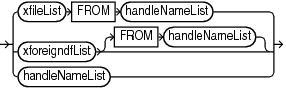
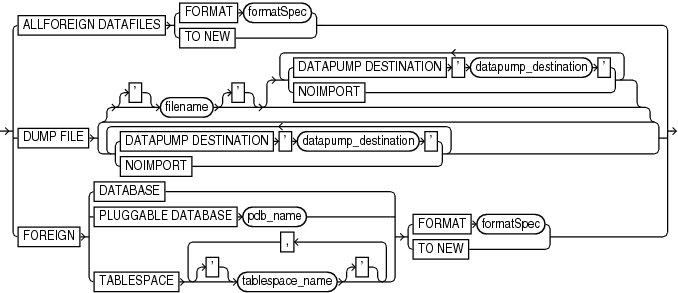
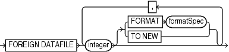
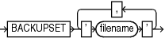

Purpose

Use the `foreignFileSpec` subclause to provide the information required to perform a cross-platform restore operation. This information includes the name of the backup set that contains the cross-platform backup and details of objects or files that must be restored.

Usage Notes

Specifying a `foreignFileSpec` is mandatory to perform a cross-platform restore operation. You can restore tablespaces even if the source platform and the destination platform use different endian formats.

Syntax

foreignFileSpec::=



> xfileList FROM handleNameList | xforeigndfList \[FROM handleNameList\] | handleNameList
>
> [  
> Copyright © 2023, 2024, Oracle and/or its affiliates.](https://docs.oracle.com/en/database/oracle/oracle-database/dcommon/html/cpyr.htm)


(xfileList::=, xforeigndfList::=, handleNameList::=)

xfileList::=



> ALLFOREIGN DATAFILES {FORMAT formatSpec | TO NEW} | DUMP FILE {\[\['\] filename \['\] \[ { {DATAPUMP DESTINATION ' datapump\_destination ' | NOIMPORT}}...\]\] | {DATAPUMP DESTINATION ' datapump\_destination ' | NOIMPORT} \[ {DATAPUMP DESTINATION ' datapump\_destination ' | NOIMPORT}\]...} | FOREIGN {DATABASE | PLUGGABLE DATABASE pdb\_name | TABLESPACE \['\] tablespace\_name \['\] \[, \['\] tablespace\_name \['\]\]...} {FORMAT formatSpec | TO NEW}


xforeigndfList::=



> FOREIGN DATAFILE integer \[ {FORMAT formatSpec | TO NEW}\] \[, integer \[ {FORMAT formatSpec | TO NEW}\]\]...
>
> [  
> Copyright © 2023, 2024, Oracle and/or its affiliates.](https://docs.oracle.com/en/database/oracle/oracle-database/dcommon/html/cpyr.htm)


handleNameList::=



> BACKUPSET ' filename ' \[, ' filename '\]...
>
> [  
> Copyright © 2023, 2024, Oracle and/or its affiliates.](https://docs.oracle.com/en/database/oracle/oracle-database/dcommon/html/cpyr.htm)


Semantics

xfilelist::=

| Syntax Element | Description |
| --- | --- |
| `ALL FOREIGN DATAFILES` | Specifies that all the data files contained in the cross-platform backup set must be restored. Use `FROM BACKUPSET` along with `ALL FOREIGN DATAFILES` to specify the name of the backup set that contains the data files to be restored. |
| `FORMAT` `formatSpec` | Specifies a pattern for the restored data files in the destination database. |
| `TO NEW` | Specifies that the data files must be restored to the location specified by the `DB_CREATE_FILE_DEST` initialization parameter using Oracle Managed File (OMF) names. |
| `DUMP FILE` `'filename` ' | Specifies that the backup set containing the Data Pump export dump file must be restored. The name of the backup set containing the dump file is specified using the `FROM BACKUPSET` clause. The dump file contains the metadata of the tablespaces that are being transported across platforms. You need this metadata to plug the restored tablespaces into the destination database.  `filename` represents the name of the file into which the export dump file is restored. |
| ` DATAPUMP DESTINATION` ' `datapump_destination` ' | Specifies the location to which the export dump file must be restored. If you omit this clause, the export dump file is restored to an operating system-dependent default location.  The database must be opened in read-write mode when this clause is used, otherwise an error occurs. |
| `NOIMPORT` | Specifies that the export dump file must be restored, but not imported into the destination database.  Because the export dump file is not imported, the tablespaces are not plugged in to the destination database. You need to manually import the dump file into the destination database using the Data Pump Import to plug the tablespaces. |
| `FOREIGN DATABASE` | Specifies that the entire CDB must be restored from a cross-platform backup set. Use `FROM BACKUPSET` to specify the backup set that contains the cross-platform database backup.  When `FOREIGN DATABASE` is used, the CDB must not be mounted, else an error occurs. |
| `FOREIGN PLUGGABLE DATABASE pdb_name` | Specifies that the pluggable database (PDB) specified by `pdb_name` must be restored from a cross-platform backup set. Use `FROM BACKUPSET` to specify the backup set that contains the cross-platform PDB backup.  The CDB must not be mounted or else an error occurs. |
| `FOREIGN TABLESPACE` `tablespace_name` | Specifies the tablespaces that must be restored from the cross-platform backup set. The names of the tablespaces must be the original tablespaces names in the source database. Use `FROM BACKUPSET` to specify the name of the backup set that contains the cross-platform backup. |

xforeigndfList::=

| Syntax Element | Description |
| --- | --- |
| `FOREIGN DATAFILE` `integer` | Restores the specified data files that are contained in a cross-platform backup. You can choose to restore only some of the data files contained in the cross-platform backup set. Use `FROM BACKUPSET` to specify the name of the backup set that contains the cross-platform backup.  `integer` specifies the absolute number of the data file in the source database. |
| `FORMAT formatSpec` | Specifies a pattern for the restored data files in the destination database. |
| `TO NEW` | Specifies that the data files must be restored to the location specified by the `DB_CREATE_FILE_DEST` initialization parameter using Oracle Managed File (OMF) names. |

handleNameList::=

| Syntax Element | Description |
| --- | --- |
| `BACKUPSET` `filename` | Specifies the backup set that contains the cross-platform backup that must be restored.  Most backup sets contain only one backup piece. However, you can create a backup consisting of multiple backup pieces by configuring `MAXPIECESIZE` to specify the maximum size of each backup piece. When a backup set contains multiple backup pieces, the `FROM BACKUPSET` clause must include a comma-separated list of all the backup pieces in the backup set. The order of the backup pieces must be must be from the first piece to the last piece. If this order is not followed, the restore operation fails. See [Example 3-39](RESTORE.md) for a `RESTORE` command that contains multiple backup pieces.  If a cross-platform backup consists of multiple backup sets, then you must use a separate `BACKUPSET` clause for each backup set that was created as part of the cross-platform backup. See [Example 3-38](RESTORE.md) for a `RESTORE` command that contains multiple backup sets. |

Examples

Example 4-20 Restoring all Data files from a Cross-Platform Backup

In the following example, the backup set `Oelmdipc_1_1` was created in the source database for cross-platform tablespace transport. The `RESTORE` command, with `foreignFileSpec`, is used to restore all data files contained in this cross-platform backup in the destination database. The destination database must be open in read-write mode.

```
RESTORE
    ALL FOREIGN DATAFILES TO NEW
    FROM BACKUPSET '/net/oracle/restores/Oelmdipc_1_1';
```

See Also:

" [RESTORE](RESTORE.md) " for additional examples on restoring cross-platform backups