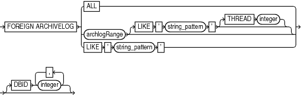
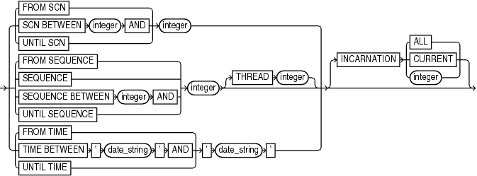

Purpose

Use the foreignlogRecordSpecifier subclause to specify a set of foreign archived redo log files for use in RMAN operations.

Usage Notes

Foreign archived redo log files are received by a logical standby database for a LogMiner session. Unlike normal archived logs, foreign archived logs have a different DBID. For this reason, they cannot be backed up or restored on a logical standby database.

A logical standby database creates foreign archived logs in the fast recovery area if the following conditions are met:

- A fast recovery area is configured on the logical standby database.
- a `LOG_ARCHIVE_DEST_` `n` initialization parameters is set to `'LOCATION=USE_DB_RECOVERY_FILE_DEST'` with a proper `VALID_FOR` setting to receive foreign archived logs.
- The `COMPATIBLE` initialization parameter is set to a value greater than or equal to 11.0.0.

Syntax

foreignlogRecordSpecifier::=



> FOREIGN ARCHIVELOG {ALL | archlogRange \[LIKE ' string\_pattern ' \[THREAD integer\]\] | LIKE ' string\_pattern '} \[DBID integer \[, integer\]...\]
>
> [  
> Copyright © 2023, 2024, Oracle and/or its affiliates.](https://docs.oracle.com/en/database/oracle/oracle-database/dcommon/html/cpyr.htm)


archlogRange::=



> { {FROM SCN | SCN BETWEEN integer AND | UNTIL SCN} integer | {FROM SEQUENCE | SEQUENCE | SEQUENCE BETWEEN integer AND | UNTIL SEQUENCE} integer \[THREAD integer\] | {FROM TIME | TIME BETWEEN ' date\_string ' AND | UNTIL TIME} ' date\_string '} \[INCARNATION {ALL | CURRENT | integer}\]


Semantics

The semantics duplicate `archivelogRecordSpecifier` except that the logs are foreign archived redo log files.

Examples

Example 4-21 Crosschecking Foreign Archived Redo Log Files

This example crosschecks all foreign archived redo log files:

```
RMAN> CROSSCHECK FOREIGN ARCHIVELOG ALL;
```