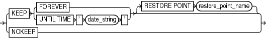

Purpose

Use the `keepOption` subclause to specify the status of a backup or copy in relation to a retention policy.

Syntax

keepOption::=



> KEEP {FOREVER | UNTIL TIME ' date\_string '} \[RESTORE POINT restore\_point\_name\] | NOKEEP
>
> [  
> Copyright © 2023, 2024, Oracle and/or its affiliates.](https://docs.oracle.com/en/database/oracle/oracle-database/dcommon/html/cpyr.htm)


Usage Notes

RMAN does not consider backup pieces with the `KEEP` option when computing the backup retention policy. If available, RMAN uses these backups for disaster recovery restore operations, but their purpose is to produce a snapshot of the database that can be restored on another system for testing or historical usage.

When creating archival backups with `KEEP`, RMAN only considers `KEEP` backups with the same tag. Thus, when using `keepOption` with `notBackedUpSpec`, RMAN only skips a backup if it finds the specified maximum number of `KEEP` backups with the same tag. Other backups are not counted.

Semantics

| Syntax Element | Description |
| --- | --- |
| `KEEP` | Specifies the backup as an **archival backup**, which is a self-contained backup that is exempt from the configured retention policy.  An archival backup is self-contained because it contains all files necessary to restore the backup and recover it to a consistent state. If the database is open during the backup, then RMAN automatically generates and backs up the archived redo log files needed to make the database backup consistent (see [Example 2-26](BACKUP.md)).  Note: PDB backups are self-contained only when local undo is used. When shared undo is used, PDB backups are not self-contained.  RMAN does not consider backup pieces with the `KEEP` option when computing the retention policy. If available, RMAN uses these backups for disaster recovery restore operations, but their purpose is to produce a snapshot of the database that can be restored on another system for testing or historical usage.  Note: You cannot use `KEEP` to override the retention policy for files stored in the fast recovery area. If you specify `KEEP` when backing up to the recovery area, then RMAN issues an error.  When `KEEP` is specified, RMAN creates multiple backup sets. RMAN backs up data files, archived redo log files, the control file, and the server parameter file with the options specified in the first `backupOperand`. Since a backup of the control file is created, an autobackup of the control file is not created. RMAN uses the `FORMAT`, `POOL`, and `TAG` parameters for all the backups. For this reason, the `FORMAT` string must allow for the creation of multiple backup pieces. Specifying `%U` is the easiest way to meet this requirement.  See Also: [CONFIGURE](CONFIGURE.md) and Oracle Database Backup and Recovery User's Guide to learn more about autobackup of the control file.  When `KEEP` is specified with `INCREMENTAL LEVEL`, the parent backup must be a `KEEP` backup and have the same `TAG` string. Unless both these criteria are met, the backup cannot be created. Backups that meet these criteria do not interfere with other nightly or archival backup tasks.  Note: A recovery catalog is only required for `KEEP FOREVER`. No other `KEEP` options require a catalog. |
| `   FOREVER` | Specifies that the backup or copy never becomes obsolete (see [Example 2-27](BACKUP.md)). A recovery catalog is required when `FOREVER` is specified because the backup records eventually age out of the control file. |
| `   UNTIL TIME` `'` `date_string` `'` | Specifies the time until which the backup or copy must be kept. After this time the backup is obsolete, regardless of the backup retention policy settings.  You can either specify a specific time by using the current `NLS_DATE_FORMAT`, or a SQL date expression such as `'SYSDATE+365'`. If you specify a `KEEP TIME` such as `01-JAN-13`, then the backup becomes obsolete one second after midnight on this date. If you specify a `KEEP` time such as 9:00 p.m, then the backup becomes obsolete at 9:01 p.m. |
| `   RESTORE POINT` `restore_point_name` | Creates a normal restore point matching the SCN to which RMAN must recover the backup to a consistent state (see [Example 2-26](BACKUP.md)). The restore point name must not already exist.  The SCN is captured just after the data file backups complete. The restore point is a label for the SCN to which this archival backup can be restored and recovered, enabling the database to be opened. In contrast, the `UNTIL TIME` clause specifies the date until which the backup must be kept.  Note: The `RESTORE POINT` parameter is not valid with the `CHANGE` command. |
| `NOKEEP` | Specifies that any `KEEP` attributes no longer apply to the backup. Thus, the backup is a normal backup that is subject to the configured backup retention policy. This is the default behavior if no `KEEP` option is specified. |

Examples

Example 4-24 Creating a Consistent Database Backup for Archival

This example makes a database backup with tag `Q107` and specifies that it is never considered obsolete (partial sample output included). The archived redo log files necessary to make the data files consistent are included in the backup set.

```
RMAN> BACKUP TAG Q107 DATABASE KEEP FOREVER;

Starting backup at 24-JAN-13

current log archived
allocated channel: ORA_SBT_TAPE_1
channel ORA_SBT_TAPE_1: SID=105 device type=SBT_TAPE
channel ORA_SBT_TAPE_1: Oracle Secure Backup
backup will never be obsolete
archived logs required to recover from this backup will be backed up
channel ORA_SBT_TAPE_1: starting full datafile backup set
channel ORA_SBT_TAPE_1: specifying datafile(s) in backup set
.
.
.
```

Example 4-25 Removing the KEEP Attributes for a Backup

This example backs up all archived redo log files. The `KEEP` clause specifies that one second after midnight on January 1, 2013 the backup is considered obsolete.

```
RMAN> BACKUP KEEP UNTIL TIME '01-JAN-13' ARCHIVELOG ALL;
```

The following command removes the `KEEP` attributes of all archived redo log backups (sample output included):

```
RMAN> CHANGE BACKUP OF ARCHIVELOG ALL NOKEEP;
 
using channel ORA_SBT_TAPE_1
allocated channel: ORA_DISK_1
channel ORA_DISK_1: SID=77 device type=DISK
keep attributes for the backup are deleted
backup set key=330 RECID=19 STAMP=612722760
keep attributes for the backup are deleted
backup set key=397 RECID=22 STAMP=612722884
```