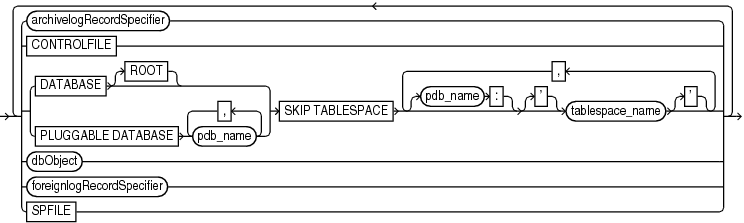

Purpose

Use the `listObjList` subclause to specify database files and archived redo log files.

Syntax

listObjList::=



> {archivelogRecordSpecifier | CONTROLFILE | {DATABASE \[ROOT\] | PLUGGABLE DATABASE pdb\_name \[, pdb\_name\]...} SKIP TABLESPACE \[pdb\_name:\] \['\] tablespace\_name \['\] \[, \[pdb\_name:\] \['\] tablespace\_name \['\]\]... | dbObject | foreignlogRecordSpecifier | SPFILE} \[ {archivelogRecordSpecifier | CONTROLFILE | {DATABASE \[ROOT\] | PLUGGABLE DATABASE pdb\_name \[, pdb\_name\]...} SKIP TABLESPACE \[pdb\_name:\] \['\] tablespace\_name \['\] \[, \[pdb\_name:\] \['\] tablespace\_name \['\]\]... | dbObject | foreignlogRecordSpecifier | SPFILE}\]...


([archivelogRecordSpecifier::=](archivelogRecordSpecifier.md), [dbObject::=](dbObject.md), [foreignlogRecordSpecifier::=](foreignlogRecordSpecifier.md))

Semantics

| Syntax Element | Description |
| --- | --- |
| `archivelogRecordSpecifier` | Specifies a range of archived redo log files.  See Also: `archivelogRecordSpecifier` |
| `CONTROLFILE` | Specifies the current control file. |
| `DATABASE` | Specifies the whole CDB. |
| `DATABASE ROOT` | Specifies only the CDB root. |
| `PLUGGABLE DATABASE` `pdb_name` | Specifies one or more pluggable databases (PDBs) in a CDB. Use a comma-delimited list to specify multiple PDBs. |
| `SKIP TABLESPACE` `tablespace_name` | Omits the specified tablespaces in the root. |
| `SKIP TABLESPACE ` `pdb_name:``tablespace_name` | The name of the tablespace in a PDB. Multiple PDBs can have tablespaces with the same name. A qualifier before the name uniquely identifies the tablespace. `pdb_name` is the name of a PDB. |
| `foreignlogRecordSpecifier` | Processes the specified foreign archived redo log files.  See Also: `foreignlogRecordSpecifier` |
| `SPFILE` | Specifies the current server parameter file. |

Examples

Example 4-26 Listing Data File Copies

The following command lists image copies of all the files in the database, skipping the `temp` tablespace, which is a dictionary-managed temporary tablespace:

```
LIST COPY OF DATABASE
  SKIP TABLESPACE temp;
```

Example 4-27 Listing Data Files for a PDB

The following command lists the backups of the PDB `hr_pdb`. Connect to the root as a common user with the `SYBACKUP` privilege before running this command.

```
LIST BACKUP OF PLUGGABLE DATABASE hr_pdb;
```

Example 4-28 Crosschecking Archived Redo Log Files

The following example queries the media manager for the status of server parameter file and archived redo log backups created in the last three months. The example includes sample output.

```
RMAN> ALLOCATE CHANNEL FOR MAINTENANCE DEVICE TYPE sbt;
 
allocated channel: ORA_MAINT_SBT_TAPE_1
channel ORA_MAINT_SBT_TAPE_1: SID=103 device type=SBT_TAPE
channel ORA_MAINT_SBT_TAPE_1: Oracle Secure Backup
 
RMAN> CROSSCHECK BACKUP OF SPFILE ARCHIVELOG FROM TIME 'SYSDATE-90';
 
crosschecked backup piece: found to be 'AVAILABLE'
backup piece handle=8cic4031_1_1 RECID=195 STAMP=616693857
crosschecked backup piece: found to be 'AVAILABLE'
backup piece handle=c-28014364-20130308-15 RECID=196 STAMP=616693875
Crosschecked 2 objects
 
RMAN> RELEASE CHANNEL;
 
released channel: ORA_MAINT_SBT_TAPE_1
```

Example 4-29 Deleting Expired Backups

The following command performs a crosscheck of all backups. One backup is found to be expired. The example then deletes all expired backups (sample output included).

```
RMAN> CROSSCHECK BACKUP;
```
```
allocated channel: ORA_SBT_TAPE_1
channel ORA_SBT_TAPE_1: SID=104 device type=SBT_TAPE
channel ORA_SBT_TAPE_1: Oracle Secure Backup
allocated channel: ORA_DISK_1
channel ORA_DISK_1: SID=103 device type=DISK
crosschecked backup piece: found to be 'EXPIRED'
backup piece handle=/disk2/PROD/autobackup/2013_03_08/o1_mf_s_616690991_2z15kl5h_.bkp
 RECID=191 STAMP=616690994
crosschecked backup piece: found to be 'AVAILABLE'
backup piece handle=8cic4031_1_1 RECID=195 STAMP=616693857
crosschecked backup piece: found to be 'AVAILABLE'
backup piece handle=c-28014364-20130308-15 RECID=196 STAMP=616693875
Crosschecked 3 objects
```
```
RMAN> DELETE EXPIRED BACKUP;
```
```
using channel ORA_SBT_TAPE_1
using channel ORA_DISK_1
```
```
List of Backup Pieces
BP Key  BS Key  Pc# Cp# Status      Device Type Piece Name
------- ------- --- --- ----------- ----------- ----------
7678    7677    1   1   EXPIRED     DISK       
 /disk2/PROD/autobackup/2013_03_08/o1_mf_s_616690991_2z15kl5h_.bkp
```
```
Do you really want to delete the above objects (enter YES or NO)? YES
deleted backup piece
backup piece handle=/disk2/PROD/autobackup/2013_03_08/o1_mf_s_616690991_2z15kl5h_.bkp
 RECID=191 STAMP=616690994
Deleted 1 EXPIRED objects
```