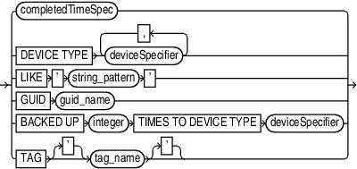

Purpose

Use the `maintQualifier` subclause to specify database files and archived redo log files.

Syntax

maintQualifier::=



> completedTimeSpec | DEVICE TYPE deviceSpecifier \[, deviceSpecifier\]... | LIKE ' string\_pattern ' | GUID guid\_name | BACKED UP integer TIMES TO DEVICE TYPE deviceSpecifier | TAG \['\] tag\_name \['\]
>
> [  
> Copyright © 2023, 2024, Oracle and/or its affiliates.](https://docs.oracle.com/en/database/oracle/oracle-database/dcommon/html/cpyr.htm)


([completedTimeSpec::=](completedTimeSpec.md), [deviceSpecifier::=](deviceSpecifier.md))

Semantics

maintQualifier

| Syntax Element | Description |
| --- | --- |
| `completedTimeSpec` | Specifies a range of time for completion of the backup or copy.  See Also: `completedTimeSpec` |
| `DEVICE TYPE` `deviceSpecifier` | Allocates automatic channels for the specified device type only. This option is valid only if you have configured automatic channels and have not manually allocated channels. For example, if you configure automatic disk and tape channels, and issue `CHANGE...DEVICE TYPE DISK`, then RMAN allocates only disk channels.  See Also: `deviceSpecifier` |
| `LIKE` `'` `string_pattern` `'` | Restricts data file copies by specifying a file name pattern. The pattern can contain Oracle pattern matching characters percent sign (`%`) and underscore (`_`). RMAN only operates on those files whose name matches the pattern.  Note: You cannot use the `LIKE` option with the `LIST` `...` `ARCHIVELOG` command or with backup pieces. |
| `GUID` `guid_name` | Specifies the GUID of the pluggable database (PDB) on which the specified action is performed. Each PDB is identified using a unique GUID. You can determine the GUID of a dropped PDB by querying the `dba_pdb_history` view. |
| `BACKED UP` `integer` `TIMES TO DEVICE TYPE` `deviceSpecifier` | Restricts the command to archived logs and backup sets that have been successfully backed up `integer` or more times to the specified media.  When the `BACKED UP` option is used with the `DELETE` `ARCHIVELOG` command, RMAN uses the `BACKED UP` setting rather than the configured settings to determine whether an archived log can be deleted. That is, `CONFIGURE` ` ARCHIVELOG DELETION POLICY` is overridden. Use `FORCE` with `DELETE ARCHIVELOG` to override this configuration and any mismatches between media and repository. |
| `TAG` `tag_name` | Specifies the data file copies and backup sets by tag. Tag names are not case sensitive and display in all uppercase.  See Also: `BACKUP` for a description of how a tag can be applied to an individual copy of a duplexed backup set, and also for a description of the default file name format for tags |

Example

Example 4-30 Listing Backups in a Specific Location

The following command lists all image copies located in directory `/disk2`:

```
RMAN> LIST COPY LIKE '/disk2/%';
 
List of Datafile Copies
=======================
 
Key     File S Completion Time Ckp SCN    Ckp Time
------- ---- - --------------- ---------- ---------------
9855    1    A 08-MAR-13       1394701    08-MAR-13
        Name: /disk2/data_D-PROD_I-28014364_TS-SYSTEM_FNO-1_8eic410j
        Tag: TAG20130308T160643
 
9856    2    A 08-MAR-13       1394735    08-MAR-13
        Name: /disk2/data_D-PROD_I-28014364_TS-SYSAUX_FNO-2_8fic412a
        Tag: TAG20130308T160643
```

Example 4-31 Deleting Archived Logs That Are Backed Up

The following command deletes only those archived logs that have been successfully backed up two or more times to tape. In this example, only the sequence 36 archived log meets these criteria.

```
RMAN> DELETE ARCHIVELOG ALL BACKED UP 2 TIMES TO DEVICE TYPE sbt;
 
released channel: ORA_SBT_TAPE_1
allocated channel: ORA_DISK_1
channel ORA_DISK_1: SID=104 device type=DISK
RMAN-08138: WARNING: archived log not deleted - must create more backups
archived log file name=/disk1/oradata/prod/arch/archiver_1_37_616443024.arc thread=1 sequence=37
List of Archived Log Copies for database with db_unique_name PROD
=====================================================================
 
Key     Thrd Seq     S Low Time
------- ---- ------- - ---------
9940    1    36      A 08-MAR-13
        Name: /disk1/oradata/prod/arch/archiver_1_36_616443024.arc
 
 
Do you really want to delete the above objects (enter YES or NO)? Y
deleted archived log
archived log file name=/disk1/oradata/prod/arch/archiver_1_36_616443024.arc RECID=129 STAMP=616695115
Deleted 1 objects
```