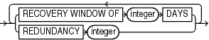

Purpose

Use the `obsOperandList` subclause used to specify which criteria are used to mark backups as obsolete.

Usage Notes

Using both `RECOVERY WINDOW` and `REDUNDANCY` in a single `REPORT OBSOLETE` or `DELETE OBSOLETE` command is not supported.

Syntax

obsOperandList::=



> {RECOVERY WINDOW OF integer DAYS | REDUNDANCY integer} \[ {RECOVERY WINDOW OF integer DAYS | REDUNDANCY integer}\]...
>
> [  
> Copyright © 2023, 2024, Oracle and/or its affiliates.](https://docs.oracle.com/en/database/oracle/oracle-database/dcommon/html/cpyr.htm)


Semantics

obsOperandList

| Syntax Element | Description |
| --- | --- |
| `RECOVERY WINDOW OF` `integer` `DAYS` | Reports as obsolete those backup sets and image copies that are not needed to recover the database to any point within the last `integer` days.  See Also: `CONFIGURE` for an explanation of the recovery window |
| `REDUNDANCY` `integer` | Specifies the minimum level of redundancy considered necessary for a backup set or image copy to be obsolete.  A data file copy is obsolete if there are at least `integer` more recent backup sets or image copies of this file; a data file backup set is obsolete if there are at least `integer` more recent backup sets or image copies of each data file contained in the backup set. For example, `REDUNDANCY` `2` means that there must be at least two more recent backup sets or image copies of a data file for any other backup set or image copy to be obsolete. |

Example

Example 4-33 Deleting Obsolete Backups

The following command deletes all backups and copies not needed to recover the database to an SCN within the last 30 days:

```
DELETE OBSOLETE RECOVERY WINDOW OF 30 DAYS;
```