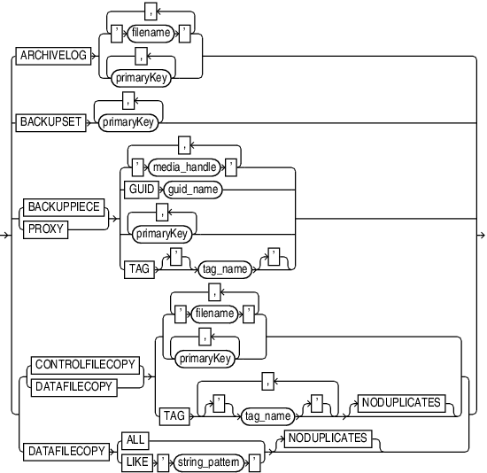

Purpose

Use the `recordSpec` subclause to specify which backups or copies the `CHANGE`, `CROSSCHECK`, `DELETE`, and `LIST` commands process.

Most `recordSpec` options allow you to specify a primary key. Use the output of the `LIST` command to obtain primary keys.

Syntax

recordSpec::=



> ARCHIVELOG { ' filename ' \[, ' filename '\]... | primaryKey \[, primaryKey\]...} | BACKUPSET primaryKey \[, primaryKey\]... | {BACKUPPIECE | PROXY} { ' media\_handle ' \[, ' media\_handle '\]... | GUID guid\_name | primaryKey \[, primaryKey\]... | TAG \['\] tag\_name \['\]} | { {CONTROLFILECOPY | DATAFILECOPY} { { ' filename ' \[, ' filename '\]... | primaryKey \[, primaryKey\]...} | TAG \['\] tag\_name \['\] \[, \['\] tag\_name \['\]\]... \[NODUPLICATES\]} | DATAFILECOPY {ALL | LIKE ' string\_pattern '} \[NODUPLICATES\]}


Semantics

| Syntax Element | Description |
| --- | --- |
| `ARCHIVELOG` | Specifies an archived redo log by either primary key or file name. |
| `BACKUPSET` | Specifies a backup set by primary key. |
| `BACKUPPIECE` | Specifies a backup piece by media handle, primary key, or tag name.  Use `GUID` to specify the globally unique identifier (GUID) of the PDB for which the action must be performed. |
| `PROXY` | Specifies a proxy copy by media handle, primary key, or tag name. |
| `CONTROLFILECOPY` | Specifies a control file copy by primary key, file name pattern (`'filename'`), or `TAG` `tag_name`. If you crosscheck a control file copy, then you must specify a file name rather than a primary key. |
| `DATAFILECOPY` | Specifies a data file copy by primary key, file name pattern (`'filename'`), tag (`TAG` `tag_name`), or matching string (`LIKE '` `string_pattern` `'`). Specify `ALL` to indicate all data file copies recorded in the RMAN repository. |
| `   NODUPLICATES` | Targets only one copy of the control file or data file copy for the operation, even when there are multiple copies. |

Examples

Example 4-34 Crosschecking Backups

This example crosschecks backup sets specified by primary key:

```
RMAN> LIST BACKUP SUMMARY; 
 
List of Backups
===============
Key     TY LV S Device Type Completion Time #Pieces #Copies Compressed Tag
------- -- -- - ----------- --------------- ------- ------- ---------- ---
8504    B  A  A SBT_TAPE    08-MAR-13       1       1       NO         TAG20130308T155057
8558    B  F  A SBT_TAPE    08-MAR-13       1       1       NO         TAG20130308T155114
9872    B  F  A DISK        08-MAR-13       1       1       NO         TAG20130308T160830
9954    B  A  A SBT_TAPE    08-MAR-13       1       1       NO         TAG20130308T161157
9972    B  F  A SBT_TAPE    08-MAR-13       1       1       NO         TAG20130308T161224
10021   B  A  A SBT_TAPE    08-MAR-13       1       1       NO         TAG20130308T161251
10042   B  F  A SBT_TAPE    08-MAR-13       1       1       NO         TAG20130308T161308
10185   B  F  A DISK        08-MAR-13       1       1       NO         TAG20130308T170532
10210   B  F  A DISK        08-MAR-13       1       1       NO         TAG20130308T170535
 
RMAN> CROSSCHECK BACKUPSET 9872, 10185, 10210;
 
allocated channel: ORA_SBT_TAPE_1
channel ORA_SBT_TAPE_1: SID=103 device type=SBT_TAPE
channel ORA_SBT_TAPE_1: Oracle Secure Backup
using channel ORA_DISK_1
crosschecked backup piece: found to be 'AVAILABLE'
backup piece handle=/disk2/PROD/autobackup/2013_03_08/o1_mf_s_616694910_2z19d0wg_.bkp RECID=197 STAMP=616694912
crosschecked backup piece: found to be 'AVAILABLE'
backup piece handle=/disk2/PROD/backupset/2013_03_08/o1_mf_nnsnf_TAG20130308T170532_2z1dpwz6_.bkp RECID=202 STAMP=616698332
crosschecked backup piece: found to be 'AVAILABLE'
backup piece handle=/disk2/PROD/autobackup/2013_03_08/o1_mf_s_616698335_2z1dq0d0_.bkp RECID=203 STAMP=616698336
Crosschecked 3 objects
```

Example 4-35 Deleting Data File Copies

This example deletes the specified data file copy:

```
RMAN> DELETE NOPROMPT DATAFILECOPY '/disk1/oradata/prod/users01.dbf';
```