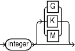

Purpose

The `sizeSpec` subclause specifies the size of the data.

Syntax

sizeSpec::=



> integer \[ {G | K | M}\]
>
> [  
> Copyright © 2023, 2024, Oracle and/or its affiliates.](https://docs.oracle.com/en/database/oracle/oracle-database/dcommon/html/cpyr.htm)


Semantics

| Syntax Element | Description |
| --- | --- |
| `integer` `[G \| K \| M]` | Specifies the size of data in gigabytes (`G`), kilobytes (`K`), or megabytes (`M`). |

Examples

Example 4-36 Setting the Maximum Size of a Backup Piece

This `ALLOCATE` command specifies in the `MAXPIECESIZE` parameter that no backup piece written to tape can exceed 800 MB.

```
RUN
{
  ALLOCATE CHANNEL c1 DEVICE TYPE sbt 
    PARMS 'SBT_LIBRARY=/usr/local/oracle/backup/lib/libobk.so, 
    ENV=(OB_DEVICE_1=stape1)'
    MAXPIECESIZE 800M;
}
```