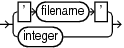

Purpose

Use the `tempfileSpec` subclause to specify a temp file by name or absolute file number.

Syntax

tempfileSpec::=



> ' filename ' | integer
>
> [  
> Copyright © 2023, 2024, Oracle and/or its affiliates.](https://docs.oracle.com/en/database/oracle/oracle-database/dcommon/html/cpyr.htm)


Semantics

| Syntax Element | Description |
| --- | --- |
| `'` `filename` `'` | Specifies the data file by using either the full path or a relative file name. If you specify a relative file name, the file name is qualified in a platform-specific manner by the target database.  You can specify an absolute path name, or a path name relative to the Oracle home. Double and single quotes are both valid (although only single quotes are shown in the diagram). Use a question mark (`?`) to represent the Oracle home and the at sign (`@`) for the Oracle SID. |
| `integer` | Specifies the data file by absolute file number. Obtain the file number from the `V$TEMPFILE` view or `REPORT` `SCHEMA` output. |

Examples

Example 4-37 Specifying a Temp File by File Name

This example renames temp file `/disk1/oradata/prod/temp01.dbf` to `/disk2/temp01.dbf`, specifying it by file name. The database must be mounted when performing this example.

```
SHUTDOWN IMMEDIATE
STARTUP MOUNT
RUN
{
  SWITCH TEMPFILE '/disk1/oradata/prod/temp01.dbf'
               TO '/disk2/temp01.dbf';
}
ALTER DATABASE OPEN;
```