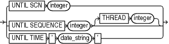

Purpose

Use the `untilClause` subclause to specify an upper limit by time, SCN, or log sequence number for various RMAN operations.

Usage Notes

To specify a restore point, use the `TO` `RESTORE` `POINT` clause. See " [SET](SET.md) " for an example.

Syntax

untilClause::=



> UNTIL SCN integer | UNTIL SEQUENCE integer \[THREAD integer\] | UNTIL TIME ' date\_string '
>
> [  
> Copyright © 2023, 2024, Oracle and/or its affiliates.](https://docs.oracle.com/en/database/oracle/oracle-database/dcommon/html/cpyr.htm)


Semantics

| Syntax Element | Description |
| --- | --- |
| `UNTIL SCN` `integer` | Specifies an SCN as an upper, noninclusive limit.  RMAN selects only files that it can use to restore or recover up to but not including the specified SCN (see Example 4-41). For example, `RESTORE` `DATABASE UNTIL SCN 1000` chooses only backups that could be used to recover to SCN 1000. |
| `UNTIL SEQUENCE` `integer` | Specifies a redo log sequence number and thread as an upper, noninclusive limit.  RMAN selects only files that it can use to restore or recover up to but not including the specified sequence number. For example, `REPORT` `OBSOLETE UNTIL SEQUENCE 8000` reports only backups that could be used to recover through log sequence 7999. |
| `   THREAD` `integer` | Specifies the number of the redo thread. |
| `UNTIL TIME` `'` `date_string` `'` | Specifies a time as an upper, noninclusive limit (see Example 4-42).  RMAN selects only files that it can use to restore and recover up to but not including the specified time. For example, `LIST` `BACKUP` `UNTIL` `TIME` `'SYSDATE-7'` lists all backups that could be used to recover to a point one week ago.  When specifying dates in RMAN commands, the date string must be either:  - A literal string whose format matches the `NLS_DATE_FORMAT` setting. - A SQL expression of type `DATE`, for example, `'SYSDATE-10'` or `"TO_DATE('01/30/2013',` `'MM/DD/YYYY')"`. The second example includes its own date format mask and so is independent of the current `NLS_DATE_FORMAT` setting.  Following are examples of typical date settings in RMAN commands:  ``` BACKUP ARCHIVELOG FROM TIME 'SYSDATE-31' UNTIL TIME 'SYSDATE-14'; RESTORE DATABASE UNTIL TIME "TO_DATE('09/20/06','MM/DD/YY')"; ```  Note: The granularity of time-based recovery is dependent on time stamps in the redo log. For example, suppose that you specify the following command:  ``` RECOVER DATABASE UNTIL TIME '2013-07-26 17:45:00'; ```  If no redo was written with a time stamp of `17:45:00`, then recovery proceeds until it finds the next redo time stamp that is higher. For example, the next redo time stamp may be `17:45:04`. You can check for the nearest time for a specific SCN by querying the `FIRST_TIME` and `FIRST_CHANGE#` columns in `V$LOG_HISTORY TABLE`. |

Examples

Example 4-41 Performing Incomplete Recovery to a Specified SCN

This example, which assumes a mounted database, recovers the database up to (but not including) the specified SCN:

```
STARTUP FORCE MOUNT
RUN
{
  SET UNTIL SCN 1418901;  # set to 1418901 to recover database through SCN 1418900
  RESTORE DATABASE;
  RECOVER DATABASE;
}
ALTER DATABASE OPEN RESETLOGS;
```

Example 4-42 Reporting Obsolete Backups

This example assumes that you want to be able to recover to any point within the last week. It considers as obsolete all backups that could be used to recover the database to a point one week ago:

```
REPORT OBSOLETE UNTIL TIME 'SYSDATE-7';
```