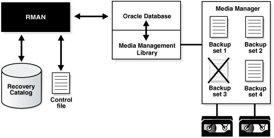

Use RMAN commands to manage the RMAN repository records, backups, and copies.

See Also:

[Managing a Recovery Catalog](managing-recovery-catalog.md) for RMAN maintenance issues that are specific to a [recovery catalog](glossary.md)

### 12.1 Overview of RMAN Backup and Repository Maintenance

This section explains the purpose and basic concepts of RMAN repository maintenance.

#### 12.1.1 Purpose of Backup and Repository Maintenance

The recommended maintenance strategy is to configure a fast recovery area, a backup retention policy, and an archived redo log deletion policy.

In this case, the database automatically maintains and deletes backups and archived redo logs as needed. However, manual maintenance of database backups and archived redo logs is sometimes necessary.

Managing RMAN backups involves the following related tasks:

- Managing the database backups that are stored on disk or tape
- Managing the records of those backups in the RMAN repository

An important part of RMAN maintenance is deleting backups that are no longer needed. If you configure a fast recovery area, then the database automatically deletes unneeded files in this area automatically; even so, you may want to delete backups and copies from tape. You may even need to delete an entire database. You can use an RMAN command to perform these tasks.

The fast recovery area may require occasional maintenance. For example, the fast recovery area may become full, in which case you can add space to it. Alternatively, you may want to change the location of the recovery area.

It is possible for the RMAN repository to fail to reflect the true state of files on disk or tape. For example, a user may delete a backup from disk with an operating system utility. In this case, the RMAN repository shows that the file exists when it does not. In a similar situation, a tape containing RMAN backups may be corrupted. You can use RMAN maintenance commands to update the repository with accurate information.

#### 12.1.2 Basic Concepts of Backup and Repository Maintenance

RMAN provides multiple commands to maintain RMAN backups and repository records.

Following are the RMAN maintenance commands:

- The [`CATALOG`](https://docs.oracle.com/pls/topic/lookup?ctx=en/database/oracle/oracle-database/21/bradv&id=RCMRF109) command enables you to add records about RMAN and user-managed backups that are currently not recorded in the RMAN repository, or to remove records for backups that are recorded.
- The [`CHANGE`](https://docs.oracle.com/pls/topic/lookup?ctx=en/database/oracle/oracle-database/21/bradv&id=RCMRF110) command enables you to update the status of records in the RMAN repository.
- The [`CROSSCHECK`](https://docs.oracle.com/pls/topic/lookup?ctx=en/database/oracle/oracle-database/21/bradv&id=RCMRF119) command enables you to synchronize the logical backup records with the physical reality of files in backup storage.
- The [`DELETE`](https://docs.oracle.com/pls/topic/lookup?ctx=en/database/oracle/oracle-database/21/bradv&id=RCMRF121) command enables you to delete backups from the operating system.

##### 12.1.2.1 About Maintenance Commands and RMAN Repository Metadata

RMAN always stores its metadata in the control file of each target database on which it performs operations. If you register a target database in the recovery catalog, then RMAN stores the metadata for this target database in the recovery catalog.

All of the RMAN maintenance commands work with or without a recovery catalog.

##### 12.1.2.2 About Maintenance Commands in a Data Guard Environment

The database in a Data Guard environment that creates a backup or copy is associated with the file. For example, if RMAN is connected to target database `standby1` and backs it up, then this backup is associated with `standby1`.

If backups are accessible to RMAN according to the criteria specified in "About RMAN File Management in a Data Guard Environment", you can use RMAN maintenance commands such as `CHANGE`, `DELETE`, and `CROSSCHECK` for backups when connected to any primary or standby database.

###### 12.1.2.2.1 About Crosschecks in a Data Guard Environment

For a crosscheck, RMAN can only update the status of a file from `AVAILABLE` to `EXPIRED` when connected to the database associated with the file.

Thus, if RMAN crosschecks a file and does not find it, and if the file is associated with a database to which it is not connected as `TARGET`, then RMAN prompts you to perform the crosscheck when connected to the target database associated with the file. RMAN performs a crosscheck when you run the `CROSSCHECK` or `CHANGE ... AVAILABLE` command.

###### 12.1.2.2.2 About Deletion in a Data Guard Environment

RMAN can delete files when connected to any database. If RMAN is not connected as `TARGET` to the database associated with a file, and if RMAN cannot delete a file successfully, then RMAN prompts you to connect as `TARGET` to the database associated with the file. You must then use `DELETE ... FORCE` to delete the file metadata.

###### 12.1.2.2.3 About Updates to RMAN Metadata in a Data Guard Environment

If a maintenance command changes RMAN metadata only, then you can connect RMAN as `TARGET` to any database in the Data Guard environment.

Commands that change only metadata include:

- `CHANGE ... UNAVAILABLE` or `CHANGE ... UNCATALOG`
- `CHANGE ... KEEP` or `CHANGE ... NOKEEP`
- `CHANGE ... RESET DB_UNIQUE_NAME`

By default, the `CHANGE` command only operates on files that are accessible according to the rules specified in "About Accessibility of Backups in a Data Guard Environment". However, you can change the status of files associated with a database other than the target database by using the `FOR DB_UNIQUE_NAME` option.

###### 12.1.2.2.4 About Files Not Associated with a Database

A backup remains associated with a database unless you explicitly use the `CHANGE ... RESET DB_UNIQUE_NAME` to associate the backup with a different database.

In some cases the `DB_UNIQUE_NAME` may not be known for a specific file. For example, the value of `DB_UNIQUE_NAME` is `null` when the database name is not known to the recovery catalog, as for Oracle9i databases that are registered in a recovery catalog. Also, rows can have a `DB_UNIQUE_NAME` of `null` because a database has been upgraded to the current version, but the recovery catalog schema has not reconciled the `DB_UNIQUE_NAME` values for all files. By default, RMAN associates files whose `SITE_KEY` is `null` with the database to which RMAN is connected as `TARGET`.

### 12.2 Maintaining the Control File Repository

RMAN is designed to work without a recovery catalog. If you choose not to use a recovery catalog, however, then the control file of each target database is the exclusive repository for RMAN metadata.

You must know how information is stored in the control file and ensure that your backup and recovery strategy protects the control file.

#### 12.2.1 About Control File Records

The control file contains two types of records: circular reuse records and noncircular reuse records.

Circular reuse records contain noncritical information that is eligible to be overwritten if needed. These records contain information that is continually generated by the database. When all available record slots are full, the database either expands the control file to make room for a new record or overwrites the oldest record. The `CONTROL_FILE_RECORD_KEEP_TIME` initialization parameter specifies the minimum age, in days, of a record before it can be reused.

Noncircular reuse records contain critical information that does not change often and cannot be overwritten. Some examples of information in noncircular reuse records include data files, online redo log files, and redo threads.

As you make backups of a target database, the database records these backups in the control file. To prevent the control file from growing too large because of the addition of new records, records can be reused if they are older than a threshold that you specify. The `CONTROL_FILE_RECORD_KEEP_TIME` initialization parameter determines the minimum age, in days, of a record before it can be overwritten.

```
CONTROL_FILE_RECORD_KEEP_TIME = integer
```

For example, if the parameter value is `14`, then any record of age 14 days or older is a candidate for reuse. Information in an overwritten record is lost. The oldest record available for reuse is used first.

Note:

When records are overwritten, the backup pieces associated with the metadata are orphaned and will not managed by RMAN.

When the database must add new RMAN repository records to the control file, but no record is older than the threshold, the database attempts to expand the size of the control file. If the underlying operating system prevents the expansion of the control file (due to a disk full condition, for instance), then the database overwrites the oldest record in the control file.

The database records the overwrite in the alert log located in the Automatic Diagnostic Repository. For each record that it overwrites, the database records an entry in the alert log similar to the following:

```
kccwnc: following control file record written over:  
RECID #72 Recno 72 Record timestamp  
07/28/06 22:15:21  
Thread=1 Seq#=3460  
Backup set key: stamp=372031415, count=17  
Low scn: 0x0000.3af33f36  
07/27/06 21:00:08  
Next scn: 0x0000.3af3871b  
07/27/06 23:23:54
Resetlogs scn and time  
scn: 0x0000.00000001
```

##### 12.2.1.1 About Fast Recovery Area and Control File Records

When a control file record containing information about a file created in the fast recovery area is about to be reused, the database attempts to delete the file from the fast recovery area when the file is eligible for deletion. Otherwise, the database expands the size of the control file section containing the record for this file.

The database logs the expansion in the alert log with a message like this example, where `nnnn` is the number of the control file record type:

```
kccwnc: trying to expand control file section nnnn for Oracle Managed Files
```

If the control file is at the maximum size supported under the host operating system, then the database cannot expand the control file. In such a situation, this warning appears in the alert log:

```
WARNING: Oracle Managed File filename is unknown to control file. This is the result of limitation in control file size that could not keep all recovery area files.
```

The preceding message means that the control file cannot hold a record of all fast recovery area files needed to satisfy the configured retention policy. The next section explains how to respond to this situation.

#### 12.2.2 Preventing the Loss of Control File Records

The best way to prevent the loss of RMAN metadata because of overwritten control file records is to use a recovery catalog.

If you cannot use a recovery catalog, then you can take the following measures:

- Set the `CONTROL_FILE_RECORD_KEEP_TIME` value to slightly longer than the oldest file that you must keep. For example, if you back up the whole database once a week, then you must keep every backup for at least 7 days. Set `CONTROL_FILE_RECORD_KEEP_TIME` to a value such as `10` or `14`. The default value of `CONTROL_FILE_RECORD_KEEP_TIME` is 7 days.
	Caution:
	Regardless of whether you use a recovery catalog, never use RMAN when `CONTROL_FILE_RECORD_KEEP_TIME` is set to 0. If you do, then you may lose backup records.
- Store the control file in a file system rather than on a [raw device](glossary.md) so that it can expand.
- Monitor the alert log to ensure that Oracle Database is not overwriting control file records. The alert log is located in the Automatic Diagnostic Repository (ADR).

If you use a fast recovery area, then follow these guidelines to avoid a situation in which the control file cannot hold a record of all fast recovery area files needed to satisfy the backup retention policy:

- If the block size of the control file is not at its maximum, then use a larger block size, preferably 32 kilobytes.
	To achieve this aim, you must set the `SYSTEM` tablespace block size to be greater than or equal to the control file block size, and re-create the control file after changing `DB_BLOCK_SIZE`. The files in the fast recovery area are recataloged, but the records for files on tape are lost.
- Make the files in the fast recovery area eligible for deletion by backing them up to tertiary storage such as tape.
	For example, you can use `BACKUP RECOVERY AREA` to specifically back up files in the fast recovery area to a media manager.
- If the backup retention policy is keeping backups and archived logs longer than your business requirements, then you can make more files in the fast recovery area eligible for deletion by changing the retention policy to a shorter recovery window or lower degree of redundancy.

#### 12.2.3 Protecting the Control File

If you are not using a recovery catalog to store RMAN metadata, then it is doubly important that you protect each target database control file.

You can use the following strategy to protect the control file.

To protect the control file:

1. Create redundant copies of control files through multiplexing or operating system mirroring.
	In this way, the database can survive the loss of a subset of the control files without requiring you to restore a control file from backup. Oracle recommends that you use a minimum of two multiplexed or mirrored control files on separate disks.
2. Configure the control file autobackup feature.
	In this case, RMAN automatically backs up the control file when you run certain RMAN commands. If a control file autobackup is available, RMAN can restore the server parameter and backup control file, and mount the database. After the control file is mounted, you can restore the remainder of the database.
3. Keep a record of the database DBID.
	If you lose the control files, then you can use the DBID to recover the database.

### 12.3 Maintaining the Fast Recovery Area

Although the fast recovery area is largely self-managing, some situations may require database administration intervention.

#### 12.3.1 Deletion Rules for the Fast Recovery Area

RMAN uses certain rules to determine when files can be deleted from the fast recovery area.

The following rules govern when files become eligible for deletion from the recovery area:

- Permanent files are never eligible for deletion.
- Files that are obsolete under the retention policy are eligible for deletion.
- Transient files that have been copied to tape are eligible for deletion.
- Archived redo logs are not eligible for deletion until all the consumers of the logs have satisfied their requirements.
	Consumers of logs can include RMAN, standby databases, and the Flashback Database feature.
- Foreign archived logs that have been mined by a LogMiner session on a logical standby database are eligible for deletion. Because it is generated from a different database than the current database, a foreign archived redo log has a different DBID than the current archived redo logs.

The safe and reliable way to control deletion of files from the fast recovery area is to configure your retention policy and archived log deletion policy. To increase the likelihood that files moved to tape are retained on disk, increase the fast recovery area quota.

#### 12.3.2 Monitoring Fast Recovery Area Space Usage

You can use the `V$RECOVERY_FILE_DEST` and `V$RECOVERY_AREA_USAGE` views to determine whether you have allocated enough space for your fast recovery area.

Query the `V$RECOVERY_FILE_DEST` view to discover the current location, disk quota, space in use, space reclaimable by deleting files, and total number of files in the fast recovery area. The space columns specify the amount in bytes. Query the `V$RECOVERY_AREA_USAGE` view to discover the percentage of the total disk quota used by different types of files. Also, you can determine how much space for each type of file can be reclaimed by deleting files that are obsolete, redundant, or backed up to tape.

When guaranteed restore points are defined on your database, you must monitor the amount of space used in your fast recovery area for files required to meet the guarantee. Use the query for viewing guaranteed restore points in "Listing Restore Points Using the V$RESTORE\_POINT View" and see the `STORAGE_SIZE` column to determine the space required for files related to each guaranteed restore point.

Example 12-1 Fast Recovery Area Space Consumption

The following example displays details about the fast recovery area such as the location, disk quota, space usage, and number of files.

```
SELECT * FROM V$RECOVERY_FILE_DEST;

NAME          SPACE_LIMIT SPACE_USED SPACE_RECLAIMABLE NUMBER_OF_FILES  CON_ID
------------  ----------- ---------- ----------------- ---------------  ------
/mydisk/rcva   5368709120 109240320             256000              28       0
```

Example 12-2 Fast Recovery Area Space Usage Based on Type of Files

The following example displays the percentage of space used, percentage of space that can be reclaimed, and number of files in the fast recovery area for each type of file.

```
SELECT * FROM V$RECOVERY_AREA_USAGE;

FILE_TYPE    PERCENT_SPACE_USED PERCENT_SPACE_RECLAIMABLE NUMBER_OF_FILES  CON_ID
------------ ------------------ ------------------------- ---------------  ------
CONTROLFILE                   0                         0               0       0
ONLINELOG                     2                         0              22       0
ARCHIVELOG                 4.05                      2.01              31       0
BACKUPPIECE                3.94                      3.86               8       0
IMAGECOPY                 15.64                     10.43              66       0
FLASHBACKLOG                .08                         0               1       0
```

#### 12.3.3 Managing Space for Flashback Logs in the Fast Recovery Area

You cannot manage the flashback logs in the fast recovery area directly other than by setting the flashback retention target or using guaranteed restore points.

Nevertheless, you can manage fast recovery area space as a whole to maximize the space available for retention of flashback logs. In this way you increase the likelihood of achieving the flashback target.

To make space for flashback logs, back up the other contents of your fast recovery area to tape with commands such as `BACKUP RECOVERY AREA`, `BACKUP BACKUPSET`, and so on. Oracle Database automatically removes obsolete files from the fast recovery area. If offloading backups to tape still does not create enough space to satisfy the backup retention policy and flashback retention target, then allocate more space in the fast recovery area.

Starting with Oracle Database Release 19c, the management of space in the fast recovery area is simplified. Oracle Database monitors flashback logs in the fast recovery area and automatically deletes flashback logs that are beyond the retention period. When the retention target is reduced, flashback logs that are beyond the retention period are deleted immediately.

The `COMPATIBLE` initialization parameter must be set to 19.0.0 or higher for flashback logs to be automatically deleted.

In scenarios where a sudden workload spike causes a large number of flashback logs to be created, the workload is monitored for several days before deleting flashback logs that are beyond the retention period. This avoids the overhead of recreating the flashback logs, if another peak workload occurs soon after.

Note:

You cannot back up flashback logs. Thus, the `BACKUP RECOVERY AREA` operation does not include the flashback logs when backing up the fast recovery area contents to tape.

#### 12.3.4 Responding to a Full Fast Recovery Area

If the RMAN retention policy requires keeping a set of backups larger than the fast recovery area disk quota, or if the retention policy is set to `NONE`, then the fast recovery area can fill completely with no reclaimable space.

The database issues a warning alert when reclaimable space is less than 15% and a critical alert when reclaimable space is less than 3%. To warn the DBA of this condition, an entry is added to the alert log and to the `DBA_OUTSTANDING_ALERTS` table (used by Enterprise Manager). Nevertheless, the database continues to consume space in the fast recovery area until there is no reclaimable space left.

When the recovery area is completely full, the error displayed is as follows, where nnnnn is the number of bytes required and mmmmm is the disk quota:

```
ORA-19809: limit exceeded for recovery files
ORA-19804: cannot reclaim nnnnn bytes disk space from mmmmm limit
```

You have several choices for how to resolve a full fast recovery area when no files are eligible for deletion:

- Make more disk space available and increase `DB_RECOVERY_FILE_DEST_SIZE` to reflect the additional space.
- Move backups from the fast recovery area to tertiary storage such as tape.
	One convenient way to back up all of your recovery area files to tape together is the `BACKUP RECOVERY AREA` command. After you transfer backups from the recovery area to tape, you can delete files from the fast recovery area. Flashback logs cannot be backed up outside the recovery area and are not backed up by `BACKUP RECOVERY AREA`.
- Run `DELETE` for any files that have been removed with an operating system utility.
	If you use host operating system commands to delete files, then the database is not aware of the resulting free space. You can run the RMAN `CROSSCHECK` command to have RMAN recheck the contents of the fast recovery area and identify expired files, and then use the `DELETE EXPIRED` command to delete every expired backup from the RMAN repository.
- Ensure that your guaranteed restore points are necessary. If not, delete them.
	Flashback logs that are not needed for a guaranteed restore point are deleted automatically to gain space for other files in the fast recovery area. A guaranteed restore point forces the retention of flashback logs required to perform Flashback Database to the restore point SCN.
- Review your backup retention policy and, if using Data Guard, your archived redo log deletion policy.

#### 12.3.5 Changing the Fast Recovery Area to a New Location

Use the `ALTER SYSTEM` command to change the location of the fast recovery area.

If you must move the fast recovery area of your database to a new location, then follow this procedure:

1. Start SQL\*Plus on the target database and change the `DB_RECOVERY_FILE_DEST` initialization parameter. For example, enter the following command to set the destination to the ASM disk group `disk1`:
	```
	ALTER SYSTEM SET DB_RECOVERY_FILE_DEST='+disk1' SCOPE=BOTH SID='*';
	```
	After you change this parameter, all new fast recovery area files are created in the new location.
2. Either leave or move the permanent files, flashback logs, and transient files in the old flash recovery location.
	If you leave the existing files in the flash recovery, then the database deletes the transient files from the old fast recovery area as they become eligible for deletion.
	If you must move the old files to the new fast recovery area, then see the [Oracle Automatic Storage Management Administrator's Guide](https://docs.oracle.com/pls/topic/lookup?ctx=en/database/oracle/oracle-database/21/bradv&id=OSTMG89997). The procedure for moving database files into and out of an ASM disk group with RMAN works when moving files into and out of a fast recovery area.

#### 12.3.6 Disabling the Fast Recovery Area

The `ALTER SYSTEM` command can be used to disable the fast recovery area.

Before disabling the fast recovery area, you must first drop all guaranteed restore points and then turn off Flashback Database.

You can then set the `DB_RECOVERY_FILE_DEST` initialization parameter to a null string to disable the fast recovery area. For example, use the following SQL statement to change the parameter on a running database:

```
ALTER SYSTEM SET DB_RECOVERY_FILE_DEST='' SCOPE=BOTH SID='*';
```

The database no longer provides the space management features of the fast recovery area for the files stored in the old `DB_RECOVERY_FILE_DEST` location. The files are still known to the RMAN repository, however, and available for backup and restore activities.

#### 12.3.7 Responding to an Instance Crash During File Creation

As a rule, the fast recovery area is self-maintaining. When an instance crashes during the creation of a file in the fast recovery area, however, the database may leave the file in the fast recovery area.

When this situation occurs, the alert log contains the following error, where `location` is the location of the fast recovery area:

```
ORA-19816: WARNING: Files may exist in location that are not known to database.
```

In such a situation, use the RMAN command `CATALOG RECOVERY AREA` to recatalog any such files. If the file header of the file in question is corrupted, then delete the file manually with an operating system utility.

### 12.4 Updating the RMAN Repository

Several situations can cause a discrepancy between the repository and the files that it records, including tape or disk failures and user-managed copies or deletions of RMAN-related files.

This section explains how to ensure that the RMAN repository accurately reflects the reality of the RMAN-related files stored on disk and tape.

#### 12.4.1 Crosschecking the RMAN Repository

To ensure that data about backups in the recovery catalog or control file is synchronized with corresponding data on disk or in the media management catalog, perform a crosscheck. The `CROSSCHECK` command operates only on files that are currently recorded in the RMAN repository.

If you use a fast recovery area, backup retention policy, and archived redo log deletion policy, then you do not need to perform crosschecks very often. If you delete files by means other than RMAN, then you must perform a crosscheck periodically to ensure that the repository data stays current.

##### 12.4.1.1 About RMAN Crosschecks

Crosschecks update outdated RMAN repository information about backups whose repository records do not match their physical status. For example, if a user removes archived logs from disk with an operating system command, the repository still indicates that the logs are on disk, when in fact they are not.

Figure 12-1 illustrates a crosscheck of a media manager. RMAN queries the RMAN repository for the names and locations of the four backup sets to be checked. RMAN sends this information to the target database server, which queries the media management software about the backups. The media management software then checks its media catalog and reports back to the server that backup set `3` is missing. RMAN updates the status of backup set `3` to `EXPIRED` in the repository. The record for backup set `3` is deleted after you run `DELETE` `EXPIRED`.

Figure 12-1 Crosschecking a Media Manager



> This illustration shows RMAN cross-checking data file backups and copies stored in a recovery catalog and control file with those stored in a media manager.
>
> On the left is the RMAN executable that is connected to a recovery catalog below it. The RMAN executable contains an arrow to the Oracle Database, which is connected to the media management layer, in the center. The media management layer is connected to the media manager, which is connected to the tape devices.


Crosschecks are useful because they can do the following:

- Update outdated information about backups that disappeared from disk or tape or became corrupted
- Update the repository if you delete archived redo logs or other files with operating system commands

Use the crosscheck feature to check the status of a backup on disk or tape. If the backup is on disk, then `CROSSCHECK` checks whether the header of the file is valid. If a backup is on tape, then the command checks that the backups exist in the media management software catalog.

Backup pieces and image copies can have the status `AVAILABLE`, `EXPIRED`, or `UNAVAILABLE`. You can view the status of backups by running the RMAN `LIST` command or by querying `V$BACKUP_FILES` or recovery catalog views such as `RC_DATAFILE_COPY` or `RC_ARCHIVED_LOG`. A crosscheck updates the RMAN repository so that all of these techniques provide accurate information. RMAN updates each backup in the RMAN repository to status `EXPIRED` if the backup is no longer available. If a new crosscheck determines that an expired backup is available again, then RMAN updates its status to `AVAILABLE`.

Note:

The `CROSSCHECK` command does not delete operating system files or remove repository records. You must use the `DELETE` command for these operations.

You can issue the `DELETE` `EXPIRED` command to delete all expired backups. RMAN removes the record for the expired file from the repository. If for some reason the file still exists on the media, then RMAN issues warnings and lists the mismatched objects that cannot be deleted.

##### 12.4.1.2 Crosschecking All Backups and Copies

After connecting to the target database and recovery catalog (if you use one), run `CROSSCHECK` commands as needed to verify the status and availability of backups known to RMAN.

You can configure or manually allocate multiple channels before issuing `CROSSCHECK` or `DELETE` commands. RMAN searches for each backup on all channels that have the same device type as the channel used to create the backup. The multichannel feature is primarily intended for use when crosschecking or deleting backups on both disk and tape within a single command. For example, assume that you have an [SBT](glossary.md) channel configured as follows:

```
CONFIGURE DEVICE TYPE sbt PARALLELISM 1;
CONFIGURE DEFAULT DEVICE TYPE sbt;
```

In this case you can run the following commands to crosscheck both disk and SBT:

```
CROSSCHECK BACKUP;
CROSSCHECK COPY;
```

RMAN uses both the SBT channel and the preconfigured disk channel to perform the crosscheck. Sample output follows:

```
allocated channel: ORA_SBT_TAPE_1
channel ORA_SBT_TAPE_1: sid=12 devtype=SBT_TAPE
channel ORA_SBT_TAPE_1: WARNING: Oracle Test Disk API
using channel ORA_DISK_1
crosschecked backup piece: found to be 'AVAILABLE'
backup piece handle=/oracle/dbs/16c5esv4_1_1 recid=36 stamp=408384484
crosschecked backup piece: found to be 'AVAILABLE'
backup piece handle=/oracle/dbs/c-674966176-20000915-01 recid=37 stamp=408384496
crosschecked backup piece: found to be 'AVAILABLE'
backup piece handle=12c5erb2_1_1 recid=32 stamp=408382820
     .
     .
     .
```

If you do not have an automatic SBT channel configured, then you can manually allocate maintenance channels on disk and tape.

```
ALLOCATE CHANNEL FOR MAINTENANCE DEVICE TYPE sbt;
CROSSCHECK BACKUP;
CROSSCHECK COPY;
```

You do not have to manually allocate a disk channel because RMAN uses the preconfigured disk channel.

##### 12.4.1.3 Crosschecking Specific Backup Sets and Copies

You can use the `LIST` command to report your backups and then use the `CROSSCHECK` command to check that specific backups described in the `LIST` output still exist.

The `DELETE` `EXPIRED` command deletes repository records for backups that fail the crosscheck.

To crosscheck specified backups:

1. Start RMAN and connect to a target database and recovery catalog (if used).
2. Run a `LIST` command to identify the backups to be checked.
	For example, run the following command:
	```
	LIST BACKUP;  # lists all backup sets, proxy copies, and image copies
	```
	Crosscheck the desired backups or copies.
	The following sample commands illustrate different types of crosschecks:
	```
	CROSSCHECK BACKUP;  # checks backup sets, proxy copies, and image copies
	CROSSCHECK COPY OF DATABASE;
	CROSSCHECK BACKUPSET 1338, 1339, 1340;
	CROSSCHECK BACKUPPIECE TAG 'nightly_backup';
	CROSSCHECK BACKUP OF ARCHIVELOG ALL SPFILE;
	CROSSCHECK BACKUP OF DATAFILE "?/oradata/trgt/system01.dbf"
	  COMPLETED AFTER 'SYSDATE-14';
	CROSSCHECK BACKUPSET DEVICE TYPE disk BACKED UP 3 TIMES TO sbt;
	CROSSCHECK BACKUP OF DATABASE BACKED UP 2 TIMES TO sbt;
	CROSSCHECK CONTROLFILECOPY '/tmp/control01.ctl';
	CROSSCHECK DATAFILECOPY 113, 114, 115;
	CROSSCHECK PROXY 789;
	```

##### 12.4.1.4 Crosschecking Preplugin Backups

Use the `CROSSCHECK` command to verify the status and availability of preplugin backups and preplugin archived redo log files known to RMAN.

Ensure that the preplugin backups and preplugin archived redo log files created on the source CDB are accessible to the target database.

To crosscheck preplugin backups:

1. Start RMAN and connect to the root of the target database as a common user with the `SYSDBA` or `SYSBACKUP` privilege. Connect to a recovery catalog, if used.
2. Ensure that the target CDB is open in read-write mode.
	The following command displays the open mode of the database:
	```
	SELECT OPEN_MODE FROM V$DATABASE;
	```
3. Set the preplugin container to the PDB whose preplugin backups must be crosschecked.
	The following example sets the preplugin container to the PDB `my_pdb`:
	```
	SET PREPLUGIN CONTAINER=my_pdb;
	```
4. Run the `CROSSCHECK` command to verify the status and availability of preplugin backups.
	The following command crosschecks the backups for PDB `my_pdb`.
	```
	CROSSCHECK PREPLUGIN BACKUP OF PLUGGABLE DATABASE my_pdb;
	```

#### 12.4.2 Changing the Repository Status of Backups and Copies

RMAN provides multiple methods of changing the repository status of backups and copies.

Perform any of the following tasks to change the repository status of backups and copies:

- Making backups available or unavailable
	You can change the status of a backup if it becomes temporarily available or unavailable. For example, if a mounted disk undergoes maintenance, then you can update the records for backups on the disk to status `UNAVAILABLE`.
- Including or exempting backups from the retention policy
	Archival backups can be created by using the `KEEP` clause to exempt backups from the configured retention policy. You can also change the status of an archival backup and subsequently include it in the configured retention policy.

##### 12.4.2.1 Updating a Backup to Status AVAILABLE or UNAVAILABLE

Run the `CHANGE...UNAVAILABLE` command when a backup cannot be found or has migrated offsite.

RMAN does not use files with status `UNAVAILABLE` in `RESTORE` or `RECOVER` commands. If the file is later found or returns to the main site, then you can update its status again by issuing `CHANGE...AVAILABLE`. The files in the fast recovery area cannot be marked as `UNAVAILABLE`.

To update the status of a file in the repository to UNAVAILABLE or AVAILABLE:

1. Issue a `LIST` command to determine the availability status of RMAN backups. For example, issue the following command to list all backups:
	```
	LIST BACKUP;
	```
2. Run `CHANGE` with the `UNAVAILABLE` or `AVAILABLE` keyword to update its status in the RMAN repository.
	The following examples illustrate forms of the `CHANGE` command:
	```
	CHANGE DATAFILECOPY '/tmp/control01.ctl' UNAVAILABLE;
	CHANGE COPY OF ARCHIVELOG SEQUENCE BETWEEN 1000 AND 1012 UNAVAILABLE;
	CHANGE BACKUPSET 12 UNAVAILABLE;
	CHANGE BACKUP OF SPFILE TAG "TAG20120208T154556" UNAVAILABLE;
	CHANGE DATAFILECOPY '/tmp/system01.dbf' AVAILABLE;
	CHANGE BACKUPSET 12 AVAILABLE;
	CHANGE BACKUP OF SPFILE TAG "TAG20120208T154556" AVAILABLE;
	```

##### 12.4.2.2 Changing the Status of an Archival Backup

You can designate backups as exempt from the retention policy. This technique is useful for archiving backups to comply with business requirements.

An archival backup is still a fully valid backup, however, and can be restored just as any other RMAN backup.

Note:

The `KEEP FOREVER` clause requires the use of a recovery catalog, because the control file cannot contain an infinitely large set of RMAN repository data.

You can use the `CHANGE` command to alter the `KEEP` status of an existing backup. For example, you may decide that you no longer want to keep a long-term backup. The same options available for `BACKUP...KEEP` are available with `CHANGE...KEEP`.

You cannot set `KEEP` attributes for backup sets or files stored in the fast recovery area.

To alter the KEEP status of an archival backup:

1. Issue a `LIST` command to list the backups. For example, issue the following command to list all backups:
	```
	LIST BACKUP;
	```
2. Issue a `CHANGE...KEEP` command to define a different retention period for this backup, or a `CHANGE...NOKEEP` command to let the retention policy apply to this file.
	This example allows a backup set to be subject to the backup retention policy:
	```
	CHANGE BACKUPSET 231 NOKEEP;
	```
	This example makes a data file copy exempt from the retention policy for 180 days:
	```
	CHANGE DATAFILECOPY '/tmp/system01.dbf' KEEP UNTIL TIME 'SYSDATE+180';
	```

##### 12.4.2.3 Changing the Status of Backups for Dropped PDBs

Use the `CHANGE` command with the `GUID` option to change the status of backups that correspond to pluggable databases (PDBs) that have been dropped from a multitenant container database (CDB).

After you drop a PDB, you cannot use the PDB name to change the status of backups associated with the dropped PDB. Instead, use the GUID to identify the dropped PDB.

1. Connect to the root as a common user with the `SYSDBA` or `SYSBACKUP` privilege.
2. Query the `DBA_PDB_HISTORY` view to determine the GUID of the PDB that was dropped.
	The following example displays the PDBs that were deleted from the CDB `test_db`:
	```
	SELECT pdb_name, pdb_guid FROM dba_pdb_history
	WHERE db_name = 'test_db';
	```
3. Use the `CHANGE` command with the `GUID` clause to modify the status of a backup corresponding to a dropped PDB.
	The following commands remove RMAN repository records of backup pieces and image copies associated with a dropped PDB that is identified using its GUID.
	```
	CHANGE BACKUPPIECE GUID 'DFCE8C3A437F214EB4230070EC0D294E' UNCATALOG;
	CHANGE COPY GUID 'DFCE8C3A437F214EB4230070EC0D294E' UNCATALOG;
	```

##### 12.4.2.4 Changing the Status of Preplugin Backups

Use the `CHANGE` command to modify the repository status of preplugin backups and preplugin archived redo log files.

Ensure that the preplugin backups and archived redo log files created on the source CDB are accessible to the target database.

To change the status of preplugin backups:

1. Start RMAN and connect to the root as a common user with the `SYSDBA` or `SYSBACKUP` privilege. Connect to a recovery catalog, if used.
2. Ensure that the target CDB is open in read-write mode.
	The following command displays the open mode of the database:
	```
	SELECT OPEN_MODE FROM V$DATABASE;
	```
3. Set the current container to the PDB whose preplugin backups must be crosschecked.
	The following example sets the preplugin container to the PDB `my_pdb`:
	```
	SET PREPLUGIN CONTAINER=my_pdb;
	```
4. Run the `CHANGE` command to verify the status and availability of preplugin archived redo log files.
	The following command makes all preplugin archived redo log files available.
	```
	CHANGE PREPLUGIN BACKUP OF ARCHIVELOG ALL AVAILABLE;
	```

#### 12.4.3 Adding Backup Records to the RMAN Repository

You can use the `CATALOG` command to make RMAN aware of the existence of archived logs not recorded in the repository or copies of database files that are created through means other than RMAN.

##### 12.4.3.1 About Cataloging Operations

The target database control file keeps records of all archived redo logs generated by the target database and all RMAN backups. The purpose of the `CATALOG` command is to add metadata to the repository when it does not have a record of files for RMAN to manage.

Run the RMAN `CATALOG` command when:

- You use an operating system utility to make copies of data files, archived logs, or backup pieces. In this case, the repository has no record of them.
- You perform recovery with a backup control file and you change the archiving destination or format during recovery. In this situation, the repository does not have information about archived logs needed for recovery, and you must catalog these logs.
- You want to catalog data file copy as a level 0 backup, thus enabling you to perform an incremental backup later by using the data file copy as the base of an incremental backup strategy.
- You want to catalog user-managed copies of Oracle7 database files created before you migrated to a higher release, or of Oracle8 and higher database files created before you started to use RMAN. These data file copies enable you to recover the database if it fails after migration but before you have a chance to take a backup of the migrated database.

Whenever you make a user-managed copy, for example, by using the UNIX `cp` command to copy a data file, be sure to catalog it. When making user-managed copies, you can use the `ALTER TABLESPACE...BEGIN/END BACKUP` statement to make data file copies off an online tablespace. Although RMAN does not create such data file copies, you can use the `CATALOG` command to add them to the recovery catalog so that RMAN is aware of them.

For a user-managed copy to be cataloged, it must be:

- Accessible on disk
- A complete image copy of a single file
- Either a data file copy, control file copy, archived redo log copy, or backup piece copy

For example, if you store data files on mirrored disk drives, then you can create a user-managed copy by breaking the mirror. In this scenario, use the `CATALOG` command to notify RMAN of the existence of the user-managed copy after breaking the mirror. Before reforming the mirror, run a `CHANGE...UNCATALOG` command to notify RMAN that the file copy no longer exists.

##### 12.4.3.2 Cataloging User-Managed Data File Copies

Use the `CATALOG` command to propagate information about user-managed copies to the RMAN repository. After the files are cataloged, you can run the `LIST` command or query `V$BACKUP_FILES` view to confirm the information is contained in the RMAN repository.

To create and catalog a user-managed copy of a data file:

1. Make a data file copy with an operating system utility. `ALTER TABLESPACE BEGIN/END BACKUP` is necessary if the database is open and the data files are online while the backup is in progress. This example backs up an online data file, using the SQL\*Plus `HOST` command to issue an operating system command.
	```
	SQL> ALTER TABLESPACE users BEGIN BACKUP;
	SQL> HOST CP $ORACLE_HOME/oradata/trgt/users01.dbf /tmp/users01.dbf;
	SQL> ALTER TABLESPACE users END BACKUP;
	```
2. Start RMAN and connect to a target database and recovery catalog (if used).
3. Run the `CATALOG` command.
	For example, enter the following command to catalog a user-managed data file copy:
	```
	CATALOG DATAFILECOPY '/tmp/users01.dbf';
	```
	If you try to catalog a data file copy from a database other than the connected target database, then RMAN issues an error such as the following:
	```
	RMAN-00571: ===========================================================
	RMAN-00569: =============== ERROR MESSAGE STACK FOLLOWS ===============
	RMAN-00571: ===========================================================
	RMAN-03009: failure of catalog command on default channel at 08/29/2013 14:44:34
	ORA-19563: datafile copy header validation failed for file /tmp/tools01.dbf
	```

##### 12.4.3.3 Cataloging Backup Pieces

You can catalog backup pieces on disk. This technique is useful if you use an operating system utility to copy backup pieces from one location to another on the same host, or from one host to another.

You can even catalog a backup piece from a prior incarnation of the database. RMAN can determine whether that backup piece can be used during a subsequent restore and recovery operation.

To catalog a backup piece:

1. Start RMAN and connect to a target database and recovery catalog (if used).
2. Catalog the file names of the backup pieces.
	For example, enter the following command:
	```
	CATALOG BACKUPPIECE '/disk2/09dtq55d_1_2', '/disk2/0bdtqdou_1_1';
	```
3. Optionally, run a `LIST` command or query `V$` views to verify your changes.
	Views include `V$BACKUP_PIECE`, `V$BACKUP_SET`, `V$BACKUP_DATAFILE`, `V$BACKUP_REDOLOG`, and `V$BACKUP_SPFILE`. The following query shows the names of backup pieces:
	```
	SELECT HANDLE 
	FROM   V$BACKUP_PIECE;
	```

##### 12.4.3.4 Cataloging All Files in a Disk Location

If you use Automatic Storage Management (ASM), an Oracle Managed Files framework, or the fast recovery area, then you may want to recatalog files that are known to the disk management system but are no longer listed in the RMAN repository. This situation can occur when the intended mechanism for tracking file names fails due to media failure, software bug, or user error.

The `CATALOG START WITH` command enables you to search through all files in an ASM disk group, Oracle Managed Files location, or traditional file system directory and investigate those that are not recorded in the RMAN repository. If the command can catalog a file, then it does so. If it cannot catalog the file, then it makes its best guess about the contents of the skipped file.

The `CATALOG RECOVERY AREA` command enables you to catalog all files in the recovery area. Typically, you do not need to run this command manually because RMAN automatically runs it as needed, for example, when you restore or create a control file. You can run this command when files are copied into the fast recovery area by operating system utilities.

To catalog all files in a disk location:

1. Start RMAN and connect to a target database and recovery catalog (if used).
2. Run the `CATALOG` command, specifying the disk location whose files you want to catalog.
	For example, enter the following commands:
	```
	CATALOG START WITH '+disk'; # catalog all files from an ASM disk group
	CATALOG START WITH '/fs1/datafiles/'; # catalog all files in directory
	```
	Note:
	Wildcard characters are not legal in the `START WITH` clause.
	You can use the `CATALOG RECOVERY AREA` command to catalog all files in the recovery area. During this operation, any files in the recovery area not listed in the RMAN repository are added. For example:
	```
	CATALOG RECOVERY AREA;
	```
3. Run a `LIST` command to verify that the files were cataloged.

##### 12.4.3.5 Cataloging Preplugin Archived Redo Logs

Use the `CATALOG` command to add preplugin archived redo log files to the RMAN repository.

Ensure that the preplugin archived redo log files created on the source CDB are accessible to the target database.

To catalog preplugin backups of archived redo log files:

1. Start RMAN and connect to the root of the target database as a common user with the `SYSDBA` or `SYSBACKUP` privilege. Connect to a recovery catalog, if used.
2. Ensure that the target CDB is open in read-write mode.
	The following command displays the open mode of the database:
	```
	SELECT OPEN_MODE FROM V$DATABASE;
	```
3. Set the current container to the PDB whose preplugin backups must be crosschecked.
	The following example sets the preplugin container to the PDB `my_pdb`:
	```
	SET PREPLUGIN CONTAINER=my_pdb;
	```
4. Run the `CATALOG` command to catalog preplugin archived redo log files in the RMAN repository.
	The following command catalogs the specified preplugin archived redo log.
	```
	CATALOG PREPLUGIN ARCHIVELOG '/disk1/backups/DB18c/backupset/2017_10_09/o1_mf_annnn_MYPDB_MIGR_dxq2r45h_.bkp';
	```

#### 12.4.4 Removing Records from the RMAN Repository

You can remove records for files from the RMAN repository.

##### 12.4.4.1 About Uncataloging Operations in the RMAN Repository

Run the `CHANGE...UNCATALOG` command to perform the following actions on RMAN repository records:

- Update a backup record in the control file repository to status `DELETED`
- Delete a specific backup record from the recovery catalog (if you use one)

RMAN does not change the specified physical files: it only alters the repository records for these files.

You can use this command when you have deleted a backup through a means other than RMAN. For example, if you delete archived redo logs with an operating system utility, then remove the record for this log from the repository by issuing a `CHANGE` `ARCHIVELOG` `...` `UNCATALOG` command.

##### 12.4.4.2 Removing Records for Files Deleted with Operating System Utilities

You can use the `CHANGE ... UNCATALOG` command to update the RMAN repository for the absent files.

In some circumstances, users may have removed backups or archived redo logs with operating system utilities. Unless you run `CROSSCHECK`, RMAN does not know about the deletion. In such cases, you can use the `CHANGE..UNCATALOG` command.

To remove the catalog record for a backup or archived redo log:

1. Run a `CHANGE` `...` `UNCATALOG` command for the backups that you deleted from the operating system with operating system commands. This example deletes repository references to disk copies of the control file and data file `1`:
	```
	CHANGE CONTROLFILECOPY '/tmp/control01.ctl' UNCATALOG;
	CHANGE DATAFILECOPY '/tmp/system01.dbf' UNCATALOG;
	CHANGE BACKUPSET '/disk1/oradata/backups/db1_full.bkp' UNCATALOG;
	```
2. Optionally, view the relevant recovery catalog view, for example, `RC_DATAFILE_COPY` or `RC_CONTROLFILE_COPY`, to confirm that a given record was removed. This query confirms that the record of copy `4833` was removed:
	```
	SELECT CDF_KEY, STATUS 
	FROM RC_DATAFILE_COPY 
	WHERE CDF_KEY = 4833;
	CDF_KEY    STATUS
	---------- ------
	0 rows selected.
	```

### 12.5 Deleting RMAN Backups and Archived Redo Logs

You can use the RMAN `DELETE` command to delete archived redo logs and RMAN backups.

For backups on disk, deleting backups physically removes the backup file from disk. For backups on SBT devices, the RMAN `DELETE` command instructs the media manager to delete the backup pieces or proxy copies on tape. In either case, RMAN updates the RMAN repository to reflect the deletion.

Note:

In a CDB, you can delete archived logs only when you connect to the root as a user with the `SYSDBA` or `SYSBACKUP` privilege. Archived redo logs cannot be deleted when connected to a PDB.

#### 12.5.1 Overview of Deleting RMAN Backups

Every RMAN backup produces a corresponding record in the RMAN repository. This record is stored in the control file. If a recovery catalog is used, then the record can also be found in the recovery catalog after the recovery catalog is resynchronized from the control file.

For example, if you generate a full database backup set, then you can view the record for this backup set in `V$BACKUP_SET`. If you use a recovery catalog, then you can also access the record in the `RC_BACKUP_SET` catalog view.

The `V$` control file views and recovery catalog views differ in the way that they store information, and this affects how RMAN handles repository records. The recovery catalog RMAN repository is stored in actual database tables, while the control file version of the repository is stored in an internal structure in the control file.

When you use an RMAN command to delete a backup or archived redo log file, RMAN does the following:

- Removes the physical file from the operating system (if the file is still present)
- Updates the file records in the control file to status `DELETED`
- Removes the file records from the recovery catalog tables (if RMAN is connected to a recovery catalog)

Because of the way that control file data is stored, RMAN cannot remove the record from the control file, only update it to `DELETED` status. Because the recovery catalog tables are ordinary database tables, however, RMAN deletes rows from them in the same way that rows are deleted from any table.

##### 12.5.1.1 About RMAN Deletion Commands

You can delete backups and recovery catalog records for backups.

The following table describes the RMAN commands that can delete backups.

Table 12-1 RMAN Deletion Commands

| Command | Purpose |
| --- | --- |
| `DELETE` | To delete backups, update the control file records to status `DELETED`, and remove their records from the recovery catalog (if a recovery catalog is used).  You can specify that `DELETE` removes backups that are `EXPIRED` or `OBSOLETE`. If you run `DELETE` `EXPIRED` on a backup that exists, then RMAN issues a warning and does not delete the backup. If you use the `DELETE` command with the optional `FORCE` keyword, then RMAN deletes the specified backups, but ignores any I/O errors, including those that occur when a backup is missing from disk or tape. It then updates the RMAN repository to reflect the fact that the backup is deleted, regardless of whether RMAN was able to delete the file or whether the file was missing.  RMAN uses all configured channels to perform the deletion. If you use `DELETE` for files on devices that are not configured for automatic channels, then you must first use `ALLOCATE CHANNEL FOR MAINTENANCE` command. For example, if you made a backup with the SBT channel, but only a disk channel is configured, then you must manually allocate an SBT channel for `DELETE`. An automatic or manually allocated maintenance channel is required when you use `DELETE` command on a disk-only file. |
| `BACKUP...DELETE [ALL] INPUT` | To back up archived logs, data file copies, or backup sets, then delete the input files from the operating system after the successful completion of the backup. RMAN also deletes and updates repository records for the deleted input files.  If you specify `DELETE` `INPUT` (without `ALL`), then RMAN deletes only the specific files that it backs up. If you specify `ALL INPUT`, then RMAN deletes all copies of the files recorded in the RMAN repository. |
| `CHANGE...UNCATALOG` | To delete recovery catalog records for specified backups and change their control file records to status `DELETED`. The `CHANGE...UNCATALOG` command only changes the RMAN repository record of backups, and does not actually delete backups. |

The RMAN repository record for an object can sometimes fail to reflect the physical status of the object. For example, you back up an archived redo log to disk and then use an operating system utility to delete it. If you run `DELETE` without first running `CROSSCHECK`, then the repository erroneously lists the log as `AVAILABLE`.

If you run RMAN interactively, then RMAN asks for confirmation before deleting any files. You can suppress these confirmations by using the `NOPROMPT` keyword with any form of the `BACKUP` command:

```
DELETE NOPROMPT ARCHIVELOG ALL;
```

##### 12.5.1.2 About Deletion of Archived Redo Logs

The recommended maintenance strategy is to configure a fast recovery area, a backup retention policy, and an archived redo log deletion policy.

By default, the archived redo logs deletion policy is configured to `NONE`. In this case, the fast recovery area considers the logs eligible for deletion if they have been backed up at least once to disk or tape or the logs are obsolete according to the backup retention policy.

Archived redo logs can be deleted automatically by the database or by any of the user-initiated RMAN commands listed in "RMAN Deletion Commands". For logs in the recovery area, the database retains them as long as possible and automatically deletes eligible logs when disk space is required. You can delete eligible logs from any location, inside or outside the recovery area, with `BACKUP ... DELETE                 INPUT` or `DELETE ARCHIVELOG`. Both of these commands obey the archive redo log deletion policy when the policy is any setting other than `NONE`. You can override the archived redo log deletion policy settings by using the `FORCE` option in the `DELETE` command.

#### 12.5.2 Deleting All Backups and Copies

Use the RMAN `DELETE` command to delete backups and image copies.

In some circumstances, you may need to delete all backup sets, proxy copies, and image copies associated with a database. For example, you no longer need a database and want to remove all related files from the system. An image copy is a file generated with `BACKUP AS COPY` command, a log archived by the database, or a file cataloged with the `CATALOG` command.

To delete all backups and copies:

1. Start RMAN and connect to a target database and recovery catalog (if used).
2. If necessary, allocate maintenance channels for the devices containing the backups to be deleted.
	As explained in Table 12-1, RMAN uses all configured channels to perform the deletion. If channels are configured, then you do not need to manually allocate maintenance channels.
3. Crosscheck the backups and copies to ensure that the logical records are synchronized with the physical media.
	```
	CROSSCHECK BACKUP;
	CROSSCHECK COPY;
	```
4. For example, enter the following commands and then enter `YES` when prompted:
	```
	DELETE BACKUP;
	DELETE COPY;
	```
	If disk and tape channels are configured, then RMAN uses both the configured SBT channel and the preconfigured disk channel when deleting. RMAN prompts you for confirmation before deleting any files.

#### 12.5.3 Deleting Specified Backups and Copies

You can use both the `DELETE` and `BACKUP ... DELETE` commands to delete specific backups and copies.

The `BACKUP ... DELETE` command backs up the files first, typically to tape, and then deletes the input files afterward.

The `DELETE` command supports a wide range of options to identify objects to delete. When deleting archived redo logs, RMAN uses the configured settings to determine whether a log can be deleted.

To delete specified backups and copies:

1. Start RMAN and connect to a target database and recovery catalog (if used).
2. If necessary, allocate maintenance channels for the devices containing the backups to be deleted.
	RMAN uses all configured channels to perform the deletion. If channels are configured, then you do not need to manually allocate maintenance channels.
3. Delete the specified backups and copies.
	The following examples show many of the common ways to specify backups and archived logs to delete with the `DELETE` command:
	- Deleting backups using primary keys from `LIST` output:
		```
		DELETE BACKUPPIECE 101;
		```
	- Deleting backups by file name on disk:
		```
		DELETE CONTROLFILECOPY '/tmp/control01.ctl';
		```
	- Deleting archived redo logs:
		```
		DELETE NOPROMPT ARCHIVELOG UNTIL SEQUENCE 300;
		```
	- Deleting backups based on tags:
		```
		DELETE BACKUP TAG 'before_upgrade';
		```
	- Deleting backups based on the objects backed up and the media or disk location where the backup is stored:
		```
		DELETE BACKUP OF TABLESPACE users DEVICE TYPE sbt; # delete only from tape
		DELETE COPY OF CONTROLFILE LIKE '/tmp/%';
		```
	- Deleting archived redo logs from disk based on whether they are backed up on tape:
		```
		DELETE ARCHIVELOG ALL 
		   BACKED UP 3 TIMES TO sbt;
		```
	- Deleting backup sets that were backed up twice to tape:
		```
		DELETE BACKUPSET DEVICE TYPE disk BACKED UP 2 TIMES TO sbt;
		```
	- Deleting backups of the target database that were backed up once to tape:
		```
		DELETE BACKUP OF DATABASE DEVICE TYPE disk BACKED UP 1 TIMES TO sbt;
		```

##### 12.5.3.1 Deleting Specified Files with BACKUP... DELETE

You can use `BACKUP ... DELETE` to back up archived redo logs, data file copies, or backup sets and then delete the input files after successfully backing them up.

Specifying the `DELETE INPUT` option is equivalent to issuing the `DELETE` command for the input files. RMAN uses the configured settings to determine whether an archived redo log can be deleted.The `ALL` option in the `DELETE ALL INPUT` clause applies only to archived redo logs. If you run `BACKUP ... DELETE ALL INPUT`, then the command deletes all copies of corresponding archived redo logs or data file copies that match the selection criteria in the `BACKUP` command.

#### 12.5.4 Deleting Expired RMAN Backups and Copies

If you run `CROSSCHECK`, and if RMAN cannot locate the files, then it updates their records in the RMAN repository to `EXPIRED` status. You can then use the `DELETE EXPIRED` command to remove records of expired backups and copies from the RMAN repository.

The `DELETE EXPIRED` command issues warnings if any files marked as `EXPIRED` actually exist. In rare cases, the repository can mark a file as `EXPIRED` even though it exists. For example, a directory containing a file is corrupted at the time of the crosscheck, but is later repaired, or the media manager was not configured properly and reported some backups as not existing when they really existed.

To delete expired repository records:

1. If you have not performed a crosscheck recently, then issue a `CROSSCHECK` command. For example, issue:
	```
	CROSSCHECK BACKUP;
	```
2. Delete the expired backups. For example, issue:
	```
	DELETE EXPIRED BACKUP;
	```

#### 12.5.5 Deleting Obsolete RMAN Backups Based on Retention Policies

The RMAN `DELETE` command supports an `OBSOLETE` option, which deletes backups that are no longer needed to satisfy specified recoverability requirements.

You can delete files that are obsolete according to the configured default retention policy, or another retention policy that you specify as an option to the `DELETE OBSOLETE` command. As with other forms of the `DELETE` command, the files deleted are removed from backup media, deleted from the recovery catalog, and marked as `DELETED` in the control file.

If you specify the `DELETE OBSOLETE` command with no arguments, then RMAN deletes all obsolete backups defined by the configured retention policy. For example:

```
DELETE OBSOLETE;
```

##### 12.5.5.1 DELETE OBSOLETE Behavior When KEEP UNTIL TIME Expires

If the `KEEP UNTIL TIME` period has not expired for an archival backup, RMAN does not consider the backup as obsolete. As soon as the `KEEP UNTIL` period expires, however, the backup is immediately considered to be obsolete, regardless of any configured backup retention policy. Thus, `DELETE OBSOLETE` deletes any backup created with `BACKUP ... KEEP UNTIL TIME` if the `KEEP` time has expired.

#### 12.5.6 Deleting Backups of Dropped PDBs

Use the `DELETE` command with the `GUID` option to delete backups of pluggable databases (PDBs) that have been dropped from a multitenant container database (CDB).

The `DELETE BACKUP ... OF PLUGGABLE DATABASE` command deletes backups of the specified PDB. However, after a PDB is dropped, you cannot use this command because the a PDB with the specified name no longer exists. In such cases, use the `DELETE BACKUP … GUID` command to delete backups of dropped PDBs. Each PDB has a globally unique identifier (GUID) which can be used to uniquely identify a PDB. The GUID of dropped PDBs is available in the `DBA_PDB_HISTORY` view.

To delete backups of a dropped PDB:

1. Connect to the root as a common user with the `SYSDBA` or `SYSBACKUP` privilege.
2. Query the `DBA_PDB_HISTORY` view to determine the GUID of the PDB that was dropped.
	The following example displays the PDBs that were deleted from the CDB `prod_db`:
	```
	SELECT pdb_name, pdb_guid FROM dba_pdb_history
	WHERE db_name = 'prod_db';
	```
3. Use the `DELETE` command with the `GUID` option to delete backups or copies associated with the dropped PDB.
	The following commands delete backup sets and image copies of a dropped PDB with the specified GUID:
	```
	DELETE BACKUP GUID '100E64EC12445321C0352900AF0FAC93';
	DELETE COPY GUID '100E64EC12445321C0352900AF0FAC93';
	```

#### 12.5.7 Deleting Preplugin Backups

Use the `DELETE` command to delete preplugin backups and prelplugin archived redo log files.

Ensure that the preplugin backups created on the source database are accessible to the target CDB.

To delete preplugin backups:

1. Start RMAN and connect to the root of the target CDB as a common user with the `SYSDBA` or `SYSBACKUP` privilege. Connect to a recovery catalog, if used.
2. Ensure that the target CDB is open in read-write mode.
	The following command displays the open mode of the database:
	```
	SELECT OPEN_MODE FROM V$DATABASE;
	```
3. Set the current container to the PDB whose preplugin backups must be crosschecked.
	The following example sets the preplugin container to the PDB `my_pdb`:
	```
	SET PREPLUGIN CONTAINER=my_pdb;
	```
4. Run the `DELETE` command to verify the status and availability of preplugin backups.
	The following command deletes preplugin backups of the PDB `my_pdb`.
	```
	DELETE PREPLUGIN BACKUP OF PLUGGABLE DATABASE my_pdb;
	```

### 12.6 Dropping a Database

To remove a database from the operating system, you can use the RMAN `DROP DATABASE` command. RMAN removes the server parameter file, all data files, online redo logs, and control files belonging to the target database.

`DROP DATABASE` requires that RMAN be connected to the target database, and that the target database be mounted. The command does not require connection to the recovery catalog. If RMAN is connected to the recovery catalog, and if you specify the option `INCLUDE COPIES AND BACKUPS`, then RMAN also unregisters the database.

To delete a database:

1. Start RMAN and connect to a target database and recovery catalog (if used).
2. Catalog all backups that are associated with the database. For example, the following commands catalog files in the fast recovery area, and then in a secondary archiving destination:
	```
	CATALOG START WITH '+disk1';    # all files from recovery area on ASM disk
	CATALOG START WITH '/arch_dest2';  # all files from second archiving location
	```
3. Delete all backups and copies associated with the database. For example:
	```
	DELETE BACKUPSET; # deletes all backups
	DELETE COPY; # deletes all image copies (including archived logs)
	```
4. Remove the database from the operating system.
	The following command deletes the database and automatically unregisters it from the recovery catalog (if used). RMAN prompts for confirmation.
	```
	DROP DATABASE;
	```