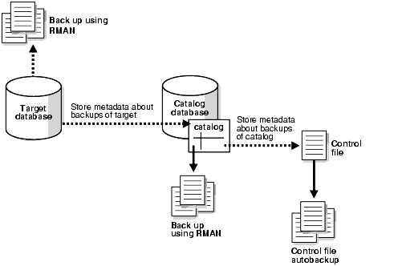

Managing the RMAN recovery catalog includes tasks such as creating the catalog, registering databases with the catalog, and creating virtual private catalog.

This chapter explains how to manage an RMAN recovery catalog. You can also manage the RMAN repository as stored in the control file, without a recovery catalog. This technique is described in "Maintaining RMAN Backups and Repository Records".

### 13.1 Overview of the RMAN Recovery Catalog

This section explains the basic concepts related to managing a recovery catalog.

#### 13.1.1 Purpose of the RMAN Recovery Catalog

A recovery catalog is a database schema used by RMAN to store metadata about one or more Oracle databases. Typically, you store the catalog in a dedicated database.

A recovery catalog provides the following benefits:

- A recovery catalog creates redundancy for the RMAN repository stored in the control file of each target database. The recovery catalog serves as a secondary metadata repository. If the target control file and all backups are lost, then the RMAN metadata still exists in the recovery catalog.
- A recovery catalog centralizes metadata for all your target databases. Storing the metadata in a single place makes reporting and administration tasks easier to perform.
- A recovery catalog can store metadata history much longer than the control file. This capability is useful if you must do a recovery that goes further back in time than the history in the control file. The added complexity of managing a recovery catalog database can be offset by the convenience of having the extended backup history available.

Some RMAN features function only when you use a recovery catalog. For example, you can store RMAN scripts in a recovery catalog. The chief advantage of a stored script is that it is available to any RMAN client that can connect to the target database and recovery catalog. Command files are only available if the RMAN client has access to the file system on which they are stored.

A recovery catalog is required when you use RMAN in a Data Guard environment. By storing backup metadata for all primary and standby databases, the catalog enables you to offload backup tasks to one standby database while enabling you to restore backups on other databases in the environment.

#### 13.1.2 Basic Concepts for the RMAN Recovery Catalog

The recovery catalog contains metadata about RMAN operations for each registered target database. When RMAN is connected to a recovery catalog, RMAN obtains its metadata exclusively from the catalog.

The catalog includes the following types of metadata:

- Data file and archived redo log backup sets and backup pieces
- Data file copies
- Archived redo logs and their copies
- Database structure (tablespaces and data files)
- Stored scripts, which are named user-created sequences of RMAN commands
- Persistent RMAN configuration settings

##### 13.1.2.1 About Database Registration in an RMAN Recovery Catalog

The process of enrolling of a database in a recovery catalog for RMAN use is called registration.

The recommended practice is to register every target database in your environment in a single recovery catalog. For example, you can register databases `prod1`, `prod2`, and `prod3` in a single catalog owned by `rco` in the database `catdb`.

##### 13.1.2.2 About Centralization of Metadata in a Base RMAN Recovery Catalog

The owner of a centralized recovery catalog, which is also called the base recovery catalog, can grant or revoke restricted access to the catalog to other database users.

Each restricted user has full read/write access to his own metadata, which is called a virtual private catalog. The RMAN metadata is stored in the schema of the virtual private catalog owner. The owner of the base recovery catalog determines which objects each virtual private catalog user can access.

You can use a recovery catalog in an environment in which you use or have used different versions of Oracle Database. As a result, your environment can have different versions of the RMAN client, recovery catalog database, recovery catalog schema, and target database. You can merge multiple recovery catalog schemas into one.

##### 13.1.2.3 About RMAN Recovery Catalog Resynchronization

For RMAN operations such as backup, restore, and crosscheck, RMAN always first updates the control file and then propagates the metadata to the recovery catalog.

This flow of metadata from the mounted control file to the recovery catalog, which is known as recovery catalog resynchronization, ensures that the metadata that RMAN obtains from the control file is current.

##### 13.1.2.4 About Stored Scripts

You can use a stored script as an alternative to a command file for managing frequently used sequences of RMAN commands. The script is stored in the recovery catalog rather than on the file system.

A local stored script is associated with the target database to which RMAN is connected when the script is created, and can only be executed when you are connected to this target database. A global stored script can be run against any database registered in the recovery catalog. A virtual private catalog user has read-only access to global scripts. Creating or updating global scripts must be done while connected to the base recovery catalog.

##### 13.1.2.5 Recovery Catalog in a Data Guard Environment

You must use a recovery catalog to manage RMAN metadata for all physical databases, both primary and standby databases, in the Data Guard environment. RMAN uses the recovery catalog as the single source of truth for the Data Guard environment.

RMAN can use the recovery catalog to update a primary or standby control file in a reverse resynchronization. In this case, the metadata flows from the catalog to the control file rather than the other way around. RMAN automatically performs resynchronizations in most situations in which they are needed. Thus, you do not need to use the `RESYNC` command to manually resynchronize very often.

#### 13.1.3 Basic Steps of Managing a Recovery Catalog

Managing a recovery catalog consists of creating the catalog and then registering your target databases with the catalog.

The basic steps for setting up a recovery catalog for use by RMAN are as follows:

### 13.2 Creating a Recovery Catalog

Creating a recovery catalog consists of multiple phases that includes configuring the recovery catalog database, creating the recovery catalog schema owner, and then creating the catalog.

To create a recovery catalog:
1. Configure the database that contains the recovery catalog.
2. Create the database user that owns the recovery catalog.
3. Create the recovery catalog.

#### 13.2.1 Configuring the Recovery Catalog Database

When you use a recovery catalog, RMAN requires that you maintain a recovery catalog schema. The recovery catalog is stored in the default tablespace of the schema. Privileged users such as `SYS` cannot be the owner of the recovery catalog.

Decide which database you will use to install the recovery catalog schema, and also how you will back up this database. Also, decide whether to operate the catalog database in `ARCHIVELOG` mode, which is recommended.

Note:

Do not use the target database to be backed up as the database for the recovery catalog. The recovery catalog must be protected if the target database is lost.

##### 13.2.1.1 Planning the Size of the Recovery Catalog Schema

You must allocate space to be used by the catalog schema. The size of the recovery catalog schema depends upon the number of databases monitored by the catalog.

The schema also grows as the number of archived redo log files and backups for each database increases. Finally, if you use RMAN stored scripts stored in the catalog, some space must be allocated for those scripts.

For example, assume that the `trgt` database has 100 files, and that you back up the database once a day, producing 50 backup sets containing 1 backup piece each. If you assume that each row in the backup piece table uses the maximum amount of space, then one daily backup consumes less than 170 kilobytes in the recovery catalog. So, if you back up once a day for a year, then the total storage in this period is about 62 megabytes. Assume approximately the same amount for archived logs. Thus, the worst case is about 120 megabytes for a year for metadata storage. For a more typical case in which only a portion of the backup piece row space is used, 15 MB for each year is realistic.

If you plan to register multiple databases in your recovery catalog, then remember to add up the space required for each one based on the previous calculation to arrive at a total size for the default tablespace of the recovery catalog schema.

##### 13.2.1.2 Allocating Disk Space for the Recovery Catalog Database

If you are creating your recovery catalog in an existing database, then add enough room to hold the default tablespace for the recovery catalog schema.

If you are creating a new database to hold your recovery catalog, then in addition to the space for the recovery catalog schema itself, allow space for other files in the recovery catalog database:

- `SYSTEM` and `SYSAUX` tablespaces
- Temporary tablespaces
- Undo tablespaces
- Online redo log files

Most of the space used in the recovery catalog database is devoted to supporting tablespaces, for example, the `SYSTEM`, temporary, and undo tablespaces. Table 13-1 describes typical space requirements.

Table 13-1 Typical Recovery Catalog Space Requirements for 1 Year

| Type of Space | Space Requirement |
| --- | --- |
| `SYSTEM` tablespace | 90 MB |
| Temp tablespace | 5 MB |
| Rollback or undo tablespace | 5 MB |
| Recovery catalog tablespace | 15 MB for each database registered in the recovery catalog |
| Online redo logs | 1 MB each (three groups, each with two members) |

Caution:

Ensure that the recovery catalog and target databases do not reside on the same disk. If both your recovery catalog and your target database suffer hard disk failure, then your recovery process is much more difficult. If possible, take other measures as well to eliminate common points of failure between your recovery catalog database and the databases that you are backing up.

#### 13.2.2 Creating the Recovery Catalog Schema Owner

After choosing the recovery catalog database and creating the necessary space, you are ready to create the owner of the recovery catalog and grant this user necessary privileges.

Assume the following background information for the instructions in the following sections:

- A tablespace called `TOOLS` in the recovery catalog database `CATDB` stores the recovery catalog. If you use an RMAN reserved word as a tablespace name, you must enclose it in quotes and put it in uppercase.
- A tablespace called `TEMP` exists in the recovery catalog database.

To create the recovery catalog schema in the recovery catalog database:

1. Start SQL\*Plus and connect to the recovery catalog database as the `SYS` user with `SYSDBA` privilege. In this example, the database is `catdb`.
2. Create a user and schema for the recovery catalog. For example, you could enter the following SQL statement (replacing password with a user-defined password):
	```
	CREATE USER rco IDENTIFIED BY password
	  TEMPORARY TABLESPACE temp 
	  DEFAULT TABLESPACE tools 
	  QUOTA UNLIMITED ON tools;
	```
	Note:
	Create a password that is secure.
3. Grant the `RECOVERY_CATALOG_OWNER` role to the schema owner. This role provides the user with all privileges required to maintain and query the recovery catalog.
	```
	GRANT RECOVERY_CATALOG_OWNER TO rco;
	```
4. Run the `dbmsrmansys.sql` script to grant additional privileges that are required for the `RECOVERY_CATALOG_OWNER` role.
	```
	SQL> @$ORACLE_HOME/rdbms/admin/dbmsrmansys.sql
	```
5. (Optional) Enable the VPD model for the recovery catalog by running the `dbmsrmanvpc.sql` script with the `–vpd` option.
	The following command enables the VPD model for the recovery catalog owned by the user `rco`:
	```
	SQL> @/$ORACLE_HOME/rdbms/admin/dbmsrmanvpc.sql -vpd rco;
	```
	To ensure that the recovery catalog schema owner can control virtual private catalogs using the VPD model, specify the `ORACLE_HOME` path that corresponds to the exact database version used by the recovery catalog schema. For example, specify the 19c `ORACLE_HOME` path if the recovery catalog is connected to Oracle Database 19c.

#### 13.2.3 Running the CREATE CATALOG Command

After creating the catalog owner, create the catalog tables with the RMAN `CREATE CATALOG` command. The command creates the catalog in the default tablespace of the catalog owner.

Note:

Starting with Oracle Database 12c Release 1 (12.1.0.2), the recovery catalog database must use the Enterprise Edition of Oracle Database.

To create the recovery catalog:

1. Enable Oracle Partitioning for the recovery catalog database.
2. Start RMAN and connect to the database that will contain the catalog. Connect to the database as the recovery catalog owner.
3. Run the `CREATE` `CATALOG` command to create the catalog. The creation of the catalog can take several minutes. If the catalog tablespace is this user's default tablespace, then you can run the following command:
	```
	RMAN> CREATE CATALOG;
	```
	You can specify the tablespace name for the catalog in the `CREATE` `CATALOG` command. For example:
	```
	RMAN> CREATE CATALOG TABLESPACE cat_tbs;
	```
	Note:
	If the tablespace name for the recovery catalog is an RMAN reserved word, then it must be uppercase and enclosed in quotes. For example:
	```
	CREATE CATALOG TABLESPACE 'CATALOG';
	```
4. You can check the results by using SQL\*Plus to query the recovery catalog to see which tables were created:
	```
	SQL> SELECT TABLE_NAME FROM USER_TABLES;
	```

### 13.3 Registering a Database in the Recovery Catalog

Registering a target database in the recovery catalog maintains the database’s records in the recovery catalog.

#### 13.3.1 About Registration of a Database in the Recovery Catalog

The process of enrolling of a target database in a recovery catalog is called registration.

If a target database is not registered in the recovery catalog, then RMAN cannot use the catalog to store metadata for operations on this database. You can still perform RMAN operations on an unregistered database: RMAN always stores its metadata in the control file of the target database.

If you are not using the recovery catalog in a Data Guard environment, then use the `REGISTER` command to register each database. Each database must have a unique [DBID](glossary.md). If you use the RMAN `DUPLICATE` command or the `CREATE DATABASE` statement in SQL, then the database is assigned a unique DBID automatically. If you create a database by other means, then the copied database may have the same DBID as its source database. You can change the DBID with the `DBNEWID` utility so that you can register the source and copy databases in the same catalog.

You can use the `UNREGISTER` command to unregister a database from the recovery catalog.

##### 13.3.1.1 About Standby Database Registration

In a Data Guard environment, the primary and standby databases share the same DBID and database name. To be eligible for registration in the recovery catalog, each database in the Data Guard environment must have different `DB_UNIQUE_NAME` values.

The `DB_UNIQUE_NAME` parameter for a database is set in its initialization parameter file. If you use RMAN in a Data Guard environment, then you can use the `REGISTER DATABASE` command only for the primary database.

You can use the following techniques to register a standby database in the recovery catalog:

- When you connect to a standby database as `TARGET`, RMAN automatically registers the database in the recovery catalog.
- When you run the `CONFIGURE DB_UNIQUE_NAME` command for a standby database that is not known to the recovery catalog, RMAN automatically registers this standby database if its primary database is registered.

#### 13.3.2 Registering a Database with the REGISTER DATABASE Command

The first step in using a recovery catalog with a target database is registering the target database in the recovery catalog. If you use the catalog in a Data Guard environment, then you can only register the primary database in this way.

Use the following procedure:

1. Start RMAN and connect to a target database and recovery catalog. The recovery catalog database must be open.
	For example, issue the following command to connect to the catalog database with the net service name `catdb` as user `rco` (who owns the catalog schema):
	```
	% rman TARGET / CATALOG rco@catdb;
	```
2. If the target database is not mounted, then mount or open it:
	```
	STARTUP MOUNT;
	```
3. Register the target database in the connected recovery catalog:
	```
	REGISTER DATABASE;
	```
	RMAN creates rows in the catalog tables to contain information about the target database, then copies all pertinent data about the target database from the control file into the catalog, synchronizing the catalog with the control file.
4. Verify that the registration was successful by running `REPORT` `SCHEMA`:
	```
	REPORT SCHEMA;
	Report of database schema for database with db_unique_name TRGT
	List of Permanent Datafiles===========================
	File Size(MB)   Tablespace       RB segs Datafile Name
	---- ---------- ---------------- ------- -------------------
	1        307200 SYSTEM             NO    /oracle/oradata/trgt/system01.dbf
	2         20480 UNDOTBS            YES   /oracle/oradata/trgt/undotbs01.dbf
	3         10240 CWMLITE            NO    /oracle/oradata/trgt/cwmlite01.dbf
	4         10240 DRSYS              NO    /oracle/oradata/trgt/drsys01.dbf
	5         10240 EXAMPLE            NO    /oracle/oradata/trgt/example01.dbf
	6         10240 INDX               NO    /oracle/oradata/trgt/indx01.dbf
	7         10240 TOOLS              NO    /oracle/oradata/trgt/tools01.dbf
	8         10240 USERS              NO    /oracle/oradata/trgt/users01.dbf
	List of Temporary Files
	=======================
	File Size(MB) Tablespace           Maxsize(MB) Tempfile Name
	---- -------- -------------------- ----------- --------------------
	1    200      TEMP                 32767       /oracle/oradata/trgt/tbs_tmp.dbf
	```

### 13.4 Cataloging Backups in the Recovery Catalog

If you have data file copies, backup pieces, or archived logs on disk, then you can catalog them in the recovery catalog with the `CATALOG` command.

When using a recovery catalog, cataloging older backups that have aged out of the control file lets RMAN use the older backups during restore operations.

- Use the `CATALOG` command with one of the following clauses to catalog backups: `DATAFILECOPY`, `ARCHIVELOG`, `BACKUPPIECE`, or `START                                                   WITH`.

Example 13-1 Cataloging Backups

This example shows multiple commands that catalog older backups by using different clauses in the `CATALOG` command.

```
CATALOG DATAFILECOPY '/disk1/old_datafiles/01_01_2003/users01.dbf';
CATALOG ARCHIVELOG '/disk1/arch_logs/archive1_731.dbf', 
                   '/disk1/arch_logs/archive1_732.dbf';
CATALOG BACKUPPIECE '/disk1/backups/backup_820.bkp';
```

Example 13-2 Cataloging Multiple Backup Files in a Directory

This example catalogs multiple backup files in a directory by using the `CATALOG START WITH` command.

```
CATALOG START WITH '/disk1/backups/';
```

RMAN lists the files to be added to the RMAN repository and prompts for confirmation before adding the backups. Be careful when creating your prefix with `CATALOG START                                                   WITH`. RMAN scans all paths for all files on disk that begin with the specified prefix.

Note that the prefix is not just a directory name. Using the wrong prefix can cause the cataloging of the wrong set of files. For example, assume that a group of directories `/disk1/backups`, `/disk1/backups-year2003`, `/disk1/backupsets`, `/disk1/backupsets/test` and so on, all contain backup files. The following command catalogs all files in all of these directories, because `/disk1/backups` is a prefix for the paths for all of these directories:

```
CATALOG START WITH '/disk1/backups';
```
To catalog only backups in the `/disk1/backups` directory, the correct command is as follows:
```
CATALOG START WITH '/disk1/backups/';
```

### 13.5 Creating and Managing Virtual Private Catalogs

RMAN provides multiple commands to create and manage virtual private catalogs.

#### 13.5.1 Overview of Virtual Private Catalogs

By default, all of the users of an RMAN recovery catalog have full privileges to read, select, insert, update, and delete any metadata in the catalog. For example, if the administrators of two unrelated databases share the same recovery catalog, each administrator could, whether inadvertently or maliciously, destroy catalog data for the other's database. In many enterprises, this situation is tolerated because the same people manage many different databases and also manage the recovery catalog. But in other enterprises where clear separation of duty exists between administrators of various databases, and between the DBA and the administrator of the recovery catalog, you may desire to restrict each database administrator to modify only backup metadata belonging to those databases that they are responsible for, while still keeping the benefits of a single, centrally-managed, RMAN recovery catalog. This goal can be achieved by implementing [virtual private catalog](glossary.md) s.

Every RMAN recovery catalog starting with Oracle Database 11g supports virtual private catalogs, but they are not used unless explicitly created. There is no restriction on the number of virtual private catalogs that can be created beneath one recovery catalog. Each virtual private catalog is owned by a database schema user which is different than the user who owns the recovery catalog.

After you set up a virtual private catalog user, the administrator for the recovery catalog grants each virtual private catalog the privilege to use that catalog for one or more databases that are currently registered in the recovery catalog. The administrator of the recovery catalog can also grant the privilege to register new databases while using a virtual private catalog.

Note:

Every virtual private catalog has access to all global stored scripts, and those non-global stored scripts that belong to those databases for which this virtual private catalog has privileges. Virtual private catalogs cannot access non-global stored scripts that belong to databases that they do not have privileges for, and they cannot create global stored scripts.

#### 13.5.2 About Using the VPD Model for Virtual Private Catalogs

RMAN uses the Virtual Private Database (VPD) functionality to implement virtual private catalogs.

The VPD functionality is not enabled by default when the RMAN base recovery catalog is created. You need to explicitly enable the VPD model for a base recovery catalog by running the `$` `ORACLE_HOME` `/rdbms/admin/dbmsrmanvpc.sql` script after upgrading the base catalog schema.

The format of the `dbmsrmanvpc.sql` script is as follows:
```
$ORACLE_HOME/rdbms/admin/dbmsrmanvpc.sql [[-vpd | -novpd | -scan ] base_catalog_schema_name[...]] | -all
```

The RMAN base catalog schema names are provided as command-line parameters when running `dbmsrmanvpc.sql`. You can specify a maximum of ten base catalog schema names each time you run the script.

Table 13-2 describes the options that you can use when running the `dbmsrmanvpc.sql` script. You must use one of the command line options or provide a catalog schema name.

Table 13-2 dbmsrmanvpc.sql Options

| dbmsrmanvpc.sql Option Name | Description |
| --- | --- |
| `-vpd` | Grants the privileges required to support the VPD protected catalog. |
| `-novpd` | Disables VPD functionality by cleaning up the base recovery catalog schema, revoking grants, and removing database objects.  This option can only be used when there are no existing VPC users registered in the base recovery catalog. |
| `-scan` | Performs a scan of the RMAN base catalog owner schemas and reports on the roles granted and the status of VPC users. |
| `-all` | Automatically detects the RMAN base catalog schemas and upgrades. |

Example 13-3 Enabling VPD Model for VPC User Schemas

Connect to SQL\*Plus and use the following command to enable the VPD model for all the virtual private catalogs of the RMAN base catalog `rman_cat`.

```
SQL> @$ORACLE_HOME/rdbms/admin/dbmsrmanvpc.sql -vpd rman_cat
```

#### 13.5.3 Creating Virtual Private Catalogs

Creating a virtual private catalog is a multi-step process in which you first create the database user who will own the virtual private catalog and then create the virtual private catalog.

Note:

If the recovery catalog is a virtual private catalog, then the RMAN client connecting to it must be at patch level 10.1.0.6 or 10.2.0.3. Oracle9i RMAN clients cannot connect to a virtual private catalog. This version restriction does not affect RMAN client connections to an Oracle Database 11g base recovery catalog, even if it has some virtual private catalog users.

Assume that the following databases are registered in the base recovery catalog: `prod1`, `prod2`, and `prod3`. The database user who owns the base recovery catalog is `rco`. You want to create database user `vpc1` and grant this user access privileges only to `prod1` and `prod2`. By default, a virtual private catalog owner has no access to the base recovery catalog.

The base RMAN recovery catalog must be created before you create virtual private catalogs.

To create a virtual private catalog:

1. Start SQL\*Plus and connect to the recovery catalog database as the `SYS` user with `SYSDBA` privilege.
2. Create the user who will own the virtual private catalog.
	For example, if you want database user `vpc1` to own the virtual private catalog, then execute the following command (replacing password with a user-defined password):
	```
	SQL> CREATE USER vpc1 IDENTIFIED BY password
	  2  DEFAULT TABLESPACE vpcusers
	  3  QUOTA UNLIMITED ON vpcusers;
	```
	Note:
	Create a password that is secure. See Oracle Database Security Guide for more information.
3. Grant the `CREATE SESSION` privilege to the user who owns the virtual private catalog and then exit SQL\*Plus.
	The following example grants the privilege to user `vpc1`:
	```
	SQL> GRANT CREATE SESSION TO vpc1;
	SQL> EXIT;
	```
4. Start RMAN and connect to the recovery catalog database as the base recovery catalog owner (not the virtual private catalog owner).
	The following example connects to the base recovery catalog as `rco`:
	```
	% rman
	RMAN> CONNECT CATALOG rco@catdb;
	recovery catalog database Password: password
	connected to recovery catalog database
	```
5. Grant desired privileges to the virtual private catalog owner.
	The following example gives user `vpc1` access to the metadata for `prod1` and `prod2` (but not `prod3`):
	```
	RMAN> GRANT CATALOG FOR DATABASE prod1 TO vpc1;
	RMAN> GRANT CATALOG FOR DATABASE prod2 TO vpc1;
	```
	You can also use a DBID rather than a database name. The virtual private catalog user does not have access to the metadata for any other databases registered in the recovery catalog.
	The following example gives the user `vpc1` access to the metadata for the PDB `hr_pdb`:
	```
	GRANT CATALOG FOR PLUGGABLE DATABASE hr_pdb TO vpc1;
	```
	You can also grant the user the ability to register new target databases in the recovery catalog. For example:
	```
	RMAN> GRANT REGISTER DATABASE TO vpc1;
	```

#### 13.5.4 Registering a Database with a Virtual Private Catalog

To store backup metadata for a target database in a virtual private catalog, you must register the database with the virtual private catalog.

Create the virtual private catalog before you register a target database with it.

To register database with a virtual private catalog and store backup metadata:

1. Start RMAN and connect to the recovery catalog database as the virtual private catalog owner (not the base recovery catalog owner). Connect to the database that you want to register as `TARGET`.
	```
	%rman
	RMAN> CONNECT TARGET /
	RMAN> CONNECT CATALOG vpc1@catdb;
	```
2. Register the database whose metadata must be stored in the virtual private catalog.
	The following example registers the database with the virtual private catalog owner `vpc1`.
	```
	RMAN> REGISTER DATABASE;
	```
3. Back up the database using the `BACKUP` command with the required clauses.
	Metadata related to the backup is stored in the virtual private catalog.

#### 13.5.5 Revoking Privileges from a Virtual Private Catalog Owner

After you create a virtual private catalog, you can revoke catalog access privileges as necessary.

Assume that two databases are registered in the base recovery catalog: `prod1` and `prod2`. As owner of the base recovery catalog, you have granted the `vpc1` user access privileges to `prod1`. You have also granted this user the right to register databases in his virtual private catalog. Now you want to revoke privileges from `vpc1`.

To revoke privileges from a virtual private catalog owner:

1. Start RMAN and connect to the recovery catalog database as the recovery catalog owner (not the virtual private catalog owner).
	The following example connects to the recovery catalog as `rco`:
	```
	% rman
	RMAN> CONNECT CATALOG rco@catdb;
	```
2. Revoke specified privileges from the virtual private catalog owner.
	The following command revokes access to the metadata for `prod1` from virtual private catalog owner `vpc1`:
	```
	REVOKE CATALOG FOR DATABASE prod1 FROM vpc1;
	```
	You can also specify a DBID rather than a database name. The catalog `vpc1` retains all other granted catalog privileges.
	The following command revokes access to the metadata for the PDB `hr_pdb` from the virtual private catalog owner `vpc1`:
	```
	REVOKE CATALOG FOR PLUGGABLE DATABASE hr_pdb FROM vpc1;
	```
	You can also revoke the privilege to register new target databases in the recovery catalog. For example:
	```
	REVOKE REGISTER DATABASE FROM vpc1;
	```

#### 13.5.6 Upgrading Virtual Private Catalogs

This section describes how to use the `UPGRADE CATALOG` command to upgrade a virtual private catalog.

RMAN uses the Virtual Private Database (VPD) functionality to implement virtual private catalogs. If you created a recovery catalog and virtual private catalogs by using a version lower than Oracle Database 12c Release 1 (12.1.0.2) or if your database is not upgraded to Oracle Database 12c Release 2 (12.2) or higher, then you must upgrade these virtual private catalogs. RMAN provides scripts, located in the `$ORACLE_HOME` `/rdbms/admin` directory, to upgrade virtual private catalogs.

To upgrade virtual private catalogs:

1. Use SQL\*Plus to connect to the recovery catalog database as the `SYS` user with `SYSDBA` privilege.
2. Run the `dbmsrmansys.sql` script to grant additional privileges that are required for the `RECOVERY_CATALOG_OWNER` role.
	```
	SQL> @$ORACLE_HOME/rdbms/admin/dbmsrmansys.sql
	```
3. Run the `dbmsmanvpc.sql` script to upgrade virtual private catalog schemas to the VPD model.
	The base recovery catalog schema name must be provided as an input parameter to this script. You can specify a maximum of 10 schema names. Alternately, you can use the `-all` option to automatically detect base catalog schemas and upgrade all associated virtual private catalog schemas.
	The following command upgrades the virtual private catalog schemas of the base recovery catalog owned by `rco`:
	```
	SQL> @$ORACLE_HOME/rdbms/admin/dbmsrmanvpc.sql -vpd rco
	```
4. Connect RMAN to the base recovery catalog, upgrade the base recovery catalog, and then exit RMAN.
	Assume that the database user who owns the base recovery catalog is `rco`. The following command upgrades the base recovery catalog. The `UPGRADE CATALOG` command must be entered twice to confirm the upgrade.
	```
	$ rman CATALOG rco@catdb
	recovery catalog database password: 
	RMAN> UPGRADE CATALOG;
	RMAN> UPGRADE CATALOG;
	RMAN> EXIT;
	```

### 13.6 Protecting the Recovery Catalog

Include the recovery catalog database in your backup and recovery strategy. If you do not back up the recovery catalog and a disk failure occurs that destroys the recovery catalog database, then you may lose the metadata in the catalog. Without the recovery catalog contents, recovery of your other databases is likely to be more difficult.

#### 13.6.1 Backing Up the Recovery Catalog

A single recovery catalog can store metadata for multiple target databases. Consequently, loss of the recovery catalog can be disastrous. You must back up the recovery catalog frequently.

This section provides general guidelines for developing a strategy for protecting the recovery catalog.

##### 13.6.1.1 Backing Up the Recovery Catalog Frequently

The recovery catalog database is a database like any other, and is also a key part of your backup and recovery strategy. Protect the recovery catalog like any other part of your database, by backing it up. The backup strategy for your recovery catalog database is part of an overall backup and recovery strategy.

Back up the recovery catalog with the same frequency that you back up a target database. For example, if you make a weekly whole database backup of a target database, then back up the recovery catalog after the backup of the target database. This backup of the recovery catalog can help you in a disaster recovery scenario. Even if you must restore the recovery catalog database with a control file autobackup, you can use the full record of backups in your restored recovery catalog database to restore the target database.

##### 13.6.1.2 Choosing the Appropriate Technique for Physical Backups

When backing up the recovery catalog database, you can use RMAN to make the backups.

As illustrated in Figure 13-1, start RMAN with the `NOCATALOG` option so that the repository for RMAN is the control file in the catalog database.

Figure 13-1 Using the Control File as the Repository for Backups of the Recovery Catalog



> This illustration presents using the control file as the repository for backups of the catalog. RMAN is used to back up the target database. Metadata about backups of the target database are stored in the recovery catalog database. RMAN is also used to back up the catalog database. Metadata about backups of the recovery catalog database are stored in the catalog database control file. RMAN takes autobackups of the control file of the recovery catalog database.


Follow these guidelines when developing an RMAN backup strategy for the recovery catalog database:

- Run the recovery catalog database in `ARCHIVELOG` mode so that you can do point-in-time recovery if needed.
- Set the retention policy to a `REDUNDANCY` value greater than `1`.
- Back up the database to two separate media (for example, disk and tape).
- Run `BACKUP DATABASE PLUS ARCHIVELOG` at regular intervals, to a media manager if available, or just to disk.
- Do not use another recovery catalog as the repository for the backups.
- Configure the control file autobackup feature to `ON`.

With this strategy, the control file autobackup feature ensures that the recovery catalog database can always be recovered, so long as the control file autobackup is available.

##### 13.6.1.3 Separating the Recovery Catalog from the Target Database

A recovery catalog is only effective when separated from the data that it is designed to protect. Thus, you must never store a recovery catalog containing the RMAN repository for a database in the same database as the target database. Also, do not store the catalog database on the same disks as the target database.

To illustrate why data separation is advised, assume that you store the catalog for database `prod1` in `prod1`. If `prod1` suffers a total media failure, and if the recovery catalog for `prod1` is also stored in `prod1`, then if you lose the database you also lose the recovery catalog. At this point the only option is to restore an autobackup of the control file for `prod1` and use it to restore and recover the database without the benefit of any information stored in the recovery catalog.

##### 13.6.1.4 Exporting the Recovery Catalog Data for Logical Backups

Logical backups of the RMAN recovery catalog created with the Data Pump Export utility can be a useful supplement for physical backups.

For damage to a recovery catalog database, you can use Data Pump Import to quickly reimport the exported recovery catalog data into another database and rebuild the catalog.

#### 13.6.2 Recovering the Recovery Catalog

Restoring and recovering the recovery catalog database is much like restoring and recovering any other database with RMAN.

You can restore the control file and server parameter file for the recovery catalog database from an autobackup, then restore and perform complete recovery on the rest of the database. If you are in a situation where you are using multiple recovery catalogs, then you can also use another recovery catalog to record metadata about backups of this recovery catalog database.

If recovery of the recovery catalog database through the normal Oracle recovery procedures is not possible, then you must re-create the catalog. Examples of this worst-case scenario include:

- A recovery catalog database that has never been backed up
- A recovery catalog database that has been backed up, but cannot be recovered because the data file backups or archived logs are not available

You have the following options for partially re-creating the contents of the missing recovery catalog:

- Use the `RESYNC CATALOG` command to update the recovery catalog with any RMAN repository information from the control file of the target database or a control file copy. Any metadata from control file records that aged out of the control file is lost.
- Issue `CATALOG START WITH` commands to recatalog any available backups.

To minimize the likelihood of this worst-case scenario, your backup strategy must at least include backing up the recovery catalog. This technique is described in "Backing Up the Recovery Catalog".

### 13.7 Managing Stored Scripts

You can create and store scripts in the recovery catalog.

#### 13.7.1 About Stored Scripts

You can use a stored script as an alternative to a command file for managing frequently used sequences of RMAN commands. The script is stored in the recovery catalog rather than on the file system.

Stored scripts can be local or global. A local script is associated with the target database to which RMAN is connected when the script is created, and can only be executed when you are connected to that target database. A global stored script can be run against any database registered in the recovery catalog, if the RMAN client is connected to the recovery catalog and a target database.

The commands allowable within the brackets of the `CREATE SCRIPT` command are the same commands supported within a `RUN` block. Any command that is legal within a `RUN` command is permitted in the stored script. The following commands are not legal within stored scripts: `RUN`, `@`, and `@@`.

When specifying a script name, RMAN permits but generally does not require that you use quotes around the name of a stored script. If the name begins with a digit or is an RMAN reserved word, however, then you must put quotes around the name to use it as a stored script name. Consider avoiding stored script names that begin with nonalphabetic characters or that are the same as RMAN reserved words.

Consider using a naming convention to avoid confusion between global and local stored scripts. For the `EXECUTE SCRIPT`, `DELETE SCRIPT` and `PRINT SCRIPT` commands, if the script name passed as an argument is not the name of a script defined for the connected target instance, then RMAN looks for a global script by the same name. For example, if the global script `global_backup` is in the recovery catalog, but no local stored script `global_backup ` is defined for the target database, then the following command deletes the global script:

```
DELETE SCRIPT global_backup;
```

To use commands related to stored scripts, even global scripts, you must be connected to both a recovery catalog and a target database instance.

#### 13.7.2 Creating Stored Scripts

You can use the `CREATE SCRIPT` command to create a stored script.

If `GLOBAL` is specified, then a global script with this name must not exist in the recovery catalog. If `GLOBAL` is not specified, then a local script must not exist with the same name for the same target database. You can also use the `REPLACE SCRIPT` to create a new script or update an existing script.

To create a stored script:

1. Start RMAN and connect to a target database and recovery catalog (if used).
2. Run the `CREATE SCRIPT` command.
	The following example illustrates creation of a local script:
	```
	CREATE SCRIPT full_backup 
	{     
	  BACKUP DATABASE PLUS ARCHIVELOG;
	  DELETE OBSOLETE;
	}
	```
	For a global script, the syntax is similar:
	```
	CREATE GLOBAL SCRIPT global_full_backup 
	{     
	  BACKUP DATABASE PLUS ARCHIVELOG;
	  DELETE OBSOLETE;
	}
	```
	Optionally, you can provide a `COMMENT` with descriptive information:
	```
	CREATE GLOBAL SCRIPT global_full_backup 
	COMMENT 'use only with ARCHIVELOG mode databases'
	{     
	  BACKUP DATABASE PLUS ARCHIVELOG;
	  DELETE OBSOLETE;
	}
	```
	You can also create a script by reading its contents from a text file. The file must begin with a left brace (`{`) character, contain a series of commands valid within a `RUN` block, and end with a right brace (`}`) character. Otherwise, a syntax error is signalled, just as if the commands were entered at the keyboard.
	```
	CREATE SCRIPT full_backup 
	  FROM FILE '/tmp/my_script_file.txt';
	```
3. Examine the output.
	If no errors are displayed, then RMAN successfully created the script and stored in the recovery catalog.

#### 13.7.3 Replacing Stored Scripts

To update stored scripts, use the `REPLACE SCRIPT` command.

If you are replacing a local script, then you must be connected to the target database that you connected to when you created the script. If the script does not exist, then RMAN creates it.

To replace a stored script:

1. Start RMAN and connect to a target database and recovery catalog (if used).
2. Execute `REPLACE SCRIPT`.
	This following example updates the script `full_backup` with new contents:
	```
	REPLACE SCRIPT full_backup 
	{
	  BACKUP DATABASE PLUS ARCHIVELOG;
	}
	```
	You can update global scripts by specifying the `GLOBAL` keyword as follows:
	```
	REPLACE GLOBAL SCRIPT global_full_backup 
	COMMENT 'A script for full backup to be used with any database'
	{
	  BACKUP AS BACKUPSET DATABASE PLUS ARCHIVELOG;
	}
	```
	As with `CREATE SCRIPT`, you can update a local or global stored script from a text file with the following form of the command:
	```
	REPLACE GLOBAL SCRIPT global_full_backup 
	  FROM FILE '/tmp/my_script_file.txt';
	```

#### 13.7.4 Running Stored Scripts

Use the `EXECUTE SCRIPT` command to run a stored script.

If `GLOBAL` is specified, then a global script with this name must exist in the recovery catalog; otherwise, RMAN returns error `RMAN-06004`. If `GLOBAL` is not specified, then RMAN searches for a local stored script defined for the current target database. If no local script with this name is found, then RMAN searches for a global script by the same name and executes it if one is found.

To run a stored script:

1. Start RMAN and connect to a target database and recovery catalog (if used).
2. If needed, use `SHOW` to examine your configured channels.
	Your script uses the automatic channels configured at the time you execute the script. Use `ALLOCATE CHANNEL` commands in the script if you must override the configured channels. Because of the `RUN` block, if an RMAN command in the script fails, subsequent RMAN commands in the script do not execute.
3. Run `EXECUTE SCRIPT`. This command requires a `RUN` block, as shown in the following example:
	```
	RUN 
	{ 
	  EXECUTE SCRIPT full_backup; 
	}
	```
	The preceding command invokes a local script if one exists with the name specified. If no local script is found, but there is a global script with the name specified, then RMAN executes the global script.
	You can also use `EXECUTE GLOBAL SCRIPT` to control which script is invoked if a local and a global script have the same name. If there is no local script called `global_full_backup`, the following two commands have the same effect:
	```
	RUN 
	{
	  EXECUTE GLOBAL SCRIPT global_full_backup;
	}
	RUN
	{ 
	  EXECUTE SCRIPT global_full_backup; 
	}
	```

#### 13.7.5 Creating and Executing Dynamic Stored Scripts

You can specify substitution variables in the `CREATE SCRIPT` command.

When you start RMAN on the command line, the `USING` clause specifies one or more values for use in substitution variables in a command file. As in SQL\*Plus, `&1` indicates where to place the first value, `&2` indicates where to place the second value, and so on.

To create and use a dynamic stored script:

1. Create a command file that contains a `CREATE SCRIPT` statement with substitution variables for values that must be dynamically updated.
	The following example uses substitution variables for the name of the tape set, for a string in the `FORMAT` specification, and for the name of the restore point.
	```
	CREATE SCRIPT quarterly { 
	  ALLOCATE CHANNEL c1
	    DEVICE TYPE sbt
	    PARMS 'ENV=(OB_MEDIA_FAMILY=&1)';
	  BACKUP
	    TAG &2
	    FORMAT '/disk2/bck/&1%U.bck'
	    KEEP FOREVER
	    RESTORE POINT &3
	    DATABASE;
	}
	```
2. Connect RMAN to a target database (which must be mounted or open) and recovery catalog, specifying the initial values for the recovery catalog script.
	For example, enter the following command:
	```
	% rman TARGET / CATALOG rco@catdb USING arc_backup bck0906 FY06Q3
	```
	A recovery catalog is required for `KEEP FOREVER`, but is not required for any other `KEEP` option.
3. Run the command file created in the first step to create the stored script.
	For example, run the `/tmp/catscript.rman` command file as follows:
	```
	RMAN> @/tmp/catscript.rman
	```
	This step creates but does not execute the stored script.
4. Every quarter, execute the stored script, passing values for the substitution variables.
	The following example executes the recovery catalog script named `quarterly`. The example specifies `arc_backup` as the name of the media family (set of tapes), `bck1206` as part of the `FORMAT` string and `FY06Q4` as the name of the restore point.
	```
	RUN
	{ 
	  EXECUTE SCRIPT quarterly 
	    USING arc_backup
	          bck1206
	          FY06Q4;
	}
	```

#### 13.7.6 Printing Stored Scripts

The `PRINT SCRIPT` command displays a stored script or writes it out to a file.

To print stored scripts:

1. Start RMAN and connect to a target database and recovery catalog.
2. Run the `PRINT SCRIPT` command as follows:
	```
	PRINT SCRIPT full_backup;
	```
	To send the contents of a script to a file, use this form of the command:
	```
	PRINT SCRIPT full_backup 
	  TO FILE '/tmp/my_script_file.txt';
	```
	For global scripts, the analogous syntax is as follows:
	```
	PRINT GLOBAL SCRIPT global_full_backup;
	PRINT GLOBAL SCRIPT global_full_backup 
	  TO FILE '/tmp/my_script_file.txt';
	```

#### 13.7.7 Listing Stored Script Names

Use the `LIST ... SCRIPT NAMES` command to display the names of scripts defined in the recovery catalog.

`LIST GLOBAL SCRIPT NAMES` and `LIST ALL SCRIPT                     NAMES` are the only commands that work when RMAN is connected to a recovery catalog without connecting to a target instance; the other forms of the `LIST ... SCRIPT NAMES` command require a recovery catalog connection.

To list stored script names:

1. Start RMAN and connect to a target database and recovery catalog.
2. Run the `LIST ... SCRIPT NAMES` command.
	For example, run the following command to list the names of all global and local scripts that can be executed for the currently connected target database:
	```
	LIST SCRIPT NAMES;
	```
	The following example lists only global script names:
	```
	LIST GLOBAL SCRIPT NAMES;
	```
	To list the names of all scripts stored in the current recovery catalog, including global scripts and local scripts for all target databases registered in the recovery catalog, use the following form of the command:
	```
	LIST ALL SCRIPT NAMES;
	```
	For each script listed, the output indicates which target database the script is defined for (or whether a script is global).

#### 13.7.8 Deleting Stored Scripts

Use the `DELETE GLOBAL SCRIPT` command to delete a stored script from the recovery catalog.

To delete a stored script:

1. Start RMAN and connect to a target database and recovery catalog.
2. Enter the `DELETE SCRIPT` command.
	If you use `DELETE SCRIPT` without `GLOBAL`, and there is no stored script for the target database with the specified name, then RMAN looks for a global stored script by the specified name and deletes the global script if it exists. For example, suppose you enter the following command:
	```
	DELETE SCRIPT 'global_full_backup';
	```
	In this case, RMAN looks for a script `global_full_backup` defined for the connected target database, and if it did not find one, it searches the global scripts for a script called `global_full_backup` and delete that script.
	To delete a global stored script, use `DELETE GLOBAL SCRIPT`:
	```
	DELETE GLOBAL SCRIPT 'global_full_backup';
	```

#### 13.7.9 Running a Stored Script at RMAN Startup

To run the RMAN client and start a stored script in the recovery catalog on startup, use the `SCRIPT` argument when starting the RMAN client.

For example, you could enter the following command to execute script `/tmp/fbkp.cmd`:

```
% rman TARGET / CATALOG rco@catdb SCRIPT '/tmp/fbkp.cmd';
```

You must connect to the recovery catalog, which contains the stored script, and the target database, to which the script applies, when starting the RMAN client.

If local and global stored scripts are defined with the same name, then RMAN always executes the local script.

### 13.8 Maintaining a Recovery Catalog

Maintaining the recovery catalog consists of tasks such as resynchronizing, updating, and upgrading the recovery catalog.

This section describes various management and maintenance tasks.

#### 13.8.1 About Recovery Catalog Maintenance

After you have created a recovery catalog and registered your target databases, you must maintain this catalog.

For example, you must run the RMAN maintenance commands to update backup records and to delete backups that are no longer needed. You must perform this type of maintenance regardless of whether you use RMAN with a recovery catalog. Other types of maintenance, such as upgrading a recovery catalog schema, are specific to use of RMAN with a recovery catalog.

If you use a recovery catalog in a Data Guard environment, then special considerations apply for backups and database files recorded in the catalog. See "About RMAN File Management in a Data Guard Environment" for an explanation of when backups are accessible to RMAN and how RMAN maintenance commands work with accessible backups.

#### 13.8.2 Resynchronizing the Recovery Catalog

When RMAN performs a resynchronization, it compares the recovery catalog to either the current or backup control file of the target database and updates the catalog with metadata that is missing or changed.

Most RMAN commands perform a resynchronization automatically when the target control file is mounted and the catalog is available. In a Data Guard environment, RMAN can perform a reverse resynchronization to update a database control file with metadata from the catalog.

##### 13.8.2.1 About Resynchronization of the Recovery Catalog

Resynchronization of the recovery catalog ensures that the metadata that RMAN obtains from the control file stays current. Resynchronizations can be full or partial.

In a partial resynchronization, RMAN reads the current control file of the target database to update changed metadata about new backups, new archived redo logs, and so on. RMAN does not resynchronize metadata about the database physical schema.

In a full resynchronization, RMAN updates all changed records, including those for the database schema. RMAN performs a full resynchronization after structural changes to database (adding or dropping database files, creating new incarnation, and so on) or after changes to the RMAN persistent configuration.

RMAN creates a snapshot control file, which is a temporary backup control file, when it performs a full resynchronization. The database ensures that only one RMAN session accesses a snapshot control file at any point in time. RMAN creates the snapshot control file in an operating system-specific location on the target database host. You can specify the name and location of the snapshot control file.

This snapshot control file ensures that RMAN has a consistent view of the control file. Because the control file is intended for short-term use, it is not registered in the catalog. RMAN records the control file checkpoint in the recovery catalog to indicate the currency of the catalog.

###### 13.8.2.1.1 About RMAN Recovery Catalog Resynchronization in a Data Guard Environment

RMAN only automatically resynchronizes the recovery catalog with a database when connected to this database as `TARGET`. Thus, RMAN does not automatically resynchronize every database in a Data Guard environment when connected as `TARGET` to one database in the environment.

You can use the `RESYNC CATALOG FROM DB_UNIQUE_NAME` command to manually resynchronize the recovery catalog with a database in the Data Guard environment.

For an example of a manual resynchronization, assume that RMAN is connected as `TARGET` to production database `prod`, and that you have used `CONFIGURE` to create a configuration for `dgprod3`. If you run `RESYNC CATALOG FROM DB_UNIQUE_NAME                 dgprod3`, then RMAN resynchronizes the recovery catalog with the `dgprod3` control file. In this case RMAN performs both a normal resynchronization, in which metadata flows from the `dgprod3` control file to the catalog, and a reverse resynchronization. In a reverse resynchronization, RMAN uses the persistent configurations in the recovery catalog to update the `dgprod3` control file.

##### 13.8.2.2 Deciding When to Resynchronize the Recovery Catalog

RMAN automatically resynchronizes the recovery catalog when RMAN is connected to a target database and recovery catalog and you have executed RMAN commands.

Thus, you do not need to manually run the `RESYNC CATALOG` command very often. The topics in this section describe situations requiring a manual catalog resynchronization.

###### 13.8.2.2.1 Resynchronizing After the Recovery Catalog is Unavailable

If the recovery catalog is unavailable when you issue RMAN commands that cause a partial resynchronization, then open the catalog database later and resynchronize it manually with the `RESYNC CATALOG` command.

For example, the target database may be in New York while the recovery catalog database is in Japan. You may not want to make daily backups of the target database in `CATALOG` mode, to avoid depending on the availability of a geographically distant database. In such a case you could connect to the catalog as often as feasible and run the `RESYNC CATALOG` command.

###### 13.8.2.2.2 Resynchronizing in ARCHIVELOG Mode When You Back Up Infrequently

Assume that a target database runs in `ARCHIVELOG` mode. Also assume that you do the following:

- Back up the database infrequently (for example, hundreds of redo logs are archived between database backups)
- Generate a high number of log switches every day (for example, 1000 switches between catalog resynchronizations)

In this case, you may want to manually resynchronize the recovery catalog regularly because the recovery catalog is not updated automatically when a redo log switch occurs or when a redo log is archived. The database stores metadata about redo log switches and archived redo logs only in the control file. You must periodically resynchronize to propagate this information into the recovery catalog.

How frequently you must resynchronize the recovery catalog depends on the rate at which the database archives redo logs. The cost of the operation is proportional to the number of records in the control file that have been inserted or changed since the previous resynchronization. If no records have been inserted or changed, then the cost of resynchronization is very low; if many records have been inserted or changed, then the resynchronization is more time-consuming.

###### 13.8.2.2.3 Resynchronizing After Configuring a Standby Database

You can create or change an RMAN configuration for a standby database even when not connected to this database as `TARGET`.

You perform this task with the `CONFIGURE DB_UNIQUE_NAME` or `CONFIGURE ... FOR DB_UNIQUE_NAME` command. You can resynchronize the standby database manually to update the control file of the standby database.

###### 13.8.2.2.4 Resynchronizing the Recovery Catalog Before Control File Records Age Out

Your goal is to ensure that the metadata in the recovery catalog is current. Because the recovery catalog obtains its metadata from the target control file, the currency of the data in the catalog depends on the currency of the data in the control file. You must make sure that the backup metadata in the control file is recorded in the catalog before it is overwritten with new records.

The `CONTROL_FILE_RECORD_KEEP_TIME` initialization parameter determines the minimum number of days that records are retained in the control file before they are candidates for being overwritten. Thus, you must ensure that you resynchronize the recovery catalog with the control file records before these records are erased.

Perform either of the following actions at intervals less than the `CONTROL_FILE_RECORD_KEEP_TIME` setting:

- Make a backup, thereby performing an implicit resynchronization of the recovery catalog
- Manually resynchronize the recovery catalog with the `RESYNC CATALOG` command

Make sure that `CONTROL_FILE_RECORD_KEEP_TIME` is longer than the interval between backups or resynchronizations. Otherwise, control file records could be reused before they are propagated to the recovery catalog. An extra week is a safe margin in most circumstances.

Caution:

Never set `CONTROL_FILE_RECORD_KEEP_TIME` to `0`. If you do, then backup records may be overwritten in the control file before RMAN can add them to the catalog.

One problem can arise if the control file becomes too large. The size of the target database control file grows depending on the number of:

- Backups that you perform
- Archived redo logs that the database generates
- Days that this information is stored in the control file

If the control file grows so large that it can no longer expand because it has reached either the maximum number of blocks or the maximum number of records, then the database may overwrite the oldest records even if their age is less than the `CONTROL_FILE_RECORD_KEEP_TIME` setting. In this case, the database writes a message to the alert log. If you discover that this situation occurs frequently, then reducing the value of `CONTROL_FILE_RECORD_KEEP_TIME` and increase the frequency of resynchronizations.

##### 13.8.2.3 Manually Resynchronizing the Recovery Catalog

Use `RESYNC CATALOG` to force a full resynchronization of the recovery catalog with a target database control file.

You can specify a database unique name with `RESYNC CATALOG FROM                     DB_UNIQUE_NAME` or `ALL`, depending on whether you want to resynchronize a specific database or all databases in the Data Guard environment. To use `DB_UNIQUE_NAME ALL`, you must connect to the target database using password file authentication and as the `SYS` user. Typically, you perform this operation after you run the `CONFIGURE` command for a standby database, but have not yet connected to this standby database.

1. Start RMAN and connect to a target database and recovery catalog.
2. Mount or open the target database:
	```
	STARTUP MOUNT;
	```
3. Resynchronize the recovery catalog.
	Run the `RESYNC` `CATALOG` command at the RMAN prompt as follows:
	```
	RESYNC CATALOG;
	```
	The following example resynchronizes the control file of `standby1`:
	```
	RESYNC CATALOG FROM DB_UNIQUE_NAME standby1;
	```
	The following variation, when connected to the target database as the `SYS` user and using password file authentication, resynchronizes the control files for all databases in the Data Guard environment:
	```
	RESYNC CATALOG FROM DB_UNIQUE_NAME ALL;
	```

#### 13.8.3 Updating the Recovery Catalog After Changing a DB\_UNIQUE\_NAME

You may decide to change the `DB_UNIQUE_NAME` of a database in a Data Guard environment. In this case, you can run the `CHANGE DB_UNIQUE_NAME` command to associate the metadata stored in recovery catalog for the old `DB_UNIQUE_NAME` to the new `DB_UNIQUE_NAME`.

The `CHANGE DB_UNIQUE_NAME` command does not actually change the `DB_UNIQUE_NAME` of the database itself. Instead, it updates the catalog metadata for the database whose unique name has been or will be changed.

The following procedure assumes that the `DB_UNIQUE_NAME` of the primary database is `prodny`, and that you have changed the `DB_UNIQUE_NAME` of a standby database from `prodsf1` to `prodsf2`. You can use the same procedure after changing the `DB_UNIQUE_NAME` of a primary database, except in Step 1 connect RMAN as `TARGET` to a standby database instead of a primary database.

To update the recovery catalog after DB\_UNIQUE\_NAME is changed:

1. Connect RMAN to the primary database as `TARGET` and also to the recovery catalog. For example, enter the following commands:
	```
	% rman
	RMAN> CONNECT CATALOG rco@catdb
	recovery catalog database Password: password
	connected to recovery catalog database
	RMAN> CONNECT TARGET sbu@prodny
	target database Password: password
	connected to target database: PRODNY (DBID=39525561)
	```
2. List the `DB_UNQUE_NAME` values known to the recovery catalog.
	Run the following `LIST` command:
	```
	RMAN> LIST DB_UNIQUE_NAME OF DATABASE;
	```
3. Change the `DB_UNIQUE_NAME` in the RMAN metadata.
	The following example changes the database unique name from standby database `prodsf1` to `prodsf2`:
	```
	RMAN> CHANGE DB_UNIQUE_NAME FROM prodsf1 TO prodsf2;
	```

#### 13.8.4 Unregistering a Target Database from the Recovery Catalog

You can use the `UNREGISTER DATABASE` command to unregister a database from the recovery catalog.

When a database is unregistered from the recovery catalog, all RMAN repository records in the recovery catalog are lost. The database can be registered again, but the recovery catalog records for that database are then based on the contents of the control file at the time of reregistration. Records older than the `CONTROLFILE_RECORD_KEEP_TIME` setting in the target database control file are lost. Stored scripts, which are not stored in the control file, are also lost.

##### 13.8.4.1 Unregistering a Target Database When Not in a Data Guard Environment

Use the `UNREGISTER DATABASE` command to unregister a target database.

This scenario assumes that you are not using the recovery catalog to store metadata for primary and standby databases.

To unregister a database:

1. Start RMAN and connect as `TARGET` to the database to unregister. Also connect to the recovery catalog.
	It is not necessary to connect to the target database, but if you do not, then you must specify the name of the target database in the `UNREGISTER` command. If multiple databases have the same name in the recovery catalog, then you must create a `RUN` block around the command and use `SET DBID` to set the DBID for the database.
2. Make a note of the DBID as displayed by RMAN at startup.
	For example, RMAN outputs a line of the following form when it connects to a target database that is open:
	```
	connected to target database: PROD (DBID=39525561)
	```
3. As a precaution, it may be useful to list all of the backups recorded in the recovery catalog using `LIST BACKUP SUMMARY` and `LIST COPY SUMMARY`. This way, you can recatalog backups not known to the control file if you later decide to reregister the database.
4. If your intention is to actually delete all backups of the database completely, then run `DELETE` statements to delete all existing backups. Do not delete all backups if your intention is only to remove the database from the recovery catalog and rely on the control file to store the RMAN metadata for this database.
	The following commands illustrate how to delete backups:
	```
	DELETE BACKUP DEVICE TYPE sbt;
	DELETE BACKUP DEVICE TYPE DISK;
	DELETE COPY;
	```
	RMAN lists the backups that it intends to delete and prompts for confirmation before deleting them.
5. Run the `UNREGISTER` `DATABASE` command. For example:
	```
	UNREGISTER DATABASE;
	```
	RMAN displays the database name and DBID, and prompts you for a confirmation:
	```
	database name is "RDBMS" and DBID is 931696259
	 
	Do you really want to unregister the database (enter YES or NO)? yes
	```
	When the process is complete, RMAN outputs the following message:
	```
	database unregistered from the recovery catalog
	```

##### 13.8.4.2 Unregistering a Standby Database

The `UNREGISTER` command supports a `DB_UNIQUE_NAME` clause for use in a Data Guard environment. You can use this clause to remove metadata for a specific database.

The recovery catalog associates a backup with a particular database. When you unregister a database, RMAN updates the database name for these backup files to `null`. Thus, the backups are still recorded but have no owner. You can execute the `CHANGE ... RESET DB_UNIQUE_NAME` command to associate ownership of the currently ownerless backups to a different database. If you specify `INCLUDING BACKUPS` on the `UNREGISTER` command, then RMAN removes the backup metadata for the unregistered database as well.

In this scenario, assume that primary database `lnx3` has associated standby database `standby1`. You want to unregister the standby database.

To unregister a standby database:

1. Start RMAN and connect as `TARGET` to the primary database. Also, connect RMAN to a recovery catalog.
	For example, enter the following commands:
	```
	% rman
	RMAN> CONNECT TARGET "sbu@lnx3 AS SYSBACKUP";
	target database Password: password
	connected to target database: LNX3 (DBID=781317675)
	RMAN> CONNECT CATALOG rco@catdb;
	```
2. For example, execute the `LIST DB_UNIQUE_NAME` command as follows:
	```
	RMAN> LIST DB_UNIQUE_NAME OF DATABASE;
	List of Databases
	DB Key  DB Name DB ID             Database Role   Db_unique_name
	------- ------- ----------------- --------------- ------------------
	1       LNX3    781317675         STANDBY         STANDBY1
	1       LNX3    781317675         PRIMARY         LNX3
	```
3. Run the `UNREGISTER` `DB_UNIQUE_NAME` command.
	For example, execute the `UNREGISTER` command as follows to unregister database `standby`:
	```
	RMAN> UNREGISTER DB_UNIQUE_NAME standby1;
	```
	RMAN displays the database name and DBID, and prompts you for a confirmation:
	```
	database db_unique_name is "standby1", db_name is "LNX3" and DBID is 781317675
	 
	Do you really want to unregister the database (enter YES or NO)? yes
	```
	When the process is complete, RMAN outputs the following message:
	```
	database with db_unique_name standby1 unregistered from the recovery catalog
	```

##### 13.8.4.3 Unregistering a Target Database in a Recovery Appliance Environment

In a Zero Data Loss Recovery Appliance (Recovery Appliance) environment, the `UNREGISTER DATABASE` command cannot be used to unregister a protected database from the Recovery Appliance catalog. Instead, use the `DBMS_RA.DELETE_DB` procedure.

To unregister a target database from the Recovery Appliance recovery catalog:

1. Obtain the `DB_NAME` of the protected database that you want to unregister.
2. (Optional) To delete all the backups associated with this protected database, perform the following steps:
	- Connect to the protected database as a user with the `SYSDBA` or `SYSBACKUP` privilege.
	- Use the following commands to delete all backups:
		```
		DELETE BACKUP DEVICE TYPE sbt;
		DELETE BACKUP DEVICE TYPE DISK;
		DELETE COPY;
		```
		RMAN lists the backups that it intends to delete and prompts for confirmation before deleting them.
3. Start SQL\*Plus and connect to the Recovery Appliance metadata database as `RASYS` (Recovery Appliance catalog owner).
4. Unregister the protected database from Recovery Appliance using the `DBMS_RA.DELETE_DB` procedure.
	```
	begin
	      DBMS_RA.DELETE_DB('TEST_DB');
	end;
	/
	```
	RMAN prompts you to confirm the unregister database operation.

#### 13.8.5 Resetting the Database Incarnation in the Recovery Catalog

You create an incarnation of the database when you open the database with the `RESETLOGS` option. You can access a record of the new incarnation in the `V$DATABASE_INCARNATION` view.

If you open the database with the `RESETLOGS` option, then a new database incarnation record is automatically created in the recovery catalog. The database also implicitly and automatically issues a `RESET` `DATABASE` command, which specifies that this new incarnation of the database is the current incarnation. All subsequent backups and log archiving done by the target database is associated with the new database incarnation.

Whenever RMAN returns the database to an SCN before the current `RESETLOGS` SCN, either with `RESTORE` and `RECOVER` or `FLASHBACK DATABASE`, the `RESET           DATABASE TO INCARNATION` command is required. However, you do not need to execute `RESET DATABASE TO INCARNATION` explicitly in the following scenarios because RMAN runs the command implicitly with Flashback.

- You use `FLASHBACK DATABASE` to rewind the database to an SCN in the [direct ancestral path](glossary.md).
- You use `FLASHBACK DATABASE` to rewind the database to a [restore point](glossary.md).

The following procedure explains how to reset the database incarnation when recovering through a `RESETLOGS`.

1. Determine the incarnation key of the desired database incarnation. Obtain the incarnation key value by issuing a `LIST` command:
	```
	LIST INCARNATION OF DATABASE trgt;
	List of Database Incarnations
	DB Key  Inc Key   DB Name   DB ID       STATUS     Reset SCN    Reset Time
	------- -------   -------   ------      -------    ----------   ----------
	1       2         TRGT      1224038686  PARENT     1            02-JUL-12
	1       582       TRGT      1224038686  CURRENT    59727        10-JUL-12
	```
	The incarnation key is listed in the `Inc Key` column.
2. Reset the database to the old incarnation. For example, enter:
	```
	RESET DATABASE TO INCARNATION 2;
	```
3. If the control file of the previous incarnation is available and mounted, then skip to Step 6 of this procedure. Otherwise, shut down the database and start it without mounting. For example:
	```
	SHUTDOWN IMMEDIATE
	STARTUP NOMOUNT
	```
4. Restore a control file from the old incarnation. If you have a control file tagged, then specify the tag. Otherwise, you can run the `SET UNTIL` command, as in this example:
	```
	RUN 
	{
	  SET UNTIL 'SYSDATE-45';
	  RESTORE CONTROLFILE; # only if current control file is not available
	}
	```
5. ```
	ALTER DATABASE MOUNT;
	```
6. Run `RESTORE` and `RECOVER` commands to restore and recover the database files from the prior incarnation, then open the database with the `RESETLOGS` option. For example, enter:
	```
	RESTORE DATABASE;
	RECOVER DATABASE;
	ALTER DATABASE OPEN RESETLOGS;
	```

#### 13.8.6 Upgrading the Recovery Catalog

This section explains what a recovery catalog upgrade is and when you must do it.

##### 13.8.6.1 About Recovery Catalog Upgrades

If you are upgrading to Oracle Database 12c Release 1 (12.1.0.2) or later, then the recovery catalog database must use the Enterprise Edition of Oracle Database.

If you use a version of the recovery catalog schema that is older than that required by the RMAN client, then you must upgrade it. The compatibility matrix in [Oracle Database Backup and Recovery Reference](https://docs.oracle.com/pls/topic/lookup?ctx=en/database/oracle/oracle-database/21/bradv&id=RCMRF005) explains which schema versions are compatible with which versions of RMAN. For example, you must upgrade the catalog if you use an Oracle Database 11g RMAN client with a release 10.2 version of the recovery catalog schema.

The Oracle Database 10g Release 1 version of the recovery catalog schema requires the `CREATE TYPE` privilege. If you created the recovery catalog owner in a release before 10gR1, and if you granted the `RECOVERY_CATALOG_OWNER` role when it did not include the `CREATE TYPE` privilege, then you must grant `CREATE TYPE` to this user explicitly before upgrading the catalog.

You receive an error when issuing `UPGRADE CATALOG` if the recovery catalog is at a version greater than that required by the RMAN client. RMAN permits the `UPGRADE CATALOG` command to be run if the recovery catalog is current and does not require upgrading, however, so that you can re-create packages at any time if necessary. Check the message log for error messages generated during the upgrade.

###### 13.8.6.1.1 Special Considerations for Upgrading the Recovery Catalog in a Data Guard Environment

Assume that you upgrade the recovery catalog schema to Oracle Database 11g or later in a Data Guard environment. When RMAN connects to a standby database, it automatically registers the new database information and resynchronizes to obtain the file names from the control file.

During the resynchronization, RMAN associates the names with the target database name. Because the recovery catalog contains historical metadata, some records in the catalog are not known to the control file. For example, the `standby1` control file does not know about all backups made on `primary1`. The database unique name for these old records is `null`. You can use `CROSSCHECK` to fix these records.

##### 13.8.6.2 Determining the Schema Version of the Recovery Catalog

The schema version of the recovery catalog is stored in the recovery catalog itself. The information is important in case you maintain multiple databases of different versions in your production system, and you must determine whether the catalog schema version is usable with a specific target database version.

To determine the schema version of the recovery catalog:

1. Start SQL\*Plus and connect to the recovery catalog database as the catalog owner.
2. Query the `RCVER` table to obtain the schema version, as in the following example (sample output included):
	```
	SELECT *
	FROM   rcver;
	VERSION
	------------
	12.01.00.01
	```

If the table displays multiple rows, then the highest version in the `RCVER` table is the current catalog schema version. The table stores only the major version numbers and not the patch numbers. For example, assume that the `rcver` table displays the following rows:

```
VERSION
------------
10.02.00
11.02.00
12.01.00.01
```

These rows indicate that the catalog was created with a release 10.2.0 executable, then upgraded to release 11.2.0, and finally upgraded to release 12.1.0.1. The current version of the catalog schema is 12.1.0.1.

##### 13.8.6.3 Using the UPGRADE CATALOG Command

This scenario assumes that you are upgrading a recovery catalog schema to the current version.

Note:

Starting with Oracle Database 12c Release 1 (12.1.0.2), the recovery catalog database must use the Enterprise Edition of Oracle Database.

To upgrade the recovery catalog:

1. Enable Oracle Partitioning for the recovery catalog database.
2. If the recovery catalog database uses the Standard Edition, then use one of the following techniques:
	- Migrate the recovery catalog database from Standard Edition to Enterprise Edition.
	- Move the recovery catalog into an Oracle Enterprise Edition database and then use the `IMPORT CATALOG` command to import the recovery catalog into this database.
3. Use SQL\*Plus to connect to the recovery catalog database as the `SYS` user with the `SYSDBA` privilege.
4. Run the `dbmsrmansys.sql` script to grant additional privileges that are required for the `RECOVERY_CATALOG_OWNER` role.
	```
	SQL> @$ORACLE_HOME/rdbms/admin/dbmsrmansys.sql
	```
5. (Optional) Enable the VPD model for the recovery catalog by running the `dbmsrmanvpc.sql` script with the `–vpd` option..
	The following command enables the VPD model for the recovery catalog owned by the user `rco`:
	```
	SQL> @/$ORACLE_HOME/rdbms/admin/dbmsrmanvpc.sql -vpd rco;
	```
6. Exit SQL\*Plus.
7. Start RMAN and connect RMAN to the recovery catalog database.
8. Run the `UPGRADE CATALOG` command:
	```
	RMAN> UPGRADE CATALOG;
	recovery catalog owner is rman 
	enter UPGRADE CATALOG command again to confirm catalog upgrade
	```
9. Run the `UPDATE CATALOG` command again to confirm:
	```
	RMAN> UPGRADE CATALOG;
	recovery catalog upgraded to version 12.01.00.01
	DBMS_RCVMAN package upgraded to version 12.01.00.01
	DBMS_RCVCAT package upgraded to version 12.01.00.01
	```
	Note:
	To bypass this step, add the `NOPROMPT` option after the `UPGRADE CATALOG` command in step 8.

#### 13.8.7 Importing and Moving a Recovery Catalog

You can use the `IMPORT CATALOG` command in RMAN to merge one recovery catalog schema into another.

This command is useful in the following situations:

- You have multiple recovery catalog schemas for different versions of the database. You want to merge all existing schemas into one without losing backup metadata.
- You want to move a recovery catalog from one database to another database.

##### 13.8.7.1 About Recovery Catalog Imports

When using `IMPORT CATALOG`, the **source catalog schema** is the catalog schema to import into a different schema. The **destination catalog schema** is the catalog schema into which you intend to import the source catalog schema.

By default, RMAN imports metadata from all target databases registered in the source recovery catalog. Optionally, you can specify the list of database IDs to be imported from the source catalog schema.

By default, RMAN unregisters the imported databases from the source catalog schema after a successful import. To indicate whether the unregister was successful, RMAN prints messages before and after unregistering the merged databases. You can also specify the `NO UNREGISTER` option to specify that the databases is not unregistered from the source catalog.

A stored script is either global or local. It is possible for global scripts, but not local scripts, to have name conflicts during import because the destination schema already contains the script name. In this case, RMAN renames the global script name to `COPY OF ` `script_name`. For example, RMAN renames `bp_cmd` to `COPY OF bp_cmd`.

If the renamed global script is still not unique, then RMAN renames it to `COPY(2) OF ` `script_name`. If this script name also exists, then RMAN renames the script to `COPY(3) OF ` `script_name`. RMAN continues the `COPY(``n``) OF` pattern until the script is uniquely named.

##### 13.8.7.2 About Importing Recovery Catalogs in a Recovery Appliance Environment

In a Recovery Appliance environment, a single, centrally-managed Recovery Appliance catalog residing on the Recovery Appliance is shared by all the protected databases. This catalog must be used by all protected databases that send backups to Recovery Appliance.

When you move protected databases to a data protection strategy that uses Recovery Appliance, you can choose to migrate existing backups and backup metadata to Recovery Appliance. To migrate backup metadata, you must import the RMAN recovery catalog into the Recovery Appliance catalog.

The Recovery Appliance documentation contains an overview of the Recovery Appliance catalog and describes how to migrate backups and backup metadata.

##### 13.8.7.3 Prerequisites for Importing a Recovery Catalog

A target database, recovery catalog database, and recovery catalog schema can be at different database versions. The recommended practice is to import all existing recovery catalogs into a single recovery catalog at the latest version of the recovery catalog schema.

Check the compatibility matrix to determine which schema versions are compatible in your environment.

When using `IMPORT CATALOG`, the version of the source recovery catalog schema must be equal to the current version of the RMAN executable with which you run the command. If the source catalog schema is a lower version, then upgrade it to the current version before importing the schema. If the source recovery catalog schema is a higher version, then retry the import with a higher version RMAN executable.

No database can be registered in both the source and destination catalog schema. If a database is currently registered in both catalog schemas, then unregister the database from source catalog schema before performing the import.

##### 13.8.7.4 Importing a Recovery Catalog

When importing one recovery catalog into another, no connection to a target database is necessary. RMAN only needs connectivity to the source and destination catalogs.

In this example, database `srcdb` contains a 10.2 recovery catalog schema owned by user `102cat`, while database `destdb` contains an 11.1 recovery catalog schema owned by user `111cat`.

To import a recovery catalog:

1. Start RMAN and connect as `CATALOG` to the destination recovery catalog schema. For example:
	```
	% rman
	RMAN> CONNECT CATALOG 111cat@destdb;
	```
2. Import the source recovery catalog schema, specifying the connection string for the source catalog.
	For example, enter the following command to import the catalog owned by `102cat` on database `srcdb`:
	```
	IMPORT CATALOG 102cat@srcdb;
	```
	A variation is to import metadata for a subset of the target databases registered in the source catalog. You can specify the databases by DBID or database name, as shown in the following examples:
	```
	IMPORT CATALOG 102cat@srcdb DBID=1423241, 1423242;
	IMPORT CATALOG 102cat@srcdb DB_NAME=prod3, prod4;
	```
3. Optionally, connect to a target database to check that the metadata was successfully imported. For example, the following commands connect to database `prod1` as `TARGET` and list all backups for this database:
	```
	CONNECT TARGET "sbu@prod1 AS SYSBACKUP";
	LIST BACKUP;
	```
	`sbu` is a user who is granted the `SYSBACKUP` privilege in the target database.

##### 13.8.7.5 Moving a Recovery Catalog

The procedure for moving a recovery catalog from one database to another is a variation of the procedure for importing a catalog.

In this scenario, the source database is the database containing the existing recovery catalog, while the destination database contains the moved recovery catalog.

To move a recovery catalog from the source database to the destination database:

1. Create a recovery catalog on the destination database, but do not register any databases in the new catalog.
2. Import the source catalog into the catalog created in the preceding step.

### 13.9 Dropping a Recovery Catalog

The `DROP CATALOG` command removes those objects that were created by the `CREATE CATALOG` command. If the user who owns the recovery catalog also owns objects that were not created by `CREATE CATALOG`, then the `DROP CATALOG` command does not remove these objects.

If you drop a recovery catalog, and if you have no backups of the recovery catalog schema, then backups of all target databases registered in this catalog may become unusable. However, the control file of every target database still retains a record of recent backups of this database.

The `DROP CATALOG` command is not appropriate for unregistering a single database from a recovery catalog that has multiple target databases registered. Dropping the recovery catalog deletes the recovery catalog record of backups for all target databases registered in the catalog.

To drop a recovery catalog schema:

1. Start RMAN and connect to a target database and recovery catalog. Connect to the recovery catalog as the owner of the catalog schema to be dropped.
	The following example connects to a recovery catalog as user `rco`:
	```
	% rman TARGET / CATALOG rco@catdb
	```
2. Run the `DROP CATALOG` command:
	```
	DROP CATALOG;
	recovery catalog owner is rco
	enter DROP CATALOG command again to confirm catalog removal
	```
	Note:
	To bypass the next confirmation step, add the `NOPROMPT` option with the `DROP CATALOG` command in this step.
3. Run the `DROP CATALOG` command again to confirm:
	```
	DROP CATALOG;
	```
	Note:
	Even after you drop the recovery catalog, the control file still contains records about the backups. To purge RMAN repository records from the control file, re-create the control file.