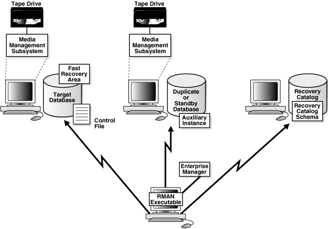
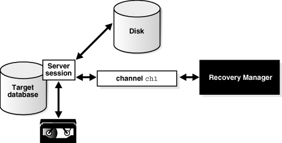

Learn about the Recovery Manager (RMAN) interface and the basic components of the RMAN environment.

### 3.1 About the RMAN Environment

The Recovery Manager environment consists of the various applications and databases that play a role in a backup and recovery strategy.

Table 3-1 lists some components in a typical RMAN environment.

Table 3-1 Components of the RMAN Environment

| Component | Description |
| --- | --- |
| RMAN client | The client application that manages backup and recovery operations for a target database. The RMAN client can use Oracle Net to connect to a target database, so it can be located on any host that is connected to the target host through Oracle Net. |
| target database | A database containing the control files, data files, and optional archived redo logs that RMAN backs up or restores. RMAN uses the target database control file to gather metadata about the target database and to store information about its own operations. The work of backup and recovery is performed by server sessions running on the target database. |
| recovery catalog database | A database containing a recovery catalog, which contains metadata that RMAN uses to perform backup and recovery. You can create one recovery catalog that contains the RMAN metadata for multiple target databases. Unless you are using RMAN with a physical standby database, a recovery catalog is optional when using RMAN because RMAN stores its metadata in the control file of each target database. |
| recovery catalog schema | The user within the recovery catalog database that owns the metadata tables maintained by RMAN. RMAN periodically propagates metadata from the target database control file into the recovery catalog. |
| physical shatndby database | A copy of the primary database that is updated with redo generated by the primary database. You can fail over to the standby database if the primary database becomes inaccessible.  RMAN can create, back up, or recover a standby database. Backups that you make at a physical standby database are usable at the primary database or another physical standby database for the same production database. The recovery catalog is required when you use RMAN to back up a physical standby database.  Note: A logical standby database is treated as a separate database by RMAN because it has a different DBID from its primary database. |
| fast recovery area | A disk location that you can use to store recovery-related files such as control file and online redo log copies, archived redo logs, flashback logs, and RMAN backups. Oracle Database and RMAN manage the files in the fast recovery area automatically. |
| media management software | A vendor-specific application that enables RMAN to back up to a storage system such as tape |
| media management catalog | A vendor-specific repository of metadata about a media management application |
| Oracle Enterprise Manager | A browser-based interface to the database, including backup and recovery through RMAN |

The only required components in an RMAN environment are a target database and RMAN client, but most real-world configurations are more complicated. For example, you use an RMAN client connecting to multiple media managers and multiple target databases, all accessed through Enterprise Manager.

Figure 3-1 illustrates components in a possible RMAN environment. The figure shows that the primary database, standby database, and recovery catalog databases all reside on different computers. The primary and standby database hosts use a locally attached tape drive. The RMAN client and Enterprise Manager console run on a separate computer.

Figure 3-1 Sample RMAN Environment

> This graphic illustrates the components of a sample RMAN environment. At the bottom is the RMAN executable. Above the RMAN executable, from right to left, are the following: recovery catalog, duplicate or standby database, and target database. The standby database contains the auxiliary instance and is connected to a tape drive through a media management layer. The target database contains the control file and the fast recovery area. It is connected to a tape drive through a media management layer.
>
> From the RMAN executable there are arrows pointing towards the following: recovery catalog, standby database, and target database.

### 3.2 About RMAN Command-Line Client

Use the RMAN command-line client to enter commands that you can use to manage all aspects of backup and recovery operations.

RMAN uses a command language interpreter that can execute commands in interactive or batch mode.

### 3.3 About RMAN Channels

An RMAN channel represents one stream of data to a device, and corresponds to one database server session. During a backup or restore operation, the channel reads data from the input device, processes it, and writes it to the output device.

The RMAN client directs database server sessions to perform all backup and recovery tasks. What constitutes a session depends on the operating system. For example, on Linux, a server session corresponds to a server process, whereas on Windows it corresponds to a thread within the database service. The RMAN client itself does not perform backup, restore, or recovery operations.

Most RMAN commands are executed by channels, which must be either configured to persist across RMAN sessions, or manually allocated in each RMAN session. As illustrated in Figure 3-2, a channel establishes a connection from the RMAN client to a target or auxiliary database instance by starting a server session on the instance.

Figure 3-2 Channel Allocation

> This illustration depicts channel allocation. RMAN has allocated one channel, which is shown starting a server session with a target database. The server session is shown performing backup operations to disk and tape.
>
> [  
> Copyright © 2023, 2024, Oracle and/or its affiliates.](https://docs.oracle.com/en/database/oracle/oracle-database/dcommon/html/cpyr.htm)

#### 3.3.1 About RMAN Channels and Devices

The RMAN-supported device types are DISK and SBT (system backup to tape).

An SBT device is controlled by a third-party media management software. Typically, SBT devices are tape libraries and tape drives.

If you use a DISK channel for a backup, then the channel creates the backup on disk in the file name space of the target database instance creating the backup. You can make a backup on any device that can store a data file. RMAN does not call a media manager when making DISK backups.

To create backups on non-disk media, you must use media management software such as Oracle Secure Backup and allocate channels supported by this software. RMAN contacts the media manager whenever the channel type allocated is not DISK. How and when the SBT channels cause the media manager to allocate resources is vendor-specific. Some media managers allocate resources when you issue the command; others do not allocate resources until you open a file for reading or writing.

#### 3.3.2 About RMAN Automatic and Manual Channels

RMAN can use automatic channels or manual channels for backup and recover operations.

You can use the `CONFIGURE CHANNEL` command to configure channels for use with disk or tape across RMAN sessions. This technique is known as automatic channel allocation. RMAN comes preconfigured with one `DISK` channel that you can use for backups to disk.

When you run a command that can use automatic channels, RMAN automatically allocates the channels with the options that you specified in the `CONFIGURE` command. For the `BACKUP` command, RMAN allocates only the type of channel required to back up to the specified media. For the `RESTORE` command and RMAN maintenance commands, RMAN allocates all necessary channels for the device types required to execute the command. RMAN determines the names for automatic channels.

You can also manually allocate channels. Each manually allocated channel uses a separate connection to the database. When you manually allocate a channel, you give it a user-defined name such as `dev1` or `ch2`.

Caution:

If the Oracle Database Windows services is running with a LP user, then you must manually grant the permissions required for the LP user to access the Oracle wallet. Otherwise, RMAN returns the ORA-28759 error message.

The number of channels available for use with a device when you run a command determines whether RMAN reads from or write to this device in parallel while performing the command. When the work is done in parallel, the backup of the files is done by multiple channels. Each channel may back up multiple files, but unless a multisection backup is performed, no file is backed up by more than one channel.

### 3.4 About the RMAN Repository

The RMAN repository is a collection of metadata about the target databases that RMAN uses for backup, recovery, and maintenance.

RMAN always stores its metadata in the control file. The version of this metadata in the control file is the authoritative record of RMAN backups of your database. This is one reason why protecting your control file is an important part of your backup strategy. RMAN can conduct all necessary backup and recovery operations using just the control file to store the RMAN repository information, and maintains all records necessary to meet your configured retention policy.

You can also create a recovery catalog, which is a repository of RMAN metadata stored in an Oracle Database schema. The control file has limited space for records of backup activities, whereas a recovery catalog can store a much longer history. You can simplify backup and recovery administration by creating a single recovery catalog that contains the RMAN metadata for all of your databases.

The owner of a recovery catalog can grant or revoke restricted access to the catalog to other database users. Each restricted user has full read/write access to his own metadata, which is called a virtual private catalog. When one or more virtual private catalogs exist in a database, the database contains just one set of catalog tables. These tables are owned by the base recovery catalog owner. The owner of the base recovery catalog controls which databases each virtual private catalog user can access.

Some RMAN features only function when you use a recovery catalog. For example, you can create a stored script in the recovery catalog and use this script to execute RMAN jobs. Other RMAN commands are specifically related to managing the recovery catalog and so are not available (and not needed) if RMAN is not connected to a recovery catalog.

The recovery catalog is maintained solely by RMAN. A target database instance never accesses the catalog directly. RMAN propagates information about the database structure, archived redo logs, backup sets, and data file copies into the recovery catalog from the target database control file after any operation that updates the repository, and also before certain operations.

### 3.5 About Media Management Using RMAN

The Oracle Media Management Layer (MML) API lets third-party vendors build media management software that works with RMAN to allow backups to sequential media devices such as tape drives.

Media management software handles loading, unloading, and labeling of sequential media such as tapes. You must install media management software to use RMAN with sequential media devices.

When backing up or restoring, the RMAN client connects to a target database instance and directs the instance to send requests to its media manager. No direct communication occurs between the RMAN client and the media manager.

#### 3.5.1 About RMAN Interaction with a Media Manager

Before performing backup or restore to a media manager, you must allocate one or more channels to handle the communication with the media manager.

You can also configure default channels for the media manager. The default channels are used for all backup and recovery tasks that employ the media manager and for which you have not explicitly allocated channels.

RMAN does not issue specific commands to load, label, or unload tapes. When backing up, RMAN gives the media manager a stream of bytes and associates a unique name with this stream. When RMAN must restore the backup, it asks the media manager to retrieve the byte stream. All details of how and where that stream is stored are handled entirely by the media manager. For example, the media manager labels and keeps track of the tape and names of files on each tape, and automatically loads and unloads tapes, or signals an operator to do so.

Some media managers support proxy copy functionality, in which they handle the entire data movement between data files and the backup devices. These products may use technologies such as high-speed connections between storage and media subsystems to reduce the load on the primary database server. RMAN provides a list of files requiring backup or restore to the media manager, which in turn makes all decisions regarding how and when to move the data.

#### 3.5.2 About RMAN and Oracle Secure Backup

Oracle Secure Backup is a media manager that provides reliable and secure data protection through file system backup to tape. All major tape drives and tape libraries in SAN, Gigabit Ethernet, and SCSI environments are supported.

Although Oracle Secure Backup has no specialized knowledge of database backup and recovery algorithms, it can serve as a media management layer for RMAN through the SBT interface. In this capacity, Oracle Secure Backup provides the same services for RMAN as other supported third-party SBT libraries. Oracle Secure Backup has some features, however, that are not available in other media managers.

#### 3.5.3 About the Backup Solutions Program

The Oracle Backup Solutions Program (BSP), part of the Oracle PartnerNetwork, is a group of media manager vendors whose products are compliant with Oracle's MML specification. Several products may be available for your platform from media management vendors.

For more information, contact your Oracle representative for a list of available products, contact individual vendors to ask them if they participate, or access the Backup Solutions Program website at:

[`http://www.oracle.com/technetwork/database/features/availability/bsp-088814.html`](http://www.oracle.com/technetwork/database/features/availability/bsp-088814.html)

Oracle does not certify media manager vendors for compatibility with RMAN. Questions about availability, version compatibility, and functionality can only be answered by the media manager vendor, not Oracle.

### 3.6 About the Fast Recovery Area

The fast recovery area is an optional disk location that can be used to store recovery-related files.

The components that create different backup and recovery-related files have no knowledge of each other or of the size of the file systems where they store their data. With automatic disk-based backup and recovery, you can create a [fast recovery area](glossary.md) (also called the recovery area), which automates management of backup-related files.

A fast recovery area minimizes the need to manually manage disk space for backup-related files and balance the use of space among the different types of files. In this way, a fast recovery area simplifies the ongoing administration of your database. Oracle recommends that you enable a recovery area to simplify backup management.

When you create a recovery area, you choose a location on disk and set an upper bound for storage space. You also set a backup retention policy that governs how long backup files are needed for recovery. The database manages the storage used for backups, archived redo logs, and other recovery-related files for the database within this space. Files no longer needed are eligible for deletion when RMAN must reclaim space for new files.

### 3.7 About RMAN in a Data Guard Environment

Data Guard maintains standby databases as transactionally consistent copies of production database. A standby database can be either a physical standby database or a logical standby database.

A database in a Data Guard environment is uniquely identified by the `DB_UNIQUE_NAME` parameter in the initialization parameter file. For RMAN to work correctly in a Data Guard environment, the `DB_UNIQUE_NAME` must be unique across all the databases with the same DBID.

When using RMAN in a Data Guard environment, a recovery catalog is required. The recovery catalog can store the metadata for all primary and standby databases.

#### 3.7.1 About RMAN Configuration in a Data Guard Environment

To simplify ongoing use of RMAN for backup and recovery, you can set some persistent configuration settings for each primary and physical standby database in a Data Guard environment. These settings control many aspects of RMAN behavior.

For example, you can configure the backup retention policy, default destinations for backups to tape or disk, or default backup device type.

You can use the `CONFIGURE` command with the `FOR                 DB_UNIQUE_NAME` clause to create a persistent configuration for a database in a Data Guard environment without connecting to the standby database or primary database as `TARGET`. For example, you connect RMAN to the recovery catalog, run the `SET DBID` command, and then can create a configuration for a physical standby database before its creation so that the RMAN configuration applies when the database is created.

RMAN updates the control file of the database when connected to it as `TARGET` during a recovery catalog resynchronization. If you use `FOR DB_UNIQUE_NAME` for a database without being connected as `TARGET` to this database, however, then RMAN changes configurations in the recovery catalog only.

#### 3.7.2 About RMAN File Management in a Data Guard Environment

RMAN uses a recovery catalog to track file names for all database files in a Data Guard environment.

The catalog also records where the online redo log files, standby redo log files, temp files, archived redo log files, backup sets, and image copies are created.

##### 3.7.2.1 About Interchangeability of Backups in a Data Guard Environment

RMAN commands use the recovery catalog metadata to function transparently across different physical databases in the Data Guard environment. For example, you can back up a tablespace on a physical standby database and restore and recover it on the primary database. Similarly, you can back up a tablespace on a primary database and restore and recover it on a physical standby database.

Backups of standby control files and nonstandby control files are interchangeable. For example, you can restore a standby control file on a primary database and a primary control file on a physical standby database. This interchangeability means that you can offload control file backups to one database in a Data Guard environment. RMAN automatically updates the file names for database files during restore and recovery at the databases.

Note:

Backups of logical standby databases are not usable at the primary database.

##### 3.7.2.2 About Association of Backups in a Data Guard Environment

The recovery catalog tracks the files in the Data Guard environment by associating every database file or backup file with a `DB_UNIQUE_NAME`. The database that creates a file is associated with the file.

For example, if RMAN backs up the database with the unique name of `standby1`, then `standby1` is associated with this backup. A backup remains associated with the database that created it unless you use the [`CHANGE`](https://docs.oracle.com/pls/topic/lookup?ctx=en/database/oracle/oracle-database/21/bradv&id=RCMRF110) `...RESET DB_UNIQUE_NAME` command to associate the backup with a different database.

##### 3.7.2.3 About Accessibility of Backups in a Data Guard Environment

The accessibility of a backup is different from its association. In a Data Guard environment, the recovery catalog considers disk backups as accessible only to the database with which they are associated, whereas tape backups created on one database are accessible to all databases.

If a backup file is not associated with any database, then the row describing it in the recovery catalog view shows `null` for the `SITE_KEY` column. By default, RMAN associates a file whose `SITE_KEY` is `null` with the database to which they are connected as `TARGET`.

RMAN commands such as `BACKUP`, `RESTORE`, and `CROSSCHECK` work on any accessible backup. For example, for a `RECOVER COPY` operation, RMAN considers only image copies that are associated with the database as eligible to be recovered. RMAN considers the incremental backups on disk and tape as eligible to recover the image copies. In a database recovery, RMAN considers only the disk backups associated with the database and all files on tape as eligible to be restored.

To illustrate the differences in backup accessibility, assume that databases `prod` and `standby1` reside on different hosts. RMAN backs up data file `1` on `prod` to `/prmhost/disk1/df1.dbf` on the production host and also to tape. RMAN backs up data file `1` on `standby1` to `/sbyhost/disk2/df1.dbf` on the standby host and also to tape. If RMAN is connected to database `prod`, then you cannot use RMAN commands to perform operations with the `/sbyhost/disk2/df1.dbf` backup located on the standby host. However, RMAN does consider the tape backup made on `standby1` as eligible to be restored.

Note:

You can transfer a backup from a standby host to a primary host or vice versa, connect as `TARGET` to the database on this host, and then use the `CATALOG` command to catalog the backup. After a file is cataloged by the target database, the file is associated with the target database.

### 3.8 About RMAN in a Recovery Appliance Environment

RMAN is fully-integrated with Zero Data Loss Recovery Appliance and RMAN commands can be used to back up protected databases to Recovery Appliance.

#### 3.8.1 Creating RMAN Backups to Recovery Appliance

Recovery Appliance provides a centralized remote repository for backups of all target databases in the enterprise. Backups and backup metadata for all target databases is managed by a central recovery catalog (the Recovery Appliance catalog) on Recovery Appliance.

Before you use Recovery Appliance to manage backups of your target database, you must perform some configuration steps both on the Recovery Appliance and on the target database.

To back up a target database to Recovery Appliance:

1. Ensure that the target database meets the requirements for protected databases in Recovery Appliance environments.
	See Also:
	[Zero Data Loss Recovery Appliance Administrator's Guide](https://docs.oracle.com/pls/topic/lookup?ctx=en/database/oracle/oracle-database/21/bradv&id=AMAGD866) for information about the supported Oracle Database releases
2. Install the Recovery Appliance backup module on the target database. This backup module is a shared library that is used by the target database to transfer backups to Recovery Appliance.
	See Also:
	[Zero Data Loss Recovery Appliance Protected Database Configuration Guide](https://docs.oracle.com/pls/topic/lookup?ctx=en/database/oracle/oracle-database/21/bradv&id=AMPDB715) for the steps to install the Recovery Appliance backup module
3. Enroll the target database as a protected database with the Recovery Appliance.
	This step includes creating a protection policy, configuring a Recovery Appliance database user that will be used by protected databases to authenticate with Recovery Appliance, and registering the protected database with the Recovery Appliance catalog.
	See Also:
	- [Zero Data Loss Recovery Appliance Administrator's Guide](https://docs.oracle.com/pls/topic/lookup?ctx=en/database/oracle/oracle-database/21/bradv&id=AMAGD1085) for the enrolment steps on the Recovery Appliance
	- [Zero Data Loss Recovery Appliance Protected Database Configuration Guide](https://docs.oracle.com/pls/topic/lookup?ctx=en/database/oracle/oracle-database/21/bradv&id=AMPDB713) for the enrolment steps on the protected database
4. (Optional) Configure backup and recovery settings for the target database. These settings will be used when you perform backup and recovery operations with Recovery Appliance.
	The `CONFIGURE` command is used to configure backup and recovery settings for protected databases.
	See Also:
	- [Configuring the RMAN Environment](configuring-rman-client-basic.md)
	- [Zero Data Loss Recovery Appliance Protected Database Configuration Guide](https://docs.oracle.com/pls/topic/lookup?ctx=en/database/oracle/oracle-database/21/bradv&id=AMPDB815) for information about configuring settings in a Recovery Appliance environment
5. Start RMAN and connect as `TARGET` to the protected database and as `CATALOG` to the Recovery Appliance catalog.
	The connection to the target database must be as a user with the `SYSDBA` or `SYSBACKUP` privilege. The connection to the Recovery Appliance is as the Recovery Appliance user that has privileges required to perform backup and recovery operations for the protected database.
	See Also:
	[Zero Data Loss Recovery Appliance Protected Database Configuration Guide](https://docs.oracle.com/pls/topic/lookup?ctx=en/database/oracle/oracle-database/21/bradv&id=AMPDB804) for information about creating connections using RMAN
6. Allocate one or more RMAN SBT channels that point to the Recovery Appliance backup module. These channels are used to transfer data to the Recovery Appliance.
	See Also:
	" [Configuring RMAN to Make Backups to Recovery Appliance](configuring-rman-client-basic.md) "
7. Back up the target database to Recovery Appliance. You use the regular RMAN commands to back up the database to Recovery Appliance.
	See Also:
	[Zero Data Loss Recovery Appliance Protected Database Configuration Guide](https://docs.oracle.com/pls/topic/lookup?ctx=en/database/oracle/oracle-database/21/bradv&id=AMPDB827) for the steps to back up protected databases