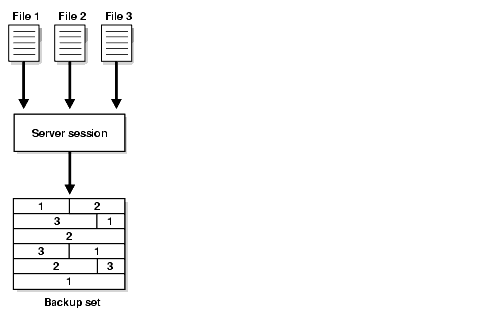
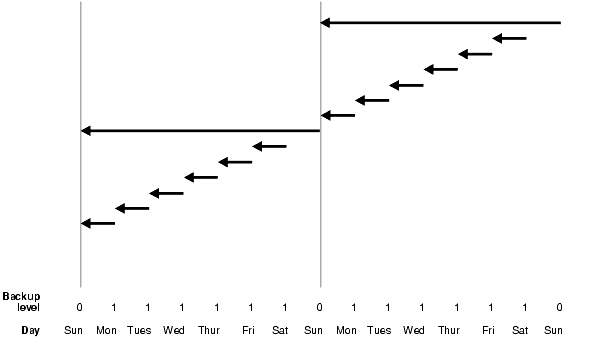
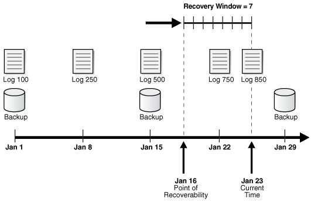
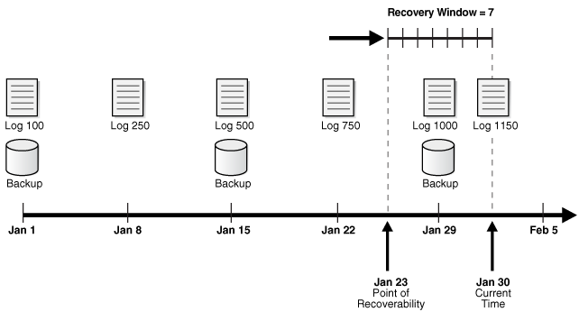

Learn about the general concepts that you must understand to make any type of RMAN backup.

### 8.1 About Consistent and Inconsistent RMAN Backups

Use the RMAN `BACKUP` command to create both consistent and inconsistent backups.

The RMAN `BACKUP` command supports backing up the following types of files:

- Data files and control files
- Server parameter file
- Archived redo logs
- RMAN backups

Although the database depends on other types of files, such as network configuration files, password files, and the contents of the Oracle home, you cannot back up these files with RMAN. Likewise, some features of Oracle Database, such as external tables, may depend upon files other than the data files, control files, and redo log. RMAN cannot back up these files. Use general-purpose backup software such as Oracle Secure Backup to protect files that RMAN does not support.

When you execute the `BACKUP` command in RMAN, the output is always either one or more backup sets or one or more image copies. A backup set is an RMAN-specific proprietary format, whereas an image copy is a bit-for-bit copy of a file. By default, RMAN creates backup sets.

#### 8.1.1 About Consistent RMAN Backups

A consistent backup occurs when the database is in a consistent state. You can use the `BACKUP` command to make consistent backups of the database.

A database is in a consistent state after being shut down with the [`SHUTDOWN`](https://docs.oracle.com/pls/topic/lookup?ctx=en/database/oracle/oracle-database/21/bradv&id=RCMRF155) `NORMAL`, `SHUTDOWN IMMEDIATE`, or `SHUTDOWN TRANSACTIONAL` commands. A consistent shutdown guarantees that all redo has been applied to the data files. If you mount the database and make a backup at this point, then you can restore the database backup later and open it without performing media recovery. But you will, of course, lose all transactions that occurred after the backup was created.

#### 8.1.2 About Inconsistent RMAN Backups

Any database backup that is not consistent is an inconsistent backup. A backup made when the database is open is inconsistent, as is a backup made after an instance failure or `SHUTDOWN ABORT` command.

When a database is restored from an inconsistent backup, Oracle Database must perform media recovery before the database can be opened, applying changes from the redo logs that took place after the backup was created.

Note:

RMAN does not permit you to make inconsistent backups when the database is in `NOARCHIVELOG` mode. If you employ user-managed backup techniques for a `NOARCHIVELOG` database, then you must not make inconsistent backups of this database.

If the database runs in `ARCHIVELOG` mode, and you back up the archived redo logs and data files, inconsistent backups can be the foundation for a sound backup and recovery strategy. Inconsistent backups offer superior availability because you do not have to shut down the database to make backups that fully protect the database.

### 8.2 About Online Backups and Backup Mode

You can create RMAN backups or user-managed backups.

When performing a user-managed backup of an online tablespace or database, an operating system utility can back up a data file at the same time that the database writer (DBWR) is updating the file. It is possible for the utility to read a block in a half-updated state, so that the block that is copied to the backup media is updated in its first half, while the second half contains older data. This type of logical corruption is known as a fractured block, that is, a block that is not consistent with an SCN. If this backup must be restored and the block requires recovery, then recovery fails because the block is not usable.

For third-party snapshot technologies, you must use one of the following techniques to eliminate the risk of creating fractured blocks:

- Ensure that the snapshot technology complies with Oracle requirements for online backups
- Take the database or data files offline
- Place the database in backup mode before using a third-party snapshot backup

Unlike user-managed tools, RMAN does not require extra logging or backup mode because it knows the format of data blocks. RMAN is guaranteed not to back up fractured blocks. During an RMAN backup, a database server session reads each data block and checks whether it is fractured by comparing the block header and footer. If a block is fractured, then the session rereads the block. If the same fracture is found, then the block is considered permanently corrupt. Also, RMAN does not need to freeze the data file header checkpoint because it knows the order in which the blocks are read, which enables it to capture a known good checkpoint for the file.

### 8.3 About Backup Sets

When you execute the `BACKUP` command in RMAN, you create one or more backup sets or image copies. By default, RMAN creates backup sets regardless of whether the destination is disk or a media manager.

Note:

Data file backup sets are typically smaller than data file image copies and take less time to write.

#### 8.3.1 About Backup Sets and Backup Pieces

RMAN can store backup data in a logical structure called a backup set, which is the smallest unit of an RMAN backup.

A backup set contains the data from one or more data files, archived redo logs, control files, or server parameter file. Backup sets, which are only created and accessed through RMAN, are the only form in which RMAN can write backups to media managers such as tape drives and tape libraries.

A backup set contains one or more binary files in an RMAN-specific format. Each of these files is known as a backup piece. A backup set can contain multiple data files. For example, you can back up 10 data files into a single backup set consisting of a single backup piece. In this case, RMAN creates one backup piece as output. The backup set contains only this backup piece.

If you specify the `SECTION SIZE` parameter on the `BACKUP` command, then RMAN produces a multisection backup. This is a backup of a single large file, produced by multiple channels in parallel, each of which produces one backup piece. Each backup piece contains one file section of the file being backed up.

For non-multisection backups, RMAN only records backup sets in the repository that complete successfully. There is no such thing as a partial backup set. This differs from an unsuccessful multisection backup, where it is possible for RMAN metadata to contain a record for a partial backup set. In the latter case, you must use the `DELETE` command to delete the partial backup set.

Note:

RMAN never considers partial backups as candidates for restore and recovery.

#### 8.3.2 About RMAN Block Compression for Backup Sets

RMAN can use block compression when creating backup sets.

The following types of block compression are available:

- Unused Block Compression (Supports disk backup and Oracle Secure Backup tape backup)
- Null Block Compression (Supports all backups)

RMAN block compression is not traditional binary compression. Rather, it is a set of techniques that RMAN uses to altogether avoid backing up certain blocks that are not needed in this backup.

##### 8.3.2.1 About Unused Block Compression

When employing unused block compression, RMAN skips reading, and backing up, any database blocks that are not currently allocated to some database object. This is regardless of whether those blocks had previously been allocated.

So if a database table is dropped, RMAN will not back up the space that was occupied by that table until new objects are created in that space.

Unused block compression is used automatically when the following conditions are true:

- The `COMPATIBLE` initialization parameter is set to 10.2 or higher.
- There are currently no guaranteed restore points defined for the database.
- The data file is locally managed.
- The data file is being backed up to a backup set as part of a full backup or a level 0 incremental backup.
- The backup set is created on disk, or Oracle Secure Backup is the media manager.

##### 8.3.2.2 About Null Block Compression

When employing null block compression, RMAN omits from its output any block that has never contained data.

Null block compression is always used with level 0 or full backups that are created in backup set format.

#### 8.3.3 About Binary Compression for RMAN Backup Sets

RMAN supports binary compression of backup sets. Binary compression is only enabled when you specify `AS COMPRESSED BACKUPSET` in the `BACKUP` command, or one-time with the `CONFIGURE DEVICE TYPE [DISK | SBT] BACKUP TYPE TO COMPRESSED BACKUPSET` command.

You have two binary compression options:

- You can use the `BASIC` compression algorithm, which does not require the Oracle Advanced Compression option. This setting offers a compression ratio comparable to `MEDIUM`, at the expense of additional CPU consumption.
- If you have enabled the Oracle Advanced Compression option, you can choose from the compression levels outlined in "About Oracle Advanced Compression Option".

#### 8.3.4 About RMAN Backup Undo Optimization

In backup undo optimization, RMAN excludes undo not needed for recovery of a backup, that is, for transactions that have been committed.

Backup undo optimization works for disk backups and Oracle Secure Backup tape backups. Unlike backup optimization, backup undo optimization is not configurable.

#### 8.3.5 About Encryption for RMAN Backup Sets

RMAN supports backup encryption for backup sets. You can use keystore-based transparent encryption, password-based encryption, or both.

You can use the `CONFIGURE ENCRYPTION` command to configure persistent transparent encryption. Use the `SET ENCRYPTION` command at the RMAN session level to specify password-based encryption.

Note:

Keystore-based encryption is more secure than password-based encryption because no passwords are involved. Use password-based encryption only when it is absolutely necessary because your backups must be transportable.

To create encrypted backups on disk with RMAN, the database must use the Advanced Security Option. For encrypted RMAN backups directly to tape, the Oracle Secure Backup SBT is the only supported interface.

#### 8.3.6 About File Names for RMAN Backup Pieces

You can either let RMAN determine a unique name for backup pieces or use the `FORMAT` clause to specify a name.

If you do not specify the `FORMAT` parameter, then RMAN automatically generates a unique file name with the `%U` substitution variable in the default backup location.

An example of RMAN generating an SBT backup piece name by `%U` is:

```
2i1nk47_1_1
```

An example of a non-Oracle Managed File (OMF) backup piece on disk is:

```
/backups/TEST/2i1nk47_1_1
```

The `FORMAT` clause supports substitution variables other than `%U` for generating unique file names. For example, you can use `%d` to generate the name of the database, `%I` for the DBID, `%t` for the time stamp, and so on.

You can specify up to four `FORMAT` parameters. If you specify multiple `FORMAT` parameters, then RMAN uses the multiple `FORMAT` parameters only when you specify multiple copies. You can create multiple copies by using the `BACKUP ... COPIES`, `SET                 BACKUP COPIES`, or `CONFIGURE ... BACKUP COPIES` commands.

Note:

If you use a media manager, then check your vendor documentation for restrictions on `FORMAT`, such as the size of the name, the naming conventions, and so on.

#### 8.3.7 About Number and Size of RMAN Backup Pieces

By default a backup set contains one backup piece. To restrict the size of each backup piece, specify the `MAXPIECESIZE` option of the `CONFIGURE CHANNEL` or `ALLOCATE CHANNEL` commands.

The `MAXPIECESIZE` option limits backup piece size to the specified number of bytes. If the total size of the backup set is greater than the specified backup piece size, then RMAN creates multiple physical pieces to hold the backup set contents.

You can use this option for media managers that cannot manage a backup piece that spans multiple tapes. For example, if a tape can hold 10 GB, but the backup set being created must hold 80 GB of data, then you must instruct RMAN to create backup pieces of 10 GB, small enough to fit on the tapes used with the media manager. In this case, the backup set media consists of eight tapes. Media managers supporting SBT 2.0 can return a value to RMAN indicating the largest supported backup piece size, which RMAN uses in planning backup activities.

If you specify the `SECTION SIZE` parameter on the `BACKUP` command, then RMAN can create a multisection backup. In this case, a single backup set can contain multiple backup pieces, each containing a file section. The purpose of multisection backups is to enable multiple channels to back up a large file in parallel.

#### 8.3.8 About Number and Size of RMAN Backup Sets

You use the `backupSpec` clause of the `BACKUP` command to specify the objects to be backed up. Each `backupSpec` clause produces at least one backup set.

The total number and size of backup sets depends mostly on an internal RMAN algorithm. However, you can influence RMAN behavior with the `MAXSETSIZE` parameter in the `CONFIGURE` or `BACKUP` command. By limiting the size of the backup set, the parameter indirectly limits the number of files in the set and can possibly force RMAN to create additional backup sets. Also, you can specify `BACKUP ... FILESPERSET` to specify the maximum number of files in each backup set.

#### 8.3.9 About Multiplexed RMAN Backup Sets

When creating backup sets, RMAN can simultaneously read multiple files from disk and then write their blocks into the same backup set. The combination of blocks from multiple files is called backup multiplexing.

For example, RMAN can read from two data files simultaneously, and then combine the blocks from these data files into a single backup piece.

Note:

If RMAN creates a multisection backup of a data file, then the data file is not multiplexed with any other data file or file section.

Image copies, by contrast, are never multiplexed.

As Figure 8-1 illustrates, RMAN can back up three data files into a backup set that contains only one backup piece. This backup piece contains the intermingled data blocks of the three input data files.

Figure 8-1 Data File Multiplexing



> This illustration depicts data file multiplexing. Three separate data files are read by a server session and written in intermingled fashion into a single backup piece as RMAN backs them up.
>
> [  
> Copyright © 2023, 2024, Oracle and/or its affiliates.](https://docs.oracle.com/en/database/oracle/oracle-database/dcommon/html/cpyr.htm)


RMAN multiplexing is determined by several factors. For example, the `FILESPERSET` parameter of the `BACKUP` command determines how many data files to put in each backup set. The `MAXOPENFILES` parameter of `ALLOCATE CHANNEL` or `CONFIGURE CHANNEL` defines how many data files RMAN can read from simultaneously. The basic multiplexing algorithm is as follows:

- Number of files in each backup set
	This number is the minimum of the `FILESPERSET` setting and the number of files read by each channel. The `FILESPERSET` default is 64.
- The level of multiplexing
	This is the number of input files simultaneously read and then written into the same backup piece. The level of multiplexing is the minimum of `MAXOPENFILES` and the number of files in each backup set. The `MAXOPENFILES` default is 8.

Suppose that you back up 12 data files with one channel when `FILEPERSET` is set to 4. The level of multiplexing is the lesser of this number and 8. Thus, the channel simultaneously writes blocks from 4 data files into each backup piece.

Now suppose that you back up 50 data files with one channel. The number of files in each backup set is 50. The level of multiplexing is the lesser of this number and 8. Thus, the channel simultaneously writes blocks from 8 data files into each backup piece.

RMAN multiplexing of backup sets is different from media manager multiplexing. One type of media manager multiplexing occurs when the media manager writes the concurrent output from multiple RMAN channels to a single sequential device. Another type occurs when a backup mixes database files and non-database files on the same tape.

Note:

Oracle recommends that you never use media manager multiplexing for RMAN backups.

#### 8.3.10 About RMAN Proxy Copies

During a proxy copy, RMAN turns over control of the data transfer to a media manager that supports this feature. The `PROXY` option of the `BACKUP` command specifies that a backup is a proxy copy.

Proxy copy can only be used with media managers that support it and cannot be used with channels of type `DISK`.

For each file that you attempt to back up with the `BACKUP PROXY` command, RMAN queries the media manager to determine whether it can perform a proxy copy. If the media manager cannot proxy copy the file, then RMAN backs up the file as if the `PROXY` option had not been used. (Use the `PROXY                 ONLY` option to force RMAN to fail if a proxy copy cannot be performed.)

Control files are never backed up with proxy copy. If the `PROXY` option is specified on an operation backing up a control file, then it is silently ignored for the purposes of backing up the control file.

### 8.4 About RMAN Image Copies

An image copy is an exact copy of a single data file, archived redo log file, or control file.

Image copies are not stored in an RMAN-specific format. They are identical to the results of copying a file with operating system commands. RMAN can use image copies during RMAN restore and recover operations, and you can also use image copies with non-RMAN restore and recovery techniques.

#### 8.4.1 About RMAN-Created Image Copies

To create image copies and have them recorded in the RMAN repository, you run the RMAN `BACKUP` `AS` `COPY` command.

Alternatively, you can configure the default backup type for disk as image copies. A database server session is used to create the copy. The server session also performs actions such as validating the blocks in the file and recording the image copy in the RMAN repository.

As with backup pieces, `FORMAT` variables are used to specify the names of image copies. The default format `%U`, which was explained in " About File Names for RMAN Backup Pieces ", is defined differently for image copies. The following example shows the name for data file `2` generated by `%U`:

```
/d1/oracle/work/orcva/RDBMS/datafile/o1_mf_sysaux_2qylngm3_.dbf
```

When creating image copies, you can also name the output copies with the `DB_FILE_NAME_CONVERT` parameter of the `BACKUP` command. This parameter works identically to the `DB_FILE_NAME_CONVERT` initialization parameter. Pairs of file name prefixes are provided to change the names of the output files. If a file is not converted by any of the pairs, then RMAN uses the `FORMAT` specification: if no `FORMAT` is specified, then RMAN uses the default format `%U`.

Example 8-1 Specifying File Names with DB\_FILE\_NAME\_CONVERT

This example copies the data files whose file name is prefixed with `/maindisk/oradata/users` so that they are prefixed with `/backups/users_ts`.

```
BACKUP AS COPY 
  DB_FILE_NAME_CONVERT ('/maindisk/oradata/users',
                        '/backups/users_ts')
  TABLESPACE users;
```

If you run a `RESTORE` command, then by default RMAN restores a data file or control file to its original location by copying an image copy backup to that location. Image copies are chosen over backup sets because of the extra overhead of reading through an entire backup set in search of files to be restored.

If you must restore and recover a current data file, and if you have an image copy available on disk, then you do not need to have RMAN copy the image copy back to its old location. Instead, you can use the image copy in place as a replacement for the data file to be restored as described in "Performing Complete Recovery After Switching to a Copy".

#### 8.4.2 About User-Managed Image Copies

RMAN can use image copies created by mechanisms outside of RMAN, such as native operating system file copy commands or third-party utilities that leave image copies of files on disk. This type of copy is known as a user-managed backup or operating system backup.

You can use the `CATALOG` command to inspect an existing image copy and enter its metadata into the RMAN repository. However, the `CATALOG` command does not do the following:

- Read all blocks in the data file copy to ensure there are no corruptions
- Guarantee that the image copy was correctly made in backup mode

After you catalog these files, you can use them with the `RESTORE` or `SWITCH` commands just as you can for RMAN-generated image copies.

Some sites store their data files on mirrored disk volumes, which permit the creation of image copies by breaking a mirror. After you have broken the mirror, you can notify RMAN of the existence of a new user-managed copy, thus making it eligible for a backup. You must notify RMAN when the copy is no longer available by using the `CHANGE...UNCATALOG` command.

### 8.5 About Sparse Backups

Use the RMAN `BACKUP` command to back up data blocks from sparse data files, tablespaces containing sparse data files, sparse pluggable databases (PDBs), and multitenant container databases (CDBs) containing sparse PDBs.

Sparse backups help in efficiently managing storage space and facilitate faster backup and recovery. To perform sparse backup and recovery operations, your database must have the `COMPATIBLE` initialization parameter set to 12.2 or higher.

A sparse data file is a logical Oracle object that is created as a shadow of a base data file object and is stored in a physical storage space known as delta space. For instance, consider a sparse database `DB0` that is created from a base database `DB`. In a sparse environment, it is mandatory that the base objects must be read-only. Unlike the base database, sparse databases are read-write databases. In this case, `DB`, a read-only database, consists of 5 data files. `DB0` recreates the logical versions of each of these 5 base data files and assigns a separate delta storage space for each individual file. When the sparse database `DB0` updates a data block in one of the sparse data files, only the updated block is logically stored in the delta space of that modified data file. When you choose to perform a sparse backup on `DB0`, the operation will copy data only from the delta storage space of the database and the delta space of the sparse data files. A sparse backup can either be in the backup set format (default) or the image copy format. RMAN restores sparse data files from sparse backups and then recovers them from archive and redo logs. You can perform a complete or a point-in-time recovery on sparse data files.

When the `COMPATIBLE` initialization parameter is set to 12.2 or higher, and you perform a full or level 0 incremental backup on a non-sparse (normal) data file, then RMAN performs a traditional full or level 0 incremental backup of the specified data file. If you perform a full or level 0 incremental backup on a sparse data file, then RMAN performs a backup only of all the latest changes from the delta storage space of that particular data file. Sparse backups can be encrypted.

If the `COMPATIBLE` initialization parameter is set to a value that is less than 12.2, RMAN backup and recovery operations are not influenced by the sparseness of a data file.

Note:

The base (read-only) data files in a sparse database are not encrypted. Ensure that the base data files are stored in a protected storage and accessed using secured communications.

### 8.6 About Preplugin Backups

A preplugin backup is an RMAN backup of a non-CDB or a PDB that was created before that non-CDB or PDB was plugged in to a different CDB.

The CDB into which the non-CDB or PDB is plugged in is referred to as the destination CDB. Preplugin backups can be used for PDB restore and recovery operations in destination CDB. To perform media recovery, all the required archive redo logs must be included in the preplugin backup.

For preplugin backups to be usable in the destination CDB, metadata about the preplugin backups must be exported to the RMAN repository of the destination CDB. When a PDB is unplugged from a source CDB, the required metadata is stored in the XML file created during the unplug operation. With non-CDBs, metadata required to make preplugin backups usable in the destination CDB is added to the non-CDB’s data dictionary using the `DBMS_PDB.EXPORTRMANBACKUP()` procedure.

Preplugin backups are usable only on the destination CDB into which the source non-CDB or PDB are plugged in. For example, assume that you migrate a PDB from the CDB `src_cdb` to the CDB `stage_cdb`. Subsequently, you migrate the source PDB from the CDB `stage_cdb` to the CDB `prod_cdb`. The PDB backups created on the CDB `src_pdb` are accessible to CDB `stage_pdb`. However, the CDB `prod_cdb` can only access the PDB backups created on the CDB `stage_cdb`, not the PDB backups created on the CDB `src_cdb`.

### 8.7 About Multiple Copies of RMAN Backups

RMAN enables you to make multiple, identical copies of backups.

Use one of the following ways:

- Duplex backups with the `BACKUP` `... COPIES` command, in which case RMAN creates multiple copies of each backup set
- Back up your files as backup sets or image copies, and then back up the backup sets or image copies with the RMAN `BACKUP` `BACKUPSET` or `BACKUP ` `COPY OF` commands

#### 8.7.1 About Duplexed Backup Sets

When backing up data files, archived redo log files, server parameter files, and control files into backup pieces, RMAN can create a duplexed backup set, producing up to four identical copies of each backup piece in the backup set on different backup destinations with one `BACKUP` command.

Duplexing is not supported for backup operations that produce image copies.

You can use the `COPIES` parameter in the `CONFIGURE`, `SET`, or `BACKUP` commands to specify duplexing of backup sets when using the `BACKUP` command. RMAN can duplex backups to either disk or tape, but cannot duplex backups to tape and disk simultaneously. When backing up to tape, ensure that the number of copies does not exceed the number of available tape devices.

The `FORMAT` parameter of the `BACKUP` command specifies the destinations for duplexed backups. The following example creates three copies of the backup of data file 7:

```
BACKUP DEVICE TYPE DISK COPIES 3 DATAFILE 7 
  FORMAT '/disk1/%U','?/oradata/%U','?/%U';
```

RMAN places the first copy of each backup piece in `/disk1`, the second in `?/oradata`, and the third in the Oracle home. RMAN does not produce three backup sets, each with a different unique backup set key. Rather, RMAN produces one backup set with a unique key, and generates three identical copies of each backup piece in the set.

#### 8.7.2 About Backups of RMAN Backups

You can use the `BACKUP` command to back up existing backup sets and image copies. Backing up existing backups enables you to make multiple, identical copies of RMAN backups.

##### 8.7.2.1 Backups of Backup Sets

The RMAN `BACKUP BACKUPSET` command backs up backup sets that were created on disk. The command is a useful way to spread backups among multiple media.

If RMAN discovers that one copy of a backup set is corrupted or missing, then it searches for other copies of the same backup set. This behavior is similar to the behavior of RMAN when backing up archived redo logs that exist in multiple archiving destinations.

Starting with Oracle Database Release 18c, while backing up backup sets, you can compress backup sets that were not previously compressed by using the `BACKUP AS COMPRESSED BACKUPSET` command.

RMAN enables you to create encrypted backups of unencrypted backup sets. Before you back up the unencrypted backup sets, use the `SET ENCRYPTION FOR DATABASE ON` command to enable encryption. Note that the `SET` command enables encryption for the current RMAN session. If encryption is not required for subsequent operations, then turn off encryption for the database.

Example 8-2 Backing Up Backup Sets to Tape

This example shows how you might run the `BACKUP` command weekly as part of the production backup schedule. In this way, you ensure that all your backups exist on both disk and tape.

```
BACKUP DEVICE TYPE DISK AS BACKUPSET 
  DATABASE PLUS ARCHIVELOG; 
BACKUP 
  DEVICE TYPE sbt 
  BACKUPSET ALL; # copies backup sets on disk to tape
```

Note:

Backups to `sbt` that use automatic channels require that you first run the `CONFIGURE` `DEVICE` `TYPE` `sbt` command.

Example 8-3 Managing Space Allocation

You can also use `BACKUP` `BACKUPSET` to manage backup space allocation. This example backs up backup sets that were created more than a week ago from disk to tape, and then deletes them from disk.

```
BACKUP 
  DEVICE TYPE sbt 
  BACKUPSET COMPLETED BEFORE 'SYSDATE-7' 
  DELETE INPUT;
```

`DELETE INPUT` here is equivalent to `DELETE ALL         INPUT`. RMAN deletes all existing copies of the backup set. If you duplexed a backup to four locations, then RMAN deletes all four copies of the pieces in the backup set.

##### 8.7.2.2 Backups of Image Copies

You can use the `BACKUP COPY OF` command to back up existing image copies of database files either as backup sets or as image copies. When using this command, an image copy of every data file specified in the command must exist. If there are multiple copies of a data file, then the latest one is used. If you specify a tablespace or the whole database, then RMAN issues an error if there are data files in the database or tablespace for which there are no image copy backups.

### 8.8 About RMAN Control File and Server Parameter File Autobackups

Having recent backups of your control file and server parameter file is extremely valuable in many recovery situations. To ensure that you have backups of these files, the database supports control file and server parameter file autobackups.

The autobackup occurs independently of any backup of the current control file explicitly requested as part of your `BACKUP` command. With a control file autobackup, RMAN can recover the database even if the current control file, recovery catalog, and server parameter file are inaccessible. Because the path used to store the autobackup follows a well-known format, RMAN can search for and restore the server parameter file from that autobackup. After you have started the instance with the restored server parameter file, RMAN can restore the control file from the autobackup. After you mount the control file, use the RMAN repository in the mounted control file to restore the data files.

It is recommended that you turn on control file autobackups. Otherwise, RMAN point-in-time recovery may not work effectively when it needs to undo data file additions or deletions.

#### 8.8.1 When RMAN Performs Control File Autobackups

Depending on the configuration of the target database, RMAN can perform autobackups of the control file and server parameter file.

For CDBs and standalone databases with the `COMPATIBLE` initialization parameter set to 12.0 or higher, by default, the control file autobackup is turned on.

If the database runs in `ARCHIVELOG` mode, RMAN makes control file autobackups when a structural change to the database affects the contents of the control file.

Note:

Beginning with Oracle Database Release 11g Release 2, RMAN takes only one control file autobackup when multiple structural changes contained in a script (for example, adding tablespaces, altering the state of a tablespace or data file, adding a new online redo log, renaming a file, and so on) have been applied.

#### 8.8.2 How RMAN Performs Control File Autobackups

The first channel allocated during the backup job creates the autobackup and places it into its own backup set. For autobackups after database structural changes, the server process associated with the structural change makes the backup.

If a server parameter file is in use by the database, then RMAN backs it up in the same backup set as the control file autobackup. After the autobackup completes, the database writes a message containing the complete path of the backup piece and the device type to the alert log located in the Automatic Diagnostic Repository (ADR).

Note:

Control file autobackups are never duplexed.

The control file autobackup file name has a default format of `%F` for all device types, so that RMAN can determine the file location and restore it without a repository. You can specify a different format with the `CONFIGURE CONTROLFILE AUTOBACKUP FORMAT` command, but all autobackup formats must include the `%F` variable. If you do not use the default format, then during disaster recovery you must specify the format that was used to generate the autobackups. Otherwise, RMAN cannot restore the autobackup.

### 8.9 About RMAN Incremental Backups

An incremental backup copies only those data blocks that have changed since a previous backup. You can use RMAN to create incremental backups of data files, tablespaces, or the whole database.

By default, RMAN makes full backups. A full backup of a data file includes every allocated block in the file being backed up. A full backup of a data file can be an image copy, in which case every data block is backed up. It can also be stored in a backup set, in which case data file blocks not in use may be skipped.

A full backup has no effect on subsequent incremental backups. Image copies are always full backups because they include every data block in a data file. A backup set is by default a full backup because it can potentially include every data block in a data file, although umused block compression means that blocks never used are excluded and, in some cases, currently unused blocks are excluded.

A full backup cannot be part of an incremental backup strategy; that is, it cannot be the parent for a subsequent incremental backup.

#### 8.9.1 About Multilevel Incremental Backups

RMAN can create multilevel incremental backups. Each incremental level is denoted by a value of 0 or 1.

A level 0 incremental backup, which is the base for subsequent incremental backups, copies all blocks containing data. The only difference between a level 0 incremental backup and a full backup is that a full backup is never included in an incremental strategy. Thus, an incremental level 0 backup is a full backup that happens to be the parent of incremental backups whose level is greater than 0.

A level 1 incremental backup can be either of the following types:

- A differential incremental backup, which backs up all blocks changed after the most recent incremental backup at level 1 or 0
- A cumulative incremental backup, which backs up all blocks changed after the most recent incremental backup at level 0

Incremental backups are differential by default.

Incremental backups at level 0 can be either backup sets or image copies, but incremental backups at level 1 can only be backup sets.

Note:

Cumulative backups are preferable to differential backups when recovery time is more important than disk space, because fewer incremental backups must be applied during recovery.

The size of the backup file depends solely upon the number of blocks modified, the incremental backup level, and the type of incremental backup (differential or cumulative).

##### 8.9.1.1 About Differential Incremental Backups

In a differential level 1 backup, RMAN backs up all blocks that have changed since the most recent incremental backup at level 1 (cumulative or differential) or level 0.

For example, in a differential level 1 backup, RMAN determines which level 1 backup occurred most recently and backs up all blocks modified after that backup. If no level 1 is available, then RMAN copies all blocks changed since the base level 0 backup.

If no level 0 backup is available in either the current or parent incarnation, then the behavior varies with the compatibility mode setting. If compatibility is >=10.0.0, RMAN copies all blocks that have been changed since the file was created. Otherwise, RMAN generates a level 0 backup.

Figure 8-2 Differential Incremental Backups



> This illustration depicts differential incremental backups. In this example, RMAN is shown backing up blocks of data over the course of two weeks. Sunday is shown as having a backup level of 0; Monday, Tuesday, Wednesday, Thursday, Friday, and Saturday are shown as having backup levels of 1. The second week is a repeat of the first. The backups are described in the following text.


In the example shown in Figure 8-2, the following activity occurs each week:

- Sunday
	An incremental level 0 backup backs up all blocks that have ever been in use in this database.
- Monday through Saturday
	On each day from Monday through Saturday, a differential incremental level 1 backup backs up all blocks that have changed since the most recent incremental backup at level 1 or 0. The Monday backup copies blocks changed since Sunday level 0 backup, the Tuesday backup copies blocks changed since the Monday level 1 backup, and so forth.

##### 8.9.1.2 About Cumulative Incremental Backups

In a cumulative level 1 backup, RMAN backs up all blocks used since the most recent level 0 incremental backup in either the current or parent incarnation.

Cumulative incremental backups reduce the work needed for a restore operation by ensuring that you only need one incremental backup from any particular level. Cumulative backups require more space and time than differential backups because they duplicate the work done by previous backups at the same level.

In the example shown in Figure 8-3, the following occurs each week:

- Sunday
	An incremental level 0 backup backs up all blocks that have ever been in use in this database.
- Monday - Saturday
	A cumulative incremental level 1 backup copies all blocks changed since the most recent level 0 backup. Because the most recent level 0 backup was created on Sunday, the level 1 backup on each day Monday through Saturday backs up all blocks changed since the Sunday backup.

Figure 8-3 Cumulative Incremental Backups


> This illustration depicts cumulative incremental backups. In this example, RMAN is shown backing up blocks of data over the course of two weeks. Sunday is shown as having a backup level of 0; Monday, Tuesday, Wednesday, Thursday, Friday, and Saturday are shown as having backup levels of 1. The second week is a repeat of the first. The backups are described in the following text.


#### 8.9.2 About Block Change Tracking

The block change tracking feature for incremental backups improves incremental backup performance by recording changed blocks in each data file in a block change tracking file.

The block change tracking file is a small binary file stored in the [database area](glossary.md). RMAN tracks changed blocks as redo is generated.

If block change tracking is enabled, then RMAN uses the change tracking file to identify changed blocks for incremental backups, thus avoiding the need to scan every block in the data file. RMAN only uses block change tracking when the incremental level is greater than 0, because a level 0 incremental backup includes all blocks.

#### 8.9.3 About the Incremental Backup Algorithm

Certain concepts are essential for understanding the algorithm that RMAN uses to make incremental backups.

- Checkpoint SCN
	Every data file has a data file checkpoint SCN, which you can view in `V$DATAFILE.CHECKPOINT_CHANGE#`. All changes with an SCN lower than this SCN are guaranteed to be in the file. When a level 0 incremental backup is restored, the restored data file contains the checkpoint SCN that it had when the level 0 was created. When a level 1 incremental backup is applied to a file, the checkpoint SCN of the file is advanced to the checkpoint SCN that the file had when the incremental level 1 backup was created.
- Incremental start SCN
	This SCN applies only to level 1 incremental backups. All blocks whose SCN is greater than or equal to the incremental start SCN are included in the backup. Blocks whose SCN is lower than the incremental start SCN are not included in the backup. The incremental start SCN is most often the checkpoint SCN of the parent of the level 1 backup.
- Block SCN
	Every data block in a data file records the SCN at which the most recent change was made to the block.

When RMAN makes a level 1 incremental backup of a file, RMAN reads the file, examines the SCN of every block, and backs up blocks whose SCN is greater than or equal to the incremental start SCN for this backup. If the backup is differential, then the incremental start SCN is the checkpoint SCN of the most recent level 1 backup. If the backup is cumulative, then the incremental start SCN is the checkpoint SCN of the most recent level 0 backup.

When block change tracking is enabled, RMAN uses bitmaps to avoid reading blocks that have not changed during the range from incremental start SCN to checkpoint SCN. RMAN still examines every block that is read and uses the SCN in the block to decide which blocks to include in the backup.

One consequence of the incremental backup algorithm is that RMAN applies all blocks containing changed data during recovery, even if the change is to an object created with the `NOLOGGING` option. Thus, if you restore a backup made before `NOLOGGING` changes were made, then incremental backups are the only way to recover these changes.

#### 8.9.4 About Recovery with Incremental Backups

During media recovery, RMAN examines the restored files to determine whether it can recover them with an incremental backup. If it has a choice, then RMAN always chooses incremental backups over archived redo logs because applying changes at a block level is faster than applying redo.

RMAN does not need to restore a base incremental backup of a data file to apply incremental backups to the data file during recovery. For example, you can restore data file image copies and recover them with incremental backups.

#### 8.9.5 About the Incremental-Forever Backup Strategy for Recovery Appliance

The incremental-forever backup strategy eliminates the need for creating recurring full backups when backing up to Zero Data Loss Recovery Appliance (Recovery Appliance). Although Recovery Appliance supports other RMAN backup strategies, the recommended method for ongoing backups is the incremental-forever backup strategy.

With the incremental-forever backup strategy, you need to create only one initial level 0 full backup and subsequent level 1 incremental backups. The initial backup and the subsequent incrementals must be RMAN backup sets and not image copies.

Note that the Recovery Appliance incremental-forever backup strategy is different from the incrementally updated backup strategy in a conventional RMAN setup. With RMAN, incrementally updated backups use an initial image copy, followed by incremental backups which are eventually merged into the full backup. Therefore, there is always at least one full image copy, a few incremental backups, and some archived redo logs.

### 8.10 About Backup Retention Policies

You can use the `CONFIGURE RETENTION POLICY` command to create a persistent and automatic backup retention policy.

When a backup retention policy is in effect, RMAN considers a backup of data files or control files as an obsolete backup, that is, no longer needed for recovery, according to criteria specified in the `CONFIGURE` command. You can use the `REPORT OBSOLETE` command to view obsolete files and the `DELETE OBSOLETE` command to delete them.

As you produce backups over time, older backups become obsolete as they are no longer needed to satisfy the retention policy. RMAN can identify the obsolete files for you, but it does not automatically delete them. You must use the `DELETE                 OBSOLETE` command to delete files that are no longer needed to satisfy the retention policy.

If a fast recovery area is configured, then the database automatically deletes files that are either obsolete or backed up to tape when more recovery area space is needed for new files. The disk quota rules are distinct from the retention policy rules, but the database never deletes files in violation of the retention policy to satisfy the disk quota.

A backup is obsolete when `REPORT OBSOLETE` or `DELETE                 OBSOLETE` determines, based on the user-defined retention policy, that it is not needed for recovery. A backup is considered an expired backup only when RMAN performs a crosscheck and cannot find the file. In short, obsolete means a file is not needed, whereas expired means it is not found.

A backup retention policy applies only to full or level 0 data file and control file backups. For data file copies and proxy copies, if RMAN determines that the copy or proxy copy is not needed, then the copy or proxy copy can be deleted. For data file backup sets, RMAN cannot delete the backup set until all data file backups within the backup set are obsolete.

The retention policy is not responsible for deleting or rendering obsolete archived redo logs and incremental level 1 backups. Rather, these files become obsolete when no full backups exist that need them. Besides affecting full or level 0 data file and control file backups, the retention policy affects archived redo logs and level 1 incremental backups. First, RMAN decides which data file and control file backups are obsolete. Then, RMAN considers as obsolete all archived logs and incremental level 1 backups that are not needed to recover the oldest data file or control file backup that must be retained.

Note:

RMAN cannot implement an automatic retention policy if backups are deleted by non-RMAN techniques, for example, through the media manager's tape retention policy. The media manager must never expire a tape until all RMAN backups on that tape have been removed from the media manager's catalog.

There are two mutually exclusive options for implementing a retention policy:

- redundancy
- recovery window.

#### 8.10.1 About the Recovery Window

A recovery window is a period that begins with the current time and extends backward in time to the point of recoverability. The point of recoverability is the earliest time for a hypothetical point-in-time recovery, that is, the earliest point to which you can recover following a media failure.

For example, if you implement a recovery window of 1 week, then RMAN retains full backups and required incremental backups and archived logs so that the database can be recovered up to 7 days in the past. You implement this retention policy as follows:

```
CONFIGURE RETENTION POLICY TO RECOVERY WINDOW OF 7 DAYS;
```

This command ensures that for each data file, one backup that is older than the point of recoverability is retained. For example, if the recovery window is `7`, then there must always exist one backup of each data file that satisfies the following condition:

```
SYSDATE - BACKUP CHECKPOINT TIME >= 7
```

All backups older than the most recent backup that satisfied this condition are obsolete.

Assume the retention policy illustrated in Figure 8-4. The retention policy has the following aspects:

- The recovery window is 7 days.
- Database backups are scheduled every two weeks on these days:
	- January 1
		- January 15
		- January 29
		- February 12
- The database runs in `ARCHIVELOG` mode, and archived logs are saved on disk only if needed for the retention policy.

Figure 8-4 Recovery Window, Part 1



> This illustration depicts part one of a recovery window. There is a timeline beginning at January 1 and proceeding through January 28. Beginning on January 1, a backup is scheduled for every two weeks. Archived logs are saved every seven days, and are numbered Log 100 for January 1, Log 250 on day 7, Log 500 on day 14, Log 750 on day 21, and Log 850 on day 23. A recovery window is shown extending back seven days from day 23 to day 16. The recovery is explained in the following text.


As illustrated in Figure 8-4, the current time is January 23 and the point of recoverability is January 16. Hence, the January 15 backup is needed for recovery, and so are the archived logs from log sequence 500 through 850. The logs before 500 and the January 1 backup are obsolete because they are not needed for recovery to a point within the window.

Assume the same scenario a week later, as depicted in Figure 8-5.

Figure 8-5 Recovery Window, Part 2



> This illustration depicts part two of a recovery window. There is a timeline beginning at January 1 and proceeding through February 4. Beginning on January 1, a backup is scheduled for every two weeks. Archived logs are saved every seven days, and are numbered Log 100 for January 1, Log 250 on day 7, Log 500 on day 14, Log 750 on day 21, Log 1000 on day 28, and Log 1150 on day 30. A recovery window is shown extending back seven days from day 30 to day 23. The recovery is explained in the following text.


In this scenario, the current time is January 30 and the point of recoverability is January 23. Note how the January 15 backup is not obsolete even though a more recent backup (January 29) exists in the recovery window. This situation occurs because restoring the January 29 backup does not enable you to recover to the earliest time in the window, January 23. To ensure recoverability to any point in the window, you must save the January 15 backup and all archived logs from sequence 500 to 1150.

#### 8.10.2 About Backup Redundancy

A redundancy-based retention policy specifies how many backups of each data file must be retained.

The default retention policy is configured to `REDUNDANCY` `1`.

For example, you can configure a redundancy of 2 as follows:

```
CONFIGURE RETENTION POLICY TO REDUNDANCY 2;
```

Note that in some cases using a recovery window can complicate disk space planning because the number of backups that must be retained is not constant and depends on the backup schedule.

#### 8.10.3 About Batch Deletes of Obsolete Backups

You can run the `REPORT OBSOLETE` command to determine which backups are currently obsolete according to the retention policy.

A companion command, `DELETE OBSOLETE`, deletes all files that are obsolete according to the retention policy. You can run `DELETE OBSOLETE` periodically to minimize space wasted by storing obsolete backups. For example, you can run `DELETE OBSOLETE` in a weekly script.

You can also override the configured retention policy by specifying the `REDUNDANCY` or `RECOVERY` `WINDOW` options on the `REPORT` or `DELETE` commands. Using `DELETE OBSOLETE` with a recovery window shorter than the configured recovery window effectively reduces the window of recoverability. For example, if the configured window is 14 days, but you execute `DELETE OBSOLETE RECOVERY WINDOW OF 7 DAYS`, then you no longer have the ability to recover to a time between 7 and 14 days ago.

#### 8.10.4 About Backup Retention Policy and Fast Recovery Area Deletion Rules

If you configure a fast recovery area, then the database uses an internal algorithm to select files in the fast recovery area that are no longer needed to meet the configured retention policy.

The retention policy is never violated when determining which files to delete from the fast recovery area to satisfy the disk quota rules. These backups have status `OBSOLETE` and are eligible for deletion to satisfy the disk quota rules.

The RMAN status `OBSOLETE` is always determined in reference to a retention policy. For example, if a database backup is considered `OBSOLETE` in the RMAN repository, then it is because it is either not needed for recovery to a point within the recovery window, or it is redundant.

There is one important difference between the fast recovery area rules for `OBSOLETE` status and the disk quota rules for deletion eligibility. Assume that archived logs 1000 through 2000, which are on disk, are needed for the current recovery window and so are not obsolete. If you back up these logs to tape, then the retention policy considers the disk logs as required, that is, not obsolete. Nevertheless, the fast recovery area disk quota algorithm considers the logs on disk as eligible for deletion because they have been backed up to tape. The logs on disk do not have `OBSOLETE` status in the repository, but they are eligible for deletion by the fast recovery area.