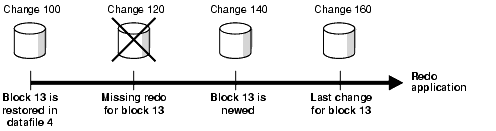

You can restore and recover individual data blocks within a data file.

See Also:

- [Oracle Database Backup and Recovery Reference](https://docs.oracle.com/pls/topic/lookup?ctx=en/database/oracle/oracle-database/21/bradv&id=RCMRF140) for `RECOVER` syntax
- [Oracle Database Reference](https://docs.oracle.com/pls/topic/lookup?ctx=en/database/oracle/oracle-database/21/bradv&id=REFRN30048) for details about the `V$DATABASE_BLOCK_CORRUPTION` view

### 19.1 Overview of Block Media Recovery

Block media recovery recovers provides lower mean time to recover (MTTR) by recovering corrupt data blocks.

This section contains the following topics:

- Purpose of Block Media Recovery
- Basic Concepts of Block Media Recovery

#### 19.1.1 Purpose of Block Media Recovery

Use block media recovery to recover one or more corrupt data blocks within a data file.

Block media recovery provides the following advantages over [data file media recovery](glossary.md):

- Lowers the [mean time to recover (MTTR)](glossary.md) because only blocks needing recovery are restored and recovered
- Enables affected data files to remain online during recovery
	Without block media recovery, if even a single block is corrupt, then you must take the data file offline and restore a backup of the data file. You must apply all redo generated for the data file after the backup was created. The entire file is unavailable until media recovery completes. With block media recovery, only the blocks actually being recovered are unavailable during the recovery.

Block media recovery is most useful for [physical corruption](glossary.md) problems that involve a small, well-known number of blocks. Block-level data loss usually results from intermittent, random I/O errors that do not cause widespread data loss, and memory corruptions that are written to disk. Block media recovery is not intended for cases where the extent of data loss or corruption is unknown and the entire data file requires recovery. In such cases, data file media recovery is the best solution.

#### 19.1.2 Basic Concepts of Block Media Recovery

Usually, the database marks a block as media corrupt and then writes it to disk when the corruption is first encountered. No subsequent read of the block is successful until the block is recovered. You can perform block recovery only on blocks that are marked corrupt or that fail a corruption check.

Typically, block corruption is reported in the following locations:

- Results of the `LIST FAILURE`, `VALIDATE`, or `BACKUP ... VALIDATE` command
- The `V$DATABASE_BLOCK_CORRUPTION` view
- Error messages in standard output
- The alert log
- User trace files
- Results of the SQL commands `ANALYZE TABLE` and `ANALYZE INDEX`
- Results of the DBVERIFY utility
- Third-party media management output

For example, you may discover the following messages in a user trace file:

```
ORA-01578: ORACLE data block corrupted (file # 7, block # 3)
ORA-01110: data file 7: '/oracle/oradata/trgt/tools01.dbf'
ORA-01578: ORACLE data block corrupted (file # 2, block # 235)
ORA-01110: data file 2: '/oracle/oradata/trgt/undotbs01.dbf'
```

Note:

Starting in Oracle Database 19c, the Data Recovery Advisor (DRA) feature is deprecated.

The deprecation of DRA includes deprecation of the following Oracle Recovery Manager (RMAN) commands: `LIST FAILURE`, `ADVISE FAILURE`, `REPAIR                     FAILURE`, and `CHANGE FAILURE`. Database administrators will no longer have access to these commands. There is no replacement feature for DRA.

See Also:

[Oracle Database Backup and Recovery Reference](https://docs.oracle.com/pls/topic/lookup?ctx=en/database/oracle/oracle-database/21/bradv&id=RCMRF140) for `RECOVER ... BLOCK` syntax

##### 19.1.2.1 About Block Recovery and Standby Databases

Block recovery behavior depends on whether the data block corruption was discovered on the primary database or the physical standby database.

If the database on which the corruption occurs is associated with a real-time query physical standby database, then the database automatically attempts to perform block media recovery. The primary database searches for good copies of blocks on the standby database and, if they are found, repairs the blocks with no impact to the query that encountered the corrupt block. The Oracle Database physical block corruption message (`ORA-1578`) is displayed only if the database cannot repair the corruption.

Whenever block corruption has been automatically detected, you can perform block media recovery manually with the `RECOVER ... BLOCK` command. By default, RMAN first searches for good blocks in the real-time query physical standby database, then flashback logs and then blocks in full or level 0 incremental backups.

Note:

For block media recovery to work automatically, the physical standby database must be in real-time query mode. An Oracle Active Data Guard license is required.

If a corrupt data block is discovered on a real-time query physical standby database, the server attempts to repair the corruption by obtaining a copy of the block from the primary database. The repair is performed in the background, enabling subsequent queries to succeed if the repair is successful. Automatic block repair is attempted if the following database initialization parameters are configured on the standby database as described:

- The `LOG_ARCHIVE_CONFIG` parameter is configured with a `DG_CONFIG` list and a `LOG_ARCHIVE_DEST_n` parameter is configured for the primary database with the `DB_UNIQUE_NAME` attribute
	or
- The `FAL_SERVER` parameter is configured and its value contains an Oracle Net service name for the primary database

Note:

If a corrupt block is detected during validation, such as by the RMAN `VALIDATE` command, then recovery is not initiated automatically.

See Also:

- [Oracle Database Backup and Recovery Reference](https://docs.oracle.com/pls/topic/lookup?ctx=en/database/oracle/oracle-database/21/bradv&id=RCMRF140) for `RECOVER ... BLOCK` syntax
- [Oracle Data Guard Concepts and Administration](https://docs.oracle.com/pls/topic/lookup?ctx=en/database/oracle/oracle-database/21/bradv&id=SBYDB00707) to learn about the real-time query option for standby databases

##### 19.1.2.2 About Identifying Corrupt Blocks

The `V$DATABASE_BLOCK_CORRUPTION` view displays blocks marked corrupt by database components such as RMAN, `ANALYZE`, and SQL queries.

The following types of corruption result in the addition of rows to this view:

- Physical corruption (sometimes called media corruption)
	The database does not recognize the block: the [checksum](glossary.md) is invalid, the block contains all zeros, or the block header is corrupt.
	Physical corruption checking is enabled by default. You can turn off checksum checking by specifying the `NOCHECKSUM` option of the `BACKUP` command, but other physical consistency checks, such as checks of the block headers and footers, cannot be disabled.
- Logical corruption
	The block has a valid checksum, the header and footer match, and so on, but the contents are logically inconsistent. Block media recovery may not be able to repair all logical block corruptions. In these cases, alternate recovery methods, such as tablespace point-in-time recovery, or dropping and re-creating the affected objects, may repair the corruption.
	Logical corruption checking is disabled by default. You can turn it on by specifying the `CHECK` `LOGICAL` option of the `BACKUP`, `RESTORE`, `RECOVER`, and `VALIDATE` commands.

The database can detect some corruptions by validating relationships between blocks and segments, but cannot detect them by a check of an individual block. The `V$DATABASE_BLOCK_CORRUPTION` view does not record at this level of granularity.

##### 19.1.2.3 About Missing Redo During Block Recovery

Block media recovery only requires an unbroken set of redo changes for the blocks being recovered. This is unlike data file recovery that requires an unbroken series of redo changes from the beginning of recovery to the end.

Like data file media recovery, block media recovery cannot generally survive a missing or inaccessible archived log, although it attempts restore failover when looking for usable copies of archived redo log files. Also, block media recovery cannot survive physical redo corruptions that result in checksum failure. However, block media recovery can survive gaps in the redo stream if the missing or corrupt redo records do not affect the blocks being recovered.

Note:

Each block is recovered independently during block media recovery, so recovery may be successful for a subset of blocks.

When RMAN first detects missing or corrupt redo records during block media recovery, it does not immediately signal an error because the block undergoing recovery may create one later in the redo stream. When a block is re-created, all previous redo for that block becomes irrelevant because the redo applies to an old incarnation of the block. For example, the database creates a new a block when users drop or truncate a table and then use the block for other data.

Assume that media recovery is performed on block 13 as depicted in Figure 19-1.

Figure 19-1 Performing RMAN Media Recovery



> This illustration depicts block media recovery. Block 13 is shown on a line with its associated archived logs. The line represents the redo stream. At the beginning of the line, Block 13 is restored in data file 4; the associated archived log is Log 100. At the next stage, Log 120 is missing redo for block 13. At the next stage, Log 140, block 13 is newed. Finally, Log 160 has the last change for block 13. The recovery is explained in the following text.


After block recovery begins, RMAN discovers that change 120 is missing from the redo stream, either because the log block is corrupt or because the log cannot be found. RMAN continues recovery if block 13 is re-created later in the redo stream. Assume that in change 140 a user drops the table `employees` stored in block 13, allocates a new table in this block, and inserts data into the new table. At this point, the database formats block 13 as a new block. Recovery can now proceed with this block even though some redo preceding the recreation operation was missing.

See Also:

[About RMAN Restore Failover](rman-data-repair-concepts.md)

### 19.2 Prerequisites for Block Media Recovery

Certain prerequisites must be met before you perform block media recovery by using the `RECOVER ... BLOCK` command.

The prerequisites include the following:

- The target database must run in `ARCHIVELOG` mode and be open or mounted with a current control file.
- If the target database is a standby database, then it must be in a consistent state, recovery cannot be in session, and the backup must be older than the corrupted file.
- The backups of the data files containing the corrupt blocks must be full or level 0 backups. They cannot be proxy copies or incremental backups.
	If only [proxy copy](glossary.md) backups exist, then you can restore them to a nondefault location on disk, in which case RMAN considers them data file copies and searches them for blocks during block media recovery.
- RMAN can use only archived redo logs for the recovery.
	RMAN cannot use level 1 incremental backups. Block media recovery cannot survive a missing or inaccessible archived redo log, although it can sometimes survive missing redo records.
- Flashback Database must be enabled on the target database for RMAN to search the flashback logs for good copies of corrupt blocks.
	If flashback logging is enabled and contains older, uncorrupted versions of the corrupt blocks, then RMAN can use these blocks, possibly speeding up the recovery.
- The target database must be associated with a real-time query physical standby database for RMAN to search the database for good copies of corrupt blocks.

### 19.3 Recovering Individual Blocks

Use the `RECOVER...BLOCK` command to recover individual corrupt blocks in a data file.

#### 19.3.1 Recovering Individual Blocks Using the RECOVER...BLOCK Command

You identify the blocks that require recovery and then use any available backup to restore and recover these blocks.

To recover specific data blocks using the RECOVER...BLOCK command:

1. Obtain the data file numbers and block numbers of the corrupted blocks.
	The easiest way to locate trace files and the alert log is to connect SQL\*Plus to the target database and execute the following query:
	```
	SELECT NAME, VALUE FROM V$DIAG_INFO;
	```
2. Start RMAN and connect to the root of the target database as a common user with the `SYSDBA` or `SYSBACKUP` privilege, as described in " [Making Database Connections with RMAN](starting-interacting-with-rman-client.md) ".
3. Ensure that the target database is mounted or open.
4. Run the `SHOW ALL` command to confirm that the appropriate channels are preconfigured.
5. Run the `RECOVER ... BLOCK` command at the RMAN prompt, specifying the file and block numbers for the corrupted blocks.
	The following example recovers two blocks.
	```
	RECOVER 
	  DATAFILE 8 BLOCK 13 
	  DATAFILE 2 BLOCK 19;
	```
	You can also specify various options to control RMAN behavior. The following example indicates that only backups with the tag `mondayam` are used when searching for blocks. You could use the `FROM BACKUPSET` option to restrict the type of backup that RMAN searches, or the `EXCLUDE FLASHBACK               LOG` option to restrict RMAN from searching the flashback logs.
	```
	RECOVER 
	  DATAFILE 8 BLOCK 13 
	  DATAFILE 2 BLOCK 199
	  FROM TAG mondayam;
	```

#### 19.3.2 Example: Recovering Individual Blocks Using the Data Recovery Advisor

You can use the Data Recovery Advisor to diagnose and repair failures caused by data block corruptions. In this example, corrupt data blocks were discovered when the `VALIDATE DATABASE` command.

Starting in Oracle Database 19c, the Data Recovery Advisor (DRA) feature is deprecated.

The deprecation of DRA includes deprecation of the following Oracle Recovery Manager (RMAN) commands: `LIST FAILURE`, `ADVISE FAILURE`, `REPAIR                     FAILURE`, and `CHANGE FAILURE`. Database administrators will no longer have access to these commands. There is no replacement feature for DRA.

To generate automated repair options and repair the failure using the Data Recovery Advisor:

1. Start RMAN and connect to the root of the target database as a common user with the `SYSDBA` or `SYSBACKUP` privilege, as described in " [Making Database Connections with RMAN](starting-interacting-with-rman-client.md) ".
2. Ensure that the target database is mounted or open.
3. List the failures recorded by the Data Recovery Advisor using the following command:
	```
	LIST FAILURE;
	Database Role: PRIMARY
	List of Database Failures
	=========================
	Failure ID Priority Status    Time Detected Summary
	---------- -------- --------- ------------- -------
	5720       HIGH     OPEN      24-APR-14     Datafile 14:
	 '/home1/oracle/dbs/tbs_32.f' contains one or more corrupt blocks
	```
4. Generate repair options for the failure listed Step 3.
	The following command generates repair options and creates a repair script to perform the automated repair tasks.
	```
	ADVISE FAILURE;
	Database Role: PRIMARY
	List of Database Failures
	=========================
	Failure ID Priority Status    Time Detected Summary
	---------- -------- --------- ------------- -------
	5720       HIGH     OPEN      24-APR-14     Datafile 14:
	 '/home1/oracle/dbs/tbs_32.f' contains one or more corrupt blocks
	analyzing automatic repair options; this may take some time
	using channel ORA_DISK_1
	analyzing automatic repair options complete
	Mandatory Manual Actions
	========================
	no manual actions available
	Optional Manual Actions
	=======================
	no manual actions available
	Automated Repair Options
	========================
	Option Repair Description
	------ ------------------
	1      Perform block media recovery of block 20 in file 14  
	  Strategy: The repair includes complete media recovery with no data loss
	  Repair script: /home1/oracle/log/diag/rdbms/db12/hm/reco_287949467.hm
	```
5. Perform the automated repairs recommended by Data Recovery Advisor.
	RMAN uses the repair script generated by the `ADVISE FAILURE` command to perform the required repairs.
	```
	REPAIR FAILURE;
	Strategy: The repair includes complete media recovery with no data loss
	Repair script: /home1/oracle/log/diag/rdbms/db12/hm/reco_287949467.hm
	contents of repair script:   
	# block media recovery   recover datafile 14 block 20;
	Do you really want to execute the above repair (enter YES or NO)? 
	yes
	executing repair script
	Starting recover at 24-APR-14
	using channel ORA_DISK_1
	channel ORA_DISK_1: restoring block(s)channel 
	ORA_DISK_1: specifying block(s) to restore from backup setrestoring blocks of datafile 00014
	channel ORA_DISK_1: reading from backup piece /backups/DB121/backupset/2014_04_24/o1_mf_nnndf_TAG20140424T213309_9omsd7vb_.bkp
	channel ORA_DISK_1: piece handle=/backups/DB121/backupset/2014_04_24/o1_mf_nnndf_TAG20140424T213309_9omsd7vb_.bkp tag=TAG20140424T213309
	channel ORA_DISK_1: restored block(s) from backup piece 1
	channel ORA_DISK_1: block restore complete, elapsed time: 00:00:01
	starting media recovery
	media recovery complete, elapsed time: 00:00:03
	Finished recover at 24-APR-14repair failure complete
	```
	When the `LIST FAILURE` command displays more than one failures, you can perform repair actions only for a particular failure. Use the option number displayed in the Automated Repair Options section of the `ADVISE FAILURE` command output to perform specific repair actions.
	The following command performs only the repair actions listed under Option 2 of the Automated Repair Options section.
	```
	REPAIR FAILURE USING ADVISE OPTION 2;
	```

See Also:

- [Diagnosing and Repairing Failures with Data Recovery Advisor](diagnosing-repairing-failures-dra.md)
- [Checking for Block Corruptions by Validating the Database](diagnosing-repairing-failures-dra.md)

### 19.4 Recovering All Blocks in V$DATABASE\_BLOCK\_CORRUPTION

RMAN can automatically recover all blocks listed in the `V$DATABASE_BLOCK_CORRUPTION` view.

To recover all blocks logged in V$DATABASE\_BLOCK\_CORRUPTION:

1. Start SQL\*Plus and connect to the target database.
2. Query `V$DATABASE_BLOCK_CORRUPTION` to determine whether corrupt blocks exist. For example, execute the following statement:
	```
	SQL> SELECT * FROM V$DATABASE_BLOCK_CORRUPTION;
	```
3. Start RMAN and connect to the target database, as descried in " [Making Database Connections with RMAN](starting-interacting-with-rman-client.md) ".
4. Recover all blocks marked corrupt in `V$DATABASE_BLOCK_CORRUPTION`.
	The following command repairs all physically corrupted blocks recorded in the view:
	```
	RMAN> RECOVER CORRUPTION LIST;
	```
	After the blocks are recovered, the database removes them from `V$DATABASE_BLOCK_CORRUPTION`.

See Also:

[Oracle Database Backup and Recovery Reference](https://docs.oracle.com/pls/topic/lookup?ctx=en/database/oracle/oracle-database/21/bradv&id=RCMRF140) to learn about the `RECOVER ... BLOCK` command