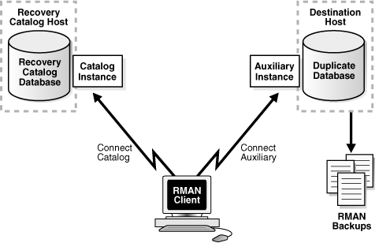
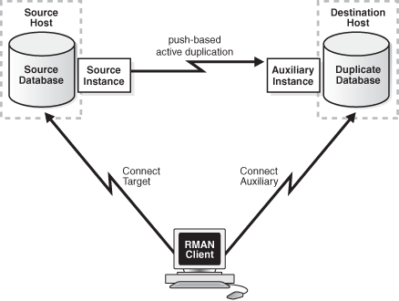
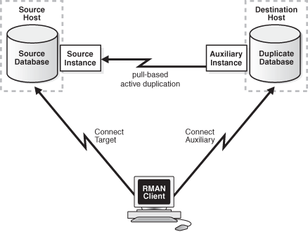

This chapter describes how to use the `DUPLICATE` command to create an independently functioning database copy.

Note:

A multitenant container database is the only supported architecture in Oracle Database 21c. While the documentation is being revised, legacy terminology may persist. In most cases, "database" and "non-CDB" refer to a CDB or PDB, depending on context. In some contexts, such as upgrades, "non-CDB" refers to a non-CDB from a previous release.

### 25.1 Overview of RMAN Database Duplication

Database duplication is the use of the `DUPLICATE` command to copy all or a subset of the data in a source database. The duplicate database (the copied database) functions entirely independently from the source database (the database being copied).

This section contains the following topics:

#### 25.1.1 Purpose of Database Duplication

A duplicate database is useful for a variety of purposes, most of which involve testing.

You can perform the following tasks in a duplicate database:

- Test backup and recovery procedures
	For example, you can duplicate the production database on `host1` to `host2`, and then use the duplicate database on `host2` to practice restoring and recovering this database while the production database on `host1` operates as usual.
- Test an upgrade to a new release of Oracle Database
- Test the effect of applications on database performance
- Create a standby database
	You can create a physical standby database or an Oracle Data Guard far sync instance. A standby database is a copy of the primary database that you update continually with archived redo log files from the primary database. If the primary database is inaccessible, then you can fail over to the standby database, which becomes the new primary database. A database copy, however, cannot be used in this way: it is not intended for failover scenarios and does not support the various standby recovery and failover options.
- Generate reports

See Also:

[Oracle Data Guards Concepts and Administration](https://docs.oracle.com/pls/topic/lookup?ctx=en/database/oracle/oracle-database/21/bradv&id=SBYDB-GUID-C713FD5C-3375-45E4-A78F-4063006DAC5B) to learn how to create a standby database with the `DUPLICATE` command

#### 25.1.2 Basic Concepts of Database Duplication

You must understand some basic concepts before duplicating a database.

The source host is the computer that hosts the source database. The source database instance is the instance that is associated with the source database.

The destination host is the computer that hosts the duplicate database. The source host and destination host can be the same or different computers.

For the duplication process, the database instance that is associated with the duplicate database is called the auxiliary instance.

RMAN must perform database point-in-time recovery, even when no explicit point in time is provided for duplication. Point-in-time recovery is required because the online redo log files in the source database are not backed up and cannot be applied to the duplicate database. The farthest point of recovery of the duplicate database is the most recent redo log file archived by the source database.

RMAN assigns a new DBID to the duplicate database (except when a standby database is created, in which case the source DBID is retained). You can then register the duplicate database in the same recovery catalog as the source database.

If you copy a database with operating system utilities rather than the `DUPLICATE` command, then the DBID of the copied database remains the same as the original database. To register the copied database in the same recovery catalog with the original, you must change the DBID with the DBNEWID utility.

See Also:

Oracle Database Utilities

##### 25.1.2.1 Initialization Parameters for the Auxiliary Instance

Certain mandatory initialization parameters must be set for the auxiliary instance.

The following table describes a subset of the possible initialization parameters for the auxiliary instance.

Table 25-1 Auxiliary Instance Initialization Parameters

| Initialization Parameter | Value | Status |
| --- | --- | --- |
| `DB_NAME` | The same name used in the `DUPLICATE` command. If you use the `DUPLICATE` command to create a standby database, then the name must be the same as the primary database.  The `DB_NAME` initialization parameter for the duplicate database must be unique among databases in its Oracle home. | Required |
| `CONTROL_FILES` | Control file locations. | Required |
| `DB_BLOCK_SIZE` | The block size for the duplicate database. This block size must match the block size of the source database. If the source database parameter file contains a value for the `DB_BLOCK_SIZE` initialization parameter, then you must specify the same value for the auxiliary instance. However, if no `DB_BLOCK_SIZE` parameter is specified in the source database initialization parameter file, then do not specify `DB_BLOCK_SIZE` parameter in the auxiliary instance. | Required, if this initialization parameter is set in the source database |
| `DB_FILE_NAME_CONVERT` | Pairs of strings for converting the names of data files and temp files. You can also specify `DB_FILE_NAME_CONVERT` parameter on the `DUPLICATE` command itself. See " [Using the DB\_FILE\_NAME\_CONVERT Parameter to Generate Names for Non-OMF or ASM Data Files](rman-duplicating-databases-advanced.md) ". | Optional |
| `LOG_FILE_NAME_CONVERT` | Pairs of strings for naming online redo log files. See " [Using the LOG\_FILE\_NAME\_CONVERT Parameter to Generate Names for Non-OMF or ASM Log Files](rman-duplicating-databases-advanced.md) ". | Optional |
| `DB_CREATE_FILE_DEST` | Location for Oracle managed data files. | Optional |
| `DB_CREATE_ONLINE_LOG_DEST_` n | Location for Oracle managed online redo log files. | Optional |
| `DB_RECOVERY_FILE_DEST` | Location for fast recovery area. | Optional |
| Oracle Real Application Cluster (Oracle RAC) parameters: - `<INSTANCESIDn>.INSTANCE_NAME` - `<INSTANCESIDn>.INSTANCE_NUMBER` - `<INSTANCESIDn>.THREAD` - `<INSTANCESIDn>.UNDO_TABLESPACE` - `<INSTANCESIDn>.LOCAL_LISTENER` | Set these parameters for each instance of the Oracle RAC database. | Required for Oracle RAC configuration |

See Also:

- [Oracle Database Reference](https://docs.oracle.com/pls/topic/lookup?ctx=en/database/oracle/oracle-database/21/bradv&id=REFRN) for more information about initialization parameters for the auxiliary instance
- [Table 26-1](rman-duplicating-databases-advanced.md) to learn about options for naming duplicate files

##### 25.1.2.2 About Parallelizing Backup Set Creation During Active Database Duplication

RMAN multisection backups provide faster backup performance by backing up very large data files in parallel. Multiple backup pieces are created, with a separate channel writing to each backup piece. Starting with Oracle Database 12c Release 1 (12.1), you can use multisection backup sets to transfer the source files that are required to perform active database duplication.

Use the `SECTION SIZE` option in the `DUPLICATE` command to create multisection backup sets. The following command creates multisection backup sets, with the size of each backup piece being 400MB. Assume that the connection to the target database and auxiliary instance has been made by using net service names.

```
DUPLICATE TARGET DATABASE TO dup_db
FROM ACTIVE DATABASE
PASSWORD FILE
SECTION SIZE 400M;
```

##### 25.1.2.3 About Encrypting Backup Sets During Active Database Duplication

RMAN can use backup sets to transfer the source database files that need to be duplicated. The backup sets are transferred over the network to the auxiliary database. Backup sets can be encrypted for additional security. Use the `SET ENCRYPTION ALGORITHM` command before the `DUPLICATE` command to specify the encryption algorithm.

Before you perform active database duplication, use one of the following techniques to ensure that the encryption is successful:

- If the source database uses transparent encryption, then you must share the Oracle software keystore that contains the encryption key between the source database and the auxiliary instance, as described in Making the Oracle Keystore Available to the Destination Host.
- If the source database uses password encryption, then you must specify the password used to encrypt backups.
	The following command sets the encryption password (where `password` is a placeholder for the actual password that you enter):
	```
	SET ENCRYPTION ON IDENTIFIED BY password;
	```

##### 25.1.2.4 About Compressing Backup Sets During Active Database Duplication

When backup sets are used to perform active database duplication, RMAN can use backup compression to minimize the size of the backup sets that are used to transfer files from the source database to the destination host. Thus, compression can enhance the performance of the duplication process.

Compressing backup sets used for active database duplication is supported starting with Oracle Database 12c Release 1 (12.1).

Use the `USING COMPRESSED BACKUPSET` clause of the `DUPLICATE` command to compress the backup sets that contain data which is required to perform active database duplication. The following command performs active database duplication by using compressed backup sets. Assume that the connection to the target database and auxiliary instance has been made using net service names.

```
DUPLICATE TARGET DATABASE TO dup_db
FROM ACTIVE DATABASE
PASSWORD FILE
USING COMPRESSED BACKUPSET;
```

#### 25.1.3 Types of Database Duplication

RMAN enables you to perform two main types of database duplication.

They include the following:
- Backup-based duplication
	The duplicate database is created by using preexisting RMAN backups or copies of the source database. You can use different techniques to duplicate a database by using backup-based duplication.
- Active database duplication
	The duplicate database is created by copying the live source database over the network to the auxiliary instance. The duplication can be performed by using backup sets or image copies.

You can use any type of duplication to duplicate a database either to the local host or to a remote host.

See Also:

- Techniques for Performing Backup-Based Duplication
- Techniques for Performing Active Database Duplication

##### 25.1.3.1 Overview of Backup-Based Duplication

In backup-based duplication, preexisting RMAN backups of the source database are used to create the duplicate database. A combination of full and incremental backups can be used. RMAN determines which backups and archived redo log files must be used based on the `UNTIL` condition.

In backup-based duplication, the primary work of duplicating the database is performed by auxiliary channels. You can configure additional channels as described in Configuring RMAN Channels for Use in Duplication.

Backup-based duplication can be used in the following scenarios:

- A connection to the source database is not available, but backups of the source database are available.
- Network bandwidth between the source host and the destination host is a constraint.
	When network bandwidth between the source host and destination host is limited, using active database duplication may result in reduced performance. For example, the source host and the destination host are in different geographical locations and are connected over a WAN. In such cases, it may be preferable to use backup-based duplication.
	See Also:
	Overview of Active Database Duplication for details of scenarios in which active database duplication is preferred.

##### 25.1.3.2 Techniques for Performing Backup-Based Duplication

Multiple techniques are available for performing backup-based duplication.

Use one of the following mutually-exclusive techniques to perform backup-based duplication:

- Backup-Based Duplication with a Target Connection
- Backup-Based Duplication Without a Target Connection
- Backup-Based Duplication Without a Target Database and Recovery Catalog Connection

###### 25.1.3.2.1 Backup-Based Duplication with a Target Connection

In this method, you must connect as `TARGET` to the source database and as `AUXILIARY` to the auxiliary instance.

Figure 25-1 below illustrates backup-based duplication with a target connection. You may connect to a recovery catalog but it is not mandatory (not in figure). RMAN uses the metadata in the control file of the source database to determine which backups or copies must be used to perform the duplication.

The destination host must have access to the RMAN backups that are required to create the duplicate database.

Figure 25-1 Backup-Based Duplication with a Target Connection


> This graphic illustrates backup-based duplication with a target connection. The RMAN client is at the bottom of the graphic. At the top-right is the Duplicate Database, which resides on the Destination Host. The rectangle to the left of the duplicate database is labeled Auxiliary Instance. Below the Duplicate Database are rectangles that are labeled RMAN Backups. The Duplicate Database is connected through an arrow to the RMAN Backups, displayed below the database. At the top-left is the Source Database, which resides on the source Host. The rectangle labeled Source Instance is to the right of the source database.
>
> An arrow from the RMAN client to the Duplicate Database, labelled Connect Auxiliary, indicates that RMAN connects to the duplicate database AS AUXILIARY. The arrow from the RMAN client to the Source Database, labelled Connect Target, indicates that RMAN connects to the recovery catalog database AS TARGET.


###### 25.1.3.2.2 Backup-Based Duplication Without a Target Connection

In this method, you connect as `CATALOG` to the recovery catalog database and as `AUXILIARY` to the auxiliary instance.

Figure 25-2 illustrates backup-based duplication without a target connection. RMAN uses the metadata in the recovery catalog to determine which backups or copies are required to perform the duplication.

The destination host must have access to the RMAN backups required to create the duplicate database.

Figure 25-2 Backup-Based Duplication Without a Target Connection



> This graphic illustrates backup-based duplication without a target connection. The RMAN client is at the bottom of the graphic. At the top-right is the Duplicate Database, which resides on the Destination Host. The rectangle to the left of the duplicate database is labeled Auxiliary Instance. The Duplicate Database is connected through an arrow to the RMAN Backups, displayed below the database. At the top-left is the Recovery Catalog Database, which resides on the Recovery Catalog Host. The rectangle labeled Catalog Instance is to the right of the source database.An arrow from the RMAN client to the Duplicate Database, labelled Connect Auxiliary, indicates that RMAN connects to the duplicate database AS AUXILIARY. The arrow from the RMAN client to the Recovery Catalog Database, labelled Connect Catalog, indicates that RMAN connects to the recovery catalog database AS CATALOG.


###### 25.1.3.2.3 Backup-Based Duplication Without a Target Database and Recovery Catalog Connection

In this method, there is no connection to either the source database or the recovery catalog.

Figure 25-3 illustrates backup-based duplication without connections to the target or to the recovery catalog database instance. You perform duplication by connecting to the auxiliary instance and using backups or copies of the source database that are stored in a disk location on the destination host. RMAN obtains metadata about where the backups and copies reside from the `BACKUP LOCATION` clause of the `DUPLICATE` command.

A disk backup location containing all the backups or copies required for duplication must be available to the destination host.

Note:

This method is not supported for backups that are stored on tape devices.

Figure 25-3 Backup-Based Duplication Without a Target Connection or Recovery Catalog Connection


> This graphic illustrates backup-based duplication without a target connection or recovery catalog connection. The RMAN client is on the left of the graphic. On the top-right is the Duplicate Database, which resides on the Destination Host. The rectangle to the left of the duplicate database is labeled Auxiliary Instance. On the bottom-right is the Backup Location.
>
> The arrow from the RMAN client to the Auxiliary Instance is labeled Connect Auxiliary. An arrow connects the Duplicate Database to the Backup Location.


##### 25.1.3.3 Overview of Active Database Duplication

Active database duplication does not require backups of the source database. It duplicates the live source database to the destination host by copying the database files over the network to the auxiliary instance. RMAN can copy the required files as image copies or backup sets.

For active database duplication, the duplication technique used determines which channel performs the principal work. When active database duplication is performed using backup sets, the principal work of duplication is performed by the auxiliary channels. When image copies are used, the primary work is performed by the target channels.

To perform active database duplication, a connection to the target database is required. Oracle recommends that you use active database duplication in general, unless network bandwidth between the source host and the destination host is a constraint. Active database duplication requires minimal setup and is simpler to perform.

Note:

For active database duplication, the source database must use a server parameter file.

Some of the scenarios in which active database duplication using backup sets may be preferred over using image copies are:
- You want to use multisection backups, compression, or encryption while duplicating your database.
- The source database does not have sufficient network resources to transfer the required database files to the duplicate database.
- You want to minimize the resources used by the duplication process.
	Active database duplication with backup sets uses minimal resources on the source database.

##### 25.1.3.4 Techniques for Performing Active Database Duplication

Multiple techniques are available for performing active database duplication.

Use one of the two mutually-exclusive methods to perform active database duplication:

- Active Database Duplication Using Image Copies
- Active Database Duplication Using Backup Sets

###### 25.1.3.4.1 Active Database Duplication Using Image Copies

In this method, RMAN connects as `TARGET` to the source database and as `AUXILIARY` to the auxiliary instance. The source database then transfers the required database files over the network to the auxiliary instance. This method is referred to as the push-based method of active database duplication.

Figure 25-4 illustrates active database duplication using image copies. Using image copies for active database duplication may require additional resources on the source database. You can configure additional target channels to improve the duplication performance as described in Configuring RMAN Channels for Use in Duplication.

Figure 25-4 Active Database Duplication Using Image Copies



> This graphic illustrates active database duplication. The RMAN client is at the bottom of the graphic. At the top-right is the Duplicate Database, which resides on the Destination Host. The rectangle to the left of the duplicate database is labeled Auxiliary Instance. At the top-left is the Source Database, which resides on the Source Host. The rectangle labeled Source Instance is to the right of the source database.
>
> An arrow from the RMAN client to the Duplicate Database, labelled Connect Auxiliary, indicates that RMAN connects to the duplicate database AS AUXILIARY. The arrow from the RMAN client to the Source Database, labelled Connect Target, indicates that RMAN connects to the duplicate database AS TARGET. An arrow from the Source Instance to the Auxiliary Instance is labeled push-based active database duplication. The dotted line arrow from the Auxiliary Instance to the Source Instance is labelled pull-based active duplication.


###### 25.1.3.4.2 Active Database Duplication Using Backup Sets

Using backup sets to perform active database duplication is also known as the pull-based method of active database duplication.

In this method, RMAN connects as `TARGET` to the source database and as `AUXILIARY` to the auxiliary instance. The auxiliary instance then connects to the source database through Oracle Net Services and retrieves the required database files, over the network, from the source database. Figure 25-5 illustrates active database duplication using backup sets.

Figure 25-5 Active Database Duplication Using Backup Sets



> This graphic illustrates active database duplication. The RMAN client is at the bottom of the graphic. At the top-right is the Duplicate Database, which resides on the Destination Host. The rectangle to the left of the duplicate database is labeled Auxiliary Instance. At the top-left is the Source Database, which resides on the Source Host. The rectangle labeled Source Instance is to the right of the source database.
>
> An arrow from the RMAN client to the Duplicate Database, labelled Connect Auxiliary, indicates that RMAN connects to the duplicate database AS AUXILIARY. The arrow from the RMAN client to the Source Database, labelled Connect Target, indicates that RMAN connects to the duplicate database AS TARGET. A dotted-line arrow from the Auxiliary Instance to the Source Instance is labeled pull-based active database duplication.


Note:

Performing active database duplication using backup sets is available starting Oracle Database 12c Release 1 (12.1).

Using backup sets for active database duplication provides the following advantages:

- RMAN can use unused block compression, thus reducing the size of backups that must be transported over the network.
- Backup sets can be created in parallel, on the source database, by using multisection backups.
- Backup sets created on the source database can be encrypted.

See Also:

- About Compressing Backup Sets During Active Database Duplication
- About Parallelizing Backup Set Creation During Active Database Duplication
- About Encrypting Backup Sets During Active Database Duplication

##### 25.1.3.5 Factors that Determine Whether Backup Sets or Image Copies Are Used for Active Database Duplication

RMAN can use backup sets or image copies to perform active database duplication.

RMAN uses backup sets to perform active database duplication when the connection to the target database is established using a net service name and any one of the following conditions is satisfied:
- The `DUPLICATE ... FROM ACTIVE DATABASE` command contains either the `USING BACKUPSET`, `USING COMPRESSED BACKUPSET`, or `SECTION SIZE` clause.
- The number of auxiliary channels allocated is equal to or greater than the number of target channels allocated.

Otherwise, RMAN uses image copies to perform active database duplication.

Note:

Oracle recommends that you use backup sets to perform active database duplication.

#### 25.1.4 How RMAN Duplicates a Database

RMAN performs a set of automated steps to duplicate a database.

The steps include the following:

1. Create a default server parameter file for the auxiliary instance, if the following conditions are true:
	- Duplication does not involve a standby database
	- Server parameter files are not being duplicated
	- The auxiliary instance was not started with a server parameter file
2. Restores from backup or copies from the active database the latest control file that satisfies the `UNTIL` clause requirements.
3. Mounts the auxiliary instance by using the restored control file or the backup control file that is copied from the active database.
4. Use metadata in the RMAN repository to select the backups that are used to restore the data files to the auxiliary instance. This step applies to backup-based duplication.
5. Copy the duplicate database files to the destination host and restores them to a noncurrent point in time by using incremental backups and archived redo log files.
6. Shut down and restarts the auxiliary database instance on the destination host in `NOMOUNT` mode.
7. Create a new control file, which then creates and stores the new DBID in the data files.
8. Open the duplicate database with the `RESETLOGS` option and creates the online redo log for the new database. If you do not want to open the duplicate database, use the `NOOPEN` clause in the `DUPLICATE` statement, as described in Deciding the State of the Duplicate Database.

See Also:

The `DUPLICATE` entry in [Oracle Database Backup and Recovery Reference](https://docs.oracle.com/pls/topic/lookup?ctx=en/database/oracle/oracle-database/21/bradv&id=RDMRF-GUID-E13D8A02-80F9-49A2-9C31-92DD3A795CE4) for a complete list of which files are copied to the duplicate database

#### 25.1.5 Contents of a Duplicate Database

A duplicate database can include the same contents as the source database or only a subset of the tablespaces in the source database.

For example, you can use the `TABLESPACE` option of the `DUPLICATE` command to duplicate only specified tablespaces, or the `SKIP READONLY` option to exclude read-only tablespaces from the duplicate database.

##### 25.1.5.1 About Duplicating a Subset of the Source Database

The `DUPLICATE` command contains clauses that enable you to duplicate a subset of the entire source database.

It is not always necessary to duplicate all tablespaces of a database. For example, you may plan to generate reports that require only a subset of tablespaces from your source database.

The following table explains the `DUPLICATE` command options to specify subsets of tablespaces for the duplicate database:

Table 25-2 Options to Specify Subsets of Tablespaces for the Duplicate Database

| DUPLICATE Options | Explanation |
| --- | --- |
| `SKIP READONLY` | Excludes the data files of read-only tablespaces from the duplicate database. |
| `SKIP TABLESPACE 'tablespace_name ', ...` | Excludes the specified tablespaces from the duplicate database. You cannot exclude the `SYSTEM` and `SYSAUX` tablespaces, tablespaces with `SYS` objects, undo tablespaces, tablespaces with undo segments, tablespaces with materialized views, or tablespaces in such a way that the duplicated tablespaces are not self-contained. |
| `TABLESPACE 'tablespace_name ', ...` | Automatically includes the `SYSTEM`, `SYSAUX`, and undo tablespaces. The included tablespaces must be self-contained and the resulting skipped tablespaces must not contain `SYS` objects or materialized views. |

Note:

When you exclude tablespaces in backup-based duplication without a target connection or without a target and a recovery catalog connection, RMAN has special prerequisites. See the Prerequisites section of the `DUPLICATE` command in [Oracle Database Backup and Recovery Reference](https://docs.oracle.com/pls/topic/lookup?ctx=en/database/oracle/oracle-database/21/bradv&id=RDMRF-GUID-E13D8A02-80F9-49A2-9C31-92DD3A795CE4) for details.

#### 25.1.6 About the Destination Host for Database Duplication

RMAN creates the duplicate database on the specified destination host. The destination host can be the same as the source host or different.

When the same computer is used as the source host and the destination host, the duplication is termed as duplicating to the local host. When the source host and the destination host are on different computers, the duplication is termed as duplicating to a remote host.

About Duplicating a Database to the Local Host

When you duplicate a database to the local host, you must store the duplicate database files by using a directory structure that is different from that of the source database. For example, if the source database files are stored in the `/disk1/oracle` directory, then the duplicate database files can be stored in the `/disk2/oracle` directory. The duplicate database file names can be the same as those of the source database or different. The techniques for specifying alternate names for duplicate database files are described in " Methods of Generating Database File Names for the Duplicate Database ".

Caution:

Using `NOFILENAMECHECK` when duplicating to the local host overwrites the source database files.

About Duplicating a Database to a Remote Host

When you duplicate a database to a remote host, the duplicate database files can either use the same directory structure and file names as the source database or use a different directory structure and file names. If you choose to name duplicate database files differently, then you must use one the techniques described in Methods of Generating Database File Names for the Duplicate Database to specify how duplicate database files are named.

Note:

Duplication to a remote host requires a password file and an Oracle Net Services connection to the auxiliary instance.

#### 25.1.7 About Duplicate Database File Names

Depending on the destination host used and your duplication scenario, the duplicate database files can either use the same names as the source database or different names. The database files include the data file, control files, online redo log files, and temp files.

If you choose to name duplicate database files differently, you must specify a strategy for naming these files.

See Also:

- Choosing a Strategy for Naming Duplicate Database Files
- About the Destination Host for Database Duplication

#### 25.1.8 About Duplicating a Database to a Past Point-in-Time

You can use clauses in the `DUPLICATE` command to duplicate a database to a past point in time.

By default, the `DUPLICATE` command creates the duplicate database by using the most recent backups of the target database and then performs recovery to the most recent consistent point contained in the incremental backups and archived redo logs. However, you can recover the duplicate database to a past point in time by using one of the following methods:
- `DUPLICATE … UNTIL` command
- `SET UNTIL` command before the `DUPLICATE` command

See Also:

[Oracle Database Backup and Recovery Reference](https://docs.oracle.com/pls/topic/lookup?ctx=en/database/oracle/oracle-database/21/bradv&id=RCMRF-GUID-E13D8A02-80F9-49A2-9C31-92DD3A795CE4) for an example of duplicating a database to a past point in time

#### 25.1.9 Prerequisites for Duplicating a Database

The prerequisites depend on the type of database duplication being performed. Some prerequisites are common to all types of duplication and others are specific to a particular type of duplication.

See Also:

[Oracle Database Backup and Recovery Reference](https://docs.oracle.com/pls/topic/lookup?ctx=en/database/oracle/oracle-database/21/bradv&id=RCMRF-GUID-E13D8A02-80F9-49A2-9C31-92DD3A795CE4) for details about prerequisites for each duplication technique

### 25.2 Planning to Duplicate a Database

Before duplicating a database, you must make some decisions about the duplication process.

Planning to duplicate a database includes the following tasks:

- Choosing a Duplication Technique
- Choosing a Strategy for Naming Duplicate Database Files
- Installing the Oracle Database Software on the Destination Host
- Deciding the State of the Duplicate Database

#### 25.2.1 Choosing a Duplication Technique

Your business requirements and the database environment determine which duplication technique is best for your situation.

Consider the following questions:
- Are you familiar with the prerequisites for each duplication technique?
	Review the Prerequisites section of the `DUPLICATE` command description in Oracle Database Backup and Recovery Reference for a complete list.
	Some prerequisites are specific and depend on the duplication technique. For example, active duplication requires that the source and auxiliary instances use the same password as the source database, whereas backup-based duplication without connections to the target database and recovery catalog requires only that all backups and database copies reside in a single location.
- Do backups of the source database exist?
	The principal advantage of active database duplication is that it does not require source database backups. Active duplication copies mounted or online database files over a network to the auxiliary instance. One disadvantage of this technique is the negative performance effect on the network. Another disadvantage is that the source database is running processes required to transfer the files to the auxiliary host, thereby affecting the source database and production workload.
	If the source database backups exist, and if the effect on the network is unacceptable, then backup-based duplication may be a better option. You can copy backups to temporary storage and transfer them manually to the destination host. If duplication is made with a connection to the target or the recovery catalog, then the backup files on the destination host must have the same file specification as they had on the source host. Otherwise, this is not a requirement.
- Is a recovery catalog available?
	If a recovery catalog exists, then you can perform backup-based duplication without connecting RMAN as TARGET to the source database. This technique is advantageous where network connections from the auxiliary host to the source database are restricted or prone to intermittent disruptions. When you perform duplication without using a target connection, the source database is unaffected by the duplication.
- How much disk space is available on the destination host?
	When you perform duplication by using disk backups, disk space on the destination host can be an issue. For example, if the source database is 1 terabyte (TB), and if you duplicate the database from disk backups without using shared disk or network file system (NFS), then you must have at least 2 terabytes (TB) of space available on the destination host. In some environments, manual transfer of backups is necessary because NFS performance is a bottleneck.
- Are the source and destination hosts connected by a LAN or a WAN?
	Performance of active database duplication is probably slower on a wide area network (WAN) than on a local area network (LAN). If the performance degradation on a WAN is unacceptable, then backup-based duplication may be the only viable option.
- When do you plan to duplicate the database?
	If you must duplicate the database during a period of high user activity, then the loss of network throughput caused by active duplication may be a problem, making backup-based duplication a better choice. Also, in active database duplication, the RMAN channels that are required for copying files to the auxiliary host can affect performance.

#### 25.2.2 Choosing a Strategy for Naming Duplicate Database Files

When you duplicate a database, RMAN generates names for the database files in the duplicate database. This includes the control files, data files, temp files, and online redo log files.

Depending on your duplication scenario, you can name the duplicate database files by using one of the following techniques:

- Using the Same Names for Database Files in the Source Database and Duplicate Database
- Using Different Names for the Database Files in the Source Database and Duplicate Database

If you do not specify a strategy to generate names for duplicate database files, then RMAN uses the same file names and directory structure as the source database for the duplicate database. Only when duplicating to a remote host, use the `NOFILENAMECHECK` clause to indicate that RMAN must not display an error when the names of the database files are the same in the source and duplicate database.

Some of the methods used to specify alternate names for duplicate database files may generate file names that are the same as the ones used by the source database. This may happen if, for example, you used the `SET NEWNAME` or the `CONFIGURE AUXNAME` commands to specify names for the duplicate database files. Use caution when you specify the file names for the duplicate database, else you may mistakenly overwrite the source database files.

##### 25.2.2.1 Using the Same Names for Database Files in the Source Database and Duplicate Database

Certain conditions must be met to use the same names for files in the source and duplicate database.

The simplest duplication strategy is to configure the duplicate database to use the same directory structure and file names as the source database. You can use the same directory structure and names only when duplicating to a remote host.

Using the same directory structure and file names means that your environment meets the following requirements:

- If the source database uses ASM disk groups, then the duplicate database must use ASM disk groups with the same names.
- If the source database files are Oracle Managed Files, then the auxiliary instance must set the `DB_CREATE_FILE_DEST` parameter to the same directory location as the source database. Although the directories are the same on the source and destination hosts, Oracle Database chooses the relative names for the duplicate files.
- If the names of the database files in the source database contain a path, then this path name must be the same in the duplicate database.
- For Oracle Real Application Clusters (Oracle RAC) environments, use the same value for the `ORACLE_SID` parameter of the source and destination databases.

When you configure your environment as suggested, no additional configuration is required to name the duplicate files.

##### 25.2.2.2 Using Different Names for the Database Files in the Source Database and Duplicate Database

If the source host and the destination host use different directory structures, or if they use the same directory structures but you want to name the database files differently, then you must specify how RMAN should generate names for the duplicate database files.

Note:

It is recommended that you use different names for the ASM disk groups in the source and duplicate database.

See Also:

Methods of Generating Database File Names for the Duplicate Database

##### 25.2.2.3 Methods of Generating Database File Names for the Duplicate Database

Depending on the method that you choose, RMAN can either automatically generate file names or use specific names for the duplicate database files. The database files include the data files, control files, online redo log files, and temp files.

Use one of the following methods, listed in the order of precedence, to generate file names for the duplicate database:
- `SET NEWNAME` command
	Provides specific names for the duplicate database files. Based on your requirement, use the `SET NEWNAME FOR DATABASE`, `SET NEWNAME FOR DATAFILE`, `SET NEWNAME FOR TABLESPACE`, or `SET NEWNAME FOR TEMPFILE` command.
	For OMF and ASM database files, you must use the `SET NEWNAME...TO NEW` comand and not explicitly provide names for the database files.
- `CONFIGURE AUXNAME` command
	Specifies non-OMF and non-ASM alternative names for duplicate database files.
- `SPFILE` clause of the `DUPLICATE` command
	Sets all the necessary initialization parameters that are related to duplicate database file names, with the exception of the `DB_FILE_NAME_CONVERT` parameter.
- (Online redo log files only) `LOGFILE` clause of the `DUPLICATE` command
	Names online redo log files in the duplicate database. You cannot use this method while creating a standby database.
	Note:
	When duplicating to the local host or to a remote host without the `NOFILENAMECHECK` clause, ensure that you do not use the name of an online redo log file that is currently in use by the source database.
- `DB_FILE_NAME_CONVERT` and `LOG_FILE_NAME_CONVERT` initialization parameters
	Specifies a rule for converting file names in the source database to names in the duplicate database. You can specify multiple conversion pairs.
	When you use the `DB_FILE_NAME_CONVERT` parameter for ASM file names, only disk group name changes must be performed.
	Note:
	If the source database uses Oracle Managed Files, then you cannot use this method to specify alternative names for duplicate database files.
- `DB_CREATE_FILE_DEST` and `DB_CREATE_ONLINE_LOG_DEST` \_n parameters
	Creates Oracle Managed Files at the location specified by these parameters. This is the recommended method to specify alternative names for OMF and ASM.

If more than one method is used to specify alternate names for duplicate database files, then the order of precedence decides which technique is used to name files. Any files that are not renamed by a particular method are renamed by the method that follows it. For example, if two data files are not included in the `SET NEWNAME` command, then these data files are renamed by using the `DB_FILE_NAME_CONVERT` parameter.

See Also:

- [Specifying Alternative Names for Duplicate Database Files](rman-duplicating-databases-advanced.md)
- The `DUPLICATE` command in [Oracle Database Backup and Recovery Reference](https://docs.oracle.com/pls/topic/lookup?ctx=en/database/oracle/oracle-database/21/bradv&id=RCMRF-GUID-E13D8A02-80F9-49A2-9C31-92DD3A795CE4) for the `LOGFILE` and `SPFILE` clauses

Preventing File Name Checking During Database Duplication

It is possible for the `CONFIGURE AUXNAME` command, the `SET NEWNAME` command, or the `DB_FILE_NAME_CONVERT` parameter to generate a name that is already in use in the target database. In this case, RMAN displays an error during duplication. When duplicating to a remote host, use the `NOFILENAMECHECK` option to avoid this error message.

Note:

Using `NOFILENAMECHECK` when duplicating to the local host overwrites the target database files.

Generating Names for Control Files in the Duplicate Database

By default, RMAN creates the control file in the default location in the duplicate database. You can specify alternate files names and directory names to store the duplicate database control files. While choosing names for the control files, ensure that you do not mistakenly overwrite the control files of the source database.

Use one of the following techniques, listed in the order of precedence, to specify the location of the duplicate database control files:
- Set the `CONTROL_FILES` initialization parameter in the auxiliary instance's initialization parameter file.
- Create an OMF-based control file in a location which is determined by setting one of the following parameters:
	- `DB_CREATE_ONLINE_LOG_DEST_n`
	- `DB_CREATE_FILE_DEST`
	- `DB_RECOVERY_FILE_DEST`
	If more than one of these parameters is set, then the order of precedence used is the order in which these parameters are listed.

#### 25.2.3 Installing the Oracle Database Software on the Destination Host

When the source and destination host are different, you must install the Oracle Database software on the destination host, so that the auxiliary instance can be created.

Note:

Ensure that you install the same release of Oracle Database software, with the same patch level, on both the source and destination host.

Use one of the following techniques to install the software:

- Perform a normal installation with the installer.
	Install an Oracle Database whose release number is the same as that of the source database. Do not create a database; install the software only. Apply any required patches.
- Clone the source Oracle home.
	Use the installer to clone the source Oracle home. Doing this ensures that all patches applied to the source database are present in the duplicate database.

#### 25.2.4 Deciding the State of the Duplicate Database

When you use the RMAN `DUPLICATE` command, the duplicate database is created and opened in `RESETLOGS` mode. You can use the `NOOPEN` clause in the `DUPLICATE` command to specify that the duplicate database must not be opened.

You may not want to open the duplicate database immediately after creation in the following situations:
- Opening the duplicate database may cause errors.
- You need to modify the initialization parameters of the duplicate database.
	For example, you need to modify flashback database settings, configure fast incremental backups, or modify block change tracking.
- You are creating a new database as part of an upgrade procedure.
	During an upgrade you cannot open the database with the `RESETLOGS` option. The `NOOPEN` clause enables you to duplicate the database and then leave it in a state that is ready for opening in upgrade mode and for subsequent execution of upgrade scripts.

### 25.3 Preparing to Duplicate Databases

Preparing to duplicating databases includes mandatory and optional tasks.

Perform the following tasks when preparing for database duplication:

- (Optional) Configure target channels and auxiliary channels, as described in Configuring RMAN Channels for Use in Duplication.
- (Backup-based duplication only) Ensure that backups required for database duplication are made available to the destination database, as described in Making Backups Accessible to the Duplicate Instance.
- Create the auxiliary instance, as described in Preparing the Auxiliary Instance.
- Ensure that the source database is open in the required state, as described in Placing the Source Database in a Proper State.
- Start RMAN and connect to the target database and auxiliary instance, as described in Starting RMAN and Connecting to Databases.

#### 25.3.1 Configuring RMAN Channels for Use in Duplication

The primary job of database duplication is performed by RMAN channels. Each channel corresponds to an Oracle Database server session that performs the duplication tasks. Depending on the duplication technique, RMAN uses either auxiliary channels or target channels.

Use one of the following methods to configure channels:

- Automatically allocate channels by using the `CONFIGURE` command
- Manually allocate channels by using the `ALLOCATE` command

If no automatic channels are configured, then you can manually allocate at least one channel before you being the duplication. The `ALLOCATE` command that allocates channels must be in the same `RUN` block as the `DUPLICATE` command.

RMAN can use the same channel configurations on the source database for duplication on the destination host even if the source database channels do not specify the `AUXILIARY` option.

See Also:

- Configuring Channels for Backup-based Duplication
- Configuring Channels for Active Database Duplication

##### 25.3.1.1 Configuring Channels for Backup-based Duplication

For backup-based duplication, the principal work of the duplication is performed by the auxiliary channels. An auxiliary channel corresponds to a server session on the auxiliary instance on the destination host. RMAN uses the channels to restore backups in the auxiliary instance.

Configure additional auxiliary channels to improve the performance of the duplicate operation. If you do not explicitly configure auxiliary channels, then RMAN uses the same channel configurations on the source database for duplication on the destination host. RMAN can use these configurations even if the source database channels do not specify the `AUXILIARY` option.

Note the following additional considerations:

- With disk-based backups, you can increase the speed of the duplication operation by allocating additional channels.
	With tape-based duplication, you can allocate only as many channels as the number of tape devices that are available.
- The channel type (DISK or sbt) of the auxiliary channel must match the backup media. In general, the more channels you allocate for disk backups, the faster the duplication. You cannot increase the speed of duplication after the disks reach their maximum read/write rate. For tape backups, limit the number of channels to the number of devices that are available.
- If the auxiliary channels need special parameters (for example, to point to a different media manager), then you can configure an automatic channel with the `AUXILIARY` option of the `CONFIGURE` command.
- When you perform duplication without a target connection and without a recovery catalog, only disk channels can be used. If no user-allocated channels are used, then only one channel initially restores the control file. After the control file is mounted, the number of allocated channels depends on the configuration in the restored control file.
- If you omit the `USING BACKUPSET` clause from the `DUPLICATE` command and the number of allocated auxiliary channels is greater than or equal to the number of target channels, then RMAN still uses active database duplication with backup sets.
- If the auxiliary channels cannot access backups of the required data files and archived redo log files, then the duplication fails.

Example 25-1 Configuring Auxiliary Channels for Disk-based Backups

The following example allocates three auxiliary channels to duplicate a database to disk.

```
run
{
ALLOCATE AUXILIARY CHANNEL c1 DEVICE TYPE disk;
ALLOCATE AUXILIARY CHANNEL c2 DEVICE TYPE disk;
ALLOCATE AUXILIARY CHANNEL c3 DEVICE TYPE disk;
. . .
DUPLICATE DATABASE . . . ;
}
```

##### 25.3.1.2 Configuring Channels for Active Database Duplication

With active database duplication, you need not change your source database channel configuration or configure auxiliary channels.

When you duplicate a database, you may want to increase the parallelism setting of the source database disk channels so that RMAN copies files over the network in parallel.

The type of active database duplication technique used determines which channels perform the principal work of duplication. When image copies are used to perform active database duplication, the primary work is performed by the target channels. Configure multiple target channels on the source database to improve the duplication performance. When active database duplication is performed by using backup sets, the principal work of duplication is performed by the auxiliary channels. Therefore, it is recommended that you allocate additional auxiliary channels. The number of auxiliary channels must be greater than or equal to the number of target channels. Using backup sets for active duplication also enables parallelism, which can improve the speed of the duplication process.

#### 25.3.2 Making Backups Accessible to the Duplicate Instance

Names of the backups used during duplication are stored in the RMAN repository or control file.

Note:

If you are performing active database duplication, then this step is not necessary.

When duplicating with a target connection and recovery catalog connection or with just a target connection, RMAN uses metadata in the RMAN repository to locate backups and archived redo log files that are required for duplication. If RMAN is connected to a recovery catalog, then RMAN obtains the backup metadata from the catalog. If RMAN is not connected to a catalog, as may be the case when you perform backup-based duplication with a target connection, then RMAN obtains metadata from the control file.

Unless you are duplicating without a connection to the target and to the recovery catalog, the names of the backups must be available with the same names recorded in the RMAN repository. Ensure that auxiliary channels on the destination host can access all data file backups and archived redo log files. This is required to restore and recover the duplicate database to the desired point in time. If not, duplication fails. The archived redo log files can be available either as image copies or backup sets.

Note:

The database backup need not have been generated with the `BACKUP DATABASE` command. You can mix full and incremental backups of individual data files, but a full backup of every data file is required.

See Also:

- Making SBT Backups Accessible to the Auxiliary Instance
- Making Disk Backups Accessible to the Auxiliary Instance

##### 25.3.2.1 Making SBT Backups Accessible to the Auxiliary Instance

The steps to make SBT backups accessible to the auxiliary instance are specific to your media manager configuration. If the backup metadata is stored in an XML file, then ensure that the XML file is stored in a location that is accessible to the destination database during duplication.

1. Use these generic steps to make SBT backups accessible to the auxiliary instance. If the source database backups are stored in a non-disk location, such as Object Storage containers, then proceed to step 2.
	1. Install media management software on the destination host, if necessary.
		2. Make the tapes with the backups accessible to the destination host. Typically, you do one of the following:
		- Physically move the tapes to a drive attached to the remote host.
		- Use a network-accessible tape server.
		3. If necessary, inform the remote media management software about the existence of the tapes.

You can duplicate a database using its backup metadata stored in an XML format. The backup-based duplication technique is supported. When the backup metadata file is used, run the `DUPLICATE` command with the `BACKUP LOCATION FROM FILE` option to specify the location of the XML file. RMAN uses the metadata stored in the XML file to identify the backups required for duplication. In this case, you must ensure that the XML file is stored in a location that is accessible to the destination host.

2. Use these steps to make the backup metadata file accessible to the destination database:
	1. Install the media management software on the destination host, if necessary.
		For example, if the source database backups, required for the duplication, are stored in an Object Storage container on Oracle Cloud, then you must install the Oracle Database Backup Cloud Service module on the destination database before performing the duplication.
		See, the Using Oracle Database Backup Cloud Service to learn how to extract the backup metadata for backups stored in an Object Storage containers.
		2. Ensure that you save the backup metadata file in a location that is accessible to the destination database during duplication.
		This is an example of an XML file `duplicate.xml` that contains the backup metadata for the source database `SALESDB`. The `duplicate.xml` file is stored in the location `/dsk1/bkps` on the destination database.
		```
		<?xml version = "1.0" encoding="US-ASCII"?> 
		<MetaData>
		   <File>
		      <Filename>6GJ28IEKFL_07CEC18D372F4D29E06379624664E053</Filename>
		      <SetStamp>1150345378</SetStamp>
		      <IsSpfile>NO</IsSpfile>
		      <IsControlFile>NO</IsControlFile>  
		      <PieceNo>1</PieceNo>
		      <Dbname>SALESDB</Dbname>
		      <Dbid>3483424530</Dbid>          
		   </File>
		   <File>
		      <Filename>6GJ28IEKFL_07CEC18D374B4D29E06379624664E053</Filename>
		      <SetStamp>1150345398</SetStamp>
		      <IsSpfile>NO</IsSpfile>
		      <IsControlFile>NO</IsControlFile>  
		      <PieceNo>1</PieceNo>
		      <Dbname>SALESDB</Dbname>
		      <Dbid>3483424530</Dbid>          
		   </File>
		   <File>
		      <Filename>6GJ28IEKFL_07CEC1A625064D36E0637962466444CD</Filename>
		      <SetStamp>1150345378</SetStamp>
		      <IsSpfile>NO</IsSpfile>
		      <IsControlFile>NO</IsControlFile>  
		      <PieceNo>1</PieceNo>
		      <Dbname>SALESDB</Dbname>
		      <Dbid>3483424530</Dbid>          
		   </File>
		   <File>
		      <Filename>6GJ28IEKFL_07CEC1A6254D4D36E0637962466444CD</Filename>
		      <SetStamp>1150345451</SetStamp>
		      <IsSpfile>NO</IsSpfile>
		      <IsControlFile>NO</IsControlFile>  
		      <PieceNo>1</PieceNo>
		      <Dbname>SALESDB</Dbname>
		      <Dbid>3483424530</Dbid>          
		   </File>
		    </MetaData>
		```
	See Backup and Recovery Reference to learn more about using the `DUPLICATE` command.

##### 25.3.2.2 Making Disk Backups Accessible to the Auxiliary Instance

When you make disk backups accessible to the auxiliary instance, your strategy depends on whether you duplicate the database while connected to the target or recovery catalog. If you do not connect to the target or recovery catalog, then you must designate a backup location for the duplication by using the `BACKUP LOCATION` clause.

When you use a backup location, the backups and copies can reside in a shared location or can be moved to the location on the destination host. In the latter case, you do not need to preserve the name or the original path of the backup or copy. The location specified in the `BACKUP LOCATION` option must contain sufficient backup sets, image copies, and archived logs to restore all of the files that are being duplicated, and recover them to the desired point in time.

It is not required that all of the backups be from the same point in time, or that they all be backup sets, or all image copies. Data file backups can be supplied as either image copies or backup sets. Archived logs can be supplied either in their normal format or as backup sets of archived logs.

When you use backups from different points in time, the backup location must contain archived logs covering the time from the start of the oldest backup until the desired recovery point.

If the backup location contains backup files from multiple databases, then the `DATABASE` clause must specify the name of the database that is to be duplicated. If the backup location contains backup files from multiple databases having the same name, then the `DATABASE` clause must specify both the name and `DBID` of the database that is to be duplicated.

The source database's Fast Recovery Area is particularly well suited for use as a backup location because it almost always contains all the files that are required for the duplication. To use a Fast Recovery Area as a backup location, you can either remotely access it from the destination system, or copy its contents to the destination system.

When you are not using a backup location, your strategy depends on the following mutually exclusive scenarios:
- Identical file systems for source and destination hosts
	This scenario is the simplest and Oracle recommends it. For example, assume that the backups of the source database are stored in the `/dsk1/bkp` directory. In this case, you can make disk backups accessible to the destination host in either of these ways:
	- Manually transfer backups from the source host to an identical path in the destination host. For example, if the backups are in the `/dsk1/bkp` directory on the source host, then use FTP to transfer them to the `/dsk1/bkp` directory on the destination host.
	- Use NFS or shared disks and ensure that the same path is accessible in the destination host. For example, assuming that the source host can access the `/dsk1/bkp` directory, use NFS to mount the `/dsk1/bkp` directory on the destination host and use `/dsk1/bkp` as the mount point name.
- Different file systems for source and destination hosts
	In this case you cannot use the same directory name on the destination host as you use on the source host. You have the following options:
	- You can use shared disk to make backups available. This section explains the shared disk technique.
	- You cannot use shared disk to make backups available. [Making Disk Backups Accessible Without Shared Disk](rman-duplicating-databases-advanced.md) describes this technique.
	Assume that you have two hosts, `srchost` and `dsthost`, and access to NFS or shared disk. The database on `srchost` is called `srcdb`. The backups of `srcdb` reside in the `/dsk1/bkp` directory on host `srchost`. The directory `/dsk1/bkp` is in use on the destination host, but the directory `/dsk2/dup` is not in use on either host.

To transfer the backups from the source host to the destination host:

1. Create a backup storage directory in either the source or destination host.
	For this example, create backup directory `/dsk2/dup` on the destination host.
2. Mount the directory created in the previous step on the other host, ensuring that the directory and the mount point names are the same.
	For example, if you created the `/dsk2/dup` directory on the destination host, then use NFS to mount this directory as `/dsk2/dup` on the source host.
3. Make the backups available in the new location on the destination host. You can use either of the following techniques:
	- Connect RMAN to the source database as TARGET and use the `BACKUP` command to back up the backups. For example, use the `BACKUP COPY OF DATABASE` command to copy the backups in the `/dsk1/bkp` directory on the source host to the `/dsk2/dup` directory on the destination host. In this case, RMAN automatically catalogs the backups in the new location.
		If you are duplicating a PDB, then use the `PLUGGABLE DATABASE` syntax of the `BACKUP COPY OF` command to copy only the backups of the PDB.
	- Use an operating system utility to transfer the backups to the new location. For example, use FTP to transfer the backups from the `/dsk1/bkp` directory on the source host to the `/dsk2/dup` directory on the destination host, or use the `cp` command to copy the backups from the `/dsk1/bkp` directory on the source host to the `/dsk2/dup` directory on the destination host. Afterward, connect RMAN to the source database as TARGET and use the `CATALOG` command to update the RMAN repository with the location of the manually transferred backups.

#### 25.3.3 Preparing the Auxiliary Instance

RMAN uses an auxiliary instance to create the duplicate database. You must prepare the auxiliary instance before you begin the duplication.

Depending on your duplication scenario, you need to perform either some or the tasks that are described in this section. Preparing the auxiliary instance includes the following tasks:

- Creating Directories for the Duplicate Database
- Creating an Initialization Parameter File for the Auxiliary Instance
- Creating a Password File for the Auxiliary Instance
- Establishing Oracle Net Connectivity Between the Source Database and Auxiliary Instance
- Starting the Auxiliary Instance
- Making the Oracle Keystore Available to the Destination Host

##### 25.3.3.1 Creating Directories for the Duplicate Database

On the destination host, you must create the directories that are used to store the duplicate database files on the destination host. This includes the directories that store the data files, control files, online redo log files, and temp files.

##### 25.3.3.2 Creating an Initialization Parameter File for the Auxiliary Instance

Multiple methods are available to create the initialization parameter file that is required to start the auxiliary instance.

Use one of the following methods to create the initialization parameter file:
- Create an initialization parameter file manually.
	If the source database does not use a server parameter file, then you must set all the necessary parameters for the auxiliary instance in a text-based initialization parameter file.
- Direct RMAN to use the initialization parameter file of the source database for the auxiliary instance.
	This technique is applicable only if the source database uses a server parameter file. Copying the initialization parameter file from the source database is useful when the duplicate database must use the same parameter settings as the source.
	Note:
	It is recommended to use a server parameter file instead of a text-based initialization parameter file for duplication.

The client-side parameter file for the auxiliary instance must reside on the same host as the RMAN client that performs the duplication.

It is recommended that you create the initialization parameter file in the default location on the auxiliary instance. On Windows, the default initialization parameter file is `ORACLE_HOME` `\database\init` `ORACLE_SID``.ora` and on Linux the file name is `ORACLE_HOME` `/dbs/init` `ORACLE_SID``.ora`.

###### 25.3.3.2.1 Steps to Create an Initialization Parameter File for the Auxiliary Instance

When you duplicate a database, use this procedure to copy or to create the auxiliary instance initialization parameter file on the destination host.

The initialization parameter file for the auxiliary instance must contain at least the `DB_NAME` and `DB_DOMAIN` initialization parameters. If required, you can specify additional parameters.

Ensure that the initialization parameter file is on the same host as the RMAN client that performs the duplication.

1. Do one of the following:
	- Copy the initialization parameter file from the source host to the destination host, placing it in the operating system-specific default location, and then modify the `DB_NAME` and `DB_DOMAIN` initialization parameters.
		If you are duplicating a CDB, then ensure that the `ENABLE_PLUGGABLE_DATABASE` parameter is present, and set to `TRUE`.
		See Copying the Server Parameter File from the Source Database.
		- Create the initialization parameter file by using these steps:
		1. Using a text editor, create an empty file for use as a text-based initialization parameter file, and save it in the operating system-specific default location.
				2. In the parameter file, set the `DB_NAME` and `DB_DOMAIN` initialization parameters. These are the only required parameters.
			Setting the `DB_DOMAIN` parameter enables you to connect to the default database service when you connect with a net service name.
2. Set the various location parameters, such as `CONTROL_FILES` and `DB_RECOVERY_FILE_DEST`.
3. If necessary, set other initialization parameters, such as those needed for Oracle Real Application Clusters.
4. Set the required environment variables, such as `ORACLE_HOME` and `ORACLE_SID`.
5. (Optional) Set initialization parameters that specify the location of the duplicate database files if one of the following conditions is satisfied:
	- The source host and the destination host are the same (duplication to the local host).
		- The duplicate database uses a directory structure that is different from that of the source host to store database files.
	Depending on the technique used to specify alternate names for duplicate database files, include one or more of the following parameters in the initialization parameter file: `CONTROL_FILES`, `DB_FILE_NAME_CONVERT`, `LOG_FILE_NAME_CONVERT`, `DB_CREATE_FILE_DEST`, `DB_CREATE_ONLINE_FILE_DEST_n`, and `RECOVERY_FILE_DEST`.
	Note:
	Oracle recommends that you verify that all paths specified are accessible to the destination host and to the server session of the auxiliary instance.
	See ”Methods of Generating Database File Names for the Duplicate Database" in Oracle Database Backup and Recovery User’s Guide.
6. Start SQL\*Plus, and connect to the auxiliary instance as a user with `SYSDBA` or `SYSBACKUP` privileges. Start the auxiliary instance in `NOMOUNT` mode. If the file is in the default location, then no `PFILE` parameter is required on the `STARTUP` command.
	```
	SQL> STARTUP NOMOUNT;
	```

Example 25-2 Initialization Parameter File for the Auxiliary Instance

```
DB_NAME=dupdb
CONTROL_FILES=(/dup/oracle/oradata/prod/control01.ctl,
                dup/oracle/oradata/prod/control02.ctl)
DB_FILE_NAME_CONVERT=(/oracle/oradata/prod/,/dup/oracle/oradata/prod/)
LOG_FILE_NAME_CONVERT=(/oracle/oradata/prod/redo,/dup/oracle/oradata/prod/redo)
```

###### 25.3.3.2.2 Copying the Server Parameter File from the Source Database

The way the initialization parameter file is copied from the source database to the auxiliary instance depends on the parameter file type, and the duplication method that you select.

- If the source database uses a server parameter file, then including the `SPFILE` option in the `DUPLICATE` command directs RMAN to use the server parameter file from the source database for the auxiliary instance.
- If you use backup-based duplication, then the server parameter file is restored from backups.
- If you use active database duplication, then the server parameter file is copied from the source database to the auxiliary instance.
- If the source database uses a text-based initialization parameter file, then use the `PFILE` clause in the `DUPLICATE` command to copy the source database's initialization parameter file to the auxiliary instance.

You can modify the values that were copied or restored from the server parameter file of the source database by using either the `PARAMETER_VALUE_CONVERT` option of `SPFILE`, or the `SET` clause of the `DUPLICATE`. For example, you can use the `SET` clause to change the value of the `DB_FILE_NAME_CONVERT` parameter in the auxiliary instance's server parameter file.

If the source database does not use a server parameter file, or if RMAN cannot restore a backup of the server parameter file, then you must manually create a text-based initialization parameter file.

##### 25.3.3.3 Creating a Password File for the Auxiliary Instance

Connections to the auxiliary instance can be established by using operating system authentication or password file authentication.

To connect to the database using password file authentication, you must create a password file for the database. Password file authentication is mandatory when duplicating to a remote host or performing active database duplication. For backup-based duplication, you can either create a password file or use operating system authentication to connect to the auxiliary instance.

The default location for the password file is `$ORACLE_BASE\database` on Microsoft Windows and `$ORACLE_BASE/dbs` on Linux and Unix.

Note:

When you create a standby database by using RMAN duplication, password files are always copied. In all other cases, password files are copied only if you specify the `PASSWORD FILE` option in the `DUPLICATE` command.

Use one of the following options on the destination host to create a password file for the auxiliary instance:

- Use operating system-specific utilities to copy the source database password file to the destination host and then rename it to match the auxiliary instance name. This is applicable only if the source and destination hosts are on the same platform.
- Create the password file manually. Ensure that the password for the `SYSDBA` and `SYSBACKUP` users are the same in the source database and auxiliary instance.
- Create the password file with the `orapwd` utility. The `SYSBACKUP` option creates a `SYSBACKUP` entry in the new password file.
	The following example creates a password file in the 12.2 format names `orapworcl` that is located in the default location in an operating system file:
	```
	orapwd FILE='/u01/oracle/dbs/orapworcl' FORMAT=12.2
	```
- Specify the `PASSWORD FILE` option on the `DUPLICATE... FROM ACTIVE DATABASE` command.
	RMAN copies the source database password file to the destination host and overwrites any existing password file for the auxiliary instance. This technique is useful if the source database password file has multiple passwords to make available on the duplicate database.
	When you use active database duplication, the password file must contain at least two passwords, for the `SYS` user and the `SYSBACKUP` user. These passwords must match the passwords in the source database.
	Note:
	If you create a standby database with the `FROM ACTIVE DATABASE` option, then RMAN always copies the password file to the standby host.

See Also:

[Oracle Database Administrator’s Guide](https://docs.oracle.com/pls/topic/lookup?ctx=en/database/oracle/oracle-database/21/bradv&id=ADMIN-GUID-26EC8D1B-7A2F-4F0A-9588-D92CBD610858)

##### 25.3.3.4 Establishing Oracle Net Connectivity Between the Source Database and Auxiliary Instance

For certain forms of duplication, you must establish a connection between the source database and auxiliary instance.

If any of the following conditions is true, the auxiliary instance must be available through Oracle Net Services:
- The RMAN client is run from a host other than the destination host
- The duplication technique chosen is active database duplication
- The destination host is different from the source host

To perform active database duplication, you must connect to the auxiliary instance with `SYSDBA` or `SYSBACKUP` privilege and by using a net service name. The source database to which RMAN is connected as `TARGET` uses this net service name to connect directly to the auxiliary database instance.

To establish Oracle Net connectivity and set up a static listener:

- Follow the instructions Oracle Database Net Services Administrator's Guide to configure a client for connection to a database and add static service information for the listener.

Example 25-3 Establishing Oracle Net Connectivity Between the Source Database and Auxiliary Instance

Assume that the `DB_NAME` of the source database is `src` and the source host is `src.example.com`. The `DB_NAME` of the auxiliary instance is `dup` and the auxiliary instance is created on the host `dup.example.com`.

Use the following steps to establish Oracle Net connectivity between the source database and the auxiliary instance:
1. In the `tnanames.ora` file of the source database, add the following entry that corresponds to the duplicate database:
	```
	dupdb = (DESCRIPTION=(ADDRESS=(PROTOCOL=TCP)(HOST=dup.example.com)(PORT=1521))(CONNECT_DATA=(SERVICE_NAME=dup)))
	```
2. On the destination host, create the `tnsnames.ora` file in the `$` `ORACLE_HOME` `/admin/network` folder. Add the following entry that corresponds to the source database.
	```
	srcdb = (DESCRIPTION=(ADDRESS=(PROTOCOL=TCP)(HOST=src.example.com)(PORT=1521))(CONNECT_DATA=(SERVICE_NAME=src)))
	```

##### 25.3.3.5 Starting the Auxiliary Instance

The initialization parameter file that you create is used to start the auxiliary instance.

RMAN shuts down and restarts the auxiliary instance as part of the duplication. Hence, it is a good idea to create a server-side initialization parameter file for the auxiliary instance in the default location. If you do not have a server-side initialization parameter file in the default location, then you must specify the client-side initialization parameter file with the `PFILE` parameter on the `DUPLICATE` command.

Note:

Because the auxiliary instance does not yet have a control file, you can only start the instance in `NOMOUNT` mode. Do not create a control file or try to mount or open the auxiliary instance.

To start the auxiliary instance:

1. ```
	% rman
	```
2. Connect to the auxiliary instance as a user with the `SYSDBA` or `SYSBACKUP` privilege. The following example uses password file authentication to connect to the auxiliary instance.
	```
	RMAN> CONNECT SYS@dupdb AS SYSDBA;
	```
	The following example uses operating system authentication to connect to the auxiliary instance by using the `SYSBACKUP` privilege.
	```
	RMAN> CONNECT / AS SYSBACKUP;
	```
3. Start the auxiliary instance in `NOMOUNT` mode.
	```
	RMAN > STARTUP FORCE NOMOUNT;
	```

##### 25.3.3.6 Making the Oracle Keystore Available to the Destination Host

If transparent encryption is configured on the source database, then you must ensure that the Oracle software keystore from the source database is available to the auxiliary instance. Manually copy the keystore from the source database to the destination host.

The Oracle software keystore contains the TDE master key that is used to:

- decrypt encrypted backups when performing backup-based duplication.
- decrypt database or tablespace data when performing active database duplication of TDE-encrypted databases or tablespaces.

The following are the requirements for the keystore at the duplicate database:

- The keystore must be in the default location, or in the location indicated by the `sqlnet.ora` file.
- Permissions on the Oracle keystore file must be set so that the database can access the file.
- During duplication, the auxiliary instance is restarted thereby causing the Oracle software keystore to become unavailable. To ensure that the auxiliary instance has access to the keystore, set the `ENCRYPTION_WALLET_LOCATION` parameter in the `sqlnet.ora` file such that it points to the keystore location.
	The `ENCRYPTION_WALLET_LOCATION` `sqlnet.ora` parameter is deprecated in Oracle Database Release 19c. Use the `WALLET_ROOT` initialization parameter with the `TDE_CONFIGURATION` initialization parameter to configure the software keystore location.
- If a user with the `SYSBACKUP` privilege is performing the duplication, and the source database uses a password-protected keystore, grant the `SYSKM` privilege to the user performing the duplication.
- With Oracle Real Application Clusters (Oracle RAC), register the auxiliary instance statically with an Oracle Grid Infrastructure listener and use the `ENVS` parameter in the `sqlnet.ora` file of the Oracle Grid home to specify environment variables that set the keystore location and the unique name of the database.
	The following example sets the `ENVS` parameter in `sqlnet.ora` to specify the keystore location and unique database name:
	```
	(ENVS="ORACLE_UNQNAME=cdbrptl, ENCRYPTION_WALLET_LOCATION=(SOURCE=(METHOD=FILE)(METHOD_DATA=(DIRECTORY=/etc/ORACLE/WALLETS/cdbrpt1)))")
	```
- If the source database uses a password-based software keystore (not an auto-login software keystore), then you must provide the keystore password before you begin the duplication.
	Use the `SET` command with the `DECRYPTION WALLET OPEN IDENTIFIED BY` clause to specify the password that must be used to open the keystore.
	The following command specifies the password used to open the keystore (where `password` is a placeholder for the actual password that you enter):
	```
	SET DECRYPTION WALLET OPEN IDENTIFIED BY password;
	```
- In an Oracle Grid Infrastructure environment, add the `TNS_ADMIN` and `ORACLE_UNQNAME` initialization parameters to both the `listener.ora` file and the static listener for Data Guard Broker. The listener must be stopped and restarted after these changes are made.
	The following is an example of setting the `TNS_ADMIN` and `ORACLE_UNQNAME` parameters:
	```
	(SID_DESC=(GLOBAL_DBNAME=sales.example.com) (ORACLE_HOME=/u01/app/oracle/19) 
	(SID_NAME=sales) (ENVS="TNS_ADMIN=/u01/app/oracle/19/network/admin") 
	(ENVS="ORACLE_UNQNAME=sales"))
	```

See Also:

- [Oracle Database Advanced Security Guide](https://docs.oracle.com/pls/topic/lookup?ctx=en/database/oracle/oracle-database/21/bradv&id=ASOAG-GUID-278422A5-1F77-4E82-B4A1-578F03AE30FD) for information about specifying the Oracle keystore location in `sqlnet.ora`
- [Oracle Database Advanced Security Guide](https://docs.oracle.com/pls/topic/lookup?ctx=en/database/oracle/oracle-database/21/bradv&id=ASOAG-GUID-C5D20EAE-3369-411F-9A7E-13AB14139F1D) for information about configuring Oracle keystores
- [Oracle Database Backup and Recovery Reference](https://docs.oracle.com/pls/topic/lookup?ctx=en/database/oracle/oracle-database/21/bradv&id=RCMRF-GUID-BC501B5C-4CD0-485D-AA18-27E2894024C3) for information about the `SET` command

#### 25.3.4 Placing the Source Database in a Proper State

If RMAN is connected to the source database as `TARGET`, then the source database must be in a proper state for duplication.

Note:

If you are performing backup-based duplication without a target connection, then skip to Starting RMAN and Connecting to Databases.

To ensure that the source database is in a proper state:

1. If the source database instance is not mounted or open, then mount or open it.
2. If you are performing active database duplication, then ensure that the following additional requirements are met:
	- If the source database is open, then archiving must be enabled.
	- If the source database is not open, then the database does not require instance recovery.

#### 25.3.5 Starting RMAN and Connecting to Databases

To start RMAN and connect to the target and auxiliary instances after duplication, use this procedure.

You must start the RMAN client and connect to the database instances as required by the chosen duplication technique. The RMAN client can be located on any host, so long as it can connect to the necessary databases over the network.

- For active database duplication using image copies, you must connect to the source database as `TARGET` and to the auxiliary instance as `AUXILIARY`. You must supply the net service name to connect to the `AUXILIARY` instance. A recovery catalog connection is optional. On both instances, the password for the user performing the duplication must be the same. Any user with a `SYSDBA` or `SYSBACKUP` privilege can perform duplication.
- For active database duplication using backup sets, you must connect to the source database as `TARGET` by using a net service name. The auxiliary instance uses this net service name to connect to the source database and retrieve the backup sets that are required for the duplication. Connect to the auxiliary instance as `AUXILIARY`. If you are connecting to the auxiliary instance remotely or intend to use the `PASSWORD FILE` option of the `DUPLICATE` command, then connect to the auxiliary instance with a net service name. On both instances, the password for the user performing the duplication must be the same. Any user with a `SYSDBA` or `SYSBACKUP` privilege can perform duplication. A recovery catalog connection is optional.
- For backup-based duplication without a target connection, you must connect to the auxiliary instance as `AUXILIARY` and the recovery catalog as `CATALOG`.
- For backup-based duplication with a target connection, you must connect to the source database as `TARGET` and the auxiliary instance as `AUXILIARY`. A recovery catalog is optional.
- For backup-based duplication without target and recovery catalog connections, you must connect to the auxiliary instance as `AUXILIARY`.

To start RMAN and connect to the target and auxiliary instances:

1. Start the RMAN client on any host that can connect to the necessary database instances.
	For example, enter the following command at the operating system prompt on the destination host:
	`% rman`
2. At the RMAN prompt, run `CONNECT` commands for the database instances that are required for your duplication technique.
	- To duplicate a whole database or multiple PDBs, connect to the root of the source database and the auxiliary instance.
		- To duplicate a single PDB, depending on the duplication scenario, you can either connect to the root or to the PDB. Connect to the root of the auxiliary database.
	Note:
	You cannot connect as `TARGET` to a standby database.

Example 25-4 Connecting to the Required Databases When Performing Active Database Duplication

In this example, a connection is established to the source database and the auxiliary instance using net service names. The Net Service name of the source database is `srcdb` and that of the auxiliary instance is `dupdb`.

To connect to required databases from the destination host:

1. Start the RMAN client on the destination host.
	```
	% rman
	```
2. Connect to the root in the source database as `TARGET`.
	```
	RMAN> CONNECT TARGET "sys@srcdb AS SYSBACKUP";
	```
	Enter the password for the `SYS` user on the source database when prompted.
3. Connect to the root in the auxiliary instance as `AUXILIARY`.
	```
	RMAN> CONNECT AUXILIARY sys@dupdb;
	```
	Enter the password for the `SYS` user on the auxiliary instance when prompted.

#### 25.3.6 Using the DUPLICATE Command to Duplicate Databases

RMAN provides multiple options for duplicating databases by using the `DUPLICATE` command.

Use one of the following options of the `DUPLICATE` command:
- `DUPLICATE DATABASE` or `DUPLICATE...ACTIVE DATABASE`
	Use these for duplicating CDBs.
- `DUPLICATE DATABASE ... FOR STANDBY`
	Use this to create a standby database by duplicating the source database.
	Use the `DUPLICATE DATABASE ... FOR FARSYNC` command to create an Oracle Data Guard far sync instance using duplication.
- `DUPLICATE PLUGGABLE DATABASE`
	Use this to duplicate one or more PDBs while connected to the root.
When you use the `SET NEWNAME` command to specify alternate names for duplicate database files, ensure that you enclose the `DUPLICATE` command and the `SET NEWNAME` commands within a `RUN` block.

See Also:

- Examples: Duplicating Databases
- The `DUPLICATE` command in [Oracle Database Backup and Recovery Reference](https://docs.oracle.com/pls/topic/lookup?ctx=en/database/oracle/oracle-database/21/bradv&id=RCMRF-GUID-E13D8A02-80F9-49A2-9C31-92DD3A795CE4) for additional examples on duplication

### 25.4 Duplicating Databases

You can use the `DUPLICATE` command to duplicate all or part of the database.

Note:

Performing simultaneous duplication operations using the same source database is not supported.

Note:

When duplicating an entire database or part of a database, if there are contents or state information that are not required or expected in the duplicate database, discard that information before you perform any other actions. For example, if the state of the source database was saved before duplication, discard this information before you perform any actions in the duplicate database.

#### 25.4.1 Duplicating the Whole Database

Use the `DUPLICATE` command to duplicate a whole multitenant container database (CDB).

To duplicate a CDB:

1. Complete the planning tasks described in " Planning to Duplicate a Database " with the following change:
	In " Making Backups Accessible to the Duplicate Instance " and " [Making Disk Backups Accessible Without Shared Disk](rman-duplicating-databases-advanced.md) ", note the following adjustment:
	Use the `PLUGGABLE DATABASE` syntax of the `BACKUP` command to copy only the backups of a specific PDB.
	The following command transfers the backup files for the entire CDB:
	```
	BACKUP COPY OF DATABASE;
	```
	The following command transfers only the backup files for the PDB `pdb3`:
	```
	BACKUP COPY OF PLUGGABLE DATABASE pdb3;
	```
2. Ensure that the prerequisites for the selected duplication technique are met, as described in " Prerequisites for Duplicating a Database ".
3. Prepare the auxiliary instance, as described in " Preparing the Auxiliary Instance ", with the following changes:
	- You must create the auxiliary instance as a CDB. To do so, start the instance with the following declaration in the initialization parameter file:
		`enable_pluggable_database=TRUE`
		- When instructed to create an initialization parameter file for the auxiliary instance, you must copy the file from the source database. This ensures that the auxiliary instance is also a CDB. After you copy the file, perform the following steps:
		- Modify the `DB_NAME` parameter
				- Modify the various destination or location parameters
		- When instructed to connect to the necessary instances, connect to the root as a user with `SYSDBA` or `SYSBACKUP` privilege. On both instances, the password for the user performing the duplication must be the same.
4. Start RMAN and connect to the root as a user with the `SYSDBA` or `SYSBACKUP` privilege.
	On both the auxiliary instance and the target database, the password for the user performing the duplication must be the same.
	Depending on your duplication technique, you may need to connect to one or more of the following: target database, auxiliary instance, or recovery catalog.
5. Place source database in a proper state, if necessary, as described in " Placing the Source Database in a Proper State ".
6. Configure RMAN channels, if necessary, as described in " Configuring RMAN Channels for Use in Duplication ".
	The primary task of duplication is performed by RMAN channels. Configuring additional channels improves the duplication performance.
7. Use the `DUPLICATE` command to duplicate the source CDB.
	See " Using the DUPLICATE Command to Duplicate Databases ".

When you perform active database duplication, you can encrypt or compress the backup sets that are used to transfer files from the source database to the duplicate database. Additionally, you can create backup sets on the source database in parallel by using multisection backups.

#### 25.4.2 Duplicating a Subset of the Source Database Tablespaces

You can duplicate specified tablespaces within a source database.

To duplicate some tablespaces in a database:

1. Ensure that the prerequisites for the selected duplication technique are met.
	See Prerequisites for Duplicating a Database.
2. Complete the required planning tasks before you begin database duplication.
	See Planning to Duplicate a Database.
3. Prepare the auxiliary instance that is used when creating the duplicate database.
	See Preparing the Auxiliary Instance.
4. Start RMAN and connect to required databases. Depending on your duplication technique, you may need to connect to one or more of the following: target database, auxiliary instance, or recovery catalog.
	See Starting RMAN and Connecting to Databases.
5. Place the source database in a proper state (if necessary).
	See Placing the Source Database in a Proper State.
6. (Optional) Configure RMAN channels to improve duplication performance. Channels perform the primary task of duplicating the database.
	See Configuring RMAN Channels for Use in Duplication.
7. Run the `DUPLICATE` command with one or more of the options in Table 25-1.
	Other factors that influence what tablespaces are copied include the `OFFLINE NORMAL` option. When tablespaces are taken offline with the `OFFLINE NORMAL` option before duplication, RMAN does not duplicate the associated data files, and issues `DROP TABLESPACE` statement for these tablespaces on the duplicate database. Therefore, you do not have to specify options to exclude these tablespaces.
	Note:
	RMAN does duplicate tablespaces that are taken offline with any other option besides `NORMAL` (unless they are named in a `SKIP TABLESPACE` option). Only `OFFLINE NORMAL` tablespaces are skipped automatically. As with online tablespaces, RMAN requires a valid backup for these tablespaces when you use backup-based duplication.

Example 25-5 Excluding Read-Only Tablespaces

This example shows how to skip read-only tablespaces during database duplication

```
DUPLICATE TARGET DATABASE TO dupdb
FROM ACTIVE DATABASE
SKIP READONLY;
```

Example 25-6 Excluding Specified Tablespaces

This example shows how to skip a tablespace named `tools` during database duplication.

```
DUPLICATE TARGET DATABASE
 TO dupdb
FROM ACTIVE DATABASE
SKIP TABLESPACE tools;
```

Example 25-7 Including Specified Tablespaces

You can use the `TABLESPACE` option to specify which tablespaces to include in the specified database. The remaining tablespaces are skipped. The duplicated subset of tablespaces must be self-contained. The resulting set of skipped tablespaces must not have undo segments or materialized views.

This example includes the `users` tablespace, which is assumed to be self-contained, and all other tablespaces are excluded, except for `SYSTEM` and `SYSAUX` tablespaces and tablespaces with undo segments.

```
DUPLICATE TARGET DATABASE
TO dupdb
FROM ACTIVE DATABASE
  TABLESPACE users;
```

Example 25-8 Including Specified Tablespaces with Undo Segments

This example performs backup-based duplication with a target connection, but without a recovery catalog connection. You want to specify a subset of tablespaces for duplication. If the target database is not open in this scenario, then RMAN has no way to obtain the names of the tablespaces with undo segments. Thus, you must specify the `UNDO TABLESPACE` option for these tablespaces. The `users` tablespace must be self-contained. The resulting set of skipped tablespaces must not have undo segments or materialized views.

```
DUPLICATE TARGET DATABASE TO dupdb
 TABLESPACE users
 UNDO TABLESPACE undotbs;
```

#### 25.4.3 Duplicating PDBs

You can duplicate a PDB to a new multitenant container database (CDB) or an existing CDB.

Topics:

- About Duplicating PDBs
- Restrictions on Duplicating a PDB to an Existing CDB
- Duplicating a PDB to a New CDB
- Duplicating a PDB to an Existing CDB
- Duplicating Sparse PDBs

##### 25.4.3.1 About Duplicating PDBs

You can duplicate a single PDB, a set of PDBs, or a set of tablespaces within a PDB by using the `DUPLICATE` command.

To duplicate PDBs, you must log in to the root of the CDB as a user with the `SYSDBA` or `SYSBACKUP` privilege. When duplicating a PDB to a new CDB, you must create the auxiliary instance as a CDB. To do so, start the auxiliary instance with the declaration `enable_pluggable_database=TRUE` in the initialization parameter file.

When you duplicate one or more PDBs, RMAN also duplicates the root (`CDB$ROOT`) and the CDB seed (`PDB$SEED`). The resulting duplicate database is a fully functional CDB that contains the root, the CDB seed, and the duplicated PDBs.

Table 25-3 Techniques for Duplicating PDBs

| Technique | Description | Additional Information |
| --- | --- | --- |
| Duplicate a PDB to an existing CDB | To duplicate a PDB into an existing CDB, use the `DUPLICATE PLUGGABLE DATABASE ` `pdb_name` `  TO  ` `cdb_name` syntax. Here, `cdb_name` is the name of an existing CDB. | Duplicating a PDB to an Existing CDB |
| Duplicate specified PDBs to a new CDB | Use one of the following techniques:  - Duplicate the specified PDBs to a new CDB by using the following syntax: 	`DUPLICATE DATABASE TO` `cdb_name` `PLUGGABLE DATABASE` `pdb_name;` 	Use a comma-delimited list to duplicate multiple PDBs. - Duplicate all the PDBs, except the PDBs specified by pdb\_name, to a new CDB by using the following syntax: 	`DUPLICATE DATABASE TO ` `cdb_name` ` SKIP PLUGGABLE DATABASE pdb_name` 	Use a comma-delimited list to specify multiple PDBs that must be excluded. | Duplicating a PDB to a New CDB |
| Duplicate specified tablespaces within a PDB to a new CDB | Use one of the following techniques:  - Duplicate specified tablespaces within a PDB to a new CDB by usingthe following syntax: 	`DUPLICATE DATABASE TO ` `cdb_name` ` TABLESPACE pdb_name:tablespace_name;` 	The tablespace name must be prefixed with the name of the PDB that contains the tablespace. If you omit the name of the PDB, root is taken as the default. - Duplicate all tablespaces in the CDB except the specified tablespaces to a new CDB by usingthe following syntax: 	`DUPLICATE DATABASE TO ` `cdb_name` ` SKIP TABLESPACE pdb_name:tablespace_name` | Duplicating Tablespaces Within a PDB to a New CDB |

Note:

When you include or exclude tablespaces in backup-based duplication without a target connection or without a target and a recovery catalog connection, RMAN has special prerequisites. See the Prerequisites section of the `DUPLICATE` command in [Oracle Database Backup and Recovery Reference](https://docs.oracle.com/pls/topic/lookup?ctx=en/database/oracle/oracle-database/21/bradv&id=RDMRF-GUID-E13D8A02-80F9-49A2-9C31-92DD3A795CE4) for details.

##### 25.4.3.2 Restrictions on Duplicating a PDB to an Existing CDB

Duplicating a PDB to an existing CDB is subject to certain restrictions.

- Only active database duplication is supported.
- Only the following clauses of the `DUPLICATE` command are supported: `NORESUME`, `DB_FILE_NAME_CONVERT`, `SECTION SIZE`, and `USING COMPRESSED BACKUPSET`.
- The following clauses of the `DUPLICATE` command are not supported: `SPFILE`, `NO STANDBY`, `FARSYNC STANDBY`, and `LOG_FILE_NAME_CONVERT`.
- Duplicating a PDB to a CDB that is a standby database is not supported.
- Only one PDB can be duplicated at a time.
- Partial PDB duplication is not supported, only complete PDB duplication is supported. For example, you cannot include or exclude specific tablespaces while duplicating a PDB.
- Duplicating a non-CDB as a PDB in an existing CDB is not supported.
- Duplicating PDBs that contain TDE-encrypted tablespaces is not supported.

##### 25.4.3.3 Duplicating a PDB to an Existing CDB

Use the `DUPLICATE` command to duplicate a PDB to an existing CDB.

To duplicate a PDB to an existing CDB:

1. Ensure that the required prerequisites are met. This includes the following:
	- Prerequisites for active database duplication
	- Additional prerequisites for duplicating a PDB to an existing CDB
	See [Oracle Database Backup and Recovery Reference](https://docs.oracle.com/pls/topic/lookup?ctx=en/database/oracle/oracle-database/21/bradv&id=RCMRF-GUID-E13D8A02-80F9-49A2-9C31-92DD3A795CE4).
2. Review the limitations of duplicating a PDB to an existing CDB, as described in " Restrictions on Duplicating a PDB to an Existing CDB ".
3. Choose a strategy for naming duplicate database files, as described in " Choosing a Strategy for Naming Duplicate Database Files ".
4. Create the directories that store the duplicate database files on the destination CDB, as described in " Creating Directories for the Duplicate Database ".
5. Establish Oracle net connectivity between the source CDB and the destination CDB, as described in " Establishing Oracle Net Connectivity Between the Source Database and Auxiliary Instance ".
6. Start RMAN and make the following connections:
	- Connect `AS TARGET` to the root of the source CDB as a common user with the `SYSDBA` or `SYSBACKUP` privilege.
	- Connect `AS AUXILIARY` to the root of the destination CDB as a common user with the `SYSDBA` or `SYSBACKUP` privilege.
7. Ensure that the destination CDB is open in read-write mode.
8. Configure RMAN channels, if necessary, as described in " Configuring RMAN Channels for Use in Duplication ".
	The primary task of duplication is performed by RMAN channels. Configuring additional channels improves the duplication performance.
9. Duplicate the PDB by using the `DUPLICATE PLUGGABLE DATABASE` command.
	The following command duplicates the PDB `mypdb` to an existing CDB `cdb_sales`.
	```
	DUPLICATE PLUGGABLE DATABASE mypdb TO cdb_sales 
	DB_FILE_NAME_CONVERT('cdb1','pdb1')
	FROM ACTIVE DATABASE 
	SECTION SIZE 400M;
	```
	To use a different name for the PDB in the destination (duplicate) database, use the `PLUGGABLE DATABASE mypdb AS pdb_dup TO cdb_sales` syntax.
10. Delete the foreign archived redo log files that were restored to the location specified by the `remote_recovery_file_dest` initialization parameter as part of the duplication.

Note:

Duplicating a PDB to an existing CDB is supported starting with Oracle Database Release 18c.

See Also:

- About Duplicating PDBs
- Example: Duplicating a PDB to an Existing CDB by Using Active Duplication

##### 25.4.3.4 Duplicating a PDB to a New CDB

Use the `DUPLICATE` command to duplicate one or more PDBs to a new CDB.

To duplicate a PDB to a new CDB:

1. Complete the planning tasks described in " Planning to Duplicate a Database " with the following change:
	In " Making Backups Accessible to the Duplicate Instance " and " [Making Disk Backups Accessible Without Shared Disk](rman-duplicating-databases-advanced.md) ", note the following adjustment:
	Use the `PLUGGABLE DATABASE` syntax of the `BACKUP` command to copy only the backups of a specific PDB.
	For example, the following command transfers only the backups files for the PDB `pdb3`:
	`BACKUP COPY OF PLUGGABLE DATABASE pdb3;`
2. Ensure that the prerequisites for the selected duplication technique are met, as described in " Prerequisites for Duplicating a Database ".
3. Prepare the auxiliary instance, as described in " Preparing the Auxiliary Instance ", with the following changes:
	- You must create the auxiliary instance as a CDB. To do so, start the instance with the following declaration in the initialization parameter file:
		`enable_pluggable_database=TRUE`
		- When instructed to create an initialization parameter file for the auxiliary instance, you must copy the file from the source database. This ensures that the auxiliary instance is also a CDB. After you copy the file, perform the following steps:
		- Modify the `DB_NAME` parameter
				- Modify the various destination/location parameters
		- When instructed to connect to the necessary instances, connect to the root as a user with `SYSDBA` or `SYSBACKUP` privilege. On both instances, the password for the user performing the duplication must be the same.
4. Start RMAN and connect to the root as a user with the `SYSDBA` or `SYSBACKUP` privilege.
	On both the auxiliary instance and the target database, the password for the user performing the duplication must be the same.
5. Place source database in proper state, if necessary, as described in " Placing the Source Database in a Proper State ".
6. Configure RMAN channels, if necessary, as described in " Configuring RMAN Channels for Use in Duplication ".
	The primary task of duplication is performed by the RMAN channels. Configuring additional channels improves the duplication performance.
7. Duplicate the PDB by using the `DUPLICATE…PLUGGABLE DATABASE` command.
	When performing duplication without a target and recovery catalog connection, you must include the root in the list of PDBs being duplicated.

Examples: Duplicating PDBs

- To duplicate the PDB `pdb1` to the CDB `cdb1`, use the following command:
	`DUPLICATE DATABASE TO cdb1 PLUGGABLE DATABASE pdb1;`
- To duplicate the PDBs `pdb1`, `pdb3`, and `pdb4` to the database `cdb1`, use the following command:
	`DUPLICATE DATABASE TO cdb1 PLUGGABLE DATABASE pdb1,pdb3,pdb4;`
- To duplicate all the PDBs in the CDB, except the PDB `pdb3`, use the following command:
	`DUPLICATE DATABASE TO cdb1 SKIP PLUGGABLE DATABASE pdb3;`

See Also:

About Duplicating PDBs

#### 25.4.4 Duplicating Tablespaces Within a PDB to a New CDB

You can duplicate one or more tablespaces within a PDB to a new CDB by using the `DUPLICATE` command.

To duplicate tablespaces within a PDB:

1. Complete the planning tasks described in " Planning to Duplicate a Database " with the following change:
	In " Making Backups Accessible to the Duplicate Instance " and " [Making Disk Backups Accessible Without Shared Disk](rman-duplicating-databases-advanced.md) ", note the following adjustment:
	Use the `PLUGGABLE DATABASE` syntax of the `BACKUP` command to copy only the backups of a specific PDB.
	For example, the following command transfers only the backups files for the PDB `pdb3`:
	`BACKUP COPY OF PLUGGABLE DATABASE pdb3;`
2. Ensure that the prerequisites for the selected duplication technique are met, as described in " Prerequisites for Duplicating a Database ".
3. Prepare the auxiliary instance, as described in " Preparing the Auxiliary Instance ", with the following changes:
	- You must create the auxiliary instance as a CDB. To do so, start the instance with the following declaration in the initialization parameter file:
		`enable_pluggable_database=TRUE`
		- When instructed to create an initialization parameter file for the auxiliary instance, you must copy the file from the source database. This ensures that the auxiliary instance is also a CDB. After you copy the file, perform the following steps:
		- Modify the `DB_NAME` parameter
				- Modify the various destination/location parameters
		- When instructed to connect to the necessary instances, connect to the root as a user with `SYSDBA` or `SYSBACKUP` privilege. On both instances, the password for the user performing the duplication must be the same.
4. Start RMAN and connect to the root as a user with the `SYSDBA` or `SYSBACKUP` privilege.
	On both the auxiliary instance and the target database, the password for the user performing the duplication must be the same.
5. Run the `DUPLICATE` command with the `TABLESPACE` option described in About Duplicating PDBs.
	When performing duplication without a target and recovery catalog connection, you must include the root in the `PLUGGABLE DATABASE` clause.

Example 25-9 Duplicating a Tablespace with a PDB

This example duplicates the `users` tablespace that is part of PDB `pdb1` to a new CDB `dup_cdb`. Assume that a connection is established with the target database and a recovery catalog.

```
DUPLICATE DATABASE TO dup_cdb 
    TABLESPACE pdb1:users;
```

Example 25-10 Duplicating a PDB and a Tablespace Within a PDB

This example duplicates the PDB `pdb1` and the `users` tablespace in PDB `pdb2` to a new CDB. Assume that a connection is established with the target database and a recovery catalog.

```
DUPLICATE DATABASE TO dup_cdb
    PLUGGABLE DATABASE pdb1 TABLESPACE pdb2:users;
```

Example 25-11 Duplicating a PDB, without a Recovery Catalog Connection

This example skips the tablespaces `tbs_arch` and `data`, from the PDB `pdb3`, while duplicating `pdb3` to a new CDB named `dup_cdb`. Because there is no connection to a recovery catalog and target database, the `root` must be included in the list of PDBs.

```
run
{
   DUPLICATE DATABASE TO dup_cdb
     PLUGGABLE DATABASE pdb3, root
     SKIP TABLESPACE PDB3:TBS_ARCH, PDB3:DATA
     BACKUP LOCATION '/tmp/2963778449/oracle/work/dup_cdb';
}
```

#### 25.4.5 Duplicating an Oracle RAC Database

The steps to duplicate an Oracle Real Application Clusters (Oracle RAC) database contain minor variations from the ones used to duplicate databases.

1. Ensure that the prerequisites for the selected duplication technique are met.
	See Prerequisites for Duplicating a Database.
2. Complete the required planning tasks before you begin database duplication.
	See Planning to Duplicate a Database.
3. Prepare the auxiliary instance that is used when creating the duplicate database.
	While duplicating an Oracle Real Application Clusters (Oracle RAC) database, set the `CLUSTER_DATABASE` initialization parameter on the auxiliary database to FALSE. This parameter can be reset to TRUE after the duplication completes.
	See Preparing the Auxiliary Instance.
4. Start RMAN and connect to required databases. Depending on your duplication technique, you may need to connect to one or more of the following: target database, auxiliary instance, or recovery catalog.
	See Starting RMAN and Connecting to Databases.
5. Place the source database in a proper state (if necessary).
	See Placing the Source Database in a Proper State.
6. (Optional) Configure RMAN channels to improve duplication performance. Channels perform the primary task of duplicating the database.
	See Configuring RMAN Channels for Use in Duplication.
7. Use the `DUPLICATE` command to duplicate the source database.
	See Using the DUPLICATE Command to Duplicate Databases.
	Note:
	For more information about duplicating an Oracle RAC database, refer to My Oracle Support Note 1617946.1 at [`https://support.oracle.com/rs?type=doc&id=1617946.1`](https://support.oracle.com/rs?type=doc&id=1617946.1)

#### 25.4.6 Duplicating Sparse Databases

The duplication process for a sparse database begins with an implicit restore and then completes duplicating the database containing sparse data files.

Note:

- The base (read-only) data files in a sparse database are not encrypted. Ensure that the base data files are stored in a protected storage and accessed using secured communications.
- Active database duplication is not supported for sparse databases.

##### 25.4.6.1 Duplicating a Whole Sparse CDB

Duplicate a whole sparse multitenant container database (CDB) using the `DUPLICATE` command.

Ensure that the backing file of the sparse data file is available for duplication.

To duplicate a sparse CDB:

1. Ensure that the prerequisites for the selected duplication technique are met, as described in " Prerequisites for Duplicating a Database ".
2. Complete the planning tasks described in " Planning to Duplicate a Database " with the following change:
	In " Making Backups Accessible to the Duplicate Instance " and " [Making Disk Backups Accessible Without Shared Disk](rman-duplicating-databases-advanced.md) ", note the following adjustment:
	Use the `PLUGGABLE DATABASE` syntax of the `BACKUP` command to copy only the backups of a specific PDB.
	The following command transfers the backup files for the entire CDB:
	```
	BACKUP COPY OF DATABASE;
	```
	The following command transfers only the backup files for the PDB `pdb3`:
	```
	BACKUP COPY OF PLUGGABLE DATABASE pdb3;
	```
3. Prepare the auxiliary instance, as described in " Preparing the Auxiliary Instance ", with the following changes:
	- You must create the auxiliary instance as a CDB. To do so, start the instance with the following declaration in the initialization parameter file:
		`enable_pluggable_database=TRUE`
	- When instructed to create an initialization parameter file for the auxiliary instance, you must copy the file from the source database. This ensures that the auxiliary instance is also a CDB. After you copy the file, perform the following steps:
		- Modify the `DB_NAME` parameter
			- Modify the various destination/location parameters
	- When instructed to connect to the necessary instances, connect to the root as a user with `SYSDBA` or `SYSBACKUP` privilege. On both instances, the password for the user performing the duplication must be the same.
	- While duplicating an Oracle Real Application Clusters (Oracle RAC) database, set the `CLUSTER_DATABASE` initialization parameter on the auxiliary database to FALSE. This parameter can be reset to TRUE after the duplication completes.
4. Start RMAN and connect to the root as a user with the `SYSDBA` or `SYSBACKUP` privilege.
	On both the auxiliary instance and the target database, the password for the user performing the duplication must be the same.
5. Place the source database in a proper state, if necessary, as described in " Placing the Source Database in a Proper State ".
6. (Optional) Configure RMAN channels, if necessary, as described in " Configuring RMAN Channels for Use in Duplication ".
	The primary task of duplication is performed by RMAN channels. Configuring additional channels improves the duplication performance.
7. Run the `DUPLICATE` command with the `FROM SPARSE` option.
	For example, the following command duplicates the CDB on to `cdb2`:
	```
	DUPICATE FROM SPARSE TO cdb2 DATABASE;
	```

##### 25.4.6.2 Duplicating Sparse PDBs

Use the `DUPLICATE` command to duplicate sparse pluggable databases (PDBs).

To duplicate a sparse PDB:

1. Complete the planning tasks described in " Planning to Duplicate a Database " with the following change:
	In " Making Backups Accessible to the Duplicate Instance " and " [Making Disk Backups Accessible Without Shared Disk](rman-duplicating-databases-advanced.md) ", use the `PLUGGABLE DATABASE` syntax of the `BACKUP` command to copy only the backups of a specific PDB.
	For example, the following command transfers only the backups files for the PDB `pdb3`:
	`BACKUP COPY OF PLUGGABLE DATABASE pdb3;`
2. Ensure that the prerequisites for the selected duplication technique are met as described in " Prerequisites for Duplicating a Database ".
3. Prepare the auxiliary instance as described in " Preparing the Auxiliary Instance ", with the following changes:
	- Create the auxiliary instance as a CDB. To do so, start the instance with the following declaration in the initialization parameter file:
		`enable_pluggable_database=TRUE`
	- When instructed to create an initialization parameter file for the auxiliary instance, you must copy the file from the source database. This ensures that the auxiliary instance is also a CDB. After copying, perform the following steps:
		- Modify the `DB_NAME` parameter
			- Modify the various destination/location parameters
	- When instructed to connect to the necessary instances, connect to the root as a user with `SYSDBA` or `SYSBACKUP` privilege. On both instances, the password for the user performing the duplication must be the same.
4. Start RMAN and connect to the root as a user with the `SYSDBA` or `SYSBACKUP` privilege.
	On both the auxiliary instance and the target database, the password for the user performing the duplication must be the same.
5. Place source database in proper state (if necessary) as described in " Placing the Source Database in a Proper State ".
6. (Optional) Configure RMAN channels to improve duplication performance as described in " Configuring RMAN Channels for Use in Duplication ".
7. Run the `DUPLICATE` command with the `PLUGGABLE DATABASE` and `FROM SPARSE` options.
	To duplicate PDB `pdb1` to CDB `cdb2`, run the following command:
	```
	DUPLICATE FROM SPARSE to cdb2 PLUGGABLE DATABASE pdb1;
	```
	Note:
	The base (read-only) data files in a sparse database are not encrypted. Ensure that the base data files are stored in a protected storage and accessed using secured communications.

### 25.5 Duplicating Databases to Oracle Cloud

Use the `DUPLICATE` command to duplicate an on-premise database to Oracle Cloud. Both backup-based and active duplication are supported.

Oracle databases on Oracle Cloud are always encrypted. Therefore, when you duplicate a database or part of a database to Oracle Cloud, any tablespaces created in Oracle Cloud are encrypted even if no encryption clause is specified during duplication.

The `COMPATIBLE` parameter of the source and Oracle Cloud database must be set to 18.0.0 or higher.

1. Ensure that the prerequisites for the selected duplication technique are met. It is recommended that you use active database duplication.
	See " Prerequisites for Duplicating a Database ".
2. Configure the Oracle Database Cloud Backup Module. This backup module is an SBT interface that enables you to perform backup and recovery operations to Oracle Cloud.
	See [Oracle Cloud Using Oracle Database Backup Service](https://docs.oracle.com/pls/topic/lookup?ctx=en/database/oracle/oracle-database/21/bradv&id=CSDBB-GUID-483BAC13-854B-4044-9569-0FAD313AD126) for information about installing the Oracle Database Cloud Backup Module
3. Complete the planning tasks, as described in " Planning to Duplicate a Database ".
4. Prepare the auxiliary instance, as described in " Preparing the Auxiliary Instance ", with the following changes when duplicating CDBs:
	- You must create the auxiliary instance as a CDB. To do so, start the instance with the following declaration in the initialization parameter file:
		`enable_pluggable_database=TRUE`
	- When instructed to create an initialization parameter file for the auxiliary instance, you must copy the file from the source database. This ensures that the auxiliary instance is also a CDB. After you copy the file, perform the following steps:
		- Modify the `DB_NAME` parameter
			- Modify the various destination/location parameters
	- Start the auxiliary instance in `NOMOUNT` mode.
	Note:
	Because the auxiliary instance must be created on Oracle Cloud, the Oracle Cloud administrator must perform the steps to prepare the auxiliary instance.
5. Start RMAN and connect to the root as a common user with the `SYSDBA` or `SYSBACKUP` privilege.
	On both the auxiliary instance and the target database, the password for the user performing the duplication must be the same.
6. If the source CDB uses encryption, then open the Oracle keystore that contains the master key on the source CDB.
7. Configure RMAN channels, if necessary, as described in " Configuring RMAN Channels for Use in Duplication ".
	The RMAN channels perform the primary task of duplication. Configuring additional channels improves the duplication performance.
8. On the destination CDB, open the Oracle keystore from the source CDB.
	If the destination CDB uses a password-based software keystore, then you must specify the password used to open this keystore. The following command sets the password used to open a password-based software keystore (replace password with your keystore password):
	```
	SET DECRYPTION WALLET OPEN IDENTIFIED BY 'password';
	```
9. Use the `DUPLICATE` command to duplicate the source CDB.
	See " Using the DUPLICATE Command to Duplicate Databases ".

Note:

Using duplication to create a standby database to Oracle Cloud is not supported.

### 25.6 Duplicating an Oracle Cloud Database as an On-premise Database

Use the `DUPLICATE` command to duplicate an Oracle Cloud Database as an on-premise database. Both backup-based and active duplication are supported.

Oracle Cloud databases are always encrypted. When you duplicate a database from Oracle Cloud, the Oracle keystore that stores the master key must be copied to the on-premise database. This key is required to decrypt the data files that are duplicated from the Oracle Cloud database. The duplicate database may or may not use encryption.

Note:

Duplicating `AS STANDBY` by using `AS                         ENCRYPTED` or `AS DECRYPTED` is not supported.

The `COMPATIBLE` parameter of the source and destination database must be set to 18.0.0 or higher.

1. Ensure that the prerequisites for the selected duplication technique are met, as described in " Prerequisites for Duplicating a Database ". It is recommended that you use active database duplication.
2. Configure the Oracle Database Cloud Backup Module. This backup module is an SBT interface that enables you to perform backup and recovery operations to Oracle Cloud.
	See [Oracle Cloud Using Oracle Database Backup Service](https://docs.oracle.com/pls/topic/lookup?ctx=en/database/oracle/oracle-database/21/bradv&id=CSDBB-GUID-483BAC13-854B-4044-9569-0FAD313AD126) for information about installing the Oracle Database Cloud Backup Module
3. Complete the planning tasks described in " Planning to Duplicate a Database ".
4. Prepare the auxiliary instance, as described in " Preparing the Auxiliary Instance ", with the following changes:
	- You must create the auxiliary instance as a CDB. To do so, start the instance with the following declaration in the initialization parameter file:
		`enable_pluggable_database=TRUE`
	- When instructed to create an initialization parameter file for the auxiliary instance, you must copy the file from the source database. This ensures that the auxiliary instance is also a CDB. After you copy the file, perform the following steps:
		- Modify the `DB_NAME` parameter
			- Modify the various destination/location parameters
	- When instructed to connect to the necessary instances, start RMAN and connect to the root as a common user with `SYSDBA` or `SYSBACKUP` privilege. On both instances, the password for the user performing the duplication must be the same.
5. Copy the Oracle keystore from Oracle Cloud to the auxiliary instance.
	The auxiliary instance needs to decrypt the data files from Oracle Cloud before encrypting them again by using the Oracle keystore in the Oracle Cloud database.
6. Configure RMAN channels, if necessary, as described in " Configuring RMAN Channels for Use in Duplication ".
	The primary task of duplication is performed by RMAN channels. Configuring additional channels improves the duplication performance.
7. On the auxiliary instance, open the Oracle keystore that was copied from the source Oracle Cloud database.
	If the destination CDB uses a password-based software keystore, then you must specify the password used to open this keystore. The following command sets the password used to open a password-based software keystore (replace password with your keystore password):
	```
	SET DECRYPTION WALLET OPEN IDENTIFIED BY 'password';
	```
8. Use the `DUPLICATE` command to duplicate the source CDB.
	To create a duplicate database that does not use encryption, use the `AS DECRYPTED` option in the `DUPLICATE` command. For example:
	```
	DUPLICATE DATABASE TO my_cdb
	FROM ACTIVE DATABASE
	AS DECRYPTED;
	```
	See " Using the DUPLICATE Command to Duplicate Databases ".
	Note:
	Any tablespace in the PDB that was explicitly encrypted is not decrypted. Only tablespaces that were encrypted by a `DUPLICATE AS ENCRYPTED` command are decrypted.

### 25.7 Restarting DUPLICATE After a Failure

RMAN automatically optimizes a `DUPLICATE` command that is a repeat of a previously failed `DUPLICATE` command.

The repeat `DUPLICATE` command notices which data files were successfully copied earlier and does not copy them again. This applies to all forms of duplication, whether they are backup-based (with or without a target connection) or active database duplication. The automatic optimization of the `DUPLICATE` command can be especially useful when a failure occurs during the duplication of very large databases.

To restart a duplicate operation:

1. Exit RMAN.
2. Start SQL\*Plus and connect to the auxiliary instance with `SYSDBA` or `SYSBACKUP` privilege. Start the auxiliary instance in `NOMOUNT` mode with the same `SPFILE` or `PFILE` specification that you used initially. If you omitted this specification initially, then omit it again here.
	This example starts the auxiliary instance by using the parameters in the file `/home/my_pfile.ora`:
	```
	STARTUP FORCE PFILE=/home/my_pfile.ora
	```
3. Exit SQL\*Plus and start RMAN.
4. Connect to the same databases as initially.
5. Repeat the `DUPLICATE` command.
	The second `DUPLICATE` operation:
	- Locates the data files that were successfully duplicated by the initial `DUPLICATE` command.
	- Displays a message similar to the following for each data file that it does not need to duplicate again:
		```
		RMAN-05560: Using previous duplicated file /oradata/new/data01.f for datafile 1 with checkpoint SCN of 1654665
		```
	- Restores only the missing or incomplete data files, thereby avoiding recopying and restoring all the data files.
	If you do not want RMAN to automatically recover from a failed `DUPLICATE` operation, specify the keyword `NORESUME` to disable the functionality. Using the keyword `NORESUME` in the first invocation of `DUPLICATE` prevents a subsequent `DUPLICATE` command for the new database from using this automatic optimization.

### 25.8 Examples: Duplicating Databases

This section contains examples on duplicating databases by using different duplication techniques.

See Also:

- Example: Duplicating a Database to a Remote ASM Host by Using Active Database Duplication with Backup Sets
- Example: Duplicating a Database to a Remote Host by Using Active Database Duplication with Image Copies
- Example: Duplicating a Database to a Remote Host by Using Backup-based Duplication without a Target Connection or Recovery Catalog
- Example: Duplicating a Database to a Remote Host by Using Backup-Based Duplication with a Recovery Catalog
- Example: Duplicating a Database to a Remote Host by Using Backup-based Duplication with a Target Connection
- Example: Duplicating a Database to the Local Host by Using Active Database Duplication
- Example: Duplicating PDBs to a New CDB by Using Active Database Duplication
- Example: Duplicating a PDB to an Existing CDB by Using Active Duplication
- Example: Performing Backup-based Duplication by Using Encrypted Backups

#### 25.8.1 Example: Duplicating a Database to a Remote ASM Host by Using Active Database Duplication with Backup Sets

This example describes how to use active database duplication to duplicate a database to a remote ASM host.

This example assumes the following scenario:
- The source host and the destination host are different.
- Both the source database and the duplicate database manage database files by using ASM.
- The duplicate database files use a different directory structure than the source database.
- Network bandwidth on the source host is limited.
- The duplicate database must be opened after the duplication process completes.

Use the following steps to create a duplicate database for the scenario that is described in this example:

1. Plan the duplication, as described in " Planning to Duplicate a Database ".
	This includes the following tasks:
	- Choose a duplication technique that suits the scenario and requirements.
		Because network bandwidth on the source host is limited, active database duplication by using backup sets is performed.
	- Choose a strategy to name duplicate database files.
		In this example, the `DB_CREATE_FILE_DEST` initialization parameter is used to specify the location of the duplicate database files.
	- Configure six auxiliary channels on the auxiliary instance, as described in " Configuring RMAN Channels for Use in Duplication ".
		In this example, there are two target channels configured on the source database. For RMAN to use backup sets to perform active database duplication, the number of auxiliary channels must be equal to or greater than the number of target channels.
2. Ensure that the prerequisites for the chosen duplication technique are met, as described in " Prerequisites for Duplicating a Database ".
3. Prepare the auxiliary instance, as described in " Preparing the Auxiliary Instance ".
	- Create the disk groups that will store the database files on the destination host.
		If it does not already exist, create the `+DGROUP2` disk group to store the duplicate database files.
	- Copy the password file from the source database to the destination database, as described in " Creating a Password File for the Auxiliary Instance ".
	- Set up Oracle net services connectivity between the source database and the auxiliary instance by using a static listener.
	- Copy the source database software keystore to the destination host. Specify the password that must be used to open the password-based software keystore by using the `SET` command.
		See " Making the Oracle Keystore Available to the Destination Host ".
	- Start the auxiliary instance in `NOMOUNT` mode, as described in " Starting the Auxiliary Instance ".
4. Start RMAN and connect to the source database as `TARGET` and to the auxiliary instance as `AUXILIARY`.
	```
	%rman
	RMAN> CONNECT TARGET 'sys@srcdb as SYSBACKUP';
	RMAN> CONNECT AUXILIARY 'sys@dupdb AS SYSBACKUP';
	```
	See Also:
	For active database duplication, connection to the auxiliary instance must also use password file authentication.
5. Duplicate the database by using the `DUPLICATE` command.
	The `SPFILE` clause directs RMAN to copy the server parameter file from the source database to the auxiliary instance. Use the `DB_CREATE_FILE_DEST` parameter to specify the disk group that is used to store the duplicate database files in the duplicate database.
	```
	DUPLICATE DATABASE to dupdb
	FROM ACTIVE DATABASE
	PASSWORD FILE
	SPFILE
	SET DB_CREATE_FILE_DEST='+DGROUP2';
	```

See Also:

Examples: Duplicating Databases

#### 25.8.2 Example: Duplicating a Database to a Remote Host by Using Active Database Duplication with Image Copies

This example uses active database duplication with image copies to duplicate a database to a remote host.

This example assumes the following scenario:
- The source host and the destination host are different.
- The duplicate database files use a directory structure that is different from that of the source database.
- The source database and the duplicate database use Oracle Managed Files (OMF) to create database files.
- The source database must be available during the duplication process.
- The duplicate database must be opened after the duplication process completes.
Use the following steps to create a duplicate database for the scenario that is described in this example:
1. Plan the duplication, as described in " Planning to Duplicate a Database ". This includes the following tasks:
	- Choose a duplication technique that suits the scenario and requirements.
		Since the bandwidth between the source and destination is limited, active database duplication by using image copies is performed.
	- Choose a strategy to name duplicate database files.
		In this example, the `DB_FILE_NAME_CONVERT` and `LOG_FILE_NAME_CONVERT` initialization parameters are used to specify how the source database file names are converted to duplicate database file names.
	- When you perform active database duplication by using image copies, RMAN uses image copies either if no auxiliary channels are configured or if the number of auxiliary channels is lesser than the number of target channels. Therefore, no additional channels need to be configured to perform active database duplication by using image copies.
2. Ensure that the prerequisites for the chosen duplication technique are met, as described in " Prerequisites for Duplicating a Database ".
3. Prepare the auxiliary instance, as described in.
	- Create the directories that store the database files on the destination host.
		In this example, create the `/app/db_home2/database` directory to store the data files, control file, and server parameter file and the `/app/db_home2/logfiles` directory to store the online redo log files.
	- On the destination host, create a minimal initialization parameter file for the auxiliary instance. The file is called `initdup.ora` and is located in the `/app/db_home1/database` directory. It contains the following entries:
		```
		DB_NAME=dup
		DB_DOMAIN = dup.example.com
		```
		See " Creating an Initialization Parameter File for the Auxiliary Instance ".
	- Copy the password file from the source database to destination host, as described in " Creating a Password File for the Auxiliary Instance "
	- Set up Oracle net services connectivity between the source database and the auxiliary instance by using a static listener, as described in " Establishing Oracle Net Connectivity Between the Source Database and Auxiliary Instance ".
	- Start the auxiliary instance in `NOMOUNT` mode, as described in " Starting the Auxiliary Instance ".
4. Start RMAN and connect to the source database as `TARGET` and to the auxiliary instance as `AUXILIARY`.
	```
	% rman
	RMAN> CONNECT TARGET sys@srcdb as SYSDBA;
	RMAN> CONNECT AUXILIARY sys@dupdb AS SYSBACKUP;
	```
	In this example, a connection is established to the source database `srcdb` and the auxiliary instance `dupdb`. The net service name of the source database is `srcdb` and that of the auxiliary instance is `dupdb`.
	See Also:
	For active database duplication, connection to the auxiliary instance must also use password file authentication.
5. Duplicate the database by using the `DUPLICATE` command. Include the `SPFILE` clause with the `DB_FILE_NAME_CONVERT` and `LOG_FILE_NAME_CONVERT` parameters to specify that the server parameter file from the source database must be used for the auxiliary instance.
	The duplicate database files are stored in the duplicate database by using OMF-generated names. The `PARAMETER_VALUE_CONVERT` option of the `SPFILE` clause specifies that the path name ` /app/db_home1` should be converted to `/app_db_home2`.
	```
	DUPLICATE DATABASE TO dupdb
	FROM ACTIVE DATABASE
	PASSWORD FILE
	SPFILE PARAMETER_VALUE_CONVERT='/app/dbhome1','/app/db_home2'
	SET db_file_name_convert='/app/dbhome1/dbs','/app/db_home2/database/dbs'
	SET log_file_name_convert='/app/dbhome1/log','/app/db_home2/logfiles';
	```

See Also:

Examples: Duplicating Databases

#### 25.8.3 Example: Duplicating a Database to a Remote Host by Using Backup-based Duplication without a Target Connection or Recovery Catalog

This example describes how to perform duplication to a remote host by using backup-based duplication without a target connection or recovery catalog.

This example uses the following scenario:
- A complete backup of the source database including the control files, data files, and archived redo log files is available in the `/backups/db_files` directory on the destination host.
- A connection to the target database or recovery catalog is not available.
- The source host and destination host are different.
- The duplicate database uses a directory structure that is different from that used by the source database to store the duplicate database files. The data files and control file of the duplicate database files are stored in the `/oracle2/database` directory and the online redo logs files are stored in `/oracle2/database/logs` directory.
- The `DB_NAME` of the source database is `db12` and that of the duplicate database is `dup`.
- The duplicate database must be opened after the duplication process completes.

Use the following steps to create a duplicate database for the scenario that is described in this example:

1. Plan the duplication, as described in " Planning to Duplicate a Database ". This includes the following tasks:
	- Choose a duplication technique that suits the scenario and requirements.
		In this example, backup-based duplication without a target connection or recovery catalog connection is performed. Therefore, we use the `BACKUP LOCATION` clause to specify the location of the source database backups.
		- Because the duplicate database uses a directory structure that is different from the source database, you must choose a strategy to generate duplicate database file names.
		In this example, the `SET NEWNAME FOR DATABASE` command specifies the location of the data files and control file. The `LOGFILE` clause of the `DUPLICATE` command specifies the location of the online redo log files.
		- Copy the required backups to the destination host by using the same directory structure used on the source database.
		In this example, the backups of the data files and archived redo log files must be stored in `/backups/db_files` and the backups of the control files and server parameter file in `/backups/cf` on the destination host.
2. Ensure that the prerequisites for the chosen duplication technique are met, as described in " Prerequisites for Duplicating a Database ".
3. Prepare the auxiliary instance.
	- Create the directories that will store the duplicate database files on the destination host.
		In this example, you create the `/oracle2/database` directory to store the data files, control file, and server parameter file. Create the `/oracle2/database/logs` directory to store the online redo log files.
		- Create a minimal initialization parameter file for the auxiliary instance, as described in " Creating an Initialization Parameter File for the Auxiliary Instance ".
		The file is called `initdup.ora` and is located in the `/oracle2/database` directory. In addition to any other specific settings, it must contain the following entries:
		```
		DB_NAME = dup
		DB_DOMAIN = dupdb.example.com
		```
		- Create a password file for the auxiliary instance by using the `orapwd` utility. A password file is required because the duplicate database is being created on a remote host.
		See " Creating a Password File for the Auxiliary Instance ".
		- Set up Oracle Net Services connectivity between the source database and the auxiliary instance by using a static listener, as described in " Establishing Oracle Net Connectivity Between the Source Database and Auxiliary Instance ".
		This is required because this example duplicates a database to a remote host.
		- Start the auxiliary instance in `NOMOUNT` mode, as described in " Starting the Auxiliary Instance ".
4. Start RMAN and connect to the auxiliary instance as `AUXILIARY`.
	```
	%rman
	RMAN> CONNECT AUXILIARY sys@dup AS SYSBACKUP;
	```
	Enter the passwords when prompted.
5. Duplicate the database by using the `DUPLICATE` command.
	Include the `BACKUP LOCATION` clause to specify the location of the source database backups. Enclose the `SET NEWNAME FOR DATABASE` and `DUPLICATE` command within a `RUN` block. The `LOGFILE` clause specifies the names and location of the online redo log files.
	```
	run
	{
	set newname for database to '/oracle2/database/%b';
	duplicate database 'db12' to 'dup'
	logfile group 1 ('/oracle2/database/logs/r1.f','/ oracle2/database/logs/r2.f') size 4m reuse, 
	        group 2 ('/ oracle2/database/logs/r3.f','/oracle2/database/logs/r4.f') size 4m reuse
	backup location '/backups/db_files';
	}
	```

See Also:

Examples: Duplicating Databases

#### 25.8.4 Example: Duplicating a Database to a Remote Host by Using Backup-Based Duplication with a Recovery Catalog

This example describes how to perform duplication to a remote host by using backup-based duplication with a recovery catalog.

This example assumes the following scenario:
- A complete backup of the source database is available on the source host. The backups of the data files and archived redo log files are stored in `/scratch/backups/db_files`. The backups of the control files and server parameter file are stored in `/scratch/backups/cf`.
- A connection to the source database is not available, but a connection to the recovery catalog is available.
- The source host and destination host are different. The destination host used OMF and has the Oracle Database software installed.
- The duplicate database stores database files in a different directory structure than the source database. The database files of the duplicate database must be stored in the `/app/oracle2/dbs` directory.
- The `DB_NAME` of the source database is `ora` and its Net Service name is `oradb`. The `DB_NAME` of the duplicate database is `dup` and its Net Service name is `dupdb`.
- The read-only tablespaces in the source database must be excluded from the duplicate database.
- The duplicate database must not be opened after the duplication process completes.
Use the following steps to create a duplicate database for the scenario that is described in this example:
1. Plan the duplication. as described in " Planning to Duplicate a Database ". This includes the following tasks:
	- Choose a duplication technique that suits the scenario and requirements.
		In this example, backup-based duplication using a recovery catalog connection is performed.
	- Choose a strategy to generate duplicate database file names.
		Since the duplicate database uses OMF, use the `DB_CREATE_FILE_DEST` parameter in the auxiliary instance's initialization parameter file to specify the directory in which the duplicate database files are stored.
	- Use the `NOOPEN` clause of the `DUPLICATE` command to specify that the duplicate database must not be opened using `RESETLOGS` after the duplication completes.
	- Copy the required backups to the destination host using the same directory structure used on the source database.
		In this example, the backups of the data files and archived redo log files must be stored in `/scratch/backups/db_files` and the backups of the control files and server parameter file in `/scratch/backups/cf` on the destination host.
2. Ensure that the prerequisites for the chosen duplication technique are met, as described in " Prerequisites for Duplicating a Database ".
3. Prepare the auxiliary instance, as described in.
	- Create the directories that will store the duplicate database files on the destination host.
		In this example, you create the `/app/oracle2/dbs` directory to store the data files, control file, online redo log files, and server parameter file.
	- Create an initialization parameter file for the auxiliary instance. The file is called `initdup.ora` and is located in the `/app/oracle2/dbs` directory. In addition to any other specific settings, it must contain the following entries:
		```
		DB_NAME=dup
		DB_DOMAIN = dupdb.example.com
		DB_CREATE_FILE_DEST= /app/oracle2/dbs
		```
		See " Creating an Initialization Parameter File for the Auxiliary Instance ".
	- Create a password file for the auxiliary instance by using the `orapwd` utility. A password file is required because the duplicate database is being created on a remote host.
		See " Creating a Password File for the Auxiliary Instance ".
	- Set up Oracle net services connectivity between the source database and the auxiliary instance using a static listener. This is required because this example duplicates a database to a remote host.
		See " Establishing Oracle Net Connectivity Between the Source Database and Auxiliary Instance ".
	- Start the auxiliary instance in `NOMOUNT` mode, as described in " Starting the Auxiliary Instance ".
4. Start RMAN and connect the auxiliary instance as `AUXILIARY`. Connect to the recovery catalog as the recovery catalog owner. In this example, the recovery catalog owner is the user `rco`.
	```
	%rman
	RMAN> CONNECT AUXILIARY 'sys@dupdb AS SYSBACKUP';
	RMAN> CONNECT CATALOG rco@catdb;
	```
	Enter the passwords when prompted.
5. Duplicate the database by using the `DUPLICATE` command.
	Include the `SKIP READONLY` clause to exclude the read-only tablespaces from the duplicate database. Because there is no connection to a target database, you must specify the name of the target database that is being duplicated.
	```
	DUPLICATE DATABASE db12 TO dup
	SKIP READONLY;
	```

See Also:

Examples: Duplicating Databases

#### 25.8.5 Example: Duplicating a Database to a Remote Host by Using Backup-based Duplication with a Target Connection

This example describes how to perform duplication to a remote host by using backup-based duplication with a target connection.

This example uses the following scenario:
- A complete backup of the source database including the control file, data files, and archived redo log files is available.
- A connection to the source database is available.
- The source host and destination host are different.
- The source database is configured to use transparent encryption with a password-based software keystore.
- The duplicate database uses the same directory structure and file names as the source database to store database files.
	On the source host, the data file, control files and server parameter file are stored in `/app/db_home1/database` and the online redo log files are stored in `/app/db_home1/logfiles`.
- The `DB_NAME` of the source database is `src` and its Net Service name is `srcdb`. The `DB_NAME` of the duplicate database is `dup` and its Net Service name is `dupdb`.
- On the source host, backups of the data files and archived redo log files are stored in `/bkups/oradata/db_files`. The backups of the control files and server parameter file are stored in `/bkups/oradata/cf`.
- The tablespaces `HR` and `SH` must be excluded from the duplicate database.
	The remaining tablespaces in the source database are self-contained and do not have links to the `hr` and `sh` tablespaces.
- The duplicate database must be opened after the duplication process completes.
Use the following steps to create a duplicate database for the scenario that is described in this example:
1. Plan the duplication, as described in " Planning to Duplicate a Database ". This includes the following tasks:
	- Choose a duplication technique that is suitable for your scenario.
		In this example, backup-based duplication by using a target connection is performed.
	- Because the duplicate database uses the same directory structure as source database, you need not specify an alternative file naming strategy.
		However, use the `NOFILENAMECHECK` clause in the `DUPLICATE` command to prevent RMAN from checking if the data files and online redo logs files of the source database use the same names as that on the duplicate database.
	- Configure three additional auxiliary channels, as described in " Configuring RMAN Channels for Use in Duplication ". Using additional auxiliary channels enhances the performance of the duplication process
	- Copy the required backups to the destination host using the same directory structure used on the source database.
		In this example, the backups of the data files and archived redo log files must be stored in the `/bkups/oradata/db_files` directory and the backups of the control file and server parameter file in the `/bkups/oradata/cf` directory on the destination host.
2. Ensure that the prerequisites for the chosen duplication technique are met, as described in " Prerequisites for Duplicating a Database ".
3. Prepare the auxiliary instance, as described in " Preparing the Auxiliary Instance ".
	- Create the directories that store the duplicate database files on the destination host.
		In this example, the source database and the duplicate database use the same directory structure. Create the `/app/database` directory to store the data files, control file, and server parameter file and the `/app/logfiles` directory to store the online redo log files.
	- Create a minimal initialization parameter file for the auxiliary instance. The file is called `initdup.or` a and is located in the `/app/database` directory. It contains the following entries:
		```
		DB_NAME=dup
		DB_DOMAIN = dup.example.com
		```
		See " Creating an Initialization Parameter File for the Auxiliary Instance ".
	- Create a password file for the auxiliary instance by copying the password file from the source database to the duplicate database, as described in " Creating a Password File for the Auxiliary Instance ".
	- Set up Oracle Net Services connectivity between the source database and the auxiliary instance by using a static listener, as described in " Establishing Oracle Net Connectivity Between the Source Database and Auxiliary Instance ".
	- Start the auxiliary instance in `NOMOUNT` mode, as described in " Starting the Auxiliary Instance "
4. Start RMAN and connect to the source database as `TARGET` and to the auxiliary instance as `AUXILIARY`. These connections are established from the destination host and the auxiliary connection uses operating system authentication.
	```
	%rman
	RMAN> CONNECT TARGET sys@dupdb AS SYSBACKUP;
	RMAN> CONNECT AUXILIARY /
	```
5. Duplicate the database by using the `DUPLICATE` command.
	Include the `SKIP TABLEPACE` clause to specify the tablespaces that must be omitted during the duplication process. Use the `SPFILE` clause to specify that the server parameter file from the source database must be restored and copied to the duplicate database.
	```
	DUPLICATE DATABASE TO dup
	SPFILE
	SKIP TABLESPACE HR, SH
	NOFILENAMECHECK;
	```

See Also:

Examples: Duplicating Databases

#### 25.8.6 Example: Duplicating a Database to the Local Host by Using Active Database Duplication

This example uses active database duplication to duplicate a database to the local host.

This example assumes the following scenario:
- The source host and the destination host are the same.
- Both the source database and the duplicate database manage database files by using Oracle Managed Files (OMF).
- The duplicate database files use a different directory structure than the source database.
- The source database is run in `ARCHIVELOG` mode and is available during the duplication process.
- The service name of the source database `dbsrc` and that of the duplicate database is `dbdup`. The source database uses a server parameter file (spfile).

Use the following steps to create a duplicate database for the scenario that is described in this example:

1. Plan the duplication, as described in " Planning to Duplicate a Database ".
	This includes the following tasks:
	- Choose a duplication technique that suits the scenario and requirements
		Because network bandwidth on the source host is limited, active database duplication by using backup sets is performed.
	- Choose a strategy to name duplicate database files
		In this example, the `DB_CREATE_FILE_DEST` initialization parameter is used to specify the location of the duplicate database files.
		To ensure that the source database files are not overwritten, do not include the `NOFILENAMECHECK` clause in the `DUPLICATE` command.
	- Configure auxiliary channels on the auxiliary instance
		In this example, there are three target channels configured on the source database. For RMAN to use backup sets to perform active database duplication, the number of auxiliary channels must be equal to or greater than the number of target channels.
		See " Configuring RMAN Channels for Use in Duplication ".
2. Ensure that the prerequisites for the chosen duplication technique are met, as described in " Prerequisites for Duplicating a Database ".
3. Prepare the auxiliary instance, as described in " Preparing the Auxiliary Instance ".
	- Create the directories that store the database files on the destination host
		In this example, create the `/app/db_home3/dbs` directory to store the data files, control file, and server parameter file and the `/app/db_home3/logfiles` directory to store the online redo log files.
	- Copy the password file from the source database to the duplicate database, as described in " Creating a Password File for the Auxiliary Instance ".
	- Create an initialization parameter file for the auxiliary instance with the following minimum parameters: `DB_NAME`, `CONTROL_FILES`, `DB_CREATE_FILE_DEST`, and `LOG_CREATE_FILE_DEST`.
	- Set up Oracle net services connectivity between the source database and the auxiliary instance by using a static listener.
	- Start the auxiliary instance in `NOMOUNT` mode, as described in " Starting the Auxiliary Instance ".
4. Start RMAN and connect to the source database as `TARGET` and to the auxiliary instance as `AUXILIARY`. Both connections user net service names.
	```
	%rman
	RMAN> CONNECT TARGET sys@srcdb as SYSDBA;
	RMAN> CONNECT AUXILIARY sys@dupdb AS SYSBACKUP;
	```
	Note: For active database duplication, the connection to the auxiliary instance must also use password file authentication.
5. Duplicate the database by using the `DUPLICATE` command.
	```
	DUPLICATE DATABASE to dbdup
	FROM ACTIVE DATABASE;
	```

See Also:

Examples: Duplicating Databases

#### 25.8.7 Example: Duplicating PDBs to a New CDB by Using Active Database Duplication

This example describes how to use active database duplication to duplicate a PDB to a new CDB.

This example assumes the following scenario:
- The source host and the destination host are different.
- Both the source database and the duplicate database manage database files by using OMF.
- Network bandwidth on the source host is limited.
- The duplicate database files use a different directory structure than the source database.

Use the following steps to create a duplicate database for the scenario that is described in this example:

1. Plan the duplication, as described in " Planning to Duplicate a Database ". This includes the following tasks:
	- Choose a duplication technique that suits the scenario and requirements.
		Because network bandwidth on the source host is limited, active database duplication by using backup sets is performed.
	- Choose a strategy to name duplicate database files.
		In this example, the `DB_FILE_NAME_CONVERT` and `LOG_FILE_NAME_CONVERT` initialization parameters are used to specify the location of the duplicate database files.
	- Configure four auxiliary channels on the auxiliary instance, as described in " Configuring RMAN Channels for Use in Duplication ".
		In this example, two target channels are configured on the source database. For RMAN to use backup sets to perform active database duplication, the number of auxiliary channels must be equal to or greater than the number of target channels.
2. Ensure that the prerequisites for the chosen duplication technique are met, as described in " Prerequisites for Duplicating a Database ".
3. Prepare the auxiliary instance, as described in.
	- Create the directories that store the database files on the destination host.
		In this example, create the `/app/dbhome3/database` directory to store the data files, control file, and server parameter file and the `/app/dbhome3/logfiles` directory to store the online redo log files.
	- On the destination host, create a minimal initialization parameter file for the auxiliary instance. The file is called `initdup.ora` and contains the following entries:
		```
		ENABLE_PLUGGABLE_DATABASE=true
		DB_NAME=dup
		DB_DOMAIN = dup.example.com
		```
	- Create the password file on the destination database by using the `PASSWORD FILE` option in the `DUPLICATE` command..
	- Set up Oracle net services connectivity between the source database and the auxiliary instance by using a static listener.
	- Start the auxiliary instance in `NOMOUNT` mode, as described in " Starting the Auxiliary Instance ". Connect to the root as a common user with the `SYSDBA` or `SYSBACKUP` privilege.
4. Start RMAN and connect to the root of the source database as `TARGET` and to the auxiliary instance as `AUXILIARY`.
	```
	%rman
	RMAN> CONNECT TARGET sys@srcdb as SYSDBA;
	RMAN> CONNECT AUXILIARY sys@dupdb AS SYSBACKUP;
	```
	Note: For active database duplication, connection to the auxiliary instance must also use password file authentication.
5. Ensure that the source CDB is open or mounted.
6. Duplicate the database by using the `DUPLICATE` command.
	The `SPFILE` option directs RMAN to copy the server parameter file from the source database to the auxiliary instance. Use the `DB_CREATE_FILE_DEST` parameter to specify the disk group that is used to store the duplicate database files in the duplicate database.
	```
	DUPLICATE DATABASE to dupdb
	PLUGGABLE DATABASE my_pdb
	FROM ACTIVE DATABASE
	PASSWORD FILE
	SET DB_FILE_NAME_CONVERT='/app/dbhome/database','/app/dbhome3/database' SET LOG_FILE_NAME_CONVERT='/app/dbhome/logfiles','/app/dbhome3/logfiles';
	```

See Also:

Examples: Duplicating Databases

#### 25.8.8 Example: Duplicating a PDB to an Existing CDB by Using Active Duplication

This example describes how to use active database duplication to duplicate a PDB into an existing CDB.

The example assumes the following scenario:

- The source CDB, `cdb_src`, and the destination CDB, `cdb_dest`, are on different hosts.
- Both source and destination CDB use OMF to manage database files.
- The source and destination CDBs have compatible set to 18.0.0 or higher.
- The source CDB and the destination CDB use local undo.
- The PDB being duplicated, `my_pdb`, is in read-write mode.
- The source CDB and the destination CDB are open in read-write mode.
- The initialization parameter `REMOTE_RECOVERY_FILE_DEST` which determines the location to which foreign archived redo log files are restored is set for the destination CDB.

1. Plan the duplication, as described in " Planning to Duplicate a Database ". This includes the following tasks:
	- Because the PDB is being duplicated to an existing CDB, the only duplication technique available is active duplication.
	- Choose a strategy to name duplicate database files.
		In this example, the `DB_FILE_NAME_CONVERT` initialization parameter is used to specify the location of the duplicate database files.
	- Configure four auxiliary channels on the destination CDB, as described in " Configuring RMAN Channels for Use in Duplication ".
		In this example, there are three target channels configured on the source database. For RMAN to use backup sets to perform active database duplication, the number of auxiliary channels must be equal to or greater than the number of target channels.
2. Ensure that the prerequisites for active duplication and the additional prerequisites for duplicating a PDB to an existing CDB are met, as described in [Oracle Database Backup and Recovery Reference](https://docs.oracle.com/pls/topic/lookup?ctx=en/database/oracle/oracle-database/21/bradv&id=RCMRF-GUID-E13D8A02-80F9-49A2-9C31-92DD3A795CE4).
3. Establish Oracle net connectivity between the source CDB and the destination CDB, as described in " Establishing Oracle Net Connectivity Between the Source Database and Auxiliary Instance ".
4. Create the directories that will store the duplicate database files on the destination host, as described in " Creating Directories for the Duplicate Database ".
5. Start RMAN and connect as `TARGET` to the root of the source CDB and as `AUXILIARY` to the root of the destination CDB.
	```
	%rman
	RMAN> CONNECT TARGET sys@cdbsrc as SYSDBA;
	RMAN> CONNECT AUXILIARY sys@cdbdup AS SYSBACKUP;
	```
	Note: For active database duplication, connection to the destination CDB must use password file authentication.
6. Duplicate the database by using the `DUPLICATE` command.
	Use the `DB_CREATE_FILE_DEST` parameter to specify the disk group that is used to store the duplicate database files in the duplicate database.
	```
	DUPLICATE PLUGGABLE DATABASE my_pdb AS dup_pdb TO cdb_dest
	FROM ACTIVE DATABASE
	DB_FILE_NAME_CONVERT='/disk1/oracle/dbs','disk2/oracle/dbs';
	```
7. Delete the foreign archived redo log files that were restored to the location specified by the `remote_recovery_file_dest` initialization parameter as part of the duplication.

#### 25.8.9 Example: Performing Backup-based Duplication by Using Encrypted Backups

RMAN enables you to use the `DUPLICATE` command to perform backup-based duplication by using encrypted backups.

This example uses the following scenario:

- The source host and destination host are different.
- Both source and destination database use OMF to manage database file names. However, the duplicate database uses a directory structure that is different from that of the source database.
- Source database backups are encrypted by using transparent-mode encryption with the encryption key stored in a password-based software keystore. The keystore password is set up by using the following command (where `password` is a placeholder for the actual password that you enter):
	```
	ALTER SYSTEM SET ENCRYPTION KEY IDENTIFIED BY password;
	```
- A complete backup of the source database including the control files, data files, and archived redo log files is stored in the `/oracle2/rman_backups` directory.
- The `DB_NAME` of source database is `db_src` and that of the duplicate database is `dup_db`.
- The `EXAMPLE` and `TOOLS` tablespaces must be excluded from the duplicate database.
- The duplicate database must be opened after the duplication process completes.

To perform backup-based database duplication by using encrypted backups:

1. Plan the duplication, as described in " Planning to Duplicate a Database ". This includes the following tasks:
	1. Choose a duplication technique that suits the scenario and requirements.
		In this example, backup-based duplication without target connection or recovery catalog connection is performed. The `BACKUP LOCATION` option is used to specify the location of the source database backups.
		2. Choose a strategy to generate duplicate database file names.
		Because the duplicate database uses a directory structure that is different from the source database, use the `DB_CREATE_FILE_DEST` parameter in the auxiliary instance's initialization parameter file to specify the location in which duplicate database files are stored.
		3. Copy the required backups to the destination host by using the same directory structure that was used on the source database.
2. Ensure that the prerequisites for the chosen duplication technique are met, as described in " Prerequisites for Duplicating a Database ".
3. Prepare the auxiliary instance.
	1. Create the directories that store the database files on the destination host.
		In this example, create the `/app/db_home2/database` directory to store the data files, control file, and server parameter file and the `/app/db_home2/logfiles` directory to store the online redo log files.
		2. Create a minimal initialization parameter file for the auxiliary instance.
		The file is called `initdup.ora` and is located in the ` /app/db_home2/database` directory. It contains the following entries:
		```
		DB_NAME=dup_db
		DB_DOMAIN = dup.example.com
		DB_CREATE_FILE_DEST = /app/db_home2/database
		```
		See " Creating an Initialization Parameter File for the Auxiliary Instance ".
		3. Copy the password file from the source database to destination host, as described in " Creating a Password File for the Auxiliary Instance ".
		A password file is required because the duplicate database is being created on a remote host.
		4. Set up Oracle net services connectivity between the source database and the auxiliary instance by using a static listener. This is required because this example duplicates a database to a remote host.
		See " Establishing Oracle Net Connectivity Between the Source Database and Auxiliary Instance ".
		5. Start the auxiliary instance in `NOMOUNT` mode by using the parameter file `initdupdb.ora` created in Step 3b.
4. Start RMAN and connect to the source database as `TARGET` and to the auxiliary instance as `AUXILIARY`.
	```
	%rman
	RMAN> CONNECT TARGET /
	RMAN> CONNECT AUXILIARY sys@dup_db AS SYSBACKUP
	```
	Enter the passwords when prompted.
5. Because the source database backups used to duplicate the database are encrypted backups, specify the password that must be used to open the software keystore that contains the encryption key (where `password` is a placeholder for the actual password that you enter).
	```
	SET DECRYPTION WALLET OPEN IDENTIFIED BY password;
	```
	Note that the password specified in the `SET` command must the same as the one that was set on the source database by using the `ALTER SYSTEM SET ENCRYPTION KEY` command.
6. Duplicate the database by using the `DUPLICATE` command.
	Before you perform the duplication, you must specify the password that must be used to decrypt the RMAN backups.
	```
	DUPLICATE TARGET DATABASE TO 'dup_db'
	          SKIP TABLESPACE example, tools
	          PFILE '/ app/db_home2/initdupdb.ora'
	          BACKUP LOCATION '/oracle2/rman_backups';
	```

See Also:

Examples: Duplicating Databases

### 25.9 Example: Script to Duplicate a Database Using Backup-based Duplication

This example shows how to use a script to automate the process of duplicating a target database.

This example assumes the following:
- The backups of the target database are available to the auxiliary instance.
- The connection to the RMAN recovery catalog that contains metadata for the target database is available (connection to the target database is not required).
- Both source and duplicate database use Oracle Managed Files (OMF).
- The operating system used is Linux or UNIX.
- The audit directory is created on the auxiliary database host.
- The prerequisites for backup-based duplication are met.

The script provided in this example performs the following tasks:
- Drops the auxiliary database.
- Backs up the target database.
- Creates a dummy auxiliary instance and opens it in `NOMOUNT` mode.
- Duplicates the target database by using the target database backups and metadata in the RMAN recovery catalog.
	The duplicate database control file is stored as `+REDO/` `ORACLE_SID` `/CONTROLFILE/cf3.ctl` and the data files are stored in the `+DATA` directory.
- Verifies that the required objects are created in the duplicate database.

To duplicate a target database by using backup-based duplication without a target connection:

1. Create a parameter file (pfile) for the auxiliary instance. The pfile contains only the `DB_NAME` initialization parameter, which is set to the SID of the duplicate database.
	The following pfile, called `init_dup.ora` and located in the `/home/oracle` directory, sets the `DB_NAME` parameter. Replace `dup_db` with the SID of your duplicate database:
	```
	*.db_name = 'dup_db'
	```
2. Use a text editor and create a Shell script (called `dup_db.sh` in this example) with the contents shown below and with the following modifications:
	- Replace the value of the `ORACLE_HOME` variable with the Oracle home directory of your auxiliary instance.
	- Replace the value of the `logdir` variable with the directory in which you want to store log files.
	- Replace the following placeholders (shown in Italics) with values appropriate to your duplication scenario:
		`dup_db`: SID and service name of the auxiliary instance
		`tgt_db`: SID and service name of the target database
		`sys_pswd`: Password for the `SYS` user of the target database
		`rman_cat_user`: Name of the RMAN catalog user
		`cat_user_pswd`: Password for the RMAN catalog user `rman_cat_user`
		`rman_catalog_db`: SID of the RMAN catalog database
		`system_pswd`: Password for the `SYSTEM` user in the target database
	- If you want to store the duplicate database control file using a name and location that is different from `+REDO/` `ORACLE_SID` `/CONTROLFILE/cf3.ctl`, then replace the value of `control_files` in the `dup_aux_db` function with a value that is appropriate for your duplication scenario.
	- If you want to store the duplicate data files in a directory that is different from `+DATA`, then replace the value of `db_create_file_dest` in the `dup_aux_db` function with a value that is appropriate for your duplication scenario.
	```
	#!/bin/bash
	export ORACLE_HOME=/u01/app/oracle/product/11.2.0.4/dbhome_2
	export ORACLE_BASE=/uo1/app/oracle
	export ORACLE_SID=dup_db
	export PATH=$PATH:$HOME/bin:$ORACLE_HOME/bin:$ORACLE_HOME/Opatch
	export LD_LIBRARY_PATH=$ORACLE_HOME/lib:$ORACLE_HOME/rdbms/lib:/lib:/usr/lib;
	export LD_LIBRARY_PATH
	export logdir=/home/oracle/log
	export dt='date +%y%m%d%H%M%S'
	export NLS_DATE_FORMAT='DD-MM-YYYY HH24:MI:SS'
	function drop_aux_db {
	export ORACLE_SID=dup_db
	$ORACLE_HOME/bin/sqlplus -s '/ as sysdba' <<EOF2
	set pagesize 999 linesize 999 heading off feedback off
	select name, open_mode from v\$database;
	shutdown immediate;
	startup mount exclusive restrict;
	drop database;
	exit;
	EOF2
	}
	echo "Backup the target database"
	function backup_source_db {
	$ORACLE_HOME/bin/rman target sys/sys_pswd@tgt_db catalog
	rman_cat_user/cat_user_pswd@rman_catalog_db <<EOF
	RUN {
	backup as backupset cumulative incremental level 1 database include current
	controlfile plus archivelog not backed up delete input;}
	exit;
	EOF
	}
	sleep 120
	echo "List the backup of the target database"
	function check_source_db_backup {
	$ORACLE_HOME/bin/rman target sys/sys_pswd@tgt_db catalog
	rman_cat_user/cat_user_pswd@rman_catalog_db <<EOF
	LIST BACKUP OF DATABASE COMPLETED AFTER '(SYSDATE-1/24)';
	EOF
	}
	echo "Start the auxiliary database in FORCE NOMOUNT mode"
	function nomount_aux_db {
	export ORACLE_SID=dup_db
	$ORACLE_HOME/bin/rman target / <<EOF2
	startup force nomount pfile='/home/oracle/init_dup.ora';
	exit;
	EOF2
	}
	echo "Duplicate the target database"
	function dup_aux_db {
	export ORACLE_SID=dup_db
	$ORACLE_HOME/bin/rman catalog rman_cat_user/cat_user_pswd@rman_catalog_db AUXILIARY /
	<<EOF
	duplicate database tgt_db to dup_db spfile
	set control_files '+REDO/${ORACLE_SID}/CONTROLFILE/cf3.ctl'
	set db_create_file_dest '+DATA/' ;
	exit;
	EOF
	}
	echo "Check schema objects on the target"
	function check_source_db {
	$ORACLE_HOME/bin/sqlplus -s system/system_pswd@tgt_db <<EOF2
	set pagesize 999 linesize 999 heading off feedback off
	select name, open_mode from v\$database;
	select table_name, num_rows from dba_tables where owner='SOE';
	exit;
	EOF2
	}
	echo "Check schema objects on the auxiliary"
	function check_aux_db {
	export ORACLE_SID=dup_db
	$ORACLE_HOME/bin/sqlplus -s '/ as sysdba' <<EOF2
	set pagesize 999 linesize 999 heading off feedback off
	select name, open_mode from v\$database;
	select table_name, num_rows from dba_tables where owner='SOE';
	exit;
	EOF2
	}
	drop_aux_db
	backup_source_db
	check_source_db_backup
	nomount_aux_db
	dup_aux_db
	check_source_db
	check_aux_db
	```
3. Set execute permissions for the script `dup_db.sh` by using the `chmod` command.
	`$ chmod +x dup_db.sh`
4. On the duplicate host (that hosts the duplicate database), run the `dup_db.sh` script.
	The following command runs the `dup_db.sh` script that is stored in the `/home/my_scripts/duplication` directory:
	`$./home/my_scripts/duplication/dup_db.sh`