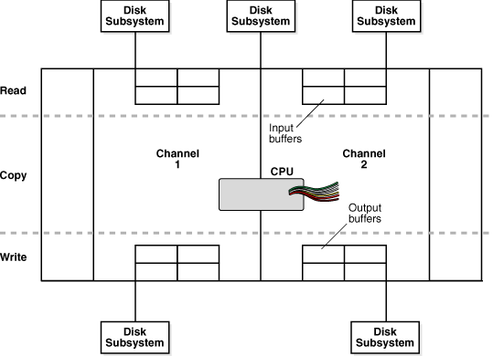
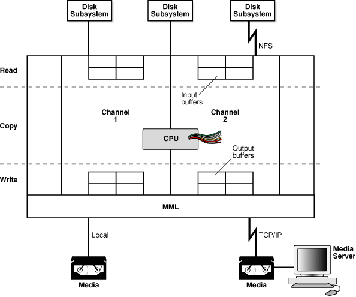
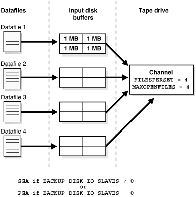
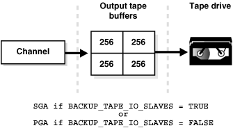
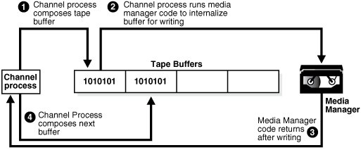
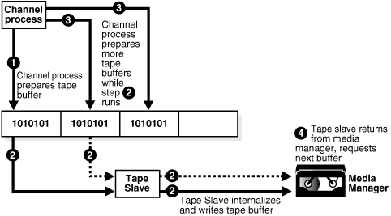

Improve RMAN performance by identifying bottlenecks and then tuning backup performance.

### 23.1 Purpose of RMAN Performance Tuning

The purpose of RMAN tuning is to identify the bottlenecks for a given job and use RMAN commands, initialization parameters, or adjustments to physical media to improve performance.

An RMAN backup or restore job can be divided into separate phases or components. The slowest of these phases in any RMAN job is called the **bottleneck**.

### 23.2 Basic Concepts of RMAN Performance Tuning

Tuning RMAN performance requires a detailed understanding of how RMAN creates a backup. The work of a backup is performed by one or more channels. A [channel](glossary.md) represents a stream of bytes to a storage device.

For the purposes of illustration, you can think of the byte stream as passing from the input buffers in memory through the CPU to the output buffers, and from there to the storage device. To direct a backup to two tape devices, you allocate two tape channels so that each byte stream goes to a different device.

The work of each channel, whether of type disk or System Backup Tape (SBT), is subdivided into distinct phases. The following table describes these phases.

Table 23-1 Phases in Channel Work

| Sequence | Phase | Description | Additional Information |
| --- | --- | --- | --- |
| 1 | Read phase | A channel reads blocks from disk into input I/O buffers. | " Read Phase " |
| 2 | Copy phase | A channel copies blocks from input buffers to output buffers and performs additional processing on the blocks. | " Copy Phase " |
| 3 | Write phase | A channel writes the blocks from output buffers to storage media. The write phase can take either of the following mutually exclusive forms, depending on the type of backup media: write phase for System Backup Tape (SBT) or write phase for disk. | - " Write Phase for System Backup Tape (SBT) " - " Write Phase for Disk " |

Figure 23-1 depicts two channels backing up data stored on three disks. Each channel reads the data into the input buffers, processes the data while copying it from the input to the output buffers, and then writes the data from the output buffers to disk.

Figure 23-1 Phases of a Multichannel Backup to Disk



> This graphic depicts the phases of a multichannel backup to disk. The input devices are three disks, while the output devices are two disks. The phases of read, copy, and write are depicted.
>
> [  
> Copyright © 2023, 2024, Oracle and/or its affiliates.](https://docs.oracle.com/en/database/oracle/oracle-database/dcommon/html/cpyr.htm)


Figure 23-2 also depicts two channels backing up data stored on three disks, but one disk is mounted remotely over the network. Each channel reads the data into the input buffers, processes the data while copying it from the input buffers to the output buffers, and then writes the data from the output buffers to tape. Channel 1 writes the data to a locally attached tape drive, whereas channel 2 sends the data over the network to a remote media server.

Figure 23-2 Phases of a Multichannel Backup to Tape



> This graphic depicts the phases of a multichannel backup to disk. The input devices are three disks, while the output devices are two tape drives. One input device is mounted through NFS. The phases of read, copy, and write are depicted.
>
> [  
> Copyright © 2023, 2024, Oracle and/or its affiliates.](https://docs.oracle.com/en/database/oracle/oracle-database/dcommon/html/cpyr.htm)


When restoring data, a channel performs these steps in reverse order and reverses the reading and writing operations. The following sections explain RMAN tuning concepts in terms of a backup.

The number of channels available for use with a device determines whether RMAN can read from and write to this device in parallel. It is recommended that the number of channels be equal to the number of storage devices used. Therefore, when RMAN uses disk, the number of channels must be equal to the number of physical disks accessed. When RMAN uses tape, the number of channels must be equal to the number of tape drives accessed by RMAN.

#### 23.2.1 Read Phase

Multiple factors can affect the performance when an RMAN channel is reading data from disk.

This following topics in this section explains these factors:

##### 23.2.1.1 Allocation of Input Disk Buffers

During a backup, an RMAN channel reads the blocks from the input files into I/O disk buffers. The database files on the disk subsystem can be managed by either Automatic Storage Management (ASM) or an alternative volume manager or file system. The considerations for backup tuning change depending on whether you manage database files with ASM.

The allocation of the input buffers depends on how the files are multiplexed. Backup [multiplexing](glossary.md) is RMAN's ability to read several files in a backup simultaneously from different sources and then write them to a single backup piece. The [level of multiplexing](glossary.md), which is the number of input files simultaneously read and then written into the same [backup piece](glossary.md), is determined by the algorithm described in " [About Multiplexed RMAN Backup Sets](rman-backup-concepts.md) ". Review this section before proceeding.

When an RMAN channel backs up files from disk, it uses the rules described in Table 23-2 to determine how large to make the input disk buffers.

Table 23-2 Data File Read Buffer Sizing Algorithm

| Level of Multiplexing | Input Disk Buffer Size |
| --- | --- |
| Less than or equal to 4 | The RMAN channel allocates 16 buffers of size 1 megabyte (MB) so that the total buffer size for all the input files is 16 MB. |
| Greater than 4 but less than or equal to 8 | The RMAN channel allocates a variable number of disk buffers of size 512 kilobytes (KB) so that the total buffer size for all the input files is less than 16 MB. |
| Greater than 8 | The RMAN channel allocates 4 disk buffers of 128 KB for each file, so that the total buffer size for each input file is 512 KB. |

In the example shown in Figure 23-3, one channel is backing up four data files. `MAXOPENFILES` is set to 4 and `FILESPERSET` is set to 4. Thus, the level of multiplexing is 4. So, the total size of the buffers for each data file is 4 MB. The combined size of all the buffers is 16 MB.

Figure 23-3 Disk Buffer Allocation



> This illustration depicts disk buffer allocation. One channel is backing up four data files. The channel settings are FILESPERSET=4 and MAXOPENFILES=4. Four 1 MB input disk buffers are allocated for each data file.
>
> [  
> Copyright © 2023, 2024, Oracle and/or its affiliates.](https://docs.oracle.com/en/database/oracle/oracle-database/dcommon/html/cpyr.htm)


If a channel is backing up files stored in ASM, then the number of input disk buffers equals the number of physical disks in the ASM disk group only if the level of multiplexing is 1. For example, if a data file is stored in an ASM disk group that contains 16 physical disks, then the channel allocates 16 input buffers for the data file backup.

If a channel is restoring a backup from disk, then 4 buffers are allocated. The size of the buffers is dependent on the operating system.

##### 23.2.1.2 Synchronous and Asynchronous Disk I/O

When a channel reads from or writes to disk, the I/O is either synchronous I/O or asynchronous I/O.

When the disk I/O is synchronous, a server process can perform only one task at a time. When the disk I/O is asynchronous, a server process can begin an I/O operation and then perform other work while waiting for the I/O to complete. RMAN can also begin multiple I/O operations before waiting for the first to complete.

When reading from an ASM [disk group](glossary.md), use asynchronous disk I/O if possible. Also, if a channel reads from a [raw device](glossary.md) managed with a volume manager, then asynchronous disk I/O also works well. Some operating systems support native asynchronous disk I/O. The database takes advantage of this feature if it is available.

##### 23.2.1.3 Disk I/O Slaves

On operating systems that do not support native asynchronous I/O, the database can simulate it with special I/O slave processes. These processes are dedicated to performing I/O on behalf of another process.

You can control disk I/O slaves by setting the `DBWR_IO_SLAVES` initialization parameter, which is not dynamic. The parameter specifies the number of I/O server processes used by the database writer process (DBWR). By default, the value is 0 and I/O server processes are not used. If asynchronous I/O is disabled, then RMAN allocates four backup disk I/O slaves for any nonzero value of `DBWR_IO_SLAVES`.

When attempting to get shared buffers for I/O slaves, the database does the following:

- If the `LARGE_POOL_SIZE` initialization parameter is set, and if the `DBWR_IO_SLAVES` parameter is set to a nonzero value, then the database attempts to get memory from the large pool. If this value is not large enough, then an error is recorded in the alert log, the database does not try to get buffers from the shared pool, and asynchronous I/O is not used.
- If the `LARGE_POOL_SIZE` initialization parameter is not set or is set to zero, then the database attempts to get memory from the shared pool.
- If the database cannot get enough memory, then it obtains I/O buffer memory from the Program Global Area (PGA) and writes a message to the `alert`.`log` file indicating that synchronous I/O is used for this backup.

The memory from the large pool is used for many features, including the shared server, parallel query, and RMAN I/O slave buffers. Configuring the large pool prevents RMAN from competing with other subsystems for the same memory.

Requests for contiguous memory allocations from the shared pool are usually small (under 5 KB). However, a request for a large contiguous memory allocation can either fail or require significant memory housekeeping to release the required amount of contiguous memory. Although the shared pool may be unable to satisfy this memory request, the large pool can do so. The large pool does not have a least recently used (LRU) list; the database does not attempt to age memory out of the large pool.

##### 23.2.1.4 RATE Channel Parameter

You can use the `RATE` parameter to set an upper limit for bytes read so that RMAN does not consume excessive disk bandwidth and degrade online performance. Essentially, `RATE` serves as a backup throttle.

In the `ALLOCATE` and `CONFIGURE CHANNEL` commands, the `RATE` parameter specifies the bytes per second that are read on a channel. For example, if you set `RATE 1500K`, and if each disk drive delivers 3 megabytes per second, then the channel leaves some disk bandwidth available to the online system.

#### 23.2.2 Copy Phase

In the copy phase, a channel copies blocks from the input buffers to the output buffers and performs additional processing.

For example, if a channel reads data from disk and backs up to tape, then the channel copies the data from the disk buffers to the output tape buffers.

The copy phase involves the following types of processing:

- Validation
- Compression
- Encryption

When performing [validation](glossary.md) of the blocks, RMAN checks them for corruption. Typically, this processing is not CPU-intensive.

When performing [binary compression](glossary.md), RMAN applies a compression algorithm to the data in backup sets. Binary compression can be CPU-intensive. You can choose which compression algorithm RMAN uses for backups. The basic compression level for RMAN has a good compression ratio for most scenarios. If you enabled the Oracle Advanced Compression option, there are several different levels to choose from that provide tradeoffs between compression ratios and required CPU resources.

When performing [backup encryption](glossary.md), RMAN encrypts backup sets by using an algorithm listed in `V$RMAN_ENCRYPTION_ALGORITHMS`. RMAN offers three modes of encryption: transparent, password-protected, and dual-mode. Backup encryption can be CPU-intensive.

See Also:

- [Validating Database Files and Backups](validating-database-files-backups.md)
- [Making Compressed Backups](backing-up-database.md)
- [Encrypting RMAN Backups](backing-up-database-advanced.md)

#### 23.2.3 Write Phase for System Backup Tape (SBT)

When backing up to SBT, RMAN gives the media management software a stream of bytes and associates a unique name with this stream. All details of how and where that stream is stored are handled entirely by the media manager. Thus, a backup to tape involves the interaction of both RMAN and the media manager.

Factors that affect the write phase for SBT are described in the following topics:

- RMAN Component of the Write Phase for SBT
- Media Manager Component of the Write Phase for SBT

##### 23.2.3.1 RMAN Component of the Write Phase for SBT

The RMAN-specific factors affecting the SBT write phase are analogous to the factors affecting disk reads. In both cases, the buffer allocation, slave processes, and synchronous or asynchronous I/O affect performance.

###### 23.2.3.1.1 Allocation of Tape Buffers

If you back up to or restore from an [SBT](glossary.md) device, then by default the database allocates four buffers for each channel for the tape writers (or reads if restoring data as shown in Figure 23-4). The size of the tape I/O buffers is platform-dependent. You can change this value with the `PARMS` and `BLKSIZE` parameters of the `ALLOCATE CHANNEL` or `CONFIGURE CHANNEL` command.

Figure 23-4 Allocation of Tape Buffers



> This graphic depicts a channel writing data to 4 output tape buffers. The output tape buffers are transferred to a tape drive.
>
> [  
> Copyright © 2023, 2024, Oracle and/or its affiliates.](https://docs.oracle.com/en/database/oracle/oracle-database/dcommon/html/cpyr.htm)


###### 23.2.3.1.2 Tape I/O Slaves

RMAN allocates the tape buffers in the System Global Area (SGA) or the Program Global Area (PGA), depending on whether I/O slaves are used. If you set the initialization parameter `BACKUP_TAPE_IO_SLAVES=true`, then RMAN allocates tape buffers from the SGA. Tape devices can only be accessed by one process at a time, so RMAN starts as many slaves as necessary for the number of tape devices. If the `LARGE_POOL_SIZE` initialization parameter is also set, then RMAN allocates buffers from the large pool. If you set `BACKUP_TAPE_IO_SLAVES=false`, then RMAN allocates the buffers from the PGA.

If you use I/O slaves, then set the `LARGE_POOL_SIZE` initialization parameter to dedicate SGA memory to holding these large memory allocations. This parameter prevents RMAN I/O buffers from competing with the library cache for SGA memory. If I/O slaves for tape I/O were requested but there is not enough space in the SGA for them, slaves are not used, and a message appears in the alert log.

The parameter `BACKUP_TAPE_IO_SLAVES` specifies whether RMAN uses slave processes rather than the number of slave processes. Tape devices can only be accessed by one process at a time, and RMAN uses the number of slaves necessary for the number of tape devices.

###### 23.2.3.1.3 Synchronous and Asynchronous I/O

When an SBT channel reads or writes data to tape, the I/O is always synchronous. For tape I/O, each channel allocated (whether manually or automatically) corresponds to a server process, called here a channel process.

Figure 23-5 shows synchronous I/O in a backup to tape.

Figure 23-5 Synchronous Tape I/O



> This illustration depicts synchronous I/O in a backup to tape and is explained in the text that follows.
>
> [  
> Copyright © 2023, 2024, Oracle and/or its affiliates.](https://docs.oracle.com/en/database/oracle/oracle-database/dcommon/html/cpyr.htm)


The following steps occur:

1. The channel process composes a tape buffer.
2. The channel process executes media manager code that processes the tape buffer and internalizes it for further processing and storage by the media manager.
3. The media manager code returns a message to the server process stating that it has completed writing.
4. The channel process can initiate a new task.

Figure 23-6 shows asynchronous I/O in a tape backup. Asynchronous I/O to tape is simulated by using tape slaves. In this case, each allocated channel corresponds to a server process, which in the explanation that follows is identified as a channel process. For each channel process, one tape slave is started (or more than one, if multiple copies exist).

Figure 23-6 Asynchronous Tape I/O



> This illustration depicts asynchronous I/O in a backup to tape and is explained in the text that follows.
>
> [  
> Copyright © 2023, 2024, Oracle and/or its affiliates.](https://docs.oracle.com/en/database/oracle/oracle-database/dcommon/html/cpyr.htm)


The following steps occur:

1. A channel process writes blocks to a tape buffer.
2. The channel process sends a message to the tape slave process to process the tape buffer. The tape slave process executes media manager code that processes the tape buffer and internalizes it so that the media manager can process it.
3. While the tape slave process is writing, the channel process is free to read data from the data files and prepare more output buffers.
4. After the tape slave channel returns from the media manager code, it requests a new tape buffer, which usually is ready. Thus waiting time for the channel process is reduced, and the backup is completed faster.

##### 23.2.3.2 Media Manager Component of the Write Phase for SBT

###### 23.2.3.2.1 Network Throughput

If the tape device is remote, then the media manager must transfer data over the network.

For example, an administrative domain in Oracle Secure Backup can contain multiple networked client hosts, media servers, and tape devices. If the database is on one host, but the output tape drive is attached to a different host, then Oracle Secure Backup manages the data transfer over the network. The network throughput is the upper limit for backup performance.

###### 23.2.3.2.2 Native Transfer Rate

The tape native transfer rate is the speed of writing to a tape without compression. This speed represents the upper limit of the backup rate.

The upper limit of your backup performance should be the aggregate transfer rate of all of your tape drives. If your backup is performing at that rate, and if it is not using an excessive amount of CPU, then RMAN performance tuning does not help.

###### 23.2.3.2.3 Tape Compression

The level of tape compression is very important for backup performance. If the tape has good compression, then the sustained backup rate is faster.

For example, if the compression ratio is 2:1 and native transfer rate of the tape drive is 6 megabytes per second, then the resulting backup speed is 12 megabytes per second. In this case, RMAN must be able to read disks with a throughput of more than 12 megabytes per second or the disk becomes the bottleneck for the backup.

Note:

Do not use both tape compression provided by the media manager and binary compression provided by RMAN. If the media manager compression is efficient, then it is usually the better choice. Using RMAN-compressed backup sets can be an effective alternative to reduce bandwidth used to move uncompressed backup sets over a network to the media manager, if the CPU overhead required to compress the data in RMAN is acceptable.

###### 23.2.3.2.4 Tape Streaming

Tape streaming during write operations has a major effect on tape backup performance.

Many tape drives are fixed-speed, streaming tape drives. Because such drives can write data at only one speed, when they run out of data to write to tape, the tape must slow and stop. Typically, when the drive's buffer empties, the tape is moving so quickly that it actually overshoots; to continue writing, the drive must rewind the tape to locate the point where it stopped writing. Multiple speed tape drives are available that alleviate this problem.

###### 23.2.3.2.5 Physical Tape Block Size

The physical tape block size can affect backup performance.

The block size is the amount of data written by media management software to a tape in one write operation. In general, the larger the tape block size, the faster the backup. The physical tape block size is not controlled by RMAN or Oracle database, but by media management software. See your media management software's documentation for details.

#### 23.2.4 Write Phase for Disk

The principal factor affecting the write phase for disk is the buffer size.

When the output of the backup resides on disk, each channel allocates four output buffers of 1 MB each. The disk channel writes the blocks to the disk subsystem. When restoring files, the read phase is similar to the write phase when backing up files, except the blocks move in the opposite direction.

If RMAN reads from a disk asynchronously, then it writes to the disk asynchronously. When writing to disk, you can make use of disk I/O slaves just as when reading from disk.

If RMAN is backing up files to a disk-based output destination striped over multiple disks, then you can allocate multiple channels. The number of channels is limited only to the number of disks over which the destination is striped. ASM is one example of a destination striped over multiple disks.

### 23.3 Using V$ Views to Diagnose RMAN Performance Problems

Typically, you begin the tuning process by using `V$` views to determine where RMAN backup and restore operations are encountering problems.

This section contains the following topics:

- Monitoring RMAN Job Progress with V$SESSION\_LONGOPS
- Identifying Bottlenecks with V$BACKUP\_SYNC\_IO and V$BACKUP\_ASYNC\_IO

#### 23.3.1 Monitoring RMAN Job Progress with V$SESSION\_LONGOPS

You can monitor the progress of backups and restore jobs by querying the view `V$SESSION_LONGOPS`. RMAN uses two types of rows in `V$SESSION_LONGOPS`: detail rows and aggregate rows.

Detail rows describe the files being processed by one job step, whereas aggregate rows describe the files processed by all job steps in an RMAN command. A job step is the creation or restoration of one backup set or data file copy. Detail rows are updated with every buffer that is read or written during the backup step, so their granularity of update is small. Aggregate rows are updated when each job step completes, so their granularity of update is large.

Table 23-3 describes the columns in `V$SESSION_LONGOPS` that are most relevant for RMAN. Typically, you view the detail rows rather than the aggregate rows to determine the progress of each backup set.

Table 23-3 Columns of V$SESSION\_LONGOPS Relevant for RMAN

| Column | Description for Detail Rows |
| --- | --- |
| `SID` | The server session ID corresponding to an RMAN channel |
| `SERIAL#` | The server session serial number. This value changes each time a server session is reused. |
| `OPNAME` | A text description of the row. Examples of details rows include `RMAN:` `datafile` `copy`, `RMAN:` `full` `datafile` `backup`, and `RMAN:` `full` `datafile` `restore`.  Note: `RMAN:` `aggregate` `input` and `RMAN:` `aggregate` `output` are the only aggregate rows. |
| `CONTEXT` | For backup output rows, this value is `2`. For all other rows except proxy copy (which does not update this column), the value is `1`. |
| `SOFAR` | The meaning of this column depends on the type of operation described by this row:  - For image copies, the number of blocks that have been read - For backup input rows, the number of blocks that have been read from the files being backed up - For backup output rows, the number of blocks that have been written to the backup piece - For restores, the number of blocks that have been processed to the files that are being restored in this one job step - For proxy copies, the number of files that have been copied |
| `TOTALWORK` | The meaning of this column depends on the type of operation described by this row:  - For image copies, the total number of blocks in the file. - For backup input rows, the total number of blocks to be read from all files processed in this job step. - For backup output rows, the value is `0` because RMAN does not know how many blocks that it will write into any backup piece. - For restores, the total number of blocks in all files restored in this job step. - For proxy copies, the total number of files to be copied in this job step. |

Each server session performing a backup or restore job reports its progress compared to the total work required for a job step. For example, if you restore the database with two channels, and each channel has two backup sets to restore (a total of four sets), then each server session reports its progress through a single backup set. When a set is completely restored, RMAN begins reporting progress on the next set to restore.

To monitor RMAN job progress:

1. Before starting the RMAN job, create a script file (called, for this example, `longops`) containing the following SQL statement:
	```
	SELECT SID, SERIAL#, CONTEXT, SOFAR, TOTALWORK,
	       ROUND(SOFAR/TOTALWORK*100,2) "%_COMPLETE"
	FROM   V$SESSION_LONGOPS
	WHERE  OPNAME LIKE 'RMAN%'
	AND    OPNAME NOT LIKE '%aggregate%'
	AND    TOTALWORK != 0
	AND    SOFAR <> TOTALWORK;
	```
2. Start RMAN and connect to the target database and recovery catalog (if used).
3. Start an RMAN job. For example, enter:
	```
	RMAN> RESTORE DATABASE;
	```
4. While the RMAN job is running, start SQL\*Plus and connect to the target database, and execute the `longops` script to check the progress of the RMAN job. If you repeat the query while the RMAN job progresses, then you see output such as the following:
	```
	SQL> @longops
	       SID    SERIAL#    CONTEXT      SOFAR  TOTALWORK %_COMPLETE
	---------- ---------- ---------- ---------- ---------- ----------
	         8         19          1      10377      36617      28.34
	SQL> @longops
	       SID    SERIAL#    CONTEXT      SOFAR  TOTALWORK % COMPLETE
	---------- ---------- ---------- ---------- ---------- ----------
	         8         19          1      21513      36617      58.75
	SQL> @longops
	       SID    SERIAL#    CONTEXT      SOFAR  TOTALWORK % COMPLETE
	---------- ---------- ---------- ---------- ---------- ----------
	         8         19          1      29641      36617      80.95
	SQL> @longops
	       SID    SERIAL#    CONTEXT      SOFAR  TOTALWORK % COMPLETE
	---------- ---------- ---------- ---------- ---------- ----------
	         8         19          1      35849      36617       97.9
	SQL> @longops
	no rows selected
	```
5. If you run the `longops` script at intervals of 2 minutes or more and the `%` \_ `COMPLETE` column does not increase, then RMAN is encountering a problem. See " [Monitoring RMAN Interaction with the Media Manager](troubleshooting-rman-operations.md) " to obtain more information.

If you frequently monitor the execution of long-running tasks, then you could create a shell script or batch file under your host operating system that runs SQL\*Plus to execute this query repeatedly.

#### 23.3.2 Identifying Bottlenecks with V$BACKUP\_SYNC\_IO and V$BACKUP\_ASYNC\_IO

You can use the `V$BACKUP_SYNC_IO` and `V$BACKUP_ASYNC_IO` views to determine the source of backup or restore bottlenecks and to see detailed progress of backup jobs.

`V$BACKUP_SYNC_IO` contains rows when the I/O is synchronous to the process (or thread on some platforms) performing the backup. `V$BACKUP_ASYNC_IO` contains rows when the I/O is asynchronous. Asynchronous I/O is obtained either with I/O processes or because it is supported by the underlying operating system.

The results of a backup or restore job remain in memory until the database instance shuts down. Thus, you can query the views after the job completes.

To determine whether the tape is streaming when the I/O is synchronous:

1. Start SQL\*Plus and connect to the target database.
2. Query the `EFFECTIVE_BYTES_PER_SECOND` column in the `V$BACKUP_SYNC_IO` or `V$BACKUP_ASYNC_IO` view.
	If `EFFECTIVE_BYTES_PER_SECOND` is less than the raw capacity of the hardware, then the tape is not streaming. If `EFFECTIVE_BYTES_PER_SECOND` is greater than the raw capacity of the hardware, the tape may or may not be streaming. Compression may cause the `EFFECTIVE_BYTES_PER_SECOND` to be greater than the speed of real I/O.

See Also:

[Oracle Database Reference](https://docs.oracle.com/pls/topic/lookup?ctx=en/database/oracle/oracle-database/21/bradv&id=REFRN) for more information about these views

##### 23.3.2.1 Identifying Bottlenecks with Synchronous I/O

Query the `V$BACKUP_SYNC_IO` view to identify bottlenecks with synchronoous I/O.

With synchronous I/O, it is difficult to identify specific bottlenecks because all synchronous I/O is a bottleneck to the process. The only way to tune synchronous I/O is to compare the rate (in bytes per second) with the device's maximum throughput rate. If the rate is lower than the rate that the device specifies, then consider tuning this aspect of the backup and restore process.

To determine the rate of synchronous I/O:

1. Start SQL\*Plus and connect to the target database.
2. Query the `DISCRETE_BYTES_PER_SECOND` column in the `V$BACKUP_SYNC_IO` view to display the I/O rate.
	If you see data in `V$BACKUP_SYNC_IO`, then the problem is that you have not enabled asynchronous I/O or you are not using disk I/O slaves.

##### 23.3.2.2 Identifying Bottlenecks with Asynchronous I/O

Query the `V$BACKUP_ASYNC_IO` to identify bottlenecks with asynchronous I/O.

**Long waits** are the number of times the backup or restore process told the operating system to wait until an I/O was complete. **Short waits** are the number of times the backup or restore process made an operating system call to poll for I/O completion in a nonblocking mode. **Ready** indicates the number of times when I/O was ready for use, so there was no need to make an operating system call to poll for I/O completion.

To determine the rate of asynchronous I/O:

1. Start SQL\*Plus and connect to the target database.
2. Query the `LONG_WAITS` and `IO_COUNT` columns in the `V$BACKUP_ASYNC_IO` view to display the I/O rate.
	The simplest way to identify the bottleneck is to find the data file that has the largest ratio for `LONG_WAITS` divided by `IO_COUNT`. For example, you can use the following query:
	```
	SELECT   LONG_WAITS/IO_COUNT, FILENAME
	FROM     V$BACKUP_ASYNC_IO
	WHERE    LONG_WAITS/IO_COUNT > 0
	ORDER BY LONG_WAITS/IO_COUNT DESC;
	```

Note:

If you have synchronous I/O but you set `BACKUP_DISK_IO_SLAVES`, then the I/O is displayed in `V$BACKUP_ASYNC_IO`.

See Also:

[Oracle Database Reference](https://docs.oracle.com/pls/topic/lookup?ctx=en/database/oracle/oracle-database/21/bradv&id=REFRN003) for descriptions of the `V$BACKUP_SYNC_IO` and `V$BACKUP_ASYNC_IO` views

### 23.4 Tuning RMAN Backup Performance

Many factors can affect backup performance. Often, finding the solution to a slow backup is a process of trial and error.

To obtain the best performance for a backup, follow these steps:

1. Remove the `RATE` parameter for channel settings, as described in " Removing the RATE Parameter from Channel Settings ".
2. If your disk does not support asynchronous I/O, then set the `DBWR_IO_SLAVES` parameter, as described in " Setting DBWR\_IO\_SLAVES to Simulate Asynchronous I/O ".
3. Set the `LARGE_POOL_SIZE` parameter, as described in " Setting LARGE\_POOL\_SIZE to Resolve Shared Memory Issues ".
4. Remove bottlenecks that affect backup performance, as described in " Tuning the Read, Write, and Copy Phases ".

#### 23.4.1 Removing the RATE Parameter from Channel Settings

The `RATE` parameter on a channel is intended to reduce, rather than increase, backup throughput so that more disk bandwidth is available for other database operations. If the backup is not streaming to tape, then confirm that the `RATE` parameter is not set.

To remove the RATE parameter:

1. Examine your backup script.
2. Do one of the following:
	- If the backup is in a `RUN` command, then remove the `RATE` parameter, if it is specified, from the `ALLOCATE` command. Skip the remaining steps.
	- If the backup is not in a `RUN` command, then start RMAN, connect to the target database, and proceed to the next step.
3. Execute the `SHOW ALL` command to show the currently configured settings.
4. Remove the `RATE` parameter, if it is set, from the `CONFIGURE CHANNEL` command.

See Also:

RATE Channel Parameter

#### 23.4.2 Setting DBWR\_IO\_SLAVES to Simulate Asynchronous I/O

Some operating systems support native asynchronous I/O. If and only if your disk does not support asynchronous I/O, then set `DBWR_IO_SLAVES`. Any nonzero value for `DBWR_IO_SLAVES` causes a fixed number of disk I/O slaves to be used for backup and restore, which simulates asynchronous I/O.

To enable disk I/O slaves:

1. Start SQL\*Plus and connect to the target database.
2. Shut down the database.
3. Set `DBWR_IO_SLAVES` initialization parameter to a nonzero value.
	This setting enables the database writer processes to use slaves. Thus, you may need to increase the value of the `PROCESSES` initialization parameter.
4. Restart the database.
5. Restart the RMAN backup.

See Also:

Synchronous and Asynchronous Disk I/O

#### 23.4.3 Setting LARGE\_POOL\_SIZE to Resolve Shared Memory Issues

Set the `LARGE_POOL_SIZE` initialization parameter if the database reports an error in the alert log stating that it does not have enough memory and that it cannot start I/O slaves.

The alert log message resembles the following:

```
ksfqxcre: failure to allocate shared memory means sync I/O will be used whenever
async I/O to file not supported natively
```

The large pool is used for RMAN and for other purposes, so its total size must accommodate all uses. This is especially true if `DBWR_IO_SLAVES` has been set and the DBWR process needs buffers.

To set the large pool size:

1. Start SQL\*Plus and connect to the target database.
2. Optionally, query `V$SGASTAT.POOL` to determine in which pool (shared pool or large pool) the memory for an object resides.
3. Set the `LARGE_POOL_SIZE` initialization parameter in the target database.
	You can execute an `ALTER SYSTEM SET` statement to set the parameter dynamically. The formula for setting `LARGE_POOL_SIZE` is as follows:
	```
	LARGE_POOL_SIZE =  number_of_allocated_channels * 
	                   (16 MB + ( 4 *  size_of_tape_buffer ) )
	```
4. Restart the RMAN backup.

See Also:

- [Oracle Database Concepts](https://docs.oracle.com/pls/topic/lookup?ctx=en/database/oracle/oracle-database/21/bradv&id=CNCPT802) for more information about the large pool
- [Oracle Database Reference](https://docs.oracle.com/pls/topic/lookup?ctx=en/database/oracle/oracle-database/21/bradv&id=REFRN10078) for complete information about initialization parameters

#### 23.4.4 Tuning the Read, Write, and Copy Phases

You can perform several tasks to identify and remedy bottlenecks that affect backup performance.

This includes the following tasks:

- Using Backup Validation To Distinguish Between Read and Write Bottlenecks
- Tuning the Read Phase
- Tuning the Copy and Write Phases

##### 23.4.4.1 Using Backup Validation To Distinguish Between Read and Write Bottlenecks

One reliable way to determine whether the output device or input disk I/O is the bottleneck in a given backup job is to compare the time required to run backup tasks with the time required to run `BACKUP VALIDATE` of the same tasks. `BACKUP VALIDATE` of a backup performs the same disk reads as a real backup but performs no I/O to an output device.

To compare backup and validation times:

1. Ensure your NLS environment date format variable is set to show the time. For example, set the NLS variables as follows:
	```
	setenv NLS_LANG  AMERICAN_AMERICA.WE8DEC;
	setenv NLS_DATE_FORMAT "MM/DD/YYYY HH24:MI:SS"
	```
2. Edit your backup script to use the `BACKUP VALIDATE` command instead of the `BACKUP` command.
3. Run the backup script.
4. Examine the RMAN output and calculate the difference between the times displayed in the `Starting backup at` and `Finished backup at` messages.
5. Edit the backup script to use the `BACKUP` command instead of the `BACKUP VALIDATE` command.
6. Run the backup script.
7. Examine the RMAN output and calculate the difference between the times displayed in the `Starting backup at` and `Finished backup at` messages.
8. Compare the backup times for the validation and real backup.
	If the time for the `BACKUP VALIDATE` to tape is about the same as the time for a real backup to tape, then reading from disk is the likely bottleneck.
	If the time for the `BACKUP VALIDATE` to tape is significantly less than the time for a real backup to tape, then writing to the output device is the likely bottleneck.

See Also:

- Tuning the Read Phase
- Tuning the Copy and Write Phases.

##### 23.4.4.2 Tuning the Read Phase

Tuning the read phase can help to improve RMAN performance.

RMAN may not be able to send data blocks to the output device fast enough to keep it occupied. For example, during an [incremental backup](glossary.md), RMAN only backs up blocks changed since a previous data file backup as part of the same strategy. If you do not turn on [block change tracking](glossary.md), then RMAN must scan whole data files for changed blocks, and fill output buffers as it finds such blocks. If few blocks changed, and if RMAN is making an SBT backup, then RMAN may not fill output buffers fast enough to keep the tape drive streaming.

You can improve backup performance by adjusting the [level of multiplexing](glossary.md), which is number of input files simultaneously read and then written into the same RMAN backup piece. The level of multiplexing is the minimum of the `MAXOPENFILES` setting on the channel and the number of input files placed in each backup set. The following table makes recommendations for adjusting the level of multiplexing.

Table 23-4 Adjusting the Level of Multiplexing

| ASM | Striped Disk | Recommendation |
| --- | --- | --- |
| No | Yes | Increase the level of multiplexing. Determine which is the minimum, `MAXOPENFILES` or the number of files in each backup set, and then increase this value.  In this way, you increase the rate at which RMAN fills tape buffers, which makes it more likely that buffers are sent to the media manager fast enough to maintain streaming. |
| No | No | Increase the `MAXOPENFILES` setting on the channel. |
| Yes | Not applicable | Set the `MAXOPENFILES` parameter on the channel to `1` or `2`. |

See Also:

- " [About Multiplexed RMAN Backup Sets](rman-backup-concepts.md) " to learn how the `MAXOPENFILES` and `FILESPERSET` settings affect the level of multiplexing
- " [About RMAN Incremental Backups](rman-backup-concepts.md) " for a conceptual overview

##### 23.4.4.3 Tuning the Copy and Write Phases

If the read phase is performing well, then the copy or write phases are probably the bottleneck. In particular, if RMAN is sending data blocks to the tape drive fast enough to support streaming, but the tape is not streaming, then the SBT write phase is the bottleneck.

Try to improve performance using one of the techniques described in the following table.

Table 23-5 Techniques for Improving Copy and Write Performance

| Technique | Description | Additional Informaiton |
| --- | --- | --- |
| If the backup is a [full backup](glossary.md), then consider using incremental backups | Incremental level 1 backups write only the changed blocks from data files to tape, so that any bottleneck on writing to tape has less impact on your overall backup strategy. In particular, if tape drives are not locally attached to the node of the database being backed up, then incremental backups can be faster.. | " [Making and Updating RMAN Incremental Backups](backing-up-database.md) " |
| If the backup uses the basic compression algorithm, then consider using the Oracle Advanced Compression option |  | - " [Configuring Compression Options](configuring-rman-client-advanced.md) " - " [About Binary Compression for RMAN Backup Sets](rman-backup-concepts.md) " |
| If the database host uses multiple CPUs, and if the backup uses binary compression, then increase the number of channels |  |  |
| If the backup is encrypted, then change the encryption algorithm to `AES128` | The `AES128` algorithm is the least CPU-intensive algorithm. | " [Configuring the Backup Encryption Algorithm](configuring-rman-client-advanced.md) " |
| (For tape backups only) Adjust the size of the tape I/O buffers | Use the `PARMS` and `BLKSIZE` parameters of the `ALLOCATE CHANNEL` or `CONFIGURE CHANNEL` command to set the size. The size of the tape I/O buffers is platform-dependent. The `BLKSIZE` setting overrides the default. |  |
| (For tape backups only) Adjust settings in the media management software | Some media manager settings, including the tape block size, may affect backup performance. |  |
| If RMAN is backing up files to ASM, then increase the number of channels | For example, if RMAN is backing up the database to a single disk group with 16 physical disks, then allocate or configure at least 4 disk channels, up to a maximum of 16. |  |