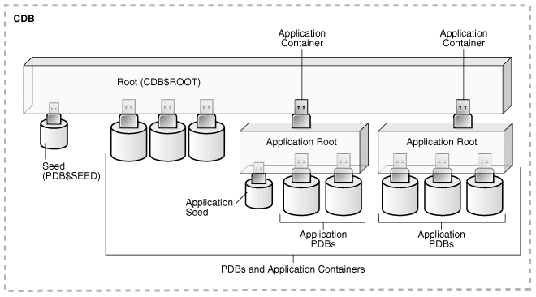
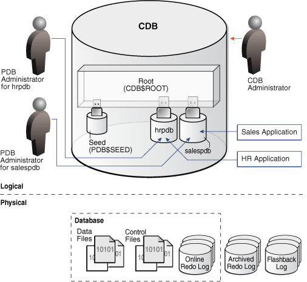
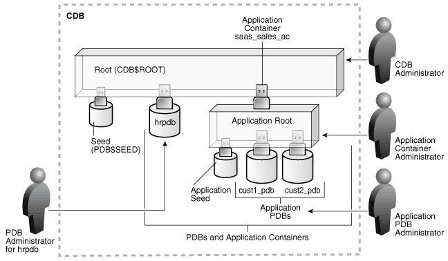
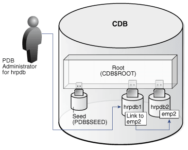

## 2 CDBs and PDBs

The **multitenant architecture** enables an Oracle database to function as a multitenant container database (CDB).

Starting in Oracle Database 21c, a multitenant container database is the only supported architecture. In previous releases, Oracle supported non-container databases (non-CDBs).

This chapter contains the following topics:

- About Containers in a CDB  
	A **container** is a collection of schemas, objects, and related structures in a **multitenant container database (CDB)**. Within a CDB, each container has a unique ID and name.
- The CDB Root and System Container  
	The **CDB root**, also called simply the root, is a collection of schemas, schema objects, and nonschema objects to which all PDBs belong.
- PDBs  
	A **PDB** is a user-created set of schemas, objects, and related structures that appears logically to a client application as a separate database.

**Parent topic:** [Multitenant Architecture](multitenant-architecture.md)

### About Containers in a CDB

A **container** is a collection of schemas, objects, and related structures in a **multitenant container database (CDB)**. Within a CDB, each container has a unique ID and name.

A **CDB** includes zero, one, or many customer-created pluggable databases (PDBs) and application containers. A **PDB** is a portable collection of schemas, schema objects, and nonschema objects that appears to an Oracle Net client as a separate database. An **application container** is an optional, user-created CDB component that stores data and metadata for one or more application back ends. A CDB includes zero or more application containers.

Note:

" [Application Containers](app-containers.md) " explains application containers in detail.

The following figure represents possible containers in a CDB.

Figure 2-1 Containers in a CDB



> This illustration shows a CDB with the following components:
>
> - The CDB has a `CDB$ROOT` container.
> - A `PDB$SEED` container is plugged into the root container.
> - Several PDBs are plugged into the root container.
> - Two application containers plugged into the root container.
> - Each application container has an application root container.
> - One application container has two application PDBs plugged into its application root container.
> - One application container has three application PDBs plugged into its application root container.
> - The application container with two application PDBs also has an application seed plugged into its application root container.


Every CDB has the following containers:

- Exactly one CDB root container (also called simply the root)
	The [CDB root](glossary.md) is a collection of schemas, schema objects, and nonschema objects to which all PDBs belong (see " CDBs and PDBs "). The root stores Oracle-supplied metadata and common users. An example of metadata is the source code for Oracle-supplied PL/SQL packages. A common user is a database user known in every container (see " [Common User Accounts](tables-and-table-clusters.md) "). The root container is named `CDB$ROOT`.
- Exactly one system container
	The [system container](glossary.md) includes the root CDB and all PDBs in the CDB. Thus, the system container is the logical container for the CDB itself.
- Zero or more application containers
	An [application container](glossary.md) consists of exactly one [application root](glossary.md), and the PDBs plugged in to this root. Whereas the system container contains the CDB root and all the PDBs within the CDB, an application container includes only the PDBs plugged into the application root. An application root belongs to the CDB root and no other container.
- Zero or more user-created PDBs
	A PDB contains the data and code required for a specific set of features (see " PDBs "). For example, a PDB can support a specific application, such as a human resources or sales application. No PDBs exist at creation of the CDB. You add PDBs based on your business requirements.
	A PDB belongs to exactly zero or one application container. If a PDB belongs to an application container, then it is an [application PDB](glossary.md). For example, the `cust1_pdb` and `cust2_pdb` application PDBs might belong to the `saas_sales_ac` application container, in which case they belong to no other application containers. An [application seed](glossary.md) is an optional application PDB that acts as a user-created PDB template, enabling you to create new application PDBs rapidly.
- Exactly one [seed PDB](glossary.md)
	The seed PDB is a system-supplied template that the CDB can use to create new PDBs. The seed PDB is named `PDB$SEED`. You cannot add or modify objects in `PDB$SEED`.

Example 2-1 CDB with No Application Containers

This example shows a simple CDB with five containers: the system container (the entire CDB), the CDB root, the PDB seed (`PDB$SEED`), and two PDBs. Each PDB has its own dedicated application. A different PDB administrator manages each PDB. A [common user](glossary.md) exists across a CDB with a single identity. In this example, common user `SYS` can manage the root and every PDB. At the physical level, this CDB is managed by one or more database instances, and contains a set of data files for each PDB and for the CDB itself.

Figure 2-2 CDB with No Application Containers



> This graphic depicts a CDB as a cylinder. Inside the CDB is a box labeled "Root (CDB$ROOT)." Plugged into the box is the Seed (CDB$SEED), hrpdb, and salespdb. A box labeled "Sales Application" points to salespdb. A box labeled "HR Application" points to hrpdb. To the right of the cylinder is an icon of a person labeled "CDB Administrator." To the left of the cylinder is a person icon labeled "PDB Administrator for hrpdb." An arrow points from this icon to hrpdb. Beneath the hrpdb administrator is a person icon labeled "PDB Administrator for salespdb." This icon points to the salespdb icon. Beneath the cylinder is a horizontal dotted line. Above the line is the text "Logical." Below the line is the text "Physical." A dotted line labeled "Database" contains Data Files icons, Control Files icons, and Online Redo Log icons. Outside the Database box are Archived Redo Log icons and Flashback Log icons.


Example 2-2 CDB with an Application Container

In this variation, the CDB contains an application container named `saas_sales_ac`. Within the application container, the application PDB `cust1_pdb` supports an application for one customer, and the application PDB `cust2_pdb` supports an application for a different customer. The CDB also contains a PDB named `hrpdb`, which supports an HR application, but does not belong to an application container.

Figure 2-3 CDB with an Application Container



> This illustration shows a CDB with the following components:
>
> - The CDB has a `CDB$ROOT` container.
> - A `PDB$SEED` container is plugged into the root container.
> - Several PDBs are plugged into the root container.
> - One application container is plugged into the root container.
> - The application container has an application root container.
> - The application container has two application PDBs plugged into its application root container.
> - The application container also has an application seed plugged into its application root container.
> - A person icon labeled “PDB Administrator for hrpdb” has an arrow pointing to hrpdb.
> - A person icon labeled “CDB Administrator” points toward `CDB$ROOT`.
> - A person icon labeled “Application Container Administrator” points to the application root.
> - A person icon labeled “Application PDB Administrator” points to the application PDBs.


In this example, multiple DBAs manage the CDB environment:

- A CDB administrator manages the CDB itself.
- An application container administrator manages the `saas_sales_ac` container, including application installation and upgrades.
- An application PDB administrator manages the two PDBs in the `saas_sales_ac` container: `cust1_pdb` and `cust2_pdb`.
- A PDB administrator manages `hrpdb`.

**Parent topic:** CDBs and PDBs

### The CDB Root and System Container

The **CDB root**, also called simply the root, is a collection of schemas, schema objects, and nonschema objects to which all PDBs belong.

Every CDB has one and only one root container named `CDB$ROOT`. The root stores the system metadata required to manage PDBs. All PDBs belong to the root. The [system container](glossary.md) is the CDB root and all PDBs that belong to this root.

The CDB root does not store user data. Oracle recommends that you do not add common objects to the root or modify Oracle-supplied schemas in the root. However, you can create common users and roles for database administration. A common user with the necessary privileges can switch between containers.

Oracle recommends AL32UTF8 for the root character set. PDBs with different character sets can reside in the same CDB without requiring character set conversion.

Example 2-3 All Containers in a CDB

The following query, issued by an administrative user connected to the CDB root, lists all containers in the CDB (including the seed and CDB root), ordered by `CON_ID`.

```
COL NAME FORMAT A15
SELECT NAME, CON_ID, DBID, CON_UID, GUID 
FROM   V$CONTAINERS ORDER BY CON_ID;

NAME          CON_ID       DBID    CON_UID GUID
------------- ------ ---------- ---------- --------------------------------
CDB$ROOT           1 1895287725          1 2003321EDD4F60D6E0534E40E40A41C5
PDB$SEED           2 2795386505 2795386505 200AC90679F07B55E05396C0E40A23FE
SAAS_SALES_AC      3 1239646423 1239646423 200B4CE0A8DC1D24E05396C0E40AF8EE
SALESPDB           4 3692549634 3692549634 200B4928319C1BCCE05396C0E40A2432
HRPDB              5 3784483090 3784483090 200B4928319D1BCCE05396C0E40A2432
```

See Also:

" [Common User Accounts](tables-and-table-clusters.md) "

**Parent topic:** CDBs and PDBs

### PDBs

A **PDB** is a user-created set of schemas, objects, and related structures that appears logically to a client application as a separate database.

Every PDB is owned by `SYS`, regardless of which user created the PDB. `SYS` is a [common user](glossary.md) in the CDB, which means that this user that has the same identity in the root and in every existing and future PDB within the CDB.

- Types of PDBs  
	All PDBs are user-created with the `CREATE PLUGGABLE DATABASE` statement except for `PDB$SEED`, which is Oracle-supplied.
- Purpose of PDBs  
	For an application, a PDB is a self-contained, fully functional Oracle database. You can consolidate PDBs into a single CDB to achieve economies of scale, while maintaining isolation between PDBs.
- Proxy PDBs  
	A **proxy PDB** refers to a remote PDB, called the **referenced PDB**.
- Names for PDBs  
	Containers in a CDB share the same namespace, which means that they must have unique names within this namespace.
- Database Links Between PDBs  
	By default, a user connected to one PDB must use database links to access objects in a different PDB.

**Parent topic:** CDBs and PDBs

#### Types of PDBs

All PDBs are user-created with the `CREATE PLUGGABLE DATABASE` statement except for `PDB$SEED`, which is Oracle-supplied.

You can create the following types of PDBs.

Standard PDB

This type of PDB results from running `CREATE PLUGGABLE DATABASE` without specifying the PDB as a seed, proxy PDB, or [application root](glossary.md). Its capabilities depend on the container in which you create it:

- PDB plugged in to the [CDB root](glossary.md)
	This PDB belongs to the CDB root container and not an [application container](glossary.md). This type of PDB cannot use application common objects. See " [Application Common Objects](app-containers.md) ".
- Application PDB
	An [application PDB](glossary.md) belongs to exactly one application container. Unlike PDBs plugged in to the CDB root, application PDBs can share a master [application](glossary.md) definition within an application container. For example, a `usa_zipcodes` table in an application root might be a [data-linked common object](glossary.md), which means it contains data accessible by all application PDBs plugged in to this root. PDBs that do not reside within the application container cannot access its application common objects.

Application Root

Consider an application root as an application-specific root container. It serves as a repository for a master definition of an application back end, including common data and metadata. To create an application root, connect to the CDB root and specify the `AS APPLICATION CONTAINER` clause in a `CREATE PLUGGABLE DATABASE` statement. See " [Application Root](app-containers.md) ".

Seed PDBs

Unlike a standard PDB, a seed PDB is not intended to support an application. Rather, the seed is a template for the creation of PDBs that support applications. A seed can be either of the following:

- Seed PDB plugged in the CDB root (`PDB$SEED`)
	You can use this system-supplied template to create new PDBs either in an application container or the system container. The system container contains exactly one PDB seed. You cannot drop `PDB$SEED`, or add objects to or modify objects within it.
- Application seed PDB
	To accelerate creation of application PDBs within an application container, you can create an optional [application seed](glossary.md). An application container contains either zero or one application seed.
	You create an application seed by connecting to the application container and executing the `CREATE PLUGGABLE DATABASE ... AS SEED` statement. See " [Application Seed](app-containers.md) ".

Proxy PDBs

A [proxy PDB](glossary.md) is a PDB that uses a database link to reference a PDB in a remote CDB. When you issue a statement in a proxy PDB while the PDB is open, the statement executes in the referenced PDB.

You must create a proxy PDB while connected to the CDB root or application root. You can alter or drop a proxy PDB just as you can a standard PDB.

**Parent topic:** PDBs

#### Purpose of PDBs

For an application, a PDB is a self-contained, fully functional Oracle database. You can consolidate PDBs into a single CDB to achieve economies of scale, while maintaining isolation between PDBs.

You can use PDBs to achieve the following specific goals:

- Store data specific to an application
	For example, a sales application can have its own dedicated PDB, and a human resources application can have its own dedicated PDB. Alternatively, you can create an [application container](glossary.md), which is a named collection of PDBs, to store an application back end containing common data and metadata.
- Move data into a different CDB
	A database is "pluggable" because you can package it as a self-contained unit, called an [unplugged PDB](glossary.md), and then move it into another CDB.
- Perform rapid upgrades
	You can unplug a PDB from CDB at a lower Oracle Database release, and then plug it in to a CDB at a higher release.
- Copy data quickly without loss of availability
	For testing and development, you can clone a PDB while it remains open, storing the clone in the same or a different CDB. Optionally, you can specify the PDB as a [refreshable clone PDB](glossary.md). Alternatively, you use the Oracle-supplied [seed PDB](glossary.md) or a user-created [application seed](glossary.md) to copy new PDBs.
- Reference data in a different CDB
	You can create a [proxy PDB](glossary.md) that refers to a different PDB, either in the same CDB or in a separate CDB. When you issue statements in the proxy PDB, they execute in the referenced PDB.
- Isolate grants within PDBs
	A local or common user with appropriate privileges can grant `EXECUTE` privileges on a schema object to `PUBLIC` within an individual PDB.

See Also:

- " [About Application Containers](app-containers.md) "
- [Oracle Database Security Guide](https://docs.oracle.com/pls/topic/lookup?ctx=en/database/oracle/oracle-database/21/cncpt&id=DBSEG588) to learn how to grant roles and privileges in a CDB

**Parent topic:** PDBs

#### Proxy PDBs

A **proxy PDB** refers to a remote PDB, called the **referenced PDB**.

Although you issue SQL statements in the proxy (referring) PDB, the statements execute in the referenced PDB. In this respect, a proxy PDB is loosely analogous to a symbolic link file in Linux.

Proxy PDBs provide the following benefits:

- Aggregate data from multiple application models
	Proxy PDBs enable you to build location-transparent applications that can aggregate data from multiple sources. These sources can be in the same data center or distributed across data centers.
- Enable an application root in one CDB to propagate application changes to a different application root
	Assume that CDBs `cdb_prod` and `cdb_test` have the same application model. You create a proxy PDB in an application container in `cdb_prod` that refers to an application root in `cdb_test`. When you run installation and upgrade scripts in the application root in `cdb_prod`, Oracle Database propagates these statements to the proxy PDB, which in turn sends them remotely to the application root in `cdb_test`. In this way, the application root in `cdb_test` becomes a replica of the application root in `cdb_prod`.

To create a proxy PDB, execute `CREATE PLUGGABLE DATABASE` with the `AS PROXY FROM` clause, where `FROM` specifies the referenced PDB name and a database link. The creation statement copies only the data files belonging to the `SYSTEM` and `SYSAUX` tablespaces.

Example 2-4 Creating a Proxy PDB

This example connects to the container `saas_sales_ac` in a local production CDB. The `sales_admin` common user creates a proxy PDB named `sales_sync_pdb`. This application PDB references an application root named `saas_sales_test_ac` in a remote development CDB, which it accesses using the `cdb_dev_rem` database link. When an application upgrade occurs in `saas_sales_ac` in the production CDB, the upgrade automatically propagates to the application root `saas_sales_test_ac` in the remote development CDB.

```
CONNECT sales_admin@saas_sales_ac
Password: ***********

CREATE PLUGGABLE DATABASE sales_sync_pdb AS PROXY FROM saas_sales_test_ac@cdb_dev_rem;
```

**Parent topic:** PDBs

#### Names for PDBs

Containers in a CDB share the same namespace, which means that they must have unique names within this namespace.

Names for the following containers must not conflict within the same CDB:

- The CDB root
- PDBs plugged in to the CDB root
- Application roots
- Application PDBs

For example, if the same CDB contains the application containers `saas_sales_ac` and `saas_sales_test_ac`, then two application PDBs that are both named `cust1` cannot simultaneously reside in both containers. The namespace rules also prevent creation of a PDB named `cust1pdb` in the CDB root and a PDB named `cust1pdb` in an application root.

Names for PDBs and application root containers must follow the same rules as net service names. Moreover, because a PDB or application root has a service with its own name, the container name must be unique across all CDBs whose services are exposed through a specific listener. The first character of a user-created container name must be alphanumeric, with remaining characters either alphanumeric or an underscore (`_`). Because service names are case-insensitive, container names are case-insensitive, and are in upper case even if specified using delimited identifiers.

See Also:

[Oracle Database Net Services Reference](https://docs.oracle.com/pls/topic/lookup?ctx=en/database/oracle/oracle-database/21/cncpt&id=NETRF-GUID-6DEC930F-6A19-4C75-8E6B-61CF288A2241) for the rules for service names

**Parent topic:** PDBs

#### Database Links Between PDBs

By default, a user connected to one PDB must use database links to access objects in a different PDB.

Figure 2-4 Database Link Between PDBs

In this illustration, a PDB administrator is connected to the PDB named `hrpdb1`. By default, during this user session, `c##dba` cannot query the `emp2` table in `hrpdb2` without specifying a database link.



> This graphic depicts a PDB administrator connect to a PDB named hrpdb1, which contains a box labeled “Link to emp2.” This box points to a box labeled “emp2,” which is located in a PDB labeled hrpdb2.
>
> [  
> Copyright © 1993, 2025, Oracle and/or its affiliates.](https://docs.oracle.com/en/database/oracle/oracle-database/dcommon/html/cpyr.htm)


Exceptions to the rule include:

- A [data-linked common object](glossary.md), which is accessible by all application PDBs that contain a [data link](glossary.md) that points to this object. For example, the application container `saas_sales_ac` might contain the data-linked table `usa_zipcodes` within its application. In this case, common CDB user `c##dba` can connect to an application PDB in this container, and then query `usa_zipcodes` even though the actual table resides in the application root. In this case, no database link is required.
- The `CONTAINERS()` clause in SQL issued from the CDB root or application root. Using this clause, you can query data across all PDBs plugged in to the container root.

When creating a proxy PDB, you must specify a database link name in the `FROM` clause of the `CREATE PLUGGABLE DATABASE ... AS PROXY` statement. If the proxy PDB and referenced PDB reside in separate CDBs, then the database link must be defined in the root of the CDB that will contain the proxy PDB. The database link must connect either to the remote referenced PDB or to the CDB root of the remote CDB.

See Also:

" [Common and Local Objects](tables-and-table-clusters.md) "

**Parent topic:** PDBs