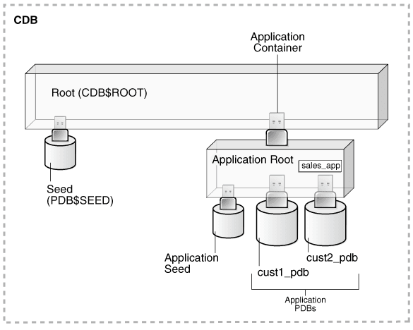

## 3 Application Containers

Within a CDB, you can create a container for application data and metadata that can be shared by PDBs.

This chapter contains the following topics:

- About Application Containers  
	An **application container** is an optional, user-created CDB component that stores data and metadata for one or more application back ends. A CDB includes zero or more application containers.
- Application Common Objects  
	An **application common object** is a common object created within an application in an application root. Common objects are either data-linked or metadata-linked.
- Container Maps  
	A **container map** enables a session connected to application root to issue SQL statements that are routed to the appropriate PDB, depending on the value of a predicate used in the SQL statement.
- Cross-Container Operations  
	A **cross-container operation** is a DDL or DML statement that affects multiple containers at once.

See Also:

" [Common and Local Objects](tables-and-table-clusters.md) " to learn about application common objects

**Parent topic:** [Multitenant Architecture](multitenant-architecture.md)

### About Application Containers

An **application container** is an optional, user-created CDB component that stores data and metadata for one or more application back ends. A CDB includes zero or more application containers.

Within an **application container**, an **application** is the named, versioned set of common data and metadata stored in the application root. In this context of an application container, the term “application” means “master application definition.” For example, the application might include definitions of tables, views, and packages.

For example, you might create multiple sales-related PDBs within one application container, with these PDBs sharing an application that consists of a set of common tables and table definitions. You might store multiple HR-related PDBs within a separate application container, with their own common tables and table definitions.

The `CREATE PLUGGABLE DATABASE` statement with the `AS APPLICATION CONTAINER` clause creates the application root of the application container, and thus implicitly creates the application container itself. When you first create the application container, it contains no PDBs. To create application PDBs, you must connect to the application root, and then execute the `CREATE PLUGGABLE DATABASE` statement.

In the `CREATE PLUGGABLE DATABASE` statement, you must specify a container name (which is the same as the application root name), for example, `saas_sales_ac`. The application container name must be unique within the CDB, and within the scope of all the CDBs whose instances are reached through a specific listener. Every application container has a default service with the same name as the application container.

- Purpose of Application Containers  
	In some ways, an application container functions as an application-specific CDB within a CDB. An application container, like the CDB itself, can include multiple PDBs, and enables these PDBs to share metadata and data.
- Application Root  
	An application container has exactly one **application root**, which is the parent of the application PDBs in the container.
- Application PDBs  
	An **application PDB** is a PDB that resides in an application container. Every PDB in a CDB resides in either zero or one application containers.
- Application Seed  
	An **application seed** is an optional, user-created PDB within an application container. An application container has either zero or one application seed.

**Parent topic:** Application Containers

#### Purpose of Application Containers

In some ways, an application container functions as an application-specific CDB within a CDB. An application container, like the CDB itself, can include multiple PDBs, and enables these PDBs to share metadata and data.

The application root enables application PDBs to share an **application**, which in this context means a named, versioned set of common metadata and data. A typical application installs application common users, metadata-linked common objects, and data-linked common objects.

- Key Benefits of Application Containers  
	Application containers provide several benefits over storing each application in a separate PDB.
- Application Container Use Case: SaaS  
	A SaaS deployment can use multiple application PDBs, each for a separate customer, that share metadata and data.
- Application Containers Use Case: Logical Data Warehouse  
	A customer can use multiple application PDBs to address data sovereignty issues.

**Parent topic:** About Application Containers

##### Key Benefits of Application Containers

Application containers provide several benefits over storing each application in a separate PDB.

- The application root stores metadata and data that all application PDBs can share.
	For example, all application PDBs can share data in a central table, such as a table listed default application roles. Also, all PDBs can share a table definition to which they add PDB-specific rows.
- You maintain your master application definition in the application root, instead of maintaining a separate copy in each PDB.
	If you upgrade the application in the application root, then the changes are automatically propagated to all application PDBs. The application back end might contain the **data-linked common object** `app_roles`, which is a table that list default roles: `admin`, `manager`, `sales_rep`, and so on. A user connected to any application PDB can query this table.
- An application container can include an application seed, application PDBs, and proxy PDBs (which refer to PDBs in other CDBs).
- You can rapidly create new application PDBs from the **application seed**.
- You can query views that report on all PDBs in the application container.
- While connected to the application root, you can use the `CONTAINERS` function to perform DML on objects in multiple PDBs.
	For example, if the `products` table exists in every application PDB, then you can connect to the application root and query the products in all application PDBs using a single `SELECT` statement.
- You can unplug a PDB from an application root, and then plug it in to an application root in a higher Oracle database release. Thus, PDBs are useful in an Oracle database upgrade.

**Parent topic:** Purpose of Application Containers

##### Application Container Use Case: SaaS

A SaaS deployment can use multiple application PDBs, each for a separate customer, that share metadata and data.

In a pure SaaS environment, the master application definition resides in the application root, but the customer-specific data resides in its own application PDB. For example, `sales_app` is the application model in the application root. The application PDB named `cust1_pdb` contains sales data only for customer 1, whereas the application PDB named `cust2_pdb` contains sales data only for customer 2. Plugging, unplugging, cloning, and other PDB-level operations are available for individual customer PDBs.

Figure 3-1 SaaS Use Case



> This graphic depicts a three-dimension box labeled Root (CDB$ROOT). Below the Root and on the left, a cylinder with a USB connector plugs into the Root box. The cylinder is labeled Seed (PDB$SEED). Below the box and on the right, a box labeled Application Root is plugged into the Root. The connector is labeled Application Container. Application Root contains a smaller box labeled sales\_app. Plugged into the Application Root are Application Seed, cust1\_pdb, and cust2\_pdb. The latter two are labeled Application PDBs.


A pure SaaS configuration provides the following benefits:

- Performance
- Security
- Support for multiple customers
	The data for each customer resides in its own container, but is consolidated so that you can manage many customers collectively. This model extends the economies of scale of managing many as one to the application administrator, not only the DBA.

**Parent topic:** Purpose of Application Containers

##### Application Containers Use Case: Logical Data Warehouse

A customer can use multiple application PDBs to address data sovereignty issues.

In a sample use case, a company puts data specific to each financial quarter in a separate PDB. For example, the application container named `sales_ac` includes `q1_2016_pdb`, `q2_2016_pdb`, `q3_2016_pdb`, and `q4_2016_pdb`. You define each transaction in the PDB corresponding to the associated quarter. To generate a report that aggregates performance across a year, you aggregate across the four PDBs using the `CONTAINERS()` clause.

Benefits of this logical warehouse design include:

- ETL for data specific to a single PDB does not affect the other PDBs.
- Execution plans are more efficient because they are based on actual data distribution.

**Parent topic:** Purpose of Application Containers

#### Application Root

An application container has exactly one **application root**, which is the parent of the application PDBs in the container.

The property of being an application root is established at creation time, and cannot be changed. The only container to which an application root belongs is the CDB root. An application root is like the CDB root in some ways, and like a PDB in other ways:

- Like the CDB root, an application root serves as parent container to the PDBs plugged into it. When connected to the application root, you can manage common users and privileges, create application PDBs, switch containers, and issue DDL that applies to all PDBs in the application container.
- Like a PDB, you create an application root with the `CREATE PLUGGABLE DATABASE` statement, alter it with `ALTER PLUGGABLE DATABASE`, and change its availability with `STARTUP` and `SHUTDOWN`. You can use DDL to plug, unplug, and drop application roots. The application root has its own service name, and users can connect to the application root in the same way that they connect to a PDB.

An application root differs from both the CDB root and standard PDB because it can store user-created common objects, which are called **application common objects**. Application common objects are accessible to the application PDBs plugged in to the application root. Application common objects are not visible to the CDB root, other application roots, or PDBs that do not belong to the application root.

Example 3-1 Creating an Application Root

In this example, you log in to the CDB root as administrative common user `c##system`. You create an application container named `saas_sales_ac`, and then open the application root, which has the same name as the container.

```
-- Create the application container called saas_sales_ac
CREATE PLUGGABLE DATABASE saas_sales_ac AS APPLICATION CONTAINER
  ADMIN USER saas_sales_ac_adm IDENTIFIED BY manager; 

-- Open the application root
ALTER PLUGGABLE DATABASE saas_sales_ac OPEN;
```

You set the current container to `saas_sales_ac`, and then verify that this container is the application root:

```
-- Set the current container to saas_sales_ac
ALTER SESSION SET CONTAINER = saas_sales_ac;

COL NAME FORMAT a15
COL ROOT FORMAT a4
SELECT CON_ID, NAME, APPLICATION_ROOT AS ROOT, 
       APPLICATION_PDB AS PDB,
FROM   V$CONTAINERS;

    CON_ID NAME            ROOT PDB
---------- --------------- ---- ---
         3 SAAS_SALES_AC   YES    NO
```

**Parent topic:** About Application Containers

#### Application PDBs

An **application PDB** is a PDB that resides in an application container. Every PDB in a CDB resides in either zero or one application containers.

For example, the `saas_sales_ac` application container might support multiple customers, with each customer application storing its data in a separate PDB. The application PDBs `cust1_sales_pdb` and `cust2_sales_pdb` might reside in `saas_sales_ac`, in which case they belong to no other application container (although as PDBs they necessarily belong also to the CDB root).

Create an application PDB by executing `CREATE PLUGGABLE DATABASE` while connected to the application root. You can either create the application PDB from a seed, or clone a PDB or plug in an unplugged PDB. Like a PDB that is plugged in to CDB root, you can clone, unplug, or drop an application PDB. However, an application PDB must always belong to an application root.

**Parent topic:** About Application Containers

#### Application Seed

An **application seed** is an optional, user-created PDB within an application container. An application container has either zero or one application seed.

An application seed enables you to create application PDBs quickly. It serves the same role within the application container as `PDB$SEED` serves within the CDB itself.

The application seed name is always `application_container_name$SEED`, where `application_container_name` is the name of the application container. For example, use the `CREATE PDB ... AS SEED` statement to create `saas_sales_ac$SEED` in the `saas_sales_ac` application container.

**Parent topic:** About Application Containers

### Application Common Objects

An **application common object** is a common object created within an application in an application root. Common objects are either data-linked or metadata-linked.

For a [data-linked common object](glossary.md), application PDBs share a single set of data. For example, an application for the `saas_sales_ac` application container is named `saas_sales_app`, has version `1.0`, and includes a data-linked `usa_zipcodes` table. In this case, the rows are stored once in the table in the application root, but are visible in all application PDBs.

For a [metadata-linked common object](glossary.md), application PDBs share only the metadata, but contain different sets of data. For example, a metadata-linked `products` table has the same definition in every application PDB, but the rows themselves are specific to the PDB. The application PDB named `cust1pdb` might have a `products` table that contains books, whereas the application PDB named `cust2pdb` might have a `products` table that contains auto parts.

- About Commonality in a CDB  
	A common phenomenon defined in a CDB or application root is the same in all containers plugged in to this root.
- Creation of Application Common Objects  
	To create common objects, connect to an application root, and then execute a `CREATE` statement that specifies a sharing attribute.
- Metadata-Linked Application Common Objects  
	A metadata link is a dictionary object that supports referring to, and granting privileges on, common metadata shared by all PDBs in the application container.
- Data-Linked Application Common Objects  
	A **data-linked object** is an object whose metadata and data reside in an application root, and are accessible from all application PDBs in this application container.
- Extended Data-Linked Application Objects  
	An **extended data-linked object** is a hybrid of a data-linked object and metadata-linked object.

See Also:

" [Common and Local Objects](tables-and-table-clusters.md) " to learn about common objects

**Parent topic:** Application Containers

#### About Commonality in a CDB

A common phenomenon defined in a CDB or application root is the same in all containers plugged in to this root.

- Principles of Commonality  
	In a CDB, a phenomenon can be common within either the system container (the CDB itself), or within a specific application container.
- Namespaces in a CDB  
	In a CDB, the namespace for every object is scoped to its container.

**Parent topic:** Application Common Objects

##### Principles of Commonality

In a CDB, a phenomenon can be common within either the system container (the CDB itself), or within a specific application container.

For example, if you create a common user account while connected to `CDB$ROOT`, then this user account is common to all PDBs and application roots in the CDB. If you create an application common user account while connected to an application root, however, then this user account is common only to the PDBs in this application container.

Within the context of `CDB$ROOT` or an application root, the principles of commonality are as follows:

- A common phenomenon is the same in every existing and future container.
	Therefore, a common user defined in the CDB root has the same identity in every PDB plugged in to the CDB root; a common user defined in an application root has the same identity in every application PDB plugged in to this application root. In contrast, a local phenomenon is scoped to exactly one existing container.
- Only a common user can alter the existence of common phenomena.
	More precisely, only a common user logged in to either the CDB root or an application root can create, destroy, or modify attributes of a user, role, or object that is common to the current container.

**Parent topic:** About Commonality in a CDB

##### Namespaces in a CDB

In a CDB, the namespace for every object is scoped to its container.

The following principles summarize the scoping rules:

- From an application perspective, a PDB is a separate database that is distinct from any other PDBs.
- Local phenomena are created within and restricted to a single container.
	Note:
	In this topic, the word “phenomenon” means “user account, role, or database object.”
- Common phenomena are defined in a CDB root or application root, and exist in all PDBs that are or will be plugged into this root.

The preceding principles have implications for local and common phenomena.

Local Phenomena

A local phenomenon must be uniquely named within a container, but not across all containers in the CDB. Identically named local phenomena in different containers are distinct. For example, local user `sh` in one PDB does not conflict with local user `sh` in another PDB.

CDB$ROOT Common Phenomena

Common phenomena defined in `CDB$ROOT` exist in multiple containers and must be unique within each of these namespaces. For example, the CDB root includes predefined common users such as `SYSTEM` and `SYS`. To ensure namespace separation, Oracle Database prevents creation of a `SYSTEM` user within another container.

To ensure namespace separation, the name of user-created common phenomena in the CDB root must begin with the value specified by the `COMMON_USER_PREFIX` initialization parameter. The default prefix is `c##` or `C##`. The names of all other user-created phenomena must not begin with `c##` or `C##`. For example, you cannot create a local user in `hrpdb` named `c##hr`, nor can you create a common user in the CDB root named `hr`.

Application Common Phenomena

Within an application container, names for local and application common phenomena must not conflict.

- Application common users and roles
	The same principles apply to application common users as to CDB common users. The difference is that for CDB common users, the default value for the common user prefix is `c##` or `C##`, whereas in application root the default value for the common user prefix is the empty string.
	The multitenant architecture assumes that you create application PDBs from an application root, or convert a single-tenant application to a multitenant application.
- Application common objects
	The multitenant architecture assumes that you create application common objects in the application root. Later, you add data locally within the application PDBs. However, Oracle Database supports creation of local tables within an application PDB. In this case, the local tables reside in the same namespace as application common objects within the application PDB.

See Also:

[Oracle Database Security Guide](https://docs.oracle.com/pls/topic/lookup?ctx=en/database/oracle/oracle-database/21/cncpt&id=DBSEG830) to learn more about common users and roles

**Parent topic:** About Commonality in a CDB

#### Creation of Application Common Objects

To create common objects, connect to an application root, and then execute a `CREATE` statement that specifies a sharing attribute.

You can only create or change application common objects as part of an application installation, upgrade, or patch. You can specify sharing in the following ways:

- `DEFAULT_SHARING` initialization parameter
	The setting is the default sharing attribute for all database objects of a supported type created in the root.
- `SHARING` clause
	You specify this clause in the `CREATE` statement itself. When a `SHARING` clause is included in a SQL statement, it takes precedence over the value specified in the `DEFAULT_SHARING` initialization parameter. Possible values are `METADATA`, `DATA`, `EXTENDED DATA`, and `NONE`.

The following table shows the types of application common objects, and where the data and metadata is stored.

Table 3-1 Application Common Objects

| Object Type | SHARING Value | Metadata Storage | Data Storage |
| --- | --- | --- | --- |
| Data-Linked | `DATA` | Application root | Application root |
| Extended Data-Linked | `EXTENDED DATA` | Application root | Application root and application PDB |
| Metadata-Linked | `METADATA` | Application root | Application PDB |

See Also:

[Oracle Database Security Guide](https://docs.oracle.com/pls/topic/lookup?ctx=en/database/oracle/oracle-database/21/cncpt&id=GUID-D3336A29-71A4-42C3-BCBB-8E6738627539) to learn how to manage privileges for common objects

**Parent topic:** Application Common Objects

#### Metadata-Linked Application Common Objects

A metadata link is a dictionary object that supports referring to, and granting privileges on, common metadata shared by all PDBs in the application container.

Specifying the `METADATA` value in either the `SHARING` clause or the `DEFAULT_SHARING` initialization parameter specifies a link to an object’s metadata, called a [metadata-linked common object](glossary.md). The metadata for the object is stored once in the application root.

Tables, views, and code objects (such as PL/SQL procedures) can share metadata. In this context, “metadata” includes column definitions, constraints, triggers, and code. For example, if `sales_mlt` is a metadata-linked common table, then all application PDBs access the same definition of this table, which is stored in the application root, by means of a metadata link. The rows in `sales_mlt` are different in every application PDB, but the column definitions are the same.

Typically, most objects in an application will be metadata-linked. Thus, you need only maintain one master application definition. This approach centralizes management of the application in multiple application PDBs.

Example 3-2 Creating a Metadata-Linked Common Object

In this example, the `SYSTEM` user logs in to the `saas_sales_ac` application container. `SYSTEM` installs an application named `saas_sales_app` at version 1.0. This application creates a common user account named `saas_sales_adm`. The schema contains a metadata-linked common table named `sales_mlt`.

```
-- Begin the install of saas_sales_app
ALTER PLUGGABLE DATABASE APPLICATION saas_sales_app BEGIN INSTALL '1.0';

-- Create the tablespace for the app
CREATE TABLESPACE saas_sales_tbs DATAFILE SIZE 100M AUTOEXTEND ON NEXT 10M MAXSIZE 200M;

-- Create the user account saas_sales_adm, which will own the app
CREATE USER saas_sales_adm IDENTIFIED BY ****** CONTAINER=ALL;

-- Grant necessary privileges to this user account
GRANT CREATE SESSION, DBA TO saas_sales_adm;

-- Makes the tablespace that you just created the default for saas_sales_adm
ALTER USER saas_sales_adm DEFAULT TABLESPACE saas_sales_tbs;

-- Now connect as the application owner
CONNECT saas_sales_adm/******@saas_sales_ac

-- Create a metadata-linked table
CREATE TABLE saas_sales_adm.sales_mlt SHARING=METADATA
(YEAR       NUMBER(4),
 REGION     VARCHAR2(10),
 QUARTER    VARCHAR2(4),
 REVENUE    NUMBER);

-- End the application installation
ALTER PLUGGABLE DATABASE APPLICATION saas_sales_app END INSTALL '1.0';
```

You can use the `ALTER PLUGGABLE DATABASE APPLICATION ... SYNC` statement to synchronize the application PDBs to use the same master application definition. In this way, every application PDB has a metadata link to the `saas_sales_adm.sales_mlt` common table. The middle-tier code that updates `sales_mlt` within the PDB named `cust1_pdb` adds rows to this table in `cust1_pdb`, whereas the middle-tier code that updates `sales_mlt` in `cust2_pdb` adds rows to the copy of this table in `cust2_pdb`. Only the table metadata, which is stored in the application root, is shared.

Note:

[Oracle Database Security Guide](https://docs.oracle.com/pls/topic/lookup?ctx=en/database/oracle/oracle-database/21/cncpt&id=GUID-A804A571-D104-451E-83E0-8CEF716DBC68) to learn more about how commonly granted object privileges work

- Metadata Links  
	For metadata-linked application common objects, the metadata for the object is stored once in the application root. A metadata link is a dictionary object whose object type is the same as the metadata it is sharing.

**Parent topic:** Application Common Objects

##### Metadata Links

For metadata-linked application common objects, the metadata for the object is stored once in the application root. A metadata link is a dictionary object whose object type is the same as the metadata it is sharing.

The description of a metadata link is stored in the data dictionary of the PDB in which it is created. A metadata link must be owned by an application common user. You can only use metadata links to share metadata of common objects owned by their creator in the CDB root or an application root.

Unlike a data link, a metadata link depends only on common data. For example, if an application contains the local tables `dow_close_lt` and `nasdaq_close_lt` in the application root, then a common user cannot create metadata links to these objects. However, an application common table named `sales_mlt` may be metadata-linked.

If a privileged common user changes the metadata for `sales_mlt`, for example, adds a column to the table, then this change propagates to the metadata links. Application PDB users may not change the metadata in the metadata link. For example, a DBA who manages the application PDB named `cust1_pdb` cannot add a column to `sales_mlt` in this PDB only: such metadata changes can be made only in the application root.

**Parent topic:** Metadata-Linked Application Common Objects

#### Data-Linked Application Common Objects

A **data-linked object** is an object whose metadata and data reside in an application root, and are accessible from all application PDBs in this application container.

Specifying the `DATA` value in either the `SHARING` clause or the `DEFAULT_SHARING` initialization parameter specifies a link to a common object, called a [data-linked common object](glossary.md). Dimension tables in a data warehouse are often good candidates for data-linked common tables.

A data link is a dictionary object that functions much like a synonym. For example, if `countries` is an application common table, then all application PDBs access the same copy of this table by means of a data link. If a row is added to this table, then this row is visible in all application PDBs.

A data link must be owned by an application common user. The link inherits the object type from the object to which it is pointing. The description of a data link is stored in the dictionary of the PDB in which it is created. For example, if an application container contains 10 application PDBs, and if every PDB contains a link to the `countries` application common table, then all 10 PDBs contain dictionary definitions for this link.

Example 3-3 Creating a Data-Linked Object

In this example, `SYSTEM` connects to the `saas_sales_ac` application container. `SYSTEM` upgrades the application named `saas_sales_app` from version `1.0` to `2.0`. This application upgrade logs in to the container as common user `saas_sales_adm`, creates a data-linked table named `countries_dlt`, and then inserts rows into it.

```
-- Begin an upgrade of the application
ALTER PLUGGABLE DATABASE APPLICATION saas_sales_app BEGIN UPGRADE '1.0' to '2.0';

-- Connect as application owner to application root
CONNECT saas_sales_adm/manager@saas_sales_ac

-- Create data-linked table named countries_dlt
CREATE TABLE countries_dlt SHARING=DATA
(country_id   NUMBER,
 country_name VARCHAR2(20));

-- Insert records into countries_dlt
INSERT INTO countries_dlt VALUES(1, 'USA');
INSERT INTO countries_dlt VALUES(44, 'UK');
INSERT INTO countries_dlt VALUES(86, 'China');
INSERT INTO countries_dlt VALUES(91, 'India');

-- End application upgrade
ALTER PLUGGABLE DATABASE APPLICATION saas_sales_app END UPGRADE TO '2.0';
```

Use the `ALTER PLUGGABLE DATABASE APPLICATION ... SYNC` statement to synchronize application PDBs with the application root. In this way, every synchronized application PDB has a data link to the `saas_sales_adm.countries_dlt` data-linked table.

**Parent topic:** Application Common Objects

#### Extended Data-Linked Application Objects

An **extended data-linked object** is a hybrid of a data-linked object and metadata-linked object.

In an extended data-linked object, the data stored in the application root is common to all application PDBs, and all PDBs can access this data. However, each application PDB can create its own, PDB-specific data while sharing the common data in application root. Thus, the PDBs supplement the common data with their own data.

For example, a sales application might support several application PDBs. All application PDBs need the postal codes for the United States. In this case, you might create a `zipcodes_edt` extended data-linked table in the application root. The application root stores the United States postal codes, so all application PDBs can access them. However, one application PDB requires the postal codes for the United States and Canada. This application PDB can store the postal codes for Canada in the extended data-linked object in the application PDB instead of in the application root.

Create an extended data-linked object by connecting to the application root and specifying the `SHARING=EXTENDED DATA` keyword in the `CREATE` statement.

Example 3-4 Creating an Extended-Data Object

In this example, `SYSTEM` connects to the `saas_sales_ac` application container, and then upgrades the application named `saas_sales_app` (created in " Example 3-2 ") from version `2.0` to `3.0`. This application logs in to the container as common user `saas_sales_adm`, creates an extended data-linked table named `zipcodes_edt`, and then inserts rows into it.

```
-- Begin an upgrade of the app
ALTER PLUGGABLE DATABASE APPLICATION saas_sales_app BEGIN UPGRADE '2.0' to '3.0';

-- Connect as app owner to app root
CONNECT saas_sales_adm/manager@saas_sales_ac

-- Create a common-data table named zipcodes_edt
CREATE TABLE zipcodes_edt SHARING=EXTENDED DATA
(code       VARCHAR2(5),
 country_id NUMBER,
 region     VARCHAR2(10));

-- Load rows into zipcodes_edt
INSERT INTO zipcodes_edt VALUES ('08820','1','East');
INSERT INTO zipcodes_edt VALUES ('10005','1','East');
INSERT INTO zipcodes_edt VALUES ('44332','1','North');
INSERT INTO zipcodes_edt VALUES ('94065','1','West');
INSERT INTO zipcodes_edt VALUES ('73301','1','South');
COMMIT;

-- End app upgrade
ALTER PLUGGABLE DATABASE APPLICATION saas_sales_app END UPGRADE TO '3.0';
```

Use the `ALTER PLUGGABLE DATABASE APPLICATION ... SYNC` statement to synchronize application PDBs with the application. In this way, every synchronized application PDB has a data link to the `saas_sales_adm.zipcodes_edt` data-linked table. Applications that connect to these PDBs can see the postal codes that were inserted into `zipcodes_edt` during the application upgrade, but can also insert their own postal codes into this table.

**Parent topic:** Application Common Objects

### Container Maps

A **container map** enables a session connected to application root to issue SQL statements that are routed to the appropriate PDB, depending on the value of a predicate used in the SQL statement.

A map table specifies a column in a metadata-linked common table, and uses partitions to associate different application PDBs with different column values. In this way, container maps enable the partitioning of data at the PDB level when the data is not physically partitioned at the table level.

The key components for using container maps are:

- Metadata-linked table
	This table is intended to be queried using the container map. For example, you might create a metadata-linked table named `countries_mlt` that stores different data in each application PDB. In `amer_pdb`, the `countries_mlt.cname` column stores North American country names; in `euro_pdb`, the `countries_mlt.cname` column stores European country names; and in `asia_pdb`, the `countries_mlt.cname` column stores Asian country names.
- Map table
	In the application root, you create a single-column map table partitioned by list, hash, or range. The map table enables the metadata-linked table to be queried using the partitioning strategy that is enabled by the container map. The names of the partitions in the map object table must match the names of the application PDBs in the application container.
	For example, the map table named `pdb_map_tbl` may partition by list on the `cname` column. The partitions named `amer_pdb`, `euro_pdb`, and `asia_pdb` correspond to the names of the application PDBs. The values in each partition are the names of the countries, for example, `PARTITION amer_pdb VALUES ('US','MEXICO','CANADA')`.
	Starting in Oracle Database 18c, for a `CONTAINERS()` query to use a map, the partitioning column in the map table does not need to match a column in the metadata-linked table. Assume that the table `sh.sales` is enabled for the container map `pdb_map_tbl`, and `cname` is the partitioning column for the map table. Even though `sh.sales` does not include a `cname` column, the map table routes the following query to the appropriate PDB: `SELECT * FROM CONTAINERS(sh.sales) WHERE cname = 'US' ORDER BY time_id`.
- Container map
	A container map is a database property that specifies a map table. To set the property, you connect to the application root and execute the `ALTER PLUGGABLE DATABASE SET CONTAINER_MAP=map_table` statement, where `map_table` is the name of the map table.

Example 3-5 Creating a Metadata-Linked Table, Map Table, and Container Map: Part 1

In this example, you log in as an application administrator to the application root. Assume that an application container has three application PDBs: `amer_pdb`, `euro_pdb`, and `asia_pdb`. Each application PDB stores country names for a different region. A metadata-linked table named `oe.countries_mlt` has a `cname` column that stores the country name. For this partitioning strategy, you use partition by list to create a map object named `salesadm.pdb_map_tbl` that creates a partition for each region. The country name determines the region.

```
ALTER PLUGGABLE DATABASE APPLICATION saas_sales_app BEGIN INSTALL '1.0';

-- Create the metadata-linked table.
CREATE TABLE oe.countries_mlt SHARING=METADATA (
  region    VARCHAR2(30),
  cname     VARCHAR2(30));

-- Create the partitioned map table, which is list partitioned on the
-- cname column. The names of the partitions are the names of the 
-- application PDBs.
CREATE TABLE salesadm.pdb_map_tbl (cname VARCHAR2(30) NOT NULL)
  PARTITION BY LIST (cname) (
    PARTITION amer_pdb VALUES ('US','MEXICO','CANADA'),
    PARTITION euro_pdb VALUES ('UK','FRANCE','GERMANY'),
    PARTITION asia_pdb VALUES ('INDIA','CHINA','JAPAN'));

-- Set the CONTAINER_MAP database property to the map object.
ALTER PLUGGABLE DATABASE SET CONTAINER_MAP='salesadm.pdb_map_tbl';

-- Enable the container map for the metadata-linked table to be queried.
ALTER TABLE oe.countries_mlt ENABLE CONTAINER_MAP;

-- Ensure that the table to be queried is enabled for the 
-- CONTAINERS clause.
ALTER TABLE oe.countries_mlt ENABLE CONTAINERS_DEFAULT;

-- End the application installation.
ALTER PLUGGABLE DATABASE APPLICATION saas_sales_app END INSTALL '1.0';
```

Note:

Although you create container maps using partitioning syntax, the database does not use partitioning functionality. Defining a container map does not require Oracle Partitioning.

In the preceding script, the `ALTER TABLE oe.countries_mlt ENABLE CONTAINERS_DEFAULT` statement specifies that queries and DML statements issued in the application root must use the `CONTAINERS()` clause by default for the database object.

Example 3-6 Synchronizing the Application, and Adding Data: Part 2

This example continues from the previous example. While connected to the application root, you switch the current container to each PDB in turn, synchronize the `saas_sales_app` application, and then add PDB-specific data to the `oe.countries_mlt` table.

```
ALTER SESSION SET CONTAINER=amer_pdb;
ALTER PLUGGABLE DATABASE APPLICATION saas_sales_app SYNC;
INSERT INTO oe.countries_mlt VALUES ('AMER','US');
INSERT INTO oe.countries_mlt VALUES ('AMER','MEXICO');
INSERT INTO oe.countries_mlt VALUES ('AMER','CANADA');
COMMIT;

ALTER SESSION SET CONTAINER=euro_pdb;
ALTER PLUGGABLE DATABASE APPLICATION saas_sales_app SYNC;
INSERT INTO oe.countries_mlt VALUES ('EURO','UK');
INSERT INTO oe.countries_mlt VALUES ('EURO','FRANCE');
INSERT INTO oe.countries_mlt VALUES ('EURO','GERMANY');
COMMIT;

ALTER SESSION SET CONTAINER=asia_pdb;
ALTER PLUGGABLE DATABASE APPLICATION saas_sales_app SYNC;
INSERT INTO oe.countries_mlt VALUES ('ASIA','INDIA');
INSERT INTO oe.countries_mlt VALUES ('ASIA','CHINA');
INSERT INTO oe.countries_mlt VALUES ('ASIA','JAPAN');
COMMIT;
```

Example 3-7 Querying the Metadata-Linked Table: Part 3

This example continues from the previous example. You connect to the application root, and then query `oe.countries_mlt` multiple times, specifying different countries in the `WHERE` clause. The query returns the correct value from the `oe.countries_mlt.region` column.

```
ALTER SESSION SET CONTAINER=saas_sales_ac;

SELECT region FROM oe.countries_mlt WHERE cname='MEXICO';

REGION
------
AMER

SELECT region FROM oe.countries_mlt WHERE cname='GERMANY';

REGION
------
EURO

SELECT region FROM oe.countries_mlt WHERE cname='JAPAN';

REGION
------
ASIA
```

**Parent topic:** Application Containers

### Cross-Container Operations

A **cross-container operation** is a DDL or DML statement that affects multiple containers at once.

Only a common user connected to either the CDB root or an application root can perform cross-container operations. A cross-container operation can affect:

- The CDB itself
- Multiple containers within a CDB
- Multiple phenomena such as common users or common roles that are represented in multiple containers
- A container to which the user issuing the DDL or DML statement is currently not connected

Examples of cross-container DDL operations include user `SYSTEM` granting a privilege commonly to another common user, and an `ALTER DATABASE . . . RECOVER` statement that applies to the entire CDB.

When you are connected to either the CDB root or an application root, you can execute a single DML statement to modify tables or views in multiple PDBs within the container. The database infers the target PDBs from the value of the `CON_ID` column specified in the DML statement. If no `CON_ID` is specified, then the database uses the `CONTAINERS_DEFAULT_TARGET` property specified by the `ALTER PLUGGABLE DATABASE CONTAINERS DEFAULT TARGET` statement.

Example 3-8 Updating Multiple PDBs in a Single DML Statement

In this example, your goal is to set the `country_name` column to the value `USA` in the `sh.sales` table. This table exists in two separate PDBs, with container IDs of `7` and `8`. Both PDBs are in the application container named `saas_sales_ac`. You can connect to the application root as an administrator, and make the update as follows:

```
CONNECT sales_admin@saas_sales_ac
Password: *******

UPDATE CONTAINERS(sh.sales) sal 
  SET sal.country_name = 'USA' 
  WHERE sal.CON_ID IN (7,8);
```

In the preceding `UPDATE` statement, `sal` is an alias for `CONTAINERS(sh.sales)`.

See Also:

" [Common User Accounts](tables-and-table-clusters.md) "

**Parent topic:** Application Containers