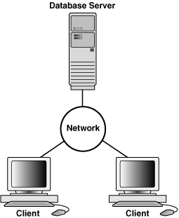
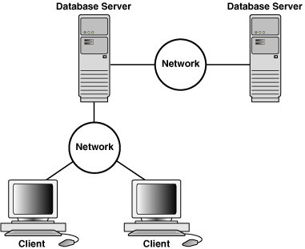
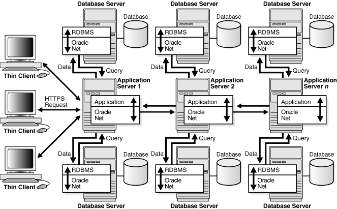
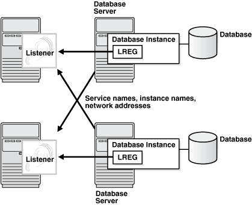
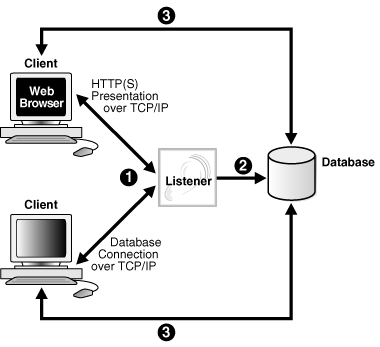
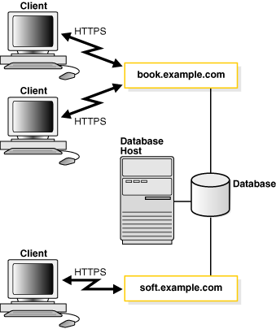
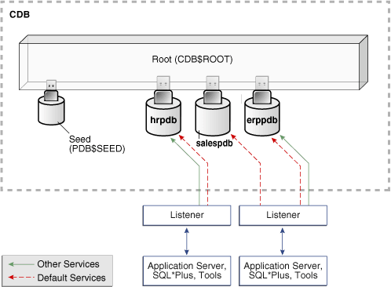
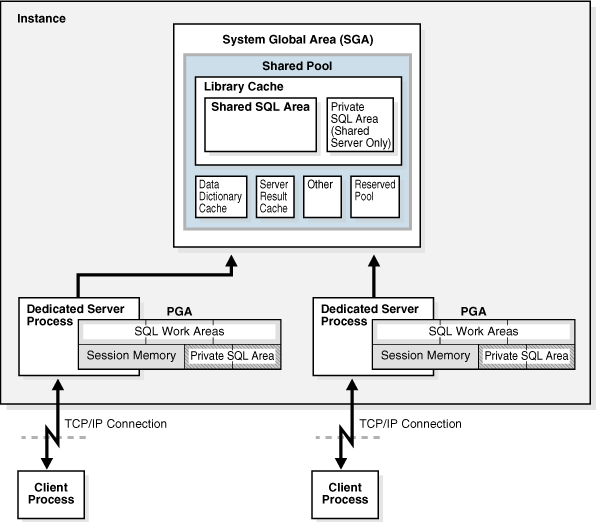
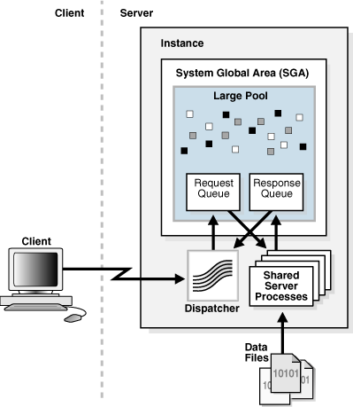
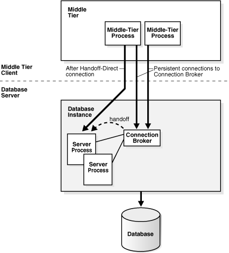

## 18 Application and Oracle Net Services Architecture

This chapter defines application architecture and describes how an Oracle database and database applications work in a distributed processing environment. This material applies to almost every type of Oracle Database environment.

This chapter contains the following sections:

- Overview of Oracle Application Architecture  
	In the context of this chapter, application architecture refers to the computing environment in which a database application connects to an Oracle database.
- Overview of Oracle Net Services Architecture  
	**Oracle Net Services** is a suite of networking components that provides enterprise-wide connectivity solutions in distributed, heterogeneous computing environments.
- Overview of the Program Interface  
	The **program interface** is the software layer between a database application and Oracle Database.

**Parent topic:** [Oracle Instance Architecture](oracle-instance-architecture.md)

### Overview of Oracle Application Architecture

In the context of this chapter, application architecture refers to the computing environment in which a database application connects to an Oracle database.

This section contains the following topics:

- Overview of Client/Server Architecture
- Overview of Multitier Architecture
- Overview of Grid Architecture

- Overview of Client/Server Architecture  
	In the Oracle Database environment, the database application and the database are separated into a **client/server architecture**.
- Overview of Multitier Architecture  
	In a traditional multitier architecture, an application server provides data for clients and serves as an interface between clients and database servers.
- Overview of Grid Architecture  
	In an Oracle Database environment, **grid computing** is a computing architecture that effectively pools large numbers of servers and storage into a flexible, on-demand computing resource.

**Parent topic:** Application and Oracle Net Services Architecture

#### Overview of Client/Server Architecture

In the Oracle Database environment, the database application and the database are separated into a **client/server architecture**.

The components are as follows:

- The [client](glossary.md) runs the database application, for example, SQL\*Plus or a Visual Basic data entry program, that accesses database information and interacts with a user.
- The [server](glossary.md) runs the Oracle Database software and handles the functions required for concurrent, shared data access to an Oracle database.

Although the client application and database can run on the same computer, greater efficiency is often achieved when the client portions and server portion are run by different computers connected through a network. The following sections discuss variations in the Oracle Database client/server architecture.

- Distributed Processing  
	Using multiple hosts to process an individual task is known as distributed processing.
- Advantages of a Client/Server Architecture  
	Oracle Database client/server architecture in a distributed processing environment provides a number of benefits.

**Parent topic:** Overview of Oracle Application Architecture

##### Distributed Processing

Using multiple hosts to process an individual task is known as distributed processing.

Front-end and back-end processing occurs on different computers. In Figure 18-1, the client and server are located on different hosts connected through Oracle Net Services.

Figure 18-1 Client/Server Architecture and Distributed Processing



> At the top of this graphic is a Database Server icon. It is connected to a circle labeled "Network." This circle connects to two Client icons.
>
> [  
> Copyright © 1993, 2025, Oracle and/or its affiliates.](https://docs.oracle.com/en/database/oracle/oracle-database/dcommon/html/cpyr.htm)


Figure 18-2 is a variation that depicts a [distributed database](glossary.md). In this example, a database on one host accesses data on a separate database located on a different host.

Figure 18-2 Client/Server Architecture and Distributed Database



> At the top of this graphic is a Database Server icon. It is connected to a circle labeled "Network." This circle connects to two Client icons. The Database Server connects to a circle labeled "Network." This circle connects to another Database Server.
>
> [  
> Copyright © 1993, 2025, Oracle and/or its affiliates.](https://docs.oracle.com/en/database/oracle/oracle-database/dcommon/html/cpyr.htm)


Note:

This rest of this chapter applies to environments with one database on one server.

**Parent topic:** Overview of Client/Server Architecture

##### Advantages of a Client/Server Architecture

Oracle Database client/server architecture in a distributed processing environment provides a number of benefits.

Benefits include:

- Client applications are not responsible for performing data processing. Rather, they request input from users, request data from the server, and then analyze and present this data using the display capabilities of the client workstation or the terminal (for example, using graphics or spreadsheets).
- Client applications are not dependent on the physical location of the data. Even if the data is moved or distributed to other database servers, the application continues to function with little or no modification.
- Oracle Database exploits the multitasking and shared-memory facilities of its underlying operating system. Consequently, it delivers the highest possible degree of concurrency, data integrity, and performance to its client applications.
- Client workstations or terminals can be optimized for the presentation of data (for example, by providing graphics and mouse support), while the server can be optimized for the processing and storage of data (for example, by having large amounts of memory and disk space).
- In networked environments, you can use inexpensive client workstations to access the remote data of the server effectively.
- The database can scale as your system grows. You can add multiple servers to distribute the database processing load throughout the network (horizontally scaled), or you can move the database to a minicomputer or mainframe to take advantage of a larger system's performance (vertically scaled). In either case, data and applications are maintained with little or no modification because Oracle Database is portable between systems.
- In networked environments, shared data is stored on the servers rather than on all computers, making it easier and more efficient to manage concurrent access.
- In networked environments, client applications submit database requests to the server using SQL statements. After it is received, each SQL statement is processed by the server, which returns results to the client. Network traffic is minimized because only the requests and the results are shipped over the network.

See Also:

[Oracle Database Administrator’s Guide](https://docs.oracle.com/pls/topic/lookup?ctx=en/database/oracle/oracle-database/21/cncpt&id=ADMIN028) to learn more about distributed databases

**Parent topic:** Overview of Client/Server Architecture

#### Overview of Multitier Architecture

In a traditional multitier architecture, an application server provides data for clients and serves as an interface between clients and database servers.

This architecture enables use of an application server to:

- Validate the credentials of a client, such as a Web browser
- Connect to a database server
- Perform the requested operation

An example of a multitier architecture appears in Figure 18-3.

Figure 18-3 A Multitier Architecture Environment



> The image shows three thin clients sending requests (arrows going back and forth) to Application Server 1. The application server shows queries going to database servers and to other application servers, and data coming back to the application server from them.
>
> [  
> Copyright © 1993, 2025, Oracle and/or its affiliates.](https://docs.oracle.com/en/database/oracle/oracle-database/dcommon/html/cpyr.htm)


- Clients  
	A client initiates a request for an operation to be performed on the database server.
- Application Servers  
	An application server provides access to the data for the client. It serves as an interface between the client and one or more database servers, and hosts the applications.
- Database Servers  
	A database server provides the data requested by an application server on behalf of a client. The database performs the query processing.
- Service-Oriented Architecture (SOA)  
	The database can serve as a Web service provider in traditional multitier or **service-oriented architecture (SOA)** environments.

**Parent topic:** Overview of Oracle Application Architecture

##### Clients

A client initiates a request for an operation to be performed on the database server.

The client can be a Web browser or other end-user program. In a multitier architecture, the client connects to the database server through one or more application servers.

**Parent topic:** Overview of Multitier Architecture

##### Application Servers

An application server provides access to the data for the client. It serves as an interface between the client and one or more database servers, and hosts the applications.

An application server permits thin clients, which are clients equipped with minimal software configurations, to access applications without requiring ongoing maintenance of the client computers. The application server can also perform data reformatting for the client, reducing the load on the client workstation.

The application server assumes the identity of the client when it is performing operations on the database server for this client. The best practice is to restrict the privileges of the application server to prevent it from performing unneeded and unwanted operations during a client operation.

**Parent topic:** Overview of Multitier Architecture

##### Database Servers

A database server provides the data requested by an application server on behalf of a client. The database performs the query processing.

The database server can audit operations performed by the application server on behalf of clients and on its own behalf. For example, a client operation can request information to display on the client, while an application server operation can request a connection to the database server.

In unified auditing, the database can append application contexts, which are application-specific name-value pairs, to records in the unified audit trail. You can configure which application contexts the database writes to database audit records.

See Also:

[Oracle Database Security Guide](https://docs.oracle.com/pls/topic/lookup?ctx=en/database/oracle/oracle-database/21/cncpt&id=DBSEG-GUID-94381464-53A3-421B-8F13-BD171C867405) for an introduction to auditing

**Parent topic:** Overview of Multitier Architecture

##### Service-Oriented Architecture (SOA)

The database can serve as a Web service provider in traditional multitier or **service-oriented architecture (SOA)** environments.

SOA is a multitier architecture relying on services that support computer-to-computer interaction over a network. In the context of SOA, a service is a self-sufficient functional endpoint that has a well defined functionality and service level agreement, can be monitored and managed, and can help enforce policy compliance.

SOA services are usually implemented as Web services accessible through the HTTP protocol. They are based on XML standards such as WSDL and SOAP.

The Oracle Database Web service capability, which is implemented as part of Oracle XML DB, must be specifically enabled by the DBA. Applications can then accomplish the following through database Web services:

- Submit SQL or XQuery queries and receive results as XML
- Invoke standalone PL/SQL functions and receive results
- Invoke PL/SQL package functions and receive results

Database Web services provide a simple way to add Web services to an application environment without the need for an application server. However, invoking Web services through application servers such as Oracle Fusion Middleware offers security, scalability, UDDI registration, and reliable messaging in an SOA environment. However, because database Web services integrate easily with Oracle Fusion Middleware, they may be appropriate for optimizing SOA solutions.

See Also:

- " [PL/SQL Subprograms](server-side-programming.md) "
- [Oracle XML Developer's Kit Programmer's Guide](https://docs.oracle.com/pls/topic/lookup?ctx=en/database/oracle/oracle-database/21/cncpt&id=ADXDB-GUID-108279B4-0315-4D8D-86A2-6487767ED280) for information on enabling and using database Web services
- Oracle Fusion Middleware documentation for more information on SOA and Web services

**Parent topic:** Overview of Multitier Architecture

#### Overview of Grid Architecture

In an Oracle Database environment, **grid computing** is a computing architecture that effectively pools large numbers of servers and storage into a flexible, on-demand computing resource.

Modular hardware and software components can be connected and rejoined on demand to meet the changing needs of businesses.

See Also:

[Oracle Clusterware Administration and Deployment Guide](https://docs.oracle.com/pls/topic/lookup?ctx=en/database/oracle/oracle-database/21/cncpt&id=CWADD-GUID-58F85575-7D88-4D45-B097-6274FBBBB646) for more detailed information about server and storage grids

**Parent topic:** Overview of Oracle Application Architecture

### Overview of Oracle Net Services Architecture

**Oracle Net Services** is a suite of networking components that provides enterprise-wide connectivity solutions in distributed, heterogeneous computing environments.

Oracle Net Services enables a network session from an application to a [database instance](glossary.md) and a database instance to another database instance.

Oracle Net Services provides location transparency, centralized configuration and management, and quick installation and configuration. It also lets you maximize system resources and improve performance. The [shared server](glossary.md) architecture increases the scalability of applications and the number of clients simultaneously connected to the database. The Virtual Interface (VI) protocol places most of the messaging burden on high-speed network hardware, freeing the CPU.

Oracle Net Services uses the communication protocols or application programmatic interfaces (APIs) supported by a wide range of networks to provide distributed database and distributed processing. After a network session is established, Oracle Net Services acts as a data courier for the client application and the database server, establishing and maintaining a connection and exchanging messages. Oracle Net Services can perform these tasks because it exists on each computer in the network.

This section contains the following topics:

- How Oracle Net Services Works
- The Oracle Net Listener
- Dedicated Server Architecture
- Shared Server Architecture
- Database Resident Connection Pooling

- How Oracle Net Services Works  
	Oracle Database protocols accept SQL statements from the interface of the Oracle applications, and then package them for transmission to Oracle Database.
- The Oracle Net Listener  
	The Oracle Net Listener (the listener) is a server-side process that listens for incoming client connection requests and manages traffic to the database. When a database instance starts, and at various times during its life, the instance contacts a listener and establishes a communication pathway to this instance.
- Dedicated Server Architecture  
	In a dedicated server architecture, the server process created on behalf of each client process is called a dedicated server process (or shadow process).
- Shared Server Architecture  
	In a **shared server** architecture, a dispatcher directs multiple incoming network session requests to a pool of shared server processes
- Database Resident Connection Pooling  
	Database Resident Connection Pooling (DRCP) provides a connection pool of dedicated servers for typical Web application scenarios.

See Also:

[Oracle Database Net Services Administrator's Guide](https://docs.oracle.com/pls/topic/lookup?ctx=en/database/oracle/oracle-database/21/cncpt&id=NETAG1511) for an overview of Oracle Net architecture

**Parent topic:** Application and Oracle Net Services Architecture

#### How Oracle Net Services Works

Oracle Database protocols accept SQL statements from the interface of the Oracle applications, and then package them for transmission to Oracle Database.

Transmission occurs through a supported industry-standard higher level protocol or API. Replies from Oracle Database are packaged through the same higher level communications mechanism. This work occurs independently of the network operating system.

Depending on the operating system that runs Oracle Database, the Oracle Net Services software of the database server could include the driver software and start an additional background process.

See Also:

[Oracle Database Net Services Administrator's Guide](https://docs.oracle.com/pls/topic/lookup?ctx=en/database/oracle/oracle-database/21/cncpt&id=NETAG1511) for more information about how Oracle Net Services works

**Parent topic:** Overview of Oracle Net Services Architecture

#### The Oracle Net Listener

The Oracle Net Listener (the listener) is a server-side process that listens for incoming client connection requests and manages traffic to the database. When a database instance starts, and at various times during its life, the instance contacts a listener and establishes a communication pathway to this instance.

Service registration enables the listener to determine whether a database service and its service handlers are available. A [service handler](glossary.md) is a dedicated [server process](glossary.md) or dispatcher that acts as a connection point to a database. During registration, the LREG process provides the listener with the instance name, database service names, and the type and addresses of service handlers. This information enables the listener to start a service handler when a client request arrives.

The following graphic shows two databases, each on a separate host. The database environment is serviced by two listeners, each on a separate host. The LREG process running in each database instance communicates with both listeners to register the database.

Figure 18-4 Two Listeners



> The graphic depicts two server computers, each of which runs a listener. The listeners communicate with two separate database instances, each running on a different database host. Inside each instance is an icon showing the PMON process. Each instance is connected to a different Database cylinder.
>
> [  
> Copyright © 1993, 2025, Oracle and/or its affiliates.](https://docs.oracle.com/en/database/oracle/oracle-database/dcommon/html/cpyr.htm)


Figure 18-5 shows a browser making an HTTP connection and a client making a database connection through a listener. The listener does not need to reside on the database host.

Figure 18-5 Listener Architecture



> This illustration shows the role of the listener during connection establishment. The connection establishment sequence is described in the following text.
>
> In addition, this illustration shows two clients connecting to the listener. One client is a web browser connecting to the listener through HTTP over TCP/IP. The other client is an intranet client using TCP/IP to connect to the listener. The listener connects to the database. The database in turn connects to each client.


The basic steps by which a client establishes a connection through a listener are:

1. A [client process](glossary.md) or another database requests a connection.
2. The listener selects an appropriate service handler to service the client request and forwards the request to the handler.
3. The client process connects directly to the service handler. The listener is no longer involved in the communication.

- Service Names  
	A service name is a logical representation of a service used for client connections.
- Services in a Multitenant Environment  
	Clients must connect to PDBs or application roots using services.
- Service Registration  
	In Oracle Net, **service registration** is a feature by which the LREG process dynamically registers instance information with a listener.

See Also:

" [Overview of Client Processes](process-architecture.md) " and " [Overview of Server Processes](process-architecture.md) "

**Parent topic:** Overview of Oracle Net Services Architecture

##### Service Names

A service name is a logical representation of a service used for client connections.

When a client connects to a listener, it requests a connection to a service. When a database instance starts, it registers itself with a listener as providing one or more services by name. Thus, the listener acts as a mediator between the client and instances and routes the connection request to the right place.

A single service, as known by a listener, can identify one or more database instances. Also, a single database instance can register one or more services with a listener. Clients connecting to a service need not specify which instance they require.

Figure 18-6 shows one single-instance database associated with two services, `book.example.com` and `soft.example.com`. The services enable the same database to be identified differently by different clients. A database administrator can limit or reserve system resources, permitting better resource allocation to clients requesting one of these services.

Figure 18-6 Multiple Services Associated with One Database



> This graphic shows two client computers connecting over HTTPS to the book.example.com service. A different client connects over HTTPS to the soft.example.com service. Both services are associated with a single database. The database is on a Database Host.
>
> [  
> Copyright © 1993, 2025, Oracle and/or its affiliates.](https://docs.oracle.com/en/database/oracle/oracle-database/dcommon/html/cpyr.htm)


See Also:

[Oracle Database Net Services Administrator's Guide](https://docs.oracle.com/pls/topic/lookup?ctx=en/database/oracle/oracle-database/21/cncpt&id=NETAG008) to learn more about naming methods

**Parent topic:** The Oracle Net Listener

##### Services in a Multitenant Environment

Clients must connect to PDBs or application roots using services.

A connection using a service name starts a new session in a PDB or application root. A foreground process, and therefore a session, at every moment of its lifetime, has a uniquely defined current container.

The following graphic shows two clients connecting to PDBs using two different listeners.

Figure 18-7 Services in a CDB



> This graphic is depicts a large rectangle with a dotted-line border. The box is labeled "CDB." Inside the box is a three-dimensional rectangular box labeled "Root (CDB$ROOT)." Plugged into this box are four cylinders that look like USB keys. The first cylinder is labeled "Seed (PDB$SEED)," the second is labeled "hrpdb," the third is labeled "salespdb," and the fourth is labeled "erppdb." Two boxes labeled "Listener" are outside of the CDB rectangle. Two arrows, one dotted and one solid, point from the first Listener to hrpdb. One dotted arrow leads from the second Listener box to the salespdb cylinder. One solid and one dotted arrow leads from the second Listener to the erppdb cylinder. A legend states that the solid arrow represents other services, and the dotted arrow represents default services. A box labeled "Application Server, SQL\*Plus, Tools" is connected to each Listener box by a double-headed arrow.


- Service Creation  
	When you execute the `CREATE PLUGGABLE DATABASE` statement to create a PDB, the database automatically creates and starts a service inside the CDB.
- Connections to Containers in a CDB  
	Typically, a CDB administrator must have appropriate privileges to provision PDBs and connect to various containers. CDB administrators are common users.

**Parent topic:** The Oracle Net Listener

###### Service Creation

When you execute the `CREATE PLUGGABLE DATABASE` statement to create a PDB, the database automatically creates and starts a service inside the CDB.

The default service has a property that identifies the PDB as the initial current container for the service. The property is shown in the `DBA_SERVICES.PDB` column.

- Default Services  
	The default service has the same name as the PDB. The PDB name must be a valid service name, which must be unique within the CDB.
- Nondefault Services  
	You can create additional services for each PDB, up to a per-CDB maximum of 10,000. Each additional service denotes its PDB as the initial current container.

**Parent topic:** Services in a Multitenant Environment

###### Default Services

The default service has the same name as the PDB. The PDB name must be a valid service name, which must be unique within the CDB.

When you create an application container, which requires specifying the `AS APPLICATION CONTAINER` clause, Oracle Database automatically creates a new default service for the application root. The service has the same name as the application container. Oracle Net Services must be configured properly for clients to access this service. Similarly, every application PDB has its own default service name, and an application seed PDB has its own default service name.

Example 18-1 Switching to a PDB Using a Default Service

This example switches to the PDB names `salespdb` using the default service, which has the same name as the PDB:

```
ALTER SESSION SET CONTAINER = salespdb;
```

**Parent topic:** Service Creation

###### Nondefault Services

You can create additional services for each PDB, up to a per-CDB maximum of 10,000. Each additional service denotes its PDB as the initial current container.

In Figure 18-7, nondefault services exist for `erppdb` and `hrpdb`. For example, in Figure 18-7 the PDB named `hrpdb` has a default service named `hrpdb`. The default service cannot be dropped.

When you switch to a container using `ALTER SESSION SET CONTAINER`, the session uses the default service for the container. Optionally, you can use a different service for the container by specifying `SERVICE = service_name`, where `service_name` is the name of the service. You might want to use a particular service so that the session can take advantage of its service attributes and features, such as service metrics, load balancing, Resource Manager settings, and so on.

Example 18-2 Switching to a PDB Using a Nondefault Service

In this example, the default service for `hrpdb` does not support all the service attributes and features such as service metrics, FAN, load balancing, Oracle Database Resource Manager, Transaction Guard, Application Continuity, and so on. You switch to a nondefault service as follows:

```
ALTER SESSION SET CONTAINER = hrpdb SERVICE = hrpdb_full;
```

**Parent topic:** Service Creation

###### Connections to Containers in a CDB

Typically, a CDB administrator must have appropriate privileges to provision PDBs and connect to various containers. CDB administrators are common users.

The CDB administrator can use either of the following techniques:

- Connect directly to a PDB or application root.
	The user requires the `CREATE SESSION` privilege in the container.
- Use the `ALTER SESSION SET CONTAINER` statement, which is useful for both connection pooling and advanced CDB administration, to switch between containers. The syntax is `ALTER SESSION SET CONTAINER = container_name [SERVICE = service_name]`.
	For example, a CDB administrator can connect to the root in one session, and then in the same session switch to a PDB. In this case, the user requires the `SET CONTAINER` system privilege in the container.

The following table describes a scenario involving the CDB in Figure 18-7. Each row describes an action that occurs after the action in the preceding row. Common user `SYSTEM` queries the name of the current container and the names of PDBs in the CDB.

Table 18-1 Services in a CDB

| Operation | Description |
| --- | --- |
| ``` SQL> CONNECT SYSTEM@prod Enter password: ******** Connected. ``` | The `SYSTEM` user, which is common to all containers in the CDB, connects to the root using service named `prod`. |
| ``` SQL> SHOW CON_NAME   CON_NAME -------- CDB$ROOT ``` | `SYSTEM` uses the SQL\*Plus command `SHOW` `CON_NAME` to list the name of the container to which the user is currently connected. `CDB$ROOT` is the name of the root container. |
| ``` SQL> SELECT NAME, PDB FROM V$SERVICES    2  ORDER BY PDB, NAME;  NAME                    PDB ----------------------  -------- SYS$BACKGROUND          CDB$ROOT SYS$USERS               CDB$ROOT prod.example.com        CDB$ROOT erppdb.example.com      ERPPDB erp.example.com         ERPPDB hr.example.com          HRPDB hrpdb.example.com       HRPDB salespdb.example.com    SALESPDB  8 rows selected. ``` | A query of `V$SERVICES` shows that three PDBs exist with service names that match the PDB name. Both `hrpdb` and `erppdb` have an additional service. |
| ``` SQL> ALTER SESSION SET CONTAINER = hrpdb;  Session altered. ``` | `SYSTEM` uses `ALTER SESSION` to connect to `hrpdb`. |
| ``` SQL> SELECT SYS_CONTEXT     2  ('USERENV', 'CON_NAME')   3  AS CUR_CONTAINER FROM DUAL;   CUR_CONTAINER ------------- HRPDB ``` | A query confirms that the current container is now `hrpdb`. |

See Also:

[Oracle Database SQL Language Reference](https://docs.oracle.com/pls/topic/lookup?ctx=en/database/oracle/oracle-database/21/cncpt&id=SQLRF56526) for the syntax and semantics of `ALTER SESSION SET CONTAINER`

**Parent topic:** Services in a Multitenant Environment

##### Service Registration

In Oracle Net, **service registration** is a feature by which the LREG process dynamically registers instance information with a listener.

This information enables the listener to forward client connection requests to the appropriate service handler. LREG provides the listener with information about the following:

- Names of the database services provided by the database
- Name of the database instance associated with the services and its current and maximum load
- Service handlers (dispatchers and dedicated servers) available for the instance, including their type, protocol addresses, and current and maximum load

Service registration is dynamic and does not require configuration in the `listener.ora` file. Dynamic registration reduces administrative overhead for multiple databases or instances.

The initialization parameter `SERVICE_NAMES` lists the services an instance belongs to. On startup, each instance registers with the listeners of other instances belonging to the same services. During database operations, the instances of each service pass information about CPU use and current connection counts to all listeners in the same services. This communication enables dynamic load balancing and connection failover.

See Also:

- " [Listener Registration Process (LREG)](process-architecture.md) "
- [Oracle Database Net Services Administrator's Guide](https://docs.oracle.com/pls/topic/lookup?ctx=en/database/oracle/oracle-database/21/cncpt&id=NETAG1080) to learn more about service registration
- [Oracle Real Application Clusters Administration and Deployment Guide](https://docs.oracle.com/pls/topic/lookup?ctx=en/database/oracle/oracle-database/21/cncpt&id=RACAD7273) to learn about instance registration and client/service connections in Oracle RAC

**Parent topic:** The Oracle Net Listener

#### Dedicated Server Architecture

In a dedicated server architecture, the server process created on behalf of each client process is called a dedicated server process (or shadow process).

A dedicated server process is separate from the client process and acts only on its behalf, as shown in Figure 18-8.

Figure 18-8 Oracle Database Using Dedicated Server Processes



> This graphic shows an instance that contains the SGA and two dedicated server processes, each with its own PGA. One client process connects to one dedicated server over TCP/IP, while the second client process connects to the other dedicated server.
>
> [  
> Copyright © 1993, 2025, Oracle and/or its affiliates.](https://docs.oracle.com/en/database/oracle/oracle-database/dcommon/html/cpyr.htm)


A one-to-one ratio exists between the client processes and server processes. Even when the user is not actively making a database request, the dedicated server process remains—although it is inactive and can be paged out on some operating systems.

Figure 18-8 shows user and server processes running on networked computers. However, the dedicated server architecture is also used if the same computer runs both the client application and the database code but the host operating system could not maintain the separation of the two programs if they were run in a single process. Linux is an example of such an operating system.

In the dedicated server architecture, the user and server processes communicate using different mechanisms:

- If the client process and the dedicated server process run on the same computer, then the program interface uses the host operating system's interprocess communication mechanism to perform its job.
- If the client process and the dedicated server process run on different computers, then the program interface provides the communication mechanisms (such as the network software and Oracle Net Services) between the programs.

Underutilized dedicated servers sometimes result in inefficient use of operating system resources. Consider an order entry system with dedicated server processes. A customer places an order as a clerk enters the order into the database. For most of the transaction, the clerk is talking to the customer while the server process dedicated to the clerk's client process is idle. The server process is not needed during most of the transaction, and the system may be slower for other clerks entering orders if the system is managing too many processes. For applications of this type, the shared server architecture may be preferable.

See Also:

[Oracle Database Net Services Administrator's Guide](https://docs.oracle.com/pls/topic/lookup?ctx=en/database/oracle/oracle-database/21/cncpt&id=NETAG185) to learn more about dedicated server processes

**Parent topic:** Overview of Oracle Net Services Architecture

#### Shared Server Architecture

In a **shared server** architecture, a dispatcher directs multiple incoming network session requests to a pool of shared server processes

The shared pool eliminates the need for a dedicated server process for each connection. An idle shared server process from the pool picks up a request from a common queue.

The potential benefits of shared server are as follows:

- Reduces the number of processes on the operating system
	A small number of shared servers can perform the same amount of processing as many dedicated servers.
- Reduces instance PGA memory
	Every dedicated or shared server has a PGA. Fewer server processes means fewer PGAs and less process management.
- Increases application scalability and the number of clients that can simultaneously connect to the database
- May be faster than dedicated server when the rate of client connections and disconnections is high

Shared server has several disadvantages, including slower response time in some cases, incomplete feature support, and increased complexity for setup and tuning. As a general guideline, only use shared server when you have more concurrent connections to the database than the operating system can handle.

The following processes are needed in a shared server architecture:

- A network listener that connects the client processes to dispatchers or dedicated servers (the listener is part of Oracle Net Services, not Oracle Database)
	Note:
	To use shared servers, a client process must connect through Oracle Net Services, even if the process runs on the same computer as the Oracle Database instance.
- One or more [dispatcher process (Dnnn)](glossary.md)
- One or more shared server processes

A database can support both shared server and dedicated server connections simultaneously. For example, one client can connect using a dedicated server while a different client connects to the same database using a shared server.

- Dispatcher Request and Response Queues  
	A request from a user is a single API call that is part of the user's SQL statement.
- Restricted Operations of the Shared Server  
	Specific administrative activities cannot be performed while connected to a dispatcher process, including shutting down or starting an instance and media recovery.

See Also:

- [Oracle Database Net Services Administrator's Guide](https://docs.oracle.com/pls/topic/lookup?ctx=en/database/oracle/oracle-database/21/cncpt&id=NETAG154) for more information about the shared server architecture
- [Oracle Database Administrator’s Guide](https://docs.oracle.com/pls/topic/lookup?ctx=en/database/oracle/oracle-database/21/cncpt&id=ADMIN00502) to learn how to configure a database for shared server

**Parent topic:** Overview of Oracle Net Services Architecture

##### Dispatcher Request and Response Queues

A request from a user is a single API call that is part of the user's SQL statement.

When a user makes a call, the following actions occur:

1. The dispatcher places the request on the request queue, where it is picked up by the next available shared server process.
	The request queue is in the SGA and is common to all dispatcher processes of an instance.
2. The shared server processes check the common request queue for new requests, picking up new requests on a first-in-first-out basis.
3. One shared server process picks up one request in the queue and makes all necessary calls to the database to complete this request.
	A different server process can handle each database call. Therefore, requests to parse a query, fetch the first row, fetch the next row, and close the result set may each be processed by a different shared server.
4. When the server process completes the request, it places the response on the calling dispatcher's response queue. Each dispatcher has its own response queue.
5. The dispatcher returns the completed request to the appropriate client process.

For example, in an order entry system, each clerk's client process connects to a dispatcher. Each request made by the clerk is sent to this dispatcher, which places the request in the queue. The next available shared server picks up the request, services it, and puts the response in the response queue. When a request is completed, the clerk remains connected to the dispatcher, but the shared server that processed the request is released and available for other requests. While one clerk talks to a customer, another clerk can use the same shared server process.

Figure 18-9 shows how client processes communicate with the dispatcher across the API and how the dispatcher communicates user requests to shared server processes.

Figure 18-9 The Shared Server Configuration and Processes



> The image shows a user process at the top, sending a dispatcher process to the database. The dispatcher process sends it along to the request queue in the SGA, which sends it to the Oracle Database, which sends it to the response queue, which sends it back to the dispatcher process, which then sends it back to the user.


- Dispatcher Processes (Dnnn)  
	The **dispatcher processes** enable client processes to share a limited number of server processes.
- Shared Server Processes (Snnn)  
	Each shared server process serves multiple client requests in the shared server configuration.

See Also:

" [Large Pool](memory-architecture.md) "

**Parent topic:** Shared Server Architecture

###### Dispatcher Processes (Dnnn)

The **dispatcher processes** enable client processes to share a limited number of server processes.

You can create multiple dispatcher processes for a single database instance. The optimum number of dispatcher processes depending on the operating system limitation and the number of connections for each process.

Note:

Each client process that connects to a dispatcher must use Oracle Net Services, even if both processes run on the same host.

Dispatcher processes establish communication as follows:

1. When an instance starts, the network listener process opens and establishes a communication pathway through which users connect to Oracle Database.
2. Each dispatcher process gives the listener process an address at which the dispatcher listens for connection requests.
	At least one dispatcher process must be configured and started for each network protocol that the database clients will use.
3. When a client process makes a connection request, the listener determines whether the client process should use a shared server process:
	- If the listener determines that a shared server process is required, then the listener returns the address of the dispatcher process that has the lightest load, and the client process connects to the dispatcher directly.
		- If the process cannot communicate with the dispatcher, or if the client process requests a dedicated server, then the listener creates a dedicated server process and establishes an appropriate connection.

See Also:

[Oracle Database Net Services Administrator's Guide](https://docs.oracle.com/pls/topic/lookup?ctx=en/database/oracle/oracle-database/21/cncpt&id=NETAG012) to learn how to configure dispatchers

**Parent topic:** Dispatcher Request and Response Queues

##### Restricted Operations of the Shared Server

Specific administrative activities cannot be performed while connected to a dispatcher process, including shutting down or starting an instance and media recovery.

These activities are typically performed when connected with administrator privileges. To connect with administrator privileges in a system configured with shared servers, you must specify that you are using a dedicated server process.

See Also:

[Oracle Database Net Services Administrator's Guide](https://docs.oracle.com/pls/topic/lookup?ctx=en/database/oracle/oracle-database/21/cncpt&id=NETAG327) for the proper connect string syntax

**Parent topic:** Shared Server Architecture

#### Database Resident Connection Pooling

Database Resident Connection Pooling (DRCP) provides a connection pool of dedicated servers for typical Web application scenarios.

A Web application typically makes a database connection, uses the connection briefly, and then releases it. Through DRCP, the database can scale to tens of thousands of simultaneous connections.

DRCP provides the following advantages:

- Complements middle-tier connection pools that share connections between threads in a middle-tier process.
- Enables database connections to be shared across multiple middle-tier processes. These middle-tier processes may belong to the same or different middle-tier host.
- Enables a significant reduction in key database resources required to support many client connections. For example, DRCP reduces the memory required for the database and boosts the scalability of the database and middle tier. The pool of available servers also reduces the cost of re-creating client connections.
- Provides pooling for architectures with multi-process, single-threaded application servers, such as PHP and Apache, that cannot do middle-tier connection pooling.

DRCP uses a pooled server, which is the equivalent of a dedicated server process (not a shared server process) and a database session combined. The pooled server model avoids the overhead of dedicating a server for every connection that requires the server for a short period.

Clients obtaining connections from the database resident connection pool connect to an Oracle background process known as the connection broker. The connection broker implements the pool functionality and multiplexes pooled servers among inbound connections from client processes.

As shown in Figure 18-10, when a client requires database access, the connection broker picks up a server process from the pool and hands it off to the client. The client is directly connected to the server process until the request is served. After the server has finished, the server process is released into the pool. The connection from the client is restored to the broker.

Figure 18-10 DRCP



> This graphic shows a database instance communicating with middle-tier processes running in a middle-tier client. A middle-tier process requests a connection from the connection broker. The broker hands off the request to the server process, which communicates directly with the middle-tier process.
>
> [  
> Copyright © 1993, 2025, Oracle and/or its affiliates.](https://docs.oracle.com/en/database/oracle/oracle-database/dcommon/html/cpyr.htm)


In DRCP, releasing resources leaves the session intact, but no longer associated with a connection (server process). Unlike in shared server, this session stores its UGA in the PGA, not in the SGA. A client can reestablish a connection transparently upon detecting activity.

### Overview of the Program Interface

The **program interface** is the software layer between a database application and Oracle Database.

The program interface performs the following functions:

- Provides a security barrier, preventing destructive access to the SGA by client processes
- Acts as a communication mechanism, formatting information requests, passing data, and trapping and returning errors
- Converts and translates data, particularly between different types of computers or to external user program data types

The **Oracle code** acts as a server, performing database tasks on behalf of an application (a client), such as fetching rows from data blocks. The program interface consists of several parts, provided by both Oracle Database software and operating system-specific software.

- Program Interface Structure  
	The program interface consists of several different components.
- Program Interface Drivers  
	A driver is a piece of software that transports data, usually across a network.
- Communications Software for the Operating System  
	The lowest-level software connecting the user side to the Oracle Database side of the program interface is the communications software, which the host operating system provides.

**Parent topic:** Application and Oracle Net Services Architecture

#### Program Interface Structure

The program interface consists of several different components.

These components include:

- Oracle call interface (OCI) or the Oracle run-time library (SQLLIB)
- The client or user side of the program interface
- Various Oracle Net Services drivers (protocol-specific communications software)
- Operating system communications software
- The server or Oracle Database side of the program interface (also called the OPI)

The user and Oracle Database sides of the program interface run Oracle software, as do the drivers.

**Parent topic:** Overview of the Program Interface

#### Program Interface Drivers

A driver is a piece of software that transports data, usually across a network.

Drivers perform operations such as connect, disconnect, signal errors, and test for errors. Drivers are specific to a communications protocol.

A default driver always exists. You can install multiple drivers, such as the asynchronous or DECnet drivers, and select one as the default driver, but allow a user to use other drivers by specifying a driver when connecting.

Different processes can use different drivers. A process can have concurrent connections to a single database or to multiple databases using different Oracle Net Services drivers.

See Also:

- Your system installation and configuration guide for details about choosing, installing, and adding drivers
- [Oracle Database Net Services Administrator's Guide](https://docs.oracle.com/pls/topic/lookup?ctx=en/database/oracle/oracle-database/21/cncpt&id=NETAG1013) to learn about JDBC drivers

**Parent topic:** Overview of the Program Interface

#### Communications Software for the Operating System

The lowest-level software connecting the user side to the Oracle Database side of the program interface is the communications software, which the host operating system provides.

DECnet, TCP/IP, LU6.2, and ASYNC are examples. The communication software can be supplied by Oracle, but it is usually purchased separately from the hardware vendor or a third-party software supplier.

**Parent topic:** Overview of the Program Interface