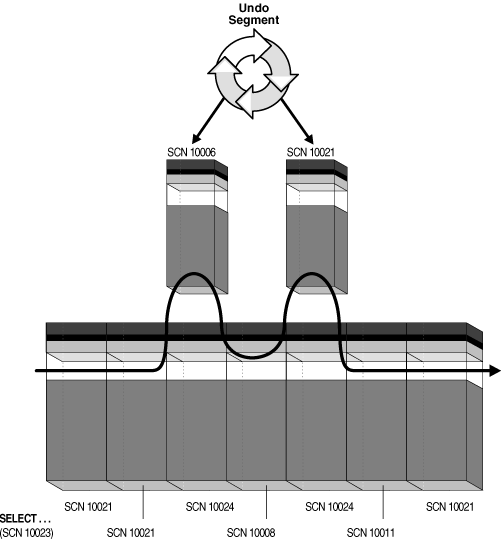
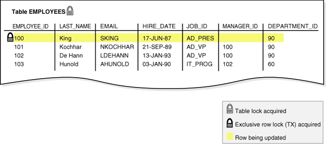
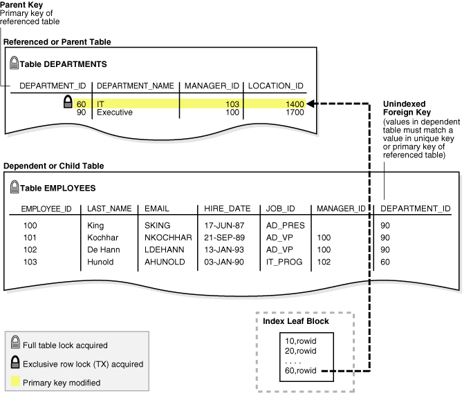
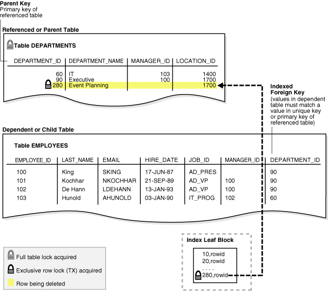

## 11 Data Concurrency and Consistency

This chapter explains how Oracle Database maintains consistent data in a multiuser database environment.

This chapter contains the following sections:

- Introduction to Data Concurrency and Consistency  
	In a single-user database, a user can modify data without concern for other users modifying the same data at the same time. However, in a multiuser database, statements within multiple simultaneous transactions may update the same data. Transactions executing simultaneously must produce meaningful and consistent results.
- Overview of Oracle Database Transaction Isolation Levels  
	The ANSI standard for transaction isolation levels is defined in terms of the phenomena that are either permitted or prevented for each isolation level.
- Overview of the Oracle Database Locking Mechanism  
	A **lock** is a mechanism that prevents destructive interactions.
- Overview of Automatic Locks  
	Oracle Database automatically locks a resource on behalf of a transaction to prevent other transactions from doing something that requires exclusive access to the same resource.
- Overview of Manual Data Locks  
	You can manually override the Oracle Database default locking mechanisms.
- Overview of User-Defined Locks  
	With Oracle Database Lock Management services, you can define your own locks for a specific application.

**Parent topic:** [Oracle Transaction Management](oracle-transaction-management.md)

### Introduction to Data Concurrency and Consistency

In a single-user database, a user can modify data without concern for other users modifying the same data at the same time. However, in a multiuser database, statements within multiple simultaneous transactions may update the same data. Transactions executing simultaneously must produce meaningful and consistent results.

A multiuser database must provide the following:

- The assurance that users can access data at the same time ([data concurrency](glossary.md))
- The assurance that each user sees a consistent view of the data ([data consistency](glossary.md)), including visible changes made by the user's own transactions and committed transactions of other users

To describe consistent transaction behavior when transactions run concurrently, database researchers have defined a transaction isolation model called [serializability](glossary.md). A serializable transaction operates in an environment that makes it appear as if no other users were modifying data in the database.

While this degree of isolation between transactions is generally desirable, running many applications in serializable mode can seriously compromise application throughput. Complete isolation of concurrently running transactions could mean that one transaction cannot perform an insertion into a table being queried by another transaction. In short, real-world considerations usually require a compromise between perfect transaction isolation and performance.

Oracle Database maintains data consistency by using a [multiversion consistency model](glossary.md) and various types of locks and transactions. In this way, the database can present a view of data to multiple concurrent users, with each view consistent to a point in time. Because different versions of data blocks can exist simultaneously, transactions can read the version of data committed at the point in time required by a [query](glossary.md) and return results that are consistent to a single point in time.

- Multiversion Read Consistency  
	In Oracle Database, multiversioning is the ability to simultaneously materialize multiple versions of data. Oracle Database maintains multiversion read consistency.
- Locking Mechanisms  
	In general, multiuser databases use some form of data locking to solve the problems associated with data concurrency, consistency, and integrity.
- ANSI/ISO Transaction Isolation Levels  
	The SQL standard, which has been adopted by both ANSI and ISO/IEC, defines four levels of transaction isolation. These levels have differing degrees of impact on transaction processing throughput.

See Also:

" [Data Integrity](data-integrity.md) " and " [Transactions](transactions.md) "

**Parent topic:** Data Concurrency and Consistency

#### Multiversion Read Consistency

In Oracle Database, multiversioning is the ability to simultaneously materialize multiple versions of data. Oracle Database maintains multiversion read consistency.

Queries of an Oracle database have the following characteristics:

- Read-consistent queries
	The data returned by a query is committed and consistent for a single point in time.
	Note:
	Oracle Database never permits a [dirty read](glossary.md), which occurs when a transaction reads uncommitted data in another transaction.
	To illustrate the problem with dirty reads, suppose one transaction updates a column value without committing. A second transaction reads the updated and dirty (uncommitted) value. The first session rolls back the transaction so that the column has its old value, but the second transaction proceeds using the updated value, corrupting the database. Dirty reads compromise [data integrity](glossary.md), violate foreign keys, and ignore unique constraints.
- Nonblocking queries
	Readers and writers of data do not block one another.

- Statement-Level Read Consistency  
	Oracle Database always enforces **statement-level read consistency**, which guarantees that data returned by a single query is committed and consistent for a single point in time.
- Transaction-Level Read Consistency  
	Oracle Database can also provide read consistency to all queries in a transaction, known as **transaction-level read consistency**.
- Read Consistency and Undo Segments  
	To manage the multiversion read consistency model, the database must create a read-consistent set of data when a table is simultaneously queried and updated.
- Read Consistency and Deferred Inserts  
	A special type of insert known as a **deferred insert** does not use the standard read consistency mechanism.

See Also:

" Summary of Locking Behavior "

**Parent topic:** Introduction to Data Concurrency and Consistency

##### Statement-Level Read Consistency

Oracle Database always enforces **statement-level read consistency**, which guarantees that data returned by a single query is committed and consistent for a single point in time.

The point in time to which a single SQL statement is consistent depends on the transaction isolation level and the nature of the query:

- In the read committed isolation level, this point is the time at which the statement was opened. For example, if a `SELECT` statement opens at SCN 1000, then this statement is consistent to SCN 1000.
- In a serializable or read-only transaction, this point is the time the transaction began. For example, if a transaction begins at SCN 1000, and if multiple `SELECT` statements occur in this transaction, then each statement is consistent to SCN 1000.
- In a Flashback Query operation (`SELECT ... AS OF`), the `SELECT` statement explicitly specifies the point in time. For example, you can query a table as it appeared last Thursday at 2 p.m.

See Also:

[Oracle Database Development Guide](https://docs.oracle.com/pls/topic/lookup?ctx=en/database/oracle/oracle-database/21/cncpt&id=ADFNS01003) to learn about Flashback Query

**Parent topic:** Multiversion Read Consistency

##### Transaction-Level Read Consistency

Oracle Database can also provide read consistency to all queries in a transaction, known as **transaction-level read consistency**.

In this case, each statement in a transaction sees data from the same point in time. This is the time at which the transaction began.

Queries made by a serializable transaction see changes made by the transaction itself. For example, a transaction that updates `employees` and then queries `employees` will see the updates. Transaction-level read consistency produces repeatable reads and does not expose a query to phantom reads.

**Parent topic:** Multiversion Read Consistency

##### Read Consistency and Undo Segments

To manage the multiversion read consistency model, the database must create a read-consistent set of data when a table is simultaneously queried and updated.

Oracle Database achieves read consistency through [undo data](glossary.md).

Whenever a user modifies data, Oracle Database creates undo entries, which it writes to undo segments. The undo segments contain the old values of data that have been changed by uncommitted or recently committed transactions. Thus, multiple versions of the same data, all at different points in time, can exist in the database. The database can use snapshots of data at different points in time to provide read-consistent views of the data and enable nonblocking queries.

Read consistency is guaranteed in single-instance and Oracle Real Application Clusters (Oracle RAC) environments. Oracle RAC uses a cache-to-cache block transfer mechanism known as cache fusion to transfer read-consistent images of data blocks from one database instance to another.

- Read Consistency: Example  
	This example shows a query that uses undo data to provide statement-level read consistency in the read committed isolation level.
- Read Consistency and Interested Transaction Lists  
	The **block header** of every segment block contains an **interested transaction list (ITL)**.

See Also:

- " [Undo Segments](logical-storage-structures.md) " to learn about undo storage
- [Oracle Database SecureFiles and Large Objects Developer's Guide](https://docs.oracle.com/pls/topic/lookup?ctx=en/database/oracle/oracle-database/21/cncpt&id=ADLOB-GUID-8E91CBE9-6CE1-4482-A694-04444C22B288) to learn about read consistency mechanisms for LOBs

**Parent topic:** Multiversion Read Consistency

###### Read Consistency: Example

This example shows a query that uses undo data to provide statement-level read consistency in the read committed isolation level.

Figure 11-1 Read Consistency in the Read Committed Isolation Level



> This graphic shows a SELECT statement at the top with "SCN 10023" written underneath it. Under the statement is a column of blocks, each with a different SCN: 10021, 10021, 10024 (this block is shaded), 10008, 10024 (this block is shaded), 10011, 10021. An arrow labeled "Scan Path" goes from the SELECT statement through the column to the end, but the arrow veers out to the right of the shaded blocks and goes through blocks that hover to the right of the column: one with SCN 10006 and another with SCN 10021. A circle labeled Undo Segment points to these two blocks.


As the database retrieves data blocks on behalf of a query, the database ensures that the data in each block reflects the contents of the block when the query began. The database rolls back changes to the block as needed to reconstruct the block to the point in time the query started processing.

The database uses an internal ordering mechanism called an [SCN](glossary.md) to guarantee the order of transactions. As the `SELECT` statement enters the execution phase, the database determines the SCN recorded at the time the query began executing. In Figure 11-1, this SCN is 10023. The query only sees committed data with respect to SCN 10023.

In Figure 11-1, blocks with SCNs after 10023 indicate changed data, as shown by the two blocks with SCN 10024. The `SELECT` statement requires a version of the block that is consistent with committed changes. The database copies current data blocks to a new buffer and applies undo data to reconstruct previous versions of the blocks. These reconstructed data blocks are called consistent read (CR) clones.

In Figure 11-1, the database creates two CR clones: one block consistent to SCN 10006 and the other block consistent to SCN 10021. The database returns the reconstructed data for the query. In this way, Oracle Database prevents dirty reads.

See Also:

" [Database Buffer Cache](memory-architecture.md) " and " [System Change Numbers (SCNs)](transactions.md) "

**Parent topic:** Read Consistency and Undo Segments

###### Read Consistency and Interested Transaction Lists

The **block header** of every segment block contains an **interested transaction list (ITL)**.

The database uses the ITL to determine whether a transaction was uncommitted when the database began modifying the block.

Entries in the ITL describe which transactions have rows locked and which rows in the block contain committed and uncommitted changes. The ITL points to the transaction table in the undo segment, which provides information about the timing of changes made to the database.

In a sense, the block header contains a recent history of transactions that affected each row in the block. The `INITRANS` parameter of the `CREATE TABLE` and `ALTER TABLE` statements controls the amount of transaction history that is kept.

See Also:

[Oracle Database SQL Language Reference](https://docs.oracle.com/pls/topic/lookup?ctx=en/database/oracle/oracle-database/21/cncpt&id=SQLRF54481) to learn about the `INITRANS` parameter

**Parent topic:** Read Consistency and Undo Segments

##### Read Consistency and Deferred Inserts

A special type of insert known as a **deferred insert** does not use the standard read consistency mechanism.

A deferred insert uses the `MEMOPTIMIZE_WRITE` hint to insert into a table specified as `MEMOPTIMIZE FOR WRITE`. The database buffers these inserts in the large pool rather than in the buffer cache. The database does not track the changes using redo and undo. Instead, the database automatically commits the changes when the Space Management Coordinator (SMCO) writes the buffer to disk. The changes cannot be rolled back.

Deferred inserts differ from conventional inserts in important ways:

- Data residing in the large pool, which the application assumes is committed, can be lost. For example, the database instance could fail before the changes are saved to disk, even though the application reports that the changes are saved.
- Reading data directly from memory is not permitted. A writer cannot read its own changes until the background processes writes them to disk. No reader can see committed changes until they are written to disk.

Client applications that must avoid data loss should keep a local copy of data after writing to the large pool. The client can use the `DBMS_MEMOPTIMIZE` package to track the durability of the writes to memory, and the `DBMS_MEMOPTIMIZE_ADMIN` package to force the database to write to disk.

See Also:

- " [Large Pool Buffers for Deferred Inserts](memory-architecture.md) "
- [Oracle Database SQL Language Reference](https://docs.oracle.com/pls/topic/lookup?ctx=en/database/oracle/oracle-database/21/cncpt&id=SQLRF-GUID-65F447C4-6914-4823-9691-F15D52DB74D7) to learn more about the `MEMOPTIMIZE FOR WRITE` hint

**Parent topic:** Multiversion Read Consistency

#### Locking Mechanisms

In general, multiuser databases use some form of data locking to solve the problems associated with data concurrency, consistency, and integrity.

A [lock](glossary.md) is a mechanism that prevent destructive interaction between transactions accessing the same resource.

See Also:

" Overview of the Oracle Database Locking Mechanism "

**Parent topic:** Introduction to Data Concurrency and Consistency

#### ANSI/ISO Transaction Isolation Levels

The SQL standard, which has been adopted by both ANSI and ISO/IEC, defines four levels of transaction isolation. These levels have differing degrees of impact on transaction processing throughput.

These isolation levels are defined in terms of phenomena that must be prevented between concurrently executing transactions. The preventable phenomena are:

- Dirty reads
	A transaction reads data that has been written by another transaction that has not been committed yet.
- Nonrepeatable (fuzzy) reads
	A transaction rereads data it has previously read and finds that another committed transaction has modified or deleted the data. For example, a user queries a row and then later queries the same row, only to discover that the data has changed.
- Phantom reads
	A transaction reruns a query returning a set of rows that satisfies a search condition and finds that another committed transaction has inserted additional rows that satisfy the condition.
	For example, a transaction queries the number of employees. Five minutes later it performs the same query, but now the number has increased by one because another user inserted a record for a new hire. More data satisfies the query criteria than before, but unlike in a fuzzy read the previously read data is unchanged.

The SQL standard defines four levels of isolation in terms of the phenomena that a transaction running at a particular isolation level is permitted to experience. Table 11-1 shows the levels.

Table 11-1 Preventable Read Phenomena by Isolation Level

| Isolation Level | Dirty Read | Nonrepeatable Read | Phantom Read |
| --- | --- | --- | --- |
| Read uncommitted | Possible | Possible | Possible |
| Read committed | Not possible | Possible | Possible |
| Repeatable read | Not possible | Not possible | Possible |
| Serializable | Not possible | Not possible | Not possible |

Oracle Database offers the read committed (default) and serializable isolation levels. Also, the database offers a read-only mode.

See Also:

- " Overview of Oracle Database Transaction Isolation Levels " to learn about read committed, serializable, and read-only isolation levels
- [Oracle Database SQL Language Reference](https://docs.oracle.com/pls/topic/lookup?ctx=en/database/oracle/oracle-database/21/cncpt&id=SQLRF019) for a discussion of Oracle Database conformance to SQL standards

**Parent topic:** Introduction to Data Concurrency and Consistency

### Overview of Oracle Database Transaction Isolation Levels

The ANSI standard for transaction isolation levels is defined in terms of the phenomena that are either permitted or prevented for each isolation level.

Oracle Database provides the transaction isolation levels:

- Read Committed Isolation Level
- Serializable Isolation Level
- Read-Only Isolation Level

- Read Committed Isolation Level  
	In the **read committed isolation level**, every query executed by a transaction sees only data committed before the query—not the transaction—began.
- Serializable Isolation Level  
	In the **serializable isolation level**, a transaction sees only changes committed at the time the transaction—not the query—began and changes made by the transaction itself.
- Read-Only Isolation Level  
	The **read-only isolation level** is similar to the serializable isolation level, but read-only transactions do not permit data to be modified in the transaction unless the user is `SYS`.

See Also:

- [Oracle Database Development Guide](https://docs.oracle.com/pls/topic/lookup?ctx=en/database/oracle/oracle-database/21/cncpt&id=ADFNS99999) to learn more about transaction isolation levels
- [Oracle Database SQL Language Reference](https://docs.oracle.com/pls/topic/lookup?ctx=en/database/oracle/oracle-database/21/cncpt&id=SQLRF55422) and [Oracle Database PL/SQL Language Reference](https://docs.oracle.com/pls/topic/lookup?ctx=en/database/oracle/oracle-database/21/cncpt&id=LNPLS00608) to learn about `SET TRANSACTION ISOLATION LEVEL`

**Parent topic:** Data Concurrency and Consistency

#### Read Committed Isolation Level

In the **read committed isolation level**, every query executed by a transaction sees only data committed before the query—not the transaction—began.

This isolation level is the default. It is appropriate for database environments in which few transactions are likely to conflict.

A query in a read committed transaction avoids reading data that commits while the query is in progress. For example, if a query is halfway through a scan of a million-row table, and if a different transaction commits an update to row 950,000, then the query does not see this change when it reads row 950,000. However, because the database does not prevent other transactions from modifying data read by a query, other transactions may change data between query executions. Thus, a transaction that runs the same query twice may experience fuzzy reads and phantoms.

- Read Consistency in the Read Committed Isolation Level  
	The database provides a consistent result set for every query, guaranteeing data consistency, with no action by the user.
- Conflicting Writes in Read Committed Transactions  
	In a read committed transaction, a **conflicting write** occurs when the transaction attempts to change a row updated by an uncommitted concurrent transaction.

**Parent topic:** Overview of Oracle Database Transaction Isolation Levels

##### Read Consistency in the Read Committed Isolation Level

The database provides a consistent result set for every query, guaranteeing data consistency, with no action by the user.

An [implicit query](glossary.md), such as a query implied by a `WHERE` clause in an `UPDATE` statement, is guaranteed a consistent set of results. However, each statement in an implicit query does not see the changes made by the DML statement itself, but sees the data as it existed before changes were made.

If a `SELECT` list contains a PL/SQL function, then the database applies statement-level read consistency at the statement level for SQL run within the PL/SQL function code, rather than at the parent SQL level. For example, a function could access a table whose data is changed and committed by another user. For each execution of the `SELECT` in the function, a new read-consistent snapshot is established.

See Also:

" [Subqueries](sql.md) "

**Parent topic:** Read Committed Isolation Level

##### Conflicting Writes in Read Committed Transactions

In a read committed transaction, a **conflicting write** occurs when the transaction attempts to change a row updated by an uncommitted concurrent transaction.

The transaction that prevents the row modification is sometimes called a **blocking transaction**. The read committed transaction waits for the blocking transaction to end and release its row lock.

The options are as follows:

- If the blocking transaction rolls back, then the waiting transaction proceeds to change the previously locked row as if the other transaction never existed.
- If the blocking transaction commits and releases its locks, then the waiting transaction proceeds with its intended update to the newly changed row.

The following table shows how transaction 1, which can be either serializable or read committed, interacts with read committed transaction 2. It shows a classic situation known as a [lost update](glossary.md). The update made by transaction 1 is not in the table even though transaction 1 committed it. Devising a strategy to handle lost updates is an important part of application development.

Table 11-2 Conflicting Writes and Lost Updates in a READ COMMITTED Transaction

| Session 1 | Session 2 | Explanation |
| --- | --- | --- |
| ``` SQL> SELECT last_name,  salary FROM employees  WHERE last_name IN  ('Banda', 'Greene', 'Hintz');   LAST_NAME         SALARY ------------- ---------- Banda               6200 Greene              9500 ``` | No action. | Session 1 queries the salaries for Banda, Greene, and Hintz. No employee named Hintz is found. |
| ``` SQL> UPDATE employees  SET salary = 7000 WHERE  last_name = 'Banda'; ``` | No action. | Session 1 begins a transaction by updating the Banda salary. The default isolation level for transaction 1 is `READ COMMITTED`. |
| No action. | ``` SQL> SET TRANSACTION  ISOLATION LEVEL  READ COMMITTED; ``` | Session 2 begins transaction 2 and sets the isolation level explicitly to `READ COMMITTED`. |
| No action. | ``` SQL> SELECT last_name,  salary FROM employees  WHERE last_name IN ('Banda', 'Greene', 'Hintz');   LAST_NAME         SALARY ------------- ---------- Banda               6200 Greene              9500 ``` | Transaction 2 queries the salaries for Banda, Greene, and Hintz. Oracle Database uses read consistency to show the salary for Banda before the uncommitted update made by transaction 1. |
| No action. | ``` SQL> UPDATE employees  SET salary = 9900  WHERE last_name='Greene'; ``` | Transaction 2 updates the salary for Greene successfully because transaction 1 locked only the Banda row. |
| ``` SQL> INSERT INTO  employees (employee_id,  last_name, email,  hire_date, job_id)  VALUES (210, 'Hintz',  'JHINTZ', SYSDATE,  'SH_CLERK'); ``` | No action. | Transaction 1 inserts a row for employee Hintz, but does not commit. |
| No action. | ``` SQL> SELECT last_name,  salary FROM employees  WHERE last_name IN  ('Banda', 'Greene', 'Hintz');   LAST_NAME         SALARY ------------- ---------- Banda               6200 Greene              9900 ``` | Transaction 2 queries the salaries for employees Banda, Greene, and Hintz.  Transaction 2 sees its own update to the salary for Greene. Transaction 2 does not see the uncommitted update to the salary for Banda or the insertion for Hintz made by transaction 1. |
| No action. | ``` SQL> UPDATE employees SET salary = 6300 WHERE  last_name = 'Banda';  -- prompt does not return ``` | Transaction 2 attempts to update the row for Banda, which is currently locked by transaction 1, creating a conflicting write. Transaction 2 waits until transaction 1 ends. |
| ``` SQL> COMMIT; ``` | No action. | Transaction 1 commits its work, ending the transaction. |
| No action. | ``` 1 row updated.   SQL> ``` | The lock on the Banda row is now released, so transaction 2 proceeds with its update to the salary for Banda. |
| No action. | ``` SQL> SELECT last_name,  salary FROM employees  WHERE last_name IN ('Banda', 'Greene',  'Hintz');   LAST_NAME         SALARY ------------- ---------- Banda               6300 Greene              9900 Hintz ``` | Transaction 2 queries the salaries for employees Banda, Greene, and Hintz. The Hintz insert committed by transaction 1 is now visible to transaction 2. Transaction 2 sees its own update to the Banda salary. |
| No action. | ``` COMMIT; ``` | Transaction 2 commits its work, ending the transaction. |
| ``` SQL> SELECT last_name,  salary FROM employees  WHERE last_name IN  ('Banda', 'Greene', 'Hintz');   LAST_NAME         SALARY ------------- ---------- Banda               6300 Greene              9900 Hintz ``` | No action. | Session 1 queries the rows for Banda, Greene, and Hintz. The salary for Banda is 6300, which is the update made by transaction 2. The update of Banda's salary to 7000 made by transaction 1 is now "lost." |

See Also:

- " Use of Locks " to learn about lost updates
- " Row Locks (TX) " to learn when and why the database obtains row locks

**Parent topic:** Read Committed Isolation Level

#### Serializable Isolation Level

In the **serializable isolation level**, a transaction sees only changes committed at the time the transaction—not the query—began and changes made by the transaction itself.

A serializable transaction operates in an environment that makes it appear as if no other users were modifying data in the database. Serializable isolation is suitable for environments:

- With large databases and short transactions that update only a few rows
- Where the chance that two concurrent transactions will modify the same rows is relatively low
- Where relatively long-running transactions are primarily read only

In serializable isolation, the read consistency normally obtained at the statement level extends to the entire transaction. Any row read by the transaction is assured to be the same when reread. Any query is guaranteed to return the same results for the duration of the transaction, so changes made by other transactions are not visible to the query regardless of how long it has been running. Serializable transactions do not experience dirty reads, fuzzy reads, or phantom reads.

Oracle Database permits a serializable transaction to modify a row only if changes to the row made by other transactions were already committed when the serializable transaction began. The database generates an error when a serializable transaction tries to update or delete data changed by a different transaction that committed after the serializable transaction began:

```
ORA-08177: Cannot serialize access for this transaction
```

When a serializable transaction fails with the `ORA-08177` error, an application can take several actions, including the following:

- Commit the work executed to that point
- Execute additional (but different) statements, perhaps after rolling back to a [savepoint](glossary.md) established earlier in the transaction
- Roll back the entire transaction

The following table shows how a serializable transaction interacts with other transactions. If the serializable transaction does not try to change a row committed by another transaction after the serializable transaction began, then a serialized access problem is avoided.

Table 11-3 Serializable Transaction

| Session 1 | Session 2 | Explanation |
| --- | --- | --- |
| ``` SQL> SELECT last_name, salary FROM employees WHERE  last_name  IN ('Banda',  'Greene', 'Hintz');   LAST_NAME         SALARY ------------- ---------- Banda               6200 Greene              9500 ``` | No action. | Session 1 queries the salaries for Banda, Greene, and Hintz. No employee named Hintz is found. |
| ``` SQL> UPDATE employees  SET salary = 7000  WHERE last_name='Banda'; ``` | No action. | Session 1 begins transaction 1 by updating the Banda salary. The default isolation level is `READ COMMITTED`. |
| No action. | ``` SQL> SET TRANSACTION  ISOLATION LEVEL SERIALIZABLE; ``` | Session 2 begins transaction 2 and sets it to the `SERIALIZABLE` isolation level. |
| No action. | ``` SQL> SELECT last_name, salary FROM employees  WHERE last_name IN  ('Banda', 'Greene', 'Hintz');   LAST_NAME        SALARY ------------ ---------- Banda              6200 Greene             9500 ``` | Transaction 2 queries the salaries for Banda, Greene, and Hintz. Oracle Database uses read consistency to show the salary for Banda before the uncommitted update made by transaction 1. |
| No action. | ``` SQL> UPDATE employees  SET salary = 9900  WHERE last_name = 'Greene'; ``` | Transaction 2 updates the Greene salary successfully because only the Banda row is locked. |
| ``` SQL> INSERT INTO employees  (employee_id, last_name,  email, hire_date, job_id)  VALUES (210, 'Hintz',  'JHINTZ', SYSDATE,'SH_CLERK'); ``` | No action. | Transaction 1 inserts a row for employee Hintz. |
| ``` SQL> COMMIT; ``` | No action. | Transaction 1 commits its work, ending the transaction. |
| ``` SQL> SELECT last_name, salary  FROM employees  WHERE last_name IN  ('Banda', 'Greene', 'Hintz');   LAST_NAME         SALARY ------------- ---------- Banda               7000 Greene              9500 Hintz ``` | ``` SQL> SELECT last_name, salary FROM employees  WHERE last_name IN ('Banda', 'Greene', 'Hintz');   LAST_NAME        SALARY ------------- --------- Banda              6200 Greene             9900 ``` | Session 1 queries the salaries for employees Banda, Greene, and Hintz and sees changes committed by transaction 1. Session 1 does not see the uncommitted Greene update made by transaction 2.  Transaction 2 queries the salaries for employees Banda, Greene, and Hintz. Oracle Database read consistency ensures that the Hintz insert and Banda update committed by transaction 1 are not visible to transaction 2. Transaction 2 sees its own update to the Greene salary. |
| No action. | ``` COMMIT; ``` | Transaction 2 commits its work, ending the transaction. |
| ``` SQL> SELECT last_name, salary  FROM employees  WHERE last_name IN  ('Banda', 'Greene', 'Hintz');   LAST_NAME         SALARY ------------- ---------- Banda               7000 Greene              9900 Hintz ``` | ``` SQL> SELECT last_name, salary FROM employees  WHERE last_name IN  ('Banda', 'Greene', 'Hintz');   LAST_NAME        SALARY ------------- --------- Banda              7000 Greene             9900 Hintz ``` | Both sessions query the salaries for Banda, Greene, and Hintz. Each session sees all committed changes made by transaction 1 and transaction 2. |
| ``` SQL> UPDATE employees  SET salary = 7100  WHERE last_name = 'Hintz'; ``` | No action. | Session 1 begins transaction 3 by updating the Hintz salary. The default isolation level for transaction 3 is `READ COMMITTED`. |
| No action. | ``` SQL> SET TRANSACTION  ISOLATION LEVEL SERIALIZABLE; ``` | Session 2 begins transaction 4 and sets it to the `SERIALIZABLE` isolation level. |
| No action. | ``` SQL> UPDATE employees  SET salary = 7200  WHERE last_name = 'Hintz';  -- prompt does not return ``` | Transaction 4 attempts to update the salary for Hintz, but is blocked because transaction 3 locked the Hintz row. Transaction 4 queues behind transaction 3. |
| ``` SQL> COMMIT; ``` | No action. | Transaction 3 commits its update of the Hintz salary, ending the transaction. |
| No action. | ``` UPDATE employees  SET salary = 7200  WHERE last_name = 'Hintz' * ERROR at line 1:  ORA-08177: can't  serialize access for  this transaction ``` | The commit that ends transaction 3 causes the Hintz update in transaction 4 to fail with the `ORA-08177` error. The problem error occurs because transaction 3 committed the Hintz update after transaction 4 began. |
| No action. | ``` SQL> ROLLBACK; ``` | Session 2 rolls back transaction 4, which ends the transaction. |
| No action. | ``` SQL> SET TRANSACTION  ISOLATION LEVEL SERIALIZABLE; ``` | Session 2 begins transaction 5 and sets it to the `SERIALIZABLE` isolation level. |
| No action. | ``` SQL> SELECT last_name,  salary FROM employees  WHERE last_name IN  ('Banda', 'Greene', 'Hintz');   LAST_NAME         SALARY ------------- ---------- Banda               7000 Greene              9900 Hintz               7100 ``` | Transaction 5 queries the salaries for Banda, Greene, and Hintz. The Hintz salary update committed by transaction 3 is visible. |
| No action. | ``` SQL> UPDATE employees  SET salary = 7200  WHERE last_name='Hintz';  1 row updated. ``` | Transaction 5 updates the Hintz salary to a different value. Because the Hintz update made by transaction 3 committed before the start of transaction 5, the serialized access problem is avoided.  Note: If a different transaction updated and committed the Hintz row after transaction 5 began, then the serialized access problem would occur again. |
| No action. | ``` SQL> COMMIT; ``` | Session 2 commits the update without any problems, ending the transaction. |

See Also:

- " Row Locks (TX) "
- " [Overview of Transaction Control](transactions.md) "

**Parent topic:** Overview of Oracle Database Transaction Isolation Levels

#### Read-Only Isolation Level

The **read-only isolation level** is similar to the serializable isolation level, but read-only transactions do not permit data to be modified in the transaction unless the user is `SYS`.

Read-only transactions are not susceptible to the `ORA-08177` error. Read-only transactions are useful for generating reports in which the contents must be consistent with respect to the time when the transaction began.

Oracle Database achieves read consistency by reconstructing data as needed from the undo segments. Because undo segments are used in a circular fashion, the database can overwrite undo data. Long-running reports run the risk that undo data required for read consistency may have been reused by a different transaction, raising a `snapshot too old` error. Setting an [undo retention period](glossary.md), which is the minimum amount of time that the database attempts to retain old undo data before overwriting it, appropriately avoids this problem.

See Also:

- " [Undo Segments](logical-storage-structures.md) "
- [Oracle Database Administrator’s Guide](https://docs.oracle.com/pls/topic/lookup?ctx=en/database/oracle/oracle-database/21/cncpt&id=ADMIN11465) to learn how to set the undo retention period

**Parent topic:** Overview of Oracle Database Transaction Isolation Levels

### Overview of the Oracle Database Locking Mechanism

A **lock** is a mechanism that prevents destructive interactions.

Interactions are destructive when they incorrectly update data or incorrectly alter underlying data structures, between transactions accessing shared data. Locks play a crucial role in maintaining database concurrency and consistency.

- Summary of Locking Behavior  
	The database maintains several different types of locks, depending on the operation that acquired the lock.
- Use of Locks  
	In a single-user database, locks are not necessary because only one user is modifying information. However, when multiple users are accessing and modifying data, the database must provide a way to prevent concurrent modification of the same data.
- Lock Modes  
	Oracle Database automatically uses the lowest applicable level of restrictiveness to provide the highest degree of data concurrency yet also provide fail-safe data integrity.
- Lock Conversion and Escalation  
	Oracle Database performs **lock conversion** as necessary.
- Lock Duration  
	Oracle Database automatically releases a lock when some event occurs so that the transaction no longer requires the resource.
- Locks and Deadlocks  
	A **deadlock** is a situation in which two or more users are waiting for data locked by each other. Deadlocks prevent some transactions from continuing to work.

**Parent topic:** Data Concurrency and Consistency

#### Summary of Locking Behavior

The database maintains several different types of locks, depending on the operation that acquired the lock.

In general, the database uses two types of locks: exclusive locks and share locks. Only one exclusive lock can be obtained on a resource such as a row or a table, but many share locks can be obtained on a single resource.

Locks affect the interaction of readers and writers. A reader is a query of a resource, whereas a writer is a statement modifying a resource. The following rules summarize the locking behavior of Oracle Database for readers and writers:

- A row is locked only when modified by a writer.
	When a statement updates one row, the transaction acquires a lock for this row only. By locking table data at the row level, the database minimizes contention for the same data. Under normal circumstances <sup>Foot 1</sup> the database does not escalate a row lock to the block or table level.
- A writer of a row blocks a concurrent writer of the same row.
	If one transaction is modifying a row, then a row lock prevents a different transaction from modifying the same row simultaneously.
- A reader never blocks a writer.
	Because a reader of a row does not lock it, a writer can modify this row. The only exception is a `SELECT ... FOR UPDATE` statement, which is a special type of `SELECT` statement that does lock the row that it is reading.
- A writer never blocks a reader.
	When a row is being changed by a writer, the database uses undo data to provide readers with a consistent view of the row.
	Note:
	Readers of data may have to wait for writers of the same data blocks in very special cases of pending distributed transactions.

See Also:

- [Oracle Database SQL Language Reference](https://docs.oracle.com/pls/topic/lookup?ctx=en/database/oracle/oracle-database/21/cncpt&id=SQLRF55370) to learn about `SELECT ... FOR UPDATE`
- [Oracle Database Administrator’s Guide](https://docs.oracle.com/pls/topic/lookup?ctx=en/database/oracle/oracle-database/21/cncpt&id=ADMIN12233) to learn about waits associated with in-doubt distributed transactions

**Parent topic:** Overview of the Oracle Database Locking Mechanism

#### Use of Locks

In a single-user database, locks are not necessary because only one user is modifying information. However, when multiple users are accessing and modifying data, the database must provide a way to prevent concurrent modification of the same data.

Locks achieve the following important database requirements:

- Consistency
	The data a session is viewing or changing must not be changed by other sessions until the user is finished.
- Integrity
	The data and structures must reflect all changes made to them in the correct sequence.

Oracle Database provides data concurrency, consistency, and integrity among transactions through its locking mechanisms. Locking occurs automatically and requires no user action.

The need for locks can be illustrated by a concurrent update of a single row. In the following example, a simple web-based application presents the end user with an employee email and phone number. The application uses an `UPDATE` statement such as the following to modify the data:

```
UPDATE employees
SET    email = ?, phone_number = ?
WHERE  employee_id = ?
AND    email = ?
AND    phone_number = ?
```

In the preceding `UPDATE` statement, the email and phone number values in the `WHERE` clause are the original, unmodified values for the specified employee. This update ensures that the row that the application modifies was not changed after the application last read and displayed it to the user. In this way, the application avoids the lost update problem in which one user overwrites changes made by another user, effectively losing the update by the second user (Table 11-2 shows an example of a lost update).

Table 11-4 shows the sequence of events when two sessions attempt to modify the same row in the `employees` table at roughly the same time.

Table 11-4 Row Locking Example

| T | Session 1 | Session 2 | Description |
| --- | --- | --- | --- |
| t0 | ``` SELECT employee_id as ID,         email, phone_number  FROM   hr.employees  WHERE  last_name='Himuro'; ``` ``` ID  EMAIL   PHONE_NUMBER --- ------- ------------ 118 GHIMURO 515.127.4565 ``` |  | In session 1, the `hr1` user queries `hr.employees` for the Himuro record and displays the employee\_id (`118`), email (`GHIMURO`), and phone number (`515.127.4565`) attributes. |
| t1 |  | ``` SELECT employee_id as ID,        email, phone_number  FROM   hr.employees  WHERE  last_name='Himuro'; ``` ``` ID  EMAIL   PHONE_NUMBER --- ------- ------------ 118 GHIMURO 515.127.4565 ``` | In session 2, the `hr2` user queries `hr.employees` for the Himuro record and displays the employee\_id (`118`), email (`GHIMURO`), and phone number (`515.127.4565`) attributes. |
| t2 | ``` UPDATE hr.employees SET  phone_number='515.555.1234' WHERE employee_id=118 AND email='GHIMURO' AND phone_number =  '515.127.4565';  1 row updated. ``` |  | In session 1, the `hr1` user updates the phone number in the row to `515.555.1234`, which acquires a lock on the `GHIMURO` row. |
| t3 |  | ``` UPDATE hr.employees SET  phone_number='515.555.1235' WHERE employee_id=118 AND email='GHIMURO' AND phone_number =  '515.127.4565';  -- SQL*Plus does not show -- a row updated message or -- return the prompt. ``` | In session 2, the `hr2` user attempts to update the same row, but is blocked because `hr1` is currently processing the row.  The attempted update by `hr2` occurs almost simultaneously with the `hr1` update. |
| t4 | ``` COMMIT;  Commit complete. ``` |  | In session 1, the `hr1` user commits the transaction.  The commit makes the change for Himuro permanent and unblocks session 2, which has been waiting. |
| t5 |  | ``` 0 rows updated. ``` | In session 2, the `hr2` user discovers that the `GHIMURO` row was modified in such a way that it no longer matches its predicate.  Because the predicates do not match, session 2 updates no records. |
| t6 | ``` UPDATE hr.employees SET  phone_number='515.555.1235' WHERE employee_id=118 AND email='GHIMURO' AND  phone_number='515.555.1234';  1 row updated. ``` |  | In session 1, the `hr1` user realizes that it updated the `GHIMURO` row with the wrong phone number. The user starts a new transaction and updates the phone number in the row to `515.555.1235`, which locks the `GHIMURO` row. |
| t7 |  | ``` SELECT employee_id as ID,         email, phone_number  FROM   hr.employees  WHERE  last_name='Himuro'; ``` ``` ID  EMAIL   PHONE_NUMBER --- ------- ------------ 118 GHIMURO 515.555.1234 ``` | In session 2, the `hr2` user queries `hr.employees` for the Himuro record. The record shows the phone number update committed by session 1 at t4. Oracle Database read consistency ensures that session 2 does not see the uncommitted change made at t6. |
| t8 |  | ``` UPDATE hr.employees SET  phone_number='515.555.1235  WHERE employee_id=118 AND email='GHIMURO' AND phone_number = '515.555.1234';  -- SQL*Plus does not show -- a row updated message or -- return the prompt. ``` | In session 2, the `hr2` user attempts to update the same row, but is blocked because `hr1` is currently processing the row. |
| t9 | ``` ROLLBACK;  Rollback complete. ``` |  | In session 1, the `hr1` user rolls back the transaction, which ends it. |
| t10 |  | ``` 1 row updated. ``` | In session 2, the update of the phone number succeeds because the session 1 update was rolled back. The `GHIMURO` row matches its predicate, so the update succeeds. |
| t11 |  | ``` COMMIT;  Commit complete. ``` | Session 2 commits the update, ending the transaction. |

Oracle Database automatically obtains necessary locks when executing SQL statements. For example, before the database permits a session to modify data, the session must first lock the data. The lock gives the session exclusive control over the data so that no other transaction can modify the locked data until the lock is released.

Because the locking mechanisms of Oracle Database are tied closely to transaction control, application designers need only define transactions properly, and Oracle Database automatically manages locking. Users never need to lock any resource explicitly, although Oracle Database also enables users to lock data manually.

The following sections explain concepts that are important for understanding how Oracle Database achieves data concurrency.

See Also:

[Oracle Database PL/SQL Packages and Types Reference](https://docs.oracle.com/pls/topic/lookup?ctx=en/database/oracle/oracle-database/21/cncpt&id=ARPLS393) to learn about the `OWA_OPT_LOCK` package, which contains subprograms that can help prevent lost updates

**Parent topic:** Overview of the Oracle Database Locking Mechanism

#### Lock Modes

Oracle Database automatically uses the lowest applicable level of restrictiveness to provide the highest degree of data concurrency yet also provide fail-safe data integrity.

The less restrictive the level, the more available the data is for access by other users. Conversely, the more restrictive the level, the more limited other transactions are in the types of locks that they can acquire.

Oracle Database uses two modes of locking in a multiuser database:

- Exclusive lock mode
	This mode prevents the associated resource from being shared. A transaction obtains an [exclusive lock](glossary.md) when it modifies data. The first transaction to lock a resource exclusively is the only transaction that can alter the resource until the exclusive lock is released.
- Share lock mode
	This mode allows the associated resource to be shared, depending on the operations involved. Multiple users reading data can share the data, each holding a [share lock](glossary.md) to prevent concurrent access by a writer who needs an exclusive lock. Multiple transactions can acquire share locks on the same resource.

Assume that a transaction uses a `SELECT ... FOR UPDATE` statement to select a single table row. The transaction acquires an exclusive row lock and a row share table lock. The row lock allows other sessions to modify any rows other than the locked row, while the table lock prevents sessions from altering the structure of the table. Thus, the database permits as many statements as possible to execute.

**Parent topic:** Overview of the Oracle Database Locking Mechanism

#### Lock Conversion and Escalation

Oracle Database performs **lock conversion** as necessary.

In lock conversion, the database automatically converts a table lock of lower restrictiveness to one of higher restrictiveness. For example, suppose a transaction issues a `SELECT ... FOR UPDATE` for an employee and later updates the locked row. In this case, the database automatically converts the row share table lock to a row exclusive table lock. A transaction holds exclusive row locks for all rows inserted, updated, or deleted within the transaction. Because row locks are acquired at the highest degree of restrictiveness, no lock conversion is required or performed.

Lock conversion is different from [lock escalation](glossary.md), which occurs when numerous locks are held at one level of granularity (for example, rows) and a database raises the locks to a higher level of granularity (for example, table). If a session locks many rows in a table, then some databases automatically escalate the row locks to a single table. The number of locks decreases, but the restrictiveness of what is locked increases.

Oracle Database never escalates locks. Lock escalation greatly increases the probability of deadlocks. Assume that a system is trying to escalate locks on behalf of transaction 1 but cannot because of the locks held by transaction 2. A deadlock is created if transaction 2 also requires lock escalation of the same data before it can proceed.

**Parent topic:** Overview of the Oracle Database Locking Mechanism

#### Lock Duration

Oracle Database automatically releases a lock when some event occurs so that the transaction no longer requires the resource.

Usually, the database holds locks acquired by statements within a transaction for the duration of the transaction. These locks prevent destructive interference such as dirty reads, lost updates, and destructive [DDL](glossary.md) from concurrent transactions.

Note:

A table lock taken on a child table because of an unindexed foreign key is held for the duration of the statement, not the transaction. Also, the `DBMS_LOCK` package enables user-defined locks to be released and allocated at will and even held over transaction boundaries.

Oracle Database releases all locks acquired by the statements within a transaction when it commits or rolls back. Oracle Database also releases locks acquired after a [savepoint](glossary.md) when rolling back to the savepoint. However, only transactions not waiting for the previously locked resources can acquire locks on the now available resources. Waiting transactions continue to wait until after the original transaction commits or rolls back completely.

See Also:

- " [Table 12-3](transactions.md) " that shows transaction waiting behavior
- " Overview of User-Defined Locks " to learn more about `DBMS_LOCK`

**Parent topic:** Overview of the Oracle Database Locking Mechanism

#### Locks and Deadlocks

A **deadlock** is a situation in which two or more users are waiting for data locked by each other. Deadlocks prevent some transactions from continuing to work.

Oracle Database automatically detects deadlocks and resolves them by rolling back one statement involved in the deadlock, releasing one set of the conflicting row locks. The database returns a corresponding message to the transaction that undergoes [statement-level rollback](glossary.md). The statement rolled back belongs to the transaction that detects the deadlock. Usually, the signaled transaction should be rolled back explicitly, but it can retry the rolled-back statement after waiting.

Table 11-5 illustrates two transactions in a deadlock.

Table 11-5 Deadlocked Transactions

| T | Session 1 | Session 2 | Explanation |
| --- | --- | --- | --- |
| t0 | ``` SQL> UPDATE employees    SET salary = salary*1.1   WHERE employee_id = 100;  1 row updated. ``` | ``` SQL> UPDATE employees   SET  salary = salary*1.1   WHERE employee_id = 200;  1 row updated. ``` | Session 1 starts transaction 1 and updates the salary for employee 100. Session 2 starts transaction 2 and updates the salary for employee 200. No problem exists because each transaction locks only the row that it attempts to update. |
| t1 | ``` SQL> UPDATE employees    SET salary = salary*1.1   WHERE employee_id = 200;  -- prompt does not return ``` | ``` SQL> UPDATE employees   SET salary = salary*1.1   WHERE employee_id = 100;  -- prompt does not return ``` | Transaction 1 attempts to update the employee 200 row, which is currently locked by transaction 2. Transaction 2 attempts to update the employee 100 row, which is currently locked by transaction 1.  A deadlock results because neither transaction can obtain the resource it needs to proceed or terminate. No matter how long each transaction waits, the conflicting locks are held. |
| t2 | ``` UPDATE employees        * ERROR at line 1: ORA-00060: deadlock detected while waiting for resource  SQL> ``` |  | Transaction 1 signals the deadlock and rolls back the `UPDATE` statement issued at t1. However, the update made at t0 is not rolled back. The prompt is returned in session 1.  Note: Only one session in the deadlock actually gets the deadlock error, but either session could get the error. |
| t3 | ``` SQL> COMMIT;  Commit complete. ``` |  | Session 1 commits the update made at t0, ending transaction 1. The update unsuccessfully attempted at t1 is not committed. |
| t4 |  | ``` 1 row updated.  SQL> ``` | The update at t1 in transaction 2, which was being blocked by transaction 1, is executed. The prompt is returned. |
| t5 |  | ``` SQL> COMMIT;  Commit complete. ``` | Session 2 commits the updates made at t0 and t1, which ends transaction 2. |

Deadlocks most often occur when transactions explicitly override the default locking of Oracle Database. Because Oracle Database does not escalate locks and does not use read locks for queries, but does use row-level (rather than page-level) locking, deadlocks occur infrequently.

See Also:

- " Overview of Manual Data Locks "
- [Oracle Database Development Guide](https://docs.oracle.com/pls/topic/lookup?ctx=en/database/oracle/oracle-database/21/cncpt&id=ADFNS00203) to learn how to handle deadlocks when you lock tables explicitly

**Parent topic:** Overview of the Oracle Database Locking Mechanism

### Overview of Automatic Locks

Oracle Database automatically locks a resource on behalf of a transaction to prevent other transactions from doing something that requires exclusive access to the same resource.

The database automatically acquires different types of locks at different levels of restrictiveness depending on the resource and the operation being performed.

Note:

The database never locks rows when performing simple reads.

Oracle Database locks are divided into the categories show in the following table.

Table 11-6 Lock Categories

| Lock | Description | To Learn More |
| --- | --- | --- |
| DML Locks | Protect data. For example, table locks lock entire tables, while row locks lock selected rows. | " DML Locks " |
| DDL Locks | Protect the structure of schema objects—for example, the dictionary definitions of tables and views. | " DDL Locks " |
| System Locks | Protect internal database structures such as data files. Latches, mutexes, and internal locks are entirely automatic. | " System Locks " |

- DML Locks  
	A **DML lock**, also called a data lock, guarantees the integrity of data accessed concurrently by multiple users.
- DDL Locks  
	A **data dictionary (DDL) lock** protects the definition of a schema object while an ongoing DDL operation acts on or refers to the object.
- System Locks  
	Oracle Database uses various types of system locks to protect internal database and memory structures. These mechanisms are inaccessible to users because users have no control over their occurrence or duration.

**Parent topic:** Data Concurrency and Consistency

#### DML Locks

A **DML lock**, also called a data lock, guarantees the integrity of data accessed concurrently by multiple users.

For example, a DML lock prevents two customers from buying the last copy of a book available from an online bookseller. DML locks prevent destructive interference of simultaneous conflicting DML or DDL operations.

DML statements automatically acquire the following types of locks:

- Row Locks (TX)
- Table Locks (TM)

In the following sections, the acronym in parentheses after each type of lock or lock mode is the abbreviation used in the Locks Monitor of Oracle Enterprise Manager (Enterprise Manager). Enterprise Manager might display TM for any table lock, rather than indicate the mode of table lock (such as RS or SRX).

- Row Locks (TX)  
	A row lock, also called a TX lock, is a lock on a single row of table. A transaction acquires a row lock for each row modified by an `INSERT`, `UPDATE`, `DELETE`, `MERGE`, or `SELECT` `... FOR` `UPDATE` statement. The row lock exists until the transaction commits or rolls back.
- Table Locks (TM)  
	A **table lock**, also called a TM lock, is acquired by a transaction when a table is modified by an `INSERT`, `UPDATE`, `DELETE`, `MERGE`, `SELECT` with the `FOR UPDATE` clause, or `LOCK TABLE` statement.
- Locks and Foreign Keys  
	Oracle Database maximizes the concurrency control of parent keys in relation to dependent foreign keys.

**Parent topic:** Overview of Automatic Locks

##### Row Locks (TX)

A row lock, also called a TX lock, is a lock on a single row of table. A transaction acquires a row lock for each row modified by an `INSERT`, `UPDATE`, `DELETE`, `MERGE`, or `SELECT` `... FOR` `UPDATE` statement. The row lock exists until the transaction commits or rolls back.

Row locks primarily serve as a queuing mechanism to prevent two transactions from modifying the same row. The database always locks a modified row in exclusive mode so that other transactions cannot modify the row until the transaction holding the lock commits or rolls back. Row locking provides the finest grain locking possible and so provides the best possible concurrency and throughput.

Note:

If a transaction terminates because of database [instance failure](glossary.md), then block-level recovery makes a row available before the entire transaction is recovered.

If a transaction obtains a lock for a row, then the transaction also acquires a lock for the table containing the row. The table lock prevents conflicting DDL operations that would override data changes in a current transaction. Figure 11-2 illustrates an update of the third row in a table. Oracle Database automatically places an exclusive lock on the updated row and a subexclusive lock on the table.

Figure 11-2 Row and Table Locks



> The graphic shows a table icon labeled Table. The table has the following rows: Row 1, Row 2, Row 3, and Row 4. On the upper left is a lock icon, which the legend identifies as a table lock. Next to Row 3 is a lock symbol. The legend identifies the lock as an exclusive row lock (TX).


- Row Locks and Concurrency  
	This scenario illustrates how Oracle Database uses row locks for concurrency.
- Storage of Row Locks  
	Unlike some databases, which use a lock manager to maintain a list of locks in memory, Oracle Database stores lock information in the data block that contains the locked row.

**Parent topic:** DML Locks

###### Row Locks and Concurrency

This scenario illustrates how Oracle Database uses row locks for concurrency.

Three sessions query the same rows simultaneously. Session 1 and 2 proceed to make uncommitted updates to different rows, while session 3 makes no updates. Each session sees its own uncommitted updates but not the uncommitted updates of any other session.

Table 11-7 Data Concurrency Example

| T | Session 1 | Session 2 | Session 3 | Explanation |
| --- | --- | --- | --- | --- |
| t0 | ``` SELECT employee_id,        salary FROM   employees WHERE  employee_id IN ( 100, 101 ); ``` ``` EMPLOYEE_ID  SALARY -----------  ------ 100          512 101          600 ``` | ``` SELECT employee_id,        salary  FROM   employees WHERE  employee_id IN ( 100, 101 ); ``` ``` EMPLOYEE_ID  SALARY -----------  ------ 100          512 101          600 ``` | ``` SELECT employee_id,         salary  FROM   employees WHERE  employee_id IN ( 100, 101 ); ``` ``` EMPLOYEE_ID  SALARY -----------  ------ 100          512 101          600 ``` | Three different sessions simultaneously query the ID and salary of employees 100 and 101. The results returned by each query are identical. |
| t1 | ``` UPDATE hr.employees SET salary =        salary+100 WHERE    employee_id=100; ``` |  |  | Session 1 updates the salary of employee 100, but does not commit. In the update, the writer acquires a row-level lock for the updated row only, thereby preventing other writers from modifying this row. |
| t2 | ``` SELECT employee_id,        salary  FROM   employees  WHERE  employee_id IN ( 100, 101 ); ``` ``` EMPLOYEE_ID  SALARY -----------  ------ 100          612 101          600 ``` | ``` SELECT employee_id,        salary FROM   employees WHERE  employee_id IN ( 100, 101 ); ``` ``` EMPLOYEE_ID  SALARY -----------  ------ 100          512 101          600 ``` | ``` SELECT employee_id,         salary  FROM   employees WHERE  employee_id IN ( 100, 101 ); ``` ``` EMPLOYEE_ID  SALARY -----------  ------ 100          512 101          600 ``` | Each session simultaneously issues the original query. Session 1 shows the salary of 612 resulting from the t1 update. The readers in session 2 and 3 return rows immediately and do not wait for session 1 to end its transaction. The database uses multiversion read consistency to show the salary as it existed before the update in session 1. |
| t3 |  | ``` UPDATE hr.employee   SET  salary =          salary+100   WHERE      employee_id=101; ``` |  | Session 2 updates the salary of employee 101, but does not commit the transaction. In the update, the writer acquires a row-level lock for the updated row only, preventing other writers from modifying this row. |
| t4 | ``` SELECT employee_id,        salary  FROM   employees  WHERE  employee_id IN ( 100, 101 ); ``` ``` EMPLOYEE_ID  SALARY -----------  ------ 100          612 101          600 ``` | ``` SELECT employee_id,        salary FROM   employees  WHERE  employee_id IN ( 100, 101 ); ``` ``` EMPLOYEE_ID  SALARY -----------  ------ 100          512 101          700 ``` | ``` SELECT employee_id,         salary  FROM   employees WHERE  employee_id IN ( 100, 101 ); ``` ``` EMPLOYEE_ID  SALARY -----------  ------ 100          512 101          600 ``` | Each session simultaneously issues the original query. Session 1 shows the salary of 612 resulting from the t1 update, but not the salary update for employee 101 made in session 2. The reader in session 2 shows the salary update made in session 2, but not the salary update made in session 1. The reader in session 3 uses read consistency to show the salaries before modification by session 1 and 2. |

See Also:

- [Oracle Database SQL Language Reference](https://docs.oracle.com/pls/topic/lookup?ctx=en/database/oracle/oracle-database/21/cncpt&id=SQLRF55505)
- [Oracle Database Reference](https://docs.oracle.com/pls/topic/lookup?ctx=en/database/oracle/oracle-database/21/cncpt&id=REFRN30121) to learn about `V$LOCK`

**Parent topic:** Row Locks (TX)

###### Storage of Row Locks

Unlike some databases, which use a lock manager to maintain a list of locks in memory, Oracle Database stores lock information in the data block that contains the locked row.

The database uses a queuing mechanism for acquisition of row locks. If a transaction requires a lock for an unlocked row, then the transaction places a lock in the data block. Each row modified by this transaction points to a copy of the transaction ID stored in the [block header](glossary.md).

When a transaction ends, the transaction ID remains in the block header. If a different transaction wants to modify a row, then it uses the transaction ID to determine whether the lock is active. If the lock is active, then the session asks to be notified when the lock is released. Otherwise, the transaction acquires the lock.

##### Table Locks (TM)

A **table lock**, also called a TM lock, is acquired by a transaction when a table is modified by an `INSERT`, `UPDATE`, `DELETE`, `MERGE`, `SELECT` with the `FOR UPDATE` clause, or `LOCK TABLE` statement.

DML operations require table locks to reserve DML access to the table on behalf of a transaction and to prevent DDL operations that would conflict with the transaction.

A table lock can be held in any of the following modes:

- Row Share (RS)
	This lock, also called a subshare table lock (SS), indicates that the transaction holding the lock on the table has locked rows in the table and intends to update them. A row share lock is the least restrictive mode of table lock, offering the highest degree of concurrency for a table.
- Row Exclusive Table Lock (RX)
	This lock, also called a subexclusive table lock (SX), generally indicates that the transaction holding the lock has updated table rows or issued `SELECT ... FOR UPDATE`. An SX lock allows other transactions to query, insert, update, delete, or lock rows concurrently in the same table. Therefore, SX locks allow multiple transactions to obtain simultaneous SX and subshare table locks for the same table.
- Share Table Lock (S)
	A share table lock held by a transaction allows other transactions to query the table (without using `SELECT ... FOR UPDATE`), but updates are allowed only if a single transaction holds the share table lock. Because multiple transactions may hold a share table lock concurrently, holding this lock is not sufficient to ensure that a transaction can modify the table.
- Share Row Exclusive Table Lock (SRX)
	This lock, also called a share-subexclusive table lock (SSX), is more restrictive than a share table lock. Only one transaction at a time can acquire an SSX lock on a given table. An SSX lock held by a transaction allows other transactions to query the table (except for `SELECT ... FOR UPDATE`) but not to update the table.
- Exclusive Table Lock (X)
	This lock is the most restrictive, prohibiting other transactions from performing any type of DML statement or placing any type of lock on the table.

See Also:

- [Oracle Database SQL Language Reference](https://docs.oracle.com/pls/topic/lookup?ctx=en/database/oracle/oracle-database/21/cncpt&id=SQLRF55504)
- [Oracle Database Development Guide](https://docs.oracle.com/pls/topic/lookup?ctx=en/database/oracle/oracle-database/21/cncpt&id=ADFNS007) to learn more about table locks

**Parent topic:** DML Locks

##### Locks and Foreign Keys

Oracle Database maximizes the concurrency control of parent keys in relation to dependent foreign keys.

Locking behavior depends on whether foreign key columns are indexed. If foreign keys are not indexed, then the child table will probably be locked more frequently, deadlocks will occur, and concurrency will be decreased. For this reason foreign keys should almost always be indexed. The only exception is when the matching unique or primary key is never updated or deleted.

- Locks and Unindexed Foreign Keys  
	The database acquires a full table lock on the child table when no index exists on the foreign key column of the child table, and a session modifies a primary key in the parent table (for example, deletes a row or modifies primary key attributes) or merges rows into the parent table.
- Locks and Indexed Foreign Keys  
	The database does not acquire a full table lock on the child table when a foreign key column in the child table is indexed, and a session modifies a primary key in the parent table (for example, deletes a row or modifies primary key attributes) or merges rows into the parent table.

**Parent topic:** DML Locks

###### Locks and Unindexed Foreign Keys

The database acquires a full table lock on the child table when no index exists on the foreign key column of the child table, and a session modifies a primary key in the parent table (for example, deletes a row or modifies primary key attributes) or merges rows into the parent table.

When both of the following conditions are true, the database acquires a full table lock on the child table:

- No index exists on the foreign key column of the child table.
- A session modifies a primary key in the parent table (for example, deletes a row or modifies primary key attributes) or merges rows into the parent table.

Note:

Inserts into the parent table do not acquire blocking table locks that prevent DML on the child table. In the case of inserts, the database acquires a lock on the child table that prevents structural changes, but not modifications of existing or newly added rows.

Suppose that `hr.departments` table is a parent of `hr.employees`, which contains the unindexed foreign key `employees.department_id`. The following figure shows a session modifying the primary key attributes of department 60 in the `departments` table.

Figure 11-3 Locking Mechanisms with Unindexed Foreign Key



> The top icon shows Table Parent. To the upper left is a lock icon. The table contains Row 1 with column Key 1, Row 2 with column Key 2, Row 3 with column Key 3, Row 4 with column Key 4. Row 3 is shaded. To the left of Row 3 is a lock icon labeled exclusive row lock (TX) acquired. The row is shaded because it is being deleted. To the right of the table is an Index icon with Key 1, Key 2, Key 3 (shaded), and Key 4. There is a lock next to Key 3.
>
> Underneath Table Parent is Table Child. To the upper left of Table Child is a lock icon. The table contains Row 1 with column Key 1, Row 2 with Key 1, Row 3 with Key 2, Row 4 with Key 2, Row 6 with Key 2. The row lock is labeled as an exclusive row lock (TX).


In Figure 11-3, the database acquires a full table lock on `employees` during the primary key modification of department 60. This lock enables other sessions to query but not update the `employees` table. For example, sessions cannot update employee phone numbers. The table lock on `employees` releases immediately after the primary key modification on the `departments` table completes. If multiple rows in `departments` undergo primary key modifications, then a table lock on `employees` is obtained and released once for each row that is modified in `departments`.

Note:

DML on a child table does not acquire a table lock on the parent table.

**Parent topic:** Locks and Foreign Keys

###### Locks and Indexed Foreign Keys

The database does not acquire a full table lock on the child table when a foreign key column in the child table is indexed, and a session modifies a primary key in the parent table (for example, deletes a row or modifies primary key attributes) or merges rows into the parent table.

A lock on the parent table prevents transactions from acquiring exclusive table locks, but does not prevent DML on the parent or child table during the primary key modification. This situation is preferable if primary key modifications occur on the parent table while updates occur on the child table.

Figure 11-4 shows child table `employees` with an indexed `department_id` column. A transaction deletes department 280 from `departments`. This deletion does not cause the database to acquire a full table lock on the `employees` table as in the scenario described in " Locks and Unindexed Foreign Keys ".

Figure 11-4 Locking Mechanisms with Indexed Foreign Key



> The top icon shows Table Parent. To the upper left is a lock icon labeled "Table Lock." The table contains Row 1 with column Key 1, Row 2 with column Key 2, Row 3 with column Key 3, Row 4 with column Key 4. Row 3 is shaded. To the left of Row 3 is a lock icon labeled "exclusive row lock (TX) acquired." The row is shaded because it is being deleted.
>
> To the right of Table Parent is an Index icon with Key 1, Key 2, Key 3 (shaded), and Key 4. There is a lock next to Key 3.
>
> Underneath Table Parent is Table Child. To the upper left of Table Child is a lock icon. The table contains Row 1 with column Key 1, Row 2 with Key 1, Row 3 with Key 2, Row 4 with Key 2, Row 6 with Key 2. To the right of Table Child is an Index with Key 1, Key 1, Key 2, Key 2, and Key 2. Row 3 in Table Parent has an arrow pointing to underneath the last Key 2 in Index


If the child table specifies `ON DELETE CASCADE`, then deletions from the parent table can result in deletions from the child table. For example, the deletion of department 280 can cause the deletion of records from `employees` for employees in the deleted department. In this case, waiting and locking rules are the same as if you deleted rows from the child table after deleting rows from the parent table.

See Also:

- " [Foreign Key Constraints](data-integrity.md) "
- " [Introduction to Indexes](indexes-and-index-organized-tables.md) "

**Parent topic:** Locks and Foreign Keys

#### DDL Locks

A **data dictionary (DDL) lock** protects the definition of a schema object while an ongoing DDL operation acts on or refers to the object.

Only individual schema objects that are modified or referenced are locked during DDL operations. The database never locks the whole data dictionary.

Oracle Database acquires a DDL lock automatically on behalf of any DDL transaction requiring it. Users cannot explicitly request DDL locks. For example, if a user creates a [stored procedure](glossary.md), then Oracle Database automatically acquires DDL locks for all schema objects referenced in the procedure definition. The DDL locks prevent these objects from being altered or dropped before procedure compilation is complete.

- Exclusive DDL Locks  
	An exclusive DDL lock prevents other sessions from obtaining a DDL or DML lock.
- Share DDL Locks  
	A share DDL lock for a resource prevents destructive interference with conflicting DDL operations, but allows data concurrency for similar DDL operations.
- Breakable Parse Locks  
	A **parse lock** is held by a SQL statement or PL/SQL program unit for each schema object that it references.

**Parent topic:** Overview of Automatic Locks

##### Exclusive DDL Locks

An exclusive DDL lock prevents other sessions from obtaining a DDL or DML lock.

Most DDL operations require exclusive DDL locks for a resource to prevent destructive interference with other DDL operations that might modify or reference the same schema object. For example, `DROP TABLE` is not allowed to drop a table while `ALTER TABLE` is adding a column to it, and vice versa.

Exclusive DDL locks last for the duration of DDL statement execution and automatic commit. During the acquisition of an exclusive DDL lock, if another DDL lock is held on the schema object by another operation, then the acquisition waits until the older DDL lock is released and then proceeds.

##### Breakable Parse Locks

A **parse lock** is held by a SQL statement or PL/SQL program unit for each schema object that it references.

Parse locks are acquired so that the associated [shared SQL area](glossary.md) can be invalidated if a referenced object is altered or dropped. A parse lock is called a breakable parse lock because it does not disallow any DDL operation and can be broken to allow conflicting DDL operations.

A parse lock is acquired in the [shared pool](glossary.md) during the parse phase of SQL statement execution. The lock is held as long as the shared SQL area for that statement remains in the shared pool.

See Also:

" [Shared Pool](memory-architecture.md) "

**Parent topic:** DDL Locks

#### System Locks

Oracle Database uses various types of system locks to protect internal database and memory structures. These mechanisms are inaccessible to users because users have no control over their occurrence or duration.

- Latches  
	A latch is a simple, low-level serialization mechanism that coordinates multiuser access to shared data structures, objects, and files.
- Mutexes  
	A mutual exclusion object (mutex) is a low-level mechanism that prevents an object in memory from aging out or from being corrupted when accessed by concurrent processes. A mutex is similar to a latch, but whereas a latch typically protects a group of objects, a mutex protects a single object.
- Internal Locks  
	Internal locks are higher-level, more complex mechanisms than latches and mutexes and serve various purposes.

**Parent topic:** Overview of Automatic Locks

##### Latches

A latch is a simple, low-level serialization mechanism that coordinates multiuser access to shared data structures, objects, and files.

Latches protect shared memory resources from corruption when accessed by multiple processes. Specifically, latches protect data structures from the following situations:

- Concurrent modification by multiple sessions
- Being read by one session while being modified by another session
- Deallocation (aging out) of memory while being accessed

Typically, a single latch protects multiple objects in the SGA. For example, background processes such as DBW and LGWR allocate memory from the [shared pool](glossary.md) to create data structures. To allocate this memory, these processes use a shared pool latch that serializes access to prevent two processes from trying to inspect or modify the shared pool simultaneously. After the memory is allocated, other processes may need to access shared pool areas such as the [library cache](glossary.md), which is required for parsing. In this case, processes latch only the library cache, not the entire shared pool.

Unlike enqueue latches such as row locks, latches do not permit sessions to queue. When a latch becomes available, the first session to request the latch obtains exclusive access to it. The phenomenon of [latch spinning](glossary.md) occurs when a process repeatedly requests a latch in a loop, whereas [latch sleeping](glossary.md) occurs when a process releases the CPU before renewing the latch request.

Typically, an Oracle process acquires a latch for an extremely short time while manipulating or looking at a data structure. For example, while processing a salary update of a single employee, the database may obtain and release thousands of latches. The implementation of latches is operating system-dependent, especially in respect to whether and how long a process waits for a latch.

An increase in latching means a decrease in concurrency. For example, excessive [hard parse](glossary.md) operations create contention for the library cache latch. The `V$LATCH` view contains detailed latch usage statistics for each latch, including the number of times each latch was requested and waited for.

##### Mutexes

A mutual exclusion object (mutex) is a low-level mechanism that prevents an object in memory from aging out or from being corrupted when accessed by concurrent processes. A mutex is similar to a latch, but whereas a latch typically protects a group of objects, a mutex protects a single object.

Mutexes provide several benefits:

- A mutex can reduce the possibility of contention.
	Because a latch protects multiple objects, it can become a bottleneck when processes attempt to access any of these objects concurrently. By serializing access to an individual object rather than a group, a mutex increases availability.
- A mutex consumes less memory than a latch.
- When in shared mode, a mutex permits concurrent reference by multiple sessions.

**Parent topic:** System Locks

##### Internal Locks

Internal locks are higher-level, more complex mechanisms than latches and mutexes and serve various purposes.

The database uses the following types of internal locks:

- Dictionary cache locks
	These locks are of very short duration and are held on entries in dictionary caches while the entries are being modified or used. They guarantee that statements being parsed do not see inconsistent object definitions. Dictionary cache locks can be shared or exclusive. Shared locks are released when the parse is complete, whereas exclusive locks are released when the DDL operation is complete.
- File and log management locks
	These locks protect various files. For example, an internal lock protects the [control file](glossary.md) so that only one process at a time can change it. Another lock coordinates the use and archiving of the online redo log files. Data files are locked to ensure that multiple instances mount a database in shared mode or that one instance mounts it in exclusive mode. Because file and log locks indicate the status of files, these locks are necessarily held for a long time.
- Tablespace and undo segment locks
	These locks protect tablespaces and undo segments. For example, all instances accessing a database must agree on whether a tablespace is online or offline. Undo segments are locked so that only one database instance can write to a segment.

See Also:

" [Data Dictionary Cache](memory-architecture.md) "

**Parent topic:** System Locks

### Overview of Manual Data Locks

You can manually override the Oracle Database default locking mechanisms.

Oracle Database performs locking automatically to ensure data concurrency, data integrity, and statement-level read consistency. However, overriding the default locking is useful in situations such as the following:

- Applications require transaction-level read consistency or repeatable reads.
	In this case, queries must produce consistent data for the duration of the transaction, not reflecting changes by other transactions. You can achieve transaction-level read consistency by using explicit locking, read-only transactions, serializable transactions, or by overriding default locking.
- Applications require that a transaction have exclusive access to a resource so that the transaction does not have to wait for other transactions to complete.

You can override Oracle Database automatic locking at the session or transaction level. At the session level, a session can set the required transaction isolation level with the `ALTER SESSION` statement. At the transaction level, transactions that include the following SQL statements override Oracle Database default locking:

- The `SET TRANSACTION ISOLATION LEVEL` statement
- The `LOCK TABLE` statement (which locks either a table or, when used with views, the base tables)
- The `SELECT ... FOR UPDATE` statement

Locks acquired by the preceding statements are released after the transaction ends or a rollback to savepoint releases them.

If Oracle Database default locking is overridden at any level, then the database administrator or application developer should ensure that the overriding locking procedures operate correctly. The locking procedures must satisfy the following criteria: data integrity is guaranteed, data concurrency is acceptable, and deadlocks are not possible or are appropriately handled.

See Also:

- [Oracle Database SQL Language Reference](https://docs.oracle.com/pls/topic/lookup?ctx=en/database/oracle/oracle-database/21/cncpt&id=SQLRF01605) for descriptions of `LOCK TABLE` and `SELECT`
- [Oracle Database Development Guide](https://docs.oracle.com/pls/topic/lookup?ctx=en/database/oracle/oracle-database/21/cncpt&id=ADFNS00203) to learn how to manually lock tables

**Parent topic:** Data Concurrency and Consistency

### Overview of User-Defined Locks

With Oracle Database Lock Management services, you can define your own locks for a specific application.

For example, you might create a lock to serialize access to a message log on the file system. Because a reserved user lock is the same as an Oracle Database lock, it has all the Oracle Database lock functionality including deadlock detection. User locks never conflict with Oracle Database locks, because they are identified with the prefix `UL`.

The Oracle Database Lock Management services are available through procedures in the `DBMS_LOCK` package. You can include statements in PL/SQL blocks that:

- Request a lock of a specific type
- Give the lock a unique name recognizable in another procedure in the same or in another instance
- Change the lock type
- Release the lock

See Also:

- [Oracle Database Development Guide](https://docs.oracle.com/pls/topic/lookup?ctx=en/database/oracle/oracle-database/21/cncpt&id=ADFNS1002) for more information about Oracle Database Lock Management services
- [Oracle Database PL/SQL Packages and Types Reference](https://docs.oracle.com/pls/topic/lookup?ctx=en/database/oracle/oracle-database/21/cncpt&id=ARPLS021) for information about `DBMS_LOCK`

**Parent topic:** Data Concurrency and Consistency

---

Footnote Legend

Footnote 1:

When processing a distributed two-phase commit, the database may briefly prevent read access in special circumstances. Specifically, if a query starts between the prepare and commit phases and attempts to read the data before the commit, then the database may escalate a lock from row-level to block-level to guarantee read consistency.