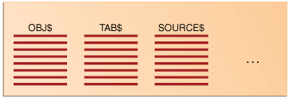
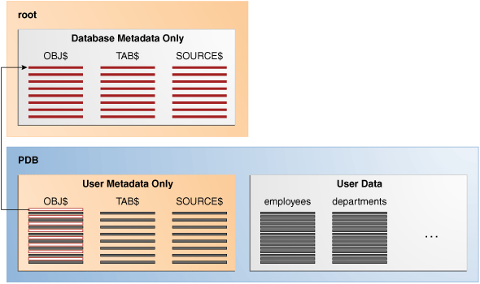

## 8 Data Dictionary and Dynamic Performance Views

The central set of read-only reference tables and views of each Oracle database is known collectively as the **data dictionary**. The **dynamic performance views** are special views that are continuously updated while a database is open and in use.

This chapter contains the following sections:

- Overview of the Data Dictionary  
	An important part of an Oracle database is its data dictionary, which is a read-only set of tables that provides administrative metadata about the database.
- Overview of the Dynamic Performance Views  
	Throughout its operation, Oracle Database maintains a set of virtual tables that record current database activity.
- Database Object Metadata  
	The `DBMS_METADATA` package provides interfaces for extracting complete definitions of database objects.

**Parent topic:** [Oracle Relational Data Structures](oracle-relational-structures.md)

### Overview of the Data Dictionary

An important part of an Oracle database is its data dictionary, which is a read-only set of tables that provides administrative metadata about the database.

- Purpose of the Data Dictionary  
	The data dictionary contains metadata describing the contents of the database.
- Data Dictionary Components  
	The data dictionary consists of base tables and views.
- How the Data Dictionary Works  
	The Oracle Database user account `SYS` owns all base tables and user-accessible views of the data dictionary.
- Data Dictionary Storage  
	The data dictionary that stores the metadata for the CDB as a whole is stored only in the system tablespaces.

**Parent topic:** Data Dictionary and Dynamic Performance Views

#### Purpose of the Data Dictionary

The data dictionary contains metadata describing the contents of the database.

For example, the data dictionary contains information such as the following:

- The definitions of every [schema object](glossary.md) in the database, including default values for columns and integrity constraint information
- The amount of space allocated for and currently used by the schema objects
- The names of Oracle Database users, privileges and roles granted to users, and auditing information related to users

- Data Management  
	The data dictionary is a central part of data management for every Oracle database.
- Data Dictionary Separation in a CDB  
	In a CDB, the data dictionary metadata is split between the CDB root and the PDBs. From the user and application perspective, the data dictionary in each container in a CDB is separate.

**Parent topic:** Overview of the Data Dictionary

##### Data Management

The data dictionary is a central part of data management for every Oracle database.

For example, the database performs the following actions:

- Accesses the data dictionary to find information about users, schema objects, and storage structures
- Modifies the data dictionary every time that a DDL statement is issued

Because Oracle Database stores data dictionary data in tables, just like other data, users can [query](glossary.md) the data with SQL. For example, users can run `SELECT` statements to determine their privileges, which tables exist in their schema, which columns are in these tables, whether indexes are built on these columns, and so on.

##### Data Dictionary Separation in a CDB

In a CDB, the data dictionary metadata is split between the CDB root and the PDBs. From the user and application perspective, the data dictionary in each container in a CDB is separate.

In a newly created CDB that does not yet contain user data, the data dictionary in the CDB root contains only system metadata. For example, the `TAB$` table contains rows that describe only Oracle-supplied tables, for example, `TRIGGER$` and `SERVICE$`. The following graphic depicts three underlying data dictionary tables, with the red bars indicating rows describing the system.

Figure 8-1 Data Dictionary Metadata in the CDB Root



> This graphic shows three tables: OBJ$, TAB$, and SOURCE$. Each table is shown with multiple rows.
>
> [  
> Copyright © 1993, 2025, Oracle and/or its affiliates.](https://docs.oracle.com/en/database/oracle/oracle-database/dcommon/html/cpyr.htm)


Assume that you create a PDB, and then create an `hr` schema containing the `employees` and `departments` tables in this PDB. The data dictionary in the PDB contains some rows that describe Oracle-supplied entities, and other rows that describe user-created entities. For example, the `TAB$` table in the PDB dictionary has a row of metadata for the `employees` table and a row for the `departments` table.

Figure 8-2 Data Dictionary Architecture in a CDB



> This box at the top is labeled "root" and contains a box labeled "Database Metadata Only." It contains boxes labeled "OBJ$," "TAB$," and "SOURCE$." The box on the bottom is labeled "PDB." It contains boxes "User Metadata Only" and "User Data." The "User Metadata Only" box contains the tables "OBJ$," "TAB$," and "SOURCE$." The top row of OBJ$ points to the top row of OBJ$ in the Database Metadata Only box. The User Data box contains the employees and departments tables.


The preceding graphic shows that the data dictionary in the PDB contains pointers to the data dictionary in the CDB root. Internally, Oracle-supplied objects such as data dictionary table definitions and PL/SQL packages are represented only once in the CDB root. This architecture achieves two main goals within the CDB:

- Reduction of duplication
	For example, instead of storing the source code for the `DBMS_ADVISOR` PL/SQL package in every PDB, the CDB stores the code only once in `CDB$ROOT`, which saves disk space.
- Ease of database upgrade
	If the definition of a data dictionary table existed in every PDB, and if the definition were to change in a new release, then each PDB would need to be upgraded separately to capture the change. Storing the table definition only once in the CDB root eliminates this problem.

**Parent topic:** Purpose of the Data Dictionary

#### Data Dictionary Components

The data dictionary consists of base tables and views.

These objects are defined as follows:

- Base tables
	These store information about the database. Only Oracle Database should write to and read these tables. Users rarely access the base tables directly because they are normalized and most data is stored in a cryptic format.
- Views
	These decode the base table data into useful information, such as user or table names, using joins and `WHERE` clauses to simplify the information. The views contain the names and description of all objects in the data dictionary. Some views are accessible to all database users, whereas others are intended for administrators only.

Typically, data dictionary views are grouped in sets. In many cases, a set consists of three views containing similar information and distinguished from each other by their prefixes, as shown in the following table. By querying the appropriate views, you can access only the information relevant for you.

Table 8-1 Data Dictionary View Sets

| Prefix | User Access | Contents | Notes |
| --- | --- | --- | --- |
| `DBA_` | Database administrators | All objects | Some `DBA_` views have additional columns containing information useful to the administrator. |
| `ALL_` | All users | Objects to which user has privileges | Includes objects owned by user. These views obey the current set of enabled roles. |
| `USER_` | All users | Objects owned by user | Views with the prefix `USER_` usually exclude the column `OWNER`. This column is implied in the `USER_` views to be the user issuing the query. |

Not all views sets have three members. For example, the data dictionary contains a `DBA_LOCK` view but no `ALL_LOCK` view.

The system-supplied `DICTIONARY` view contains the names and abbreviated descriptions of all data dictionary views. The following query of this view includes partial sample output:

```
SQL> SELECT * FROM DICTIONARY
  2  ORDER BY TABLE_NAME;

TABLE_NAME                     COMMENTS
------------------------------ ----------------------------------------
ALL_ALL_TABLES                 Description of all object and relational
                               tables accessible to the user
 
ALL_APPLY                      Details about each apply process that
                               dequeues from the queue visible to the
                               current user
.
.
.
```

- Container Data Objects in a CDB  
	A **container data object** is a table or view containing data pertaining to multiple containers or the whole CDB.
- Views with the Prefix DBA\_  
	Views with the prefix `DBA_` show all relevant information in the entire database. `DBA_` views are intended only for administrators.
- Views with the Prefix ALL\_  
	Views with the prefix `ALL_` refer to the user's overall perspective of the database.
- Views with the Prefix USER\_  
	The views most likely to be of interest to typical database users are those with the prefix `USER_`.
- The DUAL Table  
	`DUAL` is a small table in the data dictionary that Oracle Database and user-written programs can reference to guarantee a known result.

See Also:

- " [Overview of Views](partitions-views-and-other-schema-objects.md) "
- [Oracle Database Reference](https://docs.oracle.com/pls/topic/lookup?ctx=en/database/oracle/oracle-database/21/cncpt&id=GUID-8865F65B-EF6D-44A5-B0A1-3179EFF0C36A) for a complete list of data dictionary views and their columns

**Parent topic:** Overview of the Data Dictionary

##### Container Data Objects in a CDB

A **container data object** is a table or view containing data pertaining to multiple containers or the whole CDB.

Container data privileges support a general requirement in which multiple PDBs reside in a single CDB, but with different local administration requirements. For example, if application DBAs do not want to administer locally, then they can grant container data privileges on appropriate views to the common users. In this case, the CDB administrator can access the data for these PDBs. In contrast, PDB administrators who do not want the CDB administrator accessing their data do not grant container data privileges.

Examples of container data objects are Oracle-supplied views whose names begin with `V$` and `CDB_`. All container data objects have a `CON_ID` column. The following table shows the meaning of the values for this column.

Table 8-2 Container ID Values

| Container ID | Rows pertain to |
| --- | --- |
| `0` | Whole CDB |
| `1` | `CDB$ROOT` |
| `2` | `PDB$SEED` |
| All Other IDs | User-created PDBs, application roots, or application seeds |

In a CDB, for every `DBA_` view, a corresponding `CDB_` view exists. The owner of a `CDB_` view is the owner of the corresponding `DBA_` view. The following graphic shows the relationship among the different categories of dictionary views:

Figure 8-3 Dictionary Views in a CDB


> This graphic shows four boxes inside one another. The outer box is labeled "CDB\_ All of the objects in the CDB across all PDBs." The box inside of it is labeled "DBA\_ All of the objects in a container or PDB." The box inside of it is labeled "ALL\_ Objects accessible by the current user." The box inside of it is labeled "USER\_ Objects owned by the current user."


When the current container is a PDB, a user can view data dictionary information for the current PDB only. When the current container is the CDB root, however, a common user can query `CDB_` views to see metadata for the CDB root and for PDBs for which this user is privileged.

Note:

When queried from the CDB root, `CDB_` and `V$` views implicitly convert data to the AL32UTF8 character set. If a character set needs more bytes to represent a character when converted to AL32UTF8, and if the view column width cannot accommodate data from a specific PDB, then data truncation is possible.

The following table describes queries of `CDB_` views. Each row describes an action that occurs after the action in the preceding row.

Table 8-3 Querying CDB\_ Views

| Operation | Description |
| --- | --- |
| ``` SQL> CONNECT SYSTEM Enter password: ******** Connected. ``` | The `SYSTEM` user, which is common to all containers in the CDB, connects to the CDB root (see " [Common User Accounts](tables-and-table-clusters.md) "). |
| ``` SQL> SELECT COUNT(*) FROM CDB_USERS  WHERE CON_ID=1;  COUNT(*) --------       38 ``` | `SYSTEM` queries `CDB_USERS` to obtain the number of common users in the CDB root. The output indicates that 38 common users exist in CDB root. |
| ``` SQL> SELECT COUNT(DISTINCT(CON_ID))  FROM CDB_USERS;   COUNT(DISTINCT(CON_ID)) -----------------------                       4 ``` | `SYSTEM` queries `CDB_USERS` to determine the number of distinct containers in the CDB. |
| ``` SQL> CONNECT SYSTEM@hrdb Enter password: ******** Connected. ``` | The `SYSTEM` user now connects to the PDB named `hrpdb`. |
| ``` SQL> SELECT COUNT(*) FROM CDB_USERS;     COUNT(*) ----------         48 ``` | `SYSTEM` queries `CDB_USERS`. The output indicates that 48 common and local users exist in the current container, which is `hrpdb`. |
| ``` SQL> SELECT COUNT(*) FROM DBA_USERS;     COUNT(*) ----------         48 ``` | `SYSTEM` queries `DBA_USERS`. The output is the same as the previous query. Because `SYSTEM` is not connected to the CDB root, the `DBA_USERS` view shows the same output as `CDB_USERS`. Because `DBA_USERS` only shows the users in the current container, it shows 48. |

**Parent topic:** Data Dictionary Components

##### Views with the Prefix DBA\_

Views with the prefix `DBA_` show all relevant information in the entire database. `DBA_` views are intended only for administrators.

The following sample query shows information about all objects in the database:

```
SELECT OWNER, OBJECT_NAME, OBJECT_TYPE
FROM   DBA_OBJECTS
ORDER BY OWNER, OBJECT_NAME;
```

See Also:

[Oracle Database Administrator’s Guide](https://docs.oracle.com/pls/topic/lookup?ctx=en/database/oracle/oracle-database/21/cncpt&id=ADMIN11047) for detailed information on administrative privileges

**Parent topic:** Data Dictionary Components

##### Views with the Prefix ALL\_

Views with the prefix `ALL_` refer to the user's overall perspective of the database.

These views return information about schema objects to which the user has access through public or explicit grants of privileges and roles, in addition to schema objects that the user owns.

For example, the following query returns information about all the objects to which you have access:

```
SELECT OWNER, OBJECT_NAME, OBJECT_TYPE 
FROM   ALL_OBJECTS
ORDER BY OWNER, OBJECT_NAME;
```

Because the `ALL_` views obey the current set of enabled roles, query results depend on which roles are enabled, as shown in the following example:

```
SQL> SET ROLE ALL;
 
Role set.
 
SQL> SELECT COUNT(*) FROM ALL_OBJECTS;
 
COUNT(*)
----------
68295
 
SQL> SET ROLE NONE;
 
Role set.
 
SQL> SELECT COUNT(*) FROM ALL_OBJECTS;
 
COUNT(*)
----------
53771
```

Application developers should be cognizant of the effect of roles when using `ALL_` views in a [stored procedure](glossary.md), where roles are not enabled by default.

**Parent topic:** Data Dictionary Components

##### Views with the Prefix USER\_

The views most likely to be of interest to typical database users are those with the prefix `USER_`.

These views:

- Refer to the user's private environment in the database, including metadata about schema objects created by the user, grants made by the user, and so on
- Display only rows pertinent to the user, returning a subset of the information in the `ALL_` views
- Has columns identical to the other views, except that the column `OWNER` is implied
- Can have abbreviated `PUBLIC` synonyms for convenience

For example, the following query returns all the objects contained in your schema:

```
SELECT OBJECT_NAME, OBJECT_TYPE 
FROM   USER_OBJECTS
ORDER BY OBJECT_NAME;
```

**Parent topic:** Data Dictionary Components

##### The DUAL Table

`DUAL` is a small table in the data dictionary that Oracle Database and user-written programs can reference to guarantee a known result.

The dual table is useful when a value must be returned only once, for example, the current date and time. All database users have access to `DUAL`.

The `DUAL` table has one column called `DUMMY` and one row containing the value `X`. The following example queries `DUAL` to perform an arithmetical operation:

```
SQL> SELECT ((3*4)+5)/3 FROM DUAL;
 
((3*4)+5)/3
-----------
 5.66666667
```

See Also:

[Oracle Database SQL Language Reference](https://docs.oracle.com/pls/topic/lookup?ctx=en/database/oracle/oracle-database/21/cncpt&id=SQLRF20036) for more information about the `DUAL` table

**Parent topic:** Data Dictionary Components

#### How the Data Dictionary Works

The Oracle Database user account `SYS` owns all base tables and user-accessible views of the data dictionary.

During database operation, Oracle Database reads the data dictionary to ascertain that schema objects exist and that users have proper access to them. Oracle Database updates the data dictionary continuously to reflect changes in database structures, auditing, grants, and data.

For example, if user `hr` creates a table named `interns`, then the database adds new rows to the data dictionary that reflect the new table, columns, segment, extents, and the privileges that `hr` has on the table. This new information is visible the next time the dictionary views are queried.

Data in the base tables of the data dictionary is necessary for Oracle Database to function. Only Oracle Database should write or change data dictionary information. No Oracle Database user should ever alter rows or schema objects contained in the `SYS` schema because such activity can compromise [data integrity](glossary.md). The security administrator must keep strict control of this central account.

WARNING:

Altering or manipulating the data in data dictionary tables can permanently and detrimentally affect database operation.

- Metadata and Data Links  
	The CDB uses an internal linking mechanism to separate data dictionary information.
- Public Synonyms for Data Dictionary Views  
	Oracle Database creates public synonyms for many data dictionary views so users can access them conveniently.
- Data Dictionary Cache  
	Much of the data dictionary information is in the **data dictionary cache** because the database constantly requires the information to validate user access and verify the state of schema objects.
- Other Programs and the Data Dictionary  
	Other Oracle Database products can reference existing views and create additional data dictionary tables or views of their own.

See Also:

" [SYS and SYSTEM Accounts](tables-and-table-clusters.md) "

**Parent topic:** Overview of the Data Dictionary

##### Metadata and Data Links

The CDB uses an internal linking mechanism to separate data dictionary information.

Specifically, Oracle Database uses the following automatically managed pointers:

- Metadata links
	Oracle Database stores metadata about dictionary objects only in the CDB root. For example, the column definitions for the `OBJ$` dictionary table, which underlies the `DBA_OBJECTS` data dictionary view, exist only in the CDB root. As depicted in Figure 8-2, the `OBJ$` table in each PDB uses an internal mechanism called a [metadata link](glossary.md) to point to the definition of `OBJ$` stored in the CDB root.
	The data corresponding to a metadata link resides in its PDB, not in the CDB root. For example, if you create table `mytable` in `hrpdb` and add rows to it, then the rows are stored in the PDB data files, not in the CDB root data files.
	The data dictionary views in the PDB and in the CDB root contain different rows. For example, a new row describing `mytable` exists in the `OBJ$` table in `hrpdb`, but not in the `OBJ$` table in the CDB root. Thus, a query of `DBA_OBJECTS` in the CDB root and `DBA_OBJECTS` in `hrdpb` shows different results.
- Data links
	Note:
	Data links were called object links in Oracle Database 12c Release 1 (12.1.0.2).
	In some cases, Oracle Database stores the data (not only metadata) for an object only once in the application root of an application container. Consider an e-commerce company that has different PDBs for different regions. The application root might store a table named `postal_codes`, which lists all U.S. zip codes. Every application PDB in this container requires access to the common `postal_codes` table.
	An application PDB uses an internal mechanism called a [data link](glossary.md) to refer to the object in the application root. The application PDB in which the data link was created also stores the data link description. A data link inherits the data type of the object to which it refers.
- Extended data link
	An extended data link is a hybrid of a data link and a metadata link. Like a data link, an extended data link refers to an object in an application root. However, the extended data link also refers to a corresponding object in the application PDB. For example, an application PDB might have an extended data link table that stores both U.S. zip codes and Canadian postal codes. Like a metadata link, the object in the application PDB inherits metadata from the corresponding object in the application root.
	When queried in the application root, an extended data-linked table fetches rows only from the application root, for example, just U.S. zip codes. However, when queried in an application PDB, an extended data-linked table fetches rows from both the application root and application PDB, for example, U.S. zip codes and Canadian postal codes.

Oracle Database automatically creates and manages metadata and data links to `CDB$ROOT`. Users cannot add, modify, or remove these links.

See Also:

- " [Application Common Objects](app-containers.md) "
- [Oracle Database Concepts](https://docs.oracle.com/pls/topic/lookup?ctx=en/database/oracle/oracle-database/21/cncpt&id=CNCPT-GUID-9B9ABE1C-A1E3-464F-8936-978250DC3E1F) for an overview of the data dictionary

**Parent topic:** How the Data Dictionary Works

##### Public Synonyms for Data Dictionary Views

Oracle Database creates public synonyms for many data dictionary views so users can access them conveniently.

The security administrator can also create additional public synonyms for schema objects that are used systemwide. Oracle recommends against using the same name for a private schema object and a public synonym.

See Also:

" [Overview of Synonyms](partitions-views-and-other-schema-objects.md) "

**Parent topic:** How the Data Dictionary Works

##### Data Dictionary Cache

Much of the data dictionary information is in the **data dictionary cache** because the database constantly requires the information to validate user access and verify the state of schema objects.

The caches typically contain the parsing information. The `COMMENTS` columns describing the tables and their columns are not cached in the dictionary cache, but may be cached in the **database buffer cache**.

See Also:

" [Data Dictionary Cache](memory-architecture.md) "

**Parent topic:** How the Data Dictionary Works

##### Other Programs and the Data Dictionary

Other Oracle Database products can reference existing views and create additional data dictionary tables or views of their own.

Oracle recommends that application developers who write programs referring to the data dictionary use the public synonyms rather than the underlying tables. Synonyms are less likely to change between releases.

**Parent topic:** How the Data Dictionary Works

#### Data Dictionary Storage

The data dictionary that stores the metadata for the CDB as a whole is stored only in the system tablespaces.

The data dictionary that stores the metadata for a specific PDB is stored in the self-contained tablespaces dedicated to this PDB. The PDB tablespaces contain both the data and metadata for an application back end. Thus, each set of data dictionary tables is stored in its own dedicated set of tablespaces.

See Also:

" [The SYSTEM Tablespace](logical-storage-structures.md) " for more information about the `SYSTEM` tablespace

**Parent topic:** Overview of the Data Dictionary

### Overview of the Dynamic Performance Views

Throughout its operation, Oracle Database maintains a set of virtual tables that record current database activity.

These views are dynamic because they are continuously updated while a database is open and in use. The views are sometimes called V$ views because their names begin with `V$`.

Dynamic performance views contain information such as the following:

- System and [session](glossary.md) parameters
- Memory usage and allocation
- File states (including [RMAN](glossary.md) backup files)
- Progress of jobs and tasks
- SQL execution
- Statistics and metrics

The dynamic performance views have the following primary uses:

- [Oracle Enterprise Manager](glossary.md) uses the views to obtain information about the database.
- Administrators can use the views for performance monitoring and debugging.

- Contents of the Dynamic Performance Views  
	Dynamic performance views are called fixed views because they cannot be altered or removed by a database administrator. However, database administrators can query and create views on the tables and grant access to these views to other users.
- Storage of the Dynamic Performance Views  
	Dynamic performance views are based on virtual tables built from database memory structures.

See Also:

[Oracle Database Reference](https://docs.oracle.com/pls/topic/lookup?ctx=en/database/oracle/oracle-database/21/cncpt&id=REFRN003) for a complete list of the dynamic performance views

**Parent topic:** Data Dictionary and Dynamic Performance Views

#### Contents of the Dynamic Performance Views

Dynamic performance views are called fixed views because they cannot be altered or removed by a database administrator. However, database administrators can query and create views on the tables and grant access to these views to other users.

`SYS` owns the dynamic performance tables, whose names begin with `V_$`. Views are created on these tables, and then public synonyms prefixed with `V$`. For example, the `V$DATAFILE` view contains information about data files. The `V$FIXED_TABLE` view contains information about all of the dynamic performance tables and views.

For almost every `V$` view, a corresponding `GV$` view exists. In Oracle Real Application Clusters (Oracle RAC), querying a `GV$` view retrieves the `V$` view information from all qualified database instances.

When you use the Database Configuration Assistant (DBCA) to create a database, Oracle automatically creates the data dictionary. Oracle Database automatically runs the `catalog.sql` script, which contains definitions of the views and public synonyms for the dynamic performance views. You must run `catalog.sql` to create these views and synonyms.

See Also:

- [Oracle Database Administrator’s Guide](https://docs.oracle.com/pls/topic/lookup?ctx=en/database/oracle/oracle-database/21/cncpt&id=ADMIN11082) to learn how to run `catalog.sql` manually
- [Oracle Real Application Clusters Administration and Deployment Guide](https://docs.oracle.com/pls/topic/lookup?ctx=en/database/oracle/oracle-database/21/cncpt&id=RACAD718) to learn about using performance views in Oracle RAC

**Parent topic:** Overview of the Dynamic Performance Views

#### Storage of the Dynamic Performance Views

Dynamic performance views are based on virtual tables built from database memory structures.

The views are not conventional tables stored in the database. Read consistency is not guaranteed for the views because the data is updated dynamically.

Because the dynamic performance views are not true tables, the data depends on the state of the database and [database instance](glossary.md). For example, you can query `V$INSTANCE` and `V$BGPROCESS` when the database is started but not mounted. However, you cannot query `V$DATAFILE` until the database has been mounted.

See Also:

" [Data Concurrency and Consistency](data-concurrency-and-consistency.md) "

**Parent topic:** Overview of the Dynamic Performance Views

### Database Object Metadata

The `DBMS_METADATA` package provides interfaces for extracting complete definitions of database objects.

The definitions can be expressed either as XML or as SQL DDL. Oracle Database provides two styles of interface: a flexible, sophisticated interface for programmatic control, and a simplified interface for ad hoc querying.

See Also:

[Oracle Database PL/SQL Packages and Types Reference](https://docs.oracle.com/pls/topic/lookup?ctx=en/database/oracle/oracle-database/21/cncpt&id=ARPLS026) for more information about `DBMS_METADATA`

**Parent topic:** Data Dictionary and Dynamic Performance Views