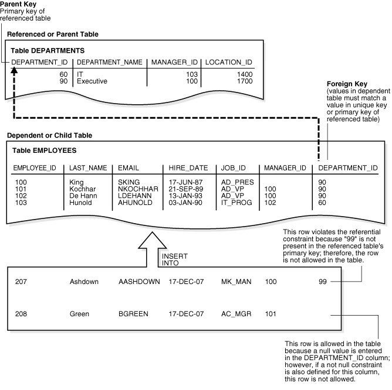
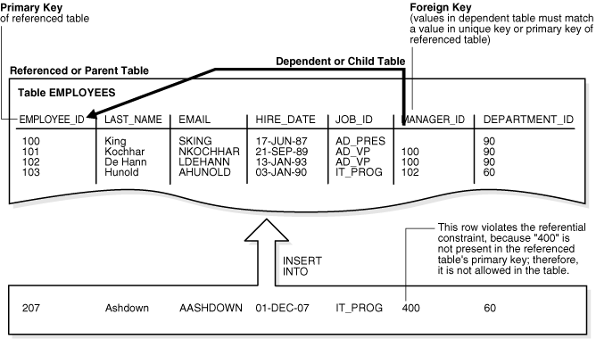
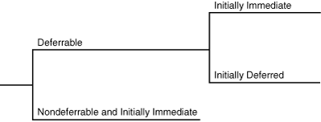
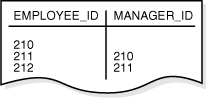
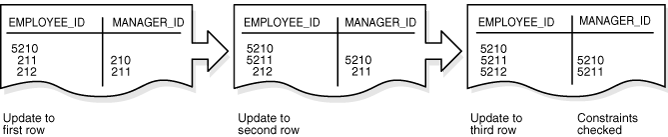

## 7 Data Integrity

This chapter explains how integrity constraints enforce the business rules associated with a database and prevent the entry of invalid information into tables.

This chapter contains the following sections:

- Introduction to Data Integrity  
	It is important that data maintain data integrity, which is adherence to business rules determined by the database administrator or application developer.
- Types of Integrity Constraints  
	Oracle Database enables you to apply constraints both at the table and column level.
- States of Integrity Constraints  
	As part of constraint definition, you can specify how and when Oracle Database should enforce the constraint, thereby determining the constraint state.

See Also:

" [Overview of Tables](tables-and-table-clusters.md) " for background on columns and the need for integrity constraints

**Parent topic:** [Oracle Relational Data Structures](oracle-relational-structures.md)

### Introduction to Data Integrity

It is important that data maintain data integrity, which is adherence to business rules determined by the database administrator or application developer.

Business rules specify conditions and relationships that must always be true or must always be false. For example, each company defines its own policies about salaries, employee numbers, inventory tracking, and so on.

- Techniques for Guaranteeing Data Integrity  
	When designing a database application, developers have several options for guaranteeing the integrity of data stored in the database.
- Advantages of Integrity Constraints  
	An integrity constraint is a schema object that is created and dropped using SQL. To enforce data integrity, use integrity constraints whenever possible.

**Parent topic:** Data Integrity

#### Techniques for Guaranteeing Data Integrity

When designing a database application, developers have several options for guaranteeing the integrity of data stored in the database.

These options include:

- Enforcing business rules with triggered stored database procedures
- Using stored procedures to completely control access to data
- Enforcing business rules in the code of a database application
- Using Oracle Database integrity constraints, which are rules defined at the column or object level that restrict values in the database

See Also:

- " [Overview of Triggers](https://docs.oracle.com/en/database/oracle/oracle-database/21/cncpt/server-side-programming.html#GUID-40297ADF-0968-42F8-B8B9-84AD6ADCBE63 "A database trigger is a compiled stored program unit, written in either PL/SQL or Java, that Oracle Database invokes (\"fires\") automatically in certain situations.") " explains the purpose and types of triggers
- " [Introduction to Server-Side Programming](server-side-programming.md) " explains the purpose and characteristics of stored procedures

**Parent topic:** Introduction to Data Integrity

#### Advantages of Integrity Constraints

An integrity constraint is a schema object that is created and dropped using SQL. To enforce data integrity, use integrity constraints whenever possible.

Advantages of integrity constraints over alternatives for enforcing data integrity include:

- Declarative ease
	Because you define integrity constraints using SQL statements, no additional programming is required when you define or alter a table. The SQL statements are easy to write and eliminate programming errors.
- Centralized rules
	Integrity constraints are defined for tables and are stored in the [data dictionary](glossary.md). Thus, data entered by all applications must adhere to the same integrity constraints. If the rules change at the table level, then applications need not change. Also, applications can use metadata in the data dictionary to immediately inform users of violations, even before the database checks the SQL statement.
- Flexibility when loading data
	You can disable integrity constraints temporarily to avoid performance overhead when loading large amounts of data. When the data load is complete, you can re-enable the integrity constraints.

See Also:

- " [Overview of the Data Dictionary](data-dictionary-and-dynamic-performance-views.md) "
- [Oracle Database 2 Day Developer's Guide](https://docs.oracle.com/pls/topic/lookup?ctx=en/database/oracle/oracle-database/21/cncpt&id=TDDDG32200) and [Oracle Database Development Guide](https://docs.oracle.com/pls/topic/lookup?ctx=en/database/oracle/oracle-database/21/cncpt&id=ADFNS004) to learn how to maintain data integrity
- [Oracle Database Administrator’s Guide](https://docs.oracle.com/pls/topic/lookup?ctx=en/database/oracle/oracle-database/21/cncpt&id=ADMIN11537) to learn how to manage integrity constraints

**Parent topic:** Introduction to Data Integrity

### Types of Integrity Constraints

Oracle Database enables you to apply constraints both at the table and column level.

A constraint specified as part of the definition of a column or attribute is an inline specification. A constraint specified as part of the table definition is an out-of-line specification.

A [key](glossary.md) is the column or set of columns included in the definition of certain types of integrity constraints. Keys describe the relationships between the tables and columns of a relational database. Individual values in a key are called [key values](glossary.md).

The following table describes the types of constraints. Each can be specified either inline or out-of-line, except for `NOT NULL`, which must be inline.

Table 7-1 Types of Integrity Constraints

| Constraint Type | Description | See Also |
| --- | --- | --- |
| `NOT NULL` | Allows or disallows inserts or updates of rows containing a [null](glossary.md) in a specified column. | " NOT NULL Integrity Constraints " |
| Unique key | Prohibits multiple rows from having the same value in the same column or combination of columns but allows some values to be null. | " Unique Constraints " |
| Primary key | Combines a `NOT NULL` constraint and a unique constraint. It prohibits multiple rows from having the same value in the same column or combination of columns and prohibits values from being null. | " Primary Key Constraints " |
| Foreign key | Designates a column as the foreign key and establishes a relationship between the foreign key and a primary or unique key, called the [referenced key](glossary.md). | " Foreign Key Constraints " |
| Check | Requires a database value to obey a specified condition. | " Check Constraints " |
| `REF` | Dictates types of data manipulation allowed on values in a `REF` column and how these actions affect dependent values. In an object-relational database, a built-in data type called a `REF` encapsulates a reference to a row object of a specified object type. Referential integrity constraints on `REF` columns ensure that there is a row object for the `REF`. | [Oracle Database Object-Relational Developer's Guide](https://docs.oracle.com/pls/topic/lookup?ctx=en/database/oracle/oracle-database/21/cncpt&id=ADOBJ00805) to learn about `REF` constraints |

- NOT NULL Integrity Constraints  
	A `NOT NULL` constraint requires that a column of a table contain no null values. A **null** is the absence of a value. By default, all columns in a table allow nulls.
- Unique Constraints  
	A unique key constraint requires that every value in a column or set of columns be unique. No rows of a table may have duplicate values in a single column (the unique key) or set of columns (the composite unique key) with a unique key constraint.
- Primary Key Constraints  
	In a primary key constraint, the values in the group of one or more columns subject to the constraint uniquely identify the row. Each table can have one primary key, which in effect names the row and ensures that no duplicate rows exist.
- Foreign Key Constraints  
	Whenever two tables contain one or more common columns, Oracle Database can enforce the relationship between the two tables through a foreign key constraint, also called a referential integrity constraint.
- Check Constraints  
	A **check constraint** on a column or set of columns requires that a specified **condition** be true or unknown for every row.

**Parent topic:** Data Integrity

#### NOT NULL Integrity Constraints

A `NOT NULL` constraint requires that a column of a table contain no null values. A **null** is the absence of a value. By default, all columns in a table allow nulls.

`NOT NULL` constraints are intended for columns that must not lack values. For example, the `hr.employees` table requires a value in the `email` column. An attempt to insert an employee row without an email address generates an error:

```
SQL> INSERT INTO hr.employees (employee_id, last_name) values (999, 'Smith');
.
.
.
ERROR at line 1:
ORA-01400: cannot insert NULL into ("HR"."EMPLOYEES"."EMAIL")
```

You can only add a column with a `NOT NULL` constraint if the table does not contain any rows or if you specify a default value.

See Also:

- [Oracle Database 2 Day Developer's Guide](https://docs.oracle.com/pls/topic/lookup?ctx=en/database/oracle/oracle-database/21/cncpt&id=TDDDG32220) for examples of adding `NOT NULL` constraints to a table
- [Oracle Database SQL Language Reference](https://docs.oracle.com/pls/topic/lookup?ctx=en/database/oracle/oracle-database/21/cncpt&id=SQLRF30038) for restrictions on using `NOT NULL` constraints
- [Oracle Database Development Guide](https://docs.oracle.com/pls/topic/lookup?ctx=en/database/oracle/oracle-database/21/cncpt&id=ADFNS265) to learn when to use the `NOT NULL` constraint

**Parent topic:** Types of Integrity Constraints

#### Unique Constraints

A unique key constraint requires that every value in a column or set of columns be unique. No rows of a table may have duplicate values in a single column (the unique key) or set of columns (the composite unique key) with a unique key constraint.

Note:

The term key refers only to the columns defined in the integrity constraint. Because the database enforces a unique constraint by implicitly creating or reusing an [index](glossary.md) on the key columns, the term unique key is sometimes incorrectly used as a synonym for unique key constraint or unique index.

Unique key constraints are appropriate for any column where duplicate values are not allowed. Unique constraints differ from primary key constraints, whose purpose is to identify each table row uniquely, and typically contain values that have no significance other than being unique. Examples of unique keys include:

- A customer phone number, where the primary key is the customer number
- A department name, where the primary key is the department number

As shown in [Example 4-1](tables-and-table-clusters.md), a unique key constraint exists on the `email` column of the `hr.employees` table. The relevant part of the statement is as follows:

```
CREATE TABLE employees    ( ...
    , email          VARCHAR2(25)
        CONSTRAINT   emp_email_nn  NOT NULL ...
    , CONSTRAINT     emp_email_uk  UNIQUE (email) ... );
```

The `emp_email_uk` constraint ensures that no two employees have the same email address, as shown in the following example:

```
SQL> SELECT employee_id, last_name, email FROM employees WHERE email = 'PFAY';
 
EMPLOYEE_ID LAST_NAME                 EMAIL
----------- ------------------------- -------------------------
        202 Fay                       PFAY

SQL> INSERT INTO employees (employee_id, last_name, email, hire_date, job_id)    
  1  VALUES (999,'Fay','PFAY',SYSDATE,'ST_CLERK');
.
.
.
ERROR at line 1:
ORA-00001: unique constraint (HR.EMP_EMAIL_UK) violated
```

Unless a `NOT NULL` constraint is also defined, a null always satisfies a unique key constraint. Thus, columns with both unique key constraints and `NOT NULL` constraints are typical. This combination forces the user to enter values in the unique key and eliminates the possibility that new row data conflicts with existing row data.

Note:

Because of the search mechanism for unique key constraints on multiple columns, you cannot have identical values in the non-null columns of a partially null composite unique key constraint.

Example 7-1 Unique Constraint

```
SQL> SELECT employee_id, last_name, email FROM employees WHERE email = 'PFAY';
 
EMPLOYEE_ID LAST_NAME                 EMAIL
----------- ------------------------- -------------------------
        202 Fay                       PFAY

SQL> INSERT INTO employees (employee_id, last_name, email, hire_date, job_id)    
  1  VALUES (999,'Fay','PFAY',SYSDATE,'ST_CLERK');
.
.
.
ERROR at line 1:
ORA-00001: unique constraint (HR.EMP_EMAIL_UK) violated
```

See Also:

- " [Unique and Nonunique Indexes](indexes-and-index-organized-tables.md) "
- [Oracle Database 2 Day Developer's Guide](https://docs.oracle.com/pls/topic/lookup?ctx=en/database/oracle/oracle-database/21/cncpt&id=TDDDG192) for examples of adding `UNIQUE` constraints to a table

**Parent topic:** Types of Integrity Constraints

#### Primary Key Constraints

In a primary key constraint, the values in the group of one or more columns subject to the constraint uniquely identify the row. Each table can have one primary key, which in effect names the row and ensures that no duplicate rows exist.

A primary key can be natural or a surrogate. A [natural key](glossary.md) is a meaningful identifier made of existing attributes in a table. For example, a natural key could be a postal code in a lookup table. In contrast, a [surrogate key](glossary.md) is a system-generated incrementing identifier that ensures uniqueness within a table. Typically, a [sequence](glossary.md) generates surrogate keys.

The Oracle Database implementation of the primary key constraint guarantees that the following statements are true:

- No two rows have duplicate values in the specified column or set of columns.
- The primary key columns do not allow nulls.

A typical situation calling for a primary key is the numeric identifier for an employee. Each employee must have a unique ID. An employee must be described by one and only one row in the `employees` table.

The example in Unique Constraints indicates that an existing employee has the employee ID of 202, where the employee ID is the primary key. The following example shows an attempt to add an employee with the same employee ID and an employee with no ID:

```
SQL> INSERT INTO employees (employee_id, last_name, email, hire_date, job_id)    
  1  VALUES (202,'Chan','JCHAN',SYSDATE,'ST_CLERK');
.
.
.
ERROR at line 1:
ORA-00001: unique constraint (HR.EMP_EMP_ID_PK) violated

SQL> INSERT INTO employees (last_name) VALUES ('Chan');
.
.
.
ERROR at line 1:
ORA-01400: cannot insert NULL into ("HR"."EMPLOYEES"."EMPLOYEE_ID")
```

The database enforces primary key constraints with an [index](glossary.md). Usually, a primary key constraint created for a column implicitly creates a unique index and a `NOT NULL` constraint. Note the following exceptions to this rule:

- In some cases, as when you create a primary key with a [deferrable constraint](glossary.md), the generated index is not unique.
	Note:
	You can explicitly create a unique index with the `CREATE UNIQUE INDEX` statement.
- If a usable index exists when a primary key constraint is created, then the constraint reuses this index and does not implicitly create one.

By default the name of the implicitly created index is the name of the primary key constraint. You can also specify a user-defined name for an index. You can specify storage options for the index by including the `ENABLE` clause in the `CREATE TABLE` or `ALTER TABLE` statement used to create the constraint.

See Also:

[Oracle Database 2 Day Developer's Guide](https://docs.oracle.com/pls/topic/lookup?ctx=en/database/oracle/oracle-database/21/cncpt&id=TDDDG193) and [Oracle Database Development Guide](https://docs.oracle.com/pls/topic/lookup?ctx=en/database/oracle/oracle-database/21/cncpt&id=ADFNS00607) to learn how to add primary key constraints to a table

**Parent topic:** Types of Integrity Constraints

#### Foreign Key Constraints

Whenever two tables contain one or more common columns, Oracle Database can enforce the relationship between the two tables through a foreign key constraint, also called a referential integrity constraint.

A foreign key constraint requires that for each value in the column on which the constraint is defined, the value in the other specified other table and column must match. An example of a referential integrity rule is an employee can work for only an existing department.

The following table lists terms associated with referential integrity constraints.

Table 7-2 Referential Integrity Constraint Terms

| Term | Definition |
| --- | --- |
| Foreign key | The column or set of columns included in the definition of the constraint that reference a referenced key. For example, the `department_id` column in `employees` is a foreign key that references the `department_id` column in `departments`.  Foreign keys may be defined as multiple columns. However, a composite foreign key must reference a composite primary or unique key with the same number of columns and the same data types.  The value of foreign keys can match either the referenced primary or unique key value, or be null. If any column of a composite foreign key is null, then the non-null portions of the key do not have to match any corresponding portion of a parent key. |
| Referenced key | The unique key or primary key of the table referenced by a foreign key. For example, the `department_id` column in `departments` is the referenced key for the `department_id` column in `employees`. |
| Dependent or child table | The table that includes the foreign key. This table depends on the values present in the referenced unique or primary key. For example, the `employees` table is a child of `departments`. |
| Referenced or parent table | The table that is referenced by the foreign key of the child table. It is this table's referenced key that determines whether specific inserts or updates are allowed in the child table. For example, the `departments` table is a parent of `employees`. |

Figure 7-1 shows a foreign key on the `employees.department_id` column. It guarantees that every value in this column must match a value in the `departments.department_id` column. Thus, no erroneous department numbers can exist in the `employees.department_id` column.

Figure 7-1 Referential Integrity Constraints



> This graphic shows the departments table. The department\_id column is labeled "Parent Key: Primary key of referenced table." Below it is the employees table labeled "Referenced or Parent Table." The department\_id column points to the departments.department\_id column. The employees.department\_id column is labeled "Foreign Key (values in dependent table must match a value in unique key or primary key of referenced table)." Below the employees table is an insert of two rows. The first row contains 99 as a department ID. The callout says: "This row violates the referential constraint because '99' is not present in the referenced table's primary key; therefore, the row is not allowed in the table." The second inserted row has a null for department\_id. The callout says "This row is allowed in the table because a null value is entered in the department\_id column; however, if a not null constraint is also defined for this column, this row is not allowed."


- Self-Referential Integrity Constraints  
	A self-referential integrity constraint is a foreign key that references a parent key in the same table.
- Nulls and Foreign Keys  
	The relational model permits the value of foreign keys to match either the referenced primary or unique key value, or be null. For example, a row in `hr.employees` might not specify a department ID.
- Parent Key Modifications and Foreign Keys  
	The relationship between foreign key and parent key has implications for deletion of parent keys. For example, if a user attempts to delete the record for this department, then what happens to the records for employees in this department?
- Indexes and Foreign Keys  
	As a rule, foreign keys should be indexed. The only exception is when the matching unique or primary key is never updated or deleted.

See Also:

[Oracle Database 2 Day Developer's Guide](https://docs.oracle.com/pls/topic/lookup?ctx=en/database/oracle/oracle-database/21/cncpt&id=TDDDG195) and [Oracle Database Development Guide](https://docs.oracle.com/pls/topic/lookup?ctx=en/database/oracle/oracle-database/21/cncpt&id=ADFNS00611) to learn how to add foreign key constraints to a table

**Parent topic:** Types of Integrity Constraints

##### Self-Referential Integrity Constraints

A self-referential integrity constraint is a foreign key that references a parent key in the same table.

In the following figure, a self-referential constraint ensures that every value in the `employees.manager_id` column corresponds to an existing value in the `employees.employee_id` column. For example, the manager for employee 102 must exist in the `employees` table. This constraint eliminates the possibility of erroneous employee numbers in the `manager_id` column.

Figure 7-2 Single Table Referential Constraints



> This graphic shows the employees table. The employee\_id column is labeled "Primary Key of referenced table." Below it is the employees table labeled "Referenced or Parent Table." The manager\_id column points to the employee\_id column. The manager\_id column is labeled "Foreign Key (values in dependent table must match a value in unique key or primary key of referenced table)." Below the employees table is an insert of a single row. The row contains 400 for a manager\_id. The callout says: "This row violates the referential constraint because '400' is not present in the referenced table's primary key; therefore, the row is not allowed in the table."


**Parent topic:** Foreign Key Constraints

##### Nulls and Foreign Keys

The relational model permits the value of foreign keys to match either the referenced primary or unique key value, or be null. For example, a row in `hr.employees` might not specify a department ID.

If any column of a composite foreign key is null, then the non-null portions of the key do not have to match any corresponding portion of a parent key. For example, a `reservations` table might contain a composite foreign key on the `table_id` and `date` columns, but `table_id` is null.

**Parent topic:** Foreign Key Constraints

##### Parent Key Modifications and Foreign Keys

The relationship between foreign key and parent key has implications for deletion of parent keys. For example, if a user attempts to delete the record for this department, then what happens to the records for employees in this department?

When a parent key is modified, referential integrity constraints can specify the following actions to be performed on dependent rows in a child table:

- No action on deletion or update
	In the normal case, users cannot modify referenced key values if the results would violate referential integrity. For example, if `employees.department_id` is a foreign key to `departments`, and if employees belong to a particular department, then an attempt to delete the row for this department violates the constraint.
- Cascading deletions
	A deletion cascades (`DELETE CASCADE`) when rows containing referenced key values are deleted, causing all rows in child tables with dependent foreign key values to also be deleted. For example, the deletion of a row in `departments` causes rows for all employees in this department to be deleted.
- Deletions that set null
	A deletion sets null (`DELETE SET NULL`) when rows containing referenced key values are deleted, causing all rows in child tables with dependent foreign key values to set those values to null. For example, the deletion of a department row sets the `department_id` column value to null for employees in this department.

Table 7-3 outlines the DML statements allowed by the different referential actions on the key values in the parent table, and the foreign key values in the child table.

Table 7-3 DML Statements Allowed by Update and Delete No Action

| DML Statement | Issued Against Parent Table | Issued Against Child Table |
| --- | --- | --- |
| `INSERT` | Always OK if the parent key value is unique | OK only if the foreign key value exists in the parent key or is partially or all null |
| `UPDATE NO` `ACTION` | Allowed if the statement does not leave any rows in the child table without a referenced parent key value | Allowed if the new foreign key value still references a referenced key value |
| `DELETE NO` `ACTION` | Allowed if no rows in the child table reference the parent key value | Always OK |
| `DELETE CASCADE` | Always OK | Always OK |
| `DELETE SET` `NULL` | Always OK | Always OK |

Note:

Other referential actions not supported by `FOREIGN KEY` integrity constraints of Oracle Database can be enforced using database triggers. See " [Overview of Triggers](https://docs.oracle.com/en/database/oracle/oracle-database/21/cncpt/server-side-programming.html#GUID-40297ADF-0968-42F8-B8B9-84AD6ADCBE63 "A database trigger is a compiled stored program unit, written in either PL/SQL or Java, that Oracle Database invokes (\"fires\") automatically in certain situations.") ".

See Also:

[Oracle Database SQL Language Reference](https://docs.oracle.com/pls/topic/lookup?ctx=en/database/oracle/oracle-database/21/cncpt&id=SQLRF52202) to learn about the `ON DELETE` clause

**Parent topic:** Foreign Key Constraints

##### Indexes and Foreign Keys

As a rule, foreign keys should be indexed. The only exception is when the matching unique or primary key is never updated or deleted.

Indexing the foreign keys in child tables provides the following benefits:

- Prevents a full table lock on the child table. Instead, the database acquires a row lock on the index.
- Removes the need for a [full table scan](glossary.md) of the child table. As an illustration, assume that a user removes the record for department 10 from the `departments` table. If `employees.department_id` is not indexed, then the database must scan `employees` to see if any employees exist in department 10.

See Also:

- " [Locks and Foreign Keys](data-concurrency-and-consistency.md) " explains the locking behavior for indexed and unindexed foreign key columns
- " [Introduction to Indexes](indexes-and-index-organized-tables.md) " explains the purpose and characteristics of indexes

**Parent topic:** Foreign Key Constraints

#### Check Constraints

A **check constraint** on a column or set of columns requires that a specified **condition** be true or unknown for every row.

If DML results in the condition of the constraint evaluating to false, then the SQL statement is rolled back. The chief benefit of check constraints is the ability to enforce very specific integrity rules. For example, you could use check constraints to enforce the following rules in the `hr.employees` table:

- The `salary` column must not have a value greater than 10000.
- The `commission` column must have a value that is not greater than the salary.

The following example creates a maximum salary constraint on `employees` and demonstrates what happens when a statement attempts to insert a row containing a salary that exceeds the maximum:

```
SQL> ALTER TABLE employees ADD CONSTRAINT max_emp_sal CHECK (salary < 10001);
SQL> INSERT INTO employees (employee_id,last_name,email,hire_date,job_id,salary)
  1  VALUES (999,'Green','BGREEN',SYSDATE,'ST_CLERK',20000);
.
.
.
ERROR at line 1:
ORA-02290: check constraint (HR.MAX_EMP_SAL) violated
```

A single column can have multiple check constraints that reference the column in its definition. For example, the `salary` column could have one constraint that prevents values over 10000 and a separate constraint that prevents values less than 500.

If multiple check constraints exist for a column, then they must be designed so their purposes do not conflict. No order of evaluation of the conditions can be assumed. The database does not verify that check conditions are not mutually exclusive.

See Also:

[Oracle Database SQL Language Reference](https://docs.oracle.com/pls/topic/lookup?ctx=en/database/oracle/oracle-database/21/cncpt&id=SQLRF52204) to learn about restrictions for check constraints

**Parent topic:** Types of Integrity Constraints

### States of Integrity Constraints

As part of constraint definition, you can specify how and when Oracle Database should enforce the constraint, thereby determining the constraint state.

- Checks for Modified and Existing Data  
	The database enables you to specify whether a constraint applies to existing data or future data. If a constraint is enabled, then the database checks new data as it is entered or updated. Data that does not conform to the constraint cannot enter the database.
- When the Database Checks Constraints for Validity  
	Every constraint is either in a not deferrable (default) or deferrable state. This state determines when Oracle Database checks the constraint for validity.
- Examples of Constraint Checking  
	The following examples help illustrate when Oracle Database performs the checking of constraints.

**Parent topic:** Data Integrity

#### Checks for Modified and Existing Data

The database enables you to specify whether a constraint applies to existing data or future data. If a constraint is enabled, then the database checks new data as it is entered or updated. Data that does not conform to the constraint cannot enter the database.

For example, enabling a `NOT NULL` constraint on `employees.department_id` guarantees that every future row has a department ID. If a constraint is disabled, then the table can contain rows that violate the constraint.

You can set constraints to either of the following validation modes:

- `VALIDATE`
	Existing data must conform to the constraint. For example, enabling a `NOT NULL` constraint on `employees.department_id` and setting it to `VALIDATE` checks that every existing row has a department ID.
- `NOVALIDATE`
	Existing data need not conform to the constraint. In effect, this is a “trust me” mode. For example, if you are certain that every sale that you loaded into a table has a date, then you can create a `NOT NULL` constraint on the date column and set the constraint to `NOVALIDATE`. Unenforced constraints are typically useful only with materialized views and query rewrite.
	For a constraint in `NOVALIDATE` mode, the `RELY` parameter indicates that the optimizer can use the constraint to determine join information. Even though the constraint is not used for validating data, it enables more sophisticated query rewrites for materialized views, and enables data warehousing tools to retrieve constraint information from the data dictionary. The default is `NORELY`, which means that the optimizer is effectively unaware of the constraint.

The behavior of `VALIDATE` and `NOVALIDATE` always depends on whether the constraint is enabled or disabled. The following table summarizes the relationships.

Table 7-4 Checks on Modified and Existing Data

| Modified Data | Existing Data | Summary |
| --- | --- | --- |
| `ENABLE` | `VALIDATE` | Existing and future data must obey the constraint. An attempt to apply a new constraint to a populated table results in an error if existing rows violate the constraint. |
| `ENABLE` | `NOVALIDATE` | The database checks the constraint, but it need not be true for all rows. Therefore, existing rows can violate the constraint, but new or modified rows must conform to the rules. This mode is often used in data warehouses that contain existing data whose integrity has already been verified. |
| `DISABLE` | `VALIDATE` | The database disables the constraint, drops its index, and prevents modification of the constrained columns. |
| `DISABLE` | `NOVALIDATE` | The constraint is not checked and is not necessarily true. |

See Also:

[Oracle Database SQL Language Reference](https://docs.oracle.com/pls/topic/lookup?ctx=en/database/oracle/oracle-database/21/cncpt&id=SQLRF52214) to learn about constraint states

**Parent topic:** States of Integrity Constraints

#### When the Database Checks Constraints for Validity

Every constraint is either in a not deferrable (default) or deferrable state. This state determines when Oracle Database checks the constraint for validity.

The following graphic shows the options for deferrable constraints.

Figure 7-3 Options for Deferrable Constraints



> This graphic depicts a decision tree. The first two branches are deferrable and nondeferrable. The deferrable branch then branches off to initially immediate and initially deferred branches.
>
> [  
> Copyright © 1993, 2025, Oracle and/or its affiliates.](https://docs.oracle.com/en/database/oracle/oracle-database/dcommon/html/cpyr.htm)


- Nondeferrable Constraints  
	In a nondeferrable constraint, Oracle Database never defers the validity check of the constraint to the end of the transaction. Instead, the database checks the constraint at the end of each statement. If the constraint is violated, then the statement rolls back.
- Deferrable Constraints  
	A deferrable constraint permits a transaction to use the `SET CONSTRAINT` clause to defer checking of this constraint until a `COMMIT` statement is issued. If you make changes to the database that might violate the constraint, then this setting effectively enables you to disable the constraint until all changes are complete.

**Parent topic:** States of Integrity Constraints

##### Nondeferrable Constraints

In a nondeferrable constraint, Oracle Database never defers the validity check of the constraint to the end of the transaction. Instead, the database checks the constraint at the end of each statement. If the constraint is violated, then the statement rolls back.

For example, a nondeferrable `NOT NULL` constraint exists for the `employees.last_name` column. If a session attempts to insert a row with no last name, then the database immediately rolls back the statement because the `NOT NULL` constraint is violated. No row is inserted.

**Parent topic:** When the Database Checks Constraints for Validity

##### Deferrable Constraints

A deferrable constraint permits a transaction to use the `SET CONSTRAINT` clause to defer checking of this constraint until a `COMMIT` statement is issued. If you make changes to the database that might violate the constraint, then this setting effectively enables you to disable the constraint until all changes are complete.

You can set the default behavior for when the database checks the deferrable constraint. You can specify either of the following attributes:

- `INITIALLY IMMEDIATE`
	The database checks the constraint immediately after each statement executes. If the constraint is violated, then the database rolls back the statement.
- `INITIALLY DEFERRED`
	The database checks the constraint when a `COMMIT` is issued. If the constraint is violated, then the database rolls back the transaction.

Assume that a deferrable `NOT NULL` constraint on `employees.last_name` is set to `INITIALLY DEFERRED`. A user creates a transaction with 100 `INSERT` statements, some of which have null values for `last_name`. When the user attempts to commit, the database rolls back all 100 statements. However, if this constraint were set to `INITIALLY IMMEDIATE`, then the database would not roll back the transaction.

If a constraint causes an action, then the database considers this action as part of the statement that caused it, whether the constraint is deferred or immediate. For example, deleting a row in `departments` causes the deletion of all rows in `employees` that reference the deleted department row. In this case, the deletion from `employees` is considered part of the `DELETE` statement executed against `departments`.

See Also:

[Oracle Database SQL Language Reference](https://docs.oracle.com/pls/topic/lookup?ctx=en/database/oracle/oracle-database/21/cncpt&id=SQLRF52216) for information about constraint attributes and their default values

**Parent topic:** When the Database Checks Constraints for Validity

#### Examples of Constraint Checking

The following examples help illustrate when Oracle Database performs the checking of constraints.

Assume the following:

- The `employees` table has the structure shown in " Self-Referential Integrity Constraints ".
- The self-referential constraint makes entries in the `manager_id` column dependent on the values of the `employee_id` column.

- Example: Insertion of a Value in a Foreign Key Column When No Parent Key Value Exists  
	This example concerns the insertion of the first row into the `employees` table. No rows currently exist, so how can a row be entered if the value in the `manager_id` column cannot reference an existing value in the `employee_id` column?
- Example: Update of All Foreign Key and Parent Key Values  
	In this example, a self-referential constraint makes entries in the `manager_id` column of `employees` dependent on the values of the `employee_id` column.

**Parent topic:** States of Integrity Constraints

##### Example: Insertion of a Value in a Foreign Key Column When No Parent Key Value Exists

This example concerns the insertion of the first row into the `employees` table. No rows currently exist, so how can a row be entered if the value in the `manager_id` column cannot reference an existing value in the `employee_id` column?

Some possibilities are:

- If the `manager_id` column does not have a `NOT NULL` constraint defined on it, then you can enter a null for the `manager_id` column of the first row.
	Because nulls are allowed in foreign keys, Oracle Database inserts this row into the table.
- You can enter the same value in the `employee_id` and `manager_id` columns, specifying that the employee is his or her own manager.
	This case reveals that Oracle Database performs its constraint checking after the statement executes. To allow a row to be entered with the same values in the parent key and the foreign key, the database must first insert the new row, and then determine whether any row in the table has an `employee_id` that corresponds to the `manager_id` of the new row.
- A multiple row `INSERT` statement, such as an `INSERT` statement with nested `SELECT` statements, can insert rows that reference one another.
	For example, the first row might have 200 for employee ID and 300 for manager ID, while the second row has 300 for employee ID and 200 for manager. Constraint checking is deferred until the complete execution of the `INSERT` statement. The database inserts all rows, and then checks all rows for constraint violations.

Default values are included as part of an `INSERT` statement before the statement is parsed. Thus, default column values are subject to all integrity constraint checking.

**Parent topic:** Examples of Constraint Checking

##### Example: Update of All Foreign Key and Parent Key Values

In this example, a self-referential constraint makes entries in the `manager_id` column of `employees` dependent on the values of the `employee_id` column.

The company has been sold. Because of this sale, all employee numbers must be updated to be the current value plus 5000 to coordinate with the employee numbers of the new company. As shown in the following graphic, some employees are also managers:

Figure 7-4 The employees Table Before Updates



> The image cncpt058.gif shows the employees table with two columns: employee\_id and manager\_id. The employee\_id column has 3 rows: 210, 211, and 212. The manager\_id column has 2 rows: 210 and 211.
>
> [  
> Copyright © 1993, 2025, Oracle and/or its affiliates.](https://docs.oracle.com/en/database/oracle/oracle-database/dcommon/html/cpyr.htm)


Because manager numbers are also employee numbers, the manager numbers must also increase by 5000. You could execute the following SQL statement to update the values:

```
UPDATE employees SET employee_id = employee_id + 5000,
  manager_id = manager_id + 5000;
```

Although a constraint is defined to verify that each `manager_id` value matches an `employee_id` value, the preceding statement is valid because the database effectively checks constraints after the statement completes. Figure 7-5 shows that the database performs the actions of the entire SQL statement before checking constraints.

Figure 7-5 Constraint Checking



> The image shows the employees table with two columns: employee\_id and manager\_id. The employee\_id column has 3 rows: 210, 211, and 212. The manager\_id column has 2 rows: 210 and 211.
>
> 5000 is added to each employee number, and therefore each manager. In the first box, under the employee\_id column, 210 is updated to 5210. In the second box, under the employee\_id column, 211 is updated to 5211 and under the manager\_id column, 210 is updated to 5210. In the third box, under the employee\_id column, 212 is updated to 5212 and under the manager\_id column, 211 is updated to 5211. Then, constraints are checked.


The examples in this section illustrate the constraint checking mechanism during `INSERT` and `UPDATE` statements, but the database uses the same mechanism for all types of DML statements. The database uses the same mechanism for all types of constraints, not just self-referential constraints.

Note:

Operations on a [view](glossary.md) or [synonym](glossary.md) are subject to the integrity constraints defined on the base tables.

**Parent topic:** Examples of Constraint Checking