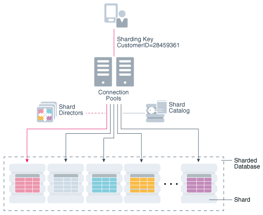

## 1 Introduction to Oracle Database

### About Relational Databases

Every organization has information that it must store and manage to meet its requirements. For example, a corporation must collect and maintain human resources records for its employees. This information must be available to those who need it.

An [information system](glossary.md) is a formal system for storing and processing information. An information system could be a set of cardboard boxes containing manila folders along with rules for how to store and retrieve the folders. However, most companies today use a database to automate their information systems. A database is an organized collection of information treated as a unit. The purpose of a database is to collect, store, and retrieve related information for use by database applications.

- Database Management System (DBMS)  
	A database management system (DBMS) is software that controls the storage, organization, and retrieval of data.
- Relational Model  
	In his seminal 1970 paper "A Relational Model of Data for Large Shared Data Banks," E. F. Codd defined a relational model based on mathematical set theory. Today, the most widely accepted database model is the relational model.
- Relational Database Management System (RDBMS)  
	The relational model is the basis for a relational database management system (RDBMS). An RDBMS moves data into a database, stores the data, and retrieves it so that applications can manipulate it.
- Brief History of Oracle Database  
	The current version of Oracle Database is the result of over 40 years of innovative development.

**Parent topic:** Introduction to Oracle Database

#### Database Management System (DBMS)

A database management system (DBMS) is software that controls the storage, organization, and retrieval of data.

Typically, a DBMS has the following elements:

- Kernel code
	This code manages memory and storage for the DBMS.
- Repository of metadata
	This repository is usually called a [data dictionary](glossary.md).
- Query language
	This language enables applications to access the data.

A [database application](glossary.md) is a software program that interacts with a database to access and manipulate data.

The first generation of database management systems included the following types:

- Hierarchical
	A [hierarchical database](glossary.md) organizes data in a tree structure. Each parent record has one or more child records, similar to the structure of a file system.
- Network
	A [network database](glossary.md) is similar to a hierarchical database, except records have a many-to-many rather than a one-to-many relationship.

The preceding database management systems stored data in rigid, predetermined relationships. Because no data definition language existed, changing the structure of the data was difficult. Also, these systems lacked a simple query language, which hindered application development.

**Parent topic:** About Relational Databases

#### Relational Model

In his seminal 1970 paper "A Relational Model of Data for Large Shared Data Banks," E. F. Codd defined a relational model based on mathematical set theory. Today, the most widely accepted database model is the relational model.

A [relational database](glossary.md) is a database that conforms to the relational model. The relational model has the following major aspects:

- Structures
	Well-defined objects store or access the data of a database.
- Operations
	Clearly defined actions enable applications to manipulate the data and structures of a database.
- Integrity rules
	Integrity rules govern operations on the data and structures of a database.

A relational database stores data in a set of simple relations. A [relation](glossary.md) is a set of tuples. A [tuple](glossary.md) is an unordered set of attribute values.

A [table](glossary.md) is a two-dimensional representation of a relation in the form of rows (tuples) and columns (attributes). Each row in a table has the same set of columns. A relational database is a database that stores data in relations (tables). For example, a relational database could store information about company employees in an employee table, a department table, and a salary table.

#### Relational Database Management System (RDBMS)

The relational model is the basis for a relational database management system (RDBMS). An RDBMS moves data into a database, stores the data, and retrieves it so that applications can manipulate it.

An RDBMS distinguishes between the following types of operations:

- Logical operations
	In this case, an application specifies what content is required. For example, an application requests an employee name or adds an employee record to a table.
- Physical operations
	In this case, the RDBMS determines how things should be done and carries out the operation. For example, after an application queries a table, the database may use an index to find the requested rows, read the data into memory, and perform many other steps before returning a result to the user. The RDBMS stores and retrieves data so that physical operations are transparent to database applications.

Oracle Database is an RDBMS. An RDBMS that implements object-oriented features such as user-defined types, inheritance, and polymorphism is called an [object-relational database management system (ORDBMS)](glossary.md). Oracle Database has extended the relational model to an object-relational model, making it possible to store complex business models in a relational database.

**Parent topic:** About Relational Databases

#### Brief History of Oracle Database

The current version of Oracle Database is the result of over 40 years of innovative development.

Highlights in the evolution of Oracle Database include the following:

- Founding of Oracle Corporation
	In 1977, Larry Ellison, Bob Miner, and Ed Oates started the consultancy Software Development Laboratories, which became Relational Software, Inc. (RSI). In 1983, RSI became Oracle Systems Corporation and then later Oracle Corporation.
- First commercially available RDBMS
	In 1979, RSI introduced Oracle V2 (Version 2) as the first commercially available [SQL](glossary.md) -based RDBMS, a landmark event in the history of relational databases.
- Portable version of Oracle Database
	Oracle Version 3, released in 1983, was the first relational database to run on mainframes, minicomputers, and personal computers. The database was written in C, enabling the database to be ported to multiple platforms.
- Enhancements to concurrency control, data distribution, and scalability
	Version 4 introduced multiversion [read consistency](glossary.md). Version 5, released in 1985, supported client/server computing and [distributed database](glossary.md) systems. Version 6 brought enhancements to disk I/O, row locking, scalability, and backup and recovery. Also, Version 6 introduced the first version of the [PL/SQL](glossary.md) language, a proprietary procedural extension to SQL.
- PL/SQL stored program units
	Oracle7, released in 1992, introduced PL/SQL stored procedures and triggers.
- Objects and partitioning
	Oracle8 was released in 1997 as the object-relational database, supporting many new data types. Additionally, Oracle8 supported partitioning of large tables.
- Internet computing
	Oracle8i Database, released in 1999, provided native support for internet protocols and server-side support for Java. Oracle8i was designed for internet computing, enabling the database to be deployed in a multitier environment.
- Oracle Real Application Clusters (Oracle RAC)
	Oracle9i Database introduced Oracle RAC in 2001, enabling multiple instances to access a single database simultaneously. Additionally, Oracle XML Database ([Oracle XML DB](glossary.md)) introduced the ability to store and query XML.
- Grid computing
	Oracle Database 10g introduced [grid computing](glossary.md) in 2003. This release enabled organizations to virtualize computing resources by building a [grid infrastructure](glossary.md) based on low-cost commodity servers. A key goal was to make the database self-managing and self-tuning. [Oracle Automatic Storage Management (Oracle ASM)](glossary.md) helped achieve this goal by virtualizing and simplifying database storage management.
- Manageability, diagnosability, and availability
	Oracle Database 11g, released in 2007, introduced a host of new features that enabled administrators and developers to adapt quickly to changing business requirements. The key to adaptability is simplifying the information infrastructure by consolidating information and using automation wherever possible.
- Plugging In to the Cloud
	Oracle Database 12c, released in 2013, was designed for the Cloud, featuring a new Multitenant architecture, In-Memory Column Store (IM column store), and support for JSON documents. Oracle Database 12c helped DBAs make more efficient use of their IT resources, while continuing to reduce costs and improve service levels for end users.
- Integration and memory performance
	Oracle Database 18c simplified integration with directory services such as Microsoft Active Directory. It also introduced functionality to exploit memory for columnar data models and high-speed row access.
- Enhanced stability
	Oracle Database 19c was the long-support version of the Oracle Database 12c (Release 12.2) family of products. A major focus of this release was stability. Oracle Database 19c also introduced several small but significant improvements to features such as JSON and Active Data Guard.
- Improved developer experience
	Oracle Database 21c improves the developer experience with features such as Oracle Blockchain Tables and native JSON data types. Enhancements to Automatic In-Memory make the IM column store largely self-managing.

**Parent topic:** About Relational Databases

### Schema Objects

One characteristic of an RDBMS is the independence of physical data storage from logical data structures.

In Oracle Database, a database [schema](glossary.md) is a collection of logical data structures, or schema objects. A database user owns a database schema, which has the same name as the [user name](glossary.md).

Schema objects are user-created structures that directly refer to the data in the database. The database supports many types of schema objects, the most important of which are tables and indexes.

A schema object is one type of [database object](glossary.md). Some database objects, such as profiles and roles, do not reside in schemas.

- Tables  
	A table describes an entity such as employees.
- Indexes  
	An **index** is an optional data structure that you can create on one or more columns of a table. Indexes can increase the performance of data retrieval.

See Also:

" [Introduction to Schema Objects](tables-and-table-clusters.md) " to learn more about schema object types, storage, and dependencies

**Parent topic:** Introduction to Oracle Database

#### Tables

A table describes an entity such as employees.

You define a table with a table name, such as `employees`, and set of columns. In general, you give each [column](glossary.md) a name, a [data type](glossary.md), and a width when you create the table.

A table is a set of rows. A column identifies an attribute of the entity described by the table, whereas a [row](glossary.md) identifies an instance of the entity. For example, attributes of the employees entity correspond to columns for employee ID and last name. A row identifies a specific employee.

You can optionally specify a rule, called an [integrity constraint](glossary.md), for a column. One example is a `NOT NULL` integrity constraint. This constraint forces the column to contain a value in every row.

See Also:

- " [Overview of Tables](tables-and-table-clusters.md) " to learn about columns and rows, data types, table storage, and table compression
- " [Data Integrity](data-integrity.md) " to learn about the possible types and states of constraints

**Parent topic:** Schema Objects

#### Indexes

An **index** is an optional data structure that you can create on one or more columns of a table. Indexes can increase the performance of data retrieval.

When processing a request, the database can use available indexes to locate the requested rows efficiently. Indexes are useful when applications often query a specific row or range of rows.

Indexes are logically and physically independent of the data. Thus, you can drop and create indexes with no effect on the tables or other indexes. All applications continue to function after you drop an index.

See Also:

" [Introduction to Indexes](indexes-and-index-organized-tables.md) " to learn about the purpose and types of indexes

**Parent topic:** Schema Objects

### Data Access

A general requirement for a DBMS is to adhere to accepted industry standards for a data access language.

- Structured Query Language (SQL)  
	SQL is a set-based declarative language that provides an interface to an RDBMS such as Oracle Database.
- PL/SQL and Java  
	**PL/SQL** is a procedural extension to Oracle SQL.

**Parent topic:** Introduction to Oracle Database

#### Structured Query Language (SQL)

SQL is a set-based declarative language that provides an interface to an RDBMS such as Oracle Database.

Procedural languages such as C describe how things should be done. SQL is nonprocedural and describes what should be done.

SQL is the ANSI standard language for relational databases. All operations on the data in an Oracle database are performed using SQL statements. For example, you use SQL to create tables and query and modify data in tables.

A SQL statement can be thought of as a very simple, but powerful, computer program or instruction. Users specify the result that they want (for example, the names of employees), not how to derive it. A SQL statement is a string of SQL text such as the following:

```
SELECT first_name, last_name FROM employees;
```

SQL statements enable you to perform the following tasks:

- Query data
- Insert, update, and delete rows in a table
- Create, replace, alter, and drop objects
- Control access to the database and its objects
- Guarantee database consistency and integrity

SQL unifies the preceding tasks in one consistent language. [Oracle SQL](glossary.md) is an implementation of the ANSI standard. Oracle SQL supports numerous features that extend beyond standard SQL.

See Also:

" [SQL](sql.md) " to learn more about SQL standards and the main types of SQL statements

**Parent topic:** Data Access

#### PL/SQL and Java

**PL/SQL** is a procedural extension to Oracle SQL.

PL/SQL is integrated with Oracle Database, enabling you to use all of the Oracle Database SQL statements, functions, and data types. You can use PL/SQL to control the flow of a SQL program, use variables, and write error-handling procedures.

A primary benefit of PL/SQL is the ability to store application logic in the database itself. A [PL/SQL procedure](glossary.md) or [function](glossary.md) is a schema object that consists of a set of SQL statements and other PL/SQL constructs, grouped together, stored in the database, and run as a unit to solve a specific problem or to perform a set of related tasks. The principal benefit of server-side programming is that built-in functionality can be deployed anywhere.

Oracle Database can also store program units written in Java. A Java stored procedure is a Java method published to SQL and stored in the database for general use. You can call existing PL/SQL programs from Java and Java programs from PL/SQL.

See Also:

- " [Server-Side Programming: PL/SQL and Java](server-side-programming.md) "
- [Oracle Database Development Guide](https://docs.oracle.com/pls/topic/lookup?ctx=en/database/oracle/oracle-database/21/cncpt&id=ADFNS-GUID-595BF48C-CAA2-4872-8A8C-0EE7B21C8E10) to learn more about choosing a programming environment

**Parent topic:** Data Access

### Transaction Management

Oracle Database is designed as a multiuser database. The database must ensure that multiple users can work concurrently without corrupting one another's data.

- Transactions  
	A **transaction** is a logical, atomic unit of work that contains one or more SQL statements.
- Data Concurrency  
	A requirement of a multiuser RDBMS is the control of **data concurrency**, which is the simultaneous access of the same data by multiple users.
- Data Consistency  
	In Oracle Database, each user must see a consistent view of the data, including visible changes made by a user's own transactions and committed transactions of other users.

**Parent topic:** Introduction to Oracle Database

#### Transactions

A **transaction** is a logical, atomic unit of work that contains one or more SQL statements.

An RDBMS must be able to group SQL statements so that they are either all committed, which means they are applied to the database, or all rolled back, which means they are undone.

An illustration of the need for transactions is a funds transfer from a savings account to a checking account. The transfer consists of the following separate operations:

1. Decrease the savings account.
2. Increase the checking account.
3. Record the transaction in the transaction journal.

Oracle Database guarantees that all three operations succeed or fail as a unit. For example, if a hardware failure prevents a statement in the transaction from executing, then the other statements must be rolled back.

Transactions are one feature that set Oracle Database apart from a file system. If you perform an atomic operation that updates several files, and if the system fails halfway through, then the files will not be consistent. In contrast, a transaction moves an Oracle database from one consistent state to another. The basic principle of a transaction is "all or nothing": an atomic operation succeeds or fails as a whole.

See Also:

" [Transactions](transactions.md) " to learn about the definition of a transaction, statement-level atomicity, and transaction control

**Parent topic:** Transaction Management

#### Data Concurrency

A requirement of a multiuser RDBMS is the control of **data concurrency**, which is the simultaneous access of the same data by multiple users.

Without concurrency controls, users could change data improperly, compromising [data integrity](glossary.md). For example, one user could update a row while a different user simultaneously updates it.

If multiple users access the same data, then one way of managing concurrency is to make users wait. However, the goal of a DBMS is to reduce wait time so it is either nonexistent or negligible. All SQL statements that modify data must proceed with as little interference as possible. Destructive interactions, which are interactions that incorrectly update data or alter underlying data structures, must be avoided.

Oracle Database uses locks to control concurrent access to data. A [lock](glossary.md) is a mechanism that prevents destructive interaction between transactions accessing a shared resource. Locks help ensure data integrity while allowing maximum concurrent access to data.

See Also:

" [Overview of the Oracle Database Locking Mechanism](data-concurrency-and-consistency.md) "

**Parent topic:** Transaction Management

#### Data Consistency

In Oracle Database, each user must see a consistent view of the data, including visible changes made by a user's own transactions and committed transactions of other users.

For example, the database must prevent the [dirty read](glossary.md) problem, which occurs when one transaction sees uncommitted changes made by another concurrent transaction.

Oracle Database always enforces statement-level [read consistency](glossary.md), which guarantees that the data that a single query returns is committed and consistent for a single point in time. Depending on the transaction isolation level, this point is the time at which the statement was opened or the time the transaction began. The Oracle Flashback Query feature enables you to specify this point in time explicitly.

The database can also provide read consistency to all queries in a transaction, known as transaction-level read consistency. In this case, each statement in a transaction sees data from the same point in time, which is the time at which the transaction began.

See Also:

- " [Data Concurrency and Consistency](data-concurrency-and-consistency.md) " to learn more about dirty reads
- [Oracle Database Development Guide](https://docs.oracle.com/pls/topic/lookup?ctx=en/database/oracle/oracle-database/21/cncpt&id=ADFNS01003) to learn about Oracle Flashback Query

**Parent topic:** Transaction Management

### Oracle Database Architecture

A database server is the key to information management.

In general, a [server](glossary.md) reliably manages a large amount of data in a multiuser environment so that users can concurrently access the same data. A database server also prevents unauthorized access and provides efficient solutions for failure recovery.

- Database and Instance  
	An Oracle database server consists of a database and at least one **database instance**, commonly referred to as simply an **instance**.
- Database Storage Structures  
	A database can be considered from both a physical and logical perspective.
- Database Instance Structures  
	An Oracle database uses memory structures and processes to manage and access the CDB. All memory structures exist in the main memory of the computers that constitute the RDBMS.
- Application and Networking Architecture  
	To take full advantage of a given computer system or network, Oracle Database enables processing to be split between the database server and the client programs. The computer running the RDBMS handles the database server responsibilities while the computers running the applications handle the interpretation and display of data.

**Parent topic:** Introduction to Oracle Database

#### Database and Instance

An Oracle database server consists of a database and at least one **database instance**, commonly referred to as simply an **instance**.

Because an instance and a database are so closely connected, the term **Oracle database** sometimes refers to both instance and database. In the strictest sense, the terms have the following meanings:

- Database
	A database is a set of files, located on disk, that store user data. These data files can exist independently of a database instance. Starting in Oracle Database 21c, "database" refers specifically to the data files of a **multitenant container database (CDB)**, **pluggable database (PDB)**, or **application container**.
- Database instance
	An instance is a named set of memory structures that manage database files. A database instance consists of a shared memory area, called the **system global area (SGA)**, and a set of background processes. An instance can exist independently of database files.

- Multitenant Architecture  
	The **multitenant architecture** enables an Oracle database to be a CDB.
- Sharding Architecture  
	Oracle Sharding is a database scaling technique based on horizontal partitioning of data across multiple PDBs. Applications perceive the pool of PDBs as a single logical database.

**Parent topic:** Oracle Database Architecture

##### Multitenant Architecture

The **multitenant architecture** enables an Oracle database to be a CDB.

Every Oracle database must contain or be able to be contained by another database. For example, a CDB contains PDBs, and an application container contains application PDBs. A PDB is contained by a CDB or application container, and an application container is contained by a CDB.

Starting in Oracle Database 21c, a multitenant container database is the only supported architecture. In previous releases, Oracle supported non-container databases (non-CDBs).

- CDBs  
	A CDB contains one or more user-created PDBs and application containers.
- PDBs  
	A **PDB** is a portable collection of schemas, schema objects, and nonschema objects that appears to an application as a separate database.
- Application Containers  
	An **application container** is an optional, user-created container within a CDB that stores data and metadata for one or more applications.

**Parent topic:** Database and Instance

###### CDBs

A CDB contains one or more user-created PDBs and application containers.

At the physical level, a CDB is a set of files: control file, online redo log files, and data files. The database instance manages the files that make up the CDB.

The following figure shows a CDB and an associated database instance.

Figure 1-1 Database Instance and CDB


> The graphic shows the SGA. Within the SGA are the Database Buffer Cache, Redo Log Buffer, Shared Pool, Large Pool, Fixed SGA, Java Pool, and Streams Pool. To the right of the SGA are the background processes PMON, SMON, RECO, MMON, MMNL, and Others. Below the SGA are DBWn, CKPT, LGWR, ARCn, and RVWR. Below the SGA are the PGA and Server Process. The Server Process is connected to a Client Process. To the right of the Client Process are Database Files (Data Files, Control Files, Online Redo Log), Archived Redo Log, and Flashback Log.


**Parent topic:** Multitenant Architecture

###### PDBs

A **PDB** is a portable collection of schemas, schema objects, and nonschema objects that appears to an application as a separate database.

At the physical level, each PDB has its own set of data files that store the data for the PDB. The CDB includes all the data files for the PDBs contained within it, and a set of system data files that store metadata for the CDB itself.

To move or archive a PDB, you can unplug it. An unplugged PDB consists of the PDB data files and a metadata file. An unplugged PDB is not usable until it is plugged in to a CDB.

The following figure shows a CDB named `MYCDB`.

Figure 1-2 PDBs in a CDB


> This graphic depicts a server computer. On this computer is a cylinder representing a database. The database is labeled "CDB." Inside the cylinder is a three-dimensional oblong box labeled "Root (CDB$ROOT)." Two smaller cylinders are plugged into the box. One cylinder is labeled "hrpdb." The other cylinder is labeled "salespdb." A box labeled Sales Application points to salespdb. A box labeled HR Application points to hrpdb.


Physically, `MYCDB` is an Oracle database, in the sense of a set of data files associated with an instance. `MYCDB` has one database instance, although multiple instances are possible in Oracle Real Application Clusters, and one set of database files.

`MYCDB` contains two PDBs: `hrpdb` and `salespdb`. As shown in Figure 1-2, these PDBs appear to their respective applications as separate, independent databases. An application has no knowledge of whether it is connecting to a CDB or PDB.

To administer the CDB itself or any PDB within it, you can connect to the [CDB root](glossary.md). The root is a collection of schemas, schema objects, and nonschema objects to which all PDBs and application containers belong.

**Parent topic:** Multitenant Architecture

###### Application Containers

An **application container** is an optional, user-created container within a CDB that stores data and metadata for one or more applications.

In this context, an [application](glossary.md) (also called the master application definition) is a named, versioned set of common data and metadata stored in the [application root](glossary.md). For example, the application might include definitions of tables, views, user accounts, and PL/SQL packages that are common to a set of PDBs.

In some ways, an application container functions as an application-specific CDB within a CDB. An application container, like the CDB itself, can include multiple application PDBs, and enables these PDBs to share metadata and data. At the physical level, an application container has its own set of data files, just like a PDB.

For example, a SaaS deployment can use multiple application PDBs, each for a separate customer, which share application metadata and data. For example, in the following figure, `sales_app` is the application model in the application root. The [application PDB](glossary.md) named `cust1_pdb` contains sales data only for customer 1, whereas the application PDB named `cust2_pdb` contains sales data only for customer 2. Plugging, unplugging, cloning, and other PDB-level operations are available for individual customer PDBs.

Figure 1-3 SaaS Use Case


> This graphic depicts a three-dimension box labeled Root (CDB$ROOT). Below the Root and on the left, a cylinder with a USB connector plugs into the Root box. The cylinder is labeled Seed (PDB$SEED). Below the box and on the right, a box labeled Application Root is plugged into the Root. The connector is labeled Application Container. Application Root contains a smaller box labeled sales\_app. Plugged into the Application Root are Application Seed, cust1\_pdb, and cust2\_pdb. The latter two are labeled Application PDBs.


**Parent topic:** Multitenant Architecture

##### Sharding Architecture

Oracle Sharding is a database scaling technique based on horizontal partitioning of data across multiple PDBs. Applications perceive the pool of PDBs as a single logical database.

Key benefits of sharding for OLTP applications include linear scalability, fault containment, and geographical data distribution. Sharding is well suited to deployment in the Oracle Cloud. Unlike NoSQL data stores that implement sharding, Oracle Sharding provides the benefits of sharding without sacrificing the capabilities of an enterprise RDBMS.

In a sharding architecture, each CDB is hosted on a dedicated server with its own local resources: CPU, memory, flash, or disk. You can designate a PDB as a **shard**. PDB shards from different CDBs make up a single logical database, which is referred to as a **sharded database**. Two shards in the same CDB cannot be members of the same sharded database. However, within the same CDB, one PDB could be in one sharded database, and another PDB could be in a separate sharded database.

Horizontal partitioning involves splitting a database table across shards so that each shard contains the table with the same columns but a different subset of rows. A table split up in this manner is also known as a **sharded table**. The following figure shows a sharded table horizontally partitioned across three shards, each of which is a PDB in a separate CDB.

Figure 1-4 Horizontal Partitioning of a Table Across Shards


> On the left is a large cylinder labeled “Server.” This cylinder contains a table with different colored rows. Underneath, the caption says “Unsharded table in 1 one database.” This graphic shows three cylinders: Server A, Server B, and Server C. Each cylinder contains a different colored table. The caption says “Shared table in 3 databases.”


A use case is distributing customer account data across multiple CDBs. For example, a customer with ID 28459361 may look up his records. The following figure shows a possible architecture. The customer request is routed through a connection pool, where sharding directors (network listeners) direct the request to the appropriate PDB shard, which contains all the customer rows.

Figure 1-5 Oracle Sharding Architecture



> The graphic shows a unidirectional flow from the customer’s client application at the top to the database shards at the bottom. The client application icon is represented with a mobile device with a person next to it. An arrow points from the client application to two server icons below it that are labeled Connection Pools. To the right of arrow between the client and the connection pools are the words "Sharding Key CustomerID=28459361."
>
> Underneath the connection pools icon are five arrows, of which the leftmost arrow is red and the remaining 4 arrows are black, pointing down to five cylinders in a row, one of which is labeled "Shard." A dashed line surrounds the shard cylinders and the line is labeled "Sharded Database" indicating that the cylinders within the dashed line are the shards in a sharded database.
>
> To the left of the arrows pointing to the shards is an icon with 3 layers labeled “Shard Directors” and there is a dashed red line with no arrow between the shard directors icon and the arrows pointing to the shards.
>
> To the right of the arrows pointing to the shards is an icon with a cylinder and a square labeled “Shard Catalog” and there is a solid grey line with no arrow between the shard catalog icon and the arrows pointing to the shards.


See Also:

[Using Oracle Sharding](https://docs.oracle.com/pls/topic/lookup?ctx=en/database/oracle/oracle-database/21/cncpt&id=SHARD-GUID-0F39B1FB-DCF9-4C8A-A2EA-88705B90C5BF) for an overview of Oracle Sharding

**Parent topic:** Database and Instance

#### Database Storage Structures

A database can be considered from both a physical and logical perspective.

Physical data is data viewable at the operating system level. For example, operating system utilities such as the Linux `ls` and `ps` can list database files and processes. Logical data such as a table is meaningful only for the database. A SQL statement can list the tables in an Oracle database, but an operating system utility cannot.

The database has physical structures and logical structures. Because the physical and logical structures are separate, you can manage the physical storage of data without affecting access to logical storage structures. For example, renaming a physical database file does not rename the tables whose data is stored in this file.

- Physical Storage Structures  
	The physical database structures are the files that store the data.
- Logical Storage Structures  
	Logical storage structures enable Oracle Database to have fine-grained control of disk space use.

**Parent topic:** Oracle Database Architecture

##### Physical Storage Structures

The physical database structures are the files that store the data.

When you execute a `CREATE DATABASE` command, you create a CDB. The following files are created:

- Data files
	Every CDB has one or more physical data files, which contain all the database data. The data of logical database structures, such as tables and indexes, is physically stored in the data files.
- Control files
	Every CDB has a [control file](glossary.md). A control file contains metadata specifying the physical structure of the database, including the database name and the names and locations of the database files.
- Online redo log files
	Every CDB has an [online redo log](glossary.md), which is a set of two or more online redo log files. An online [redo log](glossary.md) is made up of redo entries (also called redo log records), which record all changes made to data.

When you execute a `CREATE PLUGGABLE DATABASE` command within a CDB, you create a PDB. The PDB contains a dedicated set of data files within the CDB. A PDB does not have a separate, dedicated control file and online redo log: these files are shared by the PDBs.

Many other files are important for the functioning of a CDB. These include parameter files and networking files. Backup files and archived redo log files are offline files important for backup and recovery.

See Also:

" [Physical Storage Structures](physical-storage-structures.md) "

**Parent topic:** Database Storage Structures

##### Logical Storage Structures

Logical storage structures enable Oracle Database to have fine-grained control of disk space use.

This topic discusses logical storage structures:

- Data blocks
	At the finest level of granularity, Oracle Database data is stored in data blocks. One [data block](glossary.md) corresponds to a specific number of bytes on disk.
- Extents
	An [extent](glossary.md) is a specific number of logically contiguous data blocks, obtained in a single allocation, used to store a specific type of information.
- Segments
	A [segment](glossary.md) is a set of extents allocated for a user object (for example, a table or index), [undo data](glossary.md), or temporary data.
- Tablespaces
	A database is divided into logical storage units called tablespaces. A [tablespace](glossary.md) is the logical container for segments. Each tablespace consists of at least one data file.

See Also:

" [Logical Storage Structures](logical-storage-structures.md) "

**Parent topic:** Database Storage Structures

#### Database Instance Structures

An Oracle database uses memory structures and processes to manage and access the CDB. All memory structures exist in the main memory of the computers that constitute the RDBMS.

When applications connect to a CDB or PDB, they connect to a [database instance](glossary.md). The instance services applications by allocating other memory areas in addition to the SGA, and starting other processes in addition to background processes.

- Oracle Database Processes  
	A process is a mechanism in an operating system that can run a series of steps. Some operating systems use the terms job, task, or thread.
- Instance Memory Structures  
	Oracle Database creates and uses memory structures for program code, data shared among users, and private data areas for each connected user.

**Parent topic:** Oracle Database Architecture

##### Oracle Database Processes

A process is a mechanism in an operating system that can run a series of steps. Some operating systems use the terms job, task, or thread.

For the purposes of this topic, a thread is equivalent to a process. An Oracle database instance has the following types of processes:

- Client processes
	These processes are created and maintained to run the software code of an application program or an Oracle tool. Most environments have separate computers for client processes.
- Background processes
	These processes consolidate functions that would otherwise be handled by multiple Oracle Database programs running for each client process. Background processes asynchronously perform I/O and monitor other Oracle Database processes to provide increased parallelism for better performance and reliability.
- Server processes
	These processes communicate with client processes and interact with Oracle Database to fulfill requests.

Oracle processes include server processes and background processes. In most environments, Oracle processes and client processes run on separate computers.

See Also:

" [Process Architecture](process-architecture.md) "

**Parent topic:** Database Instance Structures

##### Instance Memory Structures

Oracle Database creates and uses memory structures for program code, data shared among users, and private data areas for each connected user.

The following memory structures are associated with a database instance:

- System Global Area (SGA)
	The SGA is a group of shared memory structures that contain data and control information for one database instance. Examples of SGA components include the database buffer cache and shared SQL areas. The SGA can contain an optional [In-Memory Column Store](glossary.md) (IM column store), which enables data to be populated in memory in a [columnar format](glossary.md).
- Program Global Areas (PGA)
	A PGA is a memory region that contains data and control information for a server or background process. Access to the PGA is exclusive to the process. Each server process and background process has its own PGA.
	See Also:
	" [Memory Architecture](memory-architecture.md) "

**Parent topic:** Database Instance Structures

#### Application and Networking Architecture

To take full advantage of a given computer system or network, Oracle Database enables processing to be split between the database server and the client programs. The computer running the RDBMS handles the database server responsibilities while the computers running the applications handle the interpretation and display of data.

- Application Architecture  
	The application architecture is the computing environment in which a database application connects to an Oracle database. The two most common database architectures are client/server and multitier.
- Oracle Net Services Architecture  
	**Oracle Net Services** is the interface between the database and the network communication protocols that facilitate distributed processing and distributed databases.

**Parent topic:** Oracle Database Architecture

##### Application Architecture

The application architecture is the computing environment in which a database application connects to an Oracle database. The two most common database architectures are client/server and multitier.

Client-Server Architecture

In a [client/server architecture](glossary.md), the client application initiates a request for an operation to be performed on the database server. The server runs Oracle Database software and handles the functions required for concurrent, shared data access. The server receives and processes requests that originate from clients.

Multitier Architecture

In a [multitier architecture](glossary.md), one or more application servers perform parts of the operation. An [application server](glossary.md) contains a large part of the application logic, provides access to the data for the client, and performs some query processing. In this way, the load on the database decreases. The application server can serve as an interface between clients and multiple databases and provide an additional level of security.

A [service-oriented architecture (SOA)](glossary.md) is a multitier architecture in which application functionality is encapsulated in services. SOA services are usually implemented as Web services. Web services are accessible through HTTP and are based on XML-based standards such as Web Services Description Language (WSDL) and SOAP. Oracle Database can act as a Web service provider in a traditional multitier or SOA environment.

**Simple Oracle Document Access (SODA)** is an adaption of SOA that enables you to access to data stored in the database. SODA is designed for schemaless application development without knowledge of relational database features or languages such as SQL and PL/SQL. You can create and store collections of documents in Oracle Database, retrieve them, and query them, without needing to know how the documents are stored. SODA for REST uses the representational state transfer (REST) architectural style to implement SODA.

See Also:

- " [Overview of Multitier Architecture](application-and-networking-architecture.md) "
- [Oracle XML DB Developer’s Guide](https://docs.oracle.com/pls/topic/lookup?ctx=en/database/oracle/oracle-database/21/cncpt&id=ADXDB-GUID-108279B4-0315-4D8D-86A2-6487767ED280) for more information about using Web services with the database

**Parent topic:** Application and Networking Architecture

##### Oracle Net Services Architecture

**Oracle Net Services** is the interface between the database and the network communication protocols that facilitate distributed processing and distributed databases.

Communication protocols define the way that data is transmitted and received on a network. Oracle Net Services supports communications on all major network protocols, including TCP/IP, HTTP, FTP, and WebDAV.

[Oracle Net](glossary.md), a component of Oracle Net Services, establishes and maintains a network session from a client application to a database server. After a network session is established, Oracle Net acts as the data courier for both the client application and the database server, exchanging messages between them. Oracle Net can perform these jobs because it is located on each computer in the network.

An important component of Net Services is the [Oracle Net Listener](glossary.md) (called the listener), which is a process that runs on the database or elsewhere in the network. Client applications send connection requests to the listener, which manages the traffic of these requests to the database. When a connection is established, the client and database communicate directly.

The most common ways to configure an Oracle database to service client requests are:

- Dedicated server architecture
	Each client process connects to a [dedicated server](glossary.md) process. The server process is not shared by any other client for the duration of the client's session. Each new session is assigned a dedicated server process.
- Shared server architecture
	The database uses a pool of [shared server](glossary.md) processes for multiple sessions. A client process communicates with a [dispatcher](glossary.md), which is a process that enables many clients to connect to the same database instance without the need for a dedicated server process for each client.

See Also:

- " [Overview of Oracle Net Services Architecture](application-and-networking-architecture.md) "
- [Oracle Database Net Services Administrator's Guide](https://docs.oracle.com/pls/topic/lookup?ctx=en/database/oracle/oracle-database/21/cncpt&id=NETAG1511) to learn more about Oracle Net architecture
- [Oracle XML DB Developer’s Guide](https://docs.oracle.com/pls/topic/lookup?ctx=en/database/oracle/oracle-database/21/cncpt&id=ADXDB-GUID-0F06D44E-4DBD-4B5D-B275-A4BADA0510AB) for information about using WebDAV with the database

**Parent topic:** Application and Networking Architecture

### Oracle Database Documentation Roadmap

The documentation set is designed with specific access paths to ensure that users are able to find the information they need as efficiently as possible.

The documentation set is divided into three layers or groups: basic, intermediate, and advanced. Users begin with the manuals in the basic group, proceed to the manuals in the intermediate group (the 2 Day + series), and finally to the advanced manuals, which include the remainder of the documentation.

You can find the documentation for supported releases of Oracle Database at [https://docs.oracle.com/en/database/oracle/oracle-database/](https://docs.oracle.com/en/database/oracle/oracle-database/).

- Oracle Database Documentation: Basic Group  
	Technical users who are new to Oracle Database begin by reading one or more manuals in the basic group from cover to cover. Each manual in this group is designed to be read in two days.
- Oracle Database Documentation: Intermediate Group  
	The next step up from the basic group is the intermediate group.
- Oracle Database Documentation: Advanced Group  
	The advanced group manuals are intended for expert users who require more detailed information about a particular topic than can be provided by the 2 Day + manuals.

**Parent topic:** Introduction to Oracle Database

#### Oracle Database Documentation: Basic Group

Technical users who are new to Oracle Database begin by reading one or more manuals in the basic group from cover to cover. Each manual in this group is designed to be read in two days.

In addition to this manual, the basic group includes the manuals shown in the following table.

Table 1-1 Basic Group

| Manual | Description |
| --- | --- |
| [Oracle Database 2 Day Developer's Guide](https://docs.oracle.com/pls/topic/lookup?ctx=en/database/oracle/oracle-database/21/cncpt&id=GUID-AE8B7A74-AD1F-4474-B0CF-B3E95D075DDA) | This task-based quick start guide explains how to use the basic features of Oracle Database through SQL and PL/SQL. |

The manuals in the basic group are closely related, which is reflected in the number of cross-references. For example, Oracle Database Concepts frequently sends users to a 2 Day manual to learn how to perform a task based on a concept. The 2 Day manuals frequently reference Oracle Database Concepts for conceptual background about a task.

**Parent topic:** Oracle Database Documentation Roadmap

#### Oracle Database Documentation: Intermediate Group

The next step up from the basic group is the intermediate group.

Manuals in the intermediate group are prefixed with the word 2 Day + because they expand on and assume information contained in the 2 Day manuals. The 2 Day + manuals cover topics in more depth than is possible in the basic manuals, or cover topics of special interest. The manuals are intended for different audiences:

- Database administrators
	[Oracle Database 2 Day + Performance Tuning Guide](https://docs.oracle.com/pls/topic/lookup?ctx=en/database/oracle/oracle-database/21/cncpt&id=GUID-CEF73784-0C70-415A-ACB6-72504CC10B70) is a quick start guide that describes how to perform day-to-day database performance tuning tasks using features provided by Oracle Diagnostics Pack, Oracle Tuning Pack, and Oracle Enterprise Manager Cloud Control (Cloud Control).
- Database developers
	[Oracle Database 2 Day + Java Developer's Guide](https://docs.oracle.com/pls/topic/lookup?ctx=en/database/oracle/oracle-database/21/cncpt&id=GUID-8C73108B-E0F3-4CD5-A813-909B339339BB) helps you understand all Java products used to build a Java application. The manual explains how to use Oracle JDBC Thin driver, Universal Connection Pool (UCP), and Java in the Database (OJVM) in a sample Web application.

**Parent topic:** Oracle Database Documentation Roadmap

#### Oracle Database Documentation: Advanced Group

The advanced group manuals are intended for expert users who require more detailed information about a particular topic than can be provided by the 2 Day + manuals.

The following table lists essential reference manuals in the advanced group.

Table 1-2 Essential Reference Manuals

| Manual | Description |
| --- | --- |
| [Oracle Database SQL Language Reference](https://docs.oracle.com/pls/topic/lookup?ctx=en/database/oracle/oracle-database/21/cncpt&id=SQLRF-GUID-049B7AE8-11E1-4110-B3E4-D117907D77AC) | Provides a complete description of the Structured Query Language (SQL) used to manage information in an Oracle Database. |
| [Oracle Database Reference](https://docs.oracle.com/pls/topic/lookup?ctx=en/database/oracle/oracle-database/21/cncpt&id=REFRN-GUID-6F1C3203-0AA0-4AF1-921C-A027DD7CB6A9) | Describes database initialization parameters, data dictionary views, dynamic performance views, wait events, and background processes. |
| [Oracle Database PL/SQL Packages and Types Reference](https://docs.oracle.com/pls/topic/lookup?ctx=en/database/oracle/oracle-database/21/cncpt&id=ARPLS-GUID-4AA6AA30-CAEE-4DCD-B214-9AD51D0229B4) | Describes the PL/SQL packages provided with the Oracle database server. You can use the supplied packages when creating your applications or for ideas in creating your own stored procedures. |

The advanced guides are too numerous to list in this section. The following table lists guides that the majority of expert Oracle DBAs use.

Table 1-3 Advanced Group for DBAs

| Manual | Description |
| --- | --- |
| [Oracle Database Administrator’s Guide](https://docs.oracle.com/pls/topic/lookup?ctx=en/database/oracle/oracle-database/21/cncpt&id=ADMIN-GUID-EA8CC987-EF18-4434-B962-01312CD3A8AC) | Explains how to perform tasks such as creating and configuring databases, maintaining and monitoring databases, creating schema objects, scheduling jobs, and diagnosing problems. |
| [Oracle Database Security Guide](https://docs.oracle.com/pls/topic/lookup?ctx=en/database/oracle/oracle-database/21/cncpt&id=DBSEG-GUID-41040F53-D7A6-48FA-A92A-0C23118BC8A0) | Describes how to configure security for Oracle Database by using the default database features. |
| [Oracle Database Performance Tuning Guide](https://docs.oracle.com/pls/topic/lookup?ctx=en/database/oracle/oracle-database/21/cncpt&id=TGDBA-GUID-5C5C081B-A2C1-442D-9F11-A760234C8815) | Describes how to use Oracle Database tools to optimize database performance. This guide also describes performance best practices for creating a database and includes performance-related reference information. |
| [Oracle Database SQL Tuning Guide](https://docs.oracle.com/pls/topic/lookup?ctx=en/database/oracle/oracle-database/21/cncpt&id=TGSQL-GUID-B653E5F3-F078-4BBC-9516-B892960046A2) | Describes SQL processing, the optimizer, execution plans, SQL operators, optimizer statistics, application tracing, and SQL advisors. |
| [Oracle Database Backup and Recovery User’s Guide](https://docs.oracle.com/pls/topic/lookup?ctx=en/database/oracle/oracle-database/21/cncpt&id=BRADV-GUID-9997EF87-B293-44D4-92F3-DD938E79170D) | Explains how to back up, restore, and recover Oracle databases, perform maintenance on backups of database files, and transfer data between storage systems. |
| [Oracle Real Application Clusters Administration and Deployment Guide](https://docs.oracle.com/pls/topic/lookup?ctx=en/database/oracle/oracle-database/21/cncpt&id=RACAD-GUID-5A1B02A2-A327-42DD-A1AD-20610B2A9D92) | Explains how to install, configure, manage, and troubleshoot an Oracle RAC database. |

The following table lists guides that the majority of expert Oracle developers use.

Table 1-4 Advanced Group for Developers

| Manual | Description |
| --- | --- |
| [Oracle Database Development Guide](https://docs.oracle.com/pls/topic/lookup?ctx=en/database/oracle/oracle-database/21/cncpt&id=ADFNS-GUID-EBCEA9FE-4F25-40DF-B5FD-682C3692E92F) | Explains how to develop applications or convert existing applications to run in the Oracle Database environment. The manual explains fundamentals of application design, and describes essential concepts for developing in SQL and PL/SQL. |
| [Oracle Database PL/SQL Language Reference](https://docs.oracle.com/pls/topic/lookup?ctx=en/database/oracle/oracle-database/21/cncpt&id=LNPLS-GUID-2FBCFBBE-6B42-4DB8-83F3-55B63B75B1EB) | Describes all aspects of the PL/SQL language, including data types, control statements, collections, triggers, packages, and error handling. |
| [Oracle Database Java Developer’s Guide](https://docs.oracle.com/pls/topic/lookup?ctx=en/database/oracle/oracle-database/21/cncpt&id=JJDEV-GUID-912A14D4-2621-4955-85BD-A04E17EE6D21) | Describes how to develop, load, and run Java applications in Oracle Database. |
| [Oracle Database SecureFiles and Large Objects Developer's Guide](https://docs.oracle.com/pls/topic/lookup?ctx=en/database/oracle/oracle-database/21/cncpt&id=GUID-1A2B0023-9EE8-48AF-AA76-171D1FC5C241) | Explains how to develop new applications using Large Objects (LOBs), SecureFiles LOBs, and Database File System (DBFS). |

Other advanced guides required by a particular user depend on the area of responsibility of this user.

**Parent topic:** Oracle Database Documentation Roadmap