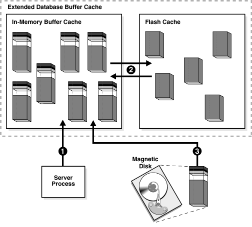
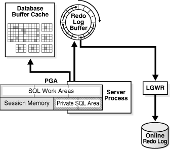
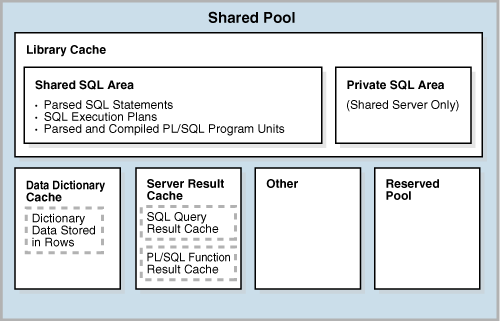
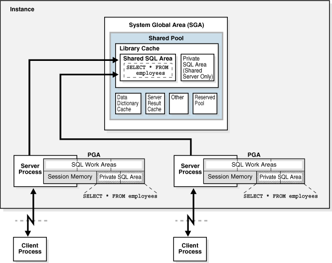
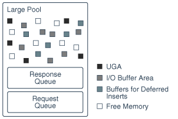
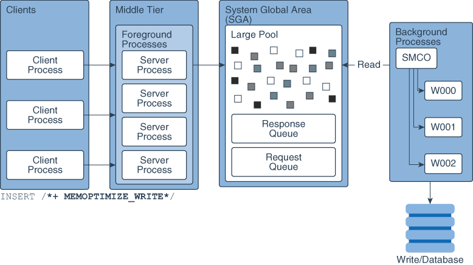
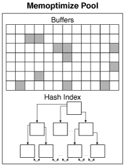

## 16 Memory Architecture

This chapter discusses the memory architecture of a database instance.

This chapter contains the following sections:

- Introduction to Oracle Database Memory Structures  
	When an instance is started, Oracle Database allocates a memory area and starts background processes.
- Overview of the User Global Area  
	The UGA is session memory, which is memory allocated for session variables, such as logon information, and other information required by a database session. Essentially, the UGA stores the session state.
- Overview of the Program Global Area (PGA)  
	The PGA is memory specific to an operating process or thread that is not shared by other processes or threads on the system. Because the PGA is process-specific, it is never allocated in the SGA.
- Overview of the System Global Area (SGA)  
	The SGA is a read/write memory area that, along with the Oracle background processes, form a database instance.
- Overview of Software Code Areas  
	A software code area is a portion of memory that stores code that is being run or can be run. Oracle Database code is stored in a software area that is typically more exclusive and protected than the location of user programs.

See Also:

[Oracle Database Administrator’s Guide](https://docs.oracle.com/pls/topic/lookup?ctx=en/database/oracle/oracle-database/21/cncpt&id=ADMIN00207) for instructions for configuring and managing memory

**Parent topic:** [Oracle Instance Architecture](oracle-instance-architecture.md)

### Introduction to Oracle Database Memory Structures

When an instance is started, Oracle Database allocates a memory area and starts background processes.

The memory area stores information such as the following:

- Program code
- Information about each connected [session](glossary.md), even if it is not currently active
- Information needed during program execution, for example, the current state of a [query](glossary.md) from which rows are being fetched
- Information such as [lock](glossary.md) data that is shared and communicated among processes
- Cached data, such as data blocks and redo records, that also exists on disk

- Basic Memory Structures  
	Oracle Database includes several memory areas, each of which contains multiple subcomponents.
- Oracle Database Memory Management  
	Memory management involves maintaining optimal sizes for the Oracle instance memory structures as demands on the database change. Oracle Database manages memory based on the settings of memory-related initialization parameters.

See Also:

" [Process Architecture](process-architecture.md) "

**Parent topic:** Memory Architecture

#### Basic Memory Structures

Oracle Database includes several memory areas, each of which contains multiple subcomponents.

The basic memory structures associated with Oracle Database include:

- System global area (SGA)
	The SGA is a group of shared memory structures, known as SGA components, that contain data and control information for one Oracle Database instance. All server and background processes share the SGA. Examples of data stored in the SGA include cached data blocks and shared SQL areas.
- Program global area (PGA)
	A PGA is a nonshared memory region that contains data and control information exclusively for use by an Oracle process. Oracle Database creates the PGA when an Oracle process starts.
	One PGA exists for each [server process](glossary.md) and background process. The collection of individual PGAs is the total instance PGA, or [instance PGA](glossary.md). Database initialization parameters set the size of the instance PGA, not individual PGAs.
- User global area (UGA)
	The UGA is memory associated with a user session.
- Software code areas
	Software code areas are portions of memory used to store code that is being run or can be run. Oracle Database code is stored in a software area that is typically at a different location from user programs—a more exclusive or protected location.

The following figure illustrates the relationships among these memory structures.

Figure 16-1 Oracle Database Memory Structures


> This image shows a large rounded-corner rectangle representing the SGA. Inside the SGA, arranged in two rows of four, are boxes for the Java pool, the buffer cache, the redo buffer, the result cache, the shared pool, the Streams pool, and the large pool. The last box is named Other Components. Outside the SGA, with arrows going back and forth to the SGA, is a box labeled Server Process containing the PGA. A Client Process box is outside the SGA and points to the Server Process box.


**Parent topic:** Introduction to Oracle Database Memory Structures

#### Oracle Database Memory Management

Memory management involves maintaining optimal sizes for the Oracle instance memory structures as demands on the database change. Oracle Database manages memory based on the settings of memory-related initialization parameters.

The basic options for memory management are as follows:

- Automatic memory management
	You specify the target size for the database instance memory. The instance automatically tunes to the target memory size, redistributing memory as needed between the SGA and the instance PGA.
- Automatic shared memory management
	This management mode is partially automated. You set a target size for the SGA and then have the option of setting an aggregate target size for the PGA or managing PGA work areas individually.
- Manual memory management
	Instead of setting the total memory size, you set many initialization parameters to manage components of the SGA and instance PGA individually.

If you create a database with Database Configuration Assistant (DBCA) and choose the basic installation option, then automatic memory management is the default.

See Also:

- [Oracle Database Performance Tuning Guide](https://docs.oracle.com/pls/topic/lookup?ctx=en/database/oracle/oracle-database/21/cncpt&id=TGDBA-GUID-BBEC24EB-DADD-4178-A553-F9C7FF684207) for more information about memory management options for DBAs
- [Oracle Database Administrator’s Guide](https://docs.oracle.com/pls/topic/lookup?ctx=en/database/oracle/oracle-database/21/cncpt&id=ADMIN11197) to learn about memory management options

**Parent topic:** Introduction to Oracle Database Memory Structures

### Overview of the User Global Area

The UGA is session memory, which is memory allocated for session variables, such as logon information, and other information required by a database session. Essentially, the UGA stores the session state.

The following figure depicts the UGA.

Figure 16-2 User Global Area (UGA)


> This graphic depicts a box labeled "UGA." Inside the box are two smaller boxes: one labeled "Session Variables" and the other labeled "OLAP Pool." The OLAP Pool box is shaded.
>
> [  
> Copyright © 1993, 2025, Oracle and/or its affiliates.](https://docs.oracle.com/en/database/oracle/oracle-database/dcommon/html/cpyr.htm)


If a session loads a [PL/SQL package](glossary.md) into memory, then the UGA contains the package state, which is the set of values stored in all the package variables at a specific time. The package state changes when a package subprogram changes the variables. By default, the package variables are unique to and persist for the life of the session.

The [OLAP page pool](glossary.md) is also stored in the UGA. This pool manages [OLAP](glossary.md) data pages, which are equivalent to data blocks. The page pool is allocated at the start of an OLAP session and released at the end of the session. An OLAP session opens automatically whenever a user queries a dimensional object such as a [cube](glossary.md).

The UGA must be available to a database session for the life of the session. For this reason, the UGA cannot be stored in the PGA when using a [shared server](glossary.md) connection because the PGA is specific to a single process. Therefore, the UGA is stored in the SGA when using shared server connections, enabling any shared server process access to it. When using a [dedicated server](glossary.md) connection, the UGA is stored in the PGA.

**Parent topic:** Memory Architecture

### Overview of the Program Global Area (PGA)

The PGA is memory specific to an operating process or thread that is not shared by other processes or threads on the system. Because the PGA is process-specific, it is never allocated in the SGA.

The PGA is a memory heap that contains session-dependent variables required by a dedicated or shared server process. The server process allocates memory structures that it requires in the PGA.

An analogy for a PGA is a temporary countertop workspace used by a file clerk. In this analogy, the file clerk is the server process doing work on behalf of the customer (client process). The clerk clears a section of the countertop, uses the workspace to store details about the customer request and to sort the folders requested by the customer, and then gives up the space when the work is done.

The following figure shows an instance PGA (collection of all PGAs) for an instance that is not configured for shared servers. You can use an initialization parameter to set a target maximum size of the instance PGA. Individual PGAs can grow as needed up to this target size.

Figure 16-3 Instance PGA


> This graphic shows a rectangle labeled "Instance PGA." Inside this rectangle are three smaller rectangles labeled "PGA." Each PGA contains the following: SQL Work AReas, Session Memory, and Private SQL Area. A Server Process box is behind and slightly to the right of each PGA box.
>
> [  
> Copyright © 1993, 2025, Oracle and/or its affiliates.](https://docs.oracle.com/en/database/oracle/oracle-database/dcommon/html/cpyr.htm)


Note:

Background processes also allocate their own PGAs. This discussion focuses on server process PGAs only.

- Contents of the PGA  
	The PGA is subdivided into different areas, each with a different purpose.
- PGA Usage in Dedicated and Shared Server Modes  
	PGA memory allocation depends on whether the database uses dedicated or shared server connections.

See Also:

[Oracle Database Performance Tuning Guide](https://docs.oracle.com/pls/topic/lookup?ctx=en/database/oracle/oracle-database/21/cncpt&id=TGDBA-GUID-BBEC24EB-DADD-4178-A553-F9C7FF684207) for an overview of PGA memory management

**Parent topic:** Memory Architecture

#### Contents of the PGA

The PGA is subdivided into different areas, each with a different purpose.

The following figure shows the possible contents of the PGA for a dedicated server session. Not all of the PGA areas will exist in every case.

Figure 16-4 PGA Contents


> This graphic shows a large rectangle labeled "PGA." The rectangle is divided into two slabs. The top slab, which is labeled SQL Work Areas, is subdivided into Sort Area, Hash Area, and Bitmap Merge Area boxes. The left half of the bottom slab is Session Memory. The right half is divided into Persistent Area and Runtime Area. These two boxes are labeled "Private SQL Area."


- Private SQL Area  
	A private SQL area holds information about a parsed SQL statement and other session-specific information for processing.
- SQL Work Areas  
	A **work area** is a private allocation of PGA memory used for memory-intensive operations.

**Parent topic:** Overview of the Program Global Area (PGA)

##### Private SQL Area

A private SQL area holds information about a parsed SQL statement and other session-specific information for processing.

When a server process executes SQL or PL/SQL code, the process uses the private SQL area to store [bind variable](glossary.md) values, query execution state information, and query execution work areas.

Do not confuse a private SQL area, which is in the PGA, with the shared SQL area, which stores execution plans in the SGA. Multiple private SQL areas in the same or different sessions can point to a single execution plan in the SGA. For example, 20 executions of `SELECT * FROM sales` in one session and 10 executions of the same query in a different session can share the same plan. The private SQL areas for each execution are not shared and may contain different values and data.

A [cursor](glossary.md) is a name or handle to a specific private SQL area. As shown in the following graphic, you can think of a cursor as a pointer on the client side and as a state on the server side. Because cursors are closely associated with private SQL areas, the terms are sometimes used interchangeably.

Figure 16-5 Cursor


> On the top is a PGA inside a server process. On the bottom is a client process that contains a data area. In this data area is a box labeled "Pointer." An arrow extends from the pointer to the Private SQL Area part of the PGA.
>
> [  
> Copyright © 1993, 2025, Oracle and/or its affiliates.](https://docs.oracle.com/en/database/oracle/oracle-database/dcommon/html/cpyr.htm)


A private SQL area is divided into the following areas:

- The run-time area
	This area contains query execution state information. For example, the run-time area tracks the number of rows retrieved so far in a [full table scan](glossary.md).
	Oracle Database creates the run-time area as the first step of an execute request. For [DML](glossary.md) statements, the run-time area is freed when the SQL statement is closed.
- The persistent area
	This area contains [bind variable](glossary.md) values. A bind variable value is supplied to a SQL statement at run time when the statement is executed. The persistent area is freed only when the cursor is closed.

The client process is responsible for managing private SQL areas. The allocation and deallocation of private SQL areas depends largely on the application, although the number of private SQL areas that a client process can allocate is limited by the initialization parameter `OPEN_CURSORS`.

Although most users rely on the automatic cursor handling of database utilities, the Oracle Database programmatic interfaces offer developers more control over cursors. In general, applications should close all open cursors that will not be used again to free the persistent area and to minimize the memory required for application users.

##### SQL Work Areas

A **work area** is a private allocation of PGA memory used for memory-intensive operations.

For example, a sort operator uses the sort area to sort a set of rows. Similarly, a [hash join](glossary.md) operator uses a hash area to build a [hash table](glossary.md) from its left input, whereas a [bitmap merge](glossary.md) uses the bitmap merge area to merge data retrieved from scans of multiple bitmap indexes.

The following example shows a [join](glossary.md) of `employees` and `departments` with its [query plan](glossary.md):

```
SQL> SELECT * 
  2  FROM   employees e JOIN departments d 
  3  ON     e.department_id=d.department_id 
  4  ORDER BY last_name;
.
.
.
--------------------------------------------------------------------------------
| Id| Operation           | Name        | Rows  | Bytes | Cost (%CPU)| Time    |
--------------------------------------------------------------------------------
| 0 | SELECT STATEMENT    |             |   106 |  9328 |    7  (29)| 00:00:01 |
| 1 |  SORT ORDER BY      |             |   106 |  9328 |    7  (29)| 00:00:01 |
|*2 |   HASH JOIN         |             |   106 |  9328 |    6  (17)| 00:00:01 |
| 3 |    TABLE ACCESS FULL| DEPARTMENTS |    27 |   540 |    2   (0)| 00:00:01 |
| 4 |    TABLE ACCESS FULL| EMPLOYEES   |   107 |  7276 |    3   (0)| 00:00:01 |
--------------------------------------------------------------------------------
```

In the preceding example, the run-time area tracks the progress of the full table scans. The session performs a hash join in the hash area to match rows from the two tables. The `ORDER BY` sort occurs in the sort area.

If the amount of data to be processed by the operators does not fit into a work area, then Oracle Database divides the input data into smaller pieces. In this way, the database processes some data pieces in memory while writing the rest to temporary disk storage for processing later.

The database automatically tunes work area sizes when automatic PGA memory management is enabled. You can also manually control and tune the size of a work area.

Generally, larger work areas can significantly improve performance of an operator at the cost of higher memory consumption. Optimally, the size of a work area is sufficient to accommodate the input data and auxiliary memory structures allocated by its associated SQL operator. If not, response time increases because part of the input data must be cached on disk. In the extreme case, if the size of a work area is too small compared to input data size, then the database must perform multiple passes over the data pieces, dramatically increasing response time.

See Also:

- [Oracle Database Administrator’s Guide](https://docs.oracle.com/pls/topic/lookup?ctx=en/database/oracle/oracle-database/21/cncpt&id=ADMIN11233) to learn how to use automatic PGA management
- [Oracle Database Performance Tuning Guide](https://docs.oracle.com/pls/topic/lookup?ctx=en/database/oracle/oracle-database/21/cncpt&id=TGDBA346) to learn how to tune PGA memory

**Parent topic:** Contents of the PGA

#### PGA Usage in Dedicated and Shared Server Modes

PGA memory allocation depends on whether the database uses dedicated or shared server connections.

The following table shows the differences.

Table 16-1 Differences in Memory Allocation Between Dedicated and Shared Servers

| Memory Area | Dedicated Server | Shared Server |
| --- | --- | --- |
| Nature of session memory | Private | Shared |
| Location of the persistent area | PGA | SGA |
| Location of the run-time area for DML and DDL statements | PGA | PGA |

See Also:

[Oracle Database Administrator’s Guide](https://docs.oracle.com/pls/topic/lookup?ctx=en/database/oracle/oracle-database/21/cncpt&id=GUID-1EC99B97-38DC-4061-A2F5-3890828616B5) to learn how to configure a database for shared server

**Parent topic:** Overview of the Program Global Area (PGA)

### Overview of the System Global Area (SGA)

The SGA is a read/write memory area that, along with the Oracle background processes, form a database instance.

Note:

The server and background processes do not reside within the SGA, but exist in a separate memory space.

All server processes that execute on behalf of users can read information in the instance SGA. Several processes write to the SGA during database operation.

Each database instance has its own SGA. Oracle Database automatically allocates memory for an SGA at instance startup and reclaims the memory at instance shutdown. When you start an instance with SQL\*Plus or Oracle Enterprise Manager, the size of the SGA is shown as in the following example:

```
SQL> STARTUP
ORACLE instance started.
 
Total System Global Area  368283648 bytes
Fixed Size                  1300440 bytes
Variable Size             343935016 bytes
Database Buffers           16777216 bytes
Redo Buffers                6270976 bytes
Database mounted.
Database opened.
```

As shown in Figure 16-1, the SGA consists of several memory components, which are pools of memory used to satisfy a particular class of memory allocation requests. All SGA components except the redo log buffer allocate and deallocate space in units of contiguous memory called granules. Granule size is platform-specific and is determined by total SGA size.

You can query the `V$SGASTAT` view for information about SGA components.

The most important SGA components are the following:

- Database Buffer Cache
- In-Memory Area
- Redo Log Buffer
- Shared Pool
- Large Pool
- Java Pool
- Fixed SGA
- Optional Performance-Related SGA Subareas

- Database Buffer Cache  
	The database buffer cache, also called the buffer cache, is the memory area that stores copies of data blocks read from data files.
- Redo Log Buffer  
	The redo log buffer is a circular buffer in the SGA that stores redo entries describing changes made to the database.
- Shared Pool  
	The shared pool caches various types of program data.
- Large Pool  
	The **large pool** is an optional memory area intended for memory allocations that are larger than is appropriate for the shared pool.
- Java Pool  
	The **Java pool** is an area of memory that stores all session-specific Java code and data within the Java Virtual Machine (JVM). This memory includes Java objects that are migrated to the Java session space at end-of-call.
- Fixed SGA  
	The **fixed SGA** is an internal housekeeping area.
- Optional Performance-Related SGA Subareas  
	Some SGA subareas are only enabled for specific performance features.

See Also:

- " [Introduction to the Oracle Database Instance](oracle-database-instance.md) "
- [Oracle Database Performance Tuning Guide](https://docs.oracle.com/pls/topic/lookup?ctx=en/database/oracle/oracle-database/21/cncpt&id=GUID-8059B22B-0F5F-4492-A6D0-256E6FDF1E59) to learn more about granule sizing

**Parent topic:** Memory Architecture

#### Database Buffer Cache

The database buffer cache, also called the buffer cache, is the memory area that stores copies of data blocks read from data files.

A [buffer](glossary.md) is a main memory address in which the buffer manager temporarily caches a currently or recently used data block. All users concurrently connected to a database instance share access to the buffer cache.

- Purpose of the Database Buffer Cache  
	Oracle Database uses the buffer cache to achieve multiple goals.
- Buffer States  
	The database uses internal algorithms to manage buffers in the cache.
- Buffer Modes  
	When a client requests data, Oracle Database retrieves buffers from the database buffer cache in either current mode or consistent mode.
- Buffer I/O  
	A logical I/O, also known as a buffer I/O, refers to reads and writes of buffers in the buffer cache.
- Buffer Pools  
	A **buffer pool** is a collection of buffers.
- Buffers and Full Table Scans  
	The database uses a complicated algorithm to manage table scans. By default, when buffers must be read from disk, the database inserts the buffers into the middle of the LRU list. In this way, hot blocks can remain in the cache so that they do not need to be read from disk again.
- DRAM and PMEM Buffers  
	Standard (DRAM) database buffers differ from PMEM buffers, but they share characteristics.

**Parent topic:** Overview of the System Global Area (SGA)

##### Purpose of the Database Buffer Cache

Oracle Database uses the buffer cache to achieve multiple goals.

The goals include:

- Optimize physical I/O
	The database updates data blocks in the cache and stores metadata about the changes in the redo log buffer. After a `COMMIT`, the database writes the redo buffers to the online redo log but does not immediately write data blocks to the data files. Instead, [database writer (DBW)](glossary.md) performs lazy writes in the background.
- Keep frequently accessed blocks in the buffer cache and write infrequently accessed blocks to disk
	When Database Smart Flash Cache (flash cache) is enabled, part of the buffer cache can reside in the flash cache. This buffer cache extension is stored on one or more flash devices. The database can improve performance by caching buffers in flash memory instead of reading from magnetic disk.
	Use the `DB_FLASH_CACHE_FILE` and `DB_FLASH_CACHE_SIZE` initialization parameters to configure multiple flash devices. The buffer cache tracks each device and distributes buffers to the devices uniformly.
	Note:
	Database Smart Flash Cache is available only in Solaris and Oracle Linux.
- Manage buffer headers that point to data files in Oracle Persistent Memory Filestore (PMEM Filestore)
	If you enable PMEM Filestore, then database files are mapped for direct read-only access. Queries can bypass the traditional buffer cache mechanism, avoiding unnecessary I/O. In this case, buffer headers must store metadata corresponding to the PMEM blocks. The database can still use the traditional (DRAM) buffer cache for modifications, read consistency, and faster access for "hot" data blocks.

##### Buffer States

The database uses internal algorithms to manage buffers in the cache.

A buffer can be in any of the following mutually exclusive states:

- Unused
	The buffer is available for use because it has never been used or is currently unused. This type of buffer is the easiest for the database to use.
- Clean
	This buffer was used earlier and now contains a read-consistent version of a block as of a point in time. The block contains data but is "clean" so it does not need to be checkpointed. The database can pin the block and reuse it.
- Dirty
	The buffer contain modified data that has not yet been written to disk. The database must checkpoint the block before reusing it.

Every buffer has an access mode: pinned or free (unpinned). A buffer is "pinned" in the cache so that it does not age out of memory while a user session accesses it. Multiple sessions cannot modify a pinned buffer at the same time.

**Parent topic:** Database Buffer Cache

##### Buffer Modes

When a client requests data, Oracle Database retrieves buffers from the database buffer cache in either current mode or consistent mode.

The modes differ as follows:

- Current mode
	A [current mode get](glossary.md), also called a db block get, is a retrieval of a block as it currently appears in the buffer cache. For example, if an uncommitted transaction has updated two rows in a block, then a current mode get retrieves the block with these uncommitted rows. The database uses db block gets most frequently during modification statements, which must update only the current version of the block.
- Consistent mode
	A [consistent read get](glossary.md) is a retrieval of a read-consistent version of a block. This retrieval may use [undo data](glossary.md). For example, if an uncommitted transaction has updated two rows in a block, and if a query in a separate session requests the block, then the database uses undo data to create a read-consistent version of this block (called a consistent read clone) that does not include the uncommitted updates. Typically, a query retrieves blocks in consistent mode.

See Also:

- " [Read Consistency and Undo Segments](data-concurrency-and-consistency.md) "
- [Oracle Database Reference](https://docs.oracle.com/pls/topic/lookup?ctx=en/database/oracle/oracle-database/21/cncpt&id=REFRN103) for descriptions of database statistics such as db block get and consistent read get

**Parent topic:** Database Buffer Cache

##### Buffer I/O

A logical I/O, also known as a buffer I/O, refers to reads and writes of buffers in the buffer cache.

When a requested buffer is not found in memory, the database performs a physical I/O to copy the buffer from either the flash cache or disk into memory. The database then performs a logical I/O to read the cached buffer.

- Buffer Replacement Algorithms  
	To make buffer access efficient, the database must decide which buffers to cache in memory, and which to access from disk.
- Buffer Writes  
	The database writer (DBW) process periodically writes cold, dirty buffers to disk.
- Buffer Reads  
	When the number of unused buffers is low, the database must remove buffers from the buffer cache.
- Buffer Touch Counts  
	The database measures the frequency of access of buffers on the LRU list using a touch count. This mechanism enables the database to increment a counter when a buffer is pinned instead of constantly shuffling buffers on the LRU list.

**Parent topic:** Database Buffer Cache

###### Buffer Replacement Algorithms

To make buffer access efficient, the database must decide which buffers to cache in memory, and which to access from disk.

The database uses the following algorithms:

- LRU-based, block-level replacement algorithm
	This sophisticated algorithm, which is the default, uses a least recently used (LRU) list that contains pointers to dirty and non-dirty buffers. The LRU list has a hot end and cold end. A [cold buffer](glossary.md) is a buffer that has not been recently used. A [hot buffer](glossary.md) is frequently accessed and has been recently used. Conceptually, there is only one LRU, but for [data concurrency](glossary.md) the database actually uses several LRUs.
- Temperature-based, object-level replacement algorithm
	Starting in Oracle Database 12c Release 1 (12.1.0.2), the automatic big table caching feature enables table scans to use a different algorithm in the following scenarios:
	- Parallel queries
		In single-instance and Oracle Real Applications Cluster (Oracle RAC) databases, parallel queries can use the big table cache when the `DB_BIG_TABLE_CACHE_PERCENT_TARGET` initialization parameter is set to a nonzero value, and `PARALLEL_DEGREE_POLICY` is set to `auto` or `adaptive`.
		- Serial queries
		In a single-instance configuration only, serial queries can use the big table cache when the `DB_BIG_TABLE_CACHE_PERCENT_TARGET` initialization parameter is set to a nonzero value.
	When a table does not fit in memory, the database decides which buffers to cache based on access patterns. For example, if only 95% of a popular table fits in memory, then the database may choose to leave 5% of the blocks on disk rather than cyclically reading blocks into memory and writing blocks to disk—a phenomenon known as thrashing. When caching multiple large objects, the database considers more popular tables hotter and less popular tables cooler, which influences which blocks are cached. The `DB_BIG_TABLE_CACHE_PERCENT_TARGET` initialization parameter sets the percentage of the buffer cache that uses this algorithm.
	Note:
	This document explains the LRU-based, block level replacement algorithm.

See Also:

[Oracle Database VLDB and Partitioning Guide](https://docs.oracle.com/pls/topic/lookup?ctx=en/database/oracle/oracle-database/21/cncpt&id=GUID-A553169D-C6CD-443E-88C3-B746D5E32923) to learn more about the temperature-based algorithm

**Parent topic:** Buffer I/O

###### Buffer Writes

The database writer (DBW) process periodically writes cold, dirty buffers to disk.

DBW writes buffers in the following circumstances:

- A server process cannot find clean buffers for reading new blocks into the database buffer cache.
	As buffers are dirtied, the number of free buffers decreases. If the number drops below an internal threshold, and if clean buffers are required, then server processes signal DBW to write.
	The database uses the LRU to determine which dirty buffers to write. When dirty buffers reach the cold end of the LRU, the database moves them off the LRU to a write queue. DBW writes buffers in the queue to disk, using multiblock writes if possible. This mechanism prevents the end of the LRU from becoming clogged with dirty buffers and allows clean buffers to be found for reuse.
- The database must advance the [checkpoint](glossary.md), which is the position in the redo thread from which [instance recovery](glossary.md) must begin.
- Tablespaces are changed to read-only status or taken offline.

See Also:

- " [Database Writer Process (DBW)](process-architecture.md) "
- [Oracle Database Performance Tuning Guide](https://docs.oracle.com/pls/topic/lookup?ctx=en/database/oracle/oracle-database/21/cncpt&id=GUID-F2D11BC8-986F-4A8B-A37F-530BE9EB2DA8) to learn how to diagnose and tune buffer write issues

**Parent topic:** Buffer I/O

###### Buffer Reads

When the number of unused buffers is low, the database must remove buffers from the buffer cache.

The algorithm depends on whether the flash cache is enabled:

- Flash cache disabled
	The database re-uses each clean buffer as needed, overwriting it. If the overwritten buffer is needed later, then the database must read it from magnetic disk.
- Flash cache enabled
	DBW can write the body of a clean buffer to the flash cache, enabling reuse of its in-memory buffer. The database keeps the buffer header in an LRU list in main memory to track the state and location of the buffer body in the flash cache. If this buffer is needed later, then the database can read it from the flash cache instead of from magnetic disk.

When a client process requests a buffer, the server process searches the buffer cache for the buffer. A cache hit occurs if the database finds the buffer in memory. The search order is as follows:

1. The server process searches for the whole buffer in the buffer cache.
	If the process finds the whole buffer, then the database performs a [logical read](glossary.md) of this buffer.
2. The server process searches for the buffer header in the flash cache LRU list.
	If the process finds the buffer header, then the database performs an optimized physical read of the buffer body from the flash cache into the in-memory cache.
3. If the process does not find the buffer in memory (a cache miss), then the server process performs the following steps:
	1. Copies the block from a data file on disk into memory (a physical read)
		2. Performs a logical read of the buffer that was read into memory

Figure 16-6 illustrates the buffer search order. The extended buffer cache includes both the in-memory buffer cache, which contains whole buffers, and the flash cache, which contains buffer bodies. In the figure, the database searches for a buffer in the buffer cache and, not finding the buffer, reads it into memory from magnetic disk.

Figure 16-6 Buffer Search



> This graphic depicts the buffer search order described in the preceding text. The extended buffer cache includes both the in-memory buffer cache, which contains whole buffers, and the flash cache, which contains buffer bodies. The server process looks in the in-memory cache for the buffer (arrow 1), then the flash cache (arrow 2), and finally reads the buffer from magnetic disk (arrow 3).


In general, accessing data through a cache hit is faster than through a cache miss. The [buffer cache hit ratio](glossary.md) measures how often the database found a requested block in the buffer cache without needing to read it from disk.

The database can perform physical reads from either a data file or a [temp file](glossary.md). Reads from a data file are followed by logical I/Os. Reads from a temp file occur when insufficient memory forces the database write data to a [temporary table](glossary.md) and read it back later. These physical reads bypass the buffer cache and do not incur a logical I/O.

See Also:

[Oracle Database Performance Tuning Guide](https://docs.oracle.com/pls/topic/lookup?ctx=en/database/oracle/oracle-database/21/cncpt&id=GUID-186EEE2D-11A1-401A-B9B2-E72325F972BC) to learn how to calculate the buffer cache hit ratio

**Parent topic:** Buffer I/O

###### Buffer Touch Counts

The database measures the frequency of access of buffers on the LRU list using a touch count. This mechanism enables the database to increment a counter when a buffer is pinned instead of constantly shuffling buffers on the LRU list.

Note:

The database does not physically move blocks in memory. The movement is the change in location of a pointer on a list.

When a buffer is pinned, the database determines when its touch count was last incremented. If the count was incremented over three seconds ago, then the count is incremented; otherwise, the count stays the same. The three-second rule prevents a burst of pins on a buffer counting as many touches. For example, a session may insert several rows in a data block, but the database considers these inserts as one touch.

If a buffer is on the cold end of the LRU, but its touch count is high, then the buffer moves to the hot end. If the touch count is low, then the buffer ages out of the cache.

**Parent topic:** Buffer I/O

##### Buffer Pools

A **buffer pool** is a collection of buffers.

The database buffer cache is divided into one or more buffer pools, which manage blocks in mostly the same way. The pools do not have radically different algorithms for aging or caching blocks.

You can manually configure separate buffer pools that either keep data in the buffer cache or make the buffers available for new data immediately after using the data blocks. You can then assign specific schema objects to the appropriate buffer pool to control how blocks age out of the cache. For example, you can segregate segments into hot, warm, and cold buffer pools.

The possible buffer pools are as follows:

- Default pool
	This pool is the location where blocks are normally cached. Unless you manually configure separate pools, the default pool is the only buffer pool. The optional configuration of the other pools has no effect on the default pool.
	The [big table cache](glossary.md) is an optional section of the default pool that uses a temperature-based, object-level replacement algorithm. In single-instance and Oracle RAC databases, parallel queries can use the big table cache when the `DB_BIG_TABLE_CACHE_PERCENT_TARGET` initialization parameter is set to a nonzero value, and `PARALLEL_DEGREE_POLICY` is set to `auto` or `adaptive`. In single-instance configurations only, serial queries can use the big table cache when `DB_BIG_TABLE_CACHE_PERCENT_TARGET` is set.
- Keep pool
	This pool is intended for blocks that were accessed frequently, but which aged out of the default pool because of lack of space. The purpose of the keep buffer pool is to retain objects in memory, thus avoiding I/O operations.
	Note:
	The keep pool manages buffers in the same way as the other pools: it does not use a special algorithm to pin buffers. The word "keep" is a naming convention. You can place tables that you want to keep in the larger keep pool, and place tables that you do not want to keep in the smaller recycle pool.
- Recycle pool
	This pool is intended for blocks that are used infrequently. A recycle pool prevent objects from consuming unnecessary space in the cache.

A database has a standard block size. You can create a tablespace with a block size that differs from the standard size. Each nondefault block size has its own pool. Oracle Database manages the blocks in these pools in the same way as in the default pool.

The following figure shows the structure of the buffer cache when multiple pools are used. The cache contains default, keep, and recycle pools. The default block size is 8 KB. The cache contains separate pools for tablespaces that use the nonstandard block sizes of 2 KB, 4 KB, and 16 KB.

Figure 16-7 Database Buffer Cache


> This graphic shows a box labeled "Database Buffer Cache." It contains six boxes: Default, 2K, 4K, 16K, Keep, and Recycle. Each box is divided into a checkerboard containing a random mix of white and shaded squares.
>
> [  
> Copyright © 1993, 2025, Oracle and/or its affiliates.](https://docs.oracle.com/en/database/oracle/oracle-database/dcommon/html/cpyr.htm)


See Also:

- " [Database Block Size](logical-storage-structures.md) "
- [Oracle Database Administrator’s Guide](https://docs.oracle.com/pls/topic/lookup?ctx=en/database/oracle/oracle-database/21/cncpt&id=ADMIN11222) to learn more about buffer pools
- [Oracle Database Performance Tuning Guide](https://docs.oracle.com/pls/topic/lookup?ctx=en/database/oracle/oracle-database/21/cncpt&id=TGDBA315) to learn how to use multiple buffer pools
- [Oracle Database Reference](https://docs.oracle.com/pls/topic/lookup?ctx=en/database/oracle/oracle-database/21/cncpt&id=GUID-122865EE-4589-434D-8DD5-4E201C6CC739) to learn about the `DB_BIG_TABLE_CACHE_PERCENT_TARGET` initialization parameter

**Parent topic:** Database Buffer Cache

##### Buffers and Full Table Scans

The database uses a complicated algorithm to manage table scans. By default, when buffers must be read from disk, the database inserts the buffers into the middle of the LRU list. In this way, hot blocks can remain in the cache so that they do not need to be read from disk again.

A problem is posed by a [full table scan](glossary.md), which sequentially reads all rows under the table [high water mark (HWM)](glossary.md). Suppose that the total size of the blocks in a table segment is greater than the size of the buffer cache. A full scan of this table could clean out the buffer cache, preventing the database from maintaining a cache of frequently accessed blocks.

- Default Mode for Full Table Scans  
	By default, the database takes a conservative approach to full table scans, loading a small table into memory only when the table size is a small percentage of the buffer cache.
- Parallel Query Execution  
	When performing a full table scan, the database can sometimes improve response time by using multiple parallel execution servers.
- CACHE Attribute  
	In the rare case where the default caching behavior is not desired, you can use `ALTER TABLE ... CACHE` to change how blocks from large tables are read into the database buffer cache.
- KEEP Attribute  
	For large tables, you can use `ALTER TABLE ... STORAGE BUFFER_POOL KEEP` to cause scans to load blocks for these tables into the keep pool.
- Force Full Database Caching Mode  
	To improve performance in some situations, you can explicitly execute the `ALTER DATABASE ... FORCE FULL DATABASE CACHING` statement to enable the **force full database caching mode**.

See Also:

" [Segment Space and the High Water Mark](logical-storage-structures.md) "

**Parent topic:** Database Buffer Cache

###### Default Mode for Full Table Scans

By default, the database takes a conservative approach to full table scans, loading a small table into memory only when the table size is a small percentage of the buffer cache.

To determine whether medium sized tables should be cached, the database uses an algorithm that incorporates the interval between the last table scan, the aging timestamp of the buffer cache, and the space remaining in the buffer cache.

For very large tables, the database typically uses a [direct path read](glossary.md), which loads blocks directly into the PGA and bypasses the SGA altogether, to avoid populating the buffer cache. For medium size tables, the database may use a direct read or a cache read. If it decides to use a cache read, then the database places the blocks at the end of the LRU list to prevent the scan from effectively cleaning out the buffer cache.

Starting in Oracle Database 12c Release 1 (12.1.0.2), the buffer cache of a database instance automatically performs an internal calculation to determine whether memory is sufficient for the database to be fully cached in the instance SGA, and if caching tables on access would be beneficial for performance. If the whole database can fully fit in memory, and if various other internal criteria are met, then Oracle Database treats all tables in the database as small tables, and considers them eligible for caching. However, the database does not cache LOBs marked with the `NOCACHE` attribute.

**Parent topic:** Buffers and Full Table Scans

###### Parallel Query Execution

When performing a full table scan, the database can sometimes improve response time by using multiple parallel execution servers.

In some cases, as when the database has a large amount of memory, the database can cache parallel query data in the system global area (SGA) instead of using direct path reads into the program global area (PGA). Typically, parallel queries occur in low-concurrency data warehouses because of the potential resource usage.

See Also:

- [Oracle Database Data Warehousing Guide](https://docs.oracle.com/pls/topic/lookup?ctx=en/database/oracle/oracle-database/21/cncpt&id=GUID-452FBA23-6976-4590-AA41-1369647AD14D) for an introduction to data warehouses
- [Oracle Database VLDB and Partitioning Guide](https://docs.oracle.com/pls/topic/lookup?ctx=en/database/oracle/oracle-database/21/cncpt&id=VLDBG010) to learn more about parallel execution

**Parent topic:** Buffers and Full Table Scans

###### CACHE Attribute

In the rare case where the default caching behavior is not desired, you can use `ALTER TABLE ... CACHE` to change how blocks from large tables are read into the database buffer cache.

For tables with the `CACHE` attribute set, the database does not force or pin the blocks in the buffer cache. Instead, the database ages the blocks out of the cache in the same way as any other table block. Use care when exercising this option because a full scan of a large table may clean most of the other blocks out of the cache.

Note:

Executing `ALTER TABLE ... CACHE` does not cause a table to be cached.

**Parent topic:** Buffers and Full Table Scans

###### KEEP Attribute

For large tables, you can use `ALTER TABLE ... STORAGE BUFFER_POOL KEEP` to cause scans to load blocks for these tables into the keep pool.

Placing a table into the keep pool changes the part of the buffer cache where the blocks are stored. Instead of caching blocks in the default buffer pool, the database caches them in the keep buffer pool. No separate algorithm controls keep pool caching.

See Also:

- [Oracle Database SQL Language Reference](https://docs.oracle.com/pls/topic/lookup?ctx=en/database/oracle/oracle-database/21/cncpt&id=SQLRF54597) for information about the `CACHE` clause and the `KEEP` attribute
- [Oracle Database Performance Tuning Guide](https://docs.oracle.com/pls/topic/lookup?ctx=en/database/oracle/oracle-database/21/cncpt&id=GUID-DE6B6C6E-D947-45FF-B189-F0271B86DB10) to learn how to interpret buffer cache advisory statistics

**Parent topic:** Buffers and Full Table Scans

###### Force Full Database Caching Mode

To improve performance in some situations, you can explicitly execute the `ALTER DATABASE ... FORCE FULL DATABASE CACHING` statement to enable the **force full database caching mode**.

In contrast to the default mode, which is automatic, the force full database caching mode considers the entire database, including `NOCACHE` LOBs, as eligible for caching in the database buffer cache. This mode is available starting in Oracle Database 12c Release 1 (12.1.0.2).

Note:

Enabling force full database caching mode does not force the database into memory. Rather, the entire database is eligible to be cached in the buffer cache. Oracle Database caches tables only when they are accessed.

Oracle recommends that you enable force full database caching mode only when the buffer cache size of each individual instance is greater than the database size. This guideline applies to both single-instance and Oracle RAC databases. However, when Oracle RAC applications are well partitioned, you can enable force full database caching mode when the combined buffer cache of all instances, with extra space to handle duplicate cached blocks between instances, is greater than the database size.

See Also:

- [Oracle Database Administrator’s Guide](https://docs.oracle.com/pls/topic/lookup?ctx=en/database/oracle/oracle-database/21/cncpt&id=ADMIN14237) to learn how to enable force full database caching mode
- [Oracle Database SQL Language Reference](https://docs.oracle.com/pls/topic/lookup?ctx=en/database/oracle/oracle-database/21/cncpt&id=SQLRF56678) for more information about `ALTER DATABASE ... FORCE FULL DATABASE CACHING` statement

**Parent topic:** Buffers and Full Table Scans

##### DRAM and PMEM Buffers

Standard (DRAM) database buffers differ from PMEM buffers, but they share characteristics.

When Oracle Persistent Memory Filestore (PMEM Filestore) is configured, every data block is directly mapped to the buffer cache in DRAM. Unlike DRAM buffers, PMEM buffers do not copy the contents of data blocks. Rather, PMEM buffer headers point to data blocks stored in PMEM Filestore. For most reads, the database only caches the block metadata, not the contents. PMEM buffers use a special type of granule whose structure is different from standard buffer cache granules.

Note:

The initialization parameter `DB_CACHE_SIZE` specifies the minimum size of the DRAM cache. PMEM metadata overhead is not included in this allocation.

PMEM buffers can be in any of the following states:

- Current
	This is the current version of a PMEM buffer. It can be directly accessed from the filestore.
	Oracle Database keeps the PMEM current version separate from the standard DRAM buffer current version. This separation helps to reduce code complexity during PMEM block pinning, cleanup, and migrate to DRAM.
- Consistent
	This is the consistent read version of a PMEM buffer. It is created after the database creates a clone in DRAM. The PMEM buffer can be directly accessed from the filestore.
- Free
	This is a free PMEM buffer. It can be reused by a PMEM block. After instance startup, all PMEM buffers are in a free state.

PMEM has higher latency than DRAM. Oracle Database uses an internal, workload-based algorithm to decide which blocks to migrate from PMEM to DRAM.

See Also:

- " [Oracle Persistent Memory Filestore (PMEM Filestore)](physical-storage-structures.md) "
- [Oracle Database Administrator’s Guide](https://docs.oracle.com/pls/topic/lookup?ctx=en/database/oracle/oracle-database/21/cncpt&id=ADMIN-GUID-E5D17A8C-D508-4A50-8774-9AAA85562621) to learn how to set up PMEM Filestore

**Parent topic:** Database Buffer Cache

#### Redo Log Buffer

The redo log buffer is a circular buffer in the SGA that stores redo entries describing changes made to the database.

A [redo record](glossary.md) is a data structure that contains the information necessary to reconstruct, or redo, changes made to the database by DML or DDL operations. Database recovery applies redo entries to data files to reconstruct lost changes.

The database processes copy redo entries from the user memory space to the redo log buffer in the SGA. The redo entries take up continuous, sequential space in the buffer. The background process [log writer process (LGWR)](glossary.md) writes the redo log buffer to the active online redo log group on disk. Figure 16-8 shows this redo buffer activity.

Figure 16-8 Redo Log Buffer



> This graphic depicts the database buffer cache as a square filled with small checker boards. A line leads from this cache to a box labeled "Server Process." The Server Process contains a PGA. A line leads from Server Process to a circular icon labeled "Redo Log Buffer." A line leads from this buffer to a box labeled "LGWR." An arrow points from LGWR to a cylinder labeled "Online Redo Log."


LGWR writes redo sequentially to disk while DBW performs scattered writes of data blocks to disk. Scattered writes tend to be much slower than sequential writes. Because LGWR enable users to avoid waiting for DBW to complete its slow writes, the database delivers better performance.

The `LOG_BUFFER` initialization parameter specifies the amount of memory that Oracle Database uses when buffering redo entries. Unlike other SGA components, the redo log buffer and fixed SGA buffer do not divide memory into granules.

See Also:

- " [Log Writer Process (LGWR)](process-architecture.md) " and " [Importance of Checkpoints for Instance Recovery](oracle-database-instance.md) "
- [Oracle Database Administrator’s Guide](https://docs.oracle.com/pls/topic/lookup?ctx=en/database/oracle/oracle-database/21/cncpt&id=ADMIN11302) for information about the online redo log

**Parent topic:** Overview of the System Global Area (SGA)

#### Shared Pool

The shared pool caches various types of program data.

For example, the shared pool stores parsed SQL, PL/SQL code, system parameters, and [data dictionary](glossary.md) information. The shared pool is involved in almost every operation that occurs in the database. For example, if a user executes a SQL statement, then Oracle Database accesses the shared pool.

The shared pool is divided into several subcomponents, the most important of which are shown in Figure 16-9.

Figure 16-9 Shared Pool



> This graphic is shows a large rectangle labeled "Shared Pool." Within it is a rectangle labeled "Library Cache." Within this rectangle are two rectangles: Shared SQL Area and Private SQL Area. Below the Library Cache are four squares: Data Dictionary Cache (which contains a box that says "Dictionary Data Stored in Rows"), Result Cache (containing the rectangle SQL Query Result Cache and PL/SQL Function Result Cache), Other, and Reserved Pool.


This section includes the following topics:

- Library Cache
- Data Dictionary Cache
- Server Result Cache
- Reserved Pool

- Library Cache  
	The library cache is a shared pool memory structure that stores executable SQL and PL/SQL code.
- Data Dictionary Cache  
	The **data dictionary** is a collection of database tables and views containing reference information about the database, its structures, and its users.
- Server Result Cache  
	The **server result cache** is a memory pool within the shared pool. Unlike the buffer pools, the server result cache holds result sets and not data blocks.
- Reserved Pool  
	The reserved pool is a memory area in the shared pool that Oracle Database can use to allocate large contiguous chunks of memory.

**Parent topic:** Overview of the System Global Area (SGA)

##### Library Cache

The library cache is a shared pool memory structure that stores executable SQL and PL/SQL code.

This cache contains the shared SQL and PL/SQL areas and control structures such as locks and library cache handles. In a shared server architecture, the library cache also contains private SQL areas.

When a SQL statement is executed, the database attempts to reuse previously executed code. If a parsed representation of a SQL statement exists in the library cache and can be shared, then the database reuses the code, known as a [soft parse](glossary.md) or a library cache hit. Otherwise, the database must build a new executable version of the application code, known as a [hard parse](glossary.md) or a library cache miss.

- Shared SQL Areas  
	The database represents each SQL statement that it runs in the shared SQL area and private SQL area.
- Program Units and the Library Cache  
	The library cache holds executable forms of PL/SQL programs and Java classes. These items are collectively referred to as program units.
- Allocation and Reuse of Memory in the Shared Pool  
	The database allocates shared pool memory when a new SQL statement is parsed, unless the statement is DDL, which is not considered sharable. The size of memory allocated depends on the complexity of the statement.

**Parent topic:** Shared Pool

###### Shared SQL Areas

The database represents each SQL statement that it runs in the shared SQL area and private SQL area.

The database uses the shared SQL area to process the first occurrence of a SQL statement. This area is accessible to all users and contains the statement parse tree and [execution plan](glossary.md). Only one shared SQL area exists for a unique statement. Each session issuing a SQL statement has a private SQL area in its PGA. Each user that submits the same statement has a private SQL area pointing to the same shared SQL area. Thus, many private SQL areas in separate PGAs can be associated with the same shared SQL area.

The database automatically determines when applications submit similar SQL statements. The database considers both SQL statements issued directly by users and applications and recursive SQL statements issued internally by other statements.

The database performs the following steps:

1. Checks the shared pool to see if a shared SQL area exists for a syntactically and semantically identical statement:
	- If an identical statement exists, then the database uses the shared SQL area for the execution of the subsequent new instances of the statement, thereby reducing memory consumption.
		- If an identical statement does not exist, then the database allocates a new shared SQL area in the shared pool. A statement with the same syntax but different semantics uses a [child cursor](glossary.md).
	In either case, the private SQL area for the user points to the shared SQL area that contains the statement and execution plan.
2. Allocates a private SQL area on behalf of the session
	The location of the private SQL area depends on the connection established for the session. If a session is connected through a shared server, then part of the private SQL area is kept in the SGA.

Figure 16-10 shows a dedicated server architecture in which two sessions keep a copy of the same SQL statement in their own PGAs. In a shared server, this copy is in the UGA, which is in the large pool or in the shared pool when no large pool exists.

Figure 16-10 Private SQL Areas and Shared SQL Area



> This graphic shows a large shared box named Instance. Inside the Instance box is an SGA box that contains a Shared Pool. Within the Shared Pool is the Library Cache, which in turn contains a Shared SQL Area box. The Shared SQL Area box contains the following statement: SELECT \* FROM employees. Two Server Process boxes are attached to the Instance box. A Client Process icon is attached to each Server Process box. A PGA box containing a Private SQL Area box is attached to each Server Process box. Each Private SQL Area box contains the following statement: SELECT \* FROM employees.


See Also:

- " Private SQL Area "
- [Oracle Database Performance Tuning Guide](https://docs.oracle.com/pls/topic/lookup?ctx=en/database/oracle/oracle-database/21/cncpt&id=TGDBA562) to learn more about managing the library cache
- [Oracle Database Development Guide](https://docs.oracle.com/pls/topic/lookup?ctx=en/database/oracle/oracle-database/21/cncpt&id=ADFNS99965) for more information about shared SQL

**Parent topic:** Library Cache

###### Program Units and the Library Cache

The library cache holds executable forms of PL/SQL programs and Java classes. These items are collectively referred to as program units.

The database processes program units similarly to SQL statements. For example, the database allocates a shared area to hold the parsed, compiled form of a PL/SQL program. The database allocates a private area to hold values specific to the session that runs the program, including local, global, and package variables, and buffers for executing SQL. If multiple users run the same program, then each user maintains a separate copy of his or her private SQL area, which holds session-specific values, and accesses a single shared SQL area.

The database processes individual SQL statements within a PL/SQL program unit as previously described. Despite their origins within a PL/SQL program unit, these SQL statements use a shared area to hold their parsed representations and a private area for each session that runs the statement.

**Parent topic:** Library Cache

##### Data Dictionary Cache

The **data dictionary** is a collection of database tables and views containing reference information about the database, its structures, and its users.

Oracle Database accesses the data dictionary frequently during SQL statement parsing. The data dictionary is accessed so often by Oracle Database that the following special memory locations are designated to hold dictionary data:

- Data dictionary cache
	This cache holds information about database objects. The cache is also known as the row cache because it holds data as rows instead of buffers.
- Library cache

All server processes share these caches for access to data dictionary information.

See Also:

- " [Data Dictionary and Dynamic Performance Views](data-dictionary-and-dynamic-performance-views.md) "
- [Oracle Database Performance Tuning Guide](https://docs.oracle.com/pls/topic/lookup?ctx=en/database/oracle/oracle-database/21/cncpt&id=TGDBA593) to learn how to allocate additional memory to the data dictionary cache

**Parent topic:** Shared Pool

##### Server Result Cache

The **server result cache** is a memory pool within the shared pool. Unlike the buffer pools, the server result cache holds result sets and not data blocks.

Note:

A client result cache differs from the server result cache. A client cache is configured at the application level and is located in client memory, not in database memory.

- SQL Query Result Cache  
	The **SQL query result cache** is a subset of the server result cache that stores the results of queries and query fragments. You can enable or disable result caching at the database or statement level.
- PL/SQL Function Result Cache  
	The **PL/SQL function result cache** is a subset of the server result cache that stores function result sets.
- Server Result Cache Infrastructure  
	The query result cache and PL/SQL function result cache share the same infrastructure.
- Server Result Cache User Interface  
	The `RESULT_CACHE_MODE` initialization parameter determines whether the SQL query result cache is used for all possible queries or only for hinted queries.

**Parent topic:** Shared Pool

###### SQL Query Result Cache

The **SQL query result cache** is a subset of the server result cache that stores the results of queries and query fragments. You can enable or disable result caching at the database or statement level.

When a query executes, the database determines whether the result exists in the query result cache. If the result is not cached, and if caching is enabled for the query, then the database runs the query, returns the result, and then caches it. If the result exists, however, then the database retrieves it from the cache instead of executing the query.

The database automatically invalidates a cached result whenever a transaction modifies the data or metadata of database objects used to construct the result. The next query cannot use the cached result, so the database automatically computes a new result, and then caches it for use by subsequent queries. The cache refresh process is transparent to the application.

In effect, the query result cache functions as a "just-in-time" materialized view that the database creates and maintains as needed. The cache enables the database to avoid the expensive operation of rereading data blocks and recomputing results. Most applications benefit from this performance improvement.

See Also:

[Oracle Database Administrator’s Guide](https://docs.oracle.com/pls/topic/lookup?ctx=en/database/oracle/oracle-database/21/cncpt&id=ADMIN-GUID-4F3422D6-BA09-4CB8-B966-6EAFCCE89469) to learn how to optimize response time using the query result cache

**Parent topic:** Server Result Cache

###### PL/SQL Function Result Cache

The **PL/SQL function result cache** is a subset of the server result cache that stores function result sets.

Without caching, 1000 calls of a PL/SQL function at 1 second per call would take 1000 seconds. With caching, 1000 function calls with the same inputs could take 1 second total. Good candidates for result caching are frequently invoked functions that depend on relatively static data.

PL/SQL function code can include a request to cache its results. Upon invocation of this function, the system checks the cache. If the cache contains the result from a previous function call with the same parameter values, then the system returns the result to the invoker and does not reexecute the function body. If the cache does not contain the result, then the system executes the function body and adds the result (for these parameter values) to the cache before returning control to the invoker.

Note:

You can specify the database objects used to compute a cached result, so that if any of them are updated, the cached result becomes invalid and must be recomputed.

A function that is invoked frequently with different arguments may generate results that are rarely reused, leading to performance degradation. Oracle Database tracks recently used PL/SQL functions that have the `RESULT_CACHE` hint. Using this history, the database only caches a PL/SQL function and argument pair if it has seen it x times in recent history, where x is set by an internal threshold. If the database needs more memory because too many results are cached, then one or more cached results are aged out.

`RESULT_CACHE_EXECUTION_THRESHOLD` specifies the number of times a function and a particular set of arguments must be seen until it is cached. Note that functions are considered unique if they have different arguments, for example, `MYFUNC(1,2)` and `MYFUNC(1,3)`. You can only set this parameter at the system level, not the session level.

See Also:

- [Oracle Database Development Guide](https://docs.oracle.com/pls/topic/lookup?ctx=en/database/oracle/oracle-database/21/cncpt&id=ADFNS333) to learn more about the PL/SQL function result cache
- [Oracle Database PL/SQL Language Reference](https://docs.oracle.com/pls/topic/lookup?ctx=en/database/oracle/oracle-database/21/cncpt&id=LNPLS00817) to learn more about the PL/SQL function result cache

**Parent topic:** Server Result Cache

###### Server Result Cache Infrastructure

The query result cache and PL/SQL function result cache share the same infrastructure.

Object Types: Result, Dependency, and Temp

Within the server result cache, a **result object** is a data structure that stores the rows returned by a query or PL/SQL function. A **dependency object** stores the metadata for objects referred to by queries stored as result objects.

A typical query result is small, expensive to compute, reused often, and based on non-volatile tables. However, results can sometimes be large. If a query result passes the size limit, then the database stores part of the result as a **temp object** and part as a standard result object. A temp object is a collection of result cache metadata that points to a temporary tablespace segment that holds the actual query result.

Result Subcaches

Depending on the workload, the database may create result subcaches to support higher concurrency during read/write access. Oracle Database uses an internal algorithm to decide whether to create subcaches, and if so, how many to create.

**Parent topic:** Server Result Cache

###### Server Result Cache User Interface

The `RESULT_CACHE_MODE` initialization parameter determines whether the SQL query result cache is used for all possible queries or only for hinted queries.

The `RESULT_CACHE_MAX_TEMP_SIZE` initialization parameter controls the maximum amount of temporary tablespace memory that the result cache can consume in the PDB. `RESULT_CACHE_MAX_TEMP_RESULT` controls the maximum amount of temporary tablespace memory that one cached query can consume.

To override the `RESULT_CACHE_MODE` parameter setting, you can annotate a query or query fragment with a `RESULT_CACHE` [hint](glossary.md). Starting in Oracle Database 21c, the hint accepts the option `TEMP={TRUE|FALSE}`, which controls whether the results can be stored in a temporary tablespace.

The `DBMS_RESULT_CACHE` package enables you to administer that part of the shared pool that is used by the SQL result cache and the PL/SQL function result cache. You can invalidate objects, blacklist queries and objects, and perform related operations.

The `V$RESULT_CACHE_OBJECTS.TYPE` column indicates the type of objects in the cache. If query results are stored in temporary tablespace, then `TYPE` shows two objects: `Result` and `Temp`. Subcache metadata is accessible using `V$RESULT_SUBCACHE_STATISTICS` and related views.

See Also:

- [Oracle Database Administrator’s Guide](https://docs.oracle.com/pls/topic/lookup?ctx=en/database/oracle/oracle-database/21/cncpt&id=ADMIN11228) to learn about sizing and controlling the behavior of the result cache
- [Oracle Database PL/SQL Packages and Types Reference](https://docs.oracle.com/pls/topic/lookup?ctx=en/database/oracle/oracle-database/21/cncpt&id=ARPLS202) for information about the `DBMS_RESULT_CACHE` package
- [Oracle Database Performance Tuning Guide](https://docs.oracle.com/pls/topic/lookup?ctx=en/database/oracle/oracle-database/21/cncpt&id=TGDBA638) for more information about the client result cache
- [Oracle Database Reference](https://docs.oracle.com/pls/topic/lookup?ctx=en/database/oracle/oracle-database/21/cncpt&id=REFRN10270) to learn more about the `RESULT_CACHE_MODE` initialization parameter
- [Oracle Database SQL Language Reference](https://docs.oracle.com/pls/topic/lookup?ctx=en/database/oracle/oracle-database/21/cncpt&id=SQLRF20004) to learn about the `RESULT_CACHE` hint

**Parent topic:** Server Result Cache

##### Reserved Pool

The reserved pool is a memory area in the shared pool that Oracle Database can use to allocate large contiguous chunks of memory.

The database allocates memory from the shared pool in chunks. Chunking allows large objects (over 5 KB) to be loaded into the cache without requiring a single contiguous area. In this way, the database reduces the possibility of running out of contiguous memory because of fragmentation.

Infrequently, Java, PL/SQL, or SQL cursors may make allocations out of the shared pool that are larger than 5 KB. To allow these allocations to occur most efficiently, the database segregates a small amount of the shared pool for the reserved pool.

See Also:

[Oracle Database Performance Tuning Guide](https://docs.oracle.com/pls/topic/lookup?ctx=en/database/oracle/oracle-database/21/cncpt&id=TGDBA605) to learn how to configure the reserved pool

**Parent topic:** Shared Pool

#### Large Pool

The **large pool** is an optional memory area intended for memory allocations that are larger than is appropriate for the shared pool.

The large pool can provide large memory allocations for the following:

- UGA for the shared server and the [Oracle XA](glossary.md) interface (used where transactions interact with multiple databases)
- Message buffers used in parallel execution
- Buffers for Recovery Manager (RMAN) I/O slaves
- Buffers for deferred inserts (inserts with the `MEMOPTIMIZE_WRITE` hint)

The following figure depicts the large pool.

Figure 16-11 Large Pool



> This graphic represents the Large Pool as a box. In the top half of the box are scattered tiny squares, each of which is either black, shaded, or empty. The legend indicates that black means UGA, shaded means I/O Buffer Area, and empty means free memory. Underneath the scattering of tiny boxes are two rectangles: Response Queue and Request Queue.


- Large Pool Memory Management  
	The large pool manages memory differently from the shared pool, which uses an LRU list so that portions of memory can age out.
- Large Pool Buffers for Deferred Inserts  
	For a special type of insert known as a **deferred insert**, the database allocates buffers from the large pool.

See Also:

- " [Query Coordinator](process-architecture.md) " for information about allocating memory for parallel execution
- " [Dispatcher Request and Response Queues](application-and-networking-architecture.md) " to learn about allocating session memory for shared server
- [Oracle Database Development Guide](https://docs.oracle.com/pls/topic/lookup?ctx=en/database/oracle/oracle-database/21/cncpt&id=ADFNS017) to learn about Oracle XA
- [Oracle Database Performance Tuning Guide](https://docs.oracle.com/pls/topic/lookup?ctx=en/database/oracle/oracle-database/21/cncpt&id=TGDBA609) for more information about the large pool

**Parent topic:** Overview of the System Global Area (SGA)

##### Large Pool Memory Management

The large pool manages memory differently from the shared pool, which uses an LRU list so that portions of memory can age out.

The large pool does not have an LRU list. When the database allocates large pool memory to a database session, this memory is not eligible to be released unless the session releases it. As soon as a portion of memory is freed, other processes can use it. By allocating session memory from the large pool, the database avoids the fragmentation that can occur in the shared pool.

**Parent topic:** Large Pool

##### Large Pool Buffers for Deferred Inserts

For a special type of insert known as a **deferred insert**, the database allocates buffers from the large pool.

For rapid “fire and forget” inserts from Internet of Things (IoT) applications, the database infrastructure creates performance overhead. For example, the code path includes buffer cache navigation, buffer pins, and concurrency protections. Array inserts minimize these costs, but the array must be built on the client side, which is not typical for Internet of Things applications. To address this issue, an Oracle application can use a hint to insert rows into a table specified as `MEMOPTIMIZE FOR WRITE`.

The inserts are deferred because they are buffered in the large pool, and then later written to disk asynchronously by background processes. The database processes deferred inserts as follows:

1. The application sends `MEMOPTIMIZE_WRITE` inserts to a middle tier, which can aggregate the data. While an IoT application will almost always send inserts to the middle tier, it is also possible to send inserts directly to the database. For example, using SQL\*Plus sends the inserts directly to the database.
2. The middle tier writes the aggregation of inserts to the database server.
3. Optionally, the middle tier client retains a local copy of the data that it wrote in the previous step.
4. A server process writes data to a buffer or buffers in the large pool.
	To avoid contention, each buffer has its own internal locking mechanism. This locking mechanism is separate from the locking mechanism that the database buffer cache uses for its buffers. The basic write process is as follows:
	1. After instance startup, the first `MEMOPTIMIZE_WRITE` insert allocates the buffers from the large pool.
		2. The writer chooses a buffer from the list of available buffers.
		3. If the chosen buffer is not locked, and if this buffer has free space, then the client writes to the buffer, stamping each buffer write with a session-specific sequence number. If not, then the writer returns to the preceding step, and continues in this way until either a buffer is found or sufficient space has been freed in the large pool.
5. The database creates a server-side array from the buffered data.
6. The Space Management Coordinator (SMCO) and its helper processes (Wnnn) write the array to disk asynchronously using the standard data block format.
	Unlike standard inserts, deferred inserts are automatically committed and cannot be rolled back. The database commits the inserts to a given object in the order in which they appear within a session. There is no guarantee of ordering between objects or sessions.
	The database supports constraints and index maintenance just as for regular inserts. However, the database performs evaluations during the write to disk, not the write to the large pool.
	Note:
	For best performance, Oracle recommends disabling constraints.

The following figure depicts the workflow for deferred inserts.

Figure 16-12 Deferred Insert Mechanism



> This graphic depicts the Ingest Global Area (IGA), which is a subarea within the SGA. Client processes send data to either foreground processes or the RDMA, which send the data to the IGA. The background process FICO direct the helper processes F000, F001, and F002 to write the data to disk.


See Also:

- " [Read Consistency and Deferred Inserts](data-concurrency-and-consistency.md) "
- [Oracle Database Performance Tuning Guide](https://docs.oracle.com/pls/topic/lookup?ctx=en/database/oracle/oracle-database/21/cncpt&id=TGDBA-GUID-CFADC9EA-2E2F-4EBB-BA2C-3663291DCC25) to learn how to specify tables as `MEMOPTIMIZE FOR WRITE`
- [Oracle Database SQL Language Reference](https://docs.oracle.com/pls/topic/lookup?ctx=en/database/oracle/oracle-database/21/cncpt&id=SQLRF-GUID-903F8043-0254-4EE9-ACC1-CB8AC0AF3423) for `INSERT` syntax and semantics
- [Oracle Database Reference](https://docs.oracle.com/pls/topic/lookup?ctx=en/database/oracle/oracle-database/21/cncpt&id=GUID-D33BB2FE-94A7-475F-B8C8-CC9AC61B502F) to learn more about `MEMOPTIMIZE_POOL_SIZE`

**Parent topic:** Large Pool

#### Java Pool

The **Java pool** is an area of memory that stores all session-specific Java code and data within the Java Virtual Machine (JVM). This memory includes Java objects that are migrated to the Java session space at end-of-call.

For dedicated server connections, the Java pool includes the shared part of each Java class, including methods and read-only memory such as code vectors, but not the per-session Java state of each session. For shared server, the pool includes the shared part of each class and some UGA used for the state of each session. Each UGA grows and shrinks as necessary, but the total UGA size must fit in the Java pool space.

The Java Pool Advisor statistics provide information about library cache memory used for Java and predict how changes in the size of the Java pool can affect the parse rate. The Java Pool Advisor is internally turned on when `statistics_level` is set to `TYPICAL` or higher. These statistics reset when the advisor is turned off.

See Also:

- [Oracle Database Java Developer’s Guide](https://docs.oracle.com/pls/topic/lookup?ctx=en/database/oracle/oracle-database/21/cncpt&id=JJDEV01000)
- [Oracle Database Performance Tuning Guide](https://docs.oracle.com/pls/topic/lookup?ctx=en/database/oracle/oracle-database/21/cncpt&id=TGDBA589) to learn about views containing Java pool advisory statistics

**Parent topic:** Overview of the System Global Area (SGA)

#### Fixed SGA

The **fixed SGA** is an internal housekeeping area.

For example, the fixed SGA contains:

- General information about the state of the database and the instance, which the background processes need to access
- Information communicated between processes, such as information about locks

The size of the fixed SGA is set by Oracle Database and cannot be altered manually. The fixed SGA size can change from release to release.

See Also:

" [Overview of Automatic Locks](data-concurrency-and-consistency.md) "

**Parent topic:** Overview of the System Global Area (SGA)

#### Optional Performance-Related SGA Subareas

Some SGA subareas are only enabled for specific performance features.

This section contains the following topics:

- In-Memory Area
- Memoptimize Pool

- In-Memory Area  
	The In-Memory Area is an optional SGA component that contains the In-Memory Column Store (IM column store).
- Memoptimize Pool  
	The memoptimize pool stores buffers and related structures for heap-organized tables specified as `MEMOPTIMIZE FOR READ`.

**Parent topic:** Overview of the System Global Area (SGA)

##### In-Memory Area

The In-Memory Area is an optional SGA component that contains the In-Memory Column Store (IM column store).

The IM column store contains copies of tables, partitions, and materialized views in a [columnar format](glossary.md) optimized for rapid scans. The IM column store supplements the database buffer cache, which stores data in traditional row format.

Note:

To enable an IM column store, you must have the Oracle Database In-Memory option.

##### Memoptimize Pool

The memoptimize pool stores buffers and related structures for heap-organized tables specified as `MEMOPTIMIZE FOR READ`.

This structure provides high performance and scalability for key-based queries such as `SELECT * FROM cust WHERE cid = 10`. To reduce end-to-end response time, clients pull requested buffers directly from the SGA over the network, avoiding CPU and operating system overhead. Applications can benefit from the memoptimize pool without requiring code changes.

The memoptimize pool contains two parts:

- Memoptimize buffer area
	To avoid disk I/O, the database permanently locks buffers for `MEMOPTIMIZE FOR READ` tables in the memoptimize pool, until the table is marked `NO MEMOPTIMIZE FOR READ`. The memoptimize buffers use the same structure as buffers in the database buffer cache. However, the buffers in the memoptimize pool are completely separate from the database buffer cache and do not count toward its size. The memoptimize buffer area occupies 75% of the memoptimize pool.
- Hash index
	A [hash index](glossary.md) is a non-persistent, segment data structure. The database allocates the hash index as multiple, noncontiguous memory units. Each unit contains a number of hash buckets. A separate map structure correlates a memory unit with a primary key. The hash index occupies 25% of the memoptimize pool.

Figure 16-13 Memoptimize Pool



> This graphic shows a box labeled “Memoptimize Pool.” It contains an icon labeled “Buffers” and an icon labeled “Hash Index.”
>
> [  
> Copyright © 1993, 2025, Oracle and/or its affiliates.](https://docs.oracle.com/en/database/oracle/oracle-database/dcommon/html/cpyr.htm)


To enable the memoptimize pool, set the `MEMOPTIMIZE_POOL_SIZE` initialization parameter to an integer value (the pool is disabled by default). The value specifies the amount of SGA to allocate to the pool. The `MEMOPTIMIZE_POOL_SIZE` value does count toward `SGA_TARGET`, but the database does not grow and shrink the memoptimize pool automatically. For example, if `SGA_TARGET` is 10 GB, and if `MEMOPTIMIZE_POOL_SIZE` is 1 GB, then a total of 9 GB is available for SGA memory other than the memoptimize pool.

To change the size of the memoptimize pool, you must set `MEMOPTIMIZE_POOL_SIZE` manually and restart the database instance. You cannot change the pool size dynamically using `ALTER SYSTEM`.

The `DBMS_MEMOPTIMIZE` package enables you to explicitly populate a table into the memoptimize pool.

See Also:

- [Oracle Database Performance Tuning Guide](https://docs.oracle.com/pls/topic/lookup?ctx=en/database/oracle/oracle-database/21/cncpt&id=TGDBA-GUID-9752E93D-55A7-4584-B09B-9623B33B5CCF) to learn how to improve query performance by enabling the memoptimize pool
- [Oracle Database PL/SQL Packages and Types Reference](https://docs.oracle.com/pls/topic/lookup?ctx=en/database/oracle/oracle-database/21/cncpt&id=ARPLS-GUID-49F0E799-97F0-41E7-9CD3-24AE3CAA8105) to learn more about the `DBMS_MEMOPTIMIZE` package
- [Oracle Database SQL Language Reference](https://docs.oracle.com/pls/topic/lookup?ctx=en/database/oracle/oracle-database/21/cncpt&id=SQLRF-GUID-F9CE0CC3-13AE-4744-A43C-EAC7A71AAAB6) to learn more about `CREATE TABLE ... MEMOPTIMIZE FOR READ`
- [Oracle Database Reference](https://docs.oracle.com/pls/topic/lookup?ctx=en/database/oracle/oracle-database/21/cncpt&id=GUID-D33BB2FE-94A7-475F-B8C8-CC9AC61B502F) to learn more about `MEMOPTIMIZE_POOL_SIZE`

### Overview of Software Code Areas

A software code area is a portion of memory that stores code that is being run or can be run. Oracle Database code is stored in a software area that is typically more exclusive and protected than the location of user programs.

Software areas are usually static in size, changing only when software is updated or reinstalled. The required size of these areas varies by operating system.

Software areas are read-only and can be installed shared or nonshared. Some database tools and utilities, such as Oracle Forms and SQL\*Plus, can be installed shared, but some cannot. When possible, database code is shared so that all users can access it without having multiple copies in memory, resulting in reduced main memory and overall improvement in performance. Multiple instances of a database can use the same database code area with different databases if running on the same computer.

Note:

The option of installing software shared is not available for all operating systems, for example, on PCs operating Microsoft Windows. See your operating system-specific documentation for more information.

**Parent topic:** Memory Architecture