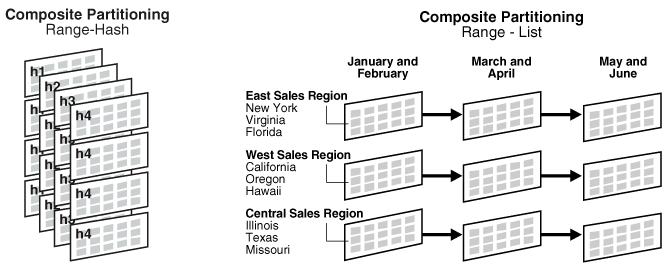
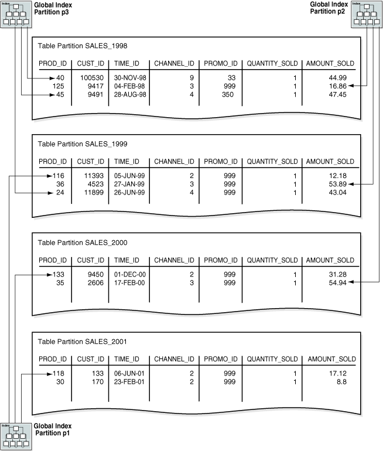
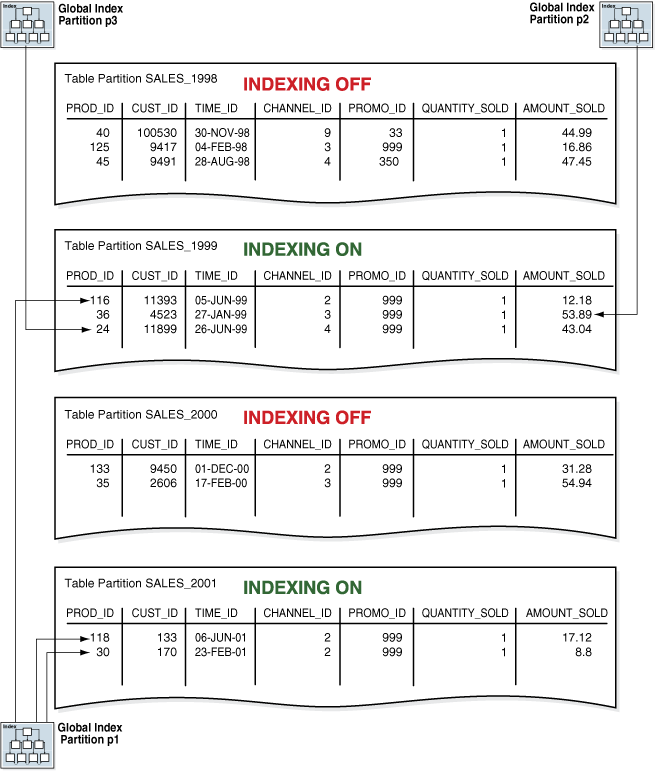
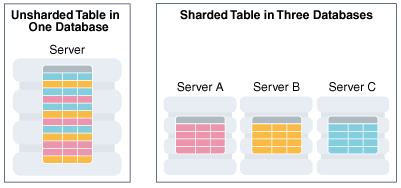
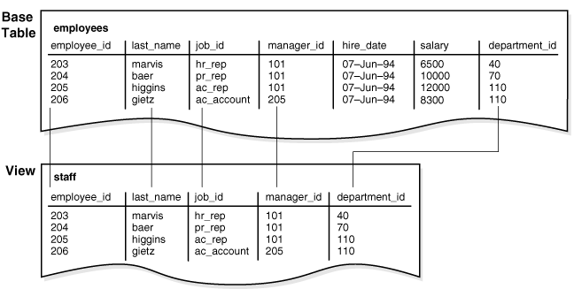
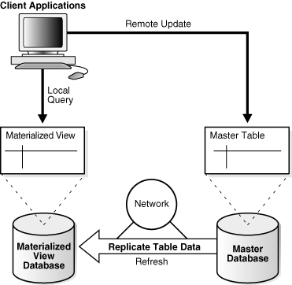
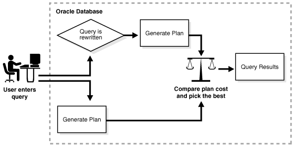

## 6 Partitions, Views, and Other Schema Objects

Although tables and indexes are the most important and commonly used schema objects, the database supports many other types of schema objects, the most common of which are discussed in this chapter.

This chapter contains the following sections:

- Overview of Partitions  
	In an Oracle database, partitioning enables you to decompose very large tables and indexes into smaller and more manageable pieces called partitions. Each partition is an independent object with its own name and optionally its own storage characteristics.
- Overview of Sharded Tables  
	In an Oracle database, sharding enables you to break up a large table into more manageable pieces called shards that can be stored in multiple databases.
- Overview of Views  
	A view is a logical representation of one or more tables. In essence, a view is a stored query.
- Overview of Materialized Views  
	A **materialized view** is a query result that has been stored or "materialized" in advance as a schema object. The `FROM` clause of the query can name tables, views, or materialized views.
- Overview of Sequences  
	A sequence is a schema object from which multiple users can generate unique integers. A sequence generator provides a highly scalable and well-performing method to generate surrogate keys for a number data type.
- Overview of Dimensions  
	A typical data warehouse has two important components: dimensions and facts.
- Overview of Synonyms  
	A synonym is an alias for a schema object. For example, you can create a synonym for a table or view, sequence, PL/SQL program unit, user-defined object type, or another synonym. Because a synonym is simply an alias, it requires no storage other than its definition in the data dictionary.

**Parent topic:** [Oracle Relational Data Structures](oracle-relational-structures.md)

### Overview of Partitions

In an Oracle database, partitioning enables you to decompose very large tables and indexes into smaller and more manageable pieces called partitions. Each partition is an independent object with its own name and optionally its own storage characteristics.

For an analogy that illustrates partitioning, suppose an HR manager has one big box that contains employee folders. Each folder lists the employee hire date. Queries are often made for employees hired in a particular month. One approach to satisfying such requests is to create an index on employee hire date that specifies the locations of the folders scattered throughout the box. In contrast, a partitioning strategy uses many smaller boxes, with each box containing folders for employees hired in a given month.

Using smaller boxes has several advantages. When asked to retrieve the folders for employees hired in June, the HR manager can retrieve the June box. Furthermore, if any small box is temporarily damaged, the other small boxes remain available. Moving offices also becomes easier because instead of moving a single heavy box, the manager can move several small boxes.

From the perspective of an application, only one schema object exists. SQL statements require no modification to access partitioned tables. Partitioning is useful for many different types of database applications, particularly those that manage large volumes of data. Benefits include:

- Increased availability
	The unavailability of a partition does not entail the unavailability of the object. The query [optimizer](glossary.md) automatically removes unreferenced partitions from the [query plan](glossary.md) so queries are not affected when the partitions are unavailable.
- Easier administration of schema objects
	A partitioned object has pieces that can be managed either collectively or individually. [DDL](glossary.md) statements can manipulate partitions rather than entire tables or indexes. Thus, you can break up resource-intensive tasks such as rebuilding an index or table. For example, you can move one table partition at a time. If a problem occurs, then only the partition move must be redone, not the table move. Also, dropping a partition avoids executing numerous `DELETE` statements.
- Reduced contention for shared resources in [OLTP](glossary.md) systems
	In some OLTP systems, partitions can decrease contention for a shared resource. For example, DML is distributed over many segments rather than one segment.
- Enhanced query performance in data warehouses
	In a [data warehouse](glossary.md), partitioning can speed processing of ad hoc queries. For example, a sales table containing a million rows can be partitioned by quarter.

- Partition Characteristics  
	Each partition of a table or index must have the same logical attributes, such as column names, data types, and constraints.
- Partitioned Tables  
	A **partitioned table** consists of one or more partitions, which are managed individually and can operate independently of the other partitions.
- Partitioned Indexes  
	A **partitioned index** is an index that, like a partitioned table, has been divided into smaller and more manageable pieces.
- Partial Indexes for Partitioned Tables  
	A **partial index** is an index that is correlated with the indexing properties of an associated partitioned table.

**Parent topic:** Partitions, Views, and Other Schema Objects

#### Partition Characteristics

Each partition of a table or index must have the same logical attributes, such as column names, data types, and constraints.

For example, all partitions in a table share the same column and constraint definitions. However, each partition can have separate physical attributes, such as the tablespace to which it belongs.

- Partition Key  
	The partition key is a set of one or more columns that determines the partition in which each row in a partitioned table should go. Each row is unambiguously assigned to a single partition.
- Partitioning Strategies  
	Oracle Partitioning offers several partitioning strategies that control how the database places data into partitions. The basic strategies are range, list, and hash partitioning.

**Parent topic:** Overview of Partitions

##### Partition Key

The partition key is a set of one or more columns that determines the partition in which each row in a partitioned table should go. Each row is unambiguously assigned to a single partition.

In the `sales` table, you could specify the `time_id` column as the key of a range partition. The database assigns rows to partitions based on whether the date in this column falls in a specified range. Oracle Database automatically directs insert, update, and delete operations to the appropriate partition by using the partition key.

**Parent topic:** Partition Characteristics

##### Partitioning Strategies

Oracle Partitioning offers several partitioning strategies that control how the database places data into partitions. The basic strategies are range, list, and hash partitioning.

A [single-level partitioning](glossary.md) uses only one method of data distribution, for example, only list partitioning or only range partitioning. In [composite partitioning](glossary.md), a table is partitioned by one data distribution method and then each partition is further divided into subpartitions using a second data distribution method. For example, you could use a list partition for `channel_id` and a range subpartition for `time_id`.

Example 6-1 Sample Row Set for Partitioned Table

This partitioning example assumes that you want to populate a partitioned table `sales` with the following rows:

```
PROD_ID    CUST_ID TIME_ID   CHANNEL_ID   PROMO_ID QUANTITY_SOLD AMOUNT_SOLD
---------- ---------- --------- ---------- ---------- ------------- -----------
      116      11393 05-JUN-99          2        999             1       12.18
       40     100530 30-NOV-98          9         33             1       44.99
      118        133 06-JUN-01          2        999             1       17.12
      133       9450 01-DEC-00          2        999             1       31.28
       36       4523 27-JAN-99          3        999             1       53.89
      125       9417 04-FEB-98          3        999             1       16.86
       30        170 23-FEB-01          2        999             1         8.8
       24      11899 26-JUN-99          4        999             1       43.04
       35       2606 17-FEB-00          3        999             1       54.94
       45       9491 28-AUG-98          4        350             1       47.45
```

- Range Partitioning  
	In **range partitioning**, the database maps rows to partitions based on ranges of values of the partitioning key. Range partitioning is the most common type of partitioning and is often used with dates.
- Interval Partitioning  
	**Interval partitioning** is an extension of range partitioning.
- List Partitioning  
	In **list partitioning**, the database uses a list of discrete values as the partition key for each partition. The partitioning key consists of one or more columns.
- Hash Partitioning  
	In **hash partitioning**, the database maps rows to partitions based on a hashing algorithm that the database applies to the user-specified partitioning key.
- Reference Partitioning  
	In reference partitioning, the partitioning strategy of a child table is solely defined through the foreign key relationship with a parent table. For every partition in the parent table, exactly one corresponding partition exists in the child table. The parent table stores the parent records in a specific partition, and the child table stores the child records in the corresponding partition.
- Composite Partitioning  
	In composite partitioning, a table is partitioned by one data distribution method and then each partition is further subdivided into subpartitions using a second data distribution method. Thus, composite partitioning combines the basic data distribution methods. All subpartitions for a given partition represent a logical subset of the data.

**Parent topic:** Partition Characteristics

###### Range Partitioning

In **range partitioning**, the database maps rows to partitions based on ranges of values of the partitioning key. Range partitioning is the most common type of partitioning and is often used with dates.

Suppose that you create `time_range_sales` as a partitioned table using the following SQL statement, with the `time_id` column as the partition key:

```
CREATE TABLE time_range_sales
   ( prod_id        NUMBER(6)
   , cust_id        NUMBER
   , time_id        DATE
   , channel_id     CHAR(1)
   , promo_id       NUMBER(6)
   , quantity_sold  NUMBER(3)
   , amount_sold    NUMBER(10,2)
   )
PARTITION BY RANGE (time_id)
 (PARTITION SALES_1998 VALUES LESS THAN (TO_DATE('01-JAN-1999','DD-MON-YYYY')),
  PARTITION SALES_1999 VALUES LESS THAN (TO_DATE('01-JAN-2000','DD-MON-YYYY')),
  PARTITION SALES_2000 VALUES LESS THAN (TO_DATE('01-JAN-2001','DD-MON-YYYY')),
  PARTITION SALES_2001 VALUES LESS THAN (MAXVALUE)
 );
```

Afterward, you load `time_range_sales` with the rows from Example 6-1. The code shows the row distributions in the four partitions. The database chooses the partition for each row based on the `time_id` value according to the rules specified in the `PARTITION BY RANGE` clause. The range partition key value determines the non-inclusive high bound for a specified partition.

**Parent topic:** Partitioning Strategies

###### Interval Partitioning

**Interval partitioning** is an extension of range partitioning.

If you insert data that exceeds existing range partitions, then Oracle Database automatically creates partitions of a specified interval. For example, you could create a sales history table that stores data for each month in a separate partition.

Interval partitions enable you to avoid creating range partitions explicitly. You can use interval partitioning for almost every table that is range partitioned and uses fixed intervals for new partitions. Unless you create range partitions with different intervals, or unless you always set specific partition attributes, consider using interval partitions.

When partitioning by interval, you must specify at least one range partition. The range partitioning key value determines the high value of the range partitions, which is called the [transition point](glossary.md). The database automatically creates interval partitions for data with values that are beyond the transition point. The lower boundary of every interval partition is the inclusive upper boundary of the previous range or interval partition. Thus, in Example 6-2, value `01-JAN-2011` is in partition `p2`.

The database creates interval partitions for data beyond the transition point. An [interval partition](glossary.md) extends range partitioning by instructing the database to create partitions of the specified range or interval. The database automatically creates the partitions when data inserted into the table exceeds all existing range partitions. In Example 6-2, the `p3` partition contains rows with partitioning key `time_id` values greater than or equal to `01-JAN-2013`.

Example 6-2 Interval Partitioning

Assume that you create a sales table with four partitions of varying widths. You specify that above the transition point of January 1, 2013, the database should create partitions in one month intervals. The high bound of partition `p3` represents the transition point. Partition `p3` and all partitions below it are in the range section, whereas all partitions above it fall into the interval section.

```
CREATE TABLE interval_sales
    ( prod_id        NUMBER(6)
    , cust_id        NUMBER
    , time_id        DATE
    , channel_id     CHAR(1)
    , promo_id       NUMBER(6)
    , quantity_sold  NUMBER(3)
    , amount_sold    NUMBER(10,2)
    ) 
  PARTITION BY RANGE (time_id) 
  INTERVAL(NUMTOYMINTERVAL(1, 'MONTH'))
    ( PARTITION p0 VALUES LESS THAN (TO_DATE('1-1-2010', 'DD-MM-YYYY'))
    , PARTITION p1 VALUES LESS THAN (TO_DATE('1-1-2011', 'DD-MM-YYYY'))
    , PARTITION p2 VALUES LESS THAN (TO_DATE('1-7-2012', 'DD-MM-YYYY'))
    , PARTITION p3 VALUES LESS THAN (TO_DATE('1-1-2013', 'DD-MM-YYYY')) );
```

You insert a sale made on date October 10, 2014:

```
SQL> INSERT INTO interval_sales VALUES (39,7602,'10-OCT-14',9,null,1,11.79);

1 row created.
```

A query of `USER_TAB_PARTITIONS` shows that the database created a new partition for the October 10 sale because the sale date was later than the transition point:

```
SQL> COL PNAME FORMAT a9
SQL> COL HIGH_VALUE FORMAT a40
SQL> SELECT PARTITION_NAME AS PNAME, HIGH_VALUE 
  2  FROM USER_TAB_PARTITIONS WHERE TABLE_NAME = 'INTERVAL_SALES';

PNAME     HIGH_VALUE
--------- ----------------------------------------
P0        TO_DATE(' 2007-01-01 00:00:00', 'SYYYY-M
          M-DD HH24:MI:SS', 'NLS_CALENDAR=GREGORIA
P1        TO_DATE(' 2008-01-01 00:00:00', 'SYYYY-M
          M-DD HH24:MI:SS', 'NLS_CALENDAR=GREGORIA
P2        TO_DATE(' 2009-07-01 00:00:00', 'SYYYY-M
          M-DD HH24:MI:SS', 'NLS_CALENDAR=GREGORIA
P3        TO_DATE(' 2010-01-01 00:00:00', 'SYYYY-M
          M-DD HH24:MI:SS', 'NLS_CALENDAR=GREGORIA
SYS_P1598 TO_DATE(' 2014-11-01 00:00:00', 'SYYYY-M
          M-DD HH24:MI:SS', 'NLS_CALENDAR=GREGORIA
```

See Also:

[Oracle Database VLDB and Partitioning Guide](https://docs.oracle.com/pls/topic/lookup?ctx=en/database/oracle/oracle-database/21/cncpt&id=VLDBG-GUID-C121EA1B-2725-4464-B2C9-EEDE0C3C95AB) to learn more about interval partitions

**Parent topic:** Partitioning Strategies

###### List Partitioning

In **list partitioning**, the database uses a list of discrete values as the partition key for each partition. The partitioning key consists of one or more columns.

You can use list partitioning to control how individual rows map to specific partitions. By using lists, you can group and organize related sets of data when the key used to identify them is not conveniently ordered.

Example 6-3 List Partitioning

Assume that you create `list_sales` as a list-partitioned table using the following statement, where the `channel_id` column is the partition key:

```
CREATE TABLE list_sales
   ( prod_id        NUMBER(6)
   , cust_id        NUMBER
   , time_id        DATE
   , channel_id     CHAR(1)
   , promo_id       NUMBER(6)
   , quantity_sold  NUMBER(3)
   , amount_sold    NUMBER(10,2)
   )
PARTITION BY LIST (channel_id)
 ( PARTITION even_channels VALUES ('2','4'),
   PARTITION odd_channels VALUES ('3','9')
 );
```

Afterward, you load the table with the rows from Example 6-1. The code shows the row distribution in the two partitions. The database chooses the partition for each row based on the `channel_id` value according to the rules specified in the `PARTITION BY LIST` clause. Rows with a `channel_id` value of 2 or 4 are stored in the `EVEN_CHANNELS` partitions, while rows with a `channel_id` value of 3 or 9 are stored in the `ODD_CHANNELS` partition.

**Parent topic:** Partitioning Strategies

###### Hash Partitioning

In **hash partitioning**, the database maps rows to partitions based on a hashing algorithm that the database applies to the user-specified partitioning key.

The destination of a row is determined by the internal [hash function](glossary.md) applied to the row by the database. When the number of partitions is a power of 2, the hashing algorithm creates a roughly even distribution of rows across all partitions.

Hash partitioning is useful for dividing large tables to increase manageability. Instead of one large table to manage, you have several smaller pieces. The loss of a single hash partition does not affect the remaining partitions and can be recovered independently. Hash partitioning is also useful in [OLTP](glossary.md) systems with high update contention. For example, a segment is divided into several pieces, each of which is updated, instead of a single segment that experiences contention.

Assume that you create the partitioned `hash_sales` table using the following statement, with the `prod_id` column as the partition key:

```
CREATE TABLE hash_sales
   ( prod_id        NUMBER(6)
   , cust_id        NUMBER
   , time_id        DATE
   , channel_id     CHAR(1)
   , promo_id       NUMBER(6)
   , quantity_sold  NUMBER(3)
   , amount_sold    NUMBER(10,2)
   )
PARTITION BY HASH (prod_id)
PARTITIONS 2;
```

Afterward, you load the table with the rows from Example 6-1. The code shows a possible row distribution in the two partitions. The names of these partitions are system-generated.

As you insert rows, the database attempts to randomly and evenly distribute them across partitions. You cannot specify the partition into which a row is placed. The database applies the hash function, whose outcome determines which partition contains the row.

See Also:

- [Oracle Database VLDB and Partitioning Guide](https://docs.oracle.com/pls/topic/lookup?ctx=en/database/oracle/oracle-database/21/cncpt&id=VLDBG003) to learn how to create partitions
- [Oracle Database SQL Language Reference](https://docs.oracle.com/pls/topic/lookup?ctx=en/database/oracle/oracle-database/21/cncpt&id=SQLRF54655) for `CREATE TABLE ... PARTITION BY` examples

**Parent topic:** Partitioning Strategies

###### Reference Partitioning

In reference partitioning, the partitioning strategy of a child table is solely defined through the foreign key relationship with a parent table. For every partition in the parent table, exactly one corresponding partition exists in the child table. The parent table stores the parent records in a specific partition, and the child table stores the child records in the corresponding partition.

For example, an `orders` table is the parent of the `line_items` table, with a primary key and foreign key defined on `order_id`. The tables are partitioned by reference. For example, if the database stores order 233 in partition `Q3_2015` of `orders`, then the database stores all line items for order 233 in partition `Q3_2015` of `line_items`. If partition `Q4_2015` is added to `orders`, then the database automatically adds `Q4_2015` to `line_items`.

The advantages of reference partitioning are:

- By using the same partitioning strategy for both the parent and child tables, you avoid duplicating all partitioning key columns. This strategy reduces the manual overhead of denormalization, and saves space.
- Maintenance operations on a parent table occur on the child table automatically. For example, when you add a partition to the master table, the database automatically propagates this addition to its descendents.
- The database automatically uses partition-wise joins of the partitions in the parent and child table, improving performance.

You can use reference partitioning with all basic partitioning strategies, including interval partitioning. You can also create reference partitioned tables as composite partitioned tables.

Example 6-4 Creating Reference-Partitioned Tables

This example creates a parent table orders which is range-partitioned on `order_date`. The reference-partitioned child table `order_items` is created with four partitions, `Q1_2015`, `Q2_2015`, `Q3_2015`, and `Q4_2015`, where each partition contains the `order_items` rows corresponding to orders in the respective parent partition.

```
CREATE TABLE orders
    ( order_id           NUMBER(12),
      order_date         DATE,
      order_mode         VARCHAR2(8),
      customer_id        NUMBER(6),
      order_status       NUMBER(2),
      order_total        NUMBER(8,2),
      sales_rep_id       NUMBER(6),
      promotion_id       NUMBER(6),
      CONSTRAINT orders_pk PRIMARY KEY(order_id)
    )
  PARTITION BY RANGE(order_date)
    ( PARTITION Q1_2015 VALUES LESS THAN (TO_DATE('01-APR-2015','DD-MON-YYYY')),
      PARTITION Q2_2015 VALUES LESS THAN (TO_DATE('01-JUL-2015','DD-MON-YYYY')),
      PARTITION Q3_2015 VALUES LESS THAN (TO_DATE('01-OCT-2015','DD-MON-YYYY')),
      PARTITION Q4_2015 VALUES LESS THAN (TO_DATE('01-JAN-2006','DD-MON-YYYY'))
    );

CREATE TABLE order_items
    ( order_id           NUMBER(12) NOT NULL,
      line_item_id       NUMBER(3)  NOT NULL,
      product_id         NUMBER(6)  NOT NULL,
      unit_price         NUMBER(8,2),
      quantity           NUMBER(8),
      CONSTRAINT order_items_fk
      FOREIGN KEY(order_id) REFERENCES orders(order_id)
    )
    PARTITION BY REFERENCE(order_items_fk);
```

See Also:

[Oracle Database VLDB and Partitioning Guide](https://docs.oracle.com/pls/topic/lookup?ctx=en/database/oracle/oracle-database/21/cncpt&id=VLDBG-GUID-54D18B18-6838-4115-9389-E1FB0D20A8CA) for an overview of reference partitioning

**Parent topic:** Partitioning Strategies

###### Composite Partitioning

In composite partitioning, a table is partitioned by one data distribution method and then each partition is further subdivided into subpartitions using a second data distribution method. Thus, composite partitioning combines the basic data distribution methods. All subpartitions for a given partition represent a logical subset of the data.

Composite partitioning provides several advantages:

- Depending on the SQL statement, partition pruning on one or two dimensions may improve performance.
- Queries may be able to use full or partial partition-wise joins on either dimension.
- You can perform parallel backup and recovery of a single table.
- The number of partitions is greater than in single-level partitioning, which may be beneficial for parallel execution.
- You can implement a rolling window to support historical data and still partition on another dimension if many statements can benefit from partition pruning or partition-wise joins.
- You can store data differently based on identification by a partitioning key. For example, you may decide to store data for a specific product type in a read-only, compressed format, and keep other product type data uncompressed.

Range, list, and hash partitioning are eligible as subpartitioning strategies for composite partitioned tables. The following figure offers a graphical view of range-hash and range-list composite partitioning.

Figure 6-1 Composite Range-List Partitioning



> The image shows composite partitioning with range-hash partitioning (h1, h2, h3, and h4) and composite partitioning with range-list partitioning (with geographical regions in various time periods (January and February, March and April, May and June).
>
> [  
> Copyright © 1993, 2025, Oracle and/or its affiliates.](https://docs.oracle.com/en/database/oracle/oracle-database/dcommon/html/cpyr.htm)


The database stores every subpartition in a composite partitioned table as a separate [segment](glossary.md). Thus, subpartition properties may differ from the properties of the table or from the partition to which the subpartitions belong.

See Also:

[Oracle Database VLDB and Partitioning Guide](https://docs.oracle.com/pls/topic/lookup?ctx=en/database/oracle/oracle-database/21/cncpt&id=GUID-BE424ACC-F746-4CA8-973C-F578CF98FF10) to learn more about composite partitioning

**Parent topic:** Partitioning Strategies

#### Partitioned Tables

A **partitioned table** consists of one or more partitions, which are managed individually and can operate independently of the other partitions.

A table is either partitioned or nonpartitioned. Even if a partitioned table consists of only one partition, this table is different from a nonpartitioned table, which cannot have partitions added to it.

- Segments for Partitioned Tables  
	A partitioned table is made up of one or more table partition segments.
- Compression for Partitioned Tables  
	Some or all partitions of a heap-organized table can be stored in a compressed format.

See Also:

" Partition Characteristics " for examples of partitioned tables

" [Overview of Index-Organized Tables](indexes-and-index-organized-tables.md) " to learn about the purpose and characteristics of Index-Organized Tables, which can also benefit from partitioning that provides improved manageability, availability, and performance.

**Parent topic:** Overview of Partitions

##### Segments for Partitioned Tables

A partitioned table is made up of one or more table partition segments.

If you create a partitioned table named `hash_products`, then no table [segment](glossary.md) is allocated for this table. Instead, the database stores data for each table partition in its own partition segment. Each table partition segment contains a portion of the table data.

When an [external table](glossary.md) is partitioned, all partitions reside outside the database. In a hybrid partitioned table, some partitions are stored in segments, whereas others are stored externally. For example, some partitions of the `sales` table might be stored in data files and others in spreadsheets.

See Also:

- " [Overview of External Tables](tables-and-table-clusters.md) "
- " [Overview of Segments](logical-storage-structures.md) "
	to learn about the relationship between objects and segments

**Parent topic:** Partitioned Tables

##### Compression for Partitioned Tables

Some or all partitions of a heap-organized table can be stored in a compressed format.

Compression saves space and can speed query execution. For this reason, compression can be useful in environments such as data warehouses, where the amount of insert and update operations is small, and in OLTP environments.

You can declare the attributes for [table compression](glossary.md) for a tablespace, table, or table partition. If declared at the tablespace level, then tables created in the tablespace are compressed by default. You can alter the compression attribute for a table, in which case the change only applies to new data going into that table. Consequently, a single table or partition may contain compressed and uncompressed blocks, which guarantees that data size will not increase because of compression. If compression could increase the size of a block, then the database does not apply it to the block.

See Also:

- " [Table Compression](tables-and-table-clusters.md) " to learn about types of table compression, including basic, advanced row, and Hybrid Columnar Compression
- [Oracle Database Data Warehousing Guide](https://docs.oracle.com/pls/topic/lookup?ctx=en/database/oracle/oracle-database/21/cncpt&id=DWHSG8913) to learn about table compression in a data warehouse

**Parent topic:** Partitioned Tables

#### Partitioned Indexes

A **partitioned index** is an index that, like a partitioned table, has been divided into smaller and more manageable pieces.

Global indexes are partitioned independently of the table on which they are created, whereas local indexes are automatically linked to the partitioning method for a table. Like partitioned tables, partitioned indexes improve manageability, availability, performance, and scalability.

The following graphic shows index partitioning options.

Figure 6-2 Index Partitioning Options


> This graphic shows a decision tree. The first branch is between partitioned and nonpartitioned indexes. The partitioned index branches into local partitioned and global partitioned. The local partitioned branches into local prefixed and local nonprefixed indexes.
>
> [  
> Copyright © 1993, 2025, Oracle and/or its affiliates.](https://docs.oracle.com/en/database/oracle/oracle-database/dcommon/html/cpyr.htm)


- Local Partitioned Indexes  
	In a **local partitioned index**, the index is partitioned on the same columns, with the same number of partitions and the same partition bounds as its table.
- Global Partitioned Indexes  
	A global partitioned index is a B-tree index that is partitioned independently of the underlying table on which it is created. A single index partition can point to any or all table partitions, whereas in a locally partitioned index, a one-to-one parity exists between index partitions and table partitions.

See Also:

- " [Introduction to Indexes](indexes-and-index-organized-tables.md) " to learn about the difference between unique and nonunique indexes, and the different index types
- [Oracle Database VLDB and Partitioning Guide](https://docs.oracle.com/pls/topic/lookup?ctx=en/database/oracle/oracle-database/21/cncpt&id=VLDBG00203) for more information about partitioned indexes and how to decide which type to use

**Parent topic:** Overview of Partitions

##### Local Partitioned Indexes

In a **local partitioned index**, the index is partitioned on the same columns, with the same number of partitions and the same partition bounds as its table.

Each index partition is associated with exactly one partition of the underlying table, so that all keys in an index partition refer only to rows stored in a single table partition. In this way, the database automatically synchronizes index partitions with their associated table partitions, making each table-index pair independent.

Local partitioned indexes are common in data warehousing environments. Local indexes offer the following advantages:

- Availability is increased because actions that make data invalid or unavailable in a partition affect this partition only.
- Partition maintenance is simplified. When moving a table partition, or when data ages out of a partition, only the associated local index partition must be rebuilt or maintained. In a global index, all index partitions must be rebuilt or maintained.
- If point-in-time recovery of a partition occurs, then the indexes can be recovered to the recovery time (see [Oracle Database Backup and Recovery User’s Guide](https://docs.oracle.com/pls/topic/lookup?ctx=en/database/oracle/oracle-database/21/cncpt&id=BRADV-GUID-B8245791-9B75-4AE7-ACE9-D9EDBC2DACC0)). The entire index does not need to be rebuilt.

The example in Hash Partitioning shows the creation statement for the partitioned `hash_sales` table, using the `prod_id` column as partition key. The following example creates a local partitioned index on the `time_id` column of the `hash_sales` table:

```
CREATE INDEX hash_sales_idx ON hash_sales(time_id) LOCAL;
```

In Figure 6-3, the `hash_products` table has two partitions, so `hash_sales_idx` has two partitions. Each index partition is associated with a different table partition. Index partition `SYS_P38` indexes rows in table partition `SYS_P33`, whereas index partition `SYS_P39` indexes rows in table partition `SYS_P34`.

Figure 6-3 Local Index Partitions


> This graphic shows two table partitions: SYS\_P33 and SYS\_P34. The partitions contain the following rows:
>
> ```
> Table Partition SYS_P33
>   PROD_ID    CUST_ID TIME_ID   CHANNEL_ID   PROMO_ID QUANTITY_SOLD AMOUNT_SOLD
> ---------- ---------- --------- ---------- ---------- ------------- -----------
>        40     100530 30-NOV-98          9         33             1       44.99
>       118        133 06-JUN-01          2        999             1       17.12
>        36       4523 27-JAN-99          3        999             1       53.89
>        30        170 23-FEB-01          2        999             1         8.8
>        35       2606 17-FEB-00          3        999             1       54.94
>  
> Table Partition SYS_P34
> PROD_ID    CUST_ID TIME_ID   CHANNEL_ID   PROMO_ID QUANTITY_SOLD AMOUNT_SOLD
> ---------- ---------- --------- ---------- ---------- ------------- -----------
>       116      11393 05-JUN-99          2        999             1       12.18
>       133       9450 01-DEC-00          2        999             1       31.28
>       125       9417 04-FEB-98          3        999             1       16.86
>        24      11899 26-JUN-99          4        999             1       43.04
>        45       9491 28-AUG-98          4        350             1       47.45
> ```
>
> Above the table partitions are two index partitions that point down to the table partitions. Index partition SYS\_P38 indexes rows in table partition SYS\_P33, whereas index partition SYS\_P39 indexes rows in table partition SYS\_P34. The two index partitions are inside a box labeled hash\_sales\_idx.


You cannot explicitly add a partition to a local index. Instead, new partitions are added to local indexes only when you add a partition to the underlying table. Likewise, you cannot explicitly drop a partition from a local index. Instead, local index partitions are dropped only when you drop a partition from the underlying table.

Like other indexes, you can create a [bitmap index](glossary.md) on partitioned tables. The only restriction is that bitmap indexes must be local to the partitioned table—they cannot be global indexes. Global bitmap indexes are supported only on nonpartitioned tables.

- Local Prefixed and Nonprefixed Indexes  
	Local partitioned indexes are either prefixed or nonprefixed.
- Local Partitioned Index Storage  
	Like a table partition, a local index partition is stored in its own segment. Each segment contains a portion of the total index data. Thus, a local index made up of four partitions is not stored in a single index segment, but in four separate segments.

**Parent topic:** Partitioned Indexes

###### Local Prefixed and Nonprefixed Indexes

Local partitioned indexes are either prefixed or nonprefixed.

The index subtypes are defined as follows:

- Local prefixed indexes
	In this case, the partition keys are on the leading edge of the index definition. In the `time_range_sales` example in Range Partitioning, the table is partitioned by range on `time_id`. A local prefixed index on this table would have `time_id` as the first column in its list.
- Local nonprefixed indexes
	In this case, the partition keys are not on the leading edge of the indexed column list and need not be in the list at all. In the `hash_sales_idx` example in Local Partitioned Indexes, the index is local nonprefixed because the partition key `product_id` is not on the leading edge.

Both types of indexes can take advantage of [partition elimination](glossary.md) (also called partition pruning), which occurs when the optimizer speeds data access by excluding partitions from consideration. Whether a [query](glossary.md) can eliminate partitions depends on the query [predicate](glossary.md). A query that uses a local prefixed index always allows for index partition elimination, whereas a query that uses a local nonprefixed index might not.

See Also:

[Oracle Database VLDB and Partitioning Guide](https://docs.oracle.com/pls/topic/lookup?ctx=en/database/oracle/oracle-database/21/cncpt&id=VLDBG1251) to learn how to use prefixed and nonprefixed indexes

**Parent topic:** Local Partitioned Indexes

###### Local Partitioned Index Storage

Like a table partition, a local index partition is stored in its own segment. Each segment contains a portion of the total index data. Thus, a local index made up of four partitions is not stored in a single index segment, but in four separate segments.

See Also:

[Oracle Database SQL Language Reference](https://docs.oracle.com/pls/topic/lookup?ctx=en/database/oracle/oracle-database/21/cncpt&id=SQLRF54053) for `CREATE INDEX ... LOCAL` examples

**Parent topic:** Local Partitioned Indexes

##### Global Partitioned Indexes

A global partitioned index is a B-tree index that is partitioned independently of the underlying table on which it is created. A single index partition can point to any or all table partitions, whereas in a locally partitioned index, a one-to-one parity exists between index partitions and table partitions.

In general, global indexes are useful for OLTP applications, where rapid access, data integrity, and availability are important. In an OLTP system, a table may be partitioned by one key, for example, the `employees.department_id` column, but an application may need to access the data with many different keys, for example, by `employee_id` or `job_id`. Global indexes can be useful in this scenario.

As an illustration, suppose that you create a global partitioned index on the `time_range_sales` table from " Range Partitioning ". In this table, rows for sales from 1998 are stored in one partition, rows for sales from 1999 are in another, and so on. The following example creates a global index partitioned by range on the `channel_id` column:

```
CREATE INDEX time_channel_sales_idx ON time_range_sales (channel_id)
   GLOBAL PARTITION BY RANGE (channel_id)
      (PARTITION p1 VALUES LESS THAN (3),
       PARTITION p2 VALUES LESS THAN (4),
       PARTITION p3 VALUES LESS THAN (MAXVALUE));
```

As shown in Figure 6-4, a global index partition can contain entries that point to multiple table partitions. Index partition `p1` points to the rows with a `channel_id` of 2, index partition `p2` points to the rows with a `channel_id` of 3, and index partition `p3` points to the rows with a `channel_id` of 4 or 9.

Figure 6-4 Global Partitioned Index



> This graphic shows four partitions: SALES\_1998, SALES\_1999, SALES\_2000, 2001. The icon Global Index Partition p3 is in the upper left. Global Index Partition p2. Global Index Partition p1. Each of these index partitions has three arrows. Each arrow points to a different row in a partition. For example, Global Index Partition p3 points to two different rows in the 1998 partition, and one row in the 1999 partition.


See Also:

- [Oracle Database VLDB and Partitioning Guide](https://docs.oracle.com/pls/topic/lookup?ctx=en/database/oracle/oracle-database/21/cncpt&id=VLDBG1256) to learn how to manage global partitioned indexes
- [Oracle Database SQL Language Reference](https://docs.oracle.com/pls/topic/lookup?ctx=en/database/oracle/oracle-database/21/cncpt&id=SQLRF54012) to learn about the `GLOBAL PARTITION` clause of `CREATE INDEX`

**Parent topic:** Partitioned Indexes

#### Partial Indexes for Partitioned Tables

A **partial index** is an index that is correlated with the indexing properties of an associated partitioned table.

The correlation enables you to specify which table partitions are indexed. Partial indexes provide the following advantages:

- Table partitions that are not indexed avoid consuming unnecessary index storage space.
- Performance of loads and queries can improve.
	Before Oracle Database 12c, an exchange partition operation required a physical update of an associated global index to retain it as usable. Starting with Oracle Database 12c, if the partitions involved in a partition maintenance operation are not part of a partial global index, then the index remains usable without requiring any global index maintenance.
- If you index only some table partitions at index creation, and if you later index other partitions, then you can reduce the sort space required by index creation.

You can turn indexing on or off for the individual partitions of a table. A partial local index does not have usable index partitions for all table partitions that have indexing turned off. A global index, whether partitioned or not, excludes the data from all partitions that have indexing turned off. The database does not support partial indexes for indexes that enforce unique constraints.

Figure 6-5 shows the same global index as in Figure 6-4, except that the global index is partial. Table partitions `SALES_1998` and `SALES_2000` have the indexing property set to `OFF`, so the partial global index does not index them.

Figure 6-5 Partial Global Partitioned Index



> This graphic depicts four table partitions: SALES\_1998, SALES\_1999, SALES\_2000, SALES\_2001. The first and third partitions are labeled "INDEXING OFF." The second and fourth partitions are labeled "INDESING ON." An icon labeled "Global Index Partition p3" points to rows in the second partition. An icon labeled "Global Index Partition p2" points to rows in the second partition. An icon labeled "Global Index Partition p1" points to rows in the fourth partition.


**Parent topic:** Overview of Partitions

### Overview of Sharded Tables

In an Oracle database, sharding enables you to break up a large table into more manageable pieces called shards that can be stored in multiple databases.

Each database is hosted on a dedicated server with its own local resources - CPU, memory, flash, or disk. Each database in such configuration is called a **shard**. All of the shards together make up a single logical database, which is referred to as a **sharded database**.

Horizontal partitioning involves splitting a database table across shards so that each shard contains the table with the same columns but a different subset of rows. A table split up in this manner is also known as a **sharded table**.

The following figure shows a table horizontally partitioned across three shards.

Figure 6-6 Horizontal Partitioning of a Table Across Shards



> On the left is a large cylinder labeled “Server.” This cylinder contains a table with different colored rows. Underneath, the caption says “Unsharded table in 1 one database.” This graphic shows three cylinders: Server A, Server B, and Server C. Each cylinder contains a different colored table. The caption says “Shared table in 3 databases.”


Sharding is based on shared-nothing hardware infrastructure and it eliminates single points of failure because shards do not share physical resources such as CPU, memory, or storage devices. Shards are also loosely coupled in terms of software; they do not run clusterware.

Shards are typically hosted on dedicated servers. These servers can be commodity hardware or engineered systems. The shards can run on single instance or Oracle RAC databases. They can be placed on-premises, in a cloud, or in a hybrid on-premises and cloud configuration.

From the perspective of a database administrator, an SDB consists of multiple databases that can be managed either collectively or individually. However, from the perspective of the application, an SDB looks like a single database: the number of shards and distribution of data across those shards are completely transparent to database applications.

Sharding is intended for custom OLTP applications that are suitable for a sharded database architecture. Applications that use sharding must have a well-defined data model and data distribution strategy (consistent hash, range, list, or composite) that primarily accesses data using a sharding key. Examples of a sharding key include `customer_id`, `account_no`, or `country_id`.

- Sharded Tables  
	A sharded table is a table that is partitioned into smaller and more manageable pieces among multiple databases, called shards.

See Also:

[Using Oracle Sharding](https://docs.oracle.com/pls/topic/lookup?ctx=en/database/oracle/oracle-database/21/cncpt&id=SHARD-GUID-0F39B1FB-DCF9-4C8A-A2EA-88705B90C5BF)

**Parent topic:** Partitions, Views, and Other Schema Objects

#### Sharded Tables

A sharded table is a table that is partitioned into smaller and more manageable pieces among multiple databases, called shards.

Partitions are distributed across shards at the tablespace level, based on a sharding key. Examples of keys include customer ID, account number, and country ID. The following data types are supported for the sharding key.

- `NUMBER`
- `INTEGER`
- `SMALLINT`
- `RAW`
- `(N)VARCHAR`
- `(N)VARCHAR2`
- `(N)CHAR`
- `DATE`
- `TIMESTAMP`

Each partition of a sharded table resides in a separate tablespace, and each tablespace is associated with a specific shard. Depending on the sharding method, the association can be established automatically or defined by the administrator.

Even though the partitions of a sharded table reside in multiple shards, to the application, the table looks and behaves exactly the same as a partitioned table in a single database. SQL statements issued by an application never have to refer to shards or depend on the number of shards and their configuration.

The familiar SQL syntax for table partitioning specifies how rows should be partitioned across shards. For example, the following SQL statement creates a sharded table, horizontally partitioning the table across shards based on the sharding key `cust_id`.

```
CREATE SHARDED TABLE customers 
( cust_id     NUMBER NOT NULL
, name        VARCHAR2(50)
, address     VARCHAR2(250)
, region      VARCHAR2(20)
, class       VARCHAR2(3)
, signup      DATE
CONSTRAINT cust_pk PRIMARY KEY(cust_id)
)
PARTITION BY CONSISTENT HASH (cust_id)
PARTITIONS AUTO
TABLESPACE SET ts1
;
```

The sharded table is partitioned by consistent hash, a special type of hash partitioning commonly used in scalable distributed systems. This technique automatically spreads tablespaces across shards to provide an even distribution of data and workload.

Note:

Global indexes on sharded tables are not supported, but local indexes are supported.

### Overview of Views

A view is a logical representation of one or more tables. In essence, a view is a stored query.

A view derives its data from the tables on which it is based, called base tables. Base tables can be tables or other views. All operations performed on a view actually affect the base tables. You can use views in most places where tables are used.

Note:

Materialized views use a different data structure from standard views.

Views enable you to tailor the presentation of data to different types of users. Views are often used to:

- Provide an additional level of table security by restricting access to a predetermined set of rows or columns of a table
	For example, Figure 6-7 shows how the `staff` view does not show the `salary` or `commission_pct` columns of the base table `employees`.
- Hide data complexity
	For example, a single view can be defined with a [join](glossary.md), which is a collection of related columns or rows in multiple tables. However, the view hides the fact that this information actually originates from several tables. A query might also perform extensive calculations with table information. Thus, users can query a view without knowing how to perform a join or calculations.
- Present the data in a different perspective from that of the base table
	For example, the columns of a view can be renamed without affecting the tables on which the view is based.
- Isolate applications from changes in definitions of base tables
	For example, if the defining query of a view references three columns of a four column table, and a fifth column is added to the table, then the definition of the view is not affected, and all applications using the view are not affected.

For an example of the use of views, consider the `hr.employees` table, which has several columns and numerous rows. To allow users to see only five of these columns or only specific rows, you could create a view as follows:

```
CREATE VIEW staff AS
  SELECT employee_id, last_name, job_id, manager_id, department_id
  FROM   employees;
```

As with all subqueries, the query that defines a view cannot contain the `FOR UPDATE` clause. The following graphic illustrates the view named `staff`. Notice that the view shows only five of the columns in the base table.

Figure 6-7 View



> The image shows the base table, employees, with 7 columns. A view called staff is created from the base table, with only 5 of the columns.
>
> [  
> Copyright © 1993, 2025, Oracle and/or its affiliates.](https://docs.oracle.com/en/database/oracle/oracle-database/dcommon/html/cpyr.htm)


- Characteristics of Views  
	Unlike a table, a view is not allocated storage space, nor does a view contain data. Rather, a view is defined by a query that extracts or derives data from the base tables referenced by the view. Because a view is based on other objects, it requires no storage other than storage for the query that defines the view in the data dictionary.
- Updatable Join Views  
	A **join view** has multiple tables or views in its `FROM` clause.
- Object Views  
	Just as a view is a virtual table, an object view is a virtual object table. Each row in the view is an object, which is an instance of an object type. An object type is a user-defined data type.

See Also:

- " [Overview of Materialized Views](https://docs.oracle.com/en/database/oracle/oracle-database/21/cncpt/partitions-views-and-other-schema-objects.html#GUID-2822B62B-CAF3-4DCE-B4D6-5E677FB8A829 "A materialized view is a query result that has been stored or \"materialized\" in advance as a schema object. The FROM clause of the query can name tables, views, or materialized views.") "
- [Oracle Database Administrator’s Guide](https://docs.oracle.com/pls/topic/lookup?ctx=en/database/oracle/oracle-database/21/cncpt&id=ADMIN11774) to learn how to manage views
- [Oracle Database SQL Language Reference](https://docs.oracle.com/pls/topic/lookup?ctx=en/database/oracle/oracle-database/21/cncpt&id=SQLRF01504) for `CREATE VIEW` syntax and semantics

**Parent topic:** Partitions, Views, and Other Schema Objects

#### Characteristics of Views

Unlike a table, a view is not allocated storage space, nor does a view contain data. Rather, a view is defined by a query that extracts or derives data from the base tables referenced by the view. Because a view is based on other objects, it requires no storage other than storage for the query that defines the view in the data dictionary.

A view has dependencies on its referenced objects, which are automatically handled by the database. For example, if you drop and re-create a base table of a view, then the database determines whether the new base table is acceptable to the view definition.

- Data Manipulation in Views  
	Because views are derived from tables, they have many similarities. Users can query views, and with some restrictions they can perform DML on views. Operations performed on a view affect data in some base table of the view and are subject to the integrity constraints and triggers of the base tables.
- How Data Is Accessed in Views  
	Oracle Database stores a view definition in the data dictionary as the text of the query that defines the view.

**Parent topic:** Overview of Views

##### Data Manipulation in Views

Because views are derived from tables, they have many similarities. Users can query views, and with some restrictions they can perform DML on views. Operations performed on a view affect data in some base table of the view and are subject to the integrity constraints and triggers of the base tables.

The following example creates a view of the `hr.employees` table:

```
CREATE VIEW staff_dept_10 AS
SELECT employee_id, last_name, job_id, 
       manager_id, department_id
FROM   employees
WHERE  department_id = 10
WITH CHECK OPTION CONSTRAINT staff_dept_10_cnst;
```

The defining query references only rows for department 10. The `CHECK OPTION` creates the view with a constraint so that `INSERT` and `UPDATE` statements issued against the view cannot result in rows that the view cannot select. Thus, rows for employees in department 10 can be inserted, but not rows for department 30.

See Also:

[Oracle Database SQL Language Reference](https://docs.oracle.com/pls/topic/lookup?ctx=en/database/oracle/oracle-database/21/cncpt&id=SQLRF55299) to learn about subquery restrictions in `CREATE VIEW` statements

**Parent topic:** Characteristics of Views

##### How Data Is Accessed in Views

Oracle Database stores a view definition in the data dictionary as the text of the query that defines the view.

When you reference a view in a SQL statement, Oracle Database performs the following tasks:

1. Merges a query (whenever possible) against a view with the queries that define the view and any underlying views
	Oracle Database optimizes the merged query as if you issued the query without referencing the views. Therefore, Oracle Database can use indexes on any referenced base table columns, whether the columns are referenced in the view definition or in the user query against the view.
	Sometimes Oracle Database cannot merge the view definition with the user query. In such cases, Oracle Database may not use all indexes on referenced columns.
2. Parses the merged statement in a [shared SQL area](glossary.md)
	Oracle Database parses a statement that references a view in a new shared SQL area only if no existing shared SQL area contains a similar statement. Thus, views provide the benefit of reduced memory use associated with shared SQL.
3. Executes the SQL statement

The following example illustrates data access when a view is queried. Assume that you create `employees_view` based on the `employees` and `departments` tables:

```
CREATE VIEW employees_view AS 
  SELECT employee_id, last_name, salary, location_id
  FROM   employees JOIN departments USING (department_id)
  WHERE  department_id = 10;
```

A user executes the following query of `employees_view`:

```
SELECT last_name 
FROM   employees_view
WHERE  employee_id = 200;
```

Oracle Database merges the view and the user query to construct the following query, which it then executes to retrieve the data:

```
SELECT last_name
FROM   employees, departments
WHERE  employees.department_id = departments.department_id 
AND    departments.department_id = 10 
AND    employees.employee_id = 200;
```

#### Updatable Join Views

A **join view** has multiple tables or views in its `FROM` clause.

In the following example, the `staff_dept_10_30` view joins the `employees` and `departments` tables, including only employees in departments 10 or 30:

```
CREATE VIEW staff_dept_10_30 AS
SELECT employee_id, last_name, job_id, e.department_id
FROM   employees e, departments d
WHERE  e.department_id IN (10, 30)
AND    e.department_id = d.department_id;
```

An [updatable join view](glossary.md), also called a modifiable join view, involves two or more base tables or views and permits DML operations. An updatable view contains multiple tables in the top-level `FROM` clause of the `SELECT` statement and is not restricted by the `WITH READ ONLY` clause.

To be inherently updatable, a view must meet several criteria. For example, a general rule is that an `INSERT`, `UPDATE`, or `DELETE` operation on a join view can modify only one base table at a time. The following query of the `USER_UPDATABLE_COLUMNS` data dictionary view shows that the `staff_dept_10_30` view is updatable:

```
SQL> SELECT TABLE_NAME, COLUMN_NAME, UPDATABLE 
  2  FROM   USER_UPDATABLE_COLUMNS 
  3  WHERE  TABLE_NAME = 'STAFF_DEPT_10_30';
 
TABLE_NAME                     COLUMN_NAME                    UPD
------------------------------ ------------------------------ ---
STAFF_DEPT_10_30               EMPLOYEE_ID                    YES
STAFF_DEPT_10_30               LAST_NAME                      YES
STAFF_DEPT_10_30               JOB_ID                         YES
STAFF_DEPT_10_30               DEPARTMENT_ID                  YES
```

Starting with Oracle Database Release 21c, it is not mandatory for all updatable columns in a join view to map to columns of a [key-preserved table](glossary.md). The key-preserved table is a table in which each row of the underlying table appears at most once in the query output. In the `staff_dept_10_30` view, `department_id` is the primary key of the `departments` table, so each row from the `employees` table appears at most once in the result set, making the `employees` table key-preserved. The `departments` table is not key-preserved because each of its rows may appear many times in the result set. The columns in a non-key-preserved table can be updated if the `UPDATE` operation only updates columns from a single table and the update is deterministic, that is, it updates each row only once.

See Also:

[Oracle Database Administrator’s Guide](https://docs.oracle.com/pls/topic/lookup?ctx=en/database/oracle/oracle-database/21/cncpt&id=ADMIN11782) to learn how to update join views

**Parent topic:** Overview of Views

#### Object Views

Just as a view is a virtual table, an object view is a virtual object table. Each row in the view is an object, which is an instance of an object type. An object type is a user-defined data type.

You can retrieve, update, insert, and delete relational data as if it were stored as an object type. You can also define views with columns that are object data types, such as objects, `REF` s, and collections (nested tables and `VARRAY` s).

Like relational views, object views can present only the data that database administrators want users to see. For example, an object view could present data about IT programmers but omit sensitive data about salaries. The following example creates an `employee_type` object and then the view `it_prog_view` based on this object:

```
CREATE TYPE employee_type AS OBJECT
(
  employee_id  NUMBER (6),
  last_name    VARCHAR2 (25),
  job_id       VARCHAR2 (10)
);
/

CREATE VIEW it_prog_view OF employee_type
  WITH OBJECT IDENTIFIER (employee_id) AS 
SELECT  e.employee_id, e.last_name, e.job_id
FROM    employees e
WHERE   job_id = 'IT_PROG';
```

Object views are useful in prototyping or transitioning to object-oriented applications because the data in the view can be taken from relational tables and accessed as if the table were defined as an object table. You can run object-oriented applications without converting existing tables to a different physical structure.

See Also:

- [Oracle Database Object-Relational Developer's Guide](https://docs.oracle.com/pls/topic/lookup?ctx=en/database/oracle/oracle-database/21/cncpt&id=ADOBJ7026) to learn about object types and object views
- [Oracle Database SQL Language Reference](https://docs.oracle.com/pls/topic/lookup?ctx=en/database/oracle/oracle-database/21/cncpt&id=SQLRF01506) to learn about the `CREATE TYPE` statement

**Parent topic:** Overview of Views

### Overview of Materialized Views

A **materialized view** is a query result that has been stored or "materialized" in advance as a schema object. The `FROM` clause of the query can name tables, views, or materialized views.

A materialized view often serves as a [master table](glossary.md) in [replication](glossary.md) and a [fact table](glossary.md) in data warehousing. Materialized views summarize, compute, replicate, and distribute data. They are suitable in various computing environments, such as the following:

- In data warehouses, materialized views can compute and store data generated from aggregate functions such as sums and averages.
	A [summary](glossary.md) is an aggregate view that reduces query time by precalculating joins and aggregation operations and storing the results in a table. Materialized views are equivalent to summaries. You can also use materialized views to compute joins with or without aggregations.
- In materialized view replication, which is achieved using XStream and Oracle GoldenGate, the view contains a complete or partial copy of a table from a single point in time. Materialized views replicate data at distributed sites and synchronize updates performed at several sites. This form of replication is suitable for environments such as field sales when databases are not always connected to the network.
- In mobile computing environments, materialized views can download a data subset from central servers to mobile clients, with periodic refreshes from the central servers and propagation of updates by clients to the central servers.

In a replication environment, a materialized view shares data with a table in a different database, called a [master database](glossary.md). The table associated with the materialized view at the master site is the master table. Figure 6-8 illustrates a materialized view in one database based on a master table in another database. Updates to the master table replicate to the materialized view database.

Figure 6-8 Materialized View



> At the top of the graphic is a Client Application icons. One arrow labeled Local Query extends to Materialized View. Another arrow labeled Remote Update to a Master Table icon. The Materialized View icon has two dotted lines extending to a Materialized View Database. A Master Table has two dotted lines extending to a Master Database icon. The Master Database icon has an arrow extending to Materialized View Database. The arrow is labeled Replicate Table Database. The icon Network is connected to the Replicate Table Data arrow.


- Characteristics of Materialized Views  
	Materialized views share some characteristics of indexes and nonmaterialized views.
- Refresh Methods for Materialized Views  
	The database maintains data in materialized views by refreshing them after changes to the base tables. The refresh method can be incremental or a complete refresh.
- Automatic Materialized Views  
	Starting with Oracle Database Release 21c, materialized views can be created and maintained automatically.
- Query Rewrite  
	**Query rewrite** transforms a user request written in terms of master tables into a semantically equivalent request that includes materialized views.

See Also:

- [Oracle Database Data Warehousing Guide](https://docs.oracle.com/pls/topic/lookup?ctx=en/database/oracle/oracle-database/21/cncpt&id=DWHSG-GUID-F90C7CB2-84A3-404C-B81C-1D71ADA7EA19) to learn more about summaries
- [Oracle Database XStream Guide](https://docs.oracle.com/pls/topic/lookup?ctx=en/database/oracle/oracle-database/21/cncpt&id=GUID-5939CB6C-8BA9-4594-8F96-B0453D246722) for an introduction to XStream
- [`http://www.oracle.com/technetwork/middleware/goldengate/documentation/index.html`](http://www.oracle.com/technetwork/middleware/goldengate/documentation/index.html) to learn more about Oracle GoldenGate
- [Oracle Database SQL Language Reference](https://docs.oracle.com/pls/topic/lookup?ctx=en/database/oracle/oracle-database/21/cncpt&id=SQLRF01302) to learn about the `CREATE MATERIALIZED VIEW` statement

**Parent topic:** Partitions, Views, and Other Schema Objects

#### Characteristics of Materialized Views

Materialized views share some characteristics of indexes and nonmaterialized views.

Materialized views are similar to indexes in the following ways:

- They contain actual data and consume storage space.
- They can be refreshed when the data in their master tables changes.
- They can improve performance of SQL execution when used for query rewrite operations.
- Their existence is transparent to SQL applications and users.

A materialized view is similar to a nonmaterialized view because it represents data in other tables and views. Unlike indexes, users can query materialized views directly using `SELECT` statements. Depending on the types of refresh that are required, the views can also be updated with DML statements.

The following example creates and populates a materialized aggregate view based on three master tables in the `sh` sample schema:

```
CREATE MATERIALIZED VIEW sales_mv AS 
  SELECT t.calendar_year, p.prod_id, SUM(s.amount_sold) AS sum_sales
  FROM   times t, products p, sales s
  WHERE  t.time_id = s.time_id 
  AND    p.prod_id = s.prod_id
  GROUP BY t.calendar_year, p.prod_id;
```

The following example drops table `sales`, which is a master table for `sales_mv`, and then queries `sales_mv`. The query selects data because the rows are stored (materialized) separately from the data in the master tables.

```
SQL> DROP TABLE sales;

Table dropped.

SQL> SELECT * FROM sales_mv WHERE ROWNUM < 4;
 
CALENDAR_YEAR    PROD_ID  SUM_SALES
------------- ---------- ----------
         1998         13  936197.53
         1998         26  567533.83
         1998         27  107968.24
```

A materialized view can be partitioned. You can define a materialized view on a partitioned table and one or more indexes on the materialized view.

**Parent topic:** [Overview of Materialized Views](https://docs.oracle.com/en/database/oracle/oracle-database/21/cncpt/partitions-views-and-other-schema-objects.html#GUID-2822B62B-CAF3-4DCE-B4D6-5E677FB8A829 "A materialized view is a query result that has been stored or \"materialized\" in advance as a schema object. The FROM clause of the query can name tables, views, or materialized views.")

#### Refresh Methods for Materialized Views

The database maintains data in materialized views by refreshing them after changes to the base tables. The refresh method can be incremental or a complete refresh.

- Complete Refresh  
	A complete refresh executes the query that defines the materialized view. A complete refresh occurs when you initially create the materialized view, unless the materialized view references a prebuilt table, or you define the table as `BUILD DEFERRED`.
- Incremental Refresh  
	An incremental refresh, also called a fast refresh, processes only the changes to the existing data. This method eliminates the need to rebuild materialized views from the beginning. Processing only the changes can result in a very fast refresh time.
- In-Place and Out-of-Place Refresh  
	For the complete and incremental methods, the database can refresh the materialized view in place, which refreshes statements directly on the view, or out of place.

**Parent topic:** [Overview of Materialized Views](https://docs.oracle.com/en/database/oracle/oracle-database/21/cncpt/partitions-views-and-other-schema-objects.html#GUID-2822B62B-CAF3-4DCE-B4D6-5E677FB8A829 "A materialized view is a query result that has been stored or \"materialized\" in advance as a schema object. The FROM clause of the query can name tables, views, or materialized views.")

##### Complete Refresh

A complete refresh executes the query that defines the materialized view. A complete refresh occurs when you initially create the materialized view, unless the materialized view references a prebuilt table, or you define the table as `BUILD DEFERRED`.

A complete refresh can be slow, especially if the database must read and process huge amounts of data. You can perform a complete refresh at any time after creation of the materialized view.

**Parent topic:** Refresh Methods for Materialized Views

##### Incremental Refresh

An incremental refresh, also called a fast refresh, processes only the changes to the existing data. This method eliminates the need to rebuild materialized views from the beginning. Processing only the changes can result in a very fast refresh time.

You can refresh materialized views either on demand or at regular time intervals. Alternatively, you can configure materialized views in the same database as their base tables to refresh whenever a transaction commits changes to the base tables.

Fast refresh comes in either of the following forms:

- Log-Based refresh
	In this type of refresh, a materialized view log or a direct loader log keeps a record of changes to the base tables. A materialized view log is a schema object that records changes to a base table so that a materialized view defined on the base table can be refreshed incrementally. Each materialized view log is associated with a single base table.
- Partition change tracking (PCT) refresh
	PCT refresh is valid only when the base tables are partitioned. PCT refresh removes all data in the affected materialized view partitions or affected portions of data, and then recomputes them. The database uses the modified base table partitions to identify the affected partitions or portions of data in the view. When partition maintenance operations have occurred on the base tables, PCT refresh is the only usable incremental refresh method.

**Parent topic:** Refresh Methods for Materialized Views

##### In-Place and Out-of-Place Refresh

For the complete and incremental methods, the database can refresh the materialized view in place, which refreshes statements directly on the view, or out of place.

An out-of-place refresh creates one or more outside tables, executes the refresh statements on them, and then switches the materialized view or affected partitions with the outside tables. This technique achieves high availability during refresh, especially when refresh statements take a long time to finish.

Synchronous refresh is a type of out-of-place refresh. A synchronous refresh does not modify the contents of the base tables, but instead uses the APIs in the synchronous refresh package, which ensures consistency by applying these changes to the base tables and materialized views at the same time. This approach enables a set of tables and the materialized views defined on them to be always synchronized. In a data warehouse, synchronous refresh method is well-suited for the following reasons:

- The loading of incremental data is tightly controlled and occurs at periodic intervals.
- Tables and their materialized views are often partitioned in the same way, or their partitions are related by a functional dependency.

See Also:

[Oracle Database Data Warehousing Guide](https://docs.oracle.com/pls/topic/lookup?ctx=en/database/oracle/oracle-database/21/cncpt&id=DWHSG03003) to learn how to refresh materialized views

**Parent topic:** Refresh Methods for Materialized Views

#### Automatic Materialized Views

Starting with Oracle Database Release 21c, materialized views can be created and maintained automatically.

Oracle Database can automatically create and manage materialized views in order to optimize query performance. With very little or no interaction with the DBA, background tasks monitor and analyze workload characteristics and identifies where materialized views will improve SQL performance. The performance benefit of candidate materialized views is measured in the background (using workload queries) before they are made visible to the workload.

See Also:

- [Oracle Database Data Warehousing Guide](https://docs.oracle.com/pls/topic/lookup?ctx=en/database/oracle/oracle-database/21/cncpt&id=DWHSG-GUID-AE73C802-9533-4E35-A156-A97F42124224) for additional information
- [Oracle Database PL/SQL Packages and Types Reference](https://docs.oracle.com/pls/topic/lookup?ctx=en/database/oracle/oracle-database/21/cncpt&id=ARPLS-GUID-05890817-CD74-4396-B468-9A82BE030321) to learn how to use the `DBMS_AUTO_MV` package to implement automatic materialized views

**Parent topic:** [Overview of Materialized Views](https://docs.oracle.com/en/database/oracle/oracle-database/21/cncpt/partitions-views-and-other-schema-objects.html#GUID-2822B62B-CAF3-4DCE-B4D6-5E677FB8A829 "A materialized view is a query result that has been stored or \"materialized\" in advance as a schema object. The FROM clause of the query can name tables, views, or materialized views.")

#### Query Rewrite

**Query rewrite** transforms a user request written in terms of master tables into a semantically equivalent request that includes materialized views.

When base tables contain large amounts of data, computing an aggregate or join is expensive and time-consuming. Because materialized views contain precomputed aggregates and joins, query rewrite can quickly answer queries using materialized views.

The [query transformer](glossary.md) transparently rewrites the request to use the materialized view, requiring no user intervention and no reference to the materialized view in the SQL statement. Because query rewrite is transparent, materialized views can be added or dropped without invalidating the SQL in the application code.

In general, rewriting queries to use materialized views rather than detail tables improves response time. The following figure shows the database generating an [execution plan](glossary.md) for the original and rewritten query and choosing the lowest-cost plan.

Figure 6-9 Query Rewrite



> This graphic shows a user entering a query. The query enters a dotted rectangle labeled "Oracle." Arrows branch up to a diamond labeled "Query is rewritten" and down to a rectangle labeled "Generate Plan." The diamond points to a rectangle labeled "Generate Plan." Both Generate Plan rectangles point to a set of justice scales labeled "Compare plan cost and pick the best." The scales point to a rectangle labeled "Query Results."


See Also:

- " [Overview of the Optimizer](sql.md) " to learn more about query transformation
- [Oracle Database Data Warehousing Guide](https://docs.oracle.com/pls/topic/lookup?ctx=en/database/oracle/oracle-database/21/cncpt&id=DWHSG-GUID-DB76286B-8557-446B-A6CC-BC987C378076) to learn how to use query rewrite

**Parent topic:** [Overview of Materialized Views](https://docs.oracle.com/en/database/oracle/oracle-database/21/cncpt/partitions-views-and-other-schema-objects.html#GUID-2822B62B-CAF3-4DCE-B4D6-5E677FB8A829 "A materialized view is a query result that has been stored or \"materialized\" in advance as a schema object. The FROM clause of the query can name tables, views, or materialized views.")

### Overview of Sequences

A sequence is a schema object from which multiple users can generate unique integers. A sequence generator provides a highly scalable and well-performing method to generate surrogate keys for a number data type.

- Sequence Characteristics  
	A sequence definition indicates general information about the sequence, including its name and whether the sequence ascends or descends.
- Concurrent Access to Sequences  
	The same sequence generator can generate numbers for multiple tables.

**Parent topic:** Partitions, Views, and Other Schema Objects

#### Sequence Characteristics

A sequence definition indicates general information about the sequence, including its name and whether the sequence ascends or descends.

A sequence definition also indicates:

- The interval between numbers
- Whether the database should cache sets of generated sequence numbers in memory
- Whether the sequence should cycle when a limit is reached

The following example creates the sequence `customers_seq` in the sample schema `oe`. An application could use this sequence to provide customer ID numbers when rows are added to the `customers` table.

```
CREATE SEQUENCE customers_seq
START WITH      1000
INCREMENT BY    1
NOCACHE
NOCYCLE;
```

The first reference to `customers_seq.nextval` returns `1000`. The second returns `1001`. Each subsequent reference returns a value 1 greater than the previous reference.

See Also:

- [Oracle Database 2 Day Developer's Guide](https://docs.oracle.com/pls/topic/lookup?ctx=en/database/oracle/oracle-database/21/cncpt&id=TDDDG34000) for a tutorial that shows you how to create a sequence
- [Oracle Database Administrator’s Guide](https://docs.oracle.com/pls/topic/lookup?ctx=en/database/oracle/oracle-database/21/cncpt&id=ADMIN11796) to learn how to reference a sequence in a SQL statement
- [Oracle Database SQL Language Reference](https://docs.oracle.com/pls/topic/lookup?ctx=en/database/oracle/oracle-database/21/cncpt&id=SQLRF01314) for `CREATE SEQUENCE` syntax and semantics

**Parent topic:** Overview of Sequences

#### Concurrent Access to Sequences

The same sequence generator can generate numbers for multiple tables.

The generator can create primary keys automatically and coordinate keys across multiple rows or tables. For example, a sequence can generate primary keys for an `orders` table and a `customers` table.

The sequence generator is useful in multiuser environments for generating unique numbers without the overhead of disk I/O or transaction locking. For example, two users simultaneously insert new rows into the `orders` table. By using a sequence to generate unique numbers for the `order_id` column, neither user has to wait for the other to enter the next available order number. The sequence automatically generates the correct values for each user.

Each user that references a sequence has access to his or her current sequence number, which is the last sequence generated in the [session](glossary.md). A user can issue a statement to generate a new sequence number or use the current number last generated by the session. After a statement in a session generates a sequence number, it is available only to this session. Individual sequence numbers can be skipped if they were generated and used in a transaction that was ultimately rolled back.

WARNING:

If your application requires a gap-free set of numbers, then you cannot use Oracle sequences. You must serialize activities in the database using your own developed code.

See Also:

" [Data Concurrency and Consistency](data-concurrency-and-consistency.md) " to learn how sessions access data at the same time

**Parent topic:** Overview of Sequences

### Overview of Dimensions

A typical data warehouse has two important components: dimensions and facts.

A **dimension** is any category used in specifying business questions, for example, time, geography, product, department, and distribution channel. A **fact** is an event or entity associated with a particular set of dimension values, for example, units sold or profits.

Examples of multidimensional requests include the following:

- Show total sales across all products at increasing aggregation levels for a geography dimension, from state to country to region, for 2013 and 2014.
- Create a cross-tabular analysis of our operations showing expenses by territory in South America for 2013 and 2014. Include all possible subtotals.
- List the top 10 sales representatives in Asia according to 2014 sales revenue for automotive products, and rank their commissions.

Many multidimensional questions require aggregated data and comparisons of data sets, often across time, geography or budgets.

Creating a dimension permits the broader use of the query rewrite feature. By transparently rewriting queries to use materialized views, the database can improve query performance.

- Hierarchical Structure of a Dimension  
	A **dimension table** is a logical structure that defines hierarchical (parent/child) relationships between pairs of columns or column sets.
- Creation of Dimensions  
	You create dimensions with the `CREATE DIMENSION` SQL statement.

See Also:

[Oracle Database Data Warehousing Guide](https://docs.oracle.com/pls/topic/lookup?ctx=en/database/oracle/oracle-database/21/cncpt&id=DWHSG-GUID-106BE703-0D67-41F1-8CAC-6432B95FBF82) to learn more about dimensions

**Parent topic:** Partitions, Views, and Other Schema Objects

#### Hierarchical Structure of a Dimension

A **dimension table** is a logical structure that defines hierarchical (parent/child) relationships between pairs of columns or column sets.

For example, a dimension can indicate that within a row the `city` column implies the value of the `state` column, and the `state` column implies the value of the `country` column.

Within a customer dimension, customers could roll up to city, state, country, subregion, and region. Data analysis typically starts at higher levels in the dimensional hierarchy and gradually drills down if the situation warrants such analysis.

Each value at the child level is associated with one and only one value at the parent level. A hierarchical relationship is a functional dependency from one level of a hierarchy to the next level in the hierarchy.

A dimension has no data storage assigned to it. Dimensional information is stored in dimension tables, whereas fact information is stored in a fact table.

See Also:

- [Oracle Database Data Warehousing Guide](https://docs.oracle.com/pls/topic/lookup?ctx=en/database/oracle/oracle-database/21/cncpt&id=DWHSG-GUID-106BE703-0D67-41F1-8CAC-6432B95FBF82) to learn about dimensions
- [Oracle OLAP User’s Guide](https://docs.oracle.com/pls/topic/lookup?ctx=en/database/oracle/oracle-database/21/cncpt&id=OLAUG300) to learn how to create dimensions

**Parent topic:** Overview of Dimensions

#### Creation of Dimensions

You create dimensions with the `CREATE DIMENSION` SQL statement.

This statement specifies:

- Multiple `LEVEL` clauses, each of which identifies a column or column set in the dimension
- One or more `HIERARCHY` clauses that specify the parent/child relationships between adjacent levels
- Optional `ATTRIBUTE` clauses, each of which identifies an additional column or column set associated with an individual level

The following statement was used to create the `customers_dim` dimension in the sample schema `sh`:

```
CREATE DIMENSION customers_dim 
   LEVEL customer   IS (customers.cust_id)
   LEVEL city       IS (customers.cust_city) 
   LEVEL state      IS (customers.cust_state_province) 
   LEVEL country    IS (countries.country_id) 
   LEVEL subregion  IS (countries.country_subregion) 
   LEVEL region     IS (countries.country_region) 
   HIERARCHY geog_rollup (
      customer      CHILD OF
      city          CHILD OF 
      state         CHILD OF 
      country       CHILD OF 
      subregion     CHILD OF 
      region 
   JOIN KEY (customers.country_id) REFERENCES country )
   ATTRIBUTE customer DETERMINES
   (cust_first_name, cust_last_name, cust_gender, 
    cust_marital_status, cust_year_of_birth, 
    cust_income_level, cust_credit_limit) 
   ATTRIBUTE country DETERMINES (countries.country_name);
```

The columns in a dimension can come either from the same table (denormalized) or from multiple tables (fully or partially normalized). For example, a normalized time dimension can include a date table, a month table, and a year table, with join conditions that connect each date row to a month row, and each month row to a year row. In a fully denormalized time dimension, the date, month, and year columns are in the same table. Whether normalized or denormalized, the hierarchical relationships among the columns must be specified in the `CREATE DIMENSION` statement.

See Also:

[Oracle Database SQL Language Reference](https://docs.oracle.com/pls/topic/lookup?ctx=en/database/oracle/oracle-database/21/cncpt&id=SQLRF01206) for `CREATE DIMENSION` syntax and semantics

**Parent topic:** Overview of Dimensions

### Overview of Synonyms

A synonym is an alias for a schema object. For example, you can create a synonym for a table or view, sequence, PL/SQL program unit, user-defined object type, or another synonym. Because a synonym is simply an alias, it requires no storage other than its definition in the data dictionary.

Synonyms can simplify SQL statements for database users. Synonyms are also useful for hiding the identity and location of an underlying schema object. If the underlying object must be renamed or moved, then only the synonym must be redefined. Applications based on the synonym continue to work without modification.

You can create both private and public synonyms. A private synonym is in the schema of a specific user who has control over its availability to others. A public synonym is owned by the user group named `PUBLIC` and is accessible by every database user.

Example 6-5 Public Synonym

Suppose that a database administrator creates a public synonym named `people` for the `hr.employees` table. The user then connects to the `oe` schema and counts the number of rows in the table referenced by the synonym.

```
SQL> CREATE PUBLIC SYNONYM people FOR hr.employees;
 
Synonym created.
 
SQL> CONNECT oe
Enter password: password
Connected.

SQL> SELECT COUNT(*) FROM people;

  COUNT(*)
----------
       107
```

Use public synonyms sparingly because they make database consolidation more difficult. As shown in the following example, if another administrator attempts to create the public synonym `people`, then the creation fails because only one public synonym `people` can exist in the database. Overuse of public synonyms causes namespace conflicts between applications.

```
SQL> CREATE PUBLIC SYNONYM people FOR oe.customers;
CREATE PUBLIC SYNONYM people FOR oe.customers
                      *
ERROR at line 1:
ORA-00955: name is already used by an existing object

SQL> SELECT OWNER, SYNONYM_NAME, TABLE_OWNER, TABLE_NAME 
  2  FROM DBA_SYNONYMS 
  3  WHERE SYNONYM_NAME = 'PEOPLE';
 
OWNER      SYNONYM_NAME TABLE_OWNER TABLE_NAME
---------- ------------ ----------- ----------
PUBLIC     PEOPLE       HR          EMPLOYEES
```

Synonyms themselves are not securable. When you grant object privileges on a synonym, you are really granting privileges on the underlying object. The synonym is acting only as an alias for the object in the `GRANT` statement.

See Also:

- [Oracle Database Administrator's Guide](https://docs.oracle.com/pls/topic/lookup?ctx=en/database/oracle/oracle-database/21/cncpt&id=ADMIN11805) to learn how to manage synonyms
- [Oracle Database SQL Language Reference](https://docs.oracle.com/pls/topic/lookup?ctx=en/database/oracle/oracle-database/21/cncpt&id=SQLRF01401) for `CREATE SYNONYM` syntax and semantics

**Parent topic:** Partitions, Views, and Other Schema Objects