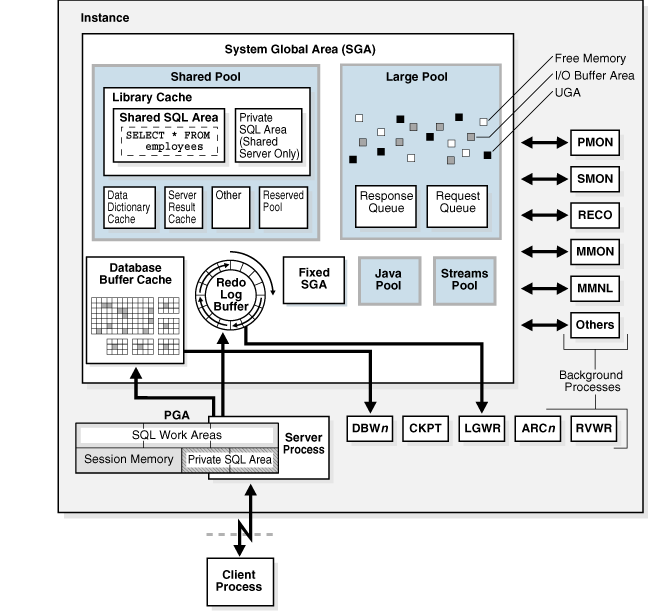
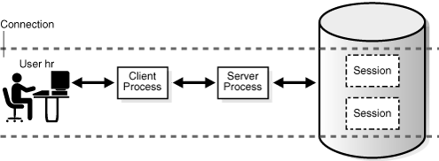
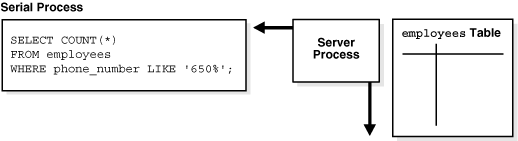
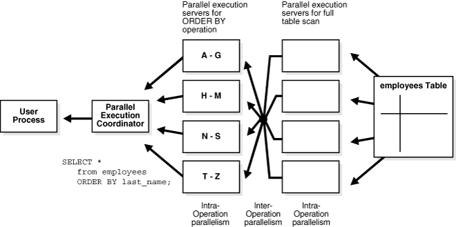

## 17 Process Architecture

**Parent topic:** [Oracle Instance Architecture](oracle-instance-architecture.md)

### Introduction to Processes

A **process** is a mechanism in an operating system that can run a series of steps.

The process execution architecture depends on the operating system. For example, on Windows an Oracle background process is a thread of execution within a process. On Linux and UNIX, an Oracle process is either an operating system process or a thread within an operating system process.

Processes run code modules. All connected Oracle Database users must run the following modules to access a [database instance](glossary.md):

- Application or Oracle Database utility
	A database user runs a database application, such as a [precompiler](glossary.md) program or a database tool such as SQL\*Plus, that issues SQL statements to a database.
- Oracle database code
	Each user has Oracle database code executing on his or her behalf that interprets and processes the application's SQL statements.

A process normally runs in its own private memory area. Most processes can periodically write to an associated trace file.

- Types of Processes  
	A database instance contains or interacts with multiple processes.
- Multiprocess and Multithreaded Oracle Database Systems  
	Multiprocess Oracle Database (also called multiuser Oracle Database) uses several processes to run different parts of the Oracle Database code and additional Oracle processes for the users—either one process for each connected user or one or more processes shared by multiple users.

See Also:

- " [Trace Files](oracle-database-instance.md) "
- [Oracle Database 2 Day Developer's Guide](https://docs.oracle.com/pls/topic/lookup?ctx=en/database/oracle/oracle-database/21/cncpt&id=TDDDG-GUID-8B3079B4-E52B-4DA8-A1B4-91C94255B62E)

**Parent topic:** Process Architecture

#### Types of Processes

A database instance contains or interacts with multiple processes.

Processes are divided into the following types:

- A [client process](glossary.md) runs the application or Oracle tool code.
- An [Oracle process](glossary.md) is a unit of execution that runs the Oracle database code. In the multithreaded architecture, an Oracle process can be an operating system process or a thread within an operating system process. Oracle processes include the following subtypes:
	- A [background process](glossary.md) starts with the database instance and perform maintenance tasks such as performing [instance recovery](glossary.md), cleaning up processes, writing redo buffers to disk, and so on.
		- A [server process](glossary.md) performs work based on a client request.
		For example, these processes parse SQL queries, place them in the [shared pool](glossary.md), create and execute a [query plan](glossary.md) for each [query](glossary.md), and read buffers from the [database buffer cache](glossary.md) or from disk.
		Note:
		Server processes, and the process memory allocated in these processes, run in the database instance. The instance continues to function when server processes terminate.
		- A slave process performs additional tasks for a background or server process.

The process structure varies depending on the operating system and the choice of Oracle Database options. For example, you can configure the code for connected users for [dedicated server](glossary.md) or [shared server](glossary.md) connections. In a shared server architecture, each server process that runs database code can serve multiple client processes.

Figure 17-1 shows a [system global area (SGA)](glossary.md) and background processes using dedicated server connections. For each user connection, a client process runs the application. This client process that is different from the dedicated server process that runs the database code. Each client process is associated with its own server process, which has its own [program global area (PGA)](glossary.md).

Figure 17-1 Oracle Processes and the SGA



> The graphic shows the SGA. Within the SGA are the Database Buffer Cache, Redo Log Buffer, Shared Pool, Large Pool, Fixed SGA, Java Pool, and Streams Pool. To the right of the SGA are the background processes PMON, SMON, RECO, MMON, MMNL, and Others. Below the SGA are DBWn, CKPT, LGWR, ARCn, and RVWR. Below the SGA are the PGA and Server Process. The Server Process is connected to a Client Process.


See Also:

- " [Dedicated Server Architecture](application-and-networking-architecture.md) " and " [Shared Server Architecture](application-and-networking-architecture.md) "
- Your Oracle Database operating system-specific documentation for more details on configuration choices
- [Oracle Database Reference](https://docs.oracle.com/pls/topic/lookup?ctx=en/database/oracle/oracle-database/21/cncpt&id=REFRN30186) to learn about the `V$PROCESS` view

**Parent topic:** Introduction to Processes

#### Multiprocess and Multithreaded Oracle Database Systems

Multiprocess Oracle Database (also called multiuser Oracle Database) uses several processes to run different parts of the Oracle Database code and additional Oracle processes for the users—either one process for each connected user or one or more processes shared by multiple users.

Most databases are multiuser because a primary advantage of a database is managing data needed by multiple users simultaneously. Each process in a database instance performs a specific job. By dividing the work of the database and applications into several processes, multiple users and applications can connect to an instance simultaneously while the system gives good performance.

In releases earlier than Oracle Database 12c, Oracle processes did not run as threads on UNIX and Linux systems. Starting in Oracle Database 12c, the [multithreaded Oracle Database model](glossary.md) enables Oracle processes to execute as operating system threads in separate address spaces. When Oracle Database is installed, the database runs in process mode. You must set the `THREADED_EXECUTION` initialization parameter to `TRUE` to run the database in threaded mode. In threaded mode, some background processes on UNIX and Linux run as processes (with each process containing one thread), whereas the remaining Oracle processes run as threads within processes.

In a database running in threaded mode, PMON and DBW might run as operating system processes, whereas LGWR and CMON might run as threads within a single process. Two foreground processes and a parallel execution (PX) server process might run as threads in a second operating system process. A third operating system process might contain multiple foreground threads. Thus, "Oracle process" does not always mean "operating system process."

Note:

When the `THREADED_EXECUTION` initialization parameter is set to `TRUE`, operating system authentication is not supported.

Example 17-1 Viewing Oracle Process Metadata

The `V$PROCESS` view contains one row for each Oracle process connected to a database instance. For example, you can run the following query in SQL\*Plus to get the operating system process ID and operating system thread ID for each process:

```
COL SPID FORMAT a8
COL STID FORMAT a8
SELECT SPID, STID, PROGRAM FROM V$PROCESS ORDER BY SPID;
```

The query yields the following partial sample output:

```
SPID   STID   PROGRAM
-----  -----  ---------------------------
7190   7190   oracle@samplehost (PMON) 
7192   7192   oracle@samplehost (PSP0) 
7194   7194   oracle@samplehost (VKTM) 
7198   7198   oracle@samplehost (SCMN) 
7198   7200   oracle@samplehost (GEN0) 
7202   7202   oracle@samplehost (SCMN) 
7202   7204   oracle@samplehost (DIAG) 
7198   7205   oracle@samplehost (DBRM) 
7202   7206   oracle@samplehost (DIA0) 
.
.
.
```

See Also:

- [Oracle Database Performance Tuning Guide](https://docs.oracle.com/pls/topic/lookup?ctx=en/database/oracle/oracle-database/21/cncpt&id=TGDBA477) to learn how to use the `V$PROCESS` view
- [Oracle Database Reference](https://docs.oracle.com/pls/topic/lookup?ctx=en/database/oracle/oracle-database/21/cncpt&id=REFRN10335) to learn about the `THREADED_EXECUTION` initialization parameter

**Parent topic:** Introduction to Processes

### Overview of Client Processes

When a user runs an application such as a Pro\*C program or SQL\*Plus, the operating system creates a client process (sometimes called a user process) to run the user application. The client application has Oracle Database libraries linked into it that provide the APIs required to communicate with the database.

- Client and Server Processes  
	Client processes differ in important ways from the Oracle processes interacting directly with the instance.
- Connections and Sessions  
	A database **connection** is a physical communication pathway between a client process and a database instance.
- Current Container  
	A database session is a logical entity in the database instance memory that represents the state of a current user login to a database.
- Database Operations  
	In the context of database monitoring, a **database operation** is session activity between two points in time, as defined by the end users or application code.

**Parent topic:** Process Architecture

#### Client and Server Processes

Client processes differ in important ways from the Oracle processes interacting directly with the instance.

The Oracle processes servicing the client process can read from and write to the SGA, whereas the client process cannot. A client process can run on a host other than the database host, whereas Oracle processes cannot.

For example, assume that a user on a client host starts SQL\*Plus, and then connects over the network to database `sample` on a different host when the database instance is not started:

```
SQL> CONNECT SYS@inst1 AS SYSDBA
Enter password: *********
Connected to an idle instance.
```

On the client host, a search of the processes for either `sqlplus` or `sample` shows only the `sqlplus` client process:

```
% ps -ef | grep -e sample -e sqlplus | grep -v grep
clientuser 29437 29436  0 15:40 pts/1    00:00:00 sqlplus           as sysdba
```

On the database host, a search of the processes for either `sqlplus` or `sample` shows a server process with a nonlocal connection, but no client process:

```
% ps -ef | grep -e sample -e sqlplus | grep -v grep
serveruser 29441     1  0 15:40 ?        00:00:00 oraclesample (LOCAL=NO)
```

See Also:

" [How an Instance Is Started](oracle-database-instance.md) " to learn how a client can connect to a database when the instance is not started

**Parent topic:** Overview of Client Processes

#### Connections and Sessions

A database **connection** is a physical communication pathway between a client process and a database instance.

During a connection, a communication pathway is established using available interprocess communication mechanisms or network software. Typically, a connection occurs between a client process and a server process or dispatcher, but it can also occur between a client process and Oracle Connection Manager (CMAN).

**Parent topic:** Overview of Client Processes

#### Current Container

A database session is a logical entity in the database instance memory that represents the state of a current user login to a database.

For example, when a user is authenticated by the database with a password, a session is established for this user. A session lasts from the time the user is authenticated by the database until the time the user disconnects or exits the database application.

Sessions and Containers

For a given session, the **current container** in the CDB is the one in which a session is running. The current container can be the CDB root, an application root, or a PDB.

Each session has exactly one current container at any point in time. Because the data dictionary in each container is separate, Oracle Database uses the data dictionary in the current container for name resolution and privilege authorization.

Relationship Between Connections and Sessions

A single connection can have 0, 1, or more sessions established on it. The sessions are independent: a commit in one session does not affect transactions in other sessions.

Note:

If Oracle Net [connection pooling](glossary.md) is configured, then it is possible for a connection to drop but leave the sessions intact.

Multiple sessions can exist concurrently for a single database user. As shown in the following figure, user `hr` can have multiple connections to a database. In dedicated server connections, the database creates a server process on behalf of each connection. Only the client process that causes the dedicated server to be created uses it. In a shared server connection, many client processes access a single shared server process.

Figure 17-2 One Session for Each Connection


> This graphic has two identical rows of squares: User hr, Client Process, Server Process, and Session. The squares are connected with double-headed arrows. The top row is labeled Connection 1. The bottom row is labeled Connection 2.
>
> [  
> Copyright © 1993, 2025, Oracle and/or its affiliates.](https://docs.oracle.com/en/database/oracle/oracle-database/dcommon/html/cpyr.htm)


Figure 17-3 illustrates a case in which user `hr` has a single connection to a database, but this connection has two sessions.

Figure 17-3 Two Sessions in One Connection



> This graphic has one rows of squares: User hr, User Process, Server Process, and two Session boxes (on top of each other). The squares are connected with double-headed arrows. The row has a dotted line above and below it and is labeled Connection.
>
> [  
> Copyright © 1993, 2025, Oracle and/or its affiliates.](https://docs.oracle.com/en/database/oracle/oracle-database/dcommon/html/cpyr.htm)


Generating an autotrace report of SQL statement execution statistics re-creates the scenario in Figure 17-3.

The `DISCONNECT` command in Example 17-2 actually ends the sessions, not the connection.

Example 17-2 Connections and Sessions

The following example connects SQL\*Plus to the database as user `SYSTEM` and enables tracing, thus creating a new session (sample output included):

```
SQL> SELECT SID, SERIAL#, PADDR FROM V$SESSION WHERE USERNAME = USER;

SID SERIAL# PADDR
--- ------- --------
 90      91 3BE2E41C
 
SQL> SET AUTOTRACE ON STATISTICS;
SQL> SELECT SID, SERIAL#, PADDR FROM V$SESSION WHERE USERNAME = USER;
 
SID SERIAL# PADDR
--- ------- --------
 88      93 3BE2E41C
 90      91 3BE2E41C
...
SQL> DISCONNECT
```

The `DISCONNECT` command actually ends the sessions, not the connection. Opening a new terminal and connecting to the instance as a different user, the following query shows that the connection with the address `3BE2E41C` is still active.

```
SQL> CONNECT dba1@inst1
Password: ********
Connected.
SQL> SELECT PROGRAM FROM V$PROCESS WHERE ADDR = HEXTORAW('3BE2E41C');

PROGRAM
------------------------------------------------
oracle@stbcs09-1 (TNS V1-V3)
```

See Also:

" [Shared Server Architecture](application-and-networking-architecture.md) "

**Parent topic:** Overview of Client Processes

#### Database Operations

In the context of database monitoring, a **database operation** is session activity between two points in time, as defined by the end users or application code.

A **simple database operation** is either a single SQL statement, or a single PL/SQL procedure or function. A **composite database operation** is a set of single or composite operations.

To monitor, compare, and tune tasks, you can divide a large set of tasks into database operations, and subdivide operations into phases. A use case is a PL/SQL batch job that is running slower than normal. By configuring the job as a database operation, you can identify and tune the expensive steps in the job.

Each execution of a database operation is uniquely identified by a pair of attributes: operation name and execution ID. One session can start or stop a database operation in a different session by specifying its session ID and serial number.

Two occurrences of the same database operation can execute at the same time using the same name but different execution IDs. Each execution of a database operation with the same name can contain different statements.

You create and manage database operations with the `DBMS_SQL_MONITOR` PL/SQL package. You can monitor operations using `V$SQL_MONITOR`, `V$SQL_PLAN_MONITOR`, and `V$SQL_MONITOR_SESSTAT`.

See Also:

- [Oracle Database SQL Tuning Guide](https://docs.oracle.com/pls/topic/lookup?ctx=en/database/oracle/oracle-database/21/cncpt&id=TGSQL789) to learn how to monitor database operations
- [Oracle Database Data Warehousing Guide](https://docs.oracle.com/pls/topic/lookup?ctx=en/database/oracle/oracle-database/21/cncpt&id=DWHSG-GUID-D66210E5-9F35-45C8-B310-FC4D764B4FEC) to learn how to monitor long-running loads
- [Oracle Database PL/SQL Packages and Types Reference](https://docs.oracle.com/pls/topic/lookup?ctx=en/database/oracle/oracle-database/21/cncpt&id=ARPLS-GUID-13874A73-369E-42CD-9C43-A12F1B3BDEC6) to learn more about `DBMS_SQL_MONITOR`
- [Oracle Database Reference](https://docs.oracle.com/pls/topic/lookup?ctx=en/database/oracle/oracle-database/21/cncpt&id=GUID-79E97A84-9C27-4A5E-AC0D-C12CB3E748E6) to learn more about `V$SQL_MONITOR`

**Parent topic:** Overview of Client Processes

### Overview of Server Processes

Oracle Database creates server processes to handle the requests of client processes connected to the instance. A client process always communicates with a database through a separate server process.

Server processes created on behalf of a database application can perform one or more of the following tasks:

- Parse and run SQL statements issued through the application, including creating and executing the [query plan](glossary.md)
- Execute PL/SQL code
- Read data blocks from data files into the database buffer cache (the DBW background process has the task of writing modified blocks back to disk)
- Return results in such a way that the application can process the information

- Dedicated Server Processes  
	In dedicated server connections, the client connection is associated with one and only one server process.
- Shared Server Processes  
	In shared server connections, client applications connect over a network to a **dispatcher process**, not a server process. For example, 20 client processes can connect to a single dispatcher process.
- How Oracle Database Creates Server Processes  
	The database creates server processes in various ways, depending on the connection methods.

See Also:

" [Stages of SQL Processing](sql.md) "

**Parent topic:** Process Architecture

#### Dedicated Server Processes

In dedicated server connections, the client connection is associated with one and only one server process.

On Linux, 20 client processes connected to a database instance are serviced by 20 server processes. Each client process communicates directly with its server process. This server process is dedicated to its client process for the duration of the session. The server process stores process-specific information and the UGA in its PGA.

See Also:

- " [Dedicated Server Architecture](application-and-networking-architecture.md) "
- " [PGA Usage in Dedicated and Shared Server Modes](memory-architecture.md) "

**Parent topic:** Overview of Server Processes

#### How Oracle Database Creates Server Processes

The database creates server processes in various ways, depending on the connection methods.

The connection methods are as follows:

- Bequeath
	SQL\*Plus, an OCI client, or another client application directly spawns the server process.
- Oracle Net listener
	The client application connects to the database through a listener.
- Dedicated broker
	This is a database process that creates foreground processes. Unlike the listener, the broker resides within the database instance. When using a dedicated broker, the client connects to the listener, which then hands off the connection to the dedicated broker.

When a connection does not use bequeath, the database creates the server process as follows:

1. The client application requests a new connection from the listener or broker.
2. The listener or broker initiates the creation of a new process or thread.
3. The operating system creates the new process or thread.
4. Oracle Database initializes various components and notifications.
5. The database hands over the connection and connection-specific code.

Optionally, if you use of the dedicated broker connection method, then you can pre-create a pool of server processes with the `DBMS_PROCESS` package. In this case, the Process Manager (PMAN) background process monitors the pool of pre-created processes, which wait to be associated with a client request. When a connection requires a server process, the database skips Steps 2-4 of process creation and performs only Step 5. This optimization improves performance.

Note:

- [Oracle Database PL/SQL Packages and Types Reference](https://docs.oracle.com/pls/topic/lookup?ctx=en/database/oracle/oracle-database/21/cncpt&id=REFRN104) to learn about the `DBMS_PROCESS` PL/SQL package
- [Oracle Database Reference](https://docs.oracle.com/pls/topic/lookup?ctx=en/database/oracle/oracle-database/21/cncpt&id=REFRN104) to learn about the PMAN background process

**Parent topic:** Overview of Server Processes

### Overview of Background Processes

Background processes are additional processes used by a multiprocess Oracle database. The background processes perform maintenance tasks required to operate the database and to maximize performance for multiple users.

Each background process has a separate task, but works with the other processes. For example, the LGWR process writes data from the [redo log buffer](glossary.md) to the [online redo log](glossary.md). When a filled redo log file is ready to be archived, LGWR signals another process to archive the redo log file.

Oracle Database creates background processes automatically when a database instance starts. An instance can have many background processes, not all of which always exist in every database configuration. The following query lists the background processes running on your database:

```
SELECT PNAME 
FROM   V$PROCESS 
WHERE  PNAME IS NOT NULL 
ORDER BY PNAME;
```

This section includes the following topics:

- Mandatory Background Processes
- Optional Background Processes
- Slave Processes

- Mandatory Background Processes  
	Mandatory background processes are present in all typical database configurations.
- Optional Background Processes  
	An optional background process is any background process not defined as mandatory.
- Slave Processes  
	Slave processes are background processes that perform work on behalf of other processes.

See Also:

[Oracle Database Reference](https://docs.oracle.com/pls/topic/lookup?ctx=en/database/oracle/oracle-database/21/cncpt&id=REFRN104) for descriptions of all the background processes

**Parent topic:** Process Architecture

#### Mandatory Background Processes

Mandatory background processes are present in all typical database configurations.

These processes run by default in a read/write database instance started with a minimally configured initialization parameter file. A read-only database instance disables some of these processes.

This section describes the following mandatory background processes:

- Process Monitor Process (PMON) Group
- Process Manager (PMAN)
- Listener Registration Process (LREG)
- System Monitor Process (SMON)
- Database Writer Process (DBW)
- Log Writer Process (LGWR)
- Checkpoint Process (CKPT)
- Manageability Monitor Processes (MMON and MMNL)
- Recoverer Process (RECO)

- Process Monitor Process (PMON) Group  
	The PMON group includes PMON, Cleanup Main Process (CLMN), and Cleanup Helper Processes (CLnn). These processes are responsible for the monitoring and cleanup of other processes.
- Process Manager (PMAN)  
	Process Manager (PMAN) oversees several background processes including shared servers, pooled servers, and job queue processes.
- Listener Registration Process (LREG)  
	The **listener registration process (LREG)** registers information about the database instance and dispatcher processes with the Oracle Net Listener.
- System Monitor Process (SMON)  
	The system monitor process (SMON) is in charge of a variety of system-level cleanup duties.
- Database Writer Process (DBW)  
	The database writer process (DBW) writes the contents of database buffers to data files. DBW processes write modified buffers in the database buffer cache to disk.
- Log Writer Process (LGWR)  
	The **log writer process (LGWR)** manages the online redo log buffer.
- Checkpoint Process (CKPT)  
	The checkpoint process (CKPT) updates the control file and data file headers with checkpoint information and signals DBW to write blocks to disk. Checkpoint information includes the checkpoint position, SCN, and location in online redo log to begin recovery.
- Manageability Monitor Processes (MMON and MMNL)  
	The **manageability monitor process (MMON)** performs many tasks related to the **Automatic Workload Repository (AWR)**.
- Recoverer Process (RECO)  
	In a distributed database, the recoverer process (RECO) automatically resolves failures in distributed transactions.

See Also:

- " [Read/Write and Read-Only Instances](oracle-database-instance.md) "
- [Oracle Database Reference](https://docs.oracle.com/pls/topic/lookup?ctx=en/database/oracle/oracle-database/21/cncpt&id=REFRN104) for descriptions of other mandatory processes, including MMAN, DIAG, VKTM, DBRM, and PSP0
- [Oracle Real Application Clusters Administration and Deployment Guide](https://docs.oracle.com/pls/topic/lookup?ctx=en/database/oracle/oracle-database/21/cncpt&id=RACAD7275) and [Oracle Clusterware Administration and Deployment Guide](https://docs.oracle.com/pls/topic/lookup?ctx=en/database/oracle/oracle-database/21/cncpt&id=CWADD90953) for more information about background processes specific to Oracle RAC and Oracle Clusterware

**Parent topic:** Overview of Background Processes

##### Process Monitor Process (PMON) Group

The PMON group includes PMON, Cleanup Main Process (CLMN), and Cleanup Helper Processes (CLnn). These processes are responsible for the monitoring and cleanup of other processes.

The PMON group oversees cleanup of the buffer cache and the release of resources used by a client process. For example, the PMON group is responsible for resetting the status of the active transaction table, releasing locks that are no longer required, and removing the process ID of terminated processes from the list of active processes.

The database must ensure that resources held by terminated processes are released so they are usable by other processes. Otherwise, process may end up blocked or stuck in contention.

- Process Monitor Process (PMON)  
	The process monitor (PMON) detects the termination of other background processes. If a server or dispatcher process terminates abnormally, then the PMON group is responsible for performing process recovery. Process termination can have multiple causes, including operating system kill commands or `ALTER SYSTEM KILL SESSION` statements.
- Cleanup Main Process (CLMN)  
	PMON delegates cleanup work to the cleanup main process (CLMN). The task of detecting abnormal termination remains with PMON.
- Cleanup Helper Processes (CLnn)  
	CLMN delegates cleanup work to the CLnn helper processes.
- Database Resource Quarantine  
	If a process or session terminates, then the PMON group releases the held resources to the database. In some cases, the PMON group can automatically quarantine corrupted, unrecoverable resources so that the database instance is not immediately forced to terminate.

**Parent topic:** Mandatory Background Processes

###### Process Monitor Process (PMON)

The process monitor (PMON) detects the termination of other background processes. If a server or dispatcher process terminates abnormally, then the PMON group is responsible for performing process recovery. Process termination can have multiple causes, including operating system kill commands or `ALTER SYSTEM KILL SESSION` statements.

**Parent topic:** Process Monitor Process (PMON) Group

###### Cleanup Main Process (CLMN)

PMON delegates cleanup work to the cleanup main process (CLMN). The task of detecting abnormal termination remains with PMON.

CLMN periodically performs cleanup of terminated processes, terminated sessions, transactions, network connections, idle sessions, detached transactions, and detached network connections that have exceeded their idle timeout.

**Parent topic:** Process Monitor Process (PMON) Group

###### Cleanup Helper Processes (CLnn)

CLMN delegates cleanup work to the CLnn helper processes.

The CLnn processes assist in the cleanup of terminated processes and sessions. The number of helper processes is proportional to the amount of cleanup work to be done and the current efficiency of cleanup.

A cleanup process can become blocked, which prevents it from proceeding to clean up other processes. Also, if multiple processes require cleanup, then cleanup time can be significant. For these reasons, Oracle Database can use multiple helper processes in parallel to perform cleanup, thus alleviating slow performance.

The `V$CLEANUP_PROCESS` and `V$DEAD_CLEANUP` views contain metadata about CLMN cleanup. The `V$CLEANUP_PROCESS` view contains one row for every cleanup process. For example, if `V$CLEANUP_PROCESS.STATE` is `BUSY`, then the process is currently engaged in cleanup.

See Also:

[Oracle Database Reference](https://docs.oracle.com/pls/topic/lookup?ctx=en/database/oracle/oracle-database/21/cncpt&id=REFRN-GUID-B219D499-E80A-4FE5-8562-21CB7FD2AF69) to learn more about `V$CLEANUP_PROCESS`

**Parent topic:** Process Monitor Process (PMON) Group

###### Database Resource Quarantine

If a process or session terminates, then the PMON group releases the held resources to the database. In some cases, the PMON group can automatically quarantine corrupted, unrecoverable resources so that the database instance is not immediately forced to terminate.

The PMON group continues to perform as much cleanup as possible on the process or session that was holding the quarantined resource. The `V$QUARANTINE` view contains metadata such as the type of resource, amount of memory consumed, Oracle error causing the quarantine, and so on.

See Also:

[Oracle Database Reference](https://docs.oracle.com/pls/topic/lookup?ctx=en/database/oracle/oracle-database/21/cncpt&id=REFRN-GUID-2686217E-C55A-4E10-8C1F-2B3E00D8FBCA) to learn more about `V$QUARANTINE`

**Parent topic:** Process Monitor Process (PMON) Group

##### Process Manager (PMAN)

Process Manager (PMAN) oversees several background processes including shared servers, pooled servers, and job queue processes.

PMAN monitors, spawns, and stops the following types of processes:

- Dispatcher and shared server processes
- Connection broker and pooled server processes for database resident connection pools
- Job queue processes
- Restartable background processes

**Parent topic:** Mandatory Background Processes

##### Listener Registration Process (LREG)

The **listener registration process (LREG)** registers information about the database instance and dispatcher processes with the Oracle Net Listener.

When an instance starts, LREG polls the listener to determine whether it is running. If the listener is running, then LREG passes it relevant parameters. If it is not running, then LREG periodically attempts to contact it.

Note:

In releases before Oracle Database 12c, PMON performed the listener registration.

See Also:

" [The Oracle Net Listener](application-and-networking-architecture.md) "

**Parent topic:** Mandatory Background Processes

##### System Monitor Process (SMON)

The system monitor process (SMON) is in charge of a variety of system-level cleanup duties.

Duties assigned to SMON include:

- Performing instance recovery, if necessary, at instance startup. In an Oracle RAC database, the SMON process of one database instance can perform instance recovery for a failed instance.
- Recovering terminated transactions that were skipped during instance recovery because of file-read or tablespace offline errors. SMON recovers the transactions when the tablespace or file is brought back online.
- Cleaning up unused temporary segments. For example, Oracle Database allocates extents when creating an index. If the operation fails, then SMON cleans up the temporary space.
- Coalescing contiguous free extents within dictionary-managed tablespaces.

SMON checks regularly to see whether it is needed. Other processes can call SMON if they detect a need for it.

**Parent topic:** Mandatory Background Processes

##### Database Writer Process (DBW)

The database writer process (DBW) writes the contents of database buffers to data files. DBW processes write modified buffers in the database buffer cache to disk.

Although one database writer process (DBW0) is adequate for most systems, you can configure additional processes—DBW1 through DBW9, DBWa through DBWz, and BW36 through BW99—to improve write performance if your system modifies data heavily. These additional DBW processes are not useful on uniprocessor systems.

The DBW process writes dirty buffers to disk under the following conditions:

- When a server process cannot find a clean reusable buffer after scanning a threshold number of buffers, it signals DBW to write. DBW writes dirty buffers to disk asynchronously if possible while performing other processing.
- DBW periodically writes buffers to advance the [checkpoint](glossary.md), which is the position in the [redo thread](glossary.md) from which instance recovery begins. The log position of the checkpoint is determined by the oldest dirty buffer in the buffer cache.

In many cases the blocks that DBW writes are scattered throughout the disk. Thus, the writes tend to be slower than the sequential writes performed by LGWR. DBW performs multiblock writes when possible to improve efficiency. The number of blocks written in a multiblock write varies by operating system.

##### Log Writer Process (LGWR)

The **log writer process (LGWR)** manages the online redo log buffer.

LGWR writes one portion of the buffer to the online redo log. By separating the tasks of modifying database buffers, performing scattered writes of dirty buffers to disk, and performing fast sequential writes of redo to disk, the database improves performance.

In the following circumstances, LGWR writes all redo entries that have been copied into the buffer since the last time it wrote:

- A user commits a transaction.
- An online redo [log switch](glossary.md) occurs.
- Three seconds have passed since LGWR last wrote.
- The redo log buffer is one-third full or contains 1 MB of buffered data.
- DBW must write modified buffers to disk.
	Before DBW can write a dirty buffer, the database must write to disk the redo records associated with changes to the buffer (the [write-ahead protocol](glossary.md)). If DBW discovers that some redo records have not been written, it signals LGWR to write the records to disk, and waits for LGWR to complete before writing the data buffers to disk.

- LGWR and Commits  
	Oracle Database uses a fast commit mechanism to improve performance for committed transactions.
- LGWR and Inaccessible Files  
	LGWR writes synchronously to the active mirrored group of online redo log files.

See Also:

" [Commits of Transactions](transactions.md) "

**Parent topic:** Mandatory Background Processes

###### LGWR and Commits

Oracle Database uses a fast commit mechanism to improve performance for committed transactions.

When a user issues a `COMMIT` statement, the transaction is assigned a **system change number (SCN)**. LGWR puts a commit record in the redo log buffer and writes it to disk immediately, along with the commit SCN and transaction's redo entries.

The redo log buffer is circular. When LGWR writes redo entries from the redo log buffer to an online redo log file, server processes can copy new entries over the entries in the redo log buffer that have been written to disk. LGWR normally writes fast enough to ensure that space is always available in the buffer for new entries, even when access to the online redo log is heavy.

The atomic write of the redo entry containing the transaction's commit record is the single event that determines that the transaction has committed. Oracle Database returns a success code to the committing transaction although the data buffers have not yet been written to disk. The corresponding changes to data blocks are deferred until it is efficient for DBW to write them to the data files.

Note:

LGWR can write redo log entries to disk before a transaction commits. The changes that are protected by the redo entries become permanent only if the transaction later commits.

When activity is high, LGWR can use group commits. For example, a user commits, causing LGWR to write the transaction's redo entries to disk. During this write other users commit. LGWR cannot write to disk to commit these transactions until its previous write completes. Upon completion, LGWR can write the list of redo entries of waiting transactions (not yet committed) in one operation. In this way, the database minimizes disk I/O and maximizes performance. If commits requests continue at a high rate, then every write by LGWR can contain multiple commit records.

**Parent topic:** Log Writer Process (LGWR)

###### LGWR and Inaccessible Files

LGWR writes synchronously to the active mirrored group of online redo log files.

If a log file is inaccessible, then LGWR continues writing to other files in the group and writes an error to the LGWR trace file and the [alert log](glossary.md). If all files in a group are damaged, or if the group is unavailable because it has not been archived, then LGWR cannot continue to function.

See Also:

- " [How Oracle Database Writes to the Online Redo Log](physical-storage-structures.md) " and " [Redo Log Buffer](memory-architecture.md) "
- [Oracle Database Performance Tuning Guide](https://docs.oracle.com/pls/topic/lookup?ctx=en/database/oracle/oracle-database/21/cncpt&id=TGDBA553) for information about how to monitor and tune the performance of LGWR

**Parent topic:** Log Writer Process (LGWR)

##### Checkpoint Process (CKPT)

The checkpoint process (CKPT) updates the control file and data file headers with checkpoint information and signals DBW to write blocks to disk. Checkpoint information includes the checkpoint position, SCN, and location in online redo log to begin recovery.

As shown in Figure 17-4, CKPT does not write data blocks to data files or redo blocks to online redo log files.

Figure 17-4 Checkpoint Process


> This graphic shows an SGA box containing a Database Buffer Cache icon. An arrow points downward out of the buffer cache to a DBWn box. The DBWn box has one arrow pointing to Data File Body and another arrow pointing to Data File Header. The CKPT box also has one arrow pointing to Data File Body and another arrow pointing to Data File Header. A CKPT box points to an icon labeled Control Files.


**Parent topic:** Mandatory Background Processes

##### Manageability Monitor Processes (MMON and MMNL)

The **manageability monitor process (MMON)** performs many tasks related to the **Automatic Workload Repository (AWR)**.

For example, MMON writes when a **metric** violates its threshold value, taking snapshots, and capturing statistics value for recently modified SQL objects.

The manageability monitor lite process (MMNL) writes statistics from the Active Session History (ASH) buffer in the SGA to disk. MMNL writes to disk when the ASH buffer is full.

See Also:

[" Oracle Database 2 Day + Performance Tuning Guide "](https://docs.oracle.com/pls/topic/lookup?ctx=en/database/oracle/oracle-database/21/cncpt&id=TDPPT-GUID-811C438C-149B-4BFE-A40A-1FAF2BF67C95) and

["Overview of Active Session History"](https://docs.oracle.com/pls/topic/lookup?ctx=en/database/oracle/oracle-database/21/cncpt&id=TDPPT-GUID-13E82054-6BFF-4FDB-8EB7-36252EC2A535)

**Parent topic:** Mandatory Background Processes

##### Recoverer Process (RECO)

In a distributed database, the recoverer process (RECO) automatically resolves failures in distributed transactions.

The RECO process of a node automatically connects to other databases involved in an in-doubt distributed transaction. When RECO reestablishes a connection between the databases, it automatically resolves all in-doubt transactions, removing from each database's pending transaction table any rows that correspond to the resolved transactions.

See Also:

[Oracle Database Administrator’s Guide](https://docs.oracle.com/pls/topic/lookup?ctx=en/database/oracle/oracle-database/21/cncpt&id=ADMIN12287) for more information about transaction recovery in distributed systems

**Parent topic:** Mandatory Background Processes

#### Optional Background Processes

An optional background process is any background process not defined as mandatory.

Most optional background processes are specific to tasks or features. For example, background processes that support Oracle ASM are only available when this feature is enabled.

This section describes some common optional processes:

- Archiver Processes (ARCn)
- Job Queue Processes (CJQ0 and Jnnn)
- Flashback Data Archive Process (FBDA)
- Space Management Coordinator Process (SMCO)

- Archiver Processes (ARCn)  
	An **archiver process (ARCn)** copies online redo log files to offline storage after a redo log switch occurs.
- Job Queue Processes (CJQ0 and Jnnn)  
	A **queue process** runs user jobs, often in batch mode. A job is a user-defined task scheduled to run one or more times.
- Flashback Data Archive Process (FBDA)  
	The **flashback data archive process (FBDA)** archives historical rows of tracked tables into Flashback Data Archives.
- Space Management Coordinator Process (SMCO)  
	The SMCO process coordinates the execution of various space management related tasks.

See Also:

- [Oracle Database Advanced Queuing User's Guide](https://docs.oracle.com/pls/topic/lookup?ctx=en/database/oracle/oracle-database/21/cncpt&id=ADQUE-GUID-95868022-ECDA-4685-9D0A-52ED7663C84B) for an introduction to Oracle Database Advanced Queuing (AQ)
- [Oracle Database Reference](https://docs.oracle.com/pls/topic/lookup?ctx=en/database/oracle/oracle-database/21/cncpt&id=REFRN104) for descriptions of background processes specific to AQ and Oracle ASM

**Parent topic:** Overview of Background Processes

##### Archiver Processes (ARCn)

An **archiver process (ARCn)** copies online redo log files to offline storage after a redo log switch occurs.

These processes can also collect transaction redo data and transmit it to [standby database](glossary.md) destinations. ARCn processes exist only when the database is in [ARCHIVELOG mode](glossary.md) and automatic archiving is enabled.

See Also:

- " [Archived Redo Log Files](physical-storage-structures.md) "
- [Oracle Database Administrator’s Guide](https://docs.oracle.com/pls/topic/lookup?ctx=en/database/oracle/oracle-database/21/cncpt&id=ADMIN11337) to learn how to adjust the number of archiver processes
- [Oracle Database Performance Tuning Guide](https://docs.oracle.com/pls/topic/lookup?ctx=en/database/oracle/oracle-database/21/cncpt&id=TGDBA553) to learn how to tune archiver performance

**Parent topic:** Optional Background Processes

##### Job Queue Processes (CJQ0 and Jnnn)

A **queue process** runs user jobs, often in batch mode. A job is a user-defined task scheduled to run one or more times.

For example, you can use a job queue to schedule a long-running update in the background. Given a start date and a time interval, the job queue processes attempt to run the job at the next occurrence of the interval.

Oracle Database manages job queue processes dynamically, thereby enabling job queue clients to use more job queue processes when required. The database releases resources used by the new processes when they are idle.

Dynamic job queue processes can run many jobs concurrently at a given interval. The sequence of events is as follows:

1. The job coordinator process (CJQ0) is automatically started and stopped as needed by Oracle Scheduler. The coordinator process periodically selects jobs that need to be run from the system `JOB$` table. New jobs selected are ordered by time.
2. The coordinator process dynamically spawns job queue slave processes (Jnnn) to run the jobs.
3. The job queue process runs one of the jobs that was selected by the CJQ0 process for execution. Each job queue process runs one job at a time to completion.
4. After the process finishes execution of a single job, it polls for more jobs. If no jobs are scheduled for execution, then it enters a sleep state, from which it wakes up at periodic intervals and polls for more jobs. If the process does not find any new jobs, then it terminates after a preset interval.

The initialization parameter `JOB_QUEUE_PROCESSES` represents the maximum number of job queue processes that can concurrently run on an instance. However, clients should not assume that all job queue processes are available for job execution.

Note:

The coordinator process is not started if the initialization parameter `JOB_QUEUE_PROCESSES` is set to 0.

See Also:

- [Oracle Database Administrator’s Guide](https://docs.oracle.com/pls/topic/lookup?ctx=en/database/oracle/oracle-database/21/cncpt&id=ADMIN-GUID-1EF9695C-72A7-4F9D-A12B-752F0BA8118B) to learn about Oracle Scheduler
- [Oracle Database Advanced Queuing User's Guide](https://docs.oracle.com/pls/topic/lookup?ctx=en/database/oracle/oracle-database/21/cncpt&id=ADQUE2530) to learn about AQ background processes

**Parent topic:** Optional Background Processes

##### Flashback Data Archive Process (FBDA)

The **flashback data archive process (FBDA)** archives historical rows of tracked tables into Flashback Data Archives.

When a transaction containing DML on a tracked table commits, this process stores the pre-image of the changed rows into the Flashback Data Archive. It also keeps metadata on the current rows.

FBDA automatically manages the Flashback Data Archive for space, organization, and retention. Additionally, the process keeps track of how long the archiving of tracked transactions has occurred.

**Parent topic:** Optional Background Processes

##### Space Management Coordinator Process (SMCO)

The SMCO process coordinates the execution of various space management related tasks.

Typical tasks include proactive space allocation and space reclamation. SMCO dynamically spawns slave processes (Wnnn) to implement the task.

See Also:

[Oracle Database Development Guide](https://docs.oracle.com/pls/topic/lookup?ctx=en/database/oracle/oracle-database/21/cncpt&id=ADFNS01011) to learn about the Flashback Data Archive and the Temporal History feature

**Parent topic:** Optional Background Processes

#### Slave Processes

Slave processes are background processes that perform work on behalf of other processes.

This section describes some slave processes used by Oracle Database.

- I/O Slave Processes  
	I/O slave processes (Innn) simulate asynchronous I/O for systems and devices that do not support it.
- Parallel Execution (PX) Server Processes  
	In parallel execution, multiple processes work together simultaneously to run a single SQL statement.

See Also:

[Oracle Database Reference](https://docs.oracle.com/pls/topic/lookup?ctx=en/database/oracle/oracle-database/21/cncpt&id=REFRN104) for descriptions of Oracle Database slave processes

**Parent topic:** Overview of Background Processes

##### I/O Slave Processes

I/O slave processes (Innn) simulate asynchronous I/O for systems and devices that do not support it.

In asynchronous I/O, there is no timing requirement for transmission, enabling other processes to start before the transmission has finished.

For example, assume that an application writes 1000 blocks to a disk on an operating system that does not support asynchronous I/O. Each write occurs sequentially and waits for a confirmation that the write was successful. With asynchronous disk, the application can write the blocks in bulk and perform other work while waiting for a response from the operating system that all blocks were written.

To simulate asynchronous I/O, one process oversees several slave processes. The invoker process assigns work to each of the slave processes, who wait for each write to complete and report back to the invoker when done. In true asynchronous I/O the operating system waits for the I/O to complete and reports back to the process, while in simulated asynchronous I/O the slaves wait and report back to the invoker.

The database supports different types of I/O slaves, including the following:

- I/O slaves for Recovery Manager (RMAN)
	When using RMAN to back up or restore data, you can use I/O slaves for both disk and tape devices.
- Database writer slaves
	If it is not practical to use multiple database writer processes, such as when the computer has one CPU, then the database can distribute I/O over multiple slave processes. DBW is the only process that scans the buffer cache LRU list for blocks to be written to disk. However, I/O slaves perform the I/O for these blocks.

See Also:

- [Oracle Database Backup and Recovery User’s Guide](https://docs.oracle.com/pls/topic/lookup?ctx=en/database/oracle/oracle-database/21/cncpt&id=BRADV90069) to learn more about I/O slaves for backup and restore operations
- [Oracle Database Performance Tuning Guide](https://docs.oracle.com/pls/topic/lookup?ctx=en/database/oracle/oracle-database/21/cncpt&id=GUID-01C9C892-4C0B-4524-82B3-146D1C191BDD) to learn more about database writer slaves

**Parent topic:** Slave Processes

##### Parallel Execution (PX) Server Processes

In parallel execution, multiple processes work together simultaneously to run a single SQL statement.

By dividing the work among multiple processes, Oracle Database can run the statement more quickly. For example, four processes handle four different quarters in a year instead of one process handling all four quarters by itself.

Parallel execution contrasts with [serial execution](glossary.md), in which a single server process performs all necessary processing for the sequential execution of a SQL statement. For example, to perform a [full table scan](glossary.md) such as `SELECT * FROM employees`, one server process performs all of the work, as shown in Figure 17-5.

Figure 17-5 Serial Full Table Scan



> At the left of this graphic is a rectangle labeled "Serial Process." It contains the following query: SELECT COUNT(\*) FROM employees WHERE phone\_number LIKE '650%'. To the right of the box is a rectangle labeled Server Process. The Server Process box also has an arrow pointing down. To the right of Server Process is a box labeled "employees Table."


Parallel execution reduces response time for data-intensive operations on large databases such as data warehouses. Symmetric multiprocessing (SMP) and clustered system gain the largest performance benefits from parallel execution because statement processing can be split up among multiple CPUs. Parallel execution can also benefit certain types of [OLTP](glossary.md) and hybrid systems.

In Oracle RAC systems, the service placement of a specific service controls parallel execution. Specifically, parallel processes run on the nodes on which the service is configured. By default, Oracle Database runs parallel processes only on an instance that offers the service used to connect to the database. This does not affect other parallel operations such as parallel recovery or the processing of `GV$` queries.

- Query Coordinator  
	In parallel execution, the server process acts as the **query coordinator** (also called the parallel execution coordinator).
- Producers and Consumers  
	Parallel execution servers are divided into producers and consumers. The producers are responsible for processing their data and then distributing it to the consumers that need it.
- Granules  
	In parallel execution, a table is divided dynamically into load units. Each unit, called a granule, is the smallest unit of work when accessing data.

See Also:

- [Oracle Database VLDB and Partitioning Guide](https://docs.oracle.com/pls/topic/lookup?ctx=en/database/oracle/oracle-database/21/cncpt&id=VLDBG010) to learn more about parallel execution
- [Oracle Real Application Clusters Administration and Deployment Guide](https://docs.oracle.com/pls/topic/lookup?ctx=en/database/oracle/oracle-database/21/cncpt&id=RACAD7124) for considerations regarding parallel execution in Oracle RAC environments

**Parent topic:** Slave Processes

###### Query Coordinator

In parallel execution, the server process acts as the **query coordinator** (also called the parallel execution coordinator).

The query coordinator is responsible for the following:

1. Parsing the query
2. Allocating and controlling the parallel execution server processes
3. Sending output to the user

Given a [query plan](glossary.md) for a query, the coordinator breaks down each [operator](glossary.md) in a SQL query into parallel pieces, runs them in the order specified in the query, and integrates the partial results produced by the parallel execution servers executing the operators.

The number of parallel execution servers assigned to a single operation is the [degree of parallelism](glossary.md) for an operation. Multiple operations within the same SQL statement all have the same degree of parallelism.

**Parent topic:** Parallel Execution (PX) Server Processes

###### Producers and Consumers

Parallel execution servers are divided into producers and consumers. The producers are responsible for processing their data and then distributing it to the consumers that need it.

The database can perform the distribution using a variety of techniques. Two common techniques are a broadcast and a hash. In a broadcast, each producer sends the rows to all consumers. In a hash, the database computes a hash function on a set of keys and makes each consumer responsible for a subset of hash values.

Figure 17-6 represents the interplay between producers and consumers in the parallel execution of the following statement:

```
SELECT * FROM employees ORDER BY last_name;
```

The execution plan implements a full scan of the `employees` table. The scan is followed by a sort of the retrieved rows. All of the producer processes involved in the scan operation send rows to the appropriate consumer process performing the sort.

Figure 17-6 Producers and Consumers



> This is partially described in the accompanying text. In addition:
>
> - It shows a typical breaking of the data into A-G, H-M, N-S, and T-Z
> - It adds the concept of the data flowing gradually from the employees table to the user process
> - It shows intra-operation parallelism for the full table scan and the ORDER BY operation
> - It shows the inter-operation parallelism for going between those two inter-operation parallelisms
> - The SQL statement is SELECT \* FROM employees ORDER BY last\_name;


**Parent topic:** Parallel Execution (PX) Server Processes

###### Granules

In parallel execution, a table is divided dynamically into load units. Each unit, called a granule, is the smallest unit of work when accessing data.

A block-based granule is a range of data blocks of the table read by a single parallel execution server (also called a PX server), which uses `Pnnn` as a name format. To obtain an even distribution of work among parallel server processes, the number of granules is always much higher than the requested DOP.

Figure 17-7 shows a parallel scan of the `employees` table.

Figure 17-7 Parallel Full Table Scan


> At the left of this graphic is a rectangle labeled "Parallel Execution Coordinator." It contains the following query: SELECT COUNT(\*) FROM employees WHERE phone\_number LIKE '650%'. To the right of the box is a stack of four boxes labeled "Parallel Execution Servers." Each Parallel Execution Server points to a rectangle to the right. This stack of four rectangle is labeled "Granules." The granules are inside a dotted box labeled "employees Table."


The database maps granules to parallel execution servers at execution time. When a parallel execution server finishes reading the rows corresponding to a granule, and when granules remain, it obtains another granule from the query coordinator. This operation continues until the table has been read. The execution servers send results back to the coordinator, which assembles the pieces into the desired [full table scan](glossary.md).

**Parent topic:** Parallel Execution (PX) Server Processes