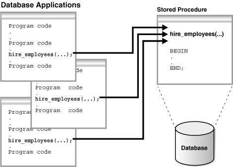
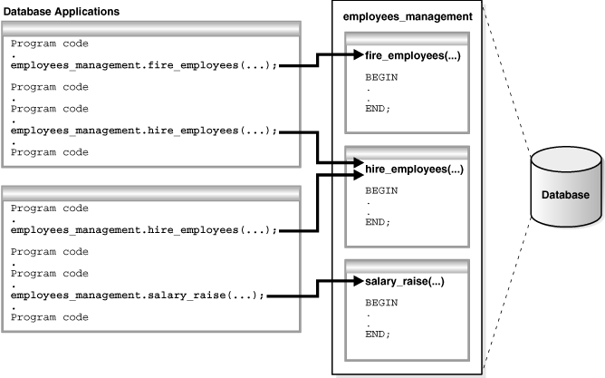
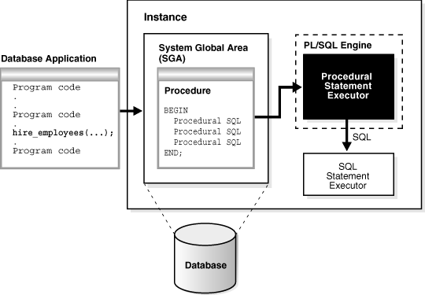
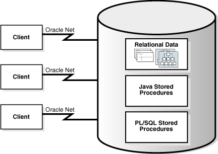
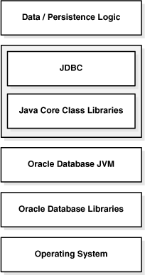
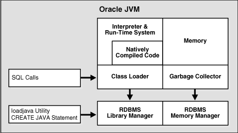
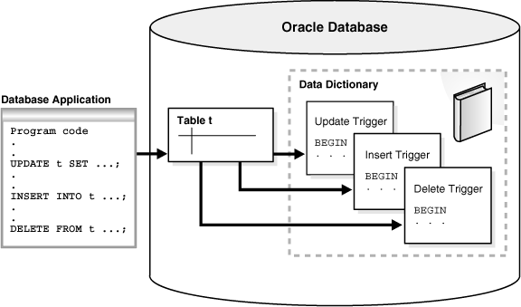

## 10 Server-Side Programming: PL/SQL and Java

**SQL** explains the Structured Query Language (SQL) language and how the database processes SQL statements. This chapter explains how Procedural Language/SQL (PL/SQL) or Java programs stored in the database can use SQL.

This chapter includes the following topics:

- Introduction to Server-Side Programming  
	In a nonprocedural language such as SQL, the set of data to be operated on is specified, but not the operations to be performed or the manner in which they are to be carried out.
- Overview of PL/SQL  
	PL/SQL provides a server-side, stored procedural language that is easy-to-use, seamless with SQL, robust, portable, and secure. You can access and manipulate database data using procedural objects called **PL/SQL units**.
- Overview of Java in Oracle Database  
	Java has emerged as the object-oriented programming language of choice.
- Overview of Triggers  
	A database trigger is a compiled stored program unit, written in either PL/SQL or Java, that Oracle Database invokes ("fires") automatically in certain situations.

See Also:

" [SQL](sql.md) " for an overview of the SQL language

**Parent topic:** [Oracle Data Access](oracle-data-access.md)

### Introduction to Server-Side Programming

In a nonprocedural language such as SQL, the set of data to be operated on is specified, but not the operations to be performed or the manner in which they are to be carried out.

In a procedural language program, most statement execution depends on previous or subsequent statements and on control structures, such as loops or conditional branches, that are not available in SQL. For an illustration of the difference between procedural and nonprocedural languages, suppose that the following SQL statement queries the `employees` table:

```
SELECT employee_id, department_id, last_name, salary FROM employees;
```

The preceding statement requests data, but does not apply logic to the data. However, suppose you want an application to determine whether each employee in the data set deserves a raise based on salary and department performance. A necessary condition of a raise is that the employee did not receive more than three raises in the last five years. If a raise is called for, then the application must adjust the salary and email the manager; otherwise, the application must update a report.

The problem is how procedural database applications requiring conditional logic and program flow control can use SQL. The basic development approaches are as follows:

- Use client-side programming to embed SQL statements in applications written in procedural languages such as C, C++, or Java
	You can place SQL statements in source code and submit it to a [precompiler](glossary.md) or Java translator before compilation. Alternatively, you can eliminate the precompilation step and use an API such as Java Database Connectivity (JDBC) or Oracle Call Interface (OCI) to enable the application to interact with the database.
- Use server-side programming to develop data logic that resides in the database
	An application can explicitly invoke stored subprograms (procedures and functions), written in PL/SQL (pronounced P L sequel) or Java. You can also create a [trigger](glossary.md), which is named program unit that is stored in the database and invoked in response to a specified event.

This chapter explains the second approach. The principal benefit of server-side programming is that functionality built into the database can be deployed anywhere. The database and not the application determines the best way to perform tasks on a given operating system. Also, subprograms increase scalability by centralizing application processing on the server, enabling clients to reuse code. Because subprogram calls are quick and efficient, a single call can start a compute-intensive stored subprogram, reducing network traffic.

You can use the following languages to store data logic in Oracle Database:

- PL/SQL
	PL/SQL is the Oracle Database procedural extension to SQL. PL/SQL is integrated with the database, supporting all Oracle SQL statements, functions, and data types. Applications written in database APIs can invoke PL/SQL stored subprograms and send PL/SQL code blocks to the database for execution.
- Java
	Oracle Database also provides support for developing, storing, and deploying Java applications. Java stored subprograms run in the database and are independent of programs that run in the middle tier. Java stored subprograms interface with SQL using a similar execution model to PL/SQL.

See Also:

- [Oracle Database Development Guide](https://docs.oracle.com/pls/topic/lookup?ctx=en/database/oracle/oracle-database/21/cncpt&id=ADFNS-GUID-595BF48C-CAA2-4872-8A8C-0EE7B21C8E10) to learn about embedding SQL with precompilers and APIs
- [Oracle Database 2 Day Developer's Guide](https://docs.oracle.com/pls/topic/lookup?ctx=en/database/oracle/oracle-database/21/cncpt&id=TDDDG10000) for an introduction to Oracle Database application development
- [Oracle Database Development Guide](https://docs.oracle.com/pls/topic/lookup?ctx=en/database/oracle/oracle-database/21/cncpt&id=ADFNS00109) to learn how to choose a programming environment

**Parent topic:** Server-Side Programming: PL/SQL and Java

### Overview of PL/SQL

PL/SQL provides a server-side, stored procedural language that is easy-to-use, seamless with SQL, robust, portable, and secure. You can access and manipulate database data using procedural objects called **PL/SQL units**.

PL/SQL units generally are categorized as follows:

- A [PL/SQL subprogram](glossary.md) is a PL/SQL block that is stored in the database and can be called by name from an application. When you create a subprogram, the database parses the subprogram and stores its parsed representation in the database. You can declare a subprogram as a procedure or a function.
- A [PL/SQL anonymous block](glossary.md) is a PL/SQL block that appears in your application and is not named or stored in the database. In many applications, PL/SQL blocks can appear wherever SQL statements can appear.

The PL/SQL compiler and interpreter are embedded in Oracle SQL Developer, giving developers a consistent and leveraged development model on both client and server. Also, PL/SQL stored procedures can be called from several database clients, such as Pro\*C, JDBC, ODBC, or OCI, and from Oracle Reports and Oracle Forms.

- PL/SQL Subprograms  
	A PL/SQL subprogram is a named PL/SQL block that permits the caller to supply parameters that can be input only, output only, or input and output values.
- PL/SQL Packages  
	A PL/SQL package is a group of related subprograms, along with the cursors and variables they use, stored together in the database for continued use as a unit. Packaged subprograms can be called explicitly by applications or users.
- PL/SQL Anonymous Blocks  
	A PL/SQL anonymous block is an unnamed, nonpersistent PL/SQL unit.
- PL/SQL Language Constructs  
	PL/SQL blocks can include a variety of different PL/SQL language constructs.
- PL/SQL Collections and Records  
	Many programming techniques use collection types such as arrays, bags, lists, nested tables, sets, and trees.
- How PL/SQL Runs  
	PL/SQL supports both interpreted execution and native execution.

See Also:

- [Oracle Database 2 Day Developer's Guide](https://docs.oracle.com/pls/topic/lookup?ctx=en/database/oracle/oracle-database/21/cncpt&id=TDDDG-GUID-8B3079B4-E52B-4DA8-A1B4-91C94255B62E)
- [Oracle Database PL/SQL Language Reference](https://docs.oracle.com/pls/topic/lookup?ctx=en/database/oracle/oracle-database/21/cncpt&id=LNPLS001) for complete information about PL/SQL, including packages

**Parent topic:** Server-Side Programming: PL/SQL and Java

#### PL/SQL Subprograms

A PL/SQL subprogram is a named PL/SQL block that permits the caller to supply parameters that can be input only, output only, or input and output values.

A subprogram solves a specific problem or performs related tasks and serves as a building block for modular, maintainable database applications. A subprogram is either a [PL/SQL procedure](glossary.md) or a [PL/SQL function](glossary.md). Procedures and functions are identical except that functions always return a single value to the caller, whereas procedures do not. The term PL/SQL procedure in this chapter refers to either a procedure or a function.

- Advantages of PL/SQL Subprograms  
	Server-side programming has many advantages over client-side programming.
- Creation of PL/SQL Subprograms  
	A standalone stored subprogram is a subprogram created at the schema level with the `CREATE PROCEDURE` or `CREATE FUNCTION` statement. Subprograms defined in a package are called package subprograms and are considered a part of the package.
- Execution of PL/SQL Subprograms  
	Users can execute a subprogram interactively in multiple ways.

See Also:

- [Pro\*C/C++ Programmer's Guide](https://docs.oracle.com/pls/topic/lookup?ctx=en/database/oracle/oracle-database/21/cncpt&id=GUID-2F2833F4-62F3-4FC7-8FC1-B742E44727B0) and [Pro\*COBOL Programmer's Guide](https://docs.oracle.com/pls/topic/lookup?ctx=en/database/oracle/oracle-database/21/cncpt&id=LNPCB006) to learn about stored procedures in these languages
- [Oracle Database PL/SQL Language Reference](https://docs.oracle.com/pls/topic/lookup?ctx=en/database/oracle/oracle-database/21/cncpt&id=LNPLS174)

**Parent topic:** Overview of PL/SQL

##### Advantages of PL/SQL Subprograms

Server-side programming has many advantages over client-side programming.

Advantages include:

- Improved performance
	- The amount of information that an application must send over a network is small compared with issuing individual SQL statements or sending the text of an entire PL/SQL block to Oracle Database, because the information is sent only once and thereafter invoked when it is used.
		- The compiled form of a procedure is readily available in the database, so no compilation is required at execution time.
		- If the procedure is present in the [shared pool](glossary.md) of the [SGA](glossary.md), then the database need not retrieve it from disk and can begin execution immediately.
- Memory allocation
	Because stored procedures take advantage of the shared memory capabilities of Oracle Database, it must load only a single copy of the procedure into memory for execution by multiple users. Sharing code among users results in a substantial reduction in database memory requirements for applications.
- Improved productivity
	Stored procedures increase development productivity. By designing applications around a common set of procedures, you can avoid redundant coding. For example, you can write procedures to manipulate rows in the `employees` table. Any application can call these procedures without requiring SQL statements to be rewritten. If the methods of data management change, then only the procedures must be modified, not the applications that use the procedures.
	Stored procedures are perhaps the best way to achieve code reuse. Because any client application written in any language that connects to the database can invoke stored procedures, they provide maximum code reuse in all environments.
- Integrity
	Stored procedures improve the integrity and consistency of your applications. By developing applications around a common group of procedures, you reduce the likelihood of coding errors.
	For example, you can test a subprogram to guarantee that it returns an accurate result and, after it is verified, reuse it in any number of applications without retesting. If the data structures referenced by the procedure are altered, then you must only recompile the procedure. Applications that call the procedure do not necessarily require modifications.
- Security with definer's rights procedures
	Stored procedures can help enforce data security. A [definer's rights PL/SQL procedure](glossary.md) executes with the [privilege](glossary.md) of its owner, not its current user. Thus, you can restrict the database tasks that users perform by allowing them to access data only through procedures and functions that run with the definer's privileges.
	For example, you can grant users access to a procedure that updates a table but not grant access to the table itself. When a user invokes the procedure, it runs with the privileges of its owner. Users who have only the privilege to run the procedure (but not privileges to query, update, or delete from the underlying tables) can invoke the procedure but not manipulate table data in any other way.
- Inherited privileges and schema context with invoker's rights procedures
	An [invoker's rights PL/SQL procedure](glossary.md) executes in the current user's schema with the current user's privileges. In other words, an invoker's rights procedure is not tied to a particular user or schema. Invoker's rights procedures make it easy for application developers to centralize application logic, even when the underlying data is divided among user schemas.
	For example, an `hr_manager` user who runs an update procedure on the `hr.employees` table can update salaries, whereas an `hr_clerk` who runs the same procedure is restricted to updating address data.

See Also:

- [Oracle Database PL/SQL Language Reference](https://docs.oracle.com/pls/topic/lookup?ctx=en/database/oracle/oracle-database/21/cncpt&id=LNPLS008) for an overview of PL/SQL subprograms
- [Oracle Database Security Guide](https://docs.oracle.com/pls/topic/lookup?ctx=en/database/oracle/oracle-database/21/cncpt&id=DBSEG50010) to learn more about definer's and invoker's rights

**Parent topic:** PL/SQL Subprograms

##### Creation of PL/SQL Subprograms

A standalone stored subprogram is a subprogram created at the schema level with the `CREATE PROCEDURE` or `CREATE FUNCTION` statement. Subprograms defined in a package are called package subprograms and are considered a part of the package.

The database stores subprograms in the data dictionary as schema objects. A subprogram has a specification, which includes descriptions of any parameters, and a body.

Example 10-1 PL/SQL Procedure

This example shows part of a creation statement for the standalone PL/SQL procedure `hire_employees`. The procedure inserts a row into the `employees` table.
```
CREATE PROCEDURE hire_employees 
  (p_last_name VARCHAR2, p_job_id VARCHAR2, p_manager_id NUMBER, 
   p_hire_date DATE, p_salary NUMBER, p_commission_pct NUMBER, 
   p_department_id NUMBER)
IS 
BEGIN
.
.
.
  INSERT INTO employees (employee_id, last_name, job_id, manager_id, hire_date, 
    salary, commission_pct, department_id)
  VALUES (emp_sequence.NEXTVAL, p_last_name, p_job_id, p_manager_id, 
          p_hire_date, p_salary, p_commission_pct, p_department_id);
.
.
.
END;
```

See Also:

- [Oracle Database 2 Day Developer's Guide](https://docs.oracle.com/pls/topic/lookup?ctx=en/database/oracle/oracle-database/21/cncpt&id=TDDDG41000) to learn how to create subprograms
- [Oracle Database PL/SQL Language Reference](https://docs.oracle.com/pls/topic/lookup?ctx=en/database/oracle/oracle-database/21/cncpt&id=LNPLS01373) to learn about the `CREATE PROCEDURE` statement

**Parent topic:** PL/SQL Subprograms

##### Execution of PL/SQL Subprograms

Users can execute a subprogram interactively in multiple ways.

The options are:

- Using an Oracle tool, such as SQL\*Plus or SQL Developer
- Calling it explicitly in the code of a database application, such as an Oracle Forms or precompiler application
- Calling it explicitly in the code of another procedure or trigger

The following graphic shows different database applications calling `hire_employees`.

Figure 10-1 Multiple Executions of a Stored Procedure



> On the left of this graphic are two boxes labeled Database Applications. The top box contains calls to fire\_employees and hire\_employees. The bottom box contains calls to hire\_employees and salary\_raise. On the right is a rectangle containing the procedures in the employees\_management package: fire\_employees, hire\_employees, and salary\_raise. The calls on the left point to the procedures on the right. The package is stored in the database.


Alternatively, a privileged user can use Oracle Enterprise Manager or SQL\*Plus to run the `hire_employees` procedure using a statement such as the following:

```
EXECUTE hire_employees ('TSMITH', 'CLERK', 1037, SYSDATE, 500, NULL, 20);
```

The preceding statement inserts a new record for `TSMITH` in the `employees` table.

A stored procedure depends on the objects referenced in its body. The database automatically tracks and manages these dependencies. For example, if you alter the definition of the `employees` table referenced by the `hire_employees` procedure in a manner that would affect this procedure, then the procedure must be recompiled to validate that it still works as designed. Usually, the database automatically administers such dependency management.

See Also:

- [Oracle Database 2 Day Developer's Guide](https://docs.oracle.com/pls/topic/lookup?ctx=en/database/oracle/oracle-database/21/cncpt&id=TDDDG-GUID-8B3079B4-E52B-4DA8-A1B4-91C94255B62E) to learn more about SQL\*Plus and SQL Developer
- [Oracle Database Development Guide](https://docs.oracle.com/pls/topic/lookup?ctx=en/database/oracle/oracle-database/21/cncpt&id=ADFNS-GUID-595BF48C-CAA2-4872-8A8C-0EE7B21C8E10) to learn more about precompilers
- [Oracle Database PL/SQL Language Reference](https://docs.oracle.com/pls/topic/lookup?ctx=en/database/oracle/oracle-database/21/cncpt&id=LNPLS008) to learn how to use PL/SQL subprograms
- [SQL\*Plus User's Guide and Reference](https://docs.oracle.com/pls/topic/lookup?ctx=en/database/oracle/oracle-database/21/cncpt&id=SQPUG043) to learn about the `EXECUTE` command

**Parent topic:** PL/SQL Subprograms

#### PL/SQL Packages

A PL/SQL package is a group of related subprograms, along with the cursors and variables they use, stored together in the database for continued use as a unit. Packaged subprograms can be called explicitly by applications or users.

Oracle Database includes many supplied packages that extend database functionality and provide PL/SQL access to SQL features. For example, the `UTL_HTTP` package enables HTTP callouts from PL/SQL and SQL to access data on the Internet or to call Oracle Web Server Cartridges. You can use the supplied packages when creating applications or as a source of ideas when creating your own stored procedures.

- Advantages of PL/SQL Packages  
	PL/SQL packages provide a number of advantages to the application developer.
- Creation of PL/SQL Packages  
	You create a package in two parts: the specification and the body. The package specification declares all public constructs of the package, whereas the package body defines all constructs (public and private) of the package.
- Execution of PL/SQL Package Subprograms  
	Database triggers, stored subprograms, 3GL application programs, and Oracle tools can reference package contents.

**Parent topic:** Overview of PL/SQL

##### Advantages of PL/SQL Packages

PL/SQL packages provide a number of advantages to the application developer.

Advantages include:

- Encapsulation
	Packages enable you to encapsulate or group stored procedures, variables, data types, and so on in a named, stored unit. Encapsulation provides better organization during development and also more flexibility. You can create specifications and reference public procedures without actually creating the package body. Encapsulation simplifies privilege management. Granting the privilege for a package makes package constructs accessible to the grantee.
- Data security
	The methods of package definition enable you to specify which variables, cursors, and procedures are public and private. Public means that it is directly accessible to the user of a package. Private means that it is hidden from the user of a package.
	For example, a package can contain 10 procedures. You can define the package so that only three procedures are public and therefore available for execution by a user of the package. The remaining procedures are private and can only be accessed by the procedures within the package. Do not confuse public and private package variables with grants to `PUBLIC`.
- Better performance
	An entire package is loaded into memory in small chunks when a procedure in the package is called for the first time. This load is completed in one operation, as opposed to the separate loads required for standalone procedures. When calls to related packaged procedures occur, no disk I/O is needed to run the compiled code in memory.
	A package body can be replaced and recompiled without affecting the specification. Consequently, schema objects that reference a package's constructs (always through the specification) need not be recompiled unless the package specification is also replaced. By using packages, unnecessary recompilations can be minimized, resulting in less impact on overall database performance.

**Parent topic:** PL/SQL Packages

##### Creation of PL/SQL Packages

You create a package in two parts: the specification and the body. The package specification declares all public constructs of the package, whereas the package body defines all constructs (public and private) of the package.

The following example shows part of a statement that creates the package specification for `employees_management`, which encapsulates several subprograms used to manage an employee database. Each part of the package is created with a different statement.

```
CREATE PACKAGE employees_management AS 
  FUNCTION hire_employees (last_name VARCHAR2, job_id VARCHAR2, manager_id NUMBER, 
    salary NUMBER, commission_pct NUMBER, department_id NUMBER) RETURN NUMBER; 
  PROCEDURE fire_employees(employee_id NUMBER); 
  PROCEDURE salary_raise(employee_id NUMBER, salary_incr NUMBER); 
.
.
.
  no_sal EXCEPTION;
END employees_management;
```

The specification declares the function `hire_employees`, the procedures `fire_employees` and `salary_raise`, and the exception `no_sal`. All of these public program objects are available to users who have access to the package.

The `CREATE PACKAGE BODY` statement defines objects declared in the specification. The package body must be created in the same schema as the package. After creating the package, you can develop applications that call any of these public procedures or functions or raise any of the public exceptions of the package.

See Also:

[Oracle Database PL/SQL Language Reference](https://docs.oracle.com/pls/topic/lookup?ctx=en/database/oracle/oracle-database/21/cncpt&id=LNPLS01371) to learn about the `CREATE PACKAGE` statement

**Parent topic:** PL/SQL Packages

##### Execution of PL/SQL Package Subprograms

Database triggers, stored subprograms, 3GL application programs, and Oracle tools can reference package contents.

The following graphic shows database applications invoking procedures and functions in the `employees_management` package.

Figure 10-2 Calling Subprograms in a PL/SQL Package



> On the left of this graphic are two boxes labeled Database Applications. The top box contains calls to fire\_employees and hire\_employees. The bottom box contains calls to hire\_employees and salary\_raise. On the right is a rectangle containing the procedures in the employees\_management package: fire\_employees, hire\_employees, and salary\_raise. The calls on the left point to the procedures on the right. The package is stored in the database.


Database applications explicitly call packaged procedures as necessary. After being granted the privileges for the `employees_management` package, a user can explicitly run any of the procedures contained in it. For example, SQL\*Plus can issue the following statement to run the `hire_employees` package procedure:

```
EXECUTE employees_management.hire_employees ('TSMITH', 'CLERK', 1037, SYSDATE, 500, NULL, 20);
```

See Also:

- [Oracle Database PL/SQL Language Reference](https://docs.oracle.com/pls/topic/lookup?ctx=en/database/oracle/oracle-database/21/cncpt&id=LNPLS009) for an introduction to PL/SQL packages
- [Oracle Database Development Guide](https://docs.oracle.com/pls/topic/lookup?ctx=en/database/oracle/oracle-database/21/cncpt&id=ADFNS009) to learn how to code PL/SQL packages

**Parent topic:** PL/SQL Packages

#### PL/SQL Anonymous Blocks

A PL/SQL anonymous block is an unnamed, nonpersistent PL/SQL unit.

Typical uses for anonymous blocks include:

- Initiating calls to subprograms and package constructs
- Isolating exception handling
- Managing control by nesting code within other PL/SQL blocks

Anonymous blocks do not have the code reuse advantages of stored subprograms. Table 10-1 summarizes the differences between the two types of PL/SQL units.

Table 10-1 Differences Between Anonymous Blocks and Subprograms

| Is the PL/SQL Unit... | Anonymous Blocks | Subprograms |
| --- | --- | --- |
| Specified with a name? | No | Yes |
| Compiled with every reuse? | No | No |
| Stored in the database? | No | Yes |
| Invocable by other applications? | No | Yes |
| Capable of returning bind variable values? | Yes | Yes |
| Capable of returning function values? | No | Yes |
| Capable of accepting parameters? | No | Yes |

An anonymous block consists of an optional declarative part, an executable part, and one or more optional exception handlers. The following sample anonymous block selects an employee last name into a variable and prints the name:

```
DECLARE
  v_lname VARCHAR2(25);
BEGIN
  SELECT last_name 
    INTO v_lname
  FROM employees
  WHERE employee_id = 101;
  DBMS_OUTPUT.PUT_LINE('Employee last name is '||v_lname);
END;
```

Oracle Database compiles the PL/SQL block and places it in the shared pool of the SGA, but it does not store the source code or compiled version in the database for reuse beyond the current instance. Unlike triggers, an anonymous block is compiled each time it is loaded into memory. Shared SQL allows anonymous PL/SQL blocks in the shared pool to be reused and shared until they are flushed out of the shared pool.

See Also:

[Oracle Database Development Guide](https://docs.oracle.com/pls/topic/lookup?ctx=en/database/oracle/oracle-database/21/cncpt&id=ADFNS311) to learn more about anonymous PL/SQL blocks

**Parent topic:** Overview of PL/SQL

#### PL/SQL Language Constructs

PL/SQL blocks can include a variety of different PL/SQL language constructs.

These constructs including the following:

- Variables and constants
	You can declare these constructs within a procedure, function, or package. You can use a variable or constant in a SQL or PL/SQL statement to capture or provide a value when one is needed.
- Cursors
	You can declare a [cursor](glossary.md) explicitly within a procedure, function, or package to facilitate record-oriented processing of Oracle Database data. The PL/SQL engine can also declare cursors implicitly.
- Exceptions
	PL/SQL lets you explicitly handle internal and user-defined error conditions, called exceptions, that arise during processing of PL/SQL code.

PL/SQL can run [dynamic SQL](glossary.md) statements whose complete text is not known until run time. Dynamic SQL statements are stored in character strings that are entered into, or built by, the program at run time. This technique enables you to create general purpose procedures. For example, you can create a procedure that operates on a table whose name is not known until run time.

See Also:

- [Oracle Database PL/SQL Packages and Types Reference](https://docs.oracle.com/pls/topic/lookup?ctx=en/database/oracle/oracle-database/21/cncpt&id=LNPLS011) for details about dynamic SQL
- [Oracle Database PL/SQL Packages and Types Reference](https://docs.oracle.com/pls/topic/lookup?ctx=en/database/oracle/oracle-database/21/cncpt&id=ARPLS058) to learn how to use dynamic SQL in the `DBMS_SQL` package

**Parent topic:** Overview of PL/SQL

#### PL/SQL Collections and Records

Many programming techniques use collection types such as arrays, bags, lists, nested tables, sets, and trees.

To support collection techniques in database applications, PL/SQL provides the data types `TABLE` and `VARRAY`. These types enable you to declare associative arrays, nested tables, and variable-size arrays.

- Collections  
	A PL/SQL collection is an ordered group of elements, all of the same type.
- Records  
	A PL/SQL record is a composite variable that can store data values of different types, similar to a struct type in C, C++, or Java. Records are useful for holding data from table rows, or certain columns from table rows.

**Parent topic:** Overview of PL/SQL

##### Collections

A PL/SQL collection is an ordered group of elements, all of the same type.

Each element has a unique subscript that determines its position in the collection. To create a collection, you first define a collection type, and then declare a variable of that type.

Collections work like the arrays found in most third-generation programming languages. Also, collections can be passed as parameters. So, you can use them to move columns of data into and out of database tables or between client-side applications and stored subprograms.

**Parent topic:** PL/SQL Collections and Records

##### Records

A PL/SQL record is a composite variable that can store data values of different types, similar to a struct type in C, C++, or Java. Records are useful for holding data from table rows, or certain columns from table rows.

Suppose you have data about an employee such as name, salary, and hire date. These items are dissimilar in type but logically related. A record containing a field for each item lets you treat the data as a logical unit.

You can use the `%ROWTYPE` attribute to declare a record that represents a table row or row fetched from a cursor. With user-defined records, you can declare your own fields.

See Also:

[Oracle Database PL/SQL Language Reference](https://docs.oracle.com/pls/topic/lookup?ctx=en/database/oracle/oracle-database/21/cncpt&id=LNPLS005) to learn how to use PL/SQL records

**Parent topic:** PL/SQL Collections and Records

#### How PL/SQL Runs

PL/SQL supports both interpreted execution and native execution.

In interpreted execution, PL/SQL source code is compiled into a so-called bytecode representation. A portable virtual computer implemented as part of Oracle Database runs this bytecode.

Native execution offers the best performance on computationally intensive units. In this case, the source code of PL/SQL units is compiled directly to object code for the given platform. This object code is linked into Oracle Database.

The [PL/SQL engine](glossary.md) defines, compiles, and runs PL/SQL units. This engine is a special component of many Oracle products, including Oracle Database. While many Oracle products have PL/SQL components, this topic specifically covers the PL/SQL units that can be stored in Oracle Database and processed using Oracle Database PL/SQL engine. The documentation for each Oracle tool describes its PL/SQL capabilities.

The following graphic illustrates the PL/SQL engine contained in Oracle Database.

Figure 10-3 The PL/SQL Engine and Oracle Database



> On the left side of the graphic is a box labeled Database Application. Inside the box are several lines, some labeled "Program code" and one labeled "Procedure call." The Database Application box points to a box labeled Oracle Database. Inside this box is a box labeled SGA. Inside the SGA box is a procedure. The code points to a box labeled PL/SQL engine. Inside this box is another box labeled Procedural Statement Executor. This box points with an arrow labeled SQL to a box labeled SQL Statement Executor.


The PL/SQL unit is stored in a database. When an application calls a stored procedure, the database loads the compiled PL/SQL unit into the [shared pool](glossary.md) in the [system global area (SGA)](glossary.md). The PL/SQL and SQL statement executors work together to process the statements in the procedure.

You can call a stored procedure from another PL/SQL block, which can be either an anonymous block or another stored procedure. For example, you can call a stored procedure from Oracle Forms.

A PL/SQL procedure executing on Oracle Database can call an external procedure or function written in the C programming language and stored in a shared library. The C routine runs in a separate address space from that of Oracle Database.

See Also:

- " [Shared Pool](memory-architecture.md) " to learn more about the purpose and contents of the shared pool
- [Oracle Database PL/SQL Language Reference](https://docs.oracle.com/pls/topic/lookup?ctx=en/database/oracle/oracle-database/21/cncpt&id=LNPLS00103) to learn about PL/SQL architecture
- [Oracle Database Development Guide](https://docs.oracle.com/pls/topic/lookup?ctx=en/database/oracle/oracle-database/21/cncpt&id=ADFNS1402) to learn more about external procedures

**Parent topic:** Overview of PL/SQL

### Overview of Java in Oracle Database

Java has emerged as the object-oriented programming language of choice.

Java includes the following features:

- A Java Virtual Machine (JVM), which provides the basis for platform independence
- Automated storage management techniques, such as garbage collection
- Language syntax that borrows from C and enforces strong typing

Note:

This chapter assumes that you have some familiarity with the Java language.

The database provides Java programs with a dynamic data-processing engine that supports complex queries and multiple views of data. Client requests are assembled as data queries for immediate processing. Query results are generated dynamically.

The combination of Java and Oracle Database helps you create component-based, network-centric applications that can be easily updated as business needs change. In addition, you can move applications and data stores off the desktop and onto intelligent networks and network-centric servers. More importantly, you can access these applications and data stores from any client device.

The following figure shows a traditional two-tier, client/server configuration in which clients call Java stored procedures in the same way that they call PL/SQL subprograms.

Figure 10-4 Two-Tier Client/Server Configuration



> The figure illustrates a traditional two-tier client/server configuration. The server comprises Oracle Database, which has relational data, object-relational data, Java stored procedures, and PL/SQL stored procedures. There are three types of clients shown in the figure: Thin clients, such as Java applet and JDBC driver, Thick clients, such as Oracle Call Interface (OCI) and Open Database Connectivity (ODBC) client, and Oracle Forms and Oracle Reports. All these clients connect to Oracle Database through Oracle Net Services Connection Manager. Oracle Net Services Connection Manager combines multiple connections from different clients into a single connection to Oracle Database.


- Overview of the Java Virtual Machine (JVM)  
	A JVM is a virtual processor that runs compiled Java code.
- Java Programming Environment  
	Oracle furnishes enterprise application developers with an end-to-end Java solution for creating, deploying, and managing Java applications.

See Also:

[Oracle Database 2 Day + Java Developer's Guide](https://docs.oracle.com/pls/topic/lookup?ctx=en/database/oracle/oracle-database/21/cncpt&id=TDPJD101) for an introduction to using Java with Oracle Database

**Parent topic:** Server-Side Programming: PL/SQL and Java

#### Overview of the Java Virtual Machine (JVM)

A JVM is a virtual processor that runs compiled Java code.

Java source code compiles to low-level machine instructions, known as bytecodes, that are platform independent. The Java bytecodes are interpreted through the JVM into platform-dependent actions.

- Overview of Oracle JVM  
	The Oracle JVM is a standard, Java-compatible environment that runs any pure Java application. It is compatible with the JLS and the JVM specifications.
- Main Components of Oracle JVM  
	Oracle JVM runs in the same process space and address space as the database kernel by sharing its memory heaps and directly accessing its relational data. This design optimizes memory use and increases throughput.

**Parent topic:** Overview of Java in Oracle Database

##### Overview of Oracle JVM

The Oracle JVM is a standard, Java-compatible environment that runs any pure Java application. It is compatible with the JLS and the JVM specifications.

The Oracle JVM supports the standard Java binary format and APIs. In addition, Oracle Database adheres to standard Java language semantics, including dynamic class loading at run time.

The following figure illustrates how Oracle Java applications reside on top of the Java core class libraries, which reside on top of the Oracle JVM. Because the Oracle Java support system is located within the database, the JVM interacts with database libraries, instead of directly interacting with the operating system.

Figure 10-5 Java Component Structure



> The graphic shows six boxes in a vertical line: Data/Persistence Logic, JDBC, Java Core Class Libraries, Oracle Database JVM, Oracle Database Libraries, and Operating System. JDBC and Java Core Class Libraries are boxed together.
>
> [  
> Copyright © 1993, 2025, Oracle and/or its affiliates.](https://docs.oracle.com/en/database/oracle/oracle-database/dcommon/html/cpyr.htm)


Unlike other Java environments, Oracle JVM is embedded within Oracle Database. Some important differences exist between Oracle JVM and typical client JVMs. For example, in a standard Java environment, you run a Java application through the interpreter by issuing the following command on the command line, where `classname` is the name of the class that the JVM interprets first:

```
java classname
```

The preceding command causes the application to run within a process on your operating system. However, if you are not using the command-line interface, then you must load the application into the database, publish the interface, and then run the application within a database [data dictionary](glossary.md).

See Also:

See [Oracle Database Java Developer’s Guide](https://docs.oracle.com/pls/topic/lookup?ctx=en/database/oracle/oracle-database/21/cncpt&id=JJDEV01300) for a description of other differences between the Oracle JVM and typical client JVMs

**Parent topic:** Overview of the Java Virtual Machine (JVM)

##### Main Components of Oracle JVM

Oracle JVM runs in the same process space and address space as the database kernel by sharing its memory heaps and directly accessing its relational data. This design optimizes memory use and increases throughput.

Oracle JVM provides a run-time environment for Java objects. It fully supports Java data structures, method dispatch, exception handling, and language-level threads. It also supports all the core Java class libraries, including `java.lang`, `java.io`, `java.net`, `java.math`, and `java.util`.

The following illustration shows the main components of Oracle JVM.

Figure 10-6 Main Components of Oracle JVM



> The figure illustrates the conceptual view of the main components of Oracle JVM and how they interact with each other. Oracle JVM consists of an interpreter and run-time system that interprets the code and store the native code in the natively compiled code area in Oracle JVM. It also contains the memory, garbage collector, and the class loader. The class loader interacts with the RDBMS library manager, and the garbage collector interacts with the RDBMS memory manager. The SQL and IIOP calls are routed to the interpreter and run-time system, and the loadjava tool and CREATE JAVA statement calls are routed to the RDBMS library manager.


Oracle JVM embeds the standard Java namespace in the database schemas. This feature lets Java programs access Java objects stored in Oracle Database and application servers across the enterprise.

In addition, Oracle JVM is tightly integrated with the scalable, shared memory architecture of the database. Java programs use call, session, and object lifetimes efficiently without user intervention. Consequently, Oracle JVM and middle-tier Java business objects can be scaled, even when they have session-long state.

See Also:

[Oracle Database Java Developer’s Guide](https://docs.oracle.com/pls/topic/lookup?ctx=en/database/oracle/oracle-database/21/cncpt&id=JJDEV01300) for a description of the main components of Oracle JVM

**Parent topic:** Overview of the Java Virtual Machine (JVM)

#### Java Programming Environment

Oracle furnishes enterprise application developers with an end-to-end Java solution for creating, deploying, and managing Java applications.

The solution consists of client-side and server-side programmatic interfaces, tools to support Java development, and a Java Virtual Machine integrated with Oracle Database. All these products are compatible with Java standards.

The Java programming environment consists of the following additional features:

- Java stored procedures as the Java equivalent and companion for PL/SQL. Java stored procedures are tightly integrated with PL/SQL. You can call Java stored procedures from PL/SQL packages and procedures from Java stored procedures.
- The JDBC and SQLJ programming interfaces for accessing SQL data.
- Tools and scripts that assist in developing, loading, and managing classes.

- Java Stored Procedures  
	A Java stored procedure is a Java method published to SQL and stored in the database.
- Java and PL/SQL Integration  
	You can call existing PL/SQL programs from Java and Java programs from PL/SQL. This solution protects and leverages your PL/SQL and Java code.

**Parent topic:** Overview of Java in Oracle Database

##### Java Stored Procedures

A Java stored procedure is a Java method published to SQL and stored in the database.

Like a PL/SQL subprogram, a Java procedure can be invoked directly with products like SQL\*Plus or indirectly with a trigger. You can access it from any Oracle Net client—OCI, precompiler, or JDBC.

To publish Java methods, you write call specifications, which map Java method names, parameter types, and return types to their SQL counterparts. When called by client applications, a Java stored procedure can accept arguments, reference Java classes, and return Java result values.

Applications calling the Java method by referencing the name of the call specification. The run-time system looks up the call specification definition in the Oracle data dictionary and runs the corresponding Java method.

In addition, you can use Java to develop powerful programs independently of PL/SQL. Oracle Database provides a fully compliant implementation of the Java programming language and JVM.

See Also:

[Oracle Database Java Developer’s Guide](https://docs.oracle.com/pls/topic/lookup?ctx=en/database/oracle/oracle-database/21/cncpt&id=GUID-AE1E5C4B-A077-4D1E-8821-6A7142BF1FEA) explains how to write stored procedures in Java, how to access them from PL/SQL, and how to access PL/SQL functionality from Java

**Parent topic:** Java Programming Environment

##### Java and PL/SQL Integration

You can call existing PL/SQL programs from Java and Java programs from PL/SQL. This solution protects and leverages your PL/SQL and Java code.

Oracle Database offers two different approaches for accessing SQL data from Java: JDBC and SQLJ. JDBC is available on both client and server, whereas SQLJ is available only on the client.

- JDBC Drivers  
	JDBC is a database access protocol that enables you to connect to a database and run SQL statements and queries to the database.
- SQLJ  
	**SQLJ** is an ANSI standard for embedding SQL statements in Java programs. You can use client-side SQLJ programs. In addition, you can combine SQLJ programs with JDBC.

**Parent topic:** Java Programming Environment

###### JDBC Drivers

JDBC is a database access protocol that enables you to connect to a database and run SQL statements and queries to the database.

The core Java class libraries provide only one JDBC API, `java.sql`. However, JDBC is designed to enable vendors to supply drivers that offer the necessary specialization for a particular database. Oracle provides the distinct JDBC drivers shown in the following table.

Table 10-2 JDBC Drivers

| Driver | Description |
| --- | --- |
| JDBC Thin driver | You can use the JDBC Thin driver to write pure Java applications and applets that access Oracle SQL data. The JDBC Thin driver is especially well-suited for Web-based applications and applets, because you can dynamically download it from a Web page, similar to any other Java applet. |
| JDBC OCI driver | The JDBC OCI driver accesses Oracle-specific native code, that is, non-Java code, and libraries on the client or middle tier, providing a performance boost compared to the JDBC Thin driver, at the cost of significantly larger size and client-side installation. |
| JDBC server-side internal driver | Oracle Database uses the server-side internal driver when the Java code runs on the server. It allows Java applications running in Oracle JVM on the server to access locally defined data, that is, data on the same system and in the same process, with JDBC. It provides a performance boost, because of its ability to use the underlying Oracle RDBMS libraries directly, without the overhead of an intervening network connection between the Java code and SQL data. By supporting the same Java-SQL interface on the server, Oracle Database does not require you to rework code when deploying it. |

See Also:

- [Oracle Database Development Guide](https://docs.oracle.com/pls/topic/lookup?ctx=en/database/oracle/oracle-database/21/cncpt&id=ADFNS-GUID-AE98D870-1124-4B1D-82CB-127DCB38BC38) for an overview of JDBC
- [Oracle Database 2 Day + Java Developer's Guide](https://docs.oracle.com/pls/topic/lookup?ctx=en/database/oracle/oracle-database/21/cncpt&id=TDPJD-GUID-2ADAB75C-88C9-4956-98C3-FE0ED96444CA) and [Oracle Database JDBC Developer’s Guide](https://docs.oracle.com/pls/topic/lookup?ctx=en/database/oracle/oracle-database/21/cncpt&id=GUID-D6975767-9F5A-4B30-8910-9298DDD7FEF0)

**Parent topic:** Java and PL/SQL Integration

###### SQLJ

**SQLJ** is an ANSI standard for embedding SQL statements in Java programs. You can use client-side SQLJ programs. In addition, you can combine SQLJ programs with JDBC.

Note:

Starting with Oracle Database 12c release 2 (12.2), Oracle Database does not support running server-side SQLJ code, including running stored procedures, functions, and triggers in the database environment.

SQLJ provides a simple, but powerful, way to develop client-side and middle-tier applications that access databases from Java. A developer writes a program using SQLJ and then uses the SQLJ translator to translate embedded SQL to pure JDBC-based Java code. At run time, the program can communicate with multi-vendor databases using standard JDBC drivers.

The following example shows a simple SQLJ executable statement:

```
String name;
#sql  { SELECT first_name INTO :name FROM employees WHERE employee_id=112 };
System.out.println("Name is " + name + ", employee number = " + employee_id);
```

See Also:

[Oracle Database SQLJ Developer’s Guide](https://docs.oracle.com/pls/topic/lookup?ctx=en/database/oracle/oracle-database/21/cncpt&id=GUID-B3A3C319-5C61-40C6-B3FB-37C2BD98AD48)

**Parent topic:** Java and PL/SQL Integration

### Overview of Triggers

A database trigger is a compiled stored program unit, written in either PL/SQL or Java, that Oracle Database invokes ("fires") automatically in certain situations.

A trigger fires whenever one of the following operations occurs:

1. [DML](glossary.md) statements on a particular table or view, issued by any user
	DML statements modify data in schema objects. For example, inserting and deleting rows are DML operations.
2. [DDL](glossary.md) statements issued either by a particular user or any user
	DDL statements define schema objects. For example, creating a table and adding a column are DDL operations.
3. Database events
	User login or logoff, errors, and database startup or shutdown are events that can invoke triggers.

Triggers are schema objects that are similar to subprograms but differ in the way they are invoked. A subprogram is explicitly run by a user, application, or trigger. Triggers are implicitly invoked by the database when a triggering event occurs.

- Advantages of Triggers  
	The correct use of triggers enables you to build and deploy applications that are more robust and that use the database more effectively.
- Types of Triggers  
	Triggers can be categorized according to their means of invocation and the type of actions they perform.
- Timing for Triggers  
	You can define the trigger timing—whether the trigger action is to be run before or after the triggering statement.
- Creation of Triggers  
	The `CREATE TRIGGER` statement creates or replaces a database trigger.
- Execution of Triggers  
	Oracle Database executes a trigger internally using the same steps as for subprogram execution.
- Storage of Triggers  
	Oracle Database stores PL/SQL triggers in compiled form in a database schema, just like PL/SQL stored procedures.

See Also:

- " [Overview of SQL Statements](sql.md) " to learn about DML and DDL
- " [Overview of Database Instance Startup and Shutdown](oracle-database-instance.md) "

**Parent topic:** Server-Side Programming: PL/SQL and Java

#### Advantages of Triggers

The correct use of triggers enables you to build and deploy applications that are more robust and that use the database more effectively.

You can use triggers to:

- Automatically generate derived column values
- Prevent invalid transactions
- Provide auditing and event logging
- Record information about table access

You can use triggers to enforce low-level business rules common for all client applications. For example, several applications may access the `employees` table. If a trigger on this table ensures the format of inserted data, then this business logic does not need to be reproduced in every client. Because the trigger cannot be circumvented by the application, the business logic in the trigger is used automatically.

You can use both triggers and integrity constraints to define and enforce any type of integrity rule. However, Oracle strongly recommends that you only use triggers to enforce complex business rules not definable using an [integrity constraint](glossary.md).

Excessive use of triggers can result in complex interdependencies that can be difficult to maintain in a large application. For example, when a trigger is invoked, a SQL statement within its trigger action potentially can fire other triggers, resulting in cascading triggers that can produce unintended effects.

See Also:

- " [Introduction to Data Integrity](data-integrity.md) "
- [Oracle Database 2 Day Developer's Guide](https://docs.oracle.com/pls/topic/lookup?ctx=en/database/oracle/oracle-database/21/cncpt&id=TDDDG50000)
- [Oracle Database PL/SQL Language Reference](https://docs.oracle.com/pls/topic/lookup?ctx=en/database/oracle/oracle-database/21/cncpt&id=LNPLS2002) for guidelines and restrictions when planning triggers for your application

**Parent topic:** [Overview of Triggers](https://docs.oracle.com/en/database/oracle/oracle-database/21/cncpt/server-side-programming.html#GUID-40297ADF-0968-42F8-B8B9-84AD6ADCBE63 "A database trigger is a compiled stored program unit, written in either PL/SQL or Java, that Oracle Database invokes (\"fires\") automatically in certain situations.")

#### Types of Triggers

Triggers can be categorized according to their means of invocation and the type of actions they perform.

Oracle Database supports the following types of triggers:

- Row triggers
	A [row trigger](glossary.md) fires each time the table is affected by the triggering statement. For example, if a statement updates multiple rows, then a row trigger fires once for each row affected by the `UPDATE`. If a triggering statement affects no rows, then a row trigger is not run. Row triggers are useful if the code in the trigger action depends on data provided by the triggering statement or rows that are affected.
- Statement triggers
	A [statement trigger](glossary.md) is fired once on behalf of the triggering statement, regardless of the number of rows affected by the triggering statement. For example, if a statement deletes 100 rows from a table, a statement-level `DELETE` trigger is fired only once. Statement triggers are useful if the code in the trigger action does not depend on the data provided by the triggering statement or the rows affected.
- `INSTEAD OF` triggers
	An [INSTEAD OF trigger](glossary.md) is fired by Oracle Database instead of executing the triggering statement. These triggers are useful for transparently modifying views that cannot be modified directly through DML statements.
- Event triggers
	You can use triggers to publish information about database events to subscribers. Event triggers are divided into the following categories:
	- A [system event trigger](glossary.md) can be caused by events such as database instance startup and shutdown or error messages.
		- A [user event trigger](glossary.md) is fired because of events related to user logon and logoff, DDL statements, and DML statements.

See Also:

- [Oracle Database 2 Day Developer's Guide](https://docs.oracle.com/pls/topic/lookup?ctx=en/database/oracle/oracle-database/21/cncpt&id=TDDDG51000)
- [Oracle Database PL/SQL Language Reference](https://docs.oracle.com/pls/topic/lookup?ctx=en/database/oracle/oracle-database/21/cncpt&id=LNPLS2005)

**Parent topic:** [Overview of Triggers](https://docs.oracle.com/en/database/oracle/oracle-database/21/cncpt/server-side-programming.html#GUID-40297ADF-0968-42F8-B8B9-84AD6ADCBE63 "A database trigger is a compiled stored program unit, written in either PL/SQL or Java, that Oracle Database invokes (\"fires\") automatically in certain situations.")

#### Timing for Triggers

You can define the trigger timing—whether the trigger action is to be run before or after the triggering statement.

A [simple trigger](glossary.md) is a single trigger on a table that enables you to specify actions for exactly one of the following timing points:

- Before the firing statement
- Before each row affected by the firing statement
- After each row affected by the firing statement
- After the firing statement

For statement and row triggers, a `BEFORE` trigger can enhance security and enable business rules before making changes to the database. The `AFTER` trigger is ideal for logging actions.

A [compound trigger](glossary.md) can fire at multiple timing points. Compound triggers help program an approach in which the actions that you implement for various timing points share common data.

See Also:

[Oracle Database PL/SQL Language Reference](https://docs.oracle.com/pls/topic/lookup?ctx=en/database/oracle/oracle-database/21/cncpt&id=LNPLS2005) to learn about compound triggers

**Parent topic:** [Overview of Triggers](https://docs.oracle.com/en/database/oracle/oracle-database/21/cncpt/server-side-programming.html#GUID-40297ADF-0968-42F8-B8B9-84AD6ADCBE63 "A database trigger is a compiled stored program unit, written in either PL/SQL or Java, that Oracle Database invokes (\"fires\") automatically in certain situations.")

#### Creation of Triggers

The `CREATE TRIGGER` statement creates or replaces a database trigger.

A PL/SQL trigger has the following general syntactic form:

```
CREATE TRIGGER trigger_name
  triggering_statement
  [trigger_restriction]
BEGIN
 triggered_action;
END;
```

A PL/SQL trigger has the following basic components:

- Trigger name
	The name must be unique among other trigger names in the same schema. For example, the name may be `part_reorder_trigger`.
- The trigger event or statement
	A triggering event or statement is the SQL statement, database event, or user event that causes a trigger to be invoked. For example, a user updates a table.
- Trigger restriction
	A trigger restriction specifies a Boolean [expression](glossary.md) that must be `true` for the trigger to fire. For example, the trigger is not invoked unless the number of available parts is less than a present reorder amount.
- Triggered action
	A triggered action is the procedure that contains the SQL statements and code to be run when a triggering statement is issued and the trigger restriction evaluates to true. For example, a user inserts a row into a pending orders table.

- Example: CREATE TRIGGER Statement  
	This example creates a trigger that fires when an `INSERT`, `UPDATE`, or `DELETE` statement executes on a line items table.
- Example: Invoking a Row-Level Trigger  
	In this scenario, a customer initiates two orders and adds and removes line items from the orders.

See Also:

- [Oracle Database 2 Day Developer's Guide](https://docs.oracle.com/pls/topic/lookup?ctx=en/database/oracle/oracle-database/21/cncpt&id=TDDDG52000) and [Oracle Database PL/SQL Language Reference](https://docs.oracle.com/pls/topic/lookup?ctx=en/database/oracle/oracle-database/21/cncpt&id=LNPLS2004) to learn how to create triggers
- [Oracle Database SQL Language Reference](https://docs.oracle.com/pls/topic/lookup?ctx=en/database/oracle/oracle-database/21/cncpt&id=SQLRF01405) to learn about the `CREATE TRIGGER` statement

**Parent topic:** [Overview of Triggers](https://docs.oracle.com/en/database/oracle/oracle-database/21/cncpt/server-side-programming.html#GUID-40297ADF-0968-42F8-B8B9-84AD6ADCBE63 "A database trigger is a compiled stored program unit, written in either PL/SQL or Java, that Oracle Database invokes (\"fires\") automatically in certain situations.")

##### Example: CREATE TRIGGER Statement

This example creates a trigger that fires when an `INSERT`, `UPDATE`, or `DELETE` statement executes on a line items table.

Suppose that you create the `orders` and `lineitems` tables with the following statements. The `orders` table contains a row for each unique order, whereas the `lineitems` table contains a row for each item in an order.

```
CREATE TABLE orders
( order_id NUMBER PRIMARY KEY,
  /* other attributes */
  line_items_count NUMBER DEFAULT 0 );

CREATE TABLE lineitems
( order_id REFERENCES orders,
  seq_no   NUMBER,
  /* other attributes */
  CONSTRAINT lineitems PRIMARY KEY(order_id,seq_no) );
```

The following statement creates a sample trigger that automatically updates the `orders` table with the number of items in an order:

```
CREATE OR REPLACE TRIGGER lineitems_trigger
  AFTER INSERT OR UPDATE OR DELETE ON lineitems 
  FOR EACH ROW
BEGIN
  IF (INSERTING OR UPDATING)
  THEN
    UPDATE orders SET line_items_count = NVL(line_items_count,0)+1
    WHERE order_id = :new.order_id;
  END IF;
  IF (DELETING OR UPDATING)
  THEN
    UPDATE orders SET line_items_count = NVL(line_items_count,0)-1
    WHERE order_id = :old.order_id;
  END IF;
END;
/
```

In `lineitems_trigger`, the triggering statement is an `INSERT`, `UPDATE`, or `DELETE` on the `lineitems` table. No triggering restriction exists. The trigger is invoked for each row changed. The trigger has access to the old and new column values of the current row affected by the triggering statement. Two correlation names exist for every column of the table being modified: the old value (`:old`), and the new value (`:new`). If a session updates or inserts rows in `lineitems` for an order, then after the action the trigger calculates the number of items in this order and updates the `orders` table with the count.

**Parent topic:** Creation of Triggers

##### Example: Invoking a Row-Level Trigger

In this scenario, a customer initiates two orders and adds and removes line items from the orders.

The scenario is based on the trigger created in Example: CREATE TRIGGER Statement.

Table 10-3 Row-Level Trigger Scenario

| SQL Statement | Triggered SQL Statement | Description |
| --- | --- | --- |
| ``` SQL> INSERT INTO orders   (order_id) VALUES (78);   1 row created. ``` |  | The customer creates an order with ID 78. At this point the customer has no items in the order.  Because no action is performed on the `lineitems` table, the trigger is not invoked. |
| ``` SQL> INSERT INTO orders   (order_id) VALUES (92);   1 row created. ``` |  | The customer creates a separate order with ID 92. At this point the customer has no items in the order.  Because no action is performed on the `lineitems` table, the trigger is not invoked. |
| ``` SQL> INSERT INTO lineitems   (order_id, seq_no)  VALUES (78,1);   1 row created. ``` | ``` UPDATE orders    SET line_items_count =      NVL(NULL,0)+1   WHERE order_id = 78; ``` | The customer adds an item to order 78.  The `INSERT` invokes the trigger. The triggered statement increases the line item count for order 78 from 0 to 1. |
| ``` SQL> INSERT INTO lineitems    (order_id, seq_no)    VALUES (78,2);   1 row created. ``` | ``` UPDATE orders    SET line_items_count =      NVL(1,0)+1   WHERE order_id = 78; ``` | The customer adds an additional item to order 78.  The `INSERT` invokes the trigger. The triggered statement increases the line item count for order 78 from 1 to 2. |
| ``` SQL> SELECT * FROM orders;   ORDER_ID LINE_ITEMS_COUNT --------- ----------------       78                2       92                0 ``` |  | The customer queries the status of the two orders. Order 78 contains two items. Order 92 contains no items. |
| ``` SQL> SELECT * FROM lineitems;     ORDER_ID     SEQ_NO ---------- ----------         78          1         78          2 ``` |  | The customer queries the status of the line items. Each item is uniquely identified by the order ID and the sequence number. |
| ``` SQL> UPDATE lineitems    SET order_id = 92;  2 rows updated. ``` | ``` UPDATE orders    SET line_items_count =      NVL(NULL,0)+1   WHERE order_id = 92;  UPDATE orders    SET line_items_count =      NVL(2,0)-1   WHERE order_id = 78; ``` ``` UPDATE orders    SET line_items_count =      NVL(1,0)+1   WHERE order_id = 92;  UPDATE orders    SET line_items_count =      NVL(1,0)-1   WHERE order_id = 78; ``` | The customer moves the line items that were in order 78 to order 92.  The `UPDATE` statement changes 2 rows in the `lineitems` tables, which invokes the trigger once for each row.  Each time the trigger is invoked, both `IF` conditions in the trigger are met. The first condition increments the count for order 92, whereas the second condition decreases the count for order 78. Thus, four total `UPDATE` statements are run. |
| ``` SQL> SELECT * FROM orders;   ORDER_ID LINE_ITEMS_COUNT --------- ----------------        78                0        92                2 ``` |  | The customer queries the status of the two orders. The net effect is that the line item count for order 92 has increased from 0 to 2, whereas the count for order 78 has decreased from 2 to 0. |
| ``` SQL> SELECT * FROM lineitems;     ORDER_ID     SEQ_NO ---------- ----------         92          1         92          2 ``` |  | The customer queries the status of the line items. Each item is uniquely identified by the order ID and the sequence number. |
| ``` SQL> DELETE FROM lineitems;   2 rows deleted. ``` | ``` UPDATE orders    SET line_items_count =      NVL(2,0)-1   WHERE order_id = 92;   UPDATE orders    SET line_items_count =      NVL(1,0)-1   WHERE order_id = 92; ``` | The customer now removes all line items from all orders.  The `DELETE` statement changes 2 rows in the `lineitems` tables, which invokes the trigger once for each row. For each trigger invocation, only one `IF` condition in the trigger is met. Each time the condition decreases the count for order 92 by 1. Thus, two total `UPDATE` statements are run. |
| ``` SQL> SELECT * FROM orders;   ORDER_ID LINE_ITEMS_COUNT --------- ----------------        78                0        92                0  SQL> SELECT * FROM lineitems;   no rows selected ``` |  | The customer queries the status of the two orders. Neither order contains line items.  The customer also queries the status of the line items. No items exist. |

**Parent topic:** Creation of Triggers

#### Execution of Triggers

Oracle Database executes a trigger internally using the same steps as for subprogram execution.

The only subtle difference is that a user account has the right to fire a trigger if it has the privilege to run the triggering statement. With this exception, the database validates and runs triggers the same way as stored subprograms.

See Also:

[Oracle Database PL/SQL Language Reference](https://docs.oracle.com/pls/topic/lookup?ctx=en/database/oracle/oracle-database/21/cncpt&id=LNPLS020) to learn more about trigger execution

**Parent topic:** [Overview of Triggers](https://docs.oracle.com/en/database/oracle/oracle-database/21/cncpt/server-side-programming.html#GUID-40297ADF-0968-42F8-B8B9-84AD6ADCBE63 "A database trigger is a compiled stored program unit, written in either PL/SQL or Java, that Oracle Database invokes (\"fires\") automatically in certain situations.")

#### Storage of Triggers

Oracle Database stores PL/SQL triggers in compiled form in a database schema, just like PL/SQL stored procedures.

When a `CREATE TRIGGER` statement commits, the compiled PL/SQL code is stored in the database. The shared pool removes the source code of the PL/SQL trigger.

The following graphic shows a database application with SQL statements that implicitly invoke PL/SQL triggers. The triggers are stored separately from their associated tables.

Figure 10-7 Triggers



> On the left of this graphic is a box labeled Applications. In this box are UPDATE, INSERT, and DELETE FROM statements. To the right is an icon labeled Oracle Database. Inside this icon is a Table icon. The Application statements point to the Table icon. The table points to a box labeled Data Dictionary. The table points to three boxes in the Data Dictionary box: Update Trigger, Insert Trigger, and Delete Trigger.


Java triggers are stored in the same manner as PL/SQL triggers. However, a Java trigger references Java code that was separately compiled with a `CALL` statement. Thus, creating a Java trigger involves creating Java code and creating the trigger that references this Java code.

See Also:

[Oracle Database PL/SQL Language Reference](https://docs.oracle.com/pls/topic/lookup?ctx=en/database/oracle/oracle-database/21/cncpt&id=LNPLS2007) to learn about compiling and storing triggers

**Parent topic:** [Overview of Triggers](https://docs.oracle.com/en/database/oracle/oracle-database/21/cncpt/server-side-programming.html#GUID-40297ADF-0968-42F8-B8B9-84AD6ADCBE63 "A database trigger is a compiled stored program unit, written in either PL/SQL or Java, that Oracle Database invokes (\"fires\") automatically in certain situations.")