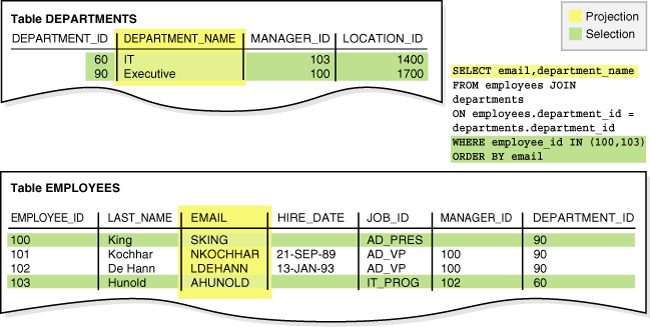
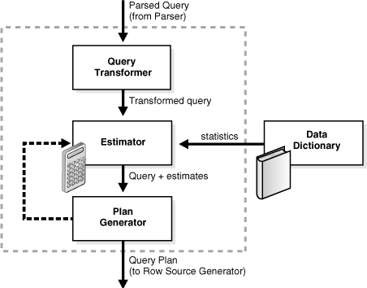

## 9 SQL

This chapter provides an overview of the Structured Query Language (SQL) and how Oracle Database processes SQL statements.

This chapter includes the following topics:

- Introduction to SQL  
	SQL (pronounced sequel) is the set-based, high-level declarative computer language with which all programs and users access data in an Oracle database.
- Overview of SQL Statements  
	All operations performed on the information in an Oracle database are run using SQL statements. A SQL statement is a computer program or instruction that consists of identifiers, parameters, variables, names, data types, and SQL reserved words.
- Overview of the Optimizer  
	To understand how Oracle Database processes SQL statements, it is necessary to understand the part of the database called the optimizer (also known as the query optimizer or cost-based optimizer). All SQL statements use the optimizer to determine the most efficient means of accessing the specified data.
- Overview of SQL Processing  
	This section explains how Oracle Database processes SQL statements. Specifically, the section explains the way in which the database processes DDL statements to create objects, DML to modify data, and queries to retrieve data.

**Parent topic:** [Oracle Data Access](oracle-data-access.md)

### Introduction to SQL

SQL (pronounced sequel) is the set-based, high-level declarative computer language with which all programs and users access data in an Oracle database.

Although some Oracle tools and applications mask SQL use, all database tasks are performed using SQL. Any other data access method circumvents the security built into Oracle Database and potentially compromises data security and integrity.

SQL provides an interface to a relational database such as Oracle Database. SQL unifies tasks such as the following in one consistent language:

- Creating, replacing, altering, and dropping objects
- Inserting, updating, and deleting table rows
- Querying data
- Controlling access to the database and its objects
- Guaranteeing database consistency and integrity

SQL can be used interactively, which means that statements are entered manually into a program. SQL statements can also be embedded within a program written in a different language such as C or Java.

- SQL Data Access  
	There are two broad families of computer languages: **declarative languages** that are nonprocedural and describe what should be done, and **procedural languages** such as C++ and Java that describe how things should be done.
- SQL Standards  
	Oracle strives to follow industry-accepted standards and participates actively in SQL standards committees.

See Also:

- " [Introduction to Server-Side Programming](server-side-programming.md) "
- [Oracle Database Development Guide](https://docs.oracle.com/pls/topic/lookup?ctx=en/database/oracle/oracle-database/21/cncpt&id=ADFNS-GUID-595BF48C-CAA2-4872-8A8C-0EE7B21C8E10) to learn how to choose a programming environment
- [Oracle Database SQL Language Reference](https://docs.oracle.com/pls/topic/lookup?ctx=en/database/oracle/oracle-database/21/cncpt&id=SQLRF001) for an introduction to SQL

**Parent topic:** SQL

#### SQL Data Access

There are two broad families of computer languages: **declarative languages** that are nonprocedural and describe what should be done, and **procedural languages** such as C++ and Java that describe how things should be done.

SQL is declarative in the sense that users specify the result that they want, not how to derive it. For example, the following statement queries records for employees whose last name begins with `K`:

The database performs the work of generating a procedure to navigate the data and retrieve the requested results. The declarative nature of SQL enables you to work with data at the logical level. You need be concerned with implementation details only when you manipulate the data.

```
SELECT   last_name, first_name
FROM     hr.employees
WHERE    last_name LIKE 'K%'
ORDER BY last_name, first_name;
```

The database retrieves all rows satisfying the `WHERE` [condition](glossary.md), also called the [predicate](glossary.md), in a single step. The database can pass these rows as a unit to the user, to another SQL statement, or to an application. The application does not need to process the rows one by one, nor does the developer need to know how the rows are physically stored or retrieved.

All SQL statements use the optimizer, a component of the database that determines the most efficient means of accessing the requested data. Oracle Database also supports techniques that you can use to make the optimizer perform its job better.

See Also:

[Oracle Database SQL Language Reference](https://docs.oracle.com/pls/topic/lookup?ctx=en/database/oracle/oracle-database/21/cncpt&id=SQLRF002) for detailed information about SQL statements and other parts of SQL (such as operators, functions, and format models)

**Parent topic:** Introduction to SQL

#### SQL Standards

Oracle strives to follow industry-accepted standards and participates actively in SQL standards committees.

Industry-accepted committees are the American National Standards Institute (ANSI) and the International Organization for Standardization (ISO). Both ANSI and the ISO/IEC have accepted SQL as the standard language for relational databases.

The SQL standard consists of ten parts. One part (SQL/RPR:2012) is new in 2012. Five other parts were revised in 2011. For the other four parts, the 2008 version remains in place.

[Oracle SQL](glossary.md) includes many extensions to the ANSI/ISO standard SQL language, and Oracle Database tools and applications provide additional statements. The tools SQL\*Plus, SQL Developer, and Oracle Enterprise Manager enable you to run any ANSI/ISO standard SQL statement against an Oracle database and any additional statements or functions available for those tools.

See Also:

- [Oracle Database 2 Day Developer's Guide](https://docs.oracle.com/pls/topic/lookup?ctx=en/database/oracle/oracle-database/21/cncpt&id=TDDDG-GUID-8B3079B4-E52B-4DA8-A1B4-91C94255B62E)
- [Oracle Database SQL Language Reference](https://docs.oracle.com/pls/topic/lookup?ctx=en/database/oracle/oracle-database/21/cncpt&id=SQLRF-GUID-330DEBBB-006E-4B35-A516-5C0AEFFE06B9) for an explanation of the differences between Oracle SQL and standard SQL
- [SQL\*Plus User's Guide and Reference](https://docs.oracle.com/pls/topic/lookup?ctx=en/database/oracle/oracle-database/21/cncpt&id=GUID-BF1995BD-EF9B-4EA2-9B32-7BFACDEB79DA) for SQL\*Plus commands, including their distinction from SQL statements

**Parent topic:** Introduction to SQL

### Overview of SQL Statements

All operations performed on the information in an Oracle database are run using SQL statements. A SQL statement is a computer program or instruction that consists of identifiers, parameters, variables, names, data types, and SQL reserved words.

Note:

SQL reserved words have special meaning in SQL and should not be used for any other purpose. For example, `SELECT` and `UPDATE` are reserved words and should not be used as table names.

A SQL statement must be the equivalent of a complete SQL sentence, such as:

```
SELECT last_name, department_id FROM employees
```

Oracle Database only runs complete SQL statements. A fragment such as the following generates an error indicating that more text is required:

```
SELECT last_name;
```

Oracle SQL statements are divided into the following categories:

- Data Definition Language (DDL) Statements
- Data Manipulation Language (DML) Statements
- Transaction Control Statements
- Session Control Statements
- System Control Statement
- Embedded SQL Statements

- Data Definition Language (DDL) Statements  
	Data definition language (**DLL**) statements define, structurally change, and drop schema objects.
- Data Manipulation Language (DML) Statements  
	Data manipulation language (DML) statements query or manipulate data in existing schema objects.
- Transaction Control Statements  
	Transaction control statements manage the changes made by DML statements and group DML statements into transactions.
- Session Control Statements  
	Session control statements dynamically manage the properties of a user session.
- System Control Statement  
	A system control statement changes the properties of the database instance.
- Embedded SQL Statements  
	Embedded SQL statements incorporate DDL, DML, and transaction control statements within a procedural language program.

**Parent topic:** SQL

#### Data Definition Language (DDL) Statements

Data definition language (**DLL**) statements define, structurally change, and drop schema objects.

DDL enables you to alter attributes of an object without altering the applications that access the object. For example, you can add a column to a table accessed by a human resources application without rewriting the application. You can also use DDL to alter the structure of objects while database users are performing work in the database.

More specifically, DDL statements enable you to:

- Create, alter, and drop schema objects and other database structures, including the database itself and database users. Most DDL statements start with the keywords `CREATE`, `ALTER`, or `DROP`.
- Delete all the data in schema objects without removing the structure of these objects (`TRUNCATE`).
	Note:
	Unlike `DELETE`, `TRUNCATE` generates no [undo data](glossary.md), which makes it faster than `DELETE`. Also, `TRUNCATE` does not invoke delete triggers
- Grant and revoke privileges and roles (`GRANT`, `REVOKE`).
- Turn auditing options on and off (`AUDIT`, `NOAUDIT`).
- Add a comment to the [data dictionary](glossary.md) (`COMMENT`).

Example 9-1 DDL Statements

The following example uses DDL statements to create the `plants` table and then uses DML to insert two rows in the table. The example then uses DDL to alter the table structure, grant and revoke read privileges on this table to a user, and then drop the table.

```
CREATE TABLE plants
    ( plant_id    NUMBER PRIMARY KEY, 
      common_name VARCHAR2(15) );

INSERT INTO plants VALUES (1, 'African Violet'); # DML statement

INSERT INTO plants VALUES (2, 'Amaryllis'); # DML statement

ALTER TABLE plants ADD 
    ( latin_name VARCHAR2(40) );

GRANT READ ON plants TO scott;

REVOKE READ ON plants FROM scott;

DROP TABLE plants;
```

An implicit `COMMIT` occurs immediately before the database executes a DDL statement and a `COMMIT` or `ROLLBACK` occurs immediately afterward. In the preceding example, two `INSERT` statements are followed by an `ALTER TABLE` statement, so the database commits the two `INSERT` statements. If the `ALTER TABLE` statement succeeds, then the database commits this statement; otherwise, the database rolls back this statement. In either case, the two `INSERT` statements have already been committed.

See Also:

- [Oracle Database Security Guide](https://docs.oracle.com/pls/topic/lookup?ctx=en/database/oracle/oracle-database/21/cncpt&id=DBSEG-GUID-41040F53-D7A6-48FA-A92A-0C23118BC8A0) to learn about privileges and roles
- [Oracle Database 2 Day Developer's Guide](https://docs.oracle.com/pls/topic/lookup?ctx=en/database/oracle/oracle-database/21/cncpt&id=TDDDG30000) and [Oracle Database Administrator’s Guide](https://docs.oracle.com/pls/topic/lookup?ctx=en/database/oracle/oracle-database/21/cncpt&id=ADMIN01503) to learn how to create schema objects
- [Oracle Database Development Guide](https://docs.oracle.com/pls/topic/lookup?ctx=en/database/oracle/oracle-database/21/cncpt&id=ADFNS187) to learn about the difference between blocking and nonblocking DDL
- [Oracle Database SQL Language Reference](https://docs.oracle.com/pls/topic/lookup?ctx=en/database/oracle/oracle-database/21/cncpt&id=SQLRF30041) for a list of DDL statements

**Parent topic:** Overview of SQL Statements

#### Data Manipulation Language (DML) Statements

Data manipulation language (DML) statements query or manipulate data in existing schema objects.

Whereas DDL statements change the structure of the database, DML statements query or change the contents. For example, `ALTER TABLE` changes the structure of a table, whereas `INSERT` adds one or more rows to the table.

DML statements are the most frequently used SQL statements and enable you to:

- Retrieve or fetch data from one or more tables or views (`SELECT`).
- Add new rows of data into a table or view (`INSERT`) by specifying a list of column values or using a [subquery](glossary.md) to select and manipulate existing data.
- Change column values in existing rows of a table or view (`UPDATE`).
- Update or insert rows conditionally into a table or [view](glossary.md) (`MERGE`).
- Remove rows from tables or views (`DELETE`).
- View the [execution plan](glossary.md) for a SQL statement (`EXPLAIN` `PLAN`).
- Lock a table or view, temporarily limiting access by other users (`LOCK` `TABLE`).

The following example uses DML to query the `employees` table. The example uses DML to insert a row into `employees`, update this row, and then delete it:

```
SELECT * FROM employees;

INSERT INTO employees (employee_id, last_name, email, job_id, hire_date, salary)
  VALUES (1234, 'Mascis', 'JMASCIS', 'IT_PROG', '14-FEB-2008', 9000);

UPDATE employees SET salary=9100 WHERE employee_id=1234;

DELETE FROM employees WHERE employee_id=1234;
```

A collection of DML statements that forms a logical unit of work is called a [transaction](glossary.md). For example, a transaction to transfer money could involve three discrete operations: decreasing the savings account balance, increasing the checking account balance, and recording the transfer in an account history table. Unlike DDL statements, DML statements do not implicitly commit the current transaction.

- SELECT Statements  
	A **query** is an operation that retrieves data from a table or view.
- Joins  
	A join is a query that combines rows from two or more tables, views, or materialized views.
- Subqueries  
	A **subquery** is a `SELECT` statement nested within another SQL statement. Subqueries are useful when you must execute multiple queries to solve a single problem.

See Also:

- " Differences Between DML and DDL Processing "
- " [Introduction to Transactions](transactions.md) "
- [Oracle Database 2 Day Developer's Guide](https://docs.oracle.com/pls/topic/lookup?ctx=en/database/oracle/oracle-database/21/cncpt&id=TDDDG20000) to learn how to query and manipulate data
- [Oracle Database SQL Language Reference](https://docs.oracle.com/pls/topic/lookup?ctx=en/database/oracle/oracle-database/21/cncpt&id=SQLRF30042) for a list of DML statements

**Parent topic:** Overview of SQL Statements

##### SELECT Statements

A **query** is an operation that retrieves data from a table or view.

`SELECT` is the only SQL statement that you can use to query data. The set of data retrieved from execution of a `SELECT` statement is known as a **result set**.

The following table shows two required keywords and two keywords that are commonly found in a `SELECT` statement. The table also associates capabilities of a `SELECT` statement with the keywords.

Table 9-1 Keywords in a SQL Statement

| Keyword | Required? | Description | Capability |
| --- | --- | --- | --- |
| `SELECT` | Yes | Specifies which columns should be shown in the result. Projection produces a subset of the columns in the table.  An [expression](glossary.md) is a combination of one or more values, operators, and SQL functions that resolves to a value. The list of expressions that appears after the `SELECT` keyword and before the `FROM` clause is called the [select list](glossary.md). | Projection |
| `FROM` | Yes | Specifies the tables or views from which the data should be retrieved. | Joining |
| `WHERE` | No | Specifies a condition to filter rows, producing a subset of the rows in the table. A condition specifies a combination of one or more expressions and logical (Boolean) operators and returns a value of `TRUE`, `FALSE`, or `UNKNOWN`. | Selection |
| `ORDER BY` | No | Specifies the order in which the rows should be shown. |  |

See Also:

[Oracle Database SQL Language Reference](https://docs.oracle.com/pls/topic/lookup?ctx=en/database/oracle/oracle-database/21/cncpt&id=SQLRF01702) for `SELECT` syntax and semantics

**Parent topic:** Data Manipulation Language (DML) Statements

##### Joins

A join is a query that combines rows from two or more tables, views, or materialized views.

The following example joins the `employees` and `departments` tables (`FROM` clause), selects only rows that meet specified criteria (`WHERE` clause), and uses projection to retrieve data from two columns (`SELECT`). Sample output follows the SQL statement.

```
SELECT email, department_name
FROM   employees 
JOIN   departments
ON     employees.department_id = departments.department_id
WHERE  employee_id IN (100,103)
ORDER BY email;

EMAIL                     DEPARTMENT_NAME
------------------------- ------------------------------
AHUNOLD                   IT
SKING                     Executive
```

The following graphic represents the operations of projection and selection in the join shown in the preceding query.

Figure 9-1 Projection and Selection



> The graphic shows four icons representing tables. The upper left table is labeled Employees and above it is the title Projection. Part of a statement is shown: "SELECT last\_name, email". The last\_name points to the second column in the table. The email in the statement points to the four column in the table. To the right of the Employees icon is the following partial SQL statement: "Where department\_name = 'Shipping' AND salary > 6000". To the right of this fragment is the Employees table icon. Arrows lead from the fragment pointing to rows in the Employees table.
>
> In the lower left is the Employees table icon. To the lower right is the Departments table icon. Between the icons is the following SQL statement fragment: "FROM employees JOIN departments ON employees.department\_id = departments.department\_id". The statement points to the last column on the Employees table and the first column in the Departments table. Between the two table icons is a Join arrow.


Most joins have at least one [join condition](glossary.md), either in the `FROM` clause or in the `WHERE` clause, that compares two columns, each from a different table. The database combines pairs of rows, each containing one row from each table, for which the join condition evaluates to `TRUE`. The optimizer determines the order in which the database joins tables based on the join conditions, indexes, and any available statistics for the tables.

Join types include the following:

- Inner joins
	An [inner join](glossary.md) is a join of two or more tables that returns only rows that satisfy the join condition. For example, if the join condition is `employees.department_id=departments.department_id`, then rows that do not satisfy this condition are not returned.
- Outer joins
	An [outer join](glossary.md) returns all rows that satisfy the join condition and also returns rows from one table for which no rows from the other table satisfy the condition.
	The result of a [left outer join](glossary.md) for table A and B always contains all records of the left table A, even if the join condition does not match a record in the right table B. If no matching row from B exists, then B columns contain nulls for rows that have no match in B. For example, if not all employees are in departments, then a left outer join of `employees` (left table) and `departments` (right table) retrieves all rows in `employees` even if no rows in `departments` satisfy the join condition (`employees.department_id` is null).
	The result of a [right outer join](glossary.md) for table A and B contains all records of the right table B, even if the join condition does not match a row in the left table A. If no matching row from A exists, then A columns contain nulls for rows that have no match in A. For example, if not all departments have employees, a right outer join of `employees` (left table) and `departments` (right table) retrieves all rows in `departments` even if no rows in `employees` satisfy the join condition.
	A [full outer join](glossary.md) is the combination of a left outer join and a right outer join.
- Cartesian products
	If two tables in a join query have no join condition, then the database performs a [Cartesian join](glossary.md). Each row of one table combines with each row of the other. For example, if `employees` has 107 rows and `departments` has 27, then the Cartesian product contains 107\*27 rows. A Cartesian product is rarely useful.

See Also:

- [Oracle Database SQL Tuning Guide](https://docs.oracle.com/pls/topic/lookup?ctx=en/database/oracle/oracle-database/21/cncpt&id=TGSQL242) to learn about joins
- [Oracle Database SQL Language Reference](https://docs.oracle.com/pls/topic/lookup?ctx=en/database/oracle/oracle-database/21/cncpt&id=SQLRF30046) for detailed descriptions and examples of joins

**Parent topic:** Data Manipulation Language (DML) Statements

##### Subqueries

A **subquery** is a `SELECT` statement nested within another SQL statement. Subqueries are useful when you must execute multiple queries to solve a single problem.

Each query portion of a statement is called a [query block](glossary.md). In the following query, the subquery in parentheses is the inner query block:

```
SELECT first_name, last_name 
FROM   employees
WHERE  department_id 
IN     ( SELECT department_id 
         FROM departments 
         WHERE location_id = 1800 );
```

The inner `SELECT` statement retrieves the IDs of departments with location ID 1800. These department IDs are needed by the outer query block, which retrieves names of employees in the departments whose IDs were supplied by the subquery.

The structure of the SQL statement does not force the database to execute the inner query first. For example, the database could rewrite the entire query as a join of `employees` and `departments`, so that the subquery never executes by itself. As another example, the Virtual Private Database (VPD) feature could restrict the query of employees using a `WHERE` clause, so that the database queries the employees first and then obtains the department IDs. The optimizer determines the best sequence of steps to retrieve the requested rows.

See Also:

[Oracle Database Security Guide](https://docs.oracle.com/pls/topic/lookup?ctx=en/database/oracle/oracle-database/21/cncpt&id=DBSEG-GUID-06022729-9210-4895-BF04-6177713C65A7) to learn more about VPD

**Parent topic:** Data Manipulation Language (DML) Statements

#### Transaction Control Statements

Transaction control statements manage the changes made by DML statements and group DML statements into transactions.

These statements enable you to:

- Make changes to a transaction permanent (`COMMIT`).
- Undo the changes in a transaction, since the transaction started (`ROLLBACK`) or since a savepoint (`ROLLBACK TO SAVEPOINT`). A [savepoint](glossary.md) is a user-declared intermediate marker within the context of a transaction.
	Note:
	The `ROLLBACK` statement ends a transaction, but `ROLLBACK TO SAVEPOINT` does not.
- Set a point to which you can roll back (`SAVEPOINT`).
- Establish properties for a transaction (`SET` `TRANSACTION`).
- Specify whether a deferrable [integrity constraint](glossary.md) is checked following each DML statement or when the transaction is committed (`SET CONSTRAINT`).

The following example starts a transaction named `Update salaries`. The example creates a savepoint, updates an employee salary, and then rolls back the transaction to the savepoint. The example updates the salary to a different value and commits.

```
SET TRANSACTION NAME 'Update salaries';

SAVEPOINT before_salary_update;

UPDATE employees SET salary=9100 WHERE employee_id=1234 # DML

ROLLBACK TO SAVEPOINT before_salary_update;

UPDATE employees SET salary=9200 WHERE employee_id=1234 # DML

COMMIT COMMENT 'Updated salaries';
```

#### Session Control Statements

Session control statements dynamically manage the properties of a user session.

A session is a logical entity in the database instance memory that represents the state of a current user login to a database. A session lasts from the time the user is authenticated by the database until the user disconnects or exits the database application.

Session control statements enable you to:

- Alter the current session by performing a specialized function, such as setting the default date format (`ALTER SESSION`).
- Enable and disable roles, which are groups of privileges, for the current session (`SET ROLE`).

The following statement dynamically changes the default date format for your session to `'YYYY MM DD-HH24:MI:SS'`:

```
ALTER SESSION 
   SET NLS_DATE_FORMAT = 'YYYY MM DD HH24:MI:SS';
```

Session control statements do not implicitly commit the current transaction.

See Also:

- " [Connections and Sessions](process-architecture.md) "
- [Oracle Database SQL Language Reference](https://docs.oracle.com/pls/topic/lookup?ctx=en/database/oracle/oracle-database/21/cncpt&id=SQLRF30044) for `ALTER SESSION` syntax and semantics

**Parent topic:** Overview of SQL Statements

#### System Control Statement

A system control statement changes the properties of the database instance.

The only system control statement is `ALTER SYSTEM`. It enables you to change settings such as the minimum number of shared servers, terminate a session, and perform other system-level tasks.

Examples of the system control statement include:

```
ALTER SYSTEM SWITCH LOGFILE; 

ALTER SYSTEM KILL SESSION '39, 23';
```

The `ALTER SYSTEM` statement does not implicitly commit the current transaction.

See Also:

[Oracle Database SQL Language Reference](https://docs.oracle.com/pls/topic/lookup?ctx=en/database/oracle/oracle-database/21/cncpt&id=SQLRF00902) for `ALTER SYSTEM` syntax and semantics

**Parent topic:** Overview of SQL Statements

#### Embedded SQL Statements

Embedded SQL statements incorporate DDL, DML, and transaction control statements within a procedural language program.

Embedded statements are used with the Oracle precompilers. Embedded SQL is one approach to incorporating SQL in your procedural language applications. Another approach is to use a procedural API such as Open Database Connectivity (ODBC) or Java Database Connectivity (JDBC).

Embedded SQL statements enable you to:

- Define, allocate, and release a [cursor](glossary.md) (`DECLARE CURSOR`, `OPEN`, `CLOSE`).
- Specify a database and connect to it (`DECLARE DATABASE`, `CONNECT`).
- Assign variable names (`DECLARE STATEMENT`).
- Initialize descriptors (`DESCRIBE`).
- Specify how error and warning conditions are handled (`WHENEVER`).
- Parse and run SQL statements (`PREPARE`, `EXECUTE`, `EXECUTE IMMEDIATE`).
- Retrieve data from the database (`FETCH`).

See Also:

- " [Introduction to Server-Side Programming](server-side-programming.md) "
- [Oracle Database Development Guide](https://docs.oracle.com/pls/topic/lookup?ctx=en/database/oracle/oracle-database/21/cncpt&id=ADFNS-GUID-FEAEF1C5-6C7D-4E3D-91E3-34AB80249140)

**Parent topic:** Overview of SQL Statements

### Overview of the Optimizer

To understand how Oracle Database processes SQL statements, it is necessary to understand the part of the database called the optimizer (also known as the query optimizer or cost-based optimizer). All SQL statements use the optimizer to determine the most efficient means of accessing the specified data.

- Use of the Optimizer  
	The optimizer generates execution plans describing possible methods of execution.
- Optimizer Components  
	The optimizer contains three main components: the transformer, estimator, and plan generator.
- Access Paths  
	An access path is the technique that a query uses to retrieve rows.
- Optimizer Statistics  
	The optimizer statistics are a collection of data that describe details about the database and the objects in the database. The statistics provide a statistically correct picture of data storage and distribution usable by the optimizer when evaluating access paths.
- Optimizer Hints  
	A hint is a comment in a SQL statement that acts as an instruction to the optimizer.

**Parent topic:** SQL

#### Use of the Optimizer

The optimizer generates execution plans describing possible methods of execution.

The optimizer determines which execution plan is most efficient by considering several sources of information. For example, the optimizer considers query conditions, available access paths, statistics gathered for the system, and hints.

To execute a DML statement, Oracle Database may have to perform many steps. Each step either retrieves rows of data physically from the database or prepares them for the user issuing the statement. The steps that the database uses to execute a statement greatly affect how quickly the statement runs. Many different ways of processing a DML statement are often possible. For example, the order in which tables or indexes are accessed can vary.

When determining the best execution plan for a SQL statement, the optimizer performs the following operations:

- Evaluation of expressions and conditions
- Inspection of integrity constraints to learn more about the data and optimize based on this metadata
- Statement transformation
- Choice of optimizer goals
- Choice of access paths
- Choice of join orders

The optimizer generates most of the possible ways of processing a query and assigns a cost to each step in the generated execution plan. The plan with the lowest cost is chosen as the [query plan](glossary.md) to be executed.

Note:

You can obtain an execution plan for a SQL statement without executing the plan. Only an execution plan that the database actually uses to execute a query is correctly termed a query plan.

You can influence optimizer choices by setting the optimizer goal and by gathering representative statistics for the optimizer. For example, you may set the optimizer goal to either of the following:

- Total throughput
	The `ALL_ROWS` hint instructs the optimizer to get the last row of the result to the client application as fast as possible.
- Initial response time
	The `FIRST_ROWS` hint instructs the optimizer to get the first row to the client as fast as possible.

A typical end-user, interactive application would benefit from initial response time optimization, whereas a batch-mode, non-interactive application would benefit from total throughput optimization.

See Also:

- [Oracle Database PL/SQL Packages and Types Reference](https://docs.oracle.com/pls/topic/lookup?ctx=en/database/oracle/oracle-database/21/cncpt&id=ARPLS059) for information about using `DBMS_STATS`
- [Oracle Database SQL Tuning Guide](https://docs.oracle.com/pls/topic/lookup?ctx=en/database/oracle/oracle-database/21/cncpt&id=TGSQL202) for more information about the optimizer and using hints

**Parent topic:** Overview of the Optimizer

#### Optimizer Components

The optimizer contains three main components: the transformer, estimator, and plan generator.

The following diagram depicts the components:

Figure 9-2 Optimizer Components



> This graphic shows the optimizer components in a box with a dotted border. The box contains three boxes vertically arranged: Query Transformer, Estimator, and Plan Generator. A Parsed Query enters from the top. An arrow leading from Query Transformer to Estimator is labeled Transformed query. An arrow leading from Estimator to Plan Generator is labeled "Query + estimated." An arrow leading from Plan Generator to the bottom of the figure is labeled "Query Plan (to Row Source Generator)." A box labeled Data Dictionary points to the Estimator box in the middle. The arrow is labeled "statistics."


The input to the optimizer is a parsed query. The optimizer performs the following operations:

1. The optimizer receives the parsed query and generates a set of potential plans for the SQL statement based on available access paths and hints.
2. The optimizer estimates the cost of each plan based on statistics in the data dictionary. The cost is an estimated value proportional to the expected resource use needed to execute the statement with a particular plan.
3. The optimizer compares the costs of plans and chooses the lowest-cost plan, known as the query plan, to pass to the row source generator.

- Query Transformer  
	The query transformer determines whether it is helpful to change the form of the query so that the optimizer can generate a better execution plan. The input to the query transformer is a parsed query, which the optimizer represents as a set of query blocks.
- Estimator  
	The estimator determines the overall cost of a given execution plan.
- Plan Generator  
	The **plan generator** tries out different plans for a submitted query. The optimizer chooses the plan with the lowest cost.

See Also:

- " SQL Parsing "
- " SQL Row Source Generation "

**Parent topic:** Overview of the Optimizer

##### Query Transformer

The query transformer determines whether it is helpful to change the form of the query so that the optimizer can generate a better execution plan. The input to the query transformer is a parsed query, which the optimizer represents as a set of query blocks.

See Also:

" [Query Rewrite](partitions-views-and-other-schema-objects.md) "

**Parent topic:** Optimizer Components

##### Estimator

The estimator determines the overall cost of a given execution plan.

The estimator generates three different types of measures to achieve this goal:

- Selectivity
	This measure represents a fraction of rows from a row set. The selectivity is tied to a query predicate, such as `last_name='Smith'`, or a combination of predicates.
- Cardinality
	This measure represents the number of rows in a row set.
- Cost
	This measure represents units of work or resource used. The query optimizer uses disk I/O, CPU usage, and memory usage as units of work.

If statistics are available, then the estimator uses them to compute the measures. The statistics improve the degree of accuracy of the measures.

**Parent topic:** Optimizer Components

##### Plan Generator

The **plan generator** tries out different plans for a submitted query. The optimizer chooses the plan with the lowest cost.

For each nested subquery and unmerged view, the optimizer generates a subplan. The optimizer represents each subplan as a separate [query block](glossary.md). The plan generator explores various plans for a query block by trying out different access paths, join methods, and join orders.

The [adaptive query optimization](glossary.md) capability changes plans based on statistics collected during statement execution. All adaptive mechanisms can execute a final plan for a statement that differs from the default plan. Adaptive optimization uses either dynamic plans, which choose among subplans during statement execution, or reoptimization, which changes a plan on executions after the current execution.

See Also:

- [Oracle Database 2 Day + Performance Tuning Guide](https://docs.oracle.com/pls/topic/lookup?ctx=en/database/oracle/oracle-database/21/cncpt&id=TDPPT-GUID-FED9A6D8-49BB-43BE-9F4D-336E6006D366) for an introduction to SQL tuning
- [Oracle Database SQL Tuning Guide](https://docs.oracle.com/pls/topic/lookup?ctx=en/database/oracle/oracle-database/21/cncpt&id=TGSQL202) to learn about the optimizer components and adaptive optimization

**Parent topic:** Optimizer Components

#### Access Paths

An access path is the technique that a query uses to retrieve rows.

For example, a query that uses an index has a different access path from a query that does not. In general, index access paths are best for statements that retrieve a small subset of table rows. Full scans are more efficient for accessing a large portion of a table.

The database can use several different access paths to retrieve data from a table. The following is a representative list:

- Full table scans
	This type of scan reads all rows from a table and filters out those that do not meet the selection criteria. The database sequentially scans all data blocks in the segment, including those under the [high water mark (HWM)](glossary.md) that separates used from unused space (see " [Segment Space and the High Water Mark](logical-storage-structures.md) ").
- Rowid scans
	The [rowid](glossary.md) of a row specifies the data file and data block containing the row and the location of the row in that block. The database first obtains the rowids of the selected rows, either from the statement `WHERE` clause or through an index scan, and then locates each selected row based on its rowid.
- Index scans
	This scan searches an index for the indexed column values accessed by the SQL statement (see " [Index Scans](indexes-and-index-organized-tables.md) "). If the statement accesses only columns of the index, then Oracle Database reads the indexed column values directly from the index.
- Cluster scans
	A cluster scan retrieves data from a table stored in an indexed [table cluster](glossary.md), where all rows with the same cluster key value are stored in the same data block (see " [Overview of Indexed Clusters](tables-and-table-clusters.md) "). The database first obtains the rowid of a selected row by scanning the cluster index. Oracle Database locates the rows based on this rowid.
- Hash scans
	A hash scan locates rows in a hash cluster, where all rows with the same hash value are stored in the same data block (see " [Overview of Hash Clusters](tables-and-table-clusters.md) "). The database first obtains the hash value by applying a [hash function](glossary.md) to a cluster key value specified by the statement. Oracle Database then scans the data blocks containing rows with this hash value.

The optimizer chooses an access path based on the available access paths for the statement and the estimated cost of using each access path or combination of paths.

See Also:

[Oracle Database 2 Day + Performance Tuning Guide](https://docs.oracle.com/pls/topic/lookup?ctx=en/database/oracle/oracle-database/21/cncpt&id=TDPPT170) and [Oracle Database SQL Tuning Guide](https://docs.oracle.com/pls/topic/lookup?ctx=en/database/oracle/oracle-database/21/cncpt&id=TGSQL228) to learn about access paths

**Parent topic:** Overview of the Optimizer

#### Optimizer Statistics

The optimizer statistics are a collection of data that describe details about the database and the objects in the database. The statistics provide a statistically correct picture of data storage and distribution usable by the optimizer when evaluating access paths.

Optimizer statistics include the following:

- Table statistics
	These include the number of rows, number of blocks, and average row length.
- Column statistics
	These include the number of distinct values and nulls in a column and the distribution of data.
- Index statistics
	These include the number of leaf blocks and index levels.
- System statistics
	These include CPU and I/O performance and utilization.

Oracle Database gathers optimizer statistics on all database objects automatically and maintains these statistics as an automated maintenance task. You can also gather statistics manually using the `DBMS_STATS` package. This PL/SQL package can modify, view, export, import, and delete statistics.

Note:

Optimizer statistics are created for the purposes of query optimization and are stored in the data dictionary. Do not confuse these statistics with performance statistics visible through dynamic performance views.

Optimizer Statistics Advisor is built-in diagnostic software that analyzes how you are currently gathering statistics, the effectiveness of existing statistics gathering jobs, and the quality of the gathered statistics. Optimizer Statistics Advisor maintains rules, which embody Oracle best practices based on the current feature set. In this way, the advisor always provides the most up-to-date recommendations for statistics gathering.

See Also:

- [Oracle Database 2 Day + Performance Tuning Guide](https://docs.oracle.com/pls/topic/lookup?ctx=en/database/oracle/oracle-database/21/cncpt&id=TDPPT007) and [Oracle Database SQL Tuning Guide](https://docs.oracle.com/pls/topic/lookup?ctx=en/database/oracle/oracle-database/21/cncpt&id=TGSQL389) to learn how to gather and manage statistics
- [Oracle Database PL/SQL Packages and Types Reference](https://docs.oracle.com/pls/topic/lookup?ctx=en/database/oracle/oracle-database/21/cncpt&id=ARPLS059) to learn about `DBMS_STATS`

**Parent topic:** Overview of the Optimizer

#### Optimizer Hints

A hint is a comment in a SQL statement that acts as an instruction to the optimizer.

Sometimes the application designer, who has more information about a particular application's data than is available to the optimizer, can choose a more effective way to run a SQL statement. The application designer can use hints in SQL statements to specify how the statement should be run. The following examples illustrate the use of hints.

Example 9-2 Execution Plan for SELECT with FIRST\_ROWS Hint

Suppose that your interactive application runs a query that returns 50 rows. This application initially fetches only the first 25 rows of the query to present to the end user. You want the optimizer to generate a plan that gets the first 25 records as quickly as possible so that the user is not forced to wait. You can use a hint to pass this instruction to the optimizer as shown in the `SELECT` statement and `AUTOTRACE` output in the following example:

```
SELECT /*+ FIRST_ROWS(25) */ employee_id, department_id
FROM   hr.employees
WHERE  department_id > 50;

------------------------------------------------------------------------
| Id | Operation                    | Name              | Rows | Bytes
------------------------------------------------------------------------
|  0 | SELECT STATEMENT             |                   | 26   | 182
|  1 |  TABLE ACCESS BY INDEX ROWID | EMPLOYEES         | 26   | 182
|* 2 |   INDEX RANGE SCAN           | EMP_DEPARTMENT_IX |      |
------------------------------------------------------------------------
```

In this example, the execution plan shows that the optimizer chooses an index on the `employees.department_id` column to find the first 25 rows of `employees` whose department ID is over 50. The optimizer uses the rowid retrieved from the index to retrieve the record from the `employees` table and return it to the client. Retrieval of the first record is typically almost instantaneous.

Example 9-3 Execution Plan for SELECT with No Hint

Assume that you execute the same statement, but without the optimizer hint:

```
SELECT employee_id, department_id
FROM   hr.employees
WHERE  department_id > 50;
 
------------------------------------------------------------------------
| Id | Operation              | Name              | Rows | Bytes | Cos
------------------------------------------------------------------------
|  0 | SELECT STATEMENT       |                   | 50   | 350   |
|* 1 |  VIEW                  | index$_join$_001  | 50   | 350   |
|* 2 |   HASH JOIN            |                   |      |       |
|* 3 |    INDEX RANGE SCAN    | EMP_DEPARTMENT_IX | 50   | 350   |
|  4 |    INDEX FAST FULL SCAN| EMP_EMP_ID_PK     | 50   | 350   |
```

In this case, the execution plan joins two indexes to return the requested records as fast as possible. Rather than repeatedly going from index to table as in Example 9-2, the optimizer chooses a range scan of `EMP_DEPARTMENT_IX` to find all rows where the department ID is over 50 and place these rows in a [hash table](glossary.md). The optimizer then chooses to read the `EMP_EMP_ID_PK` index. For each row in this index, it probes the hash table to find the department ID.

In this case, the database cannot return the first row to the client until the index range scan of `EMP_DEPARTMENT_IX` completes. Thus, this generated plan would take longer to return the first record. Unlike the plan in Example 9-2, which accesses the table by index rowid, the plan uses multiblock I/O, resulting in large reads. The reads enable the last row of the entire result set to be returned more rapidly.

See Also:

[Oracle Database SQL Tuning Guide](https://docs.oracle.com/pls/topic/lookup?ctx=en/database/oracle/oracle-database/21/cncpt&id=TGSQL260) to learn how to use optimizer hints

**Parent topic:** Overview of the Optimizer

### Overview of SQL Processing

This section explains how Oracle Database processes SQL statements. Specifically, the section explains the way in which the database processes DDL statements to create objects, DML to modify data, and queries to retrieve data.

- Stages of SQL Processing  
	The general stages of SQL processing are parsing, optimization, row source generation, and execution. Depending on the statement, the database may omit some of these steps.
- Differences Between DML and DDL Processing  
	Oracle Database processes DDL differently from DML.

**Parent topic:** SQL

#### Stages of SQL Processing

The general stages of SQL processing are parsing, optimization, row source generation, and execution. Depending on the statement, the database may omit some of these steps.

The following figure depicts the general stages:

Figure 9-3 Stages of SQL Processing


> This graphic shows the stages of SQL processing, represented as five vertical boxes linked by downward-pointing arrows: SQL Statement, Parsing, Optimization, Row Source Generation, and Execution. The Parsing box is labeled "Syntax check, Semantic check." The Optimization box is labeled "Generation of multiple execution plans." The Row Source Generation box is labeled "Generation of query plan." An arrow labeled "Soft parse" extends from the Parsing box to the Execution box.


- SQL Parsing  
	The first stage of SQL processing is SQL parsing. This stage involves separating the pieces of a SQL statement into a data structure that can be processed by other routines.
- SQL Optimization  
	**Query optimization** is the process of choosing the most efficient means of executing a SQL statement.
- SQL Row Source Generation  
	The row source generator is software that receives the optimal execution plan from the optimizer and produces an iterative plan, called the query plan, that is usable by the rest of the database.
- SQL Execution  
	During execution, the SQL engine executes each row source in the tree produced by the row source generator. This is the only mandatory step in DML processing.

**Parent topic:** Overview of SQL Processing

##### SQL Parsing

The first stage of SQL processing is SQL parsing. This stage involves separating the pieces of a SQL statement into a data structure that can be processed by other routines.

When an application issues a SQL statement, the application makes a parse call to the database to prepare the statement for execution. The parse call opens or creates a [cursor](glossary.md), which is a handle for the session-specific [private SQL area](glossary.md) that holds a parsed SQL statement and other processing information. The cursor and private SQL area are in the [PGA](glossary.md).

During the parse call, the database performs the following checks:

- Syntax check
- Semantic check
- Shared pool check

The preceding checks identify the errors that can be found before statement execution. Some errors cannot be caught by parsing. For example, the database can encounter a [deadlock](glossary.md) or errors in data conversion only during statement execution.

See Also:

" [Locks and Deadlocks](data-concurrency-and-consistency.md) "

**Parent topic:** Stages of SQL Processing

##### SQL Optimization

**Query optimization** is the process of choosing the most efficient means of executing a SQL statement.

The database optimizes queries based on statistics collected about the actual data being accessed. The optimizer uses the number of rows, the size of the data set, and other factors to generate possible execution plans, assigning a numeric cost to each plan. The database uses the plan with the lowest cost.

The database must perform a hard parse at least once for every unique DML statement and performs optimization during this parse. DDL is never optimized unless it includes a DML component such as a subquery that requires optimization.

See Also:

- " Overview of the Optimizer "
- [Oracle Database SQL Tuning Guide](https://docs.oracle.com/pls/topic/lookup?ctx=en/database/oracle/oracle-database/21/cncpt&id=TGSQL193) for detailed information about the query optimizer

**Parent topic:** Stages of SQL Processing

##### SQL Row Source Generation

The row source generator is software that receives the optimal execution plan from the optimizer and produces an iterative plan, called the query plan, that is usable by the rest of the database.

The query plan takes the form of a combination of steps. Each step returns a [row set](glossary.md). The rows in this set are either used by the next step or, in the last step, are returned to the application issuing the SQL statement.

A [row source](glossary.md) is a row set returned by a step in the execution plan along with a control structure that can iteratively process the rows. The row source can be a table, view, or result of a join or grouping operation.

**Parent topic:** Stages of SQL Processing

##### SQL Execution

During execution, the SQL engine executes each row source in the tree produced by the row source generator. This is the only mandatory step in DML processing.

During execution, if the data is not in memory, then the database reads the data from disk into memory. The database also takes out any locks and latches necessary to ensure data integrity and logs any changes made during the SQL execution. The final stage of processing a SQL statement is closing the cursor.

If the database is configured to use [In-Memory Column Store](glossary.md) (IM column store), then the database transparently routes queries to the IM column store when possible, and to disk and the database buffer cache otherwise. A single query can also use the IM column store, disk, and the buffer cache. For example, a query might join two tables, only one of which is cached in the IM column store.

See Also:

- " [In-Memory Area](memory-architecture.md) "
- [Oracle Database SQL Tuning Guide](https://docs.oracle.com/pls/topic/lookup?ctx=en/database/oracle/oracle-database/21/cncpt&id=TGSQL271) for detailed information about execution plans and the `EXPLAIN PLAN` statement

**Parent topic:** Stages of SQL Processing

#### Differences Between DML and DDL Processing

Oracle Database processes DDL differently from DML.

For example, when you create a table, the database does not optimize the `CREATE TABLE` statement. Instead, Oracle Database parses the DDL statement and carries out the command.

In contrast to DDL, most DML statements have a query component. In a query, execution of a cursor places the row generated by the query into the result set.

The database can fetch result set rows either one row at a time or in groups. In the fetch, the database selects rows and, if requested by the query, sorts the rows. Each successive fetch retrieves another row of the result until the last row has been fetched.

See Also:

[Oracle Database Development Guide](https://docs.oracle.com/pls/topic/lookup?ctx=en/database/oracle/oracle-database/21/cncpt&id=ADFNS134) to learn about processing DDL, transaction control, and other types of statements

**Parent topic:** Overview of SQL Processing