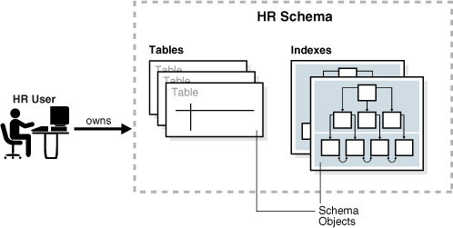
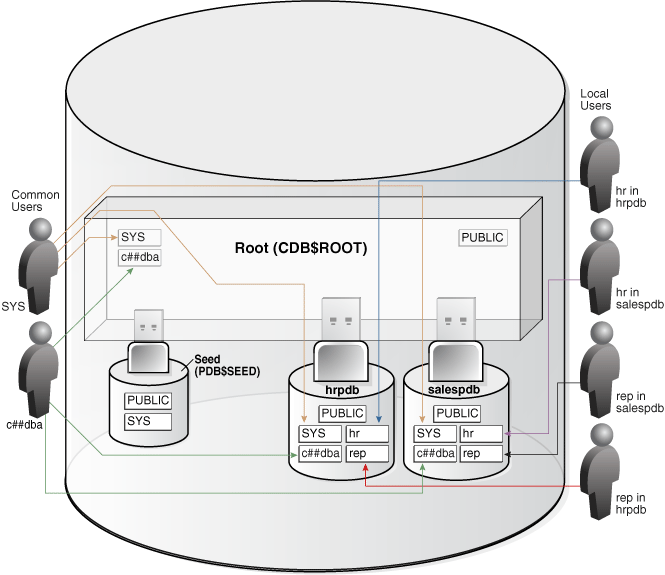
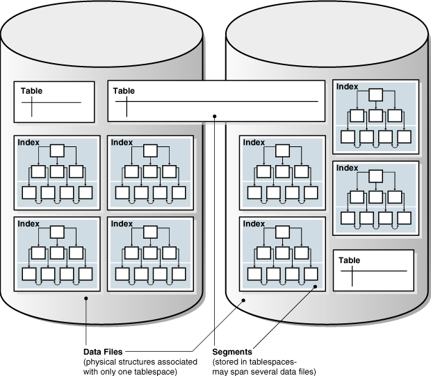
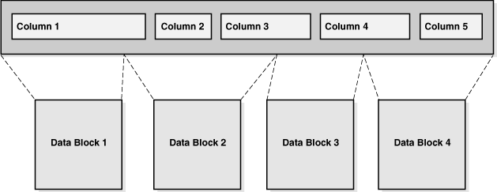
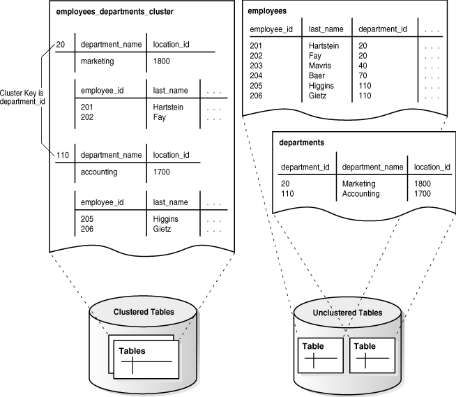
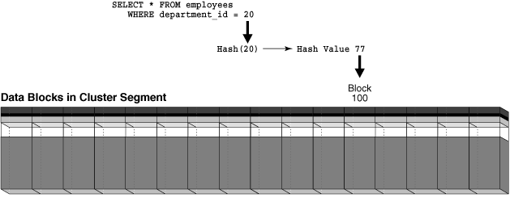

## 4 Tables and Table Clusters

This chapter provides an introduction to schema objects and discusses tables, which are the most common types of schema objects.

This chapter contains the following sections:

- Introduction to Schema Objects  
	A database **schema** is a logical container for data structures, called schema objects. Examples of schema objects are tables and indexes. You create and manipulate schema objects with SQL.
- Overview of Tables  
	A table is the basic unit of data organization in an Oracle database.
- Overview of Table Clusters  
	A **table cluster** is a group of tables that share common columns and store related data in the same blocks.
- Overview of Attribute-Clustered Tables  
	An attribute-clustered table is a heap-organized table that stores data in close proximity on disk based on user-specified clustering directives. The directives specify columns in single or multiple tables.
- Overview of Temporary Tables  
	A **temporary table** holds data that exists only for the duration of a transaction or session.
- Overview of External Tables  
	An **external table** accesses data in external sources as if this data were in a table in the database.
- Overview of Blockchain Tables  
	A **blockchain table** is an append-only table designed for centralized blockchain applications.
- Overview of Immutable Tables  
	Immutable tables are read-only tables that prevent unauthorized data modifications by insiders and accidental data modifications resulting from human errors.
- Overview of Object Tables  
	An **object table** is a special kind of table in which each row represents an object.

**Parent topic:** [Oracle Relational Data Structures](oracle-relational-structures.md)

### Introduction to Schema Objects

A database **schema** is a logical container for data structures, called schema objects. Examples of schema objects are tables and indexes. You create and manipulate schema objects with SQL.

This section contains the following topics:

- About Common and Local User Accounts
- Schema Object Types
- Schema Object Storage
- Schema Object Dependencies
- Sample Schemas

- About Common and Local User Accounts  
	A database user account has a password and specific database privileges.
- Common and Local Objects  
	A **common object** is defined in either the CDB root or an application root, and can be referenced using metadata links or object links. A local object is every object that is not a common object.
- Schema Object Types  
	Oracle SQL enables you to create and manipulate many other types of schema objects.
- Schema Object Storage  
	Some schema objects store data in a type of logical storage structure called a segment. For example, a nonpartitioned heap-organized table or an index creates a segment.
- Schema Object Dependencies  
	Some schema objects refer to other objects, creating a schema object dependency.
- Sample Schemas  
	An Oracle database may include **sample schemas**, which are a set of interlinked schemas that enable Oracle documentation and Oracle instructional materials to illustrate common database tasks.

See Also:

[Oracle Database Security Guide](https://docs.oracle.com/pls/topic/lookup?ctx=en/database/oracle/oracle-database/21/cncpt&id=DBSEG-GUID-F78AE647-184C-4790-9E95-493787CACDE1) to learn more about users and privileges

**Parent topic:** Tables and Table Clusters

#### About Common and Local User Accounts

A database user account has a password and specific database privileges.

User Accounts and Schemas

Each user account owns a single schema, which has the same name as the user. The schema contains the data for the user owning the schema. For example, the `hr` user account owns the `hr` schema, which contains schema objects such as the `employees` table. In a production database, the schema owner usually represents a database application rather than a person.

Within a schema, each schema object of a particular type has a unique name. For example, `hr.employees` refers to the table `employees` in the `hr` schema. The following figure depicts a schema owner named `hr` and schema objects within the `hr` schema.

Figure 4-1 HR Schema



> On the left of the graphic is an icon representing the HR user. An arrow labeled "owns" extends to the right of this user. The arrow points to a box bordered by a dotted line. This box is labeled "HR Schema." Inside this box are icons representing tables and indexes. These icons are labeled "schema objects."


Common and Local User Accounts

If a user account owns objects that define the database, then this user account is common. User accounts that are not Oracle-supplied are either local or common. A CDB common user is a common user that is created in the CDB root. An application common user is a user that is created in an application root, and is common only within this application container.

The following graphic shows the possible user account types in a CDB.

Figure 4-2 User Accounts in a CDB


> The graphic depicts an option tree. The first branch is between Common User and Local User. The Common User branch has branches for Oracle-Supplied and User-Created.
>
> [  
> Copyright © 1993, 2025, Oracle and/or its affiliates.](https://docs.oracle.com/en/database/oracle/oracle-database/dcommon/html/cpyr.htm)


A CDB common user can connect to any container in the CDB to which it has sufficient privileges. In contrast, an application common user can only connect to the application root in which it was created, or a PDB that is plugged in to this application root, depending on its privileges.

- Common User Accounts  
	Within the context of either the system container (CDB) or an application container, a **common user** is a database user that has the same identity in the root and in every existing and future PDB within this container.
- Local User Accounts  
	A **local user** is a database user that is not common and can operate only within a single PDB.

**Parent topic:** Introduction to Schema Objects

##### Common User Accounts

Within the context of either the system container (CDB) or an application container, a **common user** is a database user that has the same identity in the root and in every existing and future PDB within this container.

Every common user can connect to and perform operations within the root of its container, and within any PDB in which it has sufficient privileges. Some administrative tasks must be performed by a common user. Examples include creating a PDB and unplugging a PDB.

For example, `SYSTEM` is a CDB common user with DBA privileges. Thus, `SYSTEM` can connect to the CDB root and any PDB in the database. You might create a common user `saas_sales_admin` in the `saas_sales` application container. In this case, the `saas_sales_admin` user could only connect to the `saas_sales` application root or to an application PDB within the `saas_sales` application container.

Every common user is either Oracle-supplied or user-created. Examples of Oracle-supplied common users are `SYS` and `SYSTEM`. Every user-created common user is either a CDB common user, or an application common user.

The following figure shows sample users and schemas in two PDBs: `hrpdb` and `salespdb`. `SYS` and `c##dba` are CDB common users who have schemas in `CDB$ROOT`, `hrpdb`, and `salespdb`. Local users `hr` and `rep` exist in `hrpdb`. Local users `hr` and `rep` also exist in `salespdb`.

Figure 4-3 Users and Schemas in a CDB



> This graphic shows a cylinder representing a container database. On the right side of the database are the following local users: hr in hrpdb, hr in salespdb, rep in salespdb, and rep in hrpdb. Each of these users points to the appropriate schema in the appropriate PDB. Within the CDB is a three-dimensional box labeled "Root(CDB$ROOT)." Plugged in to the root are three PDBs: Seed (PDB$SEED), hrpdb, and salespdb. The root box contains the schemas SYS, c##dba, and PUBLIC. On the left of the CDB are the common users SYS and c##dba. User SYS points to a SYS schema in the root and in each PDB. The c##dba user points to the schema in the root, in hrpdb, and salespdb. The root and each PDB contains a schema named "PUBLIC." Seed contains the schemas PUBLIC and SYS.


Common users have the following characteristics:

- A common user can log in to any container (including `CDB$ROOT`) in which it has the `CREATE SESSION` privilege.
	A common user need not have the same privileges in every container. For example, the `c##dba` user may have the privilege to create a session in `hrpdb` and in the root, but not to create a session in `salespdb`. Because a common user with the appropriate privileges can switch between containers, a common user in the root can administer PDBs
- An application common user does not have the `CREATE SESSION` privilege in any container outside its own application container.
	Thus, an application common user is restricted to its own application container. For example, the application common user created in the `saas_sales` application can connect only to the application root and the PDBs in the `saas_sales` application container.
- The names of user-created CDB common users must follow the naming rules for other database users. Additionally, the names must begin with the characters specified by the `COMMON_USER_PREFIX` initialization parameter, which are `c##` or `C##` by default. Oracle-supplied common user names and user-created application common user names do not have this restriction.
	No local user name may begin with the characters `c##` or `C##`.
- Every common user is uniquely named across all PDBs within the container (either the system container or a specific application container) in which it was created.
	A CDB common user is defined in the CDB root, but must be able to connect to every PDB with the same identity. An application common user resides in the application root, and may connect to every application PDB in its container with the same identity.

- Characteristics of Common Users  
	Every common user is either Oracle-supplied or user-created.
- SYS and SYSTEM Accounts  
	All Oracle databases include default common user accounts with administrative privileges.

**Parent topic:** About Common and Local User Accounts

###### Characteristics of Common Users

Every common user is either Oracle-supplied or user-created.

Common user accounts have the following characteristics:

- A common user can log in to any container (including `CDB$ROOT`) in which it has the `CREATE SESSION` privilege.
	A common user need not have the same privileges in every container. For example, the `c##dba` user may have the privilege to create a session in `hrpdb` and in the root, but not to create a session in `salespdb`. Because a common user with the appropriate privileges can switch between containers, a common user in the root can administer PDBs.
- An application common user does not have the `CREATE SESSION` privilege in any container outside its own application container.
	Thus, an application common user is restricted to its own application container. For example, the application common user created in the `saas_sales` application can connect only to the application root and the PDBs in the `saas_sales` application container.
- The names of user-created CDB common users must follow the naming rules for other database users. Additionally, the names must begin with the characters specified by the `COMMON_USER_PREFIX` initialization parameter, which are `c##` or `C##` by default. Oracle-supplied common user names and user-created application common user names do not have this restriction.
	No local user name may begin with the characters `c##` or `C##`.
- Every common user is uniquely named across all PDBs within the container (either the system container or a specific application container) in which it was created.
	A CDB common user is defined in the CDB root, but must be able to connect to every PDB with the same identity. An application common user resides in the application root, and may connect to every application PDB in its container with the same identity.

The following figure shows sample users and schemas in two PDBs: `hrpdb` and `salespdb`. `SYS` and `c##dba` are CDB common users who have schemas in `CDB$ROOT`, `hrpdb`, and `salespdb`. Local users `hr` and `rep` exist in `hrpdb`. Local users `hr` and `rep` also exist in `salespdb`.

Figure 4-4 Users and Schemas in a CDB


> This graphic shows a cylinder representing a container database. On the right side of the database are the following local users: hr in hrpdb, hr in salespdb, rep in salespdb, and rep in hrpdb. Each of these users points to the appropriate schema in the appropriate PDB. Within the CDB is a three-dimensional box labeled "Root(CDB$ROOT)." Plugged in to the root are three PDBs: Seed (PDB$SEED), hrpdb, and salespdb. The root box contains the schemas SYS, c##dba, and PUBLIC. On the left of the CDB are the common users SYS and c##dba. User SYS points to a SYS schema in the root and in each PDB. The c##dba user points to the schema in the root, in hrpdb, and salespdb. The root and each PDB contains a schema named "PUBLIC." Seed contains the schemas PUBLIC and SYS.


See Also:

- [Oracle Database Security Guide](https://docs.oracle.com/pls/topic/lookup?ctx=en/database/oracle/oracle-database/21/cncpt&id=DBSEG580) to learn about common user accounts
- [Oracle Database Reference](https://docs.oracle.com/pls/topic/lookup?ctx=en/database/oracle/oracle-database/21/cncpt&id=GUID-516ADCCF-3661-4B54-908A-7041854EA14F) to learn about `COMMON_USER_PREFIX`

**Parent topic:** Common User Accounts

###### SYS and SYSTEM Accounts

All Oracle databases include default common user accounts with administrative privileges.

Administrative accounts are highly privileged and are intended only for DBAs authorized to perform tasks such as starting and stopping the database, managing memory and storage, creating and managing database users, and so on.

The `SYS` common user account is automatically created when a database is created. This account can perform all database administrative functions. The `SYS` schema stores the base tables and views for the data dictionary. These base tables and views are critical for the operation of Oracle Database. Tables in the `SYS` schema are manipulated only by the database and must never be modified by any user.

The `SYSTEM` administrative account is also automatically created when a database is created. The `SYSTEM` schema stores additional tables and views that display administrative information, and internal tables and views used by various Oracle Database options and tools. Never use the `SYSTEM` schema to store tables of interest to nonadministrative users.

See Also:

- [Oracle Database Security Guide](https://docs.oracle.com/pls/topic/lookup?ctx=en/database/oracle/oracle-database/21/cncpt&id=DBSEG-GUID-F78AE647-184C-4790-9E95-493787CACDE1) to learn about user accounts
- [Oracle Database Administrator’s Guide](https://docs.oracle.com/pls/topic/lookup?ctx=en/database/oracle/oracle-database/21/cncpt&id=ADMIN11042) to learn about `SYS`, `SYSTEM`, and other administrative accounts

**Parent topic:** Common User Accounts

##### Local User Accounts

A **local user** is a database user that is not common and can operate only within a single PDB.

Local users have the following characteristics:

- A local user is specific to a PDB and may own a schema in this PDB.
	In the example shown in " Characteristics of Common Users ", local user `hr` on `hrpdb` owns the `hr` schema. On `salespdb`, local user `rep` owns the `rep` schema, and local user `hr` owns the `hr` schema.
- A local user can administer a PDB, including opening and closing it.
	A common user with `SYSDBA` privileges can grant `SYSDBA` privileges to a local user. In this case, the privileged user remains local.
- A local user in one PDB cannot log in to another PDB or to the CDB root.
	For example, when local user `hr` connects to `hrpdb`, `hr` cannot access objects in the `sh` schema that reside in the `salespdb` database without using a database link. In the same way, when local user `sh` connects to the `salespdb` PDB, `sh` cannot access objects in the `hr` schema that resides in `hrpdb` without using a database link.
- The name of a local user must not begin with the characters `c##` or `C##`.
- The name of a local user must only be unique within its PDB.
	The user name and the PDB in which that user schema is contained determine a unique local user. " Characteristics of Common Users " shows that a local user and schema named `rep` exist on `hrpdb`. A completely independent local user and schema named `rep` exist on the `salespdb` PDB.

The following table describes a scenario involving the CDB in " Characteristics of Common Users ". Each row describes an action that occurs after the action in the preceding row. Common user `SYSTEM` creates local users in two PDBs.

Table 4-1 Local Users in a CDB

| Operation | Description |
| --- | --- |
| ``` SQL> CONNECT SYSTEM@hrpdb Enter password: ******** Connected. ``` | `SYSTEM` connects to the `hrpdb` container using the service name `hrpdb`. |
| ``` SQL> CREATE USER rep IDENTIFIED BY password;   User created.  SQL> GRANT CREATE SESSION TO rep;  Grant succeeded. ``` | `SYSTEM` now creates a local user `rep` and grants the `CREATE SESSION` privilege in this PDB to this user. The user is local because common users can only be created by a common user connected to the root. |
| ``` SQL> CONNECT rep@salespdb Enter password: ******* ERROR: ORA-01017: invalid username/password; logon denied ``` | The `rep` user, which is local to `hrpdb`, attempts to connect to `salespdb`. The attempt fails because `rep` does not exist in PDB `salespdb`. |
| ``` SQL> CONNECT SYSTEM@salespdb Enter password: ******** Connected. ``` | `SYSTEM` connects to the `salespdb` container using the service name `salespdb`. |
| ``` SQL> CREATE USER rep IDENTIFIED BY password;   User created.  SQL> GRANT CREATE SESSION TO rep;  Grant succeeded. ``` | `SYSTEM` creates a local user `rep` in `salespdb` and grants the `CREATE SESSION` privilege in this PDB to this user. Because the name of a local user must only be unique within its PDB, a user named `rep` can exist in both `salespdb` and `hrpdb`. |
| ``` SQL> CONNECT rep@salespdb Enter password: ******* Connected. ``` | The `rep` user successfully logs in to `salespdb`. |

See Also:

[Oracle Database Security Guide](https://docs.oracle.com/pls/topic/lookup?ctx=en/database/oracle/oracle-database/21/cncpt&id=DBSEG581) to learn about local user accounts

**Parent topic:** About Common and Local User Accounts

#### Common and Local Objects

A **common object** is defined in either the CDB root or an application root, and can be referenced using metadata links or object links. A local object is every object that is not a common object.

Database-supplied common objects are defined in `CDB$ROOT` and cannot be changed. Oracle Database does not support creation of common objects in `CDB$ROOT`.

You can create most schema objects—such as tables, views, PL/SQL and Java program units, sequences, and so on—as common objects in an application root. If the object exists in an application root, then it is called an **application common object**.

A local user can own a common object. Also, a common user can own a local object, but only when the object is not data-linked or metadata-linked, and is also neither a metadata link nor a data link.

See Also:

[Oracle Database Security Guide](https://docs.oracle.com/pls/topic/lookup?ctx=en/database/oracle/oracle-database/21/cncpt&id=GUID-D3336A29-71A4-42C3-BCBB-8E6738627539) to learn more about privilege management for common objects

**Parent topic:** Introduction to Schema Objects

#### Schema Object Types

Oracle SQL enables you to create and manipulate many other types of schema objects.

The principal types of schema objects are shown in the following table.

Table 4-2 Schema Objects

| Object | Description | To Learn More |
| --- | --- | --- |
| Table | A [table](glossary.md) stores data in rows. Tables are the most important schema objects in a relational database. | " Overview of Tables " |
| Indexes | Indexes are schema objects that contain an entry for each indexed row of the table or [table cluster](glossary.md) and provide direct, fast access to rows. Oracle Database supports several types of index. An [index-organized table](glossary.md) is a table in which the data is stored in an index structure. | " [Indexes and Index-Organized Tables](indexes-and-index-organized-tables.md) " |
| Partitions | Partitions are pieces of large tables and indexes. Each partition has its own name and may optionally have its own storage characteristics. | " [Overview of Partitions](partitions-views-and-other-schema-objects.md) " |
| Views | Views are customized presentations of data in one or more tables or other views. You can think of them as stored queries. Views do not actually contain data. | " [Overview of Views](partitions-views-and-other-schema-objects.md) " |
| Sequences | A sequence is a user-created object that can be shared by multiple users to generate integers. Typically, you use sequences to generate [primary key](glossary.md) values. | " [Overview of Sequences](partitions-views-and-other-schema-objects.md) " |
| Dimensions | A dimension defines a parent-child relationship between pairs of column sets, where all the columns of a column set must come from the same table. Dimensions are commonly used to categorize data such as customers, products, and time. | " [Overview of Dimensions](partitions-views-and-other-schema-objects.md) " |
| Synonyms | A synonym is an alias for another schema object. Because a synonym is simply an alias, it requires no storage other than its definition in the [data dictionary](glossary.md). | " [Overview of Synonyms](partitions-views-and-other-schema-objects.md) " |
| PL/SQL subprograms and packages | PL/SQL is the Oracle procedural extension of SQL. A [PL/SQL subprogram](glossary.md) is a named PL/SQL block that can be invoked with a set of parameters. A [PL/SQL package](glossary.md) groups logically related PL/SQL types, variables, and subprograms. | " [PL/SQL Subprograms](server-side-programming.md) " |

Other types of objects are also stored in the database and can be created and manipulated with SQL statements but are not contained in a schema. These objects include database user account, roles, contexts, and dictionary objects.

See Also:

- [Oracle Database Administrator’s Guide](https://docs.oracle.com/pls/topic/lookup?ctx=en/database/oracle/oracle-database/21/cncpt&id=ADMIN021) to learn how to manage schema objects
- [Oracle Database SQL Language Reference](https://docs.oracle.com/pls/topic/lookup?ctx=en/database/oracle/oracle-database/21/cncpt&id=SQLRF20003) for more about schema objects and database objects

**Parent topic:** Introduction to Schema Objects

#### Schema Object Storage

Some schema objects store data in a type of logical storage structure called a segment. For example, a nonpartitioned heap-organized table or an index creates a segment.

Other schema objects, such as views and sequences, consist of metadata only. This topic describes only schema objects that have segments.

Oracle Database stores a schema object logically within a [tablespace](glossary.md). There is no relationship between schemas and tablespaces: a tablespace can contain objects from different schemas, and the objects for a schema can be contained in different tablespaces. The data of each object is physically contained in one or more data files.

The following figure shows a possible configuration of table and index segments, tablespaces, and data files. The data segment for one table spans two data files, which are both part of the same tablespace. A segment cannot span multiple tablespaces.

Figure 4-5 Segments, Tablespaces, and Data Files



> This graphic shows two data files side by side. Each data file contains four Index icons and two Table icons. A single Table icon spans the two data files. The legend says that Data Files are physical structures associated with only one tablespace. Segments are stored in tablespaces and may span several data files.


See Also:

- " [Logical Storage Structures](logical-storage-structures.md) " to learn about tablespaces and segments
- [Oracle Database Administrator’s Guide](https://docs.oracle.com/pls/topic/lookup?ctx=en/database/oracle/oracle-database/21/cncpt&id=ADMIN014) to learn how to manage storage for schema objects

**Parent topic:** Introduction to Schema Objects

#### Schema Object Dependencies

Some schema objects refer to other objects, creating a schema object dependency.

For example, a view contains a [query](glossary.md) that references tables or views, while a [PL/SQL](glossary.md) subprogram invokes other subprograms. If the definition of object A references object B, then A is a [dependent object](glossary.md) on B, and B is a [referenced object](glossary.md) for A.

Oracle Database provides an automatic mechanism to ensure that a dependent object is always up to date with respect to its referenced objects. When you create a dependent object, the database tracks dependencies between the dependent object and its referenced objects. When a referenced object changes in a way that might affect a dependent object, the database marks the dependent object invalid. For example, if a user drops a table, no view based on the dropped table is usable.

An invalid dependent object must be recompiled against the new definition of a referenced object before the dependent object is usable. Recompilation occurs automatically when the invalid dependent object is referenced.

As an illustration of how schema objects can create dependencies, the following sample script creates a table `test_table` and then a procedure that queries this table:

```
CREATE TABLE test_table ( col1 INTEGER, col2 INTEGER );

CREATE OR REPLACE PROCEDURE test_proc
AS
BEGIN
 FOR x IN ( SELECT col1, col2 FROM test_table )
 LOOP
   -- process data
   NULL;
 END LOOP;
END;
/
```

The following query of the status of procedure `test_proc` shows that it is valid:

```
SQL> SELECT OBJECT_NAME, STATUS FROM USER_OBJECTS WHERE OBJECT_NAME = 'TEST_PROC';
 
OBJECT_NAME STATUS
----------- -------
TEST_PROC   VALID
```

After adding the `col3` column to `test_table`, the procedure is still valid because the procedure has no dependencies on this column:

```
SQL> ALTER TABLE test_table ADD col3 NUMBER;
 
Table altered.
 
SQL> SELECT OBJECT_NAME, STATUS FROM USER_OBJECTS WHERE OBJECT_NAME = 'TEST_PROC';
 
OBJECT_NAME STATUS
----------- -------
TEST_PROC   VALID
```

However, changing the data type of the `col1` column, which the `test_proc` procedure depends on, invalidates the procedure:

```
SQL> ALTER TABLE test_table MODIFY col1 VARCHAR2(20);
 
Table altered.
 
SQL> SELECT OBJECT_NAME, STATUS FROM USER_OBJECTS WHERE OBJECT_NAME = 'TEST_PROC';
 
OBJECT_NAME STATUS
----------- -------
TEST_PROC   INVALID
```

Running or recompiling the procedure makes it valid again, as shown in the following example:

```
SQL> EXECUTE test_proc
 
PL/SQL procedure successfully completed.
 
SQL> SELECT OBJECT_NAME, STATUS FROM USER_OBJECTS WHERE OBJECT_NAME = 'TEST_PROC';
 
OBJECT_NAME STATUS
----------- -------
TEST_PROC   VALID
```

See Also:

[Oracle Database Administrator’s Guide](https://docs.oracle.com/pls/topic/lookup?ctx=en/database/oracle/oracle-database/21/cncpt&id=ADMIN11556) and [Oracle Database Development Guide](https://docs.oracle.com/pls/topic/lookup?ctx=en/database/oracle/oracle-database/21/cncpt&id=ADFNS99966) to learn how to manage schema object dependencies

**Parent topic:** Introduction to Schema Objects

#### Sample Schemas

An Oracle database may include **sample schemas**, which are a set of interlinked schemas that enable Oracle documentation and Oracle instructional materials to illustrate common database tasks.

The `hr` sample schema contains information about employees, departments and locations, work histories, and so on. The following illustration depicts an entity-relationship diagram of the tables in `hr`. Most examples in this manual use objects from this schema.

Figure 4-6 HR Schema


> This figure shows the tables in the HR schema and the columns in each table, as well as dependencies between the tables.
>
> The job\_history has columns employee\_id (primary key), start\_date (primary key), end\_date, job\_id, and department\_id. Each job history record must be associated with one employee in the employees table.
>
> The jobs table has the columns job\_id (primary key), job\_title, min\_salary, and max\_salary. Each job may be related to one or more employees in the employees table.
>
> The departments table has columns department\_id (the primary key), department\_name, manager\_id, and location\_id. Each department must be related to one or more employees in the employee table and must be related to one location in the locations table.
>
> The employees table has columns employee\_id (primary key), first\_name, last\_name, email, phone\_number, hire\_date, job\_id, salary, commission\_pct, manager\_id, and department\_id. Each employee must be related to one department in the departments table and one job in the jobs table, and may be related to one or more records in the job\_history table.
>
> The locations table has columns location\_id (primary key), street\_address, postal\_code, city, state\_province, and country\_id. Each location may be associated with one or more departments and must be associated with one country.
>
> The countries table has columns country\_id (primary key), country\_name, and region\_id. Each country may be related to one or more locations and must be associated with one region.
>
> The regions table has columns region\_id (primary key) and region\_name. Each region may be associated with one or more countries.


See Also:

[Oracle Database Sample Schemas](https://docs.oracle.com/pls/topic/lookup?ctx=en/database/oracle/oracle-database/21/cncpt&id=GUID-844E92D8-A4C8-4522-8AF5-761D4BE99200) to learn how to install the sample schemas

**Parent topic:** Introduction to Schema Objects

### Overview of Tables

A table is the basic unit of data organization in an Oracle database.

A table describes an entity, which is something of significance about which information must be recorded. For example, an employee could be an entity.

Oracle Database tables fall into the following basic categories:

- Relational tables
	Relational tables have simple columns and are the most common table type. Example 4-1 shows a `CREATE TABLE` statement for a relational table.
- Object tables
	The columns correspond to the top-level attributes of an [object type](glossary.md). See " Overview of Object Tables ".

You can create a relational table with the following organizational characteristics:

- A [heap-organized table](glossary.md) does not store rows in any particular order. The `CREATE TABLE` statement creates a heap-organized table by default.
- An [index-organized table](glossary.md) orders rows according to the primary key values. For some applications, index-organized tables enhance performance and use disk space more efficiently. See " [Overview of Index-Organized Tables](indexes-and-index-organized-tables.md) ".
- An [external table](glossary.md) is a read-only table whose metadata is stored in the database but whose data is stored outside the database. See " Overview of External Tables ".

A table is either permanent or temporary. A permanent table definition and data persist across sessions. A [temporary table](glossary.md) definition persists in the same way as a permanent table definition, but the data exists only for the duration of a [transaction](glossary.md) or [session](glossary.md). Temporary tables are useful in applications where a result set must be held temporarily, perhaps because the result is constructed by running multiple operations.

This topic contains the following topics:

- Columns
- Rows
- Example: CREATE TABLE and ALTER TABLE Statements
- Oracle Data Types
- Integrity Constraints
- Table Storage
- Table Compression

- Columns  
	A table definition includes a table name and set of columns.
- Rows  
	A row is a collection of column information corresponding to a record in a table.
- Example: CREATE TABLE and ALTER TABLE Statements  
	The Oracle SQL statement to create a table is `CREATE TABLE`.
- Oracle Data Types  
	Each column has a **data type**, which is associated with a specific storage format, constraints, and valid range of values. The data type of a value associates a fixed set of properties with the value.
- Integrity Constraints  
	An **integrity constraint** is a named rule that restrict the values for one or more columns in a table.
- Table Storage  
	Oracle Database uses a **data segment** in a tablespace to hold table data.
- Table Compression  
	The database can use table compression to reduce the amount of storage required for the table.

See Also:

[Oracle Database Administrator’s Guide](https://docs.oracle.com/pls/topic/lookup?ctx=en/database/oracle/oracle-database/21/cncpt&id=ADMIN015) to learn how to manage tables

**Parent topic:** Tables and Table Clusters

#### Columns

A table definition includes a table name and set of columns.

A [column](glossary.md) identifies an attribute of the entity described by the table. For example, the column `employee_id` in the `employees` table refers to the employee ID attribute of an employee entity.

In general, you give each column a column name, a [data type](glossary.md), and a width when you create a table. For example, the data type for `employee_id` is `NUMBER(6)`, indicating that this column can only contain numeric data up to 6 digits in width. The width can be predetermined by the data type, as with `DATE`.

- Virtual Columns  
	A table can contain a **virtual column**, which unlike a nonvirtual column does not consume disk space.
- Invisible Columns  
	An invisible column is a user-specified column whose values are only visible when the column is explicitly specified by name. You can add an invisible column to a table without affecting existing applications, and make the column visible if necessary.

**Parent topic:** Overview of Tables

##### Virtual Columns

A table can contain a **virtual column**, which unlike a nonvirtual column does not consume disk space.

The database derives the values in a virtual column on demand by computing a set of user-specified expressions or functions. For example, the virtual column `income` could be a function of the `salary` and `commission_pct` columns.

See Also:

[Oracle Database Administrator’s Guide](https://docs.oracle.com/pls/topic/lookup?ctx=en/database/oracle/oracle-database/21/cncpt&id=ADMIN-GUID-2634BF31-512E-4276-99D4-848A535D273B) to learn how to manage virtual columns

**Parent topic:** Columns

##### Invisible Columns

An invisible column is a user-specified column whose values are only visible when the column is explicitly specified by name. You can add an invisible column to a table without affecting existing applications, and make the column visible if necessary.

In general, invisible columns help migrate and evolve online applications. A use case might be an application that queries a three-column table with a `SELECT *` statement. Adding a fourth column to the table would break the application, which expects three columns of data. Adding a fourth invisible column makes the application function normally. A developer can then alter the application to handle a fourth column, and make the column visible when the application goes live.

The following example creates a table `products` with an invisible column `count`, and then makes the invisible column visible:

```
CREATE TABLE products ( prod_id INT, count INT INVISIBLE );
ALTER TABLE products MODIFY ( count VISIBLE );
```

See Also:

- [Oracle Database Administrator’s Guide](https://docs.oracle.com/pls/topic/lookup?ctx=en/database/oracle/oracle-database/21/cncpt&id=ADMIN13866) to learn how to manage invisible columns
- [Oracle Database SQL Language Reference](https://docs.oracle.com/pls/topic/lookup?ctx=en/database/oracle/oracle-database/21/cncpt&id=SQLRF55897) for more information about invisible columns

**Parent topic:** Columns

#### Rows

A row is a collection of column information corresponding to a record in a table.

For example, a row in the `employees` table describes the attributes of a specific employee: employee ID, last name, first name, and so on. After you create a table, you can insert, query, delete, and update rows using SQL.

**Parent topic:** Overview of Tables

#### Example: CREATE TABLE and ALTER TABLE Statements

The Oracle SQL statement to create a table is `CREATE TABLE`.

Example 4-1 CREATE TABLE employees

The following example shows the `CREATE TABLE` statement for the `employees` table in the `hr` sample schema. The statement specifies columns such as `employee_id`, `first_name`, and so on, specifying a data type such as `NUMBER` or `DATE` for each column.

```
CREATE TABLE employees
    ( employee_id    NUMBER(6)
    , first_name     VARCHAR2(20)
    , last_name      VARCHAR2(25)
         CONSTRAINT     emp_last_name_nn  NOT NULL
    , email          VARCHAR2(25)
        CONSTRAINT     emp_email_nn  NOT NULL
    , phone_number   VARCHAR2(20)
    , hire_date      DATE
        CONSTRAINT     emp_hire_date_nn  NOT NULL
    , job_id         VARCHAR2(10)
        CONSTRAINT     emp_job_nn  NOT NULL
    , salary         NUMBER(8,2)
    , commission_pct NUMBER(2,2)
    , manager_id     NUMBER(6)
    , department_id  NUMBER(4)
    , CONSTRAINT     emp_salary_min
                     CHECK (salary > 0)
    , CONSTRAINT     emp_email_uk
                     UNIQUE (email)
    ) ;
```

Example 4-2 ALTER TABLE employees

The following example shows an `ALTER TABLE` statement that adds integrity constraints to the `employees` table. Integrity constraints enforce business rules and prevent the entry of invalid information into tables.

```
ALTER TABLE employees
ADD ( CONSTRAINT     emp_emp_id_pk
                       PRIMARY KEY (employee_id)
    , CONSTRAINT     emp_dept_fk
                       FOREIGN KEY (department_id)
                         REFERENCES departments
    , CONSTRAINT     emp_job_fk
                       FOREIGN KEY (job_id)
                         REFERENCES jobs (job_id)
    , CONSTRAINT     emp_manager_fk
                       FOREIGN KEY (manager_id)
                         REFERENCES employees
    ) ;
```

Example 4-3 Rows in the employees Table

The following sample output shows 8 rows and 6 columns of the `hr.employees` table.

```
EMPLOYEE_ID FIRST_NAME  LAST_NAME      SALARY COMMISSION_PCT DEPARTMENT_ID
----------- ----------- ------------- ------- -------------- -------------
        100 Steven      King            24000                           90
        101 Neena       Kochhar         17000                           90
        102 Lex         De Haan         17000                           90
        103 Alexander   Hunold           9000                           60
        107 Diana       Lorentz          4200                           60
        149 Eleni       Zlotkey         10500             .2            80
        174 Ellen       Abel            11000             .3            80
        178 Kimberely   Grant            7000            .15
```

The preceding output illustrates some of the following important characteristics of tables, columns, and rows:

- A row of the table describes the attributes of one employee: name, salary, department, and so on. For example, the first row in the output shows the record for the employee named Steven King.
- A column describes an attribute of the employee. In the example, the `employee_id` column is the [primary key](glossary.md), which means that every employee is uniquely identified by employee ID. Any two employees are guaranteed not to have the same employee ID.
- A non-key column can contain rows with identical values. In the example, the salary value for employees 101 and 102 is the same: `17000`.
- A [foreign key](glossary.md) column refers to a primary or unique key in the same table or a different table. In this example, the value of `90` in `department_id` corresponds to the `department_id` column of the `departments` table.
- A [field](glossary.md) is the intersection of a row and column. It can contain only one value. For example, the field for the department ID of employee 103 contains the value `60`.
- A field can lack a value. In this case, the field is said to contain a [null](glossary.md) value. The value of the `commission_pct` column for employee 100 is null, whereas the value in the field for employee 149 is `.2`. A column allows nulls unless a `NOT` `NULL` or primary key integrity constraint has been defined on this column, in which case no row can be inserted without a value for this column.

See Also:

[Oracle Database SQL Language Reference](https://docs.oracle.com/pls/topic/lookup?ctx=en/database/oracle/oracle-database/21/cncpt&id=SQLRF01402) for `CREATE TABLE` syntax and semantics

**Parent topic:** Overview of Tables

#### Oracle Data Types

Each column has a **data type**, which is associated with a specific storage format, constraints, and valid range of values. The data type of a value associates a fixed set of properties with the value.

These properties cause Oracle Database to treat values of one data type differently from values of another. For example, you can multiply values of the `NUMBER` data type, but not values of the `RAW` data type.

When you create a table, you must specify a data type for each of its columns. Each value subsequently inserted in a column assumes the column data type.

Oracle Database provides several built-in data types. The most commonly used data types fall into the following categories:

- Character Data Types
- [Numeric Data Types](https://docs.oracle.com/en/database/oracle/oracle-database/21/cncpt/tables-and-table-clusters.html#GUID-AB604FF0-D321-44CC-956E-62A7791EE2FA "The Oracle Database numeric data types store fixed and floating-point numbers, zero, and infinity. Some numeric types also store values that are the undefined result of an operation, which is known as \"not a number\" or NaN.")
- Datetime Data Types
- Rowid Data Types
- Format Models and Data Types

Other important categories of built-in types include raw, large objects (LOBs), and collections. PL/SQL has data types for constants and variables, which include `BOOLEAN`, reference types, composite types (records), and user-defined types.

- Character Data Types  
	Character data types store alphanumeric data in strings. The most common character data type is `VARCHAR2`, which is the most efficient option for storing character data.
- Numeric Data Types  
	The Oracle Database numeric data types store fixed and floating-point numbers, zero, and infinity. Some numeric types also store values that are the undefined result of an operation, which is known as "not a number" or `NaN`.
- Datetime Data Types  
	The datetime data types are `DATE` and `TIMESTAMP`. Oracle Database provides comprehensive time zone support for time stamps.
- Rowid Data Types  
	Every row stored in the database has an address– an internal representation to locate that row within the database. Oracle Database uses a `ROWID` data type to store the address (rowid) of every row in the database.
- Format Models and Data Types  
	A format model is a character literal that describes the format of datetime or numeric data stored in a character string. A format model does not change the internal representation of the value in the database.

See Also:

- [Oracle Database SecureFiles and Large Objects Developer's Guide](https://docs.oracle.com/pls/topic/lookup?ctx=en/database/oracle/oracle-database/21/cncpt&id=ADLOB-GUID-1A2B0023-9EE8-48AF-AA76-171D1FC5C241)
- [Oracle Database SQL Language Reference](https://docs.oracle.com/pls/topic/lookup?ctx=en/database/oracle/oracle-database/21/cncpt&id=SQLRF0021) to learn about built-in SQL data types
- [Oracle Database PL/SQL Packages and Types Reference](https://docs.oracle.com/pls/topic/lookup?ctx=en/database/oracle/oracle-database/21/cncpt&id=LNPLS003) to learn about PL/SQL data types
- [Oracle Database Development Guide](https://docs.oracle.com/pls/topic/lookup?ctx=en/database/oracle/oracle-database/21/cncpt&id=ADFNS0002) to learn how to use the built-in data types

**Parent topic:** Overview of Tables

##### Character Data Types

Character data types store alphanumeric data in strings. The most common character data type is `VARCHAR2`, which is the most efficient option for storing character data.

The byte values correspond to the [character encoding](glossary.md) scheme, generally called a [character set](glossary.md). The database character set is established at database creation. Examples of character sets are 7-bit ASCII, EBCDIC, and Unicode UTF-8.

The length semantics of character data types are measurable in bytes or characters. The treatment of strings as a sequence of bytes is called [byte semantics](glossary.md). This is the default for character data types. The treatment of strings as a sequence of characters is called [character semantics](glossary.md). A character is a code point of the database character set.

- VARCHAR2 and CHAR Data Types  
	The `VARCHAR2` data type stores variable-length character literals. A literal is a fixed data value.
- NCHAR and NVARCHAR2 Data Types  
	The `NCHAR` and `NVARCHAR2` data types store Unicode character data.

See Also:

- [Oracle Database Globalization Support Guide](https://docs.oracle.com/pls/topic/lookup?ctx=en/database/oracle/oracle-database/21/cncpt&id=NLSPG-GUID-BF26E01D-AB92-48FC-855A-69A5B3AF9A92) to learn more about character sets
- [Oracle Database 2 Day Developer's Guide](https://docs.oracle.com/pls/topic/lookup?ctx=en/database/oracle/oracle-database/21/cncpt&id=TDDDG31000) for a brief introduction to data types
- [Oracle Database Development Guide](https://docs.oracle.com/pls/topic/lookup?ctx=en/database/oracle/oracle-database/21/cncpt&id=ADFNS00302) to learn how to choose a character data type

**Parent topic:** Oracle Data Types

###### VARCHAR2 and CHAR Data Types

The `VARCHAR2` data type stores variable-length character literals. A literal is a fixed data value.

For example, `'LILA'`, `'St. George Island'`, and `'101'` are all character literals; `5001` is a numeric literal. Character literals are enclosed in single quotation marks so that the database can distinguish them from schema object names.

Note:

This manual uses the terms text literal, character literal, and string interchangeably.

When you create a table with a `VARCHAR2` column, you specify a maximum string length. In Example 4-1, the `last_name` column has a data type of `VARCHAR2(25)`, which means that any name stored in the column has a maximum of 25 bytes.

For each row, Oracle Database stores each value in the column as a variable-length field unless a value exceeds the maximum length, in which case the database returns an error. For example, in a single-byte character set, if you enter 10 characters for the `last_name` column value in a row, then the column in the row piece stores only 10 characters (10 bytes), not 25. Using `VARCHAR2` reduces space consumption.

In contrast to `VARCHAR2`, `CHAR` stores fixed-length character strings. When you create a table with a `CHAR` column, the column requires a string length. The default is 1 byte. The database uses blanks to pad the value to the specified length.

Oracle Database compares `VARCHAR2` values using nonpadded comparison semantics and compares `CHAR` values using blank-padded comparison semantics.

See Also:

[Oracle Database SQL Language Reference](https://docs.oracle.com/pls/topic/lookup?ctx=en/database/oracle/oracle-database/21/cncpt&id=SQLRF51040) for details about blank-padded and nonpadded comparison semantics

**Parent topic:** Character Data Types

###### NCHAR and NVARCHAR2 Data Types

The `NCHAR` and `NVARCHAR2` data types store Unicode character data.

Unicode is a universal encoded character set that can store information in any language using a single character set. `NCHAR` stores fixed-length character strings that correspond to the national character set, whereas `NVARCHAR2` stores variable length character strings.

You specify a national character set when creating a database. The character set of `NCHAR` and `NVARCHAR2` data types must be either `AL16UTF16` or `UTF8`. Both character sets use Unicode encoding.

When you create a table with an `NCHAR` or `NVARCHAR2` column, the maximum size is always in character length semantics. Character length semantics is the default and only length semantics for `NCHAR` or `NVARCHAR2`.

See Also:

[Oracle Database Globalization Support Guide](https://docs.oracle.com/pls/topic/lookup?ctx=en/database/oracle/oracle-database/21/cncpt&id=NLSPG0071) for information about Oracle's globalization support feature

**Parent topic:** Character Data Types

##### Numeric Data Types

The Oracle Database numeric data types store fixed and floating-point numbers, zero, and infinity. Some numeric types also store values that are the undefined result of an operation, which is known as "not a number" or `NaN`.

Oracle Database stores numeric data in variable-length format. Each value is stored in scientific notation, with 1 byte used to store the exponent. The database uses up to 20 bytes to store the [mantissa](glossary.md), which is the part of a floating-point number that contains its significant digits. Oracle Database does not store leading and trailing zeros.

- NUMBER Data Type  
	The `NUMBER` data type stores fixed and floating-point numbers. The database can store numbers of virtually any magnitude. This data is guaranteed to be portable among different operating systems running Oracle Database. The `NUMBER` data type is recommended for most cases in which you must store numeric data.
- Floating-Point Numbers  
	Oracle Database provides two numeric data types exclusively for floating-point numbers: `BINARY_FLOAT` and `BINARY_DOUBLE`.

**Parent topic:** Oracle Data Types

###### NUMBER Data Type

The `NUMBER` data type stores fixed and floating-point numbers. The database can store numbers of virtually any magnitude. This data is guaranteed to be portable among different operating systems running Oracle Database. The `NUMBER` data type is recommended for most cases in which you must store numeric data.

You specify a fixed-point number in the form `NUMBER` `(``p``,``s``)`, where `p` and `s` refer to the following characteristics:

- Precision
	The [precision](glossary.md) specifies the total number of digits. If a precision is not specified, then the column stores the values exactly as provided by the application without any rounding.
- Scale
	The [scale](glossary.md) specifies the number of digits from the decimal point to the least significant digit. Positive scale counts digits to the right of the decimal point up to and including the least significant digit. Negative scale counts digits to the left of the decimal point up to but not including the least significant digit. If you specify a precision without a scale, as in `NUMBER(6)`, then the scale is 0.

In Example 4-1, the `salary` column is type `NUMBER(8,2)`, so the precision is 8 and the scale is 2. Thus, the database stores a salary of 100,000 as `100000.00`.

**Parent topic:** [Numeric Data Types](https://docs.oracle.com/en/database/oracle/oracle-database/21/cncpt/tables-and-table-clusters.html#GUID-AB604FF0-D321-44CC-956E-62A7791EE2FA "The Oracle Database numeric data types store fixed and floating-point numbers, zero, and infinity. Some numeric types also store values that are the undefined result of an operation, which is known as \"not a number\" or NaN.")

###### Floating-Point Numbers

Oracle Database provides two numeric data types exclusively for floating-point numbers: `BINARY_FLOAT` and `BINARY_DOUBLE`.

These types support all of the basic functionality provided by the `NUMBER` data type. However, whereas `NUMBER` uses decimal precision, `BINARY_FLOAT` and `BINARY_DOUBLE` use binary precision, which enables faster arithmetic calculations and usually reduces storage requirements.

`BINARY_FLOAT` and `BINARY_DOUBLE` are approximate numeric data types. They store approximate representations of decimal values, rather than exact representations. For example, the value 0.1 cannot be exactly represented by either `BINARY_DOUBLE` or `BINARY_FLOAT`. They are frequently used for scientific computations. Their behavior is similar to the data types `FLOAT` and `DOUBLE` in Java and XMLSchema.

See Also:

[Oracle Database SQL Language Reference](https://docs.oracle.com/pls/topic/lookup?ctx=en/database/oracle/oracle-database/21/cncpt&id=SQLRF00222) to learn about precision, scale, and other characteristics of numeric types

**Parent topic:** [Numeric Data Types](https://docs.oracle.com/en/database/oracle/oracle-database/21/cncpt/tables-and-table-clusters.html#GUID-AB604FF0-D321-44CC-956E-62A7791EE2FA "The Oracle Database numeric data types store fixed and floating-point numbers, zero, and infinity. Some numeric types also store values that are the undefined result of an operation, which is known as \"not a number\" or NaN.")

##### Datetime Data Types

The datetime data types are `DATE` and `TIMESTAMP`. Oracle Database provides comprehensive time zone support for time stamps.

- DATE Data Type  
	The `DATE` data type stores date and time. Although datetimes can be represented in character or number data types, `DATE` has special associated properties.
- TIMESTAMP Data Type  
	The `TIMESTAMP` data type is an extension of the `DATE` data type.

**Parent topic:** Oracle Data Types

###### DATE Data Type

The `DATE` data type stores date and time. Although datetimes can be represented in character or number data types, `DATE` has special associated properties.

The database stores dates internally as numbers. Dates are stored in fixed-length fields of 7 bytes each, corresponding to century, year, month, day, hour, minute, and second.

Note:

Dates fully support arithmetic operations, so you add to and subtract from dates just as you can with numbers.

The database displays dates according to the specified [format model](glossary.md). A format model is a character literal that describes the format of a datetime in a character string. The standard date format is `DD-MON-RR`, which displays dates in the form `01-JAN-11`.

`RR` is similar to `YY` (the last two digits of the year), but the century of the return value varies according to the specified two-digit year and the last two digits of the current year. Assume that in 1999 the database displays `01-JAN-11`. If the date format uses `RR`, then `11` specifies `2011`, whereas if the format uses `YY`, then `11` specifies `1911`. You can change the default date format at both the database instance and session level.

Oracle Database stores time in 24-hour format— `HH:MI:SS`. If no time portion is entered, then by default the time in a date field is `00:00:00 A.M`. In a time-only entry, the date portion defaults to the first day of the current month.

See Also:

- [Oracle Database Development Guide](https://docs.oracle.com/pls/topic/lookup?ctx=en/database/oracle/oracle-database/21/cncpt&id=ADFNS182) for more information about centuries and date format masks
- [Oracle Database SQL Language Reference](https://docs.oracle.com/pls/topic/lookup?ctx=en/database/oracle/oracle-database/21/cncpt&id=SQLRF00212) for information about datetime format codes
- [Oracle Database Development Guide](https://docs.oracle.com/pls/topic/lookup?ctx=en/database/oracle/oracle-database/21/cncpt&id=ADFNS202) to learn how to perform arithmetic operations with datetime data types

**Parent topic:** Datetime Data Types

###### TIMESTAMP Data Type

The `TIMESTAMP` data type is an extension of the `DATE` data type.

`TIMESTAMP` stores fractional seconds in addition to the information stored in the `DATE` data type. The `TIMESTAMP` data type is useful for storing precise time values, such as in applications that must track event order.

The `DATETIME` data types `TIMESTAMP WITH TIME ZONE` and `TIMESTAMP WITH LOCAL TIME ZONE` are time-zone aware. When a user selects the data, the value is adjusted to the time zone of the user session. This data type is useful for collecting and evaluating date information across geographic regions.

See Also:

[Oracle Database SQL Language Reference](https://docs.oracle.com/pls/topic/lookup?ctx=en/database/oracle/oracle-database/21/cncpt&id=SQLRF00203) for details about the syntax of creating and entering data in time stamp columns

**Parent topic:** Datetime Data Types

##### Rowid Data Types

Every row stored in the database has an address– an internal representation to locate that row within the database. Oracle Database uses a `ROWID` data type to store the address (rowid) of every row in the database.

Rowids fall into the following categories:

- Physical rowids store the addresses of rows in heap-organized tables, table clusters, and table and index partitions.
- Logical rowids store the addresses of rows in index-organized tables.
- Foreign rowids are identifiers in foreign tables, such as DB2 tables accessed through a gateway. They are not standard Oracle Database rowids.

A data type called the [universal rowid](glossary.md), or urowid, supports all types of rowids.

- Use of Rowids  
	Oracle Database uses rowids internally for the construction of indexes.
- ROWID Pseudocolumn  
	Every table in an Oracle database has a pseudocolumn named `ROWID`.

**Parent topic:** Oracle Data Types

###### Use of Rowids

Oracle Database uses rowids internally for the construction of indexes.

A [B-tree index](glossary.md), which is the most common type, contains an ordered list of keys divided into ranges. Each key is associated with a rowid that points to the associated row's address for fast access.

End users and application developers can also use rowids for several important functions:

- Rowids are a fast means of re-accessing a row if its `rowid` has previously been retrieved with a SELECT statement.
- Rowids provide the ability to see how a table is organized.

While you can create tables with columns defined using the `ROWID` data type, you should not store rowids with the intention of using them to access data at a later stage. Using rowids in this manner may yield unpredictable or incorrect results. The `rowid` for a row may change for a number of reasons which may be user initiated or internally by the database engine. You cannot depend on the `rowid` to be pointing to the same row or a valid row at all after any of these operations has occurred.

**Parent topic:** Rowid Data Types

###### ROWID Pseudocolumn

Every table in an Oracle database has a pseudocolumn named `ROWID`.

A [pseudocolumn](glossary.md) behaves like a table column, but is not actually stored in the table. You can select from pseudocolumns, but you cannot insert, update, or delete their values. A pseudocolumn is also similar to a SQL [function](glossary.md) without arguments. Functions without arguments typically return the same value for every row in the result set, whereas pseudocolumns typically return a different value for each row.

Values of the `ROWID` pseudocolumn are strings representing the address of each row. These strings have the data type `ROWID`. This pseudocolumn is not evident when listing the structure of a table by executing `SELECT` or `DESCRIBE`, nor does the pseudocolumn consume space. However, the rowid of each row can be retrieved with a SQL query using the reserved word `ROWID` as a column name.

The following example queries the `ROWID` pseudocolumn to show the rowid of the row in the `employees` table for employee 100:

```
SQL> SELECT ROWID FROM employees WHERE employee_id = 100;

ROWID
------------------
AAAPecAAFAAAABSAAA
```

See Also:

- " [Rowid Format](logical-storage-structures.md) "
- [Oracle Database Development Guide](https://docs.oracle.com/pls/topic/lookup?ctx=en/database/oracle/oracle-database/21/cncpt&id=ADFNS00306) to learn how to identify rows by address
- [Oracle Database SQL Language Reference](https://docs.oracle.com/pls/topic/lookup?ctx=en/database/oracle/oracle-database/21/cncpt&id=SQLRF50998) to learn about rowid types

**Parent topic:** Rowid Data Types

##### Format Models and Data Types

A format model is a character literal that describes the format of datetime or numeric data stored in a character string. A format model does not change the internal representation of the value in the database.

When you convert a character string into a date or number, a format model determines how the database interprets the string. In SQL, you can use a format model as an argument of the `TO_CHAR` and `TO_DATE` functions to format a value to be returned from the database or to format a value to be stored in the database.

The following statement selects the salaries of the employees in Department 80 and uses the `TO_CHAR` function to convert these salaries into character values with the format specified by the number format model `'$99,990.99'`:

```
SQL> SELECT last_name employee, TO_CHAR(salary, '$99,990.99') AS "SALARY"
  2  FROM   employees
  3  WHERE  department_id = 80 AND last_name = 'Russell';
 
EMPLOYEE                  SALARY
------------------------- -----------
Russell                    $14,000.00
```

The following example updates a hire date using the `TO_DATE` function with the format mask `'YYYY MM DD'` to convert the string `'1998 05 20'` to a `DATE` value:

```
SQL> UPDATE employees
  2  SET hire_date = TO_DATE('1998 05 20','YYYY MM DD')
  3  WHERE last_name = 'Hunold';
```

See Also:

[Oracle Database SQL Language Reference](https://docs.oracle.com/pls/topic/lookup?ctx=en/database/oracle/oracle-database/21/cncpt&id=SQLRF00210) to learn more about format models

**Parent topic:** Oracle Data Types

#### Integrity Constraints

An **integrity constraint** is a named rule that restrict the values for one or more columns in a table.

Data integrity rules prevent invalid data entry into tables. Also, constraints can prevent the deletion of a table when certain dependencies exist.

If a constraint is enabled, then the database checks data as it is entered or updated. Oracle Database prevents data that does not conform to the constraint from being entered. If a constraint is disabled, then Oracle Database allows data that does not conform to the constraint to enter the database.

In Example 4-1, the `CREATE TABLE` statement specifies `NOT NULL` constraints for the `last_name`, `email`, `hire_date`, and `job_id` columns. The constraint clauses identify the columns and the conditions of the constraint. These constraints ensure that the specified columns contain no null values. For example, an attempt to insert a new employee without a job ID generates an error.

You can create a constraint when or after you create a table. You can temporarily disable constraints if needed. The database stores constraints in the [data dictionary](glossary.md).

See Also:

- " [Data Integrity](data-integrity.md) " to learn about integrity constraints
- " [Overview of the Data Dictionary](data-dictionary-and-dynamic-performance-views.md) " to learn about the data dictionary
- [Oracle Database SQL Language Reference](https://docs.oracle.com/pls/topic/lookup?ctx=en/database/oracle/oracle-database/21/cncpt&id=SQLRF52180) to learn about SQL constraint clauses

**Parent topic:** Overview of Tables

#### Table Storage

Oracle Database uses a **data segment** in a tablespace to hold table data.

A segment contains extents made up of data blocks. The data segment for a table (or cluster data segment, for a [table cluster](glossary.md)) is located in either the default tablespace of the table owner or in a tablespace named in the `CREATE TABLE` statement.

- Table Organization  
	By default, a table is organized as a heap, which means that the database places rows where they fit best rather than in a user-specified order. Thus, a heap-organized table is an unordered collection of rows.
- Row Storage  
	The database stores rows in data blocks. Each row of a table containing data for less than 256 columns is contained in one or more row pieces.
- Rowids of Row Pieces  
	A **rowid** is effectively a 10-byte physical address of a row.
- Storage of Null Values  
	A null is the absence of a value in a column. Nulls indicate missing, unknown, or inapplicable data.

See Also:

" [User Segments](logical-storage-structures.md) " to learn about the types of segments and how they are created

**Parent topic:** Overview of Tables

##### Table Organization

By default, a table is organized as a heap, which means that the database places rows where they fit best rather than in a user-specified order. Thus, a heap-organized table is an unordered collection of rows.

Note:

Index-organized tables use a different principle of organization.

As users add rows, the database places the rows in the first available free space in the data segment. Rows are not guaranteed to be retrieved in the order in which they were inserted.

The `hr.departments` table is a heap-organized table. It has columns for department ID, name, manager ID, and location ID. As rows are inserted, the database stores them wherever they fit. A data block in the table segment might contain the unordered rows shown in the following example:

```
50,Shipping,121,1500
120,Treasury,,1700
70,Public Relations,204,2700
30,Purchasing,114,1700
130,Corporate Tax,,1700
10,Administration,200,1700
110,Accounting,205,1700
```

The column order is the same for all rows in a table. The database usually stores columns in the order in which they were listed in the `CREATE TABLE` statement, but this order is not guaranteed. For example, if a table has a column of type `LONG`, then Oracle Database always stores this column last in the row. Also, if you add a new column to a table, then the new column becomes the last column stored.

A table can contain a [virtual column](glossary.md), which unlike normal columns does not consume space on disk. The database derives the values in a virtual column on demand by computing a set of user-specified expressions or functions. You can index virtual columns, collect statistics on them, and create integrity constraints. Thus, virtual columns are much like nonvirtual columns.

See Also:

- " [Overview of Index-Organized Tables](indexes-and-index-organized-tables.md) "
- [Oracle Database SQL Language Reference](https://docs.oracle.com/pls/topic/lookup?ctx=en/database/oracle/oracle-database/21/cncpt&id=SQLRF54465) to learn about virtual columns

**Parent topic:** Table Storage

##### Row Storage

The database stores rows in data blocks. Each row of a table containing data for less than 256 columns is contained in one or more row pieces.

If possible, Oracle Database stores each row as one [row piece](glossary.md). However, if all of the row data cannot be inserted into a single data block, or if an update to an existing row causes the row to outgrow its data block, then the database stores the row using multiple row pieces.

Rows in a table cluster contain the same information as rows in nonclustered tables. Additionally, rows in a table cluster contain information that references the cluster key to which they belong.

See Also:

" [Data Block Format](logical-storage-structures.md) " to learn about the components of a data block

**Parent topic:** Table Storage

##### Rowids of Row Pieces

A **rowid** is effectively a 10-byte physical address of a row.

Every row in a heap-organized table has a rowid unique to this table that corresponds to the physical address of a row piece. For table clusters, rows in different tables that are in the same data block can have the same rowid.

Oracle Database uses rowids internally for the construction of indexes. For example, each key in a [B-tree index](glossary.md) is associated with a rowid that points to the address of the associated row for fast access. Physical rowids provide the fastest possible access to a table row, enabling the database to retrieve a row in as little as a single I/O.

See Also:

- " [Rowid Format](logical-storage-structures.md) " to learn about the structure of a rowid
- " [Overview of B-Tree Indexes](indexes-and-index-organized-tables.md) " to learn about the types and structure of B-tree indexes

**Parent topic:** Table Storage

##### Storage of Null Values

A null is the absence of a value in a column. Nulls indicate missing, unknown, or inapplicable data.

Nulls are stored in the database if they fall between columns with data values. In these cases, they require 1 byte to store the length of the column (zero). Trailing nulls in a row require no storage because a new row header signals that the remaining columns in the previous row are null. For example, if the last three columns of a table are null, then no data is stored for these columns.

**Parent topic:** Table Storage

#### Table Compression

The database can use table compression to reduce the amount of storage required for the table.

Compression saves disk space, reduces memory use in the database buffer cache, and in some cases speeds query execution. Table compression is transparent to database applications.

- Basic Table Compression and Advanced Row Compression  
	Dictionary-based table compression provides good compression ratios for heap-organized tables.
- Hybrid Columnar Compression  
	With Hybrid Columnar Compression, the database stores the same column for a group of rows together. The data block does not store data in row-major format, but uses a combination of both row and columnar methods.

**Parent topic:** Overview of Tables

##### Basic Table Compression and Advanced Row Compression

Dictionary-based table compression provides good compression ratios for heap-organized tables.

Oracle Database supports the following types of dictionary-based table compression:

- Basic table compression
	This type of compression is intended for bulk load operations. The database does not compress data modified using conventional DML. You must use [direct path INSERT](glossary.md) operations, `ALTER TABLE . . . MOVE` operations, or online table redefinition to achieve basic table compression.
- Advanced row compression
	This type of compression is intended for OLTP applications and compresses data manipulated by any SQL operation. The database achieves a competitive compression ratio while enabling the application to perform DML in approximately the same amount of time as DML on an uncompressed table.

For the preceding types of compression, the database stores compressed rows in [row major format](glossary.md). All columns of one row are stored together, followed by all columns of the next row, and so on. The database replaces duplicate values with a short reference to a symbol table stored at the beginning of the block. Thus, information that the database needs to re-create the uncompressed data is stored in the data block itself.

Compressed data blocks look much like normal data blocks. Most database features and functions that work on regular data blocks also work on compressed blocks.

You can declare compression at the tablespace, table, partition, or subpartition level. If specified at the tablespace level, then all tables created in the tablespace are compressed by default.

Example 4-4 Table-Level Compression

The following statement applies advanced row compression to the `orders` table:

```
ALTER TABLE oe.orders ROW STORE COMPRESS ADVANCED;
```

Example 4-5 Partition-Level Compression

The following example of a partial `CREATE TABLE` statement specifies advanced row compression for one partition and basic table compression for the other partition:

```
CREATE TABLE sales (
    prod_id     NUMBER     NOT NULL,
    cust_id     NUMBER     NOT NULL, ... )
 PCTFREE 5 NOLOGGING NOCOMPRESS
 PARTITION BY RANGE (time_id)
 ( partition sales_2013 VALUES LESS THAN(TO_DATE(...)) ROW STORE COMPRESS BASIC,
   partition sales_2014 VALUES LESS THAN (MAXVALUE) ROW STORE COMPRESS ADVANCED );
```

See Also:

- " [Row Format](logical-storage-structures.md) " to learn how values are stored in a row
- " [Data Block Compression](logical-storage-structures.md) " to learn about the format of compressed data blocks
- [Oracle Database Utilities](https://docs.oracle.com/pls/topic/lookup?ctx=en/database/oracle/oracle-database/21/cncpt&id=SUTIL-GUID-DD843EE2-1FAB-4E72-A115-21D97A501ECC) to learn about using SQL\*Loader for direct path loads
- [Oracle Database Administrator’s Guide](https://docs.oracle.com/pls/topic/lookup?ctx=en/database/oracle/oracle-database/21/cncpt&id=ADMIN13948) and [Oracle Database Performance Tuning Guide](https://docs.oracle.com/pls/topic/lookup?ctx=en/database/oracle/oracle-database/21/cncpt&id=TGDBA94151) to learn about table compression

**Parent topic:** Table Compression

##### Hybrid Columnar Compression

With Hybrid Columnar Compression, the database stores the same column for a group of rows together. The data block does not store data in row-major format, but uses a combination of both row and columnar methods.

Storing column data together, with the same data type and similar characteristics, dramatically increases the storage savings achieved from compression. The database compresses data manipulated by any SQL operation, although compression levels are higher for direct path loads. Database operations work transparently against compressed objects, so no application changes are required.

Note:

Hybrid Column Compression and In-Memory Column Store (IM column store) are closely related. The primary difference is that Hybrid Column Compression optimizes disk storage, whereas the IM column store optimizes memory storage.

- Types of Hybrid Columnar Compression  
	If your underlying storage supports Hybrid Columnar Compression, then you can specify different types of compression, depending on your requirements.
- Compression Units  
	Hybrid Columnar Compression uses a logical construct called a **compression unit** to store a set of rows.
- DML and Hybrid Columnar Compression  
	Hybrid Columnar Compression has implications for row locking in different types of DML operations.

**Parent topic:** Table Compression

###### Types of Hybrid Columnar Compression

If your underlying storage supports Hybrid Columnar Compression, then you can specify different types of compression, depending on your requirements.

The compression options are:

- Warehouse compression
	This type of compression is optimized to save storage space, and is intended for data warehouse applications.
- Archive compression
	This type of compression is optimized for maximum compression levels, and is intended for historical data and data that does not change.

Hybrid Columnar Compression is optimized for data warehousing and decision support applications on Oracle Exadata storage. Oracle Exadata maximizes the performance of queries on tables that are compressed using Hybrid Columnar Compression, taking advantage of the processing power, memory, and Infiniband network bandwidth that are integral to the Oracle Exadata storage server.

Other Oracle storage systems support Hybrid Columnar Compression, and deliver the same space savings as on Oracle Exadata storage, but do not deliver the same level of query performance. For these storage systems, Hybrid Columnar Compression is ideal for in-database archiving of older data that is infrequently accessed.

**Parent topic:** Hybrid Columnar Compression

###### Compression Units

Hybrid Columnar Compression uses a logical construct called a **compression unit** to store a set of rows.

When you load data into a table, the database stores groups of rows in columnar format, with the values for each column stored and compressed together. After the database has compressed the column data for a set of rows, the database fits the data into the compression unit.

For example, you apply Hybrid Columnar Compression to a `daily_sales` table. At the end of every day, you populate the table with items and the number sold, with the item ID and date forming a composite primary key. The following table shows a subset of the rows in `daily_sales`.

Table 4-3 Sample Table daily\_sales

| Item\_ID | Date | Num\_Sold | Shipped\_From | Restock |
| --- | --- | --- | --- | --- |
| 1000 | 01-JUN-18 | 2 | WAREHOUSE1 | Y |
| 1001 | 01-JUN-18 | 0 | WAREHOUSE3 | N |
| 1002 | 01-JUN-18 | 1 | WAREHOUSE3 | N |
| 1003 | 01-JUN-14 | 0 | WAREHOUSE2 | N |
| 1004 | 01-JUN-18 | 2 | WAREHOUSE1 | N |
| 1005 | 01-JUN-18 | 1 | WAREHOUSE2 | N |

Assume that this subset of rows is stored in one compression unit. Hybrid Columnar Compression stores the values for each column together, and then uses multiple algorithms to compress each column. The database chooses the algorithms based on a variety of factors, including the data type of the column, the cardinality of the actual values in the column, and the compression level chosen by the user.

As shown in the following graphic, each compression unit can span multiple data blocks. The values for a particular column may or may not span multiple blocks.

Figure 4-7 Compression Unit



> This graphic shows a long rectangle that contains the following boxes: Column 1, Column 2, Column 3, Column 4, and Column 5. Column 1 is the largest box. Column 3 and Column 4 are smaller. Column 2 is the smallest box. Column 5 is next smallest.
>
> Below the rectangle are four boxes: Data Block 1, Data Block 2, Data Block 3, and Data Block 4. The graphic indicates that column data can span multiple data blocks.


If Hybrid Columnar Compression does not lead to space savings, then the database stores the data in the `DBMS_COMPRESSION.COMP_BLOCK` format. In this case, the database applies OLTP compression to the blocks, which reside in a Hybrid Columnar Compression segment.

See Also:

- " [Row Locks (TX)](data-concurrency-and-consistency.md) "
- [Oracle Database Licensing Information User Manual](https://docs.oracle.com/pls/topic/lookup?ctx=en/database/oracle/oracle-database/21/cncpt&id=DBLIC2152) to learn about licensing requirements for Hybrid Columnar Compression
- [Oracle Database Administrator’s Guide](https://docs.oracle.com/pls/topic/lookup?ctx=en/database/oracle/oracle-database/21/cncpt&id=ADMIN13948) to learn how to use Hybrid Columnar Compression
- [Oracle Database SQL Language Reference](https://docs.oracle.com/pls/topic/lookup?ctx=en/database/oracle/oracle-database/21/cncpt&id=SQLRF01402) for `CREATE TABLE` syntax and semantics
- [Oracle Database PL/SQL Packages and Types Reference](https://docs.oracle.com/pls/topic/lookup?ctx=en/database/oracle/oracle-database/21/cncpt&id=ARPLS236) to learn about the `DBMS_COMPRESSION` package

**Parent topic:** Hybrid Columnar Compression

###### DML and Hybrid Columnar Compression

Hybrid Columnar Compression has implications for row locking in different types of DML operations.

Direct Path Loads and Conventional Inserts

When loading data into a table that uses Hybrid Columnar Compression, you can use either conventional inserts or direct path loads. Direct path loads lock the entire table, which reduces concurrency.

Starting with Oracle Database 12c Release 2 (12.2), support is added for conventional array inserts into the Hybrid Columnar Compression format. The advantages of conventional array inserts are:

- Inserted rows use row-level locks, which increases concurrency.
- Automatic Data Optimization (ADO) and Heat Map support Hybrid Columnar Compression for row-level policies. Thus, the database can use Hybrid Columnar Compression for eligible blocks even when DML activity occurs on other parts of the segment.

When the application uses conventional array inserts, Oracle Database stores the rows in compression units when the following conditions are met:

- The table is stored in an ASSM tablespace.
- The compatibility level is 12.2.0.1 or later.
- The table definition satisfies the existing Hybrid Columnar Compression table constraints, including no columns of type `LONG`, and no row dependencies.

Conventional inserts generate redo and undo. Thus, compression units created by conventional DML statement are rolled back or committed along with the DML. The database automatically performs index maintenance, just as for rows that are stored in conventional data blocks.

Updates and Deletes

By default, the database locks all rows in the compression unit if an update or delete is applied to any row in the unit. To avoid this issue, you can choose to enable row-level locking for a table. In this case, the database only locks rows that are affected by the update or delete operation.

See Also:

- " [Automatic Segment Space Management](logical-storage-structures.md) "
- " [Row Locks (TX)](data-concurrency-and-consistency.md) "
- [Oracle Database Administrator’s Guide](https://docs.oracle.com/pls/topic/lookup?ctx=en/database/oracle/oracle-database/21/cncpt&id=ADMIN13494) to learn how to perform conventional inserts
- [Oracle Database SQL Language Reference](https://docs.oracle.com/pls/topic/lookup?ctx=en/database/oracle/oracle-database/21/cncpt&id=SQLRF01604) to learn about the `INSERT` statement

**Parent topic:** Hybrid Columnar Compression

### Overview of Table Clusters

A **table cluster** is a group of tables that share common columns and store related data in the same blocks.

When tables are clustered, a single data block can contain rows from multiple tables. For example, a block can store rows from both the `employees` and `departments` tables rather than from only a single table.

The [cluster key](glossary.md) is the column or columns that the clustered tables have in common. For example, the `employees` and `departments` tables share the `department_id` column. You specify the cluster key when creating the table cluster and when creating every table added to the table cluster.

The cluster key value is the value of the cluster key columns for a particular set of rows. All data that contains the same cluster key value, such as `department_id=20`, is physically stored together. Each cluster key value is stored only once in the cluster and the cluster index, no matter how many rows of different tables contain the value.

For an analogy, suppose an HR manager has two book cases: one with boxes of employee folders and the other with boxes of department folders. Users often ask for the folders for all employees in a particular department. To make retrieval easier, the manager rearranges all the boxes in a single book case. She divides the boxes by department ID. Thus, all folders for employees in department 20 and the folder for department 20 itself are in one box; the folders for employees in department 100 and the folder for department 100 are in another box, and so on.

Consider clustering tables when they are primarily queried (but not modified) and records from the tables are frequently queried together or joined. Because table clusters store related rows of different tables in the same data blocks, properly used table clusters offer the following benefits over nonclustered tables:

- Disk I/O is reduced for joins of clustered tables.
- Access time improves for joins of clustered tables.
- Less storage is required to store related table and index data because the cluster key value is not stored repeatedly for each row.

Typically, clustering tables is not appropriate in the following situations:

- The tables are frequently updated.
- The tables frequently require a [full table scan](glossary.md).
- The tables require truncating.

- Overview of Indexed Clusters  
	An index cluster is a table cluster that uses an index to locate data. The cluster index is a B-tree index on the cluster key. A cluster index must be created before any rows can be inserted into clustered tables.
- Overview of Hash Clusters  
	A hash cluster is like an indexed cluster, except the index key is replaced with a hash function. No separate cluster index exists. In a hash cluster, the data is the index.

**Parent topic:** Tables and Table Clusters

#### Overview of Indexed Clusters

An index cluster is a table cluster that uses an index to locate data. The cluster index is a B-tree index on the cluster key. A cluster index must be created before any rows can be inserted into clustered tables.

Example 4-6 Creating a Table Cluster and Associated Index

Assume that you create the cluster `employees_departments_cluster` with the cluster key `department_id`, as shown in the following example:

```
CREATE CLUSTER employees_departments_cluster
   (department_id NUMBER(4))
SIZE 512;

CREATE INDEX idx_emp_dept_cluster 
   ON CLUSTER employees_departments_cluster;
```

Because the `HASHKEYS` clause is not specified, `employees_departments_cluster` is an indexed cluster. The preceding example creates an index named `idx_emp_dept_cluster` on the cluster key `department_id`.

Example 4-7 Creating Tables in an Indexed Cluster

You create the `employees` and `departments` tables in the cluster, specifying the `department_id` column as the cluster key, as follows (the ellipses mark the place where the column specification goes):

```
CREATE TABLE employees ( ... )
   CLUSTER employees_departments_cluster (department_id);
 
CREATE TABLE departments ( ... )
   CLUSTER employees_departments_cluster (department_id);
```

Assume that you add rows to the `employees` and `departments` tables. The database physically stores all rows for each department from the `employees` and `departments` tables in the same data blocks. The database stores the rows in a heap and locates them with the index.

Figure 4-8 shows the `employees_departments_cluster` table cluster, which contains `employees` and `departments`. The database stores rows for employees in department 20 together, department 110 together, and so on. If the tables are not clustered, then the database does not ensure that the related rows are stored together.

Figure 4-8 Clustered Table Data



> On the left of the figure is a database cylinder icon labeled "Clustered Tables." On the top of the cylinder is a square. The square points to an icon that looks like a sheet of paper. The icon is labeled "Clustered Key department\_id." The icon shows one set of rows for department 20 and another for department 110.
>
> On the right of the figure is a database cylinder icon labeled "Unclustered Tables." On the top of the cylinder are two squares. The left square points to an icon that looks like a sheet of paper. The icon is labeled "employees" and contains rows for employees. The square on the right is labeled "departments" and shows one row for department 20 and another for department 110.


The B-tree cluster index associates the cluster key value with the database block address (DBA) of the block containing the data. For example, the index entry for key 20 shows the address of the block that contains data for employees in department 20:

```
20,AADAAAA9d
```

The cluster index is separately managed, just like an index on a nonclustered table, and can exist in a separate tablespace from the table cluster.

See Also:

- " [Introduction to Indexes](indexes-and-index-organized-tables.md) "
- [Oracle Database Administrator’s Guide](https://docs.oracle.com/pls/topic/lookup?ctx=en/database/oracle/oracle-database/21/cncpt&id=ADMIN018) to learn how to create and manage indexed clusters
- [Oracle Database SQL Language Reference](https://docs.oracle.com/pls/topic/lookup?ctx=en/database/oracle/oracle-database/21/cncpt&id=SQLRF01201) for `CREATE CLUSTER` syntax and semantics

**Parent topic:** Overview of Table Clusters

#### Overview of Hash Clusters

A hash cluster is like an indexed cluster, except the index key is replaced with a hash function. No separate cluster index exists. In a hash cluster, the data is the index.

With an indexed table or indexed cluster, Oracle Database locates table rows using key values stored in a separate index. To find or store a row in an indexed table or table cluster, the database must perform at least two I/Os:

- One or more I/Os to find or store the key value in the index
- Another I/O to read or write the row in the table or table cluster

To find or store a row in a hash cluster, Oracle Database applies the hash function to the cluster key value of the row. The resulting hash value corresponds to a data block in the cluster, which the database reads or writes on behalf of the issued statement.

Hashing is an optional way of storing table data to improve the performance of data retrieval. Hash clusters may be beneficial when the following conditions are met:

- A table is queried much more often than modified.
- The hash key column is queried frequently with equality conditions, for example, `WHERE department_id=20`. For such queries, the cluster key value is hashed. The hash key value points directly to the disk area that stores the rows.
- You can reasonably guess the number of hash keys and the size of the data stored with each key value.

- Hash Cluster Creation  
	To create a hash cluster, you use the same `CREATE CLUSTER` statement as for an indexed cluster, with the addition of a hash key. The number of hash values for the cluster depends on the hash key.
- Hash Cluster Queries  
	In queries of a hash cluster, the database determines how to hash the key values input by the user.
- Hash Cluster Variations  
	A single-table hash cluster is an optimized version of a hash cluster that supports only one table at a time. A one-to-one mapping exists between hash keys and rows.
- Hash Cluster Storage  
	Oracle Database allocates space for a hash cluster differently from an indexed cluster.

**Parent topic:** Overview of Table Clusters

##### Hash Cluster Creation

To create a hash cluster, you use the same `CREATE CLUSTER` statement as for an indexed cluster, with the addition of a hash key. The number of hash values for the cluster depends on the hash key.

The cluster key, like the key of an indexed cluster, is a single column or composite key shared by the tables in the cluster. A [hash key value](glossary.md) is an actual or possible value inserted into the cluster key column. For example, if the cluster key is `department_id`, then hash key values could be 10, 20, 30, and so on.

Oracle Database uses a hash function that accepts an infinite number of hash key values as input and sorts them into a finite number of buckets. Each bucket has a unique numeric ID known as a [hash value](glossary.md). Each hash value maps to the database block address for the block that stores the rows corresponding to the hash key value (department 10, 20, 30, and so on).

In the following example, the number of departments that are likely to exist is 100, so `HASHKEYS` is set to `100`:

```
CREATE CLUSTER employees_departments_cluster
   (department_id NUMBER(4))
SIZE 8192 HASHKEYS 100;
```

After you create `employees_departments_cluster`, you can create the `employees` and `departments` tables in the cluster. You can then load data into the hash cluster just as in the indexed cluster.

See Also:

- " Overview of Indexed Clusters "
- [Oracle Database Administrator’s Guide](https://docs.oracle.com/pls/topic/lookup?ctx=en/database/oracle/oracle-database/21/cncpt&id=ADMIN019) to learn how to create and manage hash clusters

**Parent topic:** Overview of Hash Clusters

##### Hash Cluster Queries

In queries of a hash cluster, the database determines how to hash the key values input by the user.

For example, users frequently execute queries such as the following, entering different department ID numbers for `p_id`:

```
SELECT *
FROM   employees
WHERE  department_id = :p_id;
 
SELECT * 
FROM   departments 
WHERE  department_id = :p_id;

SELECT * 
FROM   employees e, departments d 
WHERE  e.department_id = d.department_id
AND    d.department_id = :p_id;
```

If a user queries employees in `department_id` `=20`, then the database might hash this value to bucket 77. If a user queries employees in `department_id` = `10`, then the database might hash this value to bucket 15. The database uses the internally generated hash value to locate the block that contains the employee rows for the requested department.

The following illustration depicts a hash cluster segment as a horizontal row of blocks. As shown in the graphic, a query can retrieve data in a single I/O.

Figure 4-9 Retrieving Data from a Hash Cluster



> At the top of the figure is the following statement: SELECT \* FROM employees WHERE department\_id = 20. The 20 points down to Hash(20), which in turn points to Hash Value 77. Hash Value 77 points to a block labeled 100. This block exists in row of boxes labeled "Data Blocks in Cluster Segment."


A limitation of hash clusters is the unavailability of range scans on nonindexed cluster keys. Assume no separate index exists for the hash cluster created in Hash Cluster Creation. A query for departments with IDs between 20 and 100 cannot use the hashing algorithm because it cannot hash every possible value between 20 and 100. Because no index exists, the database must perform a full scan.

See Also:

" [Index Range Scan](indexes-and-index-organized-tables.md) "

**Parent topic:** Overview of Hash Clusters

##### Hash Cluster Variations

A single-table hash cluster is an optimized version of a hash cluster that supports only one table at a time. A one-to-one mapping exists between hash keys and rows.

A single-table hash cluster can be beneficial when users require rapid access to a table by primary key. For example, users often look up an employee record in the `employees` table by `employee_id`.

A [sorted hash cluster](glossary.md) stores the rows corresponding to each value of the hash function in such a way that the database can efficiently return them in sorted order. The database performs the optimized sort internally. For applications that always consume data in sorted order, this technique can mean faster retrieval of data. For example, an application might always sort on the `order_date` column of the `orders` table.

See Also:

[Oracle Database Administrator’s Guide](https://docs.oracle.com/pls/topic/lookup?ctx=en/database/oracle/oracle-database/21/cncpt&id=ADMIN01901) to learn how to create single-table and sorted hash clusters

**Parent topic:** Overview of Hash Clusters

##### Hash Cluster Storage

Oracle Database allocates space for a hash cluster differently from an indexed cluster.

In the example in Hash Cluster Creation, `HASHKEYS` specifies the number of departments likely to exist, whereas `SIZE` specifies the size of the data associated with each department. The database computes a storage space value based on the following formula:

```
HASHKEYS * SIZE / database_block_size
```

Thus, if the block size is 4096 bytes in the example shown in Hash Cluster Creation, then the database allocates at least 200 blocks to the hash cluster.

Oracle Database does not limit the number of hash key values that you can insert into the cluster. For example, even though `HASHKEYS` is `100`, nothing prevents you from inserting 200 unique departments in the `departments` table. However, the efficiency of the hash cluster retrieval diminishes when the number of hash values exceeds the number of hash keys.

To illustrate the retrieval issues, assume that block 100 in Figure 4-9 is completely full with rows for department 20. A user inserts a new department with `department_id` 43 into the `departments` table. The number of departments exceeds the `HASHKEYS` value, so the database hashes `department_id` 43 to hash value 77, which is the same hash value used for `department_id` 20. Hashing multiple input values to the same output value is called a [hash collision](glossary.md).

When users insert rows into the cluster for department 43, the database cannot store these rows in block 100, which is full. The database links block 100 to a new overflow block, say block 200, and stores the inserted rows in the new block. Both block 100 and 200 are now eligible to store data for either department. As shown in Figure 4-10, a query of either department 20 or 43 now requires two I/Os to retrieve the data: block 100 and its associated block 200. You can solve this problem by re-creating the cluster with a different `HASHKEYS` value.

Figure 4-10 Retrieving Data from a Hash Cluster When a Hash Collision Occurs


> At the top left of the figure is the following statement: SELECT \* FROM employees WHERE department\_id = 20. The 20 points down to Hash(20), which in turn points to Hash Value 77, which in turn points to a Data Block labeled 100. This block exists in row of boxes labeled "Data Blocks in Cluster Segment." At the top right is the following statement: SELECT \* FROM employees WHERE department\_id = 43. The 43 points to Hash(43). The Hash (43) points to Hash Value 77. The 77 points down to Block 100. Block 100 points to Block 200.


See Also:

[Oracle Database Administrator’s Guide](https://docs.oracle.com/pls/topic/lookup?ctx=en/database/oracle/oracle-database/21/cncpt&id=ADMIN11762) to learn how to manage space in hash clusters

**Parent topic:** Overview of Hash Clusters

### Overview of Attribute-Clustered Tables

An attribute-clustered table is a heap-organized table that stores data in close proximity on disk based on user-specified clustering directives. The directives specify columns in single or multiple tables.

The directives are as follows:

- The `CLUSTERING ... BY LINEAR ORDER` directive orders data in a table according to specified columns.
	Consider using `BY LINEAR ORDER` clustering, which is the default, when queries qualify the prefix of columns specified in the clustering clause. For example, if queries of `sh.sales` often specify either a customer ID or both customer ID and product ID, then you could cluster data in the table using the linear column order `cust_id`, `prod_id`.
- The `CLUSTERING ... BY INTERLEAVED ORDER` directive orders data in one or more tables using a special algorithm, similar to a Z-order function, that permits multicolumn I/O reduction.
	Consider using `BY INTERLEAVED ORDER` clustering when queries specify a variety of column combinations. For example, if queries of `sh.sales` specify different dimensions in different orders, then you can cluster data in the `sales` table according to columns in these dimensions.

Attribute clustering is only available for [direct path INSERT](glossary.md) operations. It is ignored for conventional DML.

This section contains the following topics:

- Advantages of Attribute-Clustered Tables
- Join Attribute Clustered Tables
- I/O Reduction Using Zones
- Attribute-Clustered Tables with Linear Ordering
- Attribute-Clustered Tables with Interleaved Ordering

- Advantages of Attribute-Clustered Tables  
	The primary benefit of attribute-clustered tables is I/O reduction, which can significantly reduce the I/O cost and CPU cost of table scans. I/O reduction occurs either with zones or by reducing physical I/O through closer physical proximity on disk for the clustered values.
- Join Attribute Clustered Tables  
	Attribute clustering that is based on joined columns is called join attribute clustering. In contrast with table clusters, join attribute clustered tables do not store data from a group of tables in the same database blocks.
- I/O Reduction Using Zones  
	A **zone** is a set of contiguous data blocks that stores the minimum and maximum values of relevant columns.
- Attribute-Clustered Tables with Linear Ordering  
	A linear ordering scheme for a table divides rows into ranges based on user-specified attributes in a specific order. Oracle Database supports linear ordering on single or multiple tables that are connected through a primary-foreign key relationship.
- Attribute-Clustered Tables with Interleaved Ordering  
	Interleaved ordering uses a technique that is similar to a Z-order.

**Parent topic:** Tables and Table Clusters

#### Advantages of Attribute-Clustered Tables

The primary benefit of attribute-clustered tables is I/O reduction, which can significantly reduce the I/O cost and CPU cost of table scans. I/O reduction occurs either with zones or by reducing physical I/O through closer physical proximity on disk for the clustered values.

An attribute-clustered table has the following advantages:

- You can cluster fact tables based on dimension columns in star schemas.
	In star schemas, most queries qualify dimension tables and not fact tables, so clustering by fact table columns is not effective. Oracle Database supports clustering on columns in dimension tables.
- I/O reduction can occur in several different scenarios:
	- When used with Oracle Exadata Storage Indexes, Oracle In-Memory min/max pruning, or zone maps
		- In OLTP applications for queries that qualify a prefix and use attribute clustering with linear order
		- On a subset of the clustering columns for `BY INTERLEAVED ORDER` clustering
- Attribute clustering can improve data compression, and in this way indirectly improve table scan costs.
	When the same values are close to each other on disk, the database can more easily compress them.
- Oracle Database does not incur the storage and maintenance cost of an index.

See Also:

[Oracle Database Data Warehousing Guide](https://docs.oracle.com/pls/topic/lookup?ctx=en/database/oracle/oracle-database/21/cncpt&id=DWHSG8919) for more advantages of attribute-clustered tables

**Parent topic:** Overview of Attribute-Clustered Tables

#### Join Attribute Clustered Tables

Attribute clustering that is based on joined columns is called join attribute clustering. In contrast with table clusters, join attribute clustered tables do not store data from a group of tables in the same database blocks.

For example, consider an attribute-clustered table, `sales`, joined with a dimension table, `products`. The `sales` table contains only rows from the `sales` table, but the ordering of the rows is based on the values of columns joined from `products` table. The appropriate join is executed during data movement, direct path insert, and `CREATE TABLE AS SELECT` operations. In contrast, if `sales` and `products` were in a standard table cluster, the data blocks would contain rows from both tables.

See Also:

[Oracle Database Data Warehousing Guide](https://docs.oracle.com/pls/topic/lookup?ctx=en/database/oracle/oracle-database/21/cncpt&id=DWHSG8917) to learn more about join attribute clustering

**Parent topic:** Overview of Attribute-Clustered Tables

#### I/O Reduction Using Zones

A **zone** is a set of contiguous data blocks that stores the minimum and maximum values of relevant columns.

When a SQL statement contains predicates on columns stored in a zone, the database compares the predicate values to the minimum and maximum stored in the zone. In this way, the database determines which zones to read during SQL execution.

I/O reduction is the ability to skip table or index blocks that do not contain data that the database needs to satisfy a query. This reduction can significantly reduce the I/O and CPU cost of table scans.

- Purpose of Zones  
	For a loose analogy of zones, consider a sales manager who uses a bookcase of pigeonholes, which are analogous to data blocks.
- Zone Maps  
	A **zone map** is an independent access structure that divides data blocks into zones. Oracle Database implements each zone map as a type of **materialized view**.
- Zone Map Creation  
	Basic zone maps are created either manually or automatically.
- How a Zone Map Works: Example  
	This example illustrates how a zone map can prune data in a query whose predicate contains a constant.

**Parent topic:** Overview of Attribute-Clustered Tables

##### Purpose of Zones

For a loose analogy of zones, consider a sales manager who uses a bookcase of pigeonholes, which are analogous to data blocks.

Each pigeonhole has receipts (rows) describing shirts sold to a customer, ordered by ship date. In this analogy, a zone map is like a stack of index cards. Each card corresponds to a "zone" (contiguous range) of pigeonholes, such as pigeonholes 1-10. For each zone, the card lists the minimum and maximum ship dates for the receipts stored in the zone.

When someone wants to know which shirts shipped on a certain date, the manager flips the cards until she comes to the date range that contains the requested date, notes the pigeonhole zone, and then searches only pigeonholes in this zone for the requested receipts. In this way, the manager avoids searching every pigeonhole in the bookcase for the receipts.

**Parent topic:** I/O Reduction Using Zones

##### Zone Maps

A **zone map** is an independent access structure that divides data blocks into zones. Oracle Database implements each zone map as a type of **materialized view**.

Like indexes, zone maps can reduce the I/O and CPU costs of table scans. When a SQL statement contains predicates on columns in a zone map, the database compares the predicate values to the minimum and maximum table column values stored in each zone to determine which zones to read during SQL execution.

A **basic zone map** is defined on a single table and maintains the minimum and maximum values of some columns of this table. A **join zone map** is defined on a table that has an outer join to one or more other tables and maintains the minimum and maximum values of some columns in the other tables. Oracle Database maintains both types of zone map automatically.

At most one zone map can exist on a table. In the case of a partitioned table, one zone map exists for all partitions and subpartitions. A zone map of a partitioned table also keeps track of the minimum and maximum values per zone, per partition, and per subpartition. Zone map definitions can include minimum and maximum values of dimension columns provided the table has an outer join with the dimension tables.

See Also:

[Oracle Database Data Warehousing Guide](https://docs.oracle.com/pls/topic/lookup?ctx=en/database/oracle/oracle-database/21/cncpt&id=DWHSG-GUID-7E5C3F5A-C1F5-4A5E-A501-DB50B8948263) for an overview of zone maps

**Parent topic:** I/O Reduction Using Zones

##### Zone Map Creation

Basic zone maps are created either manually or automatically.

- Manual Zone Maps  
	You can create, drop, and maintain zone maps using DDL statements.
- Automatic Zone Maps  
	Oracle Database can create basic zone maps automatically. These are known as automatic zone maps.

**Parent topic:** I/O Reduction Using Zones

###### Manual Zone Maps

You can create, drop, and maintain zone maps using DDL statements.

Whenever you specify the `CLUSTERING` clause in a `CREATE TABLE` or `ALTER TABLE` statement, the database automatically creates a zone map on the specified clustering columns. The zone map correlates minimum and maximum values of columns with consecutive data blocks in the attribute-clustered table. Attribute-clustered tables use zone maps to perform I/O reduction.

You can also create zone maps explicitly by using the `CREATE MATERIALIZED ZONEMAP` statement. In this case, you can create zone maps for use with or without attribute clustering. For example, you can create a zone map on a table whose rows are naturally ordered on a set of columns, such as a stock trade table whose trades are ordered by time.

See Also:

- " [Overview of Materialized Views](https://docs.oracle.com/en/database/oracle/oracle-database/21/cncpt/partitions-views-and-other-schema-objects.html#GUID-2822B62B-CAF3-4DCE-B4D6-5E677FB8A829 "A materialized view is a query result that has been stored or \"materialized\" in advance as a schema object. The FROM clause of the query can name tables, views, or materialized views.") "
- [Oracle Database Data Warehousing Guide](https://docs.oracle.com/pls/topic/lookup?ctx=en/database/oracle/oracle-database/21/cncpt&id=DWHSG-GUID-4FDF378C-B8CC-4C12-A545-237B42F084BA) to learn more how to create zone maps

**Parent topic:** Zone Map Creation

###### Automatic Zone Maps

Oracle Database can create basic zone maps automatically. These are known as automatic zone maps.

Oracle Database can create basic zone maps automatically for both partitioned and nonpartitioned tables. A background process automatically maintains zone maps created in this way.

Use the `DBMS_AUTO_ZONEMAP` procedure to enable automatic zone maps:

```
EXEC DBMS_AUTO_ZONEMAP.CONFIGURE('AUTO_ZONEMAP_MODE','ON')
```

See Also:

- [Oracle Database Data Warehousing Guide](https://docs.oracle.com/pls/topic/lookup?ctx=en/database/oracle/oracle-database/21/cncpt&id=DWHSG-GUID-6784A194-3726-4F1F-81F0-C6D04C54C22A) to learn more about managing automatic zone maps using the `DBMS_AUTO_ZONEMAP` package
- [Oracle Database PL/SQL Packages and Types Reference](https://docs.oracle.com/pls/topic/lookup?ctx=en/database/oracle/oracle-database/21/cncpt&id=ARPLS-GUID-574AC235-9CFC-4DAF-8EC6-8D98CB3B91F3) to learn more about the `DBMS_AUTO_ZONEMAP` package
- [Oracle Database Licensing Information User Manual](https://docs.oracle.com/pls/topic/lookup?ctx=en/database/oracle/oracle-database/21/cncpt&id=DBLIC-GUID-0F9EB85D-4610-4EDF-89C2-4916A0E7AC87) for details on which features are supported for different editions and services

**Parent topic:** Zone Map Creation

##### How a Zone Map Works: Example

This example illustrates how a zone map can prune data in a query whose predicate contains a constant.

Assume you create the following `lineitem` table:

```
CREATE TABLE lineitem 
  ( orderkey      NUMBER        , 
    shipdate      DATE          ,
    receiptdate   DATE          ,
    destination   VARCHAR2(50)  ,
    quantity      NUMBER        );
```

The table `lineitem` contains 4 data blocks with 2 rows per block. Table 4-4 shows the 8 rows of the table.

Table 4-4 Data Blocks for lineitem Table

| Block | orderkey | shipdate | receiptdate | destination | quantity |
| --- | --- | --- | --- | --- | --- |
| 1 | 1 | 1-1-2014 | 1-10-2014 | San\_Fran | 100 |
| 1 | 2 | 1-2-2014 | 1-10-2014 | San\_Fran | 200 |
| 2 | 3 | 1-3-2014 | 1-9-2014 | San\_Fran | 100 |
| 2 | 4 | 1-5-2014 | 1-10-2014 | San\_Diego | 100 |
| 3 | 5 | 1-10-2014 | 1-15-2014 | San\_Fran | 100 |
| 3 | 6 | 1-12-2014 | 1-16-2014 | San\_Fran | 200 |
| 4 | 7 | 1-13-2014 | 1-20-2014 | San\_Fran | 100 |
| 4 | 8 | 1-15-2014 | 1-30-2014 | San\_Jose | 100 |

You can use the `CREATE MATERIALIZED ZONEMAP` statement to create a zone map on the `lineitem` table. Each zone contains 2 blocks and stores the minimum and maximum of the `orderkey`, `shipdate`, and `receiptdate` columns. Table 4-5 shows the zone map.

Table 4-5 Zone Map for lineitem Table

| Block Range | min orderkey | max orderkey | min shipdate | max shipdate | min receiptdate | max receiptdate |
| --- | --- | --- | --- | --- | --- | --- |
| 1-2 | 1 | 4 | 1-1-2014 | 1-5-2014 | 1-9-2014 | 1-10-2014 |
| 3-4 | 5 | 8 | 1-10-2014 | 1-15-2014 | 1-15-2014 | 1-30-2014 |

When you execute the following query, the database can read the zone map and then scan only blocks 1 and 2, and therefore skip blocks 3 and 4, because the date `1-3-2014` falls between the minimum and maximum dates:

```
SELECT * FROM lineitem WHERE shipdate = '1-3-2014';
```

See Also:

- [Oracle Database Data Warehousing Guide](https://docs.oracle.com/pls/topic/lookup?ctx=en/database/oracle/oracle-database/21/cncpt&id=DWHSG8935) to learn how to use zone maps
- [Oracle Database SQL Language Reference](https://docs.oracle.com/pls/topic/lookup?ctx=en/database/oracle/oracle-database/21/cncpt&id=SQLRF01402) for syntax and semantics of the `CREATE MATERIALIZED ZONEMAP` statement

**Parent topic:** I/O Reduction Using Zones

#### Attribute-Clustered Tables with Linear Ordering

A linear ordering scheme for a table divides rows into ranges based on user-specified attributes in a specific order. Oracle Database supports linear ordering on single or multiple tables that are connected through a primary-foreign key relationship.

For example, the `sales` table divides the `cust_id` and `prod_id` columns into ranges, and then clusters these ranges together on disk. When you specify the `BY LINEAR ORDER` directive for a table, significant I/O reduction can occur when a predicate specifies either the prefix column or all columns in the directive.

Assume that queries of `sales` often specify either a customer ID or a combination of a customer ID and product ID. You can create an attribute-clustered table so that such queries benefit from I/O reduction:

```
CREATE TABLE sales
(
   prod_id     NOT NULL NUMBER
,  cust_id     NOT NULL NUMBER
,  amount_sold NUMBER(10,2) ...
)
CLUSTERING 
  BY LINEAR ORDER (cust_id, prod_id)
  YES ON LOAD YES ON DATA MOVEMENT
  WITH MATERIALIZED ZONEMAP;
```

Queries that qualify both columns `cust_id` and `prod_id`, or the prefix `cust_id` experience I/O reduction. Queries that qualify `prod_id` only do not experience significant I/O reduction because `prod_id` is the suffix of the `BY LINEAR ORDER` clause. The following examples show how the database can reduce I/O during table scans.

Example 4-8 Specifying Only cust\_id

An application issues the following query:

```
SELECT * FROM sales WHERE cust_id = 100;
```

Because the `sales` table is a `BY LINEAR ORDER` cluster, the database must only read the zones that include the `cust_id` value of `100`.

Example 4-9 Specifying prod\_id and cust\_id

An application issues the following query:

```
SELECT * FROM sales WHERE cust_id = 100 AND prod_id = 2300;
```

Because the `sales` table is a `BY LINEAR ORDER` cluster, the database must only read the zones that include the `cust_id` value of `100` and `prod_id` value of `2300`.

See Also:

- [Oracle Database Data Warehousing Guide](https://docs.oracle.com/pls/topic/lookup?ctx=en/database/oracle/oracle-database/21/cncpt&id=DWHSG8923) to learn how to cluster tables using linear ordering
- [Oracle Database SQL Language Reference](https://docs.oracle.com/pls/topic/lookup?ctx=en/database/oracle/oracle-database/21/cncpt&id=SQLRF01402) for syntax and semantics of the `BY LINEAR ORDER` clause

**Parent topic:** Overview of Attribute-Clustered Tables

#### Attribute-Clustered Tables with Interleaved Ordering

Interleaved ordering uses a technique that is similar to a Z-order.

Interleaved ordering enables the database to prune I/O based on any subset of predicates in the clustering columns. Interleaved ordering is useful for dimensional hierarchies in a data warehouse.

As with attribute-clustered tables with linear ordering, Oracle Database supports interleaved ordering on single or multiple tables that are connected through a primary-foreign key relationship. Columns in tables other than the attribute-clustered table must be linked by foreign key and joined to the attribute-clustered table.

Large data warehouses frequently organize data in a [star schema](glossary.md). A [dimension table](glossary.md) uses a parent-child hierarchy and is connected to a [fact table](glossary.md) by a [foreign key](glossary.md). Clustering a fact table by interleaved order enables the database to use a special function to skip values in dimension columns during table scans.

Example 4-10 Interleaved Ordering Example

Suppose your data warehouse contains a `sales` fact table and its two dimension tables: `customers` and `products`. Most queries have predicates on the `customers` table hierarchy `(cust_state_province, cust_city)` and the products hierarchy `(prod_category, prod_subcategory)`. You can use interleaved ordering for the `sales` table as shown in the partial statement in the following example:

```
CREATE TABLE sales
(
   prod_id NUMBER NOT NULL
,  cust_id NUMBER NOT NULL
,  amount_sold NUMBER(10,2) ...
)
CLUSTERING sales
   JOIN products ON (sales.prod_id = products.prod_id)
   JOIN customers ON (sales.cust_id = customers.cust_id)
   BY INTERLEAVED ORDER
   (
     (  products.prod_category
     ,  products.prod_subcategory
     ),
     (  customers.cust_state_province
     ,  customers.cust_city
     )
   )
WITH MATERIALIZED ZONEMAP;
```

Note:

The columns specified in the `BY INTERLEAVED ORDER` clause need not be in actual dimension tables, but they must be connected through a primary-foreign key relationship.

Suppose an application queries the `sales`, `products`, and `customers` tables in a join. The query specifies the `customers.prod_category` and `customers_cust_state_province` columns in the predicate as follows:

```
SELECT cust_city, prod_sub_category, SUM(amount_sold)
FROM   sales, products, customers
WHERE  sales.prod_id = products.prod_id 
AND    sales.cust_id = customers.cust_id
AND    customers.prod_category = 'Boys' 
AND    customers.cust_state_province = 'England - Norfolk' 
GROUP BY cust_city, prod_sub_category;
```

In the preceding query, the `prod_category` and `cust_state_province` columns are part of the clustering definition shown in the `CREATE TABLE` example. During the scan of the `sales` table, the database can consult the zone map and access only the rowids in this zone.

See Also:

- " [Overview of Dimensions](partitions-views-and-other-schema-objects.md) "
- [Oracle Database Data Warehousing Guide](https://docs.oracle.com/pls/topic/lookup?ctx=en/database/oracle/oracle-database/21/cncpt&id=DWHSG8927) to learn how to cluster tables using interleaved ordering
- [Oracle Database SQL Language Reference](https://docs.oracle.com/pls/topic/lookup?ctx=en/database/oracle/oracle-database/21/cncpt&id=SQLRF01402) for syntax and semantics of the `BY INTERLEAVED ORDER` clause

**Parent topic:** Overview of Attribute-Clustered Tables

### Overview of Temporary Tables

A **temporary table** holds data that exists only for the duration of a transaction or session.

Data in a temporary table is private to the session. Each session can only see and modify its own data.

You can create either a **global temporary table** or a **private temporary table**. The following table shows the essential differences between them.

Table 4-6 Temporary Table Characteristics

| Characteristic | Global | Private |
| --- | --- | --- |
| Naming rules | Same as for permanent tables | Must be prefixed with `ORA$PTT_` |
| Visibility of table definition | All sessions | Only the session that created the table |
| Storage of table definition | Disk | Memory only |
| Types | Transaction-specific (`ON COMMIT DELETE ROWS`) or session-specific (`ON COMMIT PRESERVE ROWS`) | Transaction-specific (`ON COMMIT DROP DEFINITION`) or session-specific (`ON COMMIT PRESERVE DEFINITION`) |

A third type of temporary table, known as a **cursor-duration temporary table**, is created by the database automatically for certain types of queries.

- Purpose of Temporary Tables  
	Temporary tables are useful in applications where a result set must be buffered.
- Segment Allocation in Temporary Tables  
	Like permanent tables, global temporary tables are persistent objects that are statically defined in the data dictionary. For private temporary tables, metadata exists only in memory, but can reside in the temporary tablespace on disk.
- Temporary Table Creation  
	The `CREATE ... TEMPORARY TABLE` statement creates a temporary table.

See Also:

[Oracle Database SQL Tuning Guide](https://docs.oracle.com/pls/topic/lookup?ctx=en/database/oracle/oracle-database/21/cncpt&id=TGSQL-GUID-C1AE164B-E99F-418A-9B2A-1ADB036048DF) to learn more about cursor-duration temporary tables

**Parent topic:** Tables and Table Clusters

#### Purpose of Temporary Tables

Temporary tables are useful in applications where a result set must be buffered.

For example, a scheduling application enables college students to create optional semester course schedules. A row in a global temporary table represents each schedule. During the session, the schedule data is private. When the student chooses a schedule, the application moves the row for the chosen schedule to a permanent table. At the end of the session, the database automatically drops the schedule data that was in the global temporary table.

Private temporary tables are useful for dynamic reporting applications. For example, a customer resource management (CRM) application might connect as the same user indefinitely, with multiple sessions active at the same time. Each session creates a private temporary table named `ORA$PTT_crm` for each new [transaction](glossary.md). The application can use the same table name for every session, but change the definition. The data and definition are visible only to the session. The table definition persists until the transaction ends or the table is manually dropped.

**Parent topic:** Overview of Temporary Tables

#### Segment Allocation in Temporary Tables

Like permanent tables, global temporary tables are persistent objects that are statically defined in the data dictionary. For private temporary tables, metadata exists only in memory, but can reside in the temporary tablespace on disk.

For global and private temporary tables, the database allocates temporary segments when a session first inserts data. Until data is loaded in a session, the table appears empty. For transaction-specific temporary tables, the database deallocates temporary segments at the end of the transaction. For session-specific temporary tables, the database deallocates temporary segments at the end of the session.

See Also:

" [Temporary Segments](logical-storage-structures.md) "

**Parent topic:** Overview of Temporary Tables

#### Temporary Table Creation

The `CREATE ... TEMPORARY TABLE` statement creates a temporary table.

Specify either `GLOBAL TEMPORARY TABLE` or `PRIVATE TEMPORARY TABLE`. In both cases, the `ON COMMIT` clause specifies whether the table data is transaction-specific (default) or session-specific. You create a temporary table for the database itself, not for every PL/SQL stored procedure.

You can create indexes for global (not private) temporary tables with the `CREATE INDEX` statement. These indexes are also temporary. The data in the index has the same session or transaction scope as the data in the temporary table. You can also create a [view](glossary.md) or [trigger](glossary.md) on a global temporary table.

See Also:

- " [Overview of Views](partitions-views-and-other-schema-objects.md) "
- " [Overview of Triggers](https://docs.oracle.com/en/database/oracle/oracle-database/21/cncpt/server-side-programming.html#GUID-40297ADF-0968-42F8-B8B9-84AD6ADCBE63 "A database trigger is a compiled stored program unit, written in either PL/SQL or Java, that Oracle Database invokes (\"fires\") automatically in certain situations.") "
- [Oracle Database Administrator’s Guide](https://docs.oracle.com/pls/topic/lookup?ctx=en/database/oracle/oracle-database/21/cncpt&id=ADMIN11633) to learn how to create and manage temporary tables
- [Oracle Database SQL Language Reference](https://docs.oracle.com/pls/topic/lookup?ctx=en/database/oracle/oracle-database/21/cncpt&id=SQLRF01402) for `CREATE ... TEMPORARY TABLE` syntax and semantics

**Parent topic:** Overview of Temporary Tables

### Overview of External Tables

An **external table** accesses data in external sources as if this data were in a table in the database.

The data can be in any format for which an access driver is provided. You can use SQL (serial or parallel), PL/SQL, and Java to query external tables.

- Purpose of External Tables  
	External tables are useful when an Oracle database application must access non-relational data.
- Data in Object Stores  
	External tables can be used to access data in object stores.
- External Table Access Drivers  
	An access driver is an API that interprets the external data for the database. The access driver runs inside the database, which uses the driver to read the data in the external table. The access driver and the external table layer are responsible for performing the transformations required on the data in the data file so that it matches the external table definition.
- External Table Creation  
	Internally, creating an external table means creating metadata in the data dictionary. Unlike an ordinary table, an external table does not describe data stored in the database, nor does it describe how data is stored externally. Rather, external table metadata describes how the external table layer must present data to the database.

**Parent topic:** Tables and Table Clusters

#### Purpose of External Tables

External tables are useful when an Oracle database application must access non-relational data.

For example, a SQL-based application may need to access a text file whose records are in the following form:

```
100,Steven,King,SKING,515.123.4567,17-JUN-03,AD_PRES,31944,150,90
101,Neena,Kochhar,NKOCHHAR,515.123.4568,21-SEP-05,AD_VP,17000,100,90 
102,Lex,De Haan,LDEHAAN,515.123.4569,13-JAN-01,AD_VP,17000,100,90
```

You could create an external table, copy the text file to the location specified in the external table definition, and then use SQL to query the records in the text file. Similarly, you could use external tables to give read-only access to JSON documents or LOBs.

In [data warehouse](glossary.md) environments, external tables are valuable for performing extraction, transformation, and loading (ETL) tasks. For example, external tables enable you to pipeline the data loading phase with the transformation phase. This technique eliminates the need to stage data inside the database in preparation for further processing inside the database.

You can partition external tables on virtual or non-virtual columns. Also, you can create a [hybrid partitioned table](glossary.md), where some partitions are internal and some external. Like internal partitions, external benefit from performance enhancements such as partition pruning and partition-wise joins. For example, you could use partitioned external tables to analyze large volumes of non-relational data stored on Hadoop Distributed File System (HDFS) or a NoSQL database.

See Also:

" [Partitioned Tables](partitions-views-and-other-schema-objects.md) "

**Parent topic:** Overview of External Tables

#### Data in Object Stores

External tables can be used to access data in object stores.

In addition to supporting access to external data residing in operating system files and Big Data sources, Oracle supports access to external data in object stores. Object storage is common in the Cloud and provides a flat architecture to manage individual objects, any type of unstructured data with metadata, by grouping them in simple containers. Although object storage is predominantly a data storage architecture in the Cloud, it is also available as on-premises storage hardware.

You can access data in object stores by using the `DBMS_CLOUD` package or by manually defining external tables. Oracle strongly recommends using the `DBMS_CLOUD` package because it provides additional functionality and is fully compatible with Oracle Autonomous Database.

**Parent topic:** Overview of External Tables

#### External Table Access Drivers

An access driver is an API that interprets the external data for the database. The access driver runs inside the database, which uses the driver to read the data in the external table. The access driver and the external table layer are responsible for performing the transformations required on the data in the data file so that it matches the external table definition.

The following figure represents SQL access of external data.

Figure 4-11 External Tables


> On the left side of the diagram is an icon of files labeled "External Files." To the right of this icon is a double arrow. In the middle is a cylinder icon containing two boxes: Access Driver and External Table Metadata. The latter shows two dotted lines leading to Data Dictionary. To the right of the cylinder is a left-sided arrow labeled "Queries of External Table." To the right of this arrow is an icon of a user in front of a computer.


Oracle provides the following access drivers for external tables:

- `ORACLE_LOADER` (default)
	Enables access to external files using most of the formats supported by SQL\*Loader. You cannot create, update, or append to an external file using the `ORACLE_LOADER` driver.
- `ORACLE_DATAPUMP`
	Enables you to unload or load external data. An unload operation reads data from the database and inserts the data into an external table, represented by one or more external files. After external files are created, the database cannot update or append data to them. A load operation reads an external table and loads its data into a database.
- `ORACLE_HDFS`
	Enables the extraction of data stored in a Hadoop Distributed File System (HDFS).
- `ORACLE_HIVE`
	Enables access to data stored in an Apache Hive database. The source data can be stored in HDFS, HBase, Cassandra, or other systems. Unlike the other access drivers, you cannot specify a location because `ORACLE_HIVE` obtains location information from an external metadata store.
- `ORACLE_BIGDATA`
	Enables read-only access to data stored in both structured and unstructured formats, including Apache Parquet, Apache Avro, Apache ORC, and text formats. You can also use this driver to query local data, which is useful for testing and smaller data sets.

**Parent topic:** Overview of External Tables

#### External Table Creation

Internally, creating an external table means creating metadata in the data dictionary. Unlike an ordinary table, an external table does not describe data stored in the database, nor does it describe how data is stored externally. Rather, external table metadata describes how the external table layer must present data to the database.

A `CREATE TABLE ... ORGANIZATION EXTERNAL` statement has two parts. The external table definition describes the column types. This definition is like a view that enables SQL to query external data without loading it into the database. The second part of the statement maps the external data to the columns.

External tables are read-only unless created with `CREATE TABLE AS SELECT` with the `ORACLE_DATAPUMP` access driver. Restrictions for external tables include no support for indexed columns and column objects.

See Also:

- [Oracle Database Utilities](https://docs.oracle.com/pls/topic/lookup?ctx=en/database/oracle/oracle-database/21/cncpt&id=SUTIL011) to learn about external tables
- [Oracle Database Administrator's Guide](https://docs.oracle.com/pls/topic/lookup?ctx=en/database/oracle/oracle-database/21/cncpt&id=ADMIN01507) to learn about managing external tables, external connections, and directory objects
- [Oracle Database SQL Language Reference](https://docs.oracle.com/pls/topic/lookup?ctx=en/database/oracle/oracle-database/21/cncpt&id=SQLRF54502) for information about creating and querying external tables

**Parent topic:** Overview of External Tables

### Overview of Blockchain Tables

A **blockchain table** is an append-only table designed for centralized blockchain applications.

In Oracle Blockchain Table, peers are database users who trust the database to maintain a tamper-resistant ledger. The ledger is implemented as a blockchain table, which is defined and managed by the application. Existing applications can protect against fraud without requiring a new infrastructure or programming model. Although transaction throughput is lower than for a standard table, performance for a blockchain table is better than for a decentralized blockchain.

A blockchain table is append-only because the only permitted DML are `INSERT` commands. The table disallows `UPDATE`, `DELETE`, `MERGE`, `TRUNCATE`, and direct-path loads. Database transactions can span blockchain tables and standard tables. For example, a single transaction can insert rows into a standard table and two different blockchain tables.

- Row Chains  
	In a blockchain table, a **row chain** is a series of rows linked together with a hashing scheme.
- Row Content  
	The **row content** is a contiguous sequence of bytes containing the column data of the row and the hash value of the previous row in the chain.
- User Interface for Blockchain Tables  
	Like a standard table, a blockchain table is created by SQL and supports scalar data types, LOBs, and partitions. You can also create indexes and triggers for blockchain tables.

**Parent topic:** Tables and Table Clusters

#### Row Chains

In a blockchain table, a **row chain** is a series of rows linked together with a hashing scheme.

A row chain is identified by unique combination of database instance ID and chain ID. A row in a blockchain table belongs to exactly one row chain. A single table supports multiple row chains.

Note:

A chained row in a standard table is orthogonal to a row chain in a blockchain table. Only the word "chain" is the same.

Every row in a chain has a unique sequence number. The database sequences the rows using an SHA2-512 hash computation on the rows of each chain. The hash for every inserted row is derived from the hash value of the previously inserted row in the chain and the **row content** of the inserted row.

**Parent topic:** Overview of Blockchain Tables

#### Row Content

The **row content** is a contiguous sequence of bytes containing the column data of the row and the hash value of the previous row in the chain.

When you create a blockchain table, the database creates several hidden columns. For example, you might create the blockchain table `bank_ledger` with the columns `bank` and `deposit`:

```
CREATE BLOCKCHAIN TABLE bank_ledger (bank VARCHAR2 (128), deposit NUMBER)
  NO DROP UNTIL 31 DAYS IDLE 
  NO DELETE UNTIL 31 DAYS AFTER INSERT
  HASHING USING "SHA2_512" VERSION "v1";
```

The database automatically creates hidden columns with the prefix `ORABCTAB`: `ORABCTAB_INST_ID$`, `ORABCTAB_CHAIN_ID$`, `ORABCTAB_SEQ_NUM$`, and others. These hidden columns, which you cannot alter or manage, implement the anti-tampering algorithm. This algorithm avoids deadlocks by acquiring unique, table-level locks in a specific order at commit time.

Note:

Row content for blockchain tables is stored in standard data blocks. In Oracle Database 21c, blockchain tables do not support table clusters.

The instance ID, chain ID, and sequence number uniquely identify a row. Each row has a platform-independent SHA2-512 hash that is stored in hidden column `ORABCTAB_HASH$`. The hash is based on the content of the inserted row and the hash of the previous row in the chain.

The data format for the column value of a row consists of bytes from the column metadata and content. The column metadata is a 20-byte structure that describes characteristics such as position in the table, data type, null status, and byte length. The column content is the set of bytes representing the value in a row. For example, the ASCII representation of the value `Chase` is `43 68 61 73 65`. You can use the `DUMP` function in SQL to obtain both column metadata and content.

The row content for a hash computation includes the column data formats from multiple columns: the hash value in the previous row in the chain, the user-defined columns, and a fixed number of hidden columns.

**Parent topic:** Overview of Blockchain Tables

#### User Interface for Blockchain Tables

Like a standard table, a blockchain table is created by SQL and supports scalar data types, LOBs, and partitions. You can also create indexes and triggers for blockchain tables.

To create a blockchain table, use a `CREATE BLOCKCHAIN TABLE` statement. A blockchain table has a retention period specified by the `NO DROP                 UNTIL n DAYS IDLE` clause. You can remove the table by using `DROP TABLE`.

Oracle Blockchain Table supports the following interfaces:

- The `DBMS_BLOCKCHAIN_TABLE` package enables you to perform various operations on table rows. For example, to apply a signature to the content of a previously inserted row, use the `SIGN_ROW` procedure. To verify that the rows have not been tampered with, use `VERIFY_ROWS`. To remove rows after the retention period (specified by the `NO DELETE` clause) has passed, use `DELETE_ROWS`.
- The `DBMS_TABLE_DATA` package provides procedures to retrieve the byte value of a column. You can retrieve the row content for row data on which the hash or user signature is computed.
- The `DBA_BLOCKCHAIN_TABLES` view shows table metadata such as the row retention period, inactivity period before a table drop is permitted, and hash algorithm.

Note:

- [Oracle Database Administrator’s Guide](https://docs.oracle.com/pls/topic/lookup?ctx=en/database/oracle/oracle-database/21/cncpt&id=ADMIN-GUID-43470B0C-DE4A-4640-9278-B066901C3926) to learn how to manage blockchain tables
- [Oracle Database PL/SQL Packages and Types Reference](https://docs.oracle.com/pls/topic/lookup?ctx=en/database/oracle/oracle-database/21/cncpt&id=ARPLS-GUID-B469E277-978E-4378-A8C1-26D3FF96C9A6) to learn about the `DBMS_BLOCKCHAIN_TABLE` package
- [Oracle Database PL/SQL Packages and Types Reference](https://docs.oracle.com/pls/topic/lookup?ctx=en/database/oracle/oracle-database/21/cncpt&id=ARPLS-GUID-C04E9DA8-C59F-4E11-9E75-44AAAFA57E89) to learn about the `DBMS_TABLE_DATA` package
- [Oracle Database Reference](https://docs.oracle.com/pls/topic/lookup?ctx=en/database/oracle/oracle-database/21/cncpt&id=REFRN-GUID-2E7FFA31-6241-474E-BA88-5EB5B8F69245) to learn about the `DBA_BLOCKCHAIN_TABLES` view

**Parent topic:** Overview of Blockchain Tables

### Overview of Immutable Tables

Immutable tables are read-only tables that prevent unauthorized data modifications by insiders and accidental data modifications resulting from human errors.

Unauthorized modifications can be attempted by compromised or rogue employees who have access to insider credentials.

New rows can be added to an immutable table, but existing rows cannot be modified. You must specify a retention period both for the immutable table and for rows within the immutable table. Rows become obsolete after the specified row retention period. Only obsolete rows can be deleted from the immutable table.

Immutable tables contain system-generated hidden columns. The columns are the same as those for blockchain tables. When a row is inserted, a non-NULL value is set for the `ORABCTAB_CREATION_TIME$` and `ORABCTAB_USER_NUMBER$` columns. The value of remaining system-generated hidden columns is set to `NULL`.

Using immutable tables requires no changes to existing applications.

**Parent topic:** Tables and Table Clusters

### Overview of Object Tables

An **object table** is a special kind of table in which each row represents an object.

An Oracle **object type** is a user-defined type with a name, attributes, and methods. Object types make it possible to model real-world entities such as customers and purchase orders as objects in the database.

An object type defines a logical structure, but does not create storage. The following example creates an object type named `department_typ`:

```
CREATE TYPE department_typ AS OBJECT
   ( d_name     VARCHAR2(100),
     d_address  VARCHAR2(200) );
/
```

The following example creates an object table named `departments_obj_t` of the object type `department_typ`, and then inserts a row into the table. The attributes (columns) of the `departments_obj_t` table are derived from the definition of the object type.

```
CREATE TABLE departments_obj_t OF department_typ;
INSERT INTO departments_obj_t VALUES ('hr', '10 Main St, Sometown, CA');
```

Like a relational column, an object table can contain rows of just one kind of thing, namely, object instances of the same declared type as the table. By default, every row object in an object table has an associated logical object identifier (OID) that uniquely identifies it in an object table. The OID column of an object table is a hidden column.

See Also:

- [Oracle Database Object-Relational Developer's Guide](https://docs.oracle.com/pls/topic/lookup?ctx=en/database/oracle/oracle-database/21/cncpt&id=ADOBJ001) to learn about object-relational features in Oracle Database
- [Oracle Database SQL Language Reference](https://docs.oracle.com/pls/topic/lookup?ctx=en/database/oracle/oracle-database/21/cncpt&id=SQLRF01506) for `CREATE TYPE` syntax and semantics

**Parent topic:** Tables and Table Clusters