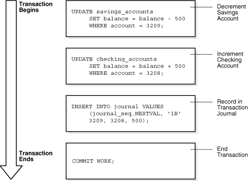
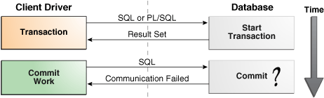
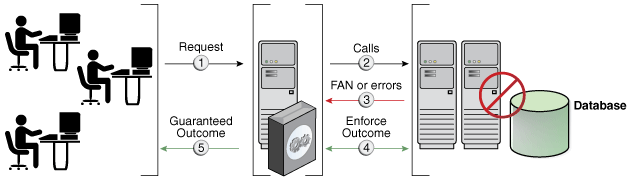

## 12 Transactions

This chapter defines a transaction and describes how the database processes transactions.

This chapter contains the following sections:

- Introduction to Transactions  
	A transaction is a logical, atomic unit of work that contains one or more SQL statements.
- Overview of Transaction Control  
	Transaction control is the management of changes made by DML statements and the grouping of DML statements into transactions.
- Overview of Transaction Guard  
	**Transaction Guard** is an API that applications can use to provide **transaction idempotence**, which is the ability of the database to preserve a guaranteed commit outcome that indicates whether a transaction committed and completed. Oracle Database provides the API for JDBC thin, OCI, OCCI, and ODP.Net.
- Overview of Application Continuity  
	Application Continuity attempts to mask outages from applications by replaying incomplete application requests after unplanned and planned outages. In this context, a request is a unit of work from the application.
- Overview of Autonomous Transactions  
	An autonomous transaction is an independent transaction that can be called from another transaction, which is the main transaction. You can suspend the calling transaction, perform SQL operations and commit or undo them in the autonomous transaction, and then resume the calling transaction.
- Overview of Distributed Transactions  
	A **distributed transaction** is a transaction that includes one or more statements that update data on two or more distinct nodes of a distributed database, using a schema object called a database link.

**Parent topic:** [Oracle Transaction Management](oracle-transaction-management.md)

### Introduction to Transactions

A transaction is a logical, atomic unit of work that contains one or more SQL statements.

A transaction groups SQL statements so that they are either all committed, which means they are applied to the database, or all rolled back, which means they are undone from the database. Oracle Database assigns every transaction a unique identifier called a [transaction ID](glossary.md).

All Oracle transactions obey the basic properties of a database transaction, known as [ACID properties](glossary.md). ACID is an acronym for the following:

- Atomicity
	All tasks of a transaction are performed or none of them are. There are no partial transactions. For example, if a transaction starts updating 100 rows, but the system fails after 20 updates, then the database rolls back the changes to these 20 rows.
- Consistency
	The transaction takes the database from one consistent state to another consistent state. For example, in a banking transaction that debits a savings account and credits a checking account, a failure must not cause the database to credit only one account, which would lead to inconsistent data.
- Isolation
	The effect of a transaction is not visible to other transactions until the transaction is committed. For example, one user updating the `hr.employees` table does not see the uncommitted changes to `employees` made concurrently by another user. Thus, it appears to users as if transactions are executing serially.
- Durability
	Changes made by committed transactions are permanent. After a transaction completes, the database ensures through its recovery mechanisms that changes from the transaction are not lost.

The use of transactions is one of the most important ways that a database management system differs from a file system.

- Sample Transaction: Account Debit and Credit  
	To illustrate the concept of a transaction, consider a banking database.
- Structure of a Transaction  
	A database transaction consists of one or more statements.
- Statement-Level Atomicity  
	Oracle Database supports **statement-level atomicity**, which means that a SQL statement is an atomic unit of work and either completely succeeds or completely fails.
- System Change Numbers (SCNs)  
	A **system change number (SCN)** is a logical, internal time stamp used by Oracle Database.

**Parent topic:** Transactions

#### Sample Transaction: Account Debit and Credit

To illustrate the concept of a transaction, consider a banking database.

When a customer transfers money from a savings account to a checking account, the transaction must consist of three separate operations:

- Decrement the savings account
- Increment the checking account
- Record the transaction in the transaction journal

Oracle Database must allow for two situations. If all three SQL statements maintain the accounts in proper balance, then the effects of the transaction can be applied to the database. However, if a problem such as insufficient funds, invalid account number, or a hardware failure prevents one or two of the statements in the transaction from completing, then the database must roll back the entire transaction so that the balance of all accounts is correct.

The following graphic illustrates a banking transaction. The first statement subtracts $500 from savings account 3209. The second statement adds $500 to checking account 3208. The third statement inserts a record of the transfer into the journal table. The final statement commits the transaction.

Figure 12-1 A Banking Transaction



> The image cncpt025.gif shows the SQL statement for the banking transaction example. The statement is divided into four blocks:
>
> - Decrement Savings Account
> - Increment Checking Account
> - Record in Transaction Journal
> - End Transaction
>
> The SQL statement for the Decrement Savings Account is as follows:
>
> ```
> UPDATE savings_accounts
> SET balance = balance - 500
> WHERE account = 3209;
> ```
>
> The SQL statement for the Increment Checking Account is as follows:
>
> ```
> UPDATE checking_accounts
> SET balance = balance + 500
> WHERE account =3208;
> ```
>
> The SQL statement for Record in Transaction Journal is as follows:
>
> ```
> INSERT INTO journal VALUES
> (journal_seq.NEXTVAL, '1B'
> 3209, 3208, 500),
> ```
>
> The SQL statement for End Transaction is as follows:
>
> ```
> COMMIT WORK;
> ```


**Parent topic:** Introduction to Transactions

#### Structure of a Transaction

A database transaction consists of one or more statements.

Specifically, a transaction consists of one of the following:

- One or more data manipulation language (DML) statements that together constitute an atomic change to the database
- One data definition language (DDL) statement

A transaction has a beginning and an end.

- Beginning of a Transaction  
	A transaction begins when the first executable SQL statement is encountered.
- End of a Transaction  
	A transaction can end under different circumstances.

See Also:

- " [Overview of SQL Statements](sql.md) "
- [Oracle Database SQL Language Reference](https://docs.oracle.com/pls/topic/lookup?ctx=en/database/oracle/oracle-database/21/cncpt&id=SQLRF-GUID-E1749EF5-2264-44DF-99EF-AEBEB943BED6) for an account of the types of SQL statements

**Parent topic:** Introduction to Transactions

##### Beginning of a Transaction

A transaction begins when the first executable SQL statement is encountered.

An [executable SQL statement](glossary.md) is a SQL statement that generates calls to a [database instance](glossary.md), including DML and DDL statements and the `SET TRANSACTION` statement.

When a transaction begins, Oracle Database assigns the transaction to an available [undo data](glossary.md) segment to record the undo entries for the new transaction. A transaction ID is not allocated until an undo segment and [transaction table](glossary.md) slot are allocated, which occurs during the first DML statement. A transaction ID is unique to a transaction and represents the undo segment number, slot, and sequence number.

The following example execute an `UPDATE` statement to begin a transaction and queries `V$TRANSACTION` for details about the transaction:

```
SQL> UPDATE hr.employees SET salary=salary; 

107 rows updated.
 
SQL> SELECT XID AS "txn id", XIDUSN AS "undo seg", XIDSLOT AS "slot", 
  2  XIDSQN AS "seq", STATUS AS "txn status"
  3  FROM V$TRANSACTION;
 
txn id             undo seg       slot        seq txn status
---------------- ---------- ---------- ---------- ----------------
0600060037000000          6          6         55 ACTIVE
```

See Also:

" [Undo Segments](logical-storage-structures.md) "

**Parent topic:** Structure of a Transaction

##### End of a Transaction

A transaction can end under different circumstances.

A transaction ends when any of the following actions occurs:

- A user issues a `COMMIT` or `ROLLBACK` statement without a `SAVEPOINT` clause.
	In a [commit](glossary.md), a user explicitly or implicitly requested that the changes in the transaction be made permanent. Changes made by the transaction are permanent and visible to other users only after a transaction commits.
- A user runs a DDL command such as `CREATE`, `DROP`, `RENAME`, or `ALTER`.
	The database issues an implicit `COMMIT` statement before and after every DDL statement. If the current transaction contains DML statements, then Oracle Database first commits the transaction and then runs and commits the DDL statement as a new, single-statement transaction.
- A user exits normally from most Oracle Database utilities and tools, causing the current transaction to be implicitly committed. The commit behavior when a user disconnects is application-dependent and configurable.
	Note:
	Applications should always explicitly commit or undo transactions before program termination.
- A client process terminates abnormally, causing the transaction to be implicitly rolled back using metadata stored in the transaction table and the undo segment.

After one transaction ends, the next executable SQL statement automatically starts the following transaction. The following example executes an `UPDATE` to start a transaction, ends the transaction with a `ROLLBACK` statement, and then executes an `UPDATE` to start a new transaction (note that the transaction IDs are different):

```
SQL> UPDATE hr.employees SET salary=salary; 
107 rows updated.
 
SQL> SELECT XID, STATUS FROM V$TRANSACTION;
 
XID              STATUS
---------------- ----------------
0800090033000000 ACTIVE
 
SQL> ROLLBACK;
 
Rollback complete.
 
SQL> SELECT XID FROM V$TRANSACTION;
 
no rows selected
 
SQL> UPDATE hr.employees SET last_name=last_name;
 
107 rows updated.
 
SQL> SELECT XID, STATUS FROM V$TRANSACTION;
 
XID              STATUS
---------------- ----------------
0900050033000000 ACTIVE
```

See Also:

- " Sample Transaction: Account Debit and Credit " for an example of a transaction that ends with a commit.
- [Oracle Database SQL Language Reference](https://docs.oracle.com/pls/topic/lookup?ctx=en/database/oracle/oracle-database/21/cncpt&id=SQLRF01110) to learn about `COMMIT`

**Parent topic:** Structure of a Transaction

#### Statement-Level Atomicity

Oracle Database supports **statement-level atomicity**, which means that a SQL statement is an atomic unit of work and either completely succeeds or completely fails.

A successful statement is different from a committed transaction. A single SQL statement executes successfully if the database parses and runs it without error as an atomic unit, as when all rows are changed in a multirow update.

If a SQL statement causes an error during execution, then it is not successful and so all effects of the statement are rolled back. This operation is a [statement-level rollback](glossary.md). This operation has the following characteristics:

- A SQL statement that does not succeed causes the loss only of work it would have performed itself.
	The unsuccessful statement does not cause the loss of any work that preceded it in the current transaction. For example, if the execution of the second `UPDATE` statement in " Sample Transaction: Account Debit and Credit " causes an error and is rolled back, then the work performed by the first `UPDATE` statement is not rolled back. The first `UPDATE` statement can be committed or rolled back explicitly by the user.
- The effect of the rollback is as if the statement had never been run.
	Any side effects of an atomic statement, for example, triggers invoked upon execution of the statement, are considered part of the atomic statement. Either all work generated as part of the atomic statement succeeds or none does.

An example of an error causing a statement-level rollback is an attempt to insert a duplicate [primary key](glossary.md). Single SQL statements involved in a [deadlock](glossary.md), which is competition for the same data, can also cause a statement-level rollback. However, errors discovered during SQL statement parsing, such as a syntax error, have not yet been run and so do not cause a statement-level rollback.

#### System Change Numbers (SCNs)

A **system change number (SCN)** is a logical, internal time stamp used by Oracle Database.

SCNs order events that occur within the database, which is necessary to satisfy the ACID properties of a transaction. Oracle Database uses SCNs to mark the SCN before which all changes are known to be on disk so that recovery avoids applying unnecessary redo. The database also uses SCNs to mark the point at which no redo exists for a set of data so that recovery can stop.

SCNs occur in a monotonically increasing sequence. Oracle Database can use an SCN like a clock because an observed SCN indicates a logical point in time, and repeated observations return equal or greater values. If one event has a lower SCN than another event, then it occurred at an earlier time in the database. Several events may share the same SCN, which means that they occurred at the same time in the database.

Every transaction has an SCN. For example, if a transaction updates a row, then the database records the SCN at which this update occurred. Other modifications in this transaction have the same SCN. When a transaction commits, the database records an SCN for this commit.

Oracle Database increments SCNs in the [system global area (SGA)](glossary.md). When a transaction modifies data, the database writes a new SCN to the undo data segment assigned to the transaction. The log writer process then writes the commit record of the transaction immediately to the [online redo log](glossary.md). The commit record has the unique SCN of the transaction. Oracle Database also uses SCNs as part of its [instance recovery](glossary.md) and [media recovery](glossary.md) mechanisms.

**Parent topic:** Introduction to Transactions

### Overview of Transaction Control

Transaction control is the management of changes made by DML statements and the grouping of DML statements into transactions.

In general, application designers are concerned with transaction control so that work is accomplished in logical units and data is kept consistent.

Transaction control involves using the following statements, as described in " [Transaction Control Statements](sql.md) ":

- The `COMMIT` statement ends the current transaction and makes all changes performed in the transaction permanent. `COMMIT` also erases all savepoints in the transaction and releases transaction locks.
- The `ROLLBACK` statement reverses the work done in the current transaction; it causes all data changes since the last `COMMIT` or `ROLLBACK` to be discarded. The `ROLLBACK TO SAVEPOINT` statement undoes the changes since the last savepoint but does not end the entire transaction.
- The `SAVEPOINT` statement identifies a point in a transaction to which you can later roll back.

The session in Table 12-1 illustrates the basic concepts of transaction control.

Table 12-1 Transaction Control

| T | Session | Explanation |
| --- | --- | --- |
| t0 | ``` COMMIT; ``` | This statement ends any existing transaction in the session. |
| t1 | ``` SET TRANSACTION NAME 'sal_update'; ``` | This statement begins a transaction and names it `sal_update`. |
| t2 | ``` UPDATE employees     SET salary = 7000      WHERE last_name = 'Banda'; ``` | This statement updates the salary for Banda to 7000. |
| t3 | ``` SAVEPOINT after_banda_sal; ``` | This statement creates a savepoint named `after_banda_sal`, enabling changes in this transaction to be rolled back to this point. |
| t4 | ``` UPDATE employees     SET salary = 12000      WHERE last_name = 'Greene'; ``` | This statement updates the salary for Greene to 12000. |
| t5 | ``` SAVEPOINT after_greene_sal; ``` | This statement creates a savepoint named `after_greene_sal`, enabling changes in this transaction to be rolled back to this point. |
| t6 | ``` ROLLBACK TO SAVEPOINT     after_banda_sal; ``` | This statement rolls back the transaction to t3, undoing the update to Greene's salary at t4. The `sal_update` transaction has not ended. |
| t7 | ``` UPDATE employees     SET salary = 11000      WHERE last_name = 'Greene'; ``` | This statement updates the salary for Greene to 11000 in transaction `sal_update`. |
| t8 | ``` ROLLBACK; ``` | This statement rolls back all changes in transaction `sal_update`, ending the transaction. |
| t9 | ``` SET TRANSACTION NAME 'sal_update2'; ``` | This statement begins a new transaction in the session and names it `sal_update2`. |
| t10 | ``` UPDATE employees     SET salary = 7050      WHERE last_name = 'Banda'; ``` | This statement updates the salary for Banda to 7050. |
| t11 | ``` UPDATE employees     SET salary = 10950      WHERE last_name = 'Greene'; ``` | This statement updates the salary for Greene to 10950. |
| t12 | ``` COMMIT; ``` | This statement commits all changes made in transaction `sal_update2`, ending the transaction. The commit guarantees that the changes are saved in the online redo log files. |

- Transaction Names  
	A transaction name is an optional, user-specified tag that serves as a reminder of the work that the transaction is performing. You name a transaction with the `SET TRANSACTION` `...` `NAME` statement, which if used must be first statement of the transaction.
- Active Transactions  
	An **active transaction** is one that has started but not yet committed or rolled back.
- Savepoints  
	A savepoint is a user-declared intermediate marker within the context of a transaction.
- Rollback of Transactions  
	A rollback of an uncommitted transaction undoes any changes to data that have been performed by SQL statements within the transaction.
- Commits of Transactions  
	A commit ends the current transaction and makes permanent all changes performed in the transaction.

See Also:

[Oracle Database SQL Language Reference](https://docs.oracle.com/pls/topic/lookup?ctx=en/database/oracle/oracle-database/21/cncpt&id=SQLRF30043) to learn about transaction control statements

**Parent topic:** Transactions

#### Transaction Names

A transaction name is an optional, user-specified tag that serves as a reminder of the work that the transaction is performing. You name a transaction with the `SET TRANSACTION` `...` `NAME` statement, which if used must be first statement of the transaction.

In Table 12-1, the first transaction was named `sal_update` and the second was named `sal_update2`.

Transaction names provide the following advantages:

- It is easier to monitor long-running transactions and to resolve in-doubt distributed transactions.
- You can view transaction names along with transaction IDs in applications. For example, a database administrator can view transaction names in Oracle Enterprise Manager (Enterprise Manager) when monitoring system activity.
- The database writes transaction names to the transaction auditing redo record, so you can use LogMiner to search for a specific transaction in the redo log.
- You can use transaction names to find a specific transaction in data dictionary views such as `V$TRANSACTION`.

See Also:

- [Oracle Database Reference](https://docs.oracle.com/pls/topic/lookup?ctx=en/database/oracle/oracle-database/21/cncpt&id=REFRN30291) to learn about `V$TRANSACTION`
- [Oracle Database SQL Language Reference](https://docs.oracle.com/pls/topic/lookup?ctx=en/database/oracle/oracle-database/21/cncpt&id=SQLRF01705) to learn about `SET TRANSACTION`

**Parent topic:** Overview of Transaction Control

#### Active Transactions

An **active transaction** is one that has started but not yet committed or rolled back.

In Table 12-1, the first statement to modify data in the `sal_update` transaction is the update to Banda's salary. From the successful execution of this update until the `ROLLBACK` statement ends the transaction, the `sal_update` transaction is active.

Data changes made by a transaction are temporary until the transaction is committed or rolled back. Before the transaction ends, the state of the data is as shown in the following table.

Table 12-2 State of the Data Before the Transaction Ends

| State | Description | To Learn More |
| --- | --- | --- |
| Oracle Database has generated undo information in the SGA. | The undo data contains the old data values changed by the SQL statements of the transaction. | " [Read Consistency in the Read Committed Isolation Level](data-concurrency-and-consistency.md) " |
| Oracle Database has generated redo in the online redo log buffer of the SGA. | The redo log record contains the change to the data block and the change to the undo block. | " [Redo Log Buffer](memory-architecture.md) " |
| Changes have been made to the database buffers of the SGA. | The data changes for a committed transaction, stored in the database buffers of the SGA, are not necessarily written immediately to the data files by the [database writer (DBW)](glossary.md). The disk write can happen before or after the commit. | " [Database Buffer Cache](memory-architecture.md) " |
| The rows affected by the data change are locked. | Other users cannot change the data in the affected rows, nor can they see the uncommitted changes. | " [Summary of Locking Behavior](data-concurrency-and-consistency.md) " |

**Parent topic:** Overview of Transaction Control

#### Savepoints

A savepoint is a user-declared intermediate marker within the context of a transaction.

Internally, the savepoint marker resolves to an SCN. Savepoints divide a long transaction into smaller parts.

If you use savepoints in a long transaction, then you have the option later of rolling back work performed before the current point in the transaction but after a declared savepoint within the transaction. Thus, if you make an error, you do not need to resubmit every statement. Table 12-1 creates savepoint `after_banda_sal` so that the update to the Greene salary can be rolled back to this savepoint.

- Rollback to Savepoint  
	A rollback to a savepoint in an uncommitted transaction means undoing any changes made after the specified savepoint, but it does not mean a rollback of the transaction itself.
- Enqueued Transactions  
	Depending on the scenario, transactions waiting for previously locked resources may still be blocked after a rollback to savepoint.

**Parent topic:** Overview of Transaction Control

##### Rollback to Savepoint

A rollback to a savepoint in an uncommitted transaction means undoing any changes made after the specified savepoint, but it does not mean a rollback of the transaction itself.

When a transaction is rolled back to a savepoint, as when the `ROLLBACK TO SAVEPOINT after_banda_sal` is run in Table 12-1, the following occurs:

1. Oracle Database rolls back only the statements run after the savepoint.
	In Table 12-1, the `ROLLBACK TO SAVEPOINT` causes the `UPDATE` for Greene to be rolled back, but not the `UPDATE` for Banda.
2. Oracle Database preserves the savepoint specified in the `ROLLBACK TO SAVEPOINT` statement, but all subsequent savepoints are lost.
	In Table 12-1, the `ROLLBACK TO SAVEPOINT` causes the `after_greene_sal` savepoint to be lost.
3. Oracle Database releases all table and row locks acquired after the specified savepoint but retains all data locks acquired before the savepoint.

The transaction remains active and can be continued.

See Also:

- [Oracle Database SQL Language Reference](https://docs.oracle.com/pls/topic/lookup?ctx=en/database/oracle/oracle-database/21/cncpt&id=SQLRF01610) to learn about the `ROLLBACK` and `SAVEPOINT` statements
- [Oracle Database PL/SQL Language Reference](https://docs.oracle.com/pls/topic/lookup?ctx=en/database/oracle/oracle-database/21/cncpt&id=LNPLS00608) to learn about transaction processing and control

**Parent topic:** Savepoints

##### Enqueued Transactions

Depending on the scenario, transactions waiting for previously locked resources may still be blocked after a rollback to savepoint.

When a transaction is blocked by another transaction it enqueues on the blocking transaction itself, so that the entire blocking transaction must commit or roll back for the blocked transaction to continue.

In the scenario shown in the following table, session 1 rolls back to a savepoint created before it executed a DML statement. However, session 2 is still blocked because it is waiting for the session 1 transaction to complete.

Table 12-3 Rollback to Savepoint Example

| T | Session 1 | Session 2 | Session 3 | Explanation |
| --- | --- | --- | --- | --- |
| t0 | ``` UPDATE employees    SET salary=7000    WHERE last_name=    'Banda'; ``` |  |  | Session 1 begins a transaction. The session places an exclusive lock on the `Banda` row (TX) and a subexclusive table lock (SX) on the table. |
| t1 | ``` SAVEPOINT   after_banda_sal; ``` |  |  | Session 1 creates a savepoint named `after_banda_sal`. |
| t2 | ``` UPDATE employees   SET salary=12000   WHERE last_name=    'Greene'; ``` |  |  | Session 1 locks the `Greene` row. |
| t3 |  | ``` UPDATE employees   SET salary=14000   WHERE last_name=  'Greene'; ``` |  | Session 2 attempts to update the `Greene` row, but fails to acquire a lock because session 1 has a lock on this row. No transaction has begun in session 2. |
| t4 | ``` ROLLBACK  TO SAVEPOINT   after_banda_sal; ``` |  |  | Session 1 rolls back the update to the salary for `Greene`, which releases the row lock for `Greene`. The table lock acquired at t0 is not released.  At this point, session 2 is still blocked by session 1 because session 2 enqueues on the session 1 transaction, which has not yet completed. |
| t5 |  |  | ``` UPDATE employees   SET salary=11000  WHERE last_name=  'Greene'; ``` | The `Greene` row is currently unlocked, so session 3 acquires a lock for an update to the `Greene` row. This statement begins a transaction in session 3. |
| t6 | ``` COMMIT; ``` |  |  | Session 1 commits, ending its transaction. Session 2 is now enqueued for its update to the `Greene` row behind the transaction in session 3. |

See Also:

" [Lock Duration](data-concurrency-and-consistency.md) " to learn more about when Oracle Database releases locks

**Parent topic:** Savepoints

#### Rollback of Transactions

A rollback of an uncommitted transaction undoes any changes to data that have been performed by SQL statements within the transaction.

After a transaction has been rolled back, the effects of the work done in the transaction no longer exist. In rolling back an entire transaction, without referencing any savepoints, Oracle Database performs the following actions:

- Undoes all changes made by all the SQL statements in the transaction by using the corresponding undo segments
	The transaction table entry for every active transaction contains a pointer to all the undo data (in reverse order of application) for the transaction. The database reads the data from the undo segment, reverses the operation, and then marks the undo entry as applied. Thus, if a transaction inserts a row, then a rollback deletes it. If a transaction updates a row, then a rollback reverses the update. If a transaction deletes a row, then a rollback reinserts it. In Table 12-1, the `ROLLBACK` reverses the updates to the salaries of Greene and Banda.
- Releases all the locks of data held by the transaction
- Erases all savepoints in the transaction
	In Table 12-1, the `ROLLBACK` deletes the savepoint `after_banda_sal`. The `after_greene_sal` savepoint was removed by the `ROLLBACK TO SAVEPOINT` statement.
- Ends the transaction
	In Table 12-1, the `ROLLBACK` leaves the database in the same state as it was after the initial `COMMIT` was executed.

The duration of a rollback is a function of the amount of data modified.

See Also:

- " [Undo Segments](logical-storage-structures.md) "
- [Oracle Database SQL Language Reference](https://docs.oracle.com/pls/topic/lookup?ctx=en/database/oracle/oracle-database/21/cncpt&id=GUID-94551F0C-A47F-43DE-BC68-9B1C1ED38C93) to learn about the `ROLLBACK` command

**Parent topic:** Overview of Transaction Control

#### Commits of Transactions

A commit ends the current transaction and makes permanent all changes performed in the transaction.

In Table 12-1, a second transaction begins with `sal_update2` and ends with an explicit `COMMIT` statement. The changes that resulted from the two `UPDATE` statements are now made permanent.

When a transaction commits, the following actions occur:

- The database generates an SCN for the `COMMIT`.
	The internal transaction table for the associated [undo tablespace](glossary.md) records that the transaction has committed. The corresponding unique SCN of the transaction is assigned and recorded in the transaction table.
- The [log writer process (LGWR)](glossary.md) process writes remaining redo log entries in the redo log buffers to the online redo log and writes the transaction SCN to the online redo log. This atomic event constitutes the commit of the transaction.
- Oracle Database releases locks held on rows and tables.
	Users who were enqueued waiting on locks held by the uncommitted transaction are allowed to proceed with their work.
- Oracle Database deletes savepoints.
	In Table 12-1, no savepoints existed in the `sal_update` transaction so no savepoints were erased.
- Oracle Database performs a [commit cleanout](glossary.md).
	If modified blocks containing data from the committed transaction are still in the SGA, and if no other session is modifying them, then the database removes lock-related transaction information (the ITL entry) from the blocks.
	Ideally, the `COMMIT` cleans the blocks so that a subsequent `SELECT` does not have to perform this task. If no ITL entry exists for a specific row, then it is not locked. If an ITL entry exists for a specific row, then it is possibly locked, so a session must check the undo segment header to determine whether this interested transaction has committed. If the interested transaction has committed, then the session cleans out the block, which generates redo. However, if the `COMMIT` cleaned out the ITL previously, then the check and cleanout are unnecessary.
	Note:
	Because a block cleanout generates redo, a query may generate redo and thus cause blocks to be written during the next [checkpoint](glossary.md).
- Oracle Database marks the transaction complete.

After a transaction commits, users can view the changes.

Typically, a commit is a fast operation, regardless of the transaction size. The speed of a commit does not increase with the size of the data modified in the transaction. The lengthiest part of the commit is the physical disk I/O performed by LGWR. However, the amount of time spent by LGWR is reduced because it has been incrementally writing the contents of the redo log buffer in the background.

The default behavior is for LGWR to write redo to the online redo log synchronously and for transactions to wait for the buffered redo to be on disk before returning a commit to the user. However, for lower transaction commit latency, application developers can specify that redo be written asynchronously so that transactions need not wait for the redo to be on disk and can return from the `COMMIT` call immediately.

**Parent topic:** Overview of Transaction Control

### Overview of Transaction Guard

**Transaction Guard** is an API that applications can use to provide **transaction idempotence**, which is the ability of the database to preserve a guaranteed commit outcome that indicates whether a transaction committed and completed. Oracle Database provides the API for JDBC thin, OCI, OCCI, and ODP.Net.

A [recoverable error](glossary.md) is caused by an external system failure, independent of the application session logic that is executing. Recoverable errors occur following planned and unplanned outages of foreground processes, networks, nodes, storage, and databases. If an outage breaks the connection between a client application and the database, then the application receives a disconnection error message. The transaction that was running when the connection broke is called an [in-flight transaction](glossary.md).

To decide whether to resubmit the transaction or to return the result (committed or uncommitted) to the client, the application must determine the outcome of the in-flight transaction. Before Oracle Database 12c, commit messages returned to the client were not persistent. Checking a transaction was no guarantee that it would not commit after being checked, permitting duplicate transactions and other forms of logical corruption. For example, a user might refresh a web browser when purchasing a book online and be charged twice for the same book.

- Benefits of Transaction Guard  
	Starting in Oracle Database 12c, Transaction Guard provides applications with a tool for determining the status of an in-flight transaction following a recoverable outage.
- How Transaction Guard Works  
	This section explains the problem of lost commit messages and how Transaction Guard uses logical transaction IDs to solve the problem.
- Transaction Guard: Example  
	In this scenario, the commit message is lost because of a recoverable error.

See Also:

- " Introduction to Transactions "
- [Oracle Database Development Guide](https://docs.oracle.com/pls/topic/lookup?ctx=en/database/oracle/oracle-database/21/cncpt&id=ADFNS1062) to learn about Transaction Guard
- [Oracle Real Application Clusters Administration and Deployment Guide](https://docs.oracle.com/pls/topic/lookup?ctx=en/database/oracle/oracle-database/21/cncpt&id=RACAD8423) to learn how to configure services for Transaction Guard

**Parent topic:** Transactions

#### Benefits of Transaction Guard

Starting in Oracle Database 12c, Transaction Guard provides applications with a tool for determining the status of an in-flight transaction following a recoverable outage.

Using Transaction Guard, an application can ensure that a transaction executes no more than once. For example, if an online bookstore application determines that the previously submitted commit failed, then the application can safely resubmit.

Transaction Guard provides a tool for at-most-once execution to avoid the application executing duplicate submissions. Transaction Guard provides a known outcome for every transaction.

Transaction Guard is a core Oracle Database capability. Application Continuity uses Transaction Guard when masking outages from end users. Without Transaction Guard, an application retrying after an error may cause duplicate transactions to be committed.

See Also:

- " Overview of Application Continuity " to learn about Application Continuity, which works with Transaction Guard to help developers achieve high application availability
- [Oracle Database Development Guide](https://docs.oracle.com/pls/topic/lookup?ctx=en/database/oracle/oracle-database/21/cncpt&id=ADFNS1062) to learn about Transaction Guard, including the types of supported and included transactions

**Parent topic:** Overview of Transaction Guard

#### How Transaction Guard Works

This section explains the problem of lost commit messages and how Transaction Guard uses logical transaction IDs to solve the problem.

- Lost Commit Messages  
	When designing for idempotence, developers must address the problem of communication failures after submission of commit statements. Commit messages do not persist in the database and so cannot be retrieved after a failure.
- Logical Transaction ID  
	Oracle Database solves the communication failure by using a globally unique identifier called a logical transaction ID.

**Parent topic:** Overview of Transaction Guard

##### Lost Commit Messages

When designing for idempotence, developers must address the problem of communication failures after submission of commit statements. Commit messages do not persist in the database and so cannot be retrieved after a failure.

The following graphic is a high-level representation of an interaction between a client application and a database.

Figure 12-2 Lost Commit Message



> This graphic shows Client Drivers connecting to a Database. A time arrow points downward. The top left driver says Transaction. An arrow labeled "SQL or PL/SQL" points right to the Start Transaction box. An arrow labeled "Result Set" points left to the Transaction box. Below this box is the Commit Work box. An arrow labeled "SQL" points right to the Commit box. An arrow labeled "Communication Failed" points left to the Commit Work box.


In the standard commit case, the database commits a transaction and returns a success message to the client. In Figure 12-2, the client submits a commit statement and receives a message stating that communication failed. This type of failure can occur for several reasons, including a database instance failure or network outage. In this scenario, the client does not know the state of the transaction.

Following a communication failure, the database may still be running the submission and be unaware that the client disconnected. Checking the transaction state does not guarantee that an active transaction will not commit after being checked. If the client resends the commit because of this out-of-date information, then the database may repeat the transaction, resulting in logical corruption.

**Parent topic:** How Transaction Guard Works

##### Logical Transaction ID

Oracle Database solves the communication failure by using a globally unique identifier called a logical transaction ID.

This ID contains the logical session number allocated when a session first connects, and a running commit number that is updated each time the session commits or rolls back.<sup>Foot 1</sup> From the application perspective, the logical transaction ID uniquely identifies the last database transaction submitted on the session that failed.

For each round trip from the client in which one or more transactions are committed, the database stores a logical transaction ID. This ID can provide transaction idempotence for interactions between the application and the database for each round trip that commits data.

The at-most-once protocol enables access to the commit outcome by requiring the database to do the following:

- Maintain the logical transaction ID for the retention period agreed for retry
- Persist the logical transaction ID on commit

While a transaction is running, both the database and client hold the logical transaction ID. The database gives the client a logical transaction ID at authentication, when borrowing from a connection pool, and at each round trip from the client driver that executes one or more commit operations.

Before the application can determine the outcome of the last transaction following a recoverable error, the application obtains the logical transaction ID held at the client using Java, OCI, OCCI, or ODP.Net APIs. The application then invokes the PL/SQL procedure `DBMS_APP_CONT.GET_LTXID_OUTCOME` with the logical transaction ID to determine the outcome of the last submission: committed (`true` or `false`) and user call completed (`true` or `false`).

When using Transaction Guard, the application can replay transactions when the error is recoverable and the last transaction on the session has not committed. The application can continue when the last transaction has committed and the user call has completed. The application can use Transaction Guard to return the known outcome to the client so that the client can decide the next action to take.

See Also:

- [Oracle Database Development Guide](https://docs.oracle.com/pls/topic/lookup?ctx=en/database/oracle/oracle-database/21/cncpt&id=ADFNS324) to learn about logical transaction IDs
- [Oracle Database PL/SQL Packages and Types Reference](https://docs.oracle.com/pls/topic/lookup?ctx=en/database/oracle/oracle-database/21/cncpt&id=ARPLS73456) to learn more about the `DBMS_APP_CONT.GET_LTXID_OUTCOME` procedure

**Parent topic:** How Transaction Guard Works

#### Transaction Guard: Example

In this scenario, the commit message is lost because of a recoverable error.

Transaction Guard uses the logical transaction ID to preserve the outcome of the `COMMIT` statement, ensuring that there is a known outcome for the transaction.

Figure 12-3 Check of Logical Transaction Status



> This graphic shows three person icons on the self. An arrow labeled "1 Request" points to the right toward a computer icon. An arrow labeled "5 Guaranteed Outcome" points left back to the person icons. An arrow labeled "2 Calls" points right to server icons with a database attached. A red circle with a line through it is over the database. An arrow labeled "3 FAN or arrows" points left to the computer icon. A double-headed arrow labeled "4 Enforce Outcome" is between the computer and Database icons.


In Figure 12-3, the database informs the application whether the transaction committed and whether the last user call completed. The application can then return the result to the end user. The possibilities are:

- If the transaction committed and the user call completed, then the application can return the result to the end user and continue.
- If the transaction committed but the user call did not complete, then the application can return the result to the end user with warnings. Examples include a lost out bind or lost number of rows processed. Some applications depend on the extra information, whereas others do not.
- If the user call was not committed, then the application can return this information to the end user, or safely resubmit. The protocol is guaranteed. When the commit status returns false, the last submission is blocked from committing.

See Also:

[Oracle Database Development Guide](https://docs.oracle.com/pls/topic/lookup?ctx=en/database/oracle/oracle-database/21/cncpt&id=ADFNS8000) to learn how to use Transaction Guard

**Parent topic:** Overview of Transaction Guard

### Overview of Application Continuity

Application Continuity attempts to mask outages from applications by replaying incomplete application requests after unplanned and planned outages. In this context, a request is a unit of work from the application.

Typically, a request corresponds to the DML statements and other database calls of a single web request on a single database connection. In general, a request is demarcated by the calls made between check-out and check-in of a database connection from a connection pool.

This section contains the following topics:

- Benefits of Application Continuity
- Application Continuity Architecture

- Benefits of Application Continuity  
	A basic problem for developers is how to mask a lost database session from end users.
- Application Continuity Architecture  
	The key components of Application Continuity are runtime, reconnection, and replay.

**Parent topic:** Transactions

#### Benefits of Application Continuity

A basic problem for developers is how to mask a lost database session from end users.

Application Continuity attempts to solve the lost session problem by restoring the database session when any component disrupts the conversation between database and client. The restored database session includes all states, cursors, variables, and the most recent transaction when one exists.

- Use Case for Application Continuity  
	In a typical case, a client has submitted a request to the database, which has built up both transactional and nontransactional states.
- Application Continuity for Planned Maintenance  
	Application Continuity for planned outages enables applications to continue operations for database sessions that can be reliably drained or migrated.

**Parent topic:** Overview of Application Continuity

##### Use Case for Application Continuity

In a typical case, a client has submitted a request to the database, which has built up both transactional and nontransactional states.

The state at the client remains current, potentially with entered data, returned data, and cached data and variables. However, the database session state, which the application needs to operate within, is lost.

If the client request has initiated one or more transactions, then the application is faced with the following possibilities:

- If a commit has been issued, then the commit message returned to the client is not durable. The client does not know whether the request committed, and where in the nontransactional processing state it reached.
- If a commit has not been issued, or if it was issued but did not execute, then the in-flight transaction is rolled back and must be resubmitted using a session in the correct state.

If the replay is successful, then database user service for planned and unplanned outages is not interrupted. If the database detects changes in the data seen and potentially acted on by the application, then the replay is rejected. Replay is not attempted when the time allowed for starting replay is exceeded, the application uses a restricted call, or the application has explicitly disabled replay using the `disableReplay` method.

See Also:

[Oracle Real Application Clusters Administration and Deployment Guide](https://docs.oracle.com/pls/topic/lookup?ctx=en/database/oracle/oracle-database/21/cncpt&id=GUID-70D9CDC4-0C86-432B-A04E-1618AF5C35A4) to learn more about how Application Continuity works for database sessions

**Parent topic:** Benefits of Application Continuity

##### Application Continuity for Planned Maintenance

Application Continuity for planned outages enables applications to continue operations for database sessions that can be reliably drained or migrated.

Scheduled maintenance need not disrupt application work. Application Continuity gives active work time to drain from its current location to a new location currently unaffected by maintenance. At the end of the drain interval, sessions may remain on the database instance where maintenance is planned. Instead of forcibly disconnecting these sessions, Application Continuity can fail over these sessions to a remaining site, and resubmit any in-flight transactions.

With Application Continuity enabled the database can do the following:

- Report no errors for either incoming or existing work during maintenance
- Redirect active database sessions to other functional services
- Rebalance database sessions, as needed, during and after the maintenance

Control the drain behavior during planned maintenance using the `drain_timeout` and `stop_option` service attributes of the SRVCTL utility, Global Data Services Control Utility (GDSCTL), and Oracle Data Guard Broker. The `DBMS_SERVICE` package provides the underlying infrastructure.

See Also:

- [Oracle Real Application Clusters Administration and Deployment Guide](https://docs.oracle.com/pls/topic/lookup?ctx=en/database/oracle/oracle-database/21/cncpt&id=GUID-BD699AEB-9F85-42A8-8687-5A979918938D) to learn more Application Continuity
- [Oracle Database PL/SQL Packages and Types Reference](https://docs.oracle.com/pls/topic/lookup?ctx=en/database/oracle/oracle-database/21/cncpt&id=ARPLS-GUID-C11449DC-EEDE-4BB8-9D2C-0A45198C1928) to learn more about `DBMS_SERVICE`
- [Oracle Real Application Clusters Administration and Deployment Guide](https://docs.oracle.com/pls/topic/lookup?ctx=en/database/oracle/oracle-database/21/cncpt&id=RACAD-GUID-C2D37BAB-DA98-49B4-A777-F2B3AA8D2E7A) for the SRVCTL command reference
- [Oracle Database Global Data Services Concepts and Administration Guide](https://docs.oracle.com/pls/topic/lookup?ctx=en/database/oracle/oracle-database/21/cncpt&id=GSMUG-GUID-E6E76443-AD85-455C-99AA-BF0A7856F880) for the GDSCTL command reference

**Parent topic:** Benefits of Application Continuity

#### Application Continuity Architecture

The key components of Application Continuity are runtime, reconnection, and replay.

The phases are as follows:

1. Normal runtime
	In this phase, Application Continuity performs the following tasks:
	- Identifies database requests
		- Decides whether local and database calls are replayable
		- Builds proxy objects to enable replay, if necessary, and to manage queues
		- Holds original calls and validation of these calls until the end of the database request or replay is disabled
2. Reconnection
	This phase is triggered by a recoverable error. Application Continuity performs the following tasks:
	- Ensures that replay is enabled for the database requests
		- Manages timeouts
		- Obtains a new connection to the database, and then validates that this is a valid database target
		- Uses Transaction Guard to determine whether the last transaction committed successfully (committed transactions are not resubmitted)
3. Replay
	Application Continuity performs the following tasks:
	- Replays calls that are held in the queue
		- Disables replay if user-visible changes in results appear during the replay
		- Does not allow a commit, but does allow the last recall (which encountered the error) to commit

Following a successful replay, the request continues from the point of failure.

See Also:

- " Overview of Transaction Guard "
- [Oracle Real Application Clusters Administration and Deployment Guide](https://docs.oracle.com/pls/topic/lookup?ctx=en/database/oracle/oracle-database/21/cncpt&id=GUID-91427DA2-2C5F-46E9-93D4-B5FF6427A69B) to learn more about Application Continuity
- [Oracle Database JDBC Developer's Guide](https://docs.oracle.com/pls/topic/lookup?ctx=en/database/oracle/oracle-database/21/cncpt&id=JJDBC29059) to learn more about JDBC and Application Continuity

**Parent topic:** Overview of Application Continuity

### Overview of Autonomous Transactions

An autonomous transaction is an independent transaction that can be called from another transaction, which is the main transaction. You can suspend the calling transaction, perform SQL operations and commit or undo them in the autonomous transaction, and then resume the calling transaction.

Autonomous transactions are useful for actions that must be performed independently, regardless of whether the calling transaction commits or rolls back. For example, in a stock purchase transaction, you want to commit customer data regardless of whether the overall stock purchase goes through. Additionally, you want to log error messages to a debug table even if the overall transaction rolls back.

Autonomous transactions have the following characteristics:

- The autonomous transaction does not see uncommitted changes made by the main transaction and does not share locks or resources with the main transaction.
- Changes in an autonomous transaction are visible to other transactions upon commit of the autonomous transactions. Thus, users can access the updated information without having to wait for the main transaction to commit.
- Autonomous transactions can start other autonomous transactions. There are no limits, other than resource limits, on how many levels of autonomous transactions can be called.

In PL/SQL, an autonomous transaction executes within an autonomous scope, which is a routine marked with the pragma `AUTONOMOUS_TRANSACTION`. In this context, routines include top-level anonymous PL/SQL blocks and PL/SQL subprograms and triggers. A [pragma](glossary.md) is a directive that instructs the compiler to perform a compilation option. The pragma `AUTONOMOUS_TRANSACTION` instructs the database that this procedure, when executed, is to be executed as a new autonomous transaction that is independent of its parent transaction.

The following graphic shows how control flows from the main routine (MT) to an autonomous routine and back again. The main routine is `proc1` and the autonomous routine is `proc2`. The autonomous routine can commit multiple transactions (AT1 and AT2) before control returns to the main routine.

Figure 12-4 Transaction Control Flow


> This figure shows how control flows from a main routine (MT) to an autonomous routine (AT) and back again.
>
> The autonomous routine commits two transactions, AT1 and AT2, before control returns to the main routine. When control enters the executable section of the autonomous routine (BEGIN), the main routine suspends. When control exits the autonomous routine (END), the main routine resumes. COMMIT and ROLLBACK statements in an autonomous routine end the active transaction, but they do not end the autonomous routine.


When you enter the executable section of an autonomous routine, the main routine suspends. When you exit the autonomous routine, the main routine resumes.

In Figure 12-4, the `COMMIT` inside `proc1` makes permanent not only its own work but any outstanding work performed in its session. However, a `COMMIT` in `proc2` makes permanent only the work performed in the `proc2` transaction. Thus, the `COMMIT` statements in transactions AT1 and AT2 have no effect on the MT transaction.

See Also:

[Oracle Database Development Guide](https://docs.oracle.com/pls/topic/lookup?ctx=en/database/oracle/oracle-database/21/cncpt&id=ADFNS00205) and [Oracle Database PL/SQL Language Reference](https://docs.oracle.com/pls/topic/lookup?ctx=en/database/oracle/oracle-database/21/cncpt&id=LNPLS00609) to learn how to use autonomous transactions

**Parent topic:** Transactions

### Overview of Distributed Transactions

A **distributed transaction** is a transaction that includes one or more statements that update data on two or more distinct nodes of a distributed database, using a schema object called a database link.

A [distributed database](glossary.md) is a set of databases in a distributed system that can appear to applications as a single data source. A [database link](glossary.md) describes how one database instance can log in to another database instance.

Unlike a transaction on a local database, a distributed transaction alters data on multiple databases. Consequently, distributed transaction processing is more complicated because the database must coordinate the committing or rolling back of the changes in a transaction as an atomic unit. The entire transaction must commit or roll back. Oracle Database must coordinate transaction control over a network and maintain data consistency, even if a network or system failure occurs.

- Two-Phase Commit  
	The **two-phase commit mechanism** guarantees that all databases participating in a distributed transaction either all commit or all undo the statements in the transaction. The mechanism also protects implicit DML performed by integrity constraints, remote procedure calls, and triggers.
- In-Doubt Transactions  
	An in-doubt distributed transaction occurs when a two-phase commit was interrupted by any type of system or network failure.

See Also:

[Oracle Database Administrator’s Guide](https://docs.oracle.com/pls/topic/lookup?ctx=en/database/oracle/oracle-database/21/cncpt&id=ADMIN031) to learn how to manage distributed transactions

**Parent topic:** Transactions

#### Two-Phase Commit

The **two-phase commit mechanism** guarantees that all databases participating in a distributed transaction either all commit or all undo the statements in the transaction. The mechanism also protects implicit DML performed by integrity constraints, remote procedure calls, and triggers.

In a two-phase commit among multiple databases, one database coordinates the distributed transaction. The initiating node is called the global coordinator. The coordinator asks the other databases if they are prepared to commit. If any database responds with a no, then the entire transaction is rolled back. If all databases vote yes, then the coordinator broadcasts a message to make the commit permanent on each of the databases.

The two-phase commit mechanism is transparent to users who issue distributed transactions. In fact, users need not even know the transaction is distributed. A `COMMIT` statement denoting the end of a transaction automatically triggers the two-phase commit mechanism. No coding or complex statement syntax is required to include distributed transactions within the body of a database application.

See Also:

- [Oracle Database Administrator’s Guide](https://docs.oracle.com/pls/topic/lookup?ctx=en/database/oracle/oracle-database/21/cncpt&id=ADMIN12222) to learn about the two-phase commit mechanism
- [Oracle Database SQL Language Reference](https://docs.oracle.com/pls/topic/lookup?ctx=en/database/oracle/oracle-database/21/cncpt&id=GUID-6CD5C9A7-54B9-4FA2-BA3C-D6B4492B9EE2)

**Parent topic:** Overview of Distributed Transactions

#### In-Doubt Transactions

An in-doubt distributed transaction occurs when a two-phase commit was interrupted by any type of system or network failure.

For example, two databases report to the coordinating database that they were prepared to commit, but the coordinating database instance fails immediately after receiving the messages. The two databases who are prepared to commit are now left hanging while they await notification of the outcome.

The recoverer (`RECO`) background process automatically resolves the outcome of in-doubt distributed transactions. After the failure is repaired and communication is reestablished, the `RECO` process of each local Oracle database automatically commits or rolls back any in-doubt distributed transactions consistently on all involved nodes.

In the event of a long-term failure, Oracle Database enables each local administrator to manually commit or undo any distributed transactions that are in doubt because of the failure. This option enables the local database administrator to free any locked resources that are held indefinitely because of the long-term failure.

If a database must be recovered to a past time, then database recovery facilities enable database administrators at other sites to return their databases to the earlier point in time. This operation ensures that the global database remains consistent.

See Also:

- " [Recoverer Process (RECO)](process-architecture.md) "
- [Oracle Database Administrator’s Guide](https://docs.oracle.com/pls/topic/lookup?ctx=en/database/oracle/oracle-database/21/cncpt&id=ADMIN12252) to learn how to manage in-doubt transactions

**Parent topic:** Overview of Distributed Transactions

---

Footnote Legend

Footnote 1:

For Oracle Real Application Clusters (Oracle RAC), the logical transaction ID includes the database instance number as a prefix.