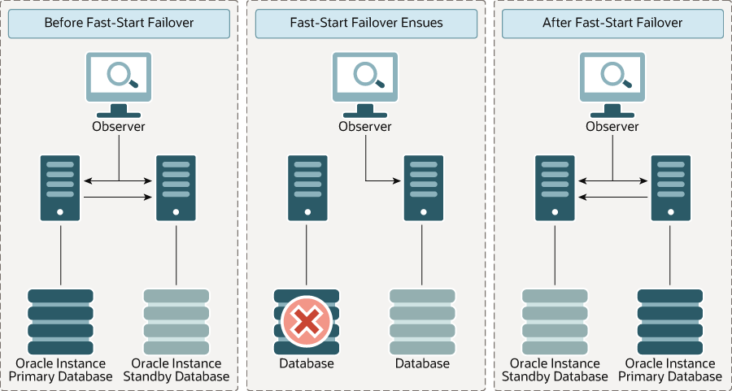
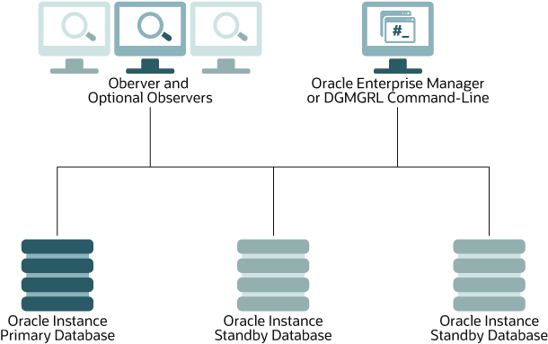

### Overview of Switchover and Failover in a Broker Environment

Oracle Data Guard helps you change the role of databases between primary and standby using either a switchover or failover operation.

- A switchover is a role reversal between the primary database and one of its standby databases. A switchover guarantees no data loss and is typically done for planned maintenance of the primary system. During a switchover, the primary database transitions to a standby role, and the standby database transitions to the primary role.
- A failover is a role transition in which one of the standby databases is transitioned to the primary role after the primary database (all instances in the case of an Oracle RAC database) fails or has become unreachable. A failover may or may not result in data loss depending on the protection mode in effect at the time of the failover.

The broker simplifies switchovers and failovers by allowing you to invoke them using a single key click in Oracle Enterprise Manager Cloud Control (Cloud Control) or a single command in the DGMGRL command-line interface (referred to in this documentation as manual failover). As part of managing the switchover, the broker automatically does the following:
- Sets up redo transport from the new primary to the other members of the configuration
- Starts Redo Apply services on the new standby
- Ensures the other standbys in the broker configuration are viable to the new primary
- Integrates with Oracle Clusterware and Oracle Global Data Services (GDS) to ensure that the proper services are started after a role change

When fast-start failover is enabled, the broker determines if a failover is necessary and initiates the failover to the current target standby database automatically, with no need for manual intervention. The reduced need for manual intervention can increase availability without increasing management costs. Manual failover gives you control over exactly when a failover occurs and to which target standby database. Regardless of the method you choose, the broker coordinates the role transition on all databases in the configuration.

### Choosing a Target Standby Database

When you select a standby database to be the next primary database after a switchover or a failover, there are several factors to consider.

You need to consider all of the options at the time you are building your Oracle Data Guard configuration, including factors such as the characteristics of physical standbys versus logical standbys versus snapshot standbys, the network latency to your standby database sites, the computing capabilities at a future primary database site, and so on.

Note:

A snapshot standby cannot be the target of a switchover or fast-start failover operation. You can, however, perform a manual failover to a snapshot standby.

A far sync instance or Zero Data Loss Recovery Appliance is not a database and therefore cannot be the target of a role transition.

For switchovers, understanding all of the factors can simplify the choice of which standby database to consider as your new primary database. In disaster situations where a failover is necessary, you may be more limited as to which standby database is the best one to pick up the failed primary database's activities. Choosing a Target Standby Database for Switchover and Choosing a Target Standby Database for Failover provide guidelines to help you choose a target standby database.

Note:

For fast-start failover, you must pre-select at least one target standby database. You can also pre-select multiple targets if you want to; the selection does not have to be reciprocal.

Determining a Database's Readiness to Change Roles

To help you select an appropriate switchover or failover target, use the following DGMGRL commands which perform checks on the database to determine its readiness to complete a role change.

- [VALIDATE DATABASE](oracle-data-guard-broker-commands.md)
- [VALIDATE NETWORK CONFIGURATION](oracle-data-guard-broker-commands.md)
- [VALIDATE DATABASE SPFILE](oracle-data-guard-broker-commands.md)
- [VALIDATE STATIC CONNECT IDENTIFIER](oracle-data-guard-broker-commands.md)
- [VALIDATE DGConnectIdentifier](unresolvable-reference.md)

See Also:

- " [Scenario 9: Performing a Switchover Operation](examples-using-data-guard-broker-DGMGRL-utility.md) " for an example of using the `VALIDATE DATABASE` command to show a database's readiness to complete a role switchover
- " [Scenario 10: Performing a Manual Failover Operation](examples-using-data-guard-broker-DGMGRL-utility.md) " for an example of using the `VALIDATE DATABASE` command to show a database's readiness to complete a role failover

#### Choosing a Target Standby Database for Switchover

When performing a switchover in a configuration whose standby databases are all of the same type (all physical or all logical standby databases), choose the standby database that has the least amount of unapplied redo (smallest apply lag).

By choosing the standby database with the least amount of unapplied redo, you can minimize the overall time it takes to complete the switchover operation. For example:

- Using DGMGRL, you can do this by examining the output of the `SHOW CONFIGURATION LAG`.
- Using Cloud Control, you can view the value of the `ApplyLag` column for each standby database in the `Standby` `Databases` section of the Oracle Data Guard Overview page.

If the configuration contains both physical and logical standby databases, consider choosing a physical standby database (that has the least amount of unapplied redo) to be the target standby database. A switchover to a physical standby database is preferable because all databases in the configuration will be available as standby databases to the new primary database after the switchover operation completes. Whereas a switchover to a logical standby database will invalidate and disable all of the physical and snapshot standby databases in the configuration. You will then need to re-create the physical standby databases from a copy of the new primary database before you can reenable them. Alternatively, if you intend to switch back to the original primary relatively soon, then you may re-enable the disabled standby databases after the switch back.

You cannot perform a switchover to a snapshot standby database unless you first convert it back to a physical standby database.

Note:

If the Oracle Data Guard configuration is operating in maximum protection mode, the broker does not allow a switchover to occur to a logical standby database. The configuration must be operating in either maximum availability mode or maximum performance mode in order to be able to switch over to a logical standby database.

#### Choosing a Target Standby Database for Failover

When performing a failover in a configuration whose standbys are all of the same type, choose the standby database that has the smallest transport lag.

Choosing the standby database with the smallest transport lag can minimize the amount of data loss and in some cases, incur no data loss at all.

If the configuration contains physical, snapshot, and logical standby databases, consider choosing a physical standby database as the target standby database. A failover to a physical standby database is preferable because it is likely that all standby databases in the configuration will still be available as standby databases to the new primary database after the failover operation completes.

You may failover to a snapshot standby database. However failing over to a snapshot standby database will require more time because the broker must first convert it back to a physical standby database. After the conversion, the broker will start Redo Apply to apply accumulated redo data, before failing the database over to the primary role. Because the broker performs the failover after converting the snapshot standby database to a physical standby database, it is likely that all standby databases in the configuration will still be available as standby databases to the new primary database after the failover operation completes.

A failover to a logical standby database requires that all physical and snapshot standby databases be re-created from a copy of the new primary database after the failover completes. In addition, a logical standby database may contain only a subset of the data present in the primary database. (For example, if the `DBMS_LOGSTDBY.SKIP` procedure was used to specify which database operations done on the primary database will not be applied to the logical standby database.)

However, there may be exceptions to the recommendation to choose a physical standby database as the target standby database. For example, if all your physical standbys are also unavailable, then failing over to a logical standby is your only choice.

### Switchover

A switchover is a role reversal between the primary database and one of its standby databases.

A switchover guarantees no data loss and is typically done for planned maintenance of the primary system. During a switchover, the primary database transitions to a standby role, and the standby database transitions to the primary role.

Whenever possible, you should switch over to a physical standby database:

- If the switchover transitions a physical standby database to the primary role, then:
	- The original primary database will be switched to a physical standby role.
		- Other members of the configuration will receive redo from the designated redo source based on the new primary.
		- The original primary database will be restarted as a part of the switchover operation. Note that the new primary database does not need to be restarted.
		Standby databases not involved in the switchover (known as bystander standby databases) continue operating in the state they were in before the switchover occurred and will automatically begin applying redo data received from the new primary database.
- If the switchover transitions a logical standby database to the primary role, then:
	- The original primary database will be switched to a logical standby role.
		- Neither the primary database nor the logical standby database needs to be restarted after the switchover completes.
		Other logical standby bystander databases in the broker configuration will remain viable after the switchover. All physical and snapshot standby databases will be disabled and must be re-created from a copy of the new primary database after a switchover to a logical standby database.
	Switchover to a logical standby database is disallowed when the configuration is operating in maximum protection mode.
	WARNING:
	Switching over to a logical standby database results in the snapshot and physical standby databases in the broker configuration being disabled by the broker, making these databases no longer viable as standby databases. Reenabling Disabled Databases After a Role Change describes how to restore their viability as standby databases.
	If you intend to switch back to the original primary database relatively soon, you may allow the physical and snapshot standbys to remain disabled. Once you have completed the switchover back to the original primary, you may then reenable the physical and snapshot standby databases since they are still viable standbys for the original primary database.

#### Before You Perform a Switchover Operation

These are some points to consider before you begin a switchover.

- When you start a switchover, the broker verifies that at least one standby database, including the primary database that is about to be transitioned to the standby role, is configured to support the overall protection mode (maximum protection, maximum availability, or maximum performance) after the switchover is completed.
- Prepare the primary database in advance for its possible future role as a standby database in the context of the overall protection mode (see [Managing Data Protection Modes](managing-oracle-data-guard-broker-configuration-members.md)). Such preparation includes:
	- Ensuring that standby redo log files are configured on the primary database.
		- Presetting database properties related to redo transport services, such as `LogXptMode`, `NetTimeout`, `StandbyArchiveLocation`, `StandbyAlternateLocation`, and `RedoRoutes`. For more details about managing redo transport services using database properties, see [Managing Redo Transport Services](managing-oracle-data-guard-broker-configuration-members.md).
		- Reset database properties related to Redo Apply services, such as `DelayMins`. Any apply delay must be removed before beginning a switchover. The broker will not allow a switchover to a standby that has an apply delay configured (`DelayMins` property is set to a non-zero value). For more details about managing Redo Apply services using properties, see [Managing Log Apply Services](managing-oracle-data-guard-broker-configuration-members.md).
		- For each temporary table, verifying that temporary files associated with that table on the primary database also exist on the standby database.
	Note that the broker does not use the properties to set up redo transport services and Redo Apply services until you actually switch over the primary database to the standby role. Thus, the validity of the values of these properties is not verified until after the switchover. Once you set these properties, their values persist through role changes during switchover and failover.
- If fast-start failover is enabled, then a switchover can be performed only to the pre-specified target standby database and only if the standby database is synchronized with the primary database or is within the configured lag limit, for the max availability and max performance modes respectively. For information about enabling fast-start failover, see Enabling Fast-Start Failover.
- You can use the `SHOW CONFIGURATION WHEN PRIMARY IS` command to show the redo transport configuration (based on each member's setting of the `RedoRoutes` property) that would be in effect if the specified database were the primary database. You can use this information to identify ahead of time any redo transport configurations that would be incorrect after a role change, including any standbys that will not receive redo because the `RedoRoutes` property was not configured correctly.

After a switchover completes, the broker preserves the overall Oracle Data Guard protection mode as part of the switchover process by keeping the protection mode at the same protection level (maximum protection, maximum availability, or maximum performance) it was at before the switchover. Apply services on all other bystander standby databases automatically begin applying redo data received from the new primary database.

If there are physical or snapshot standby databases in the configuration and the switchover occurs to a logical standby database, you need to re-create those databases from a copy of the new primary database and then reenable those databases, as described in Reenabling Disabled Databases After a Role Change.

Note:

In an Oracle Data Guard configuration, the SRVCTL `-startoption` and `-role` are updated after switchover to reflect the current open mode and database role on the new primary and standby databases. See " Database Service Configuration Requirements " for additional information about how the broker interacts with Oracle Restart.

#### Starting a Switchover

When a switchover is started, the primary and standby databases that are involved should have as small a redo lag as possible.

The act of switching roles should be a well-planned activity. [Oracle Data Guard Concepts and Administration](https://docs.oracle.com/pls/topic/lookup?ctx=en/database/oracle/oracle-database/21/dgbkr&id=SBYDB00600) provides information about setting up the databases in preparation of a switchover.

To start a switchover using Cloud Control, select the standby database that you want to change to the primary role and click Switchover. When using DGMGRL, you need to issue the `SWITCHOVER` command, specifying the name of the standby database that you want to change into the primary role.

The broker controls the rest of the switchover.

#### How the Broker Performs a Switchover

These are the actions the broker performs after you start a switchover.

1. Verifies that the primary and the target standby databases are in the following states:
	1. The primary database is enabled and is in the `TRANSPORT-ON` state.
		2. The target standby database is enabled and is in the `APPLY-ON` state.
	The broker allows the switchover to proceed as long as there are no errors for the primary database and the standby database that you selected to participate in the switchover operation. Errors occurring for any other configuration members will not impede the switchover.
2. If block change tracking is enabled on the primary, and the target standby database is mounted, broker remembers this setting.
3. If the `WAIT` option is included in the `SWITCHOVER` command, and the databases are managed by Oracle Clusterware:
	- The broker notifies Oracle Clusterware to stop active services.
		- The broker continuously monitors for all sessions that are connected through these services to exit or for the specified wait time expires.
		- If a non-zero value is specified for the `WAIT` option, broker waits for the amount of time specified in the `WAIT` option.
				- If no value is specified for the `WAIT` option, broker waits for the amount of time specified by maximum configured `drain_timeout` amongst the active services. The `drain_timeout` is specified in the SRVCTL `add service` command.
		Note that a switchover operation may be started before the specified wait time, if all the sessions that are connected though the active services exit.
4. Switches roles between the primary and standby databases.
	The broker first converts the original primary database to run in the standby role. If any errors occur during either conversion, the broker stops the switchover. See [Troubleshooting Problems During a Switchover Operation](troubleshooting-oracle-data-guard-broker.md) for more information.
5. Updates the broker configuration file to record the change in roles.
	This allows the appropriate Data Guard services, such as redo transport or redo apply, to be started when the database is restarted later for any reason.
6. If the new primary database was a primary database in the past, and had block change tracking enabled, broker enables block change tracking on the new primary.
7. Restarts the new standby (former primary) database if the switchover occurs to a physical standby database, and Redo Apply begins applying redo data from the new primary database. If this is an Oracle RAC physical standby database managed by Oracle Clusterware, then the broker directs Oracle Clusterware to restart the new standby database.
	If the switchover occurs to a physical standby database, and the former primary database is managed by Oracle Clusterware, broker directs Oracle Clusterware to restart the new physical standby database. Else, broker restarts the new physical standby database.
	After the restart, Redo Apply begins applying redo data from the new primary database.
8. The new primary database is opened in read/write mode and redo transport services are started.
	If the former physical standby database was running with real-time query enabled, the new physical standby database will run with real-time query enabled.
	If the database is managed by Oracle Clusterware, broker does not open any of the PDBs. Instead, Oracle Clusterware opens PDBs on particular instances based on the service configuration. If the database is not managed by Oracle Clusterware, broker opens all the PDBs on the new primary database and on the target standby database (if real-time query is enabled).

The broker verifies the state and status of the databases to ensure that the switchover transitioned the databases to their new role correctly. Bystander standby databases that are not disabled by the broker after the switchover will continue operating in the state they were in before the switchover. SQL Apply on all other bystander standby databases automatically begin applying redo data received from the new primary database.

In the rare event that a switchover operation fails and you are left with no primary database, retry the switchover command. You can switch back to the original primary and then either retry the switchover to the original target standby, or choose another standby in the configuration to switch over to.

### Manual Failover

In a manual failover, you convert a standby database to a primary database because the original primary database failed and there is no possibility of recovering the primary database in a timely manner.

There may or may not be data loss depending upon whether your primary and target standby databases were synchronized at the time of the primary database failure. The word manual is used to contrast this type of failover with a fast-start failover (described in Fast-Start Failover).

Note:

You can perform a manual failover even if fast-start failover is enabled. See Performing Manual Role Changes When Fast-Start Failover Is Enabled for more information.

The following sections describe how to perform manual failovers:

- Complete and Immediate Manual Failovers
- Performing a Manual Failover Operation
- Reenabling Disabled Databases After a Role Change

#### Complete and Immediate Manual Failovers

You can use Cloud Control or DGMGRL, to perform either a complete (recommended) or an immediate failover.

- A complete failover is the recommended and default failover option. It automatically recovers the maximum amount of redo data for the protection mode the configuration is operating in. A complete failover also attempts to avoid disabling any standby databases that were not the target of the failover, so that they may continue serving as standby databases to the new primary database.
	Whether or not standby databases that were not the target of failover (bystander standby databases) are disabled depends upon how much redo data they have applied relative to the failover target and the standby type of the failover target:
	- If the failover target is a physical or snapshot standby database, the original primary database must be reinstated or re-created in order to be a standby database for the new primary database. In addition, some standby databases may be disabled by the broker during the failover if the broker detects that they have applied redo beyond where the new primary database had applied. Any standby database that was disabled by the broker must be reinstated or re-created, as described in Reenabling Disabled Databases After a Role Change, before it can be a standby database for the new primary database.
		Note that if failover was performed on a snapshot standby database, the old primary must be either reinstated or re-created as a physical standby database.
		- If the failover target is a logical standby database, the original primary database and all physical and snapshot standby databases in the configuration will be disabled. The primary database can be reinstated if it had flashback database enabled. The physical and snapshot standby databases will have to be re-created from a copy of the new primary database. See Reenabling Disabled Databases After a Role Change for more information.
	If the primary database can be mounted, it may be possible to flush any unsent redo data from the primary database to the target standby database using the `ALTER SYSTEM FLUSH REDO` SQL statement. If this operation is successful, a zero data loss failover may be possible even if the primary database is not in a zero data loss protection mode. See [Oracle Data Guard Concepts and Administration](https://docs.oracle.com/pls/topic/lookup?ctx=en/database/oracle/oracle-database/21/dgbkr&id=SBYDB5171) for more information on using the ` ALTER SYSTEM FLUSH REDO` statement.
	During a complete failover, the broker performs the failover steps described in How the Broker Performs a Complete Failover Operation.
- An immediate failover is the fastest type of failover. However, no additional data is applied on the standby database once you invoke the failover. Another consequence of immediate failover is that all other databases in the configuration are disabled and must be reinstated or re-created before they can serve as standby databases for the new primary database. Reenabling Disabled Databases After a Role Change describes how to do this. During an immediate failover, the broker performs the failover steps described in How the Broker Performs an Immediate Failover Operation.
	Note:
	Always try to perform a complete failover first unless redo apply has stopped at the failover target due to an `ORA-752` or `ORA-600` `[3020]` error. If one of these errors has occurred, follow the guidelines in "Resolving ORA-752 or ORA-600 \[3020\] During Standby Recovery" in My Oracle Support Note 1265884.1 before proceeding. This support note is available at [`http://support.oracle.com`](http://support.oracle.com/).
	An immediate failover should only be performed when a complete failover is unsuccessful or in the error cases just noted. A complete failover can occur without any data loss, depending on the destination attributes of redo transport services, but an immediate failover usually results in some data loss.

#### Performing a Manual Failover Operation

Before beginning a failover, first determine that there is no possibility of recovering the primary database in a timely manner, and ensure that the primary database is shut down.

If the database is managed by Oracle Clusterware, broker does not open any pluggable databases (PDBs) on any of the instances. Instead, when broker notifies the Oracle Clusterware agent that the failover completed, the Oracle Clusterware agent opens PDBs on particular instances based on the service configuration.

The steps in this section describe the tasks involved to perform a manual failover. Depending on the failover and the types of standby databases involved, some of the databases may need to be reinstated or re-created.

- Performing a Manual Failover Task 1: Determine Which of the Available Standby Databases is the Best Target for the Failover
- Performing a Manual Failover Task 2: Start the Failover
- Performing a Manual Failover Task 3: Reset the Protection Mode
- Performing a Manual Failover Task 4: Re-establish a Disaster-Recovery Configuration

##### Performing a Manual Failover Task 1: Determine Which of the Available Standby Databases is the Best Target for the Failover

These are the guidelines for choosing a target standby database.

See Choosing a Target Standby Database.

##### Performing a Manual Failover Task 2: Start the Failover

Use Cloud Control or DGMGRL to perform either a complete (recommended) or an immediate failover.

Manual Failover Using Cloud Control:

On the Oracle Data Guard Overview page in Cloud Control, select the standby database that you want to change to the primary role and click Failover. Then, on the Failover Confirmation page, click Yes to invoke the default Complete failover option.

Manual Failover Using DGMGRL:

Connect to the target standby database and issue the `FAILOVER` command to perform a failover, specifying the name of the standby database that you want to become the primary database:

```
DGMGRL> FAILOVER TO database-name;
```

Specify the optional `IMMEDIATE` clause to perform an immediate failover if any of the following conditions are true:

- An `ORA-752` error has occurred at the standby database
- An `ORA-600` `[3020]` error has occurred at the standby database and Oracle support has determined that it was caused by a lost write at the primary database
- A complete failover is not possible
```
DGMGRL> FAILOVER TO database-name IMMEDIATE;
```

See Also:

- [FAILOVER](oracle-data-guard-broker-commands.md)

If you are performing a complete failover, then all accumulated redo data is applied before the database role is changed to primary. If you are performing an immediate failover, then the database role is changed to primary without applying any accumulated redo data.

If the target is a snapshot standby database, the broker first converts the database to a physical standby database.

No instances are shutdown when doing a failover, if the target standby database is either a physical or logical standby. If the target standby database is a snapshot standby database, all of its instances must be restarted to the mount mode before performing failover. Both Cloud Control and the DGMGRL CLI will do this automatically as part of failover.

##### Performing a Manual Failover Task 3: Reset the Protection Mode

This list describes how the overall Oracle Data Guard protection mode is handled after a manual failover (complete or immediate).

- If the protection mode was at maximum protection, it is reset to maximum performance. You can upgrade the protection mode later, if necessary, as described in [Setting the Protection Mode for Your Configuration](managing-oracle-data-guard-broker-configuration-members.md).
- If the protection mode was at maximum availability or maximum performance, it remains unchanged.

Note:

If you perform a manual failover when fast-start failover is enabled:

- The failover can only be performed to the current target standby database.
- The broker preserves the protection mode that was in effect prior to the failover.

##### Performing a Manual Failover Task 4: Re-establish a Disaster-Recovery Configuration

To maintain a viable disaster-recovery solution in the event of another disaster, you may need to perform additional steps.

See Reenabling Disabled Databases After a Role Change

- Reinstate the original primary database to act as a standby database in the new configuration.
	Caution:
	Do not attempt to reinstate the old primary database if an `ORA-752` or `ORA-600` `[3020]` error has occurred at the failover target. Instead, the old primary database must be re-created as a standby from a backup of the new primary using the procedure described in How to Re-create and Reenable a Disabled Database.
- Reinstate or re-create standby databases in the configuration that were disabled by the broker.
	After a complete failover finishes, any bystander standby database that is not viable as a standby for the new primary database will be disabled by the broker. This can happen for either of the following reasons:
	- A bystander standby database has applied more redo data than the new primary database itself had applied when it was a standby database. The standby database must be re-created or reinstated before it can serve as a standby for the new primary database.
		- The failover was to a logical standby database. The broker disables all of the physical and snapshot standby databases in the configuration. They must be re-created before they can serve as standby to the new primary database.

##### How the Broker Performs a Complete Failover Operation

These are the actions the broker performs after you start a complete failover.

1. Verifies that the target standby database is enabled. If the database is not enabled, you will not be able to perform a failover to this database.
2. Waits for the target standby database to finish applying any unapplied redo data before stopping Redo Apply (if the target is a physical standby database) or SQL Apply (if the target is a logical standby database).
	If the target is a snapshot standby database, the broker first converts the database back to a physical standby and then starts Redo Apply to apply all the accumulated redo before completing the failover and opening the database as a primary database.
3. Transitions the target standby database into the primary database role, as follows:
	1. Changes the role of the database from standby to primary.
		2. Opens the new primary database in read/write mode.
		3. Determines whether or not any standby databases that did not participate in the failover operation have applied redo data beyond the new primary database, and thus need to be disabled.
		If a bystander standby database is not disabled by the broker during this failover, it will remain in the state it was in before the failover. For example, if a physical standby database was in the `APPLY-OFF` state, it will remain in the `APPLY-OFF` state.
		By default, the broker always determines whether bystander standby databases will be viable standby databases for the new primary when performing a complete failover. If you want the broker to skip this viability check of bystander standby databases during a complete failover, thus decreasing the overall failover time, set the `BystandersFollowRoleChange` configuration property to `NONE`.
		When this property is set to `NONE`, the broker will disable all bystander standby databases without checking whether they have applied more redo data than the new primary database. You will have to reinstate or re-create (see Reenabling Disabled Databases After a Role Change) the standby databases after failover has completed. The `SHOW CONFIGURATION` command will show you which databases can be reinstated and which databases must be re-created. Use the `SHOW CONFIGURATION BystandersFollowRoleChange` command to see the value of this property. The default value is `ALL`.
		This property also affects whether the broker skips viability checks of bystander standby databases when a fast-start failover occurs.
		4. Starts redo transport services to begin transmitting redo data to all bystander standby databases that were not disabled.
		Note:
		Bystander standby databases may be disabled by the broker during the failover, and they must be reinstated or re-created before they can serve as standby databases to the new primary database. Oracle recommends configuring Flashback Database on every database so that if failover occurs to a physical standby database, you can more easily reinstate any disabled standby databases. If failover occurs to a logical standby database, all physical and snapshot standby databases will be disabled by the broker. In this case, Flashback Database cannot be used to reinstate databases. They must be re-created from a copy of the new primary database. Logical standby databases that are disabled during failover can be reinstated.
4. If the failover target database is an Oracle RAC physical or snapshot standby database, the broker directs Oracle Clusterware to restart all instances that may have been shut down prior to the failover.

The broker allows the failover to proceed as long as there are no errors for the standby database that you selected to participate in the failover. Errors occurring for any other configuration members will not impede the switchover. If you initiated a complete failover and it fails, you might need to use immediate failover.

Complete Failovers in Configurations Using Far Sync Instances

It is possible to manually perform a completer failover to a standby database that receives redo data from a far sync instance. To failover, connect to the standby database and use the DGMGRL `FAILOVER` `TO` `db-unique-name` command. Any unsent redo data residing on the far sync instance is transmitted to the target physical standby prior to converting the physical standby into a primary database.

Complete Failovers in Configurations Using Cascaded Standbys

In a complete failover, it is also possible to failover to a standby database (terminal standby) that gets redo from another standby database (cascader). In such a case, no attempt is made to transmit any unsent redo from the cascader to the terminal standby.

##### How the Broker Performs an Immediate Failover Operation

To start an immediate failover, use the DGMGRL `FAILOVER TO database-name IMMEDIATE` command.

Once an immediate failover is started, the broker:

1. Verifies that the target standby database is enabled. If the standby database is not enabled for management by the broker, then the failover cannot occur.
2. Stops Redo Apply or SQL Apply on the standby database immediately, without waiting until all available redo data has been applied. This may result in data loss.
3. Transitions the target standby database into the primary role, opens the new primary database in read/write mode, and starts redo transport services.
	After an immediate failover completes, all the standby databases in the configuration, regardless of their type, are disabled. They may be reinstated if Flashback Database is enabled on those databases. Otherwise, they must be re-created from a copy of the new primary database.

The broker allows a complete failover to proceed as long as there are no errors present on the standby database that you selected to participate in the failover.

The broker allows an immediate failover to proceed even if there are errors present on the standby database that you selected to participate in the failover.

Immediate Failovers in Configurations Using Far Sync Instances

It is possible to manually perform an immediate failover to a standby database that receives redo data from a far sync instance. In this case, no attempt is made to transmit any unsent redo from the far sync instance to the target physical standby prior to converting the physical standby into a primary database.

Immediate Failovers in Configurations Using Cascaded Standbys

In an immediate failover, it is also possible to failover to a standby database (terminal standby) that gets redo from another standby database (cascader). In such a case, no attempt is made to transmit any unsent redo from the cascader to the terminal standby.

#### Reenabling Disabled Databases After a Role Change

To restore your original disaster-recovery solution after switchover to a logical standby database or after failover to any standby database, you may need to perform additional steps.

Databases that have been disabled after a role transition are not removed from the broker configuration, but they are no longer managed by the broker.

To reenable broker management of these databases, you must reinstate or re-create the databases using one of the following procedures:

- If a database can be reinstated, the database will show the following status:
	```
	ORA-16661: the standby database needs to be reinstated
	```
	Reinstate the database using the DGMGRL `REINSTATE DATABASE` command or the reinstate option in Cloud Control, as described in How to Reinstate a Database. The broker automatically reenables the database as part of reinstating it.
- If a database must be re-created from a copy of the new primary database, it will have the following status:
	```
	ORA-16795: the standby database needs to be re-created
	```
	Re-create the standby database from a copy of the primary database and then reenable it, as described in How to Re-create and Reenable a Disabled Database.

Note:

Any database that was disabled while multiple role changes were performed cannot be reinstated. You must re-create the database manually from a copy of the current primary database and then reenable the database in the broker configuration.

Whether you reinstate or re-create a database depends on whether you performed a switchover or failover, on the type of standby database that was the target of the operation, and on whether or not there are sufficient flashback logs. Note that role changes to logical standby databases always result in physical standby database bystanders being disabled. They cannot be reinstated. They must be re-created from a copy of the new primary database.

The following sections describe how to reinstate or reenable a database.

##### How to Reinstate a Database

You can use the broker's reinstate capability to make a failed primary database a viable standby database for the new primary.

This can be done regardless of whether the failover was done to a physical, logical, or snapshot standby database.

You can also reinstate bystander standby databases that were disabled during a failover operation.

Databases that can be reinstated will have the following status value:

```
ORA-16661: the standby database needs to be reinstated
```

If the database is managed by Oracle Clusterware, broker does not open any pluggable databases (PDBs) on any of the instances. Instead, when broker notifies the Oracle Clusterware agent that the failover completed, the Oracle Clusterware agent opens PDBs on particular instances based on the service configuration.

For the `REINSTATE` command to succeed, Flashback Database must have been enabled on the database prior to the failover and there must be sufficient flashback logs on that database. In addition, the database to be reinstated and the new primary database must have network connectivity.

To reinstate a database:

1. Restart the database to the mounted state
2. Connect to the new primary database
3. Use Cloud Control or DGMGRL to reinstate the database

The broker reinstates a failed primary database as a standby database of the same type (physical or logical standby database) as the old standby database. The only exception to this is failovers to snapshot standby databases. In such cases, the failed primary database is reinstated as a physical standby database.

The broker reinstates bystander standby databases that were disabled during a failover as standby databases to the new primary database.

Reinstatement Using Cloud Control

On the Oracle Data Guard Overview page, click Database must be reinstated. This brings up the General Properties page that provides a Reinstate button. After you click the Reinstate button, Cloud Control begins reinstating the database.

When the process is complete, the database will be enabled as a standby database to the new primary database, and Cloud Control displays the Oracle Data Guard Overview page.

Reinstatement Using DGMGRL

Issue the following command while connected to any database in the broker configuration, except the database that is to be reinstated:

```
DGMGRL> REINSTATE DATABASE db_unique_name;
```

The newly reinstated standby database will begin serving as a standby database to the new primary database. If reinstatement of a database fails, its status changes to `ORA-16795: the standby database needs to be re-created`. You must then re-create it from a copy of the new primary database and reenable it as described in How to Re-create and Reenable a Disabled Database.

##### How to Re-create and Reenable a Disabled Database

If you re-create the old primary database, it must be created as the standby type of the old standby database.

For example, if the old standby was a physical or snapshot standby, then the old primary must be re-created as a physical standby.

After the database has been re-created, enable broker management of the re-created standby database by using the DGMGRL `ENABLE DATABASE` command.

If you performed a failover or switchover that requires you to re-create the failed primary database or standby databases that were disabled during the role transition, then follow the procedures in the [Oracle Data Guard Concepts and Administration](https://docs.oracle.com/pls/topic/lookup?ctx=en/database/oracle/oracle-database/21/dgbkr&id=SBYDB00200) chapter, "Creating a Physical Standby Database" and also the [Oracle Data Guard Concepts and Administration](https://docs.oracle.com/pls/topic/lookup?ctx=en/database/oracle/oracle-database/21/dgbkr&id=SBYDB00300) chapter, "Creating a Logical Standby Database."

### Fast-Start Failover

Fast-start failover allows the broker to automatically fail over to a previously chosen standby database in the event of loss of the primary database.

The following sections describe these topics:

- About Fast-start Failover
- Prerequisites for Enabling Fast-Start Failover
- Enabling Fast-Start Failover
- Viewing Fast-Start Failover Configuration Statistics and Status
- Disabling Fast-Start Failover
- Performance Considerations for Fast-Start Failover
- Managing the Observer
- Reinstating the Former Primary Database in the Broker Configuration
- Shutting Down Databases In a Fast-Start Failover Environment

#### About Fast-start Failover

Fast-start failover quickly and reliably fails over the target standby database to the primary database role, without requiring you to perform any manual steps to invoke the failover.

If the primary database has multiple standby databases, then you can specify multiple fast-start failover targets, using the `FastStartFailoverTarget` property. The targets are referred to as candidate targets. The broker selects a target based on the order in which they are specified on the `FaststartFailoverTarget` property. If the designated fast-start failover target develops a problem and cannot be the target of a failover, then the broker automatically changes the fast-start failover target to one of the other candidate targets.

Fast-start failover can be used only in a broker configuration and can be configured only through DGMGRL or Cloud Control. The `VALIDATE FAST_START FAILOVER` command can be used to validate a fast-start failover configuration and identify misconfigurations that prevent the initiation of fast-start failover.

See Also:

[VALIDATE FAST\_START FAILOVER](oracle-data-guard-broker-commands.md)

##### Fast-start Failover Protection Modes

You can use the maximum protection, maximum availability, or maximum performance protection mode with fast-start failover.

- Maximum protection mode
	Provides an automatic failover environment guaranteed to lose no data.
- Maximum availability mode
	Provides an automatic failover environment that is guaranteed to either lose no data (when the `FastStartFailoverLagLimit` configuration property is set to zero) or lose no more than the amount of data (in seconds) specified by the `FastStartFailoverLagLimit` configuration property.
- Maximum performance mode
	Provides an automatic failover environment that is guaranteed to lose no more than the amount of data (in seconds) specified by the `FastStartFailoverLagLimit` configuration property.

Once fast-start failover is enabled, the broker will ensure that fast-start failover is only possible when the configured data loss guarantee can be upheld. If the configured data loss guarantee cannot be upheld, redo generation on the primary database will be stalled. In maximum availability and maximum performance modes, to avoid a prolonged stall, either the observer or target standby database may allow the primary database to continue redo generation after first recording that a fast-start failover cannot happen.

In maximum protection mode, an automatic failover is always possible because the broker does not allow the primary database to commit transactions until it has regained connectivity with target standby. Therefore, the target standby never falls behind the primary (as it might in maximum availability and maximum performance modes).

In maximum availability mode, the behavior depends on the value of the `FastStartFailoverLagLimit` property. If the value is zero, the standby must have received all the redo data the primary has generated in order for automatic failover to occur. If the value is non-zero, failover is possible any time the standby database's apply lag is less than or equal to the value specified by the `FastStartFailoverLagLimit` property.

In maximum performance mode, the ability to automatically failover is restored once the target standby database's redo applied point is no longer lagging behind the primary database's redo generation point by more than the value specified by the `FastStartFailoverLagLimit` property.

The following table summarizes which standby types are supported in which protection modes when fast-start failover is enabled. (Snapshot standbys are not included in the table because they are not supported as fast-start failover targets.)

| Protection Mode | Physical Standbys Supported? | Logical Standbys Supported? | Far Sync Instances Supported to Send Redo? |
| --- | --- | --- | --- |
| Maximum Protection | Yes | No | No |
| Maximum Availability | Yes | Yes | Yes |
| Maximum Performance | Yes | Yes | Yes |

As shown in the table, fast-start failover can be enabled in maximum availability mode when the fast-start failover target is a logical or physical standby database that receives redo data from a far sync instance. This lets you take advantage of the broker's automatic failover feature in configurations set up for zero data loss protection at any distance.

##### Observers in a Fast-start Failover Configuration

An observer is a separate OCI client-side component that run on a different computer from the primary and standby databases and monitors the availability of the primary database.

Observer sites monitor the fast-start failover environment. Once an observer is started, no further user interaction is required. If both the observer and designated standby database lose connectivity with the primary database for longer than the number of seconds specified by the `FastStartFailoverThreshold` configuration property, the observer will initiate a fast-start failover to the standby database. In addition, the primary database will shut down if it perceives a loss of connectivity for a period longer than `FastStartFailoverThreshold` seconds, if the `FastStartFailoverPmyShutdown` configuration property is set to `TRUE`. After the failover completes, the former primary database is automatically reinstated as a standby database when a connection to it is reestablished, if the `FastStartFailoverAutoReinstate` configuration property is set to `TRUE`.

Note:

When a fast-start failover occurs because either a user configurable fast-start failover condition is detected or an application initiates a fast-start failover by calling the `DBMS_DG.INITIATE_FS_FAILOVER` function, the former primary database is always shut down and never automatically reinstated. This is true regardless of the settings for the `FastStartFailoverPmyShutdown` and `FastStartFailoverAutoReinstate` configuration properties. See Enabling Fast-Start Failover for more information.

Relationship Between Primary, Target Standby, and Observer During Fast-start Failover

Figure 6-1 shows the relationships between the primary database, target standby database, and observer during fast-start failover:

- Before Fast-Start Failover: Oracle Data Guard is operating in a steady state, with the primary database transmitting redo data to the target standby database and the observer monitoring the state of the entire configuration.
- FastStart Failover Ensues: Disaster strikes the primary database and its network connections to both the observer and the target standby database are lost. Upon detecting the break in communication, the observer attempts to reestablish a connection with the primary database for the amount of time defined by the `FastStartFailoverThreshold` property before initiating a fast-start failover. If the observer is unable to regain a connection to the primary database within the specified time, and the target standby database is ready for fast-start failover, then fast-start failover ensues.
- After Fast-Start Failover: The fast-start failover has completed and the target standby database is running in the primary database role. After the former primary database has been repaired, the observer reestablishes its connection to that database and reinstates it as a new standby database. The new primary database starts transmitting redo data to the new standby database.

Figure 6-1 Relationship of Primary and Standby Databases and the Observer



> This figure is described in the text preceding the figure.


See Also:

Managing the Observer for information about configuring and managing observers

##### Location of Client-side Broker Files

Client-side broker files include the observer configuration file (`observer.ora`), observer log file, observer runtime data file (`fsfo.dat`), fast-start failover callout configuration file, and fast-start failover callout script files.

Starting with Oracle Database Release 21c, use the `DG_ADMIN` environment variable to specify the default location for client-side broker files. These files are stored in subdirectories of the `DG_ADMIN` directory. You must create the directory specified by the `DG_ADMIN` environment variable and ensure that it has the required permissions.

If the `DG_ADMIN` environment variable is not set, or the directory by this environment variable does not exist, or the `$DG_ADMIN` directory does not have the required permissions, broker does the following:

- Stores the observer runtime data file and observer configuration file in the current working directory
- Uses standard output for displaying the observer logs

Note:

Because callout configuration and script files must be stored in a subdirectory of the `$DG_ADMIN` directory, fast-start failover callout functionality will not work if the `DG_ADMIN` environment variable is not set correctly.

When you run DGMGRL commands, if a path and file name are explicitly specified for client-side broker files, the specified values are used. If only a file name is specified, the file is stored in an appropriate directory under the broker's `$DG_ADMIN` directory. If only a path is specified, the files are stored in the specified path using the default file names. If the `DG_ADMIN` environment variable is not set, the files are stored in the current working directory.

Table 6-1 Content of Default Directory for Client-side Files

| Directory Name | Description |
| --- | --- |
| `admin` | Contains the observer configuration file that is used by DGMGRL to manage multiple observers on multiple configurations. This file also declares broker configurations and defines configuration groups used by multiple configuration commands. The default name for the observer configuration file is `observer.ora`  When DGMGRL starts, if the `DG_ADMIN` environment variable is set and the specified directory has the required permissions, the `admin` folder is created under the `$DG_ADMIN` directory.  When you run commands that need access to the observer configuration file, such as `START OBSERVING`, `STOP OBSERVING`, and `SET                                     MASTEROBSERVERHOSTS`, DGMGRL reports an error if the directory does not have the required permissions. |
| `config_ConfigurationSimpleName` | Stores files related to the observer and callout configuration. This directory has the same permissions as its parent directory.  For each broker configuration on which one or more observers are registered, a directory named `ConfigurationSimpleName` is created. `ConfigurationSimpleName` represents an alias of the broker configuration name. Subdirectories within this directory are used to store the files related to the configuration.  This directory is created when you run the `CONNECT` command. When running the `START                                     OBSERVER` command, if this directory does not have the required permissions, DGMGRL reports an error. |
| `config_ConfigurationSimpleName/log` | Contains the observer log file for the broker configuration named `ConfigurationSimpleName`. The default name of the observer log file is `observer_hostname.log`. |
| `config_ConfigurationSimpleName/dat` | Contains the observer runtime data file for the broker configuration named `ConfigurationSimpleName`. The default name of the observer runtime data file is `fsfo_hostname.dat`. This file contains important information about the observer. In the event of a crash, data in this file can be used to restart the observer to the status before the crash. |
| `config_ConfigurationSimpleName/callout` | Contains the callout configuration file, pre-callout script, post-callout script, and pre-callout success file for the broker configuration named `ConfigurationSimpleName`. The default name of the callout configuration file is `fsfocallout.ora`. |

Note:

If the database uses a version lower than Oracle Database Release 21c, the `ConfigurationSimpleName` is derived from the `DB_UNIQUE_NAME` of the database. See [ConfigurationSimpleName](oracle-data-guard-broker-properties.md).

Permissions Required by the `DG_ADMIN` Directory

Ensure that the required permissions are granted to the `DG_ADMIN` directory.

On Linux/Unix, the directory specified by the `DG_ADMIN` environment variable must have read, write, and execute permissions for the directory owner only. The subdirectories that DGMGRL creates under this directory will also have the same permissions.

On Windows, the directory specified by the `DG_ADMIN` environment variable must have exclusive permissions wherein it can be accessed only by the current operating system user who is running DGMGRL The subdirectories created under this directory by DGMGRL will also have the same permissions.

##### Fast-start Failover Callout Configuration Files

Use the callout configuration file and script files to automate tasks that must be performed before and after a fast-start failover operation.

The name of the callout configuration file is `fsfocallout.ora`. You cannot use a different name for this file. This file is stored in the `$DG_ADMIN/config_ConfigurationSimpleName/callout` directory. If the `DG_ADMIN` environment variable is not defined, or the directory specified by this variable does not exist, or the directory does not have the required permissions, fast-start failover callouts will fail.

The name of the callout configuration scripts is specified in `fsfocallout.ora`. These scripts must be in the same directory as the callout configuration file. You can create two callout configuration scripts, a pre-callout configuration script and post-callout configuration script. Before a fast-start failover operation, the observer checks if a fast-start failover configuration file exists. If it exists, and it contains a pre-callout script location, this script is run before the fast-start failover is initiated. The pre-callout script must create a `.suc` and `.err` file in the `callout` directory. The existence of a `.suc` file, irrespective of its content, indicates that the script executed successfully. After fast-start failover succeeds, if a post-callout script is specified in the fast-start failover configuration file, this script is run.

The `VALIDATE FAST_START FAILOVER` command parses the callout configuration scripts and checks for errors or misconfigurations.

Note:

Enabling Fast-Start Failover Task 7: Configure Actions Before and After Fast-start Failover (Optional)

#### Prerequisites for Enabling Fast-Start Failover

There are prerequisites that must be met before the broker allows you to enable fast-start failover.

The prerequisites are as follows:

- Configure the protection mode. See [Setting the Protection Mode for Your Configuration](managing-oracle-data-guard-broker-configuration-members.md).
- The selected standby database that will be the fast-start failover target must receive redo directly from the primary database.
- Ensure that the standby database you choose to be the target of fast-start failover has its `LogXptMode` property set as follows, depending on the protection mode:
	- Maximum protection — `SYNC`
	- Maximum availability — `SYNC` or `FASTSYNC` or `ASYNC`
	- Maximum performance — `SYNC` or `FASTSYNC` or `ASYNC`
	The current primary database must have its `LogXptMode` property set accordingly and must have standby redo logs configured. Alternatively, use the `RedoRoutes` property to configure the redo transport mode for the target standby and the database currently in the primary role.
- To use a far sync instance with fast-start failover, the far sync instance transport mode must be set to either `SYNC` or `FASTSYNC` and the target standby database transport mode must be set to `ASYNC`. A far-sync instance cannot be used in maximum protection mode.
- Install the DGMGRL command-line interface on the observer computer as described in [Oracle Data Guard Installation](oracle-data-guard-broker-installation-requirements.md).
- Configure the `TNSNAMES.ORA` file on the observer system so that the observer is able to connect to the primary database and to the pre-selected target standby database.
- If you are not using Oracle Clusterware or Oracle Restart, then you must create static service names so that the observer can automatically restart a database as part of reinstatement. Use the `VALIDATE STATIC CONNECT IDENTIFIER` command to ensure the static services have been configured correctly. See [Prerequisites](oracle-data-guard-broker-installation-requirements.md) for more information.

#### Enabling Fast-Start Failover

You can enable fast-start failover from any site while connected to any database in the broker configuration.

Enabling fast-start failover does not trigger a failover. Instead, it allows an observer that is monitoring the configuration to initiate a fast-start failover should database conditions warrant a failover. (If there are other conditions, unique to an application, that would warrant a fast-start failover then the application can be set up to call the `DBMS_DG.INITIATE_FS_FAILOVER` function and start a fast-start failover immediately should any of those conditions occur. See Directing a Fast-Start Failover From an Application)

Enabling fast-start failover and starting an observer process involves the following tasks. These tasks assume that you are connected as `SYS` or `SYSDG` and that a primary and standby database are already set up in a broker configuration.

- Enabling Fast-Start Failover Task 1: Determine Which of the Available Standby Databases is the Best Target for the Failover
- Enabling Fast-Start Failover Task 2: Specify Target Standbys with the FastStartFailoverTarget Configuration Property
- Enabling Fast-Start Failover Task 3: Determine the Protection Mode You Want
- Enabling Fast-Start Failover Task 4: Set the FastStartFailoverThreshold Configuration Property
- Enabling Fast-Start Failover Task 5: Set Other Properties Related to Fast-Start Failover (Optional)
- Enabling Fast-Start Failover Task 6: Enable Additional Fast-Start Failover Conditions (Optional)
- Enabling Fast-Start Failover Task 7: Using DGMGRL or Cloud Control
- Enabling Fast-Start Failover Task 8: Start the Observer
- Enabling Fast-Start Failover Task 9: Verify the Fast-Start Failover Environment

##### Enabling Fast-Start Failover Task 1: Determine Which Available Standby Databases Should Be Targets for the Failover

You must determine which available standby databases should be targets for failover.

Follow the guidelines described in Choosing a Target Standby Database.

##### Enabling Fast-Start Failover Task 2: Specify Target Standby Databases with the FastStartFailoverTarget Configuration Property

Use the `FastStartFailoverTarget` configuration property on the current primary database to specify one or more fast-start failover targets.

The broker selects a target standby based on the order they are specified in the property.

- If there is only one standby database in the configuration, you can skip this step and continue with Task 3.
- If there is more than one standby database in the configuration, you must explicitly set the `FastStartFailoverTarget` property on the primary database to name one or more candidate target standby databases. When enabling fast-start failover, the broker verifies that the property indicates an existing standby. (Note that the target standby cannot be a far-sync instance. However the target can receive redo from a far sync instance.)
	Note:
	To change the `FastStartFailoverTarget` property to point to a different standby database, disable fast-start failover, set the `FastStartFailoverTarget` property, and reenable fast-start failover.

See [FastStartFailoverTarget](oracle-data-guard-broker-properties.md) for more information about this property.

##### Enabling Fast-Start Failover Task 3: Determine the Protection Mode You Want

If you cannot tolerate any loss of data, then ensure that the configuration protection mode is set to maximum availability or maximum protection. For zero data loss in maximum availability mode, the `FastStartFailoverLagLimit` property must be set to zero.

In maximum availability mode, set the `LogXptMode` database property for both the primary and target standby databases to `SYNC` or `FASTSYNC`. In maximum protection mode, set the `LogXptMode` database property to `SYNC` (note that in maximum protection mode, a far sync instance cannot be used to ship redo to a standby). The following is an example of setting the `LogXptMode` property:

```
DGMGRL> EDIT DATABASE 'North_Sales' SET PROPERTY LogXptMode=SYNC;
DGMGRL> EDIT DATABASE 'South_Sales' SET PROPERTY LogXptMode=SYNC;
DGMGRL> EDIT CONFIGURATION SET PROTECTION MODE AS MaxAvailability;
```

Alternatively, use the `RedoRoutes` property to set the redo transport mode for the target standby and database that is currently in the primary role. Then set the configuration protection mode to maximum availability.

If you are more concerned about the performance of the primary database than a minimal loss of data, consider enabling fast-start failover when the configuration protection mode is set to maximum performance. In this mode you will need to consider how much data loss is acceptable in terms of seconds and set the `FastStartFailoverLagLimit` configuration property accordingly. This property specifies the amount of data, in seconds, that the target standby database can lag behind the primary database in terms of redo applied. If the standby database's redo applied point is within that many seconds of the primary database's redo generation point, a fast-start failover will be allowed. The `FastStartFailoverLagLimit` configuration property is only used by the broker when enabling fast-start failover for configurations operating in maximum performance mode. The default value is 30 seconds and the lowest possible value is 5 seconds.

In addition to setting the configuration protection mode to maximum performance, you will also need to ensure that the `LogXptMode` database property for both the primary and target standby database is set to `ASYNC`. For example:

```
DGMGRL> EDIT DATABASE 'North_Sales' SET PROPERTY LogXptMode=ASYNC;
DGMGRL> EDIT DATABASE 'South_Sales' SET PROPERTY LogXptMode=ASYNC;
DGMGRL> EDIT CONFIGURATION SET PROTECTION MODE AS MaxPerformance;
DGMGRL> EDIT CONFIGURATION SET PROPERTY FastStartFailoverLagLimit=45;
```

##### Enabling Fast-Start Failover Task 4: Set the FastStartFailoverThreshold Configuration Property

Fast-start failover occurs if both the observer and the target standby database lose connection to the primary database for the period of time specified by the `FastStartFailoverThreshold` configuration property.

Set the `FastStartFailoverThreshold` property to specify the number of seconds you want the observer and target standby database to wait (after detecting the primary database is unavailable) before initiating a failover. For example:

```
DGMGRL> EDIT CONFIGURATION SET PROPERTY FastStartFailoverThreshold = 45;
```

The default value for the `FastStartFailoverThreshold` property is 30 seconds and the lowest possible value is 6 seconds. If you have an Oracle RAC primary database, consider specifying a higher value to minimize the possibility of a false failover in the event of an instance failure.

The time interval starts when the observer first loses its connection to the primary database. If the observer is unable to regain a connection to the primary database within the specified time, then the observer begins a fast-start failover provided the standby database is ready to fail over. Although the default value of 30 seconds is typically adequate for detecting outages and failures on most configurations, you can adjust failover sensitivity with this property to decrease the probability of false failovers in a temporarily unstable environment.

If the `FastStartFailoverPmyShutdown` configuration property is set to `TRUE`, the primary database will shut down after `FastStartFailoverThreshold` seconds has elapsed if redo generation has been stalled and the primary database is unable to reestablish connectivity with either the observer or target standby database.

Note that the `FastStartFailoverThreshold` property can be changed even when fast-start failover is enabled.

See Also:

[FastStartFailoverThreshold](oracle-data-guard-broker-properties.md) for reference information about the `FastStartFailoverThreshold` property

##### Enabling Fast-Start Failover Task 5: Set Other Properties Related to Fast-Start Failover (Optional)

This table describes the optional database properties that you can set.

| Property Name | Description | Default Value |
| --- | --- | --- |
| `FastStartFailoverPmyShutdown` | This configuration property causes the primary database to shut down if fast-start failover is enabled and `V$DATABASE.FS_FAILOVER_STATUS` indicates the primary has been `STALLED` for longer than `FastStartFailoverThreshold` seconds. A value of `TRUE` helps to ensure that an isolated primary database cannot satisfy user queries.  This property cannot be used to prevent the primary database from shutting down if a fast-start failover occurred because a user configuration condition was detected or was requested by an application by calling the `DBMS_DG.INITIATE_FS_FAILOVER` function. | `TRUE` |
| `FastStartFailoverLagLimit` | This configuration property establishes an acceptable limit, in seconds, that the standby is allowed to fall behind the primary in terms of redo applied, beyond which a fast-start failover will not be allowed. The lowest possible value is 5 seconds. | 30 seconds |
| `FastStartFailoverAutoReinstate` | This configuration property causes the former primary database to be automatically reinstated if a fast-start failover was initiated because the primary database was either isolated or had crashed. To prevent automatic reinstatement of the former primary database in these cases, set this configuration property to `FALSE`. The broker never automatically reinstates the former primary database if a fast-start failover was initiated because a user configuration condition was detected or was requested by an application calling the `DBMS_DG.INITIATE_FS_FAILOVER` function. | `TRUE` |
| `ObserverConnectIdentifier` | This database property is used to specify how the observer should connect to and monitor the primary and standby database. Set this property for the primary and target standby database if you want the observer to use a different connect identifier than that used to ship redo data (that is, the connect identifier specified by the `DGConnectIdentifier` property). | Observer uses the value of the `DGConnectIdentifier` property to connect to and monitor the primary and target standby databases. |
| `ObserverOverride` | The `ObserverOverride` configuration property, when set to `TRUE`, allows an automatic failover to occur when the observer has lost connectivity to the primary, even if the standby has a healthy connection to the primary. | `FALSE` |
| `ObserverPingInterval` | The `ObserverPingInterval` configuration property specifies how frequently the observer must ping the primary database. This property is measured in milliseconds. The minimum value is 100 milliseconds. To achieve lower detection times for primary database failures, you must set the `ObserverPingInterval` and `ObserverPingRetry` properties before enabling fast-start failover. | Valid values are >= 100. Default value is 100 miliseconds. |
| `ObserverPingRetry` | The OberverPingRetry property specifies the number of times that the observer retries a failed ping before it initiates a failover to the target standby database. A failed ping is a ping to the primary database that failed or took longer than the time specified by the ObserverPingInterval property. You must set both the ObserverPingRetry and ObserverPingInterval properties to achieve lower detection times for primary database failures. The minimum value is 10. Therefore, the detection time can be reduced to nearly 1 second. | Valid values are >= 10. Default value is 10 miliseconds. |
| `ObserverReconnect` | The `ObserverReconnect` configuration property specifies how often the observer establishes a new connection to the primary database. When this property is set to the default value of 0, it prevents the observer from periodically establishing a new connection with the primary database. While this eliminates the processing overhead associated with periodically establishing a new observer connection to the primary database, it also prevents the observer from detecting that it is not possible to create new connections to the primary database. Oracle recommends that this property be set to a value that is small enough to allow timely detection of faults at the primary database, but large enough to limit the overhead associated with periodic observer connections to an acceptable level. | 0 (zero) |

##### Enabling Fast-Start Failover Task 6: Enable Additional Fast-Start Failover Conditions (Optional)

By default, a fast-start failover is done when both the observer and the standby cannot reach the primary after the configured time threshold (`FastStartFailoverThreshold`) has passed.

You can optionally indicate the database health conditions that should cause fast-start failover to occur. These conditions are described in the following table:

| Health Condition | Description | Enabled by Default |
| --- | --- | --- |
| Datafile Write Errors | If fast-start failover is enabled and the Datafile Write Errors condition is specified, then a fast-start failover is initiated if write errors are encountered in any data files, including temp files, system data files, and undo files. | Yes |
| Corrupted Dictionary | Dictionary corruption of a critical database. Currently, this state can be detected only when the database is open | Yes |
| Corrupted Controlfile | Controlfile is permanently damaged because of a disk failure. | Yes |
| Inaccessible Logfile | LGWR is unable to write to any member of the log group because on an I/O error | No |
| Stuck Archiver | Archiver is unable to archive a redo log because the device is full or unavailable. | No |

In Oracle RAC configurations, the Inaccessible Logfile and Stuck Archiver health conditions may only be applicable to a single instance. Careful consideration should be given before enabling fast-start failover for either of these conditions because doing so will supersede availability options provided by Oracle Clusterware.

You can specify particular conditions for which a fast-start failover should occur using either Cloud Control or the DGMGRL `ENABLE FAST_START FAILOVER CONDITION` and `DISABLE FAST_START FAILOVER CONDITION` commands.

##### Enabling Fast-Start Failover Task 7: Configure Actions Before and After Fast-start Failover (Optional)

Tasks that must be performed before and after a fast-start failover operation can be automated using callout scripts.

To perform specified actions before or after a fast-start failover operation:

1. Create a pre-callout script, or a post-callout script, or both.
	See Fast-start Failover Callout Configuration Files for information about the directory used to store callout scripts and the permissions required.
2. Create or update the fast-start failover callout configuration file and include the names of the scripts created in the previous step.

Example 6-1 Fast-start Failover Configuration File

The following example displays the contents of the fast-start failover configuration file `/home1/dataguard/config_NorthSales/callout/fsfocallout.ora`. The callout configuration scripts `fsfo_precallout` and `fsfo_postcallout` are stored in the same location as `fsfocallout.ora` and they have the required permissions.

```
# This is a fast-start failover configuration file.

# The pre-callout script that is run before fast-start failover is enabled.
FastStartFailoverPreCallout=fsfo_precallout

# The timeout value (in seconds) for pre-callout script
FastStartFailoverPreCalloutTimeout=1200

# The name of the suc file created by the pre-callout script.
FastStartFailoverPreCalloutSucFileName=fsfo_precallout.suc

# The name of the error file that the pre-callout script creates 
FastStartFailoverPreCalloutErrorFileName=precallout.err

# Action taken by observer if the suc file does not exist after FastStartFailoverPreCalloutTimeout seconds
# or if an error file is detected before FastStartFailoverPreCalloutTimeout seconds passed
FastStartFailoverActionOnPreCalloutFailure=STOP

# The post-callout script that is run after fast-start failover succeeds
FastStartFailoverPostCallout=fsfo_postcallout
```

##### Enabling Fast-Start Failover Task 8: Using DGMGRL or Cloud Control

Use the Cloud Control Fast-Start Failover wizard or the DGMGRL `ENABLE FAST_START FAILOVER` command to enable fast-start failover.

To enable fast-start failover, both the primary and target standby databases must be running and have connectivity, and satisfy all of the prerequisite conditions listed in Prerequisites for Enabling Fast-Start Failover.

Note:

The Cloud Control Fast-Start Failover wizard does not currently support specification of multiple targets. If you want to specify multiple targets, then you must use the DGMGRL utility.

Enable Fast-Start Failover Using Cloud Control

To enable fast-start failover in Cloud Control, use the Fast-Start Failover wizard. On the Oracle Data Guard Overview page next to the Fast-Start Failover status field, click Disabled to invoke the Fast-Start Failover page. Then, on the Fast-Start Failover Change Mode page, click Enabled. Cloud Control will start the observer. Then, on the Fast-Start Failover Configure page, select the standby database that should be the target of a failover. See Choosing a Target Standby Database for helpful advice. This page will not allow you to alter the protection mode. Rather, fast-start failover will be enabled in accordance with the current protection mode. If the currently configured mode is maximum protection, Cloud Control will downgrade the mode to maximum availability.

Enable Fast-Start Failover Using DGMGRL

To enable fast-start failover with DGMGRL, issue the `ENABLE FAST_START FAILOVER` command while connected to any database in the broker configuration, including on the observer computer. For example:

```
DGMGRL> ENABLE FAST_START FAILOVER;
Enabled.
```

See Also:

- [ENABLE FAST\_START FAILOVER](oracle-data-guard-broker-commands.md)
- [Scenario 6: Enabling Fast-Start Failover and Starting the Observer](examples-using-data-guard-broker-DGMGRL-utility.md)

Note:

Administration at the target standby site should be as comprehensive as that at the primary site because the standby database may assume the primary role without prior notice. Staff support, hardware and software, security (both software and site), network connections, and bandwidth should be equivalent at both sites.

##### Enabling Fast-Start Failover Task 9: Start the Observer

The primary database must be running in order to start the observer.

You can start the observer before or after you enable fast-start failover. If fast-start failover is already enabled, the observer immediately begins monitoring the status and connections to the primary and target standby databases. If fast-start failover is not already enabled, the observer waits until fast-start failover gets enabled and then begins monitoring.

Starting the Observer Using Cloud Control

If the Cloud Control agent is installed on the observer computer, it automatically starts the observer when you enable fast-start failover through Cloud Control. If the agent is not present, you must start the observer manually using the following instructions for the DGMGRL command-line interface.

Starting the Observer Using DGMGRL

To start the observer with DGMGRL, issue the following command on the observer computer:

```
DGMGRL> START OBSERVER;
```

The observer is a continuously executing process that is created when the `START OBSERVER` command is issued. Thus, the command-line prompt on the observer computer does not return until you issue the `STOP OBSERVER` command from another DGMGRL session. To issue commands and interact with the broker configuration, you must connect through another DGMGRL client session.

There can be up to four observers for a single Data Guard configuration. One is the master observer and the others are backup observers.

Starting the Observer as a Background Process Using DGMGRL

To start an observer as a background process, use the DGMGRL command `START OBSERVER IN BACKGROUND`. If this command is submitted successfully, the command-line prompt on the observer computer is returned to you so that you can continue to issue commands and interact with the broker configuration. This is the preferred method for starting an observer.

- See Installing and Starting the Observer.
- See Managing the Observer
- See the [START OBSERVER](oracle-data-guard-broker-commands.md) command for more information about starting the observer as a foreground process.
- See [START OBSERVER IN BACKGROUND](oracle-data-guard-broker-commands.md) for more information about starting the observer as a background process.

Specifying Preferred Observers Based on Current Primary

To specify which observer can be a master observer when a database is in the primary role, use the `PreferredObserverHosts` property. This property allows you to specify a priority ordered list of the observers that can become the master observer when that database is in the primary role.

For example:

```
EDIT DATABASE North_Sales SET PROPERTY PreferredObserverHosts="'ob1-host:1, ob2-host:2'; 
EDIT DATABASE South_Sales SET PROPERTY PreferredObserverHosts="'ob3-host:1, ob4-host:2';
```

In this case, only observers on `ob1-host` and `ob2-host` can be a master observer when `North_Sales` is in the primary role. The observer `on ob1-host` will be given priority over the observer on `ob2-host` to become the master observer. If both of those observers are unavailable, the observers on `ob3-host` and `ob4-host` will not become the master observer.

##### Enabling Fast-Start Failover Task 10: Verify the Fast-Start Failover Environment

To verify the readiness of the fast-start failover configuration, issue the DGMGRL `SHOW CONFIGURATION VERBOSE` command or the `SHOW FAST_START FAILOVER` command on the primary database.

For example:

```
DGMGRL> SHOW FAST_START FAILOVER;
 
Fast-Start Failover: Enabled in Zero Data Loss Mode

 Protection Mode: MaxAvailability
 Lag Limit: 0 seconds

 Threshold: 180 seconds 
 Ping Interval: 3000 milliseconds
 Ping Retry: 0
 Active Target: South_Sales
 Potential Targets: East_Sales, West_Sales
   East_Sales    valid
   West_Sales    valid
 Observer: observer.example.com
 Shutdown Primary: TRUE
 Auto-reinstate: TRUE
 Observer Reconnect: (none)
 Observer Override: FALSE
 
Configurable Failover Conditions
 Health Conditions:
  Corrupted Controlfile     YES
  Corrupted Dictionary      YES
  Inaccessible Logfile       NO
  Stuck Archiver             NO
  Datafile Write Errors     YES

Oracle Error Conditions:
(none)
```

The following sections provide more information about the fast-start failover environment:

- When Fast-Start Failover Is Enabled and the Observer Is Running
- Restrictions When Fast-Start Failover is Enabled
- Shutting Down the Primary Database When Fast-Start Failover Is Enabled
- Performing Manual Role Changes When Fast-Start Failover Is Enabled

##### When Fast-Start Failover Is Enabled and the Observer Is Running

After fast-start failover is enabled and up to four observers are started, one observer is nominated as the master observer that continuously monitors the environment to ensure the primary database is available.

This section lists the steps the master observer takes to determine if a fast-start failover is needed and then to perform one, if necessary.

1. Monitor the environment to ensure the primary database is available.
	The master observer waits the number of seconds specified by the `FastStartFailoverThreshold` configuration property before attempting a fast-start failover when the primary database has crashed or has lost connectivity with the observer, as in the following situations:
	- The primary database loses its connections with both the observer and target standby database
		- Instance failures
		If a single-instance primary database (either Oracle RAC or non-Oracle RAC), or if all instances of an Oracle RAC primary database fail, the observer attempts a fast-start failover.
		- Shutdown abort
		If a single-instance primary database (either Oracle RAC or non-Oracle RAC), or if all instances of an Oracle RAC primary database are shut down with the `ABORT` option, the observer attempts a fast-start failover. Fast-start failover will not be attempted for the other types of database shutdown (`NORMAL`, `IMMEDIATE`, `TRANSACTIONAL`).
	The master observer never waits for the threshold to expire to perform a fast-start failover in the following situations:
	- User-configurable condition
		If the master observer determines that any of the user-configurable conditions has been detected, then it attempts a fast-start failover.
		- Application calls to `DBMS_DG.INITIATE_FS_FAILOVER`
		If an application has called this function and it has received a status of `SUCCESS`, then the master observer attempts a fast-start failover.
2. Reconnect within the time specified by the `FastStartFailoverThreshold` property.
	If the master observer detects an availability problem with the primary database, then it typically attempts to reconnect to the primary database within the time specified by the `FastStartFailoverThreshold` configuration property. The `FastStartFailoverThreshold` time interval starts when the observer first detects there might be a failure with the primary database.
	The time interval specified by the `FastStartFailoverThreshold` property is ignored if the master observer detects that a user-configurable condition has occurred or if a fast-start failover has been requested by the `DBMS_DG.INITIATE_FS_FAILOVER` function.
	If the primary database is an Oracle Real Application Clusters (Oracle RAC) database, the master observer will attempt to connect to one of the remaining primary instances. Fast-start failover will not occur unless all instances comprising the Oracle RAC primary database are perceived to have failed. The master observer uses the value specified by either the `DGConnectIdentifier` or `ObserverConnectIdentifier` database properties to connect to the primary and fast-start failover target standby databases. The value specified for either of these properties should allow the master observer to connect to any instance of an Oracle RAC database.
3. Verify the target standby database is ready for failover.
	If fast-start failover is initiated, the master observer verifies the target standby database is ready to fail over to the primary database role.
	Fast-start failover cannot occur if:
	- Fast-start failover is no longer enabled
		- The master observer cannot connect to the target standby database
		See Also:
		What Happens if the Observer Fails? if the observer is not running
		- The master observer and the target standby database are inconsistent with regard to the current state of the broker configuration
		- The master observer is not running
		- If the protection mode is maximum availability or maximum protection and the target standby database was not synchronized with the primary database at the time the primary database failed
		- If the protection mode is maximum performance and the apply point of the target standby database lags the redo generation point of the primary database by more than the amount specified by the `FastStartFailoverLagLimit` configuration property at the time the primary database failed
		- The target standby database has contact with the primary database. However, failover is attempted if the `ObserverOverride` configuration property is set to `TRUE`.
		- The `FS_FAILOVER_STATUS` column in the `V$DATABASE` view for the target standby database displays a reason why fast-start failover cannot occur
		- A manual failover is already in progress. See Manual Failover for complete information about manual failovers.
		- The primary database was shut down without using the `ABORT` option
4. Initiate a fast-start failover.
	If the target standby database is ready for failover, then the master observer immediately directs the target standby database to fail over to the primary database role. If failover is not possible for some reason, then the master observer will continue checking whether the standby database is ready to fail over. But it will also continue trying to reconnect to the primary database indefinitely. If it reconnects to the primary database before the standby agrees to fail over, then the master observer will stop attempting to initiate a fast-start failover.
5. Reinstate the former primary database as a new standby database.
	After the fast-start failover completes successfully, the master observer will attempt to reinstate the former primary database as a new standby database when a connection to the former primary database is reestablished, and the `FastStartFailoverAutoReinstate` configuration property is set to `TRUE`. If the `FastStartFailoverPmyShutdown` configuration property is set to `TRUE`, then the former primary database will have been automatically shut down and must be manually restarted before the master observer can attempt to reinstate it.
	Note that these properties only affect whether primary shutdown and automatic reinstatement are performed if a fast-start failover occurs because the primary crashed or was isolated from the observer and target standby database.
	See Also:
	Reinstating the Former Primary Database in the Broker Configuration for more information about reinstatement

##### Restrictions When Fast-Start Failover is Enabled

This list describes restrictions when fast-start failover is enabled.

- Change:
	- The configuration protection mode
		- The redo transport mode used to send redo to the target standby database or the database currently in the primary role
		- The [FastStartFailoverTarget](oracle-data-guard-broker-properties.md) configuration property on the primary unless the new property value contains the current fast-start failover target.
		- The `RedoRoutes` property on the primary if the new value would result in the primary not being able to ship redo to the current fast-start failover target standby. (It is permissible to change the `RedoRoutes` property on all standby databases including target standby databases.)
		- The `RedoRoutes` property on a far sync instance if it is being used to receive redo from the primary database and ship redo to the target standby database
- Disable or delete:
	- The broker configuration
		- The standby database that is the target of fast-start failover
		- A far sync instance if it is being used to receive redo from the primary database and ship redo to the target standby database
- Perform a manual failover:
	- Unless the conditions listed in Performing Manual Role Changes When Fast-Start Failover Is Enabled have been met
		- To a standby database that is not configured as the fast-start failover target
		To determine if the configuration is ready for fast-start failover to occur, issue the DGMGRL `SHOW DATABASE <target-standby-database>` command, or query the `V$DATABASE` view on either the primary or target standby databases. The column value for `V$DATABASE.FS_FAILOVER_STATUS` will be `SYNCHRONIZED` in a configuration operating in maximum availability mode, and it will be `TARGET UNDER LAG LIMIT ` in a configuration operating in maximum performance mode when ready to fast-start failover. The `FS_FAILOVER_OBSERVER_PRESENT` column displays `YES` for the target standby database.
- Perform a switchover to a standby database that is not configured as the fast-start failover target
- Perform a switchover to the target standby database in a configuration operating in maximum availability mode, unless the standby database is synchronized with the primary database
- Perform a switchover to the target standby database in a configuration operating in maximum performance mode, unless the standby database is within the lag limit of the primary database
- Attempt to open the primary database, or the following error may be returned:
	```
	ORA-16649: possible failover to another database prevents this database from being opened
	```
	This error may return if the fast-start failover validity check fails or does not complete in under two minutes.
- Use the SQL `ALTER DATABASE MOVE DATAFILE` command to rename or relocate an online data file on a physical standby that is a fast-start failover target if the standby is mounted, but not open.

##### Configuring Fast-Start Failover in Observe-only Mode

The observe-only mode for fast-start failover enables you to test how fast-start failover will work in your environment. There is no impact on your current configuration or on applications.

In this mode, no actual changes are made to your Broker configuration. When the conditions for fast-start failover are met, the Broker adds messages to the observer log and broker log indicating that fast-start failover would have been initiated. The logs also contain other details about the actions that will be performed in case of a failover.

Note the following points about the observe-only mode:

- The primary database can enter `UNSYNC` or `LAGGING` state without an acknowledgement from the observer or target standby.
- The primary database can be opened even if there is no acknowledgement from the observer or target standby.
- Manual failover to the fast-start failover target can be performed without receiving an acknowledgement from the observer.
- Manual failover can be performed even if the pre-condition checks are not met. This includes the following: broker configuration is in `UNSYNC` or `LAGGING` state or unobserved state, failover target is invalid, reinstatement is in progress, or a master observer switch is in progress.
- You can switch over or manual failover to a bystander database.

To configure fast-start failover in observe-only mode:

```
DGMGRL> ENABLE FAST_START FAILOVER OBSERVE ONLY;
```

##### Shutting Down the Primary Database When Fast-Start Failover Is Enabled

Fast-start failover will not be triggered if the primary or standby database is shut down normally.

A normal shutdown uses `SHUTDOWN NORMAL`, `SHUTDOWN IMMEDIATE`, or `SHUTDOWN TRANSACTIONAL`. A normal shutdown prevents a fast-start failover until the primary database and standby database are connected and communicating again.

##### Performing Manual Role Changes When Fast-Start Failover Is Enabled

If fast-start failover is enabled you can still perform a switchover or a manual failover as long as certain conditions are met.

The conditions are as follows:

- The role change is directed to the same standby database that was specified for the `FastStartFailoverTarget` database property on the primary database.
- The target standby database is synchronized with the primary database if it is a configuration operating in maximum availability or maximum protection mode, or the target standby database is within the lag limit if it is a configuration operating in maximum performance mode.
- For manual failover, the observer is started and communicating with the target standby database. You must ensure that the primary database is shut down prior to performing a manual failover.

Note:

You can disable fast-start failover if necessary, by using the `FORCE` option. See Disabling Fast-Start Failover.

See Also:

Switchover and Manual Failover for more information about switchovers and manual failovers, respectively

#### Directing a Fast-Start Failover From an Application

You can customize fast-start failover setup for a specific application by using the `DBMS_DG` PL/SQL package.

When a serious condition uniquely known to an application is detected, the application can call the `DBMS_DG.INITIATE_FS_FAILOVER` function to initiate an immediate fast-start failover. This function can be called from a connection to either the primary or any standby in the configuration. The database on which the procedure is called notifies the observer. The observer immediately initiates a fast-start failover, as long as the failover target database is in a valid fast-start failover state ("observed" and either "synchronized" or "within lag") to accept a failover. Once the observer has initiated a fast-start failover, the primary database shuts down automatically. The observer does not attempt to reinstate the former primary database.

If the configuration is not failable, the `DBMS_DG.INITIATE_FS_FAILOVER` function returns an `ORA` error number (it does not signal an exception) informing the caller that a fast-start failover could not be performed.

Note:

An application should use caution when calling the `DBMS_DG.INITIATE_FS_FAILOVER` function because the observer will initiate failover, if at all possible.

See Also:

[Oracle Database PL/SQL Packages and Types Reference](https://docs.oracle.com/pls/topic/lookup?ctx=en/database/oracle/oracle-database/21/dgbkr&id=ARPLS920) for more information about the `DBMS_DG` package

#### Viewing Fast-Start Failover Configuration Statistics and Status

To verify the observer is started and the configuration is ready for fast-start failover, you can issue the `DGMGRL SHOW FAST_START FAILOVER`, `SHOW CONFIGURATION VERBOSE`, or `SHOW OBSERVER` commands.

Alternatively, you can query the `V$DATABASE` view on the target standby database.

You can also query the `V$FS_FAILOVER_STATS` view to display statistics about fast-start failover occurring on the system.

The rest of this section provides examples of using DGMGRL `SHOW` commands to display fast-start failover information and includes sections describing the following views:

- V$DATABASE View
- V$FS\_FAILOVER\_STATS View

Example 1: SHOW FAST\_START FAILOVER

The DGMGRL `SHOW FAST-START FAILOVER` command displays all the fast-start failover related information. For example:

```
DGMGRL> SHOW FAST_START FAILOVER;
 
Fast-Start Failover: Enabled in Zero Data Loss Mode

 Protection Mode: MaxAvailability
 Lag Limit: 0 seconds

 Threshold:           180 seconds
 Ping Interval: 3000 milliseconds
 Ping Retry: 0
 Active Target:       South_Sales
 Potential Targets: East_Sales, West_Sales
   East_Sales    valid
   West_Sales    valid
 Observer:            observer.example.com
 Shutdown Primary:    TRUE
 Auto-reinstate:      TRUE
 Observer Reconnect: (none)
 Observer Override: FALSE
 
Configurable Failover Conditions
 Health Conditions:
   Corrupted Controlfile          YES
   Corrupted Dictionary           YES
   Inaccessible Logfile            NO
   Stuck Archiver                  NO   
   Datafile Write Errors          YES 

Oracle Error Conditions:
   (none)
```

Example 2: SHOW CONFIGURATION VERBOSE

The following example shows the fast-start failover information for the DRSolution configuration:

```
Configuration - DRSolution
 
Protection Mode: MaxAvailability
Members:
North_Sales - Primary database
South_Sales - (*) Physical standby database
 
(*) Fast-Start Failover target
 
Properties:
  FastStartFailoverThreshold     = '60'
  OperationTimeout               = '30'
  TraceLevel                     = 'USER'
  FastStartFailoverLagLimit      = '30'
  CommunicationTimeout           = '180'
  ObserverReconnect              = '0'
  FastStartFailoverAutoReinstate = 'TRUE'
  FastStartFailoverPmyShutdown   = 'TRUE'
  BystandersFollowRoleChange     = 'ALL'
  ObserverOverride               = 'FALSE'
  ExternalDestination1           = ''
  ExternalDestination2           = ''
  PrimaryLostWriteAction         = 'CONTINUE'
  ConfigurationWideServiceName = 'North_Sales_CFG'

Fast-Start Failover: Enabled in Zero Data Loss Mode
 
  Lag Limit: 0 seconds
  Threshold: 30 seconds
  Active Target: South_Sales
  Potential Target: "South_Sales"
      South_Sales    valid
  Observer: observer.example.com
  Shutdown Primary: TRUE
  Auto-reinstate: TRUE
  Observer Reconnect: (none)
  Observer Override: FALSE
 
Configuration Status:
SUCCESS
```

Example 3: SHOW OBSERVER

The following `SHOW OBSERVER` command displays information about multiple observers in the `DRSolution` broker configuration.

```
DGMGRL> SHOW OBSERVER;

Configuration - DRSolution

Primary:               North_Sales
Active Target Standby: South_Sales

Observer "ob2" - Master

   Host Name:              observer2.example.com
   Last Ping to Primary:   1 second ago
   Last Ping to Target:    2 seconds ago

Observer "ob1" - Backup

   Host Name:              observer1.example.com
   Last Ping to Primary:   1 second ago
   Last Ping to Target:    3 seconds ago

Observer "ob3" - Backup

   Host Name:              observer3.example.com
   Last Ping to Primary:   4 seconds ago
   Last Ping to Target:    5 seconds ago
```

##### V$DATABASE View

You can query the `V$DATABASE` view to verify that the observer is started and the configuration is ready for fast-start failover.

When querying the `V$DATABASE` view, pay special attention to the following:

- The `FS_FAILOVER_STATUS` column, which can contain the values described in Table 6-2. Note that if the `V$DATABASE.FS_FAILOVER_STATUS` column has a value of `DISABLED`, then any values returned for the remaining columns related to fast-start failover (`V$DATABASE.FS_FAILOVER_*`) become irrelevant.
- The `FS_FAILOVER_OBSERVER_PRESENT` column, which indicates whether the observer is running and actively pinging the database.

Table 6-2 FS\_FAILOVER\_STATUS Column of the V$DATABASE View

| Column Value | Description | Fast-Start Failover... |
| --- | --- | --- |
| `BYSTANDER` | Fast-start failover is enabled, but this standby database is not the target of the fast-start failover. The database cannot provide fast-start failover status information. | Is enabled |
| `DISABLED` | Fast-start failover is disabled. | Is not possible |
| `LOADING DICTIONARY` | Displays only on a logical standby database that has not yet completed loading a copy of the primary database's data dictionary. | Is not possible |
| `PRIMARY UNOBSERVED` | Displays only on the target standby database when it is `SYNCHRONIZED` with or is `TARGET UNDER LAG LIMIT` of the primary database, has connectivity to the observer, but the primary database does not have a connection to the observer. | Is not possible |
| `REINSTATE FAILED` | Reinstatement of the failed primary database as a new standby database failed. See [Sources of Diagnostic Information](troubleshooting-oracle-data-guard-broker.md) for details about the broker's `drc*` log files. | Has completed |
| `REINSTATE REQUIRED` | The failed primary database requires reinstatement as a new standby database to the new primary. The observer automatically starts the reinstatement process. `REINSTATE REQUIRED` is present only after fast-start failover has occurred and shows on both the new primary database and the database undergoing reinstatement. This is cleared on both when the reinstatement has been completed. | Has completed |
| `STALLED` | Displays on the primary database after loss of connectivity to the target standby database and the change to the `UNSYNCHRONIZED` state (maximum availability mode) or to the `TARGET OVER LAG LIMIT` state (maximum performance mode) cannot be confirmed by either the target standby database or the observer. Note that the value of the `FastStartFailoverPmyShutdown` configuration property must be `FALSE` for the primary to stall indefinitely under these conditions. With a value of `TRUE` for this property, the primary will shut down after being stalled for the number of seconds specified by the `FastStartFailoverThreshold` property.  It shuts down or stalls because it is likely a failover has occurred.  Note: this state also occurs on the primary during startup when fast-start failover is possible and neither the target standby database nor the observer are present to confirm it is okay to continue opening the database. | Is possible |
| `TARGET OVER LAG LIMIT` | Displays if the standby database's redo applied point lags the primary database's redo generation point by more than the number of seconds specified by the `FastStartFailoverLagLimit` configuration property and the configuration is operating in maximum performance mode. | Is not possible |
| `TARGET UNDER LAG LIMIT` | Displays if the standby database's redo applied point does not lag the primary database's redo generation point by more than the number of seconds specified by the `FastStartFailoverLagLimit` configuration property and the configuration is operating in maximum performance mode. | Is possible |
| `SUSPENDED` | Displays only on the target standby database when either the primary or target standby database was shut down in a controlled fashion (using the `NORMAL`, `IMMEDIATE`, or `TRANSACTIONAL`, options, but not the `ABORT` option). Fast-start failover is inhibited in this case. `SUSPENDED` is cleared when connectivity with the primary database is restored. | Is not possible |
| `SYNCHRONIZED` | Displays when the primary and target standby databases are synchronized and the configuration is operating in maximum availability mode. | Is possible if the target standby database displays `SYNCHRONIZED` and the `FS_FAILOVER_OBSERVER_PRESENT` column displays `YES` |
| `UNSYNCHRONIZED` | Displays when the target standby database does not have all of the primary database redo data and the configuration is operating in maximum availability mode. | Is not possible |
| `FS_FAILOVER_MODE` | Displays the current fast-start failover mode. | The mode can have one of the following values:  - `DISABLED`: Fast-start failover is disabled. - `OBSERVE-ONLY`: Fast-start failover is enabled in observe-only mode. - `ZERO DATA LOSS`: Fast-start failover is enabled with zero data loss. In this mode, the `FastStartFailoverLagLimit` configuration property is set to zero. - `POTENTIAL DATA LOSS`: Fast-start failover is enabled with some data loss. In this mode, the `FastStartFailoverLagLimit` configuration property is set to a non-zero value. Fast-start failover can incur data-loss within the time specified by `FastStartFailoverlagLimit`. |

##### V$FS\_FAILOVER\_STATS View

You can query the `V$FS_FAILOVER_STATS` view on the primary database to display statistics about fast-start failovers that have occurred on the system.

It can be useful to perform such queries because fast-start failovers are fully automated and can occur at any time. Some of the statistics that can be monitored are as follows:

- `LAST_FAILOVER_TIME` that shows the timestamp of last fast-start failover
- `LAST_FAILOVER_REASON` that shows the reason for the last fast-start failover

The following is an example of querying the `V$FS_FAILOVER_STATS` view:

```
SQL> SELECT LAST_FAILOVER_TIME, LAST_FAILOVER_REASON FROM V$FS_FAILOVER_STATS;
 
LAST_FAILOVER_TIME
--------------------
LAST_FAILOVER_REASON
------------------------------------------------------------------------------------------------------------------------------------
02/13/2007 16:53:10
Primary Disconnected
```

#### Disabling Fast-Start Failover

Disabling fast-start failover prevents the observer from initiating a failover to the target standby database.

If fast-start failover is disabled, then manual failover may still be possible. See Manual Failover for information about manual failover.

Note:

Disabling fast-start failover does not stop the observer. To stop the observer, see Stopping the Observer.

To disable fast-start failover, use the Fast-Start Failover wizard in Cloud Control or the DGMGRL `DISABLE FAST_START FAILOVER` `[FORCE]` command. The `FORCE` option disables fast-start failover on the database to which you are connected even when errors occur. Whether or not you need the `FORCE` option depends mostly on if the primary and target standby database have network connectivity:

- If the primary and target standby database have network connectivity, and the database to which you are connected has network connectivity with the primary database, the `FORCE` option has no effect. Simply use `DISABLE FAST_START FAILOVER`. This method will disable fast-start failover on all databases in the broker configuration.
	If errors occur during the disable operation, the broker returns an error message and stops the disable operation.
- If the primary and target standby databases do not have network connectivity or if the database to which you are connected does not have network connectivity with the primary database, consider using `DISABLE FAST_START FAILOVER` with the `FORCE` option.
	The broker may not be able to disable fast-start failover on all databases in the broker configuration when you issue the `DISABLE FAST_START FAILOVER FORCE` command. As a result, there is no guarantee that the observer will not perform a fast-start failover to the target standby database if the observer determines that conditions warrant a failover. The following list indicates the extent to which fast-start failover is disabled in the broker configuration when the `DISABLE FAST_START FAILOVER FORCE` command is issued on the primary database, target standby database, and a standby database that is not the fast-start failover target.
	If you issue this command on:
	- The target standby database when it does not have connectivity with the primary database, fast-start failover is disabled only on the target standby database. In this case, the observer cannot perform a fast-start failover even if conditions warrant a failover. Disabling fast-start failover with the `FORCE` option when connected to the target standby database guarantees that fast-start failover will not occur.
		When the primary database and the target standby database regain network connectivity, the broker will disable fast-start failover for the entire broker configuration.
		- The primary database, it attempts to disable fast-start failover on as many databases in the configuration with which it has a network connection. If the primary database does not have connectivity with the target standby database, fast-start failover remains enabled on the target standby database and the observer may still attempt a fast-start failover if conditions warrant a failover.
		Caution:
		This action may result in two databases in the configuration simultaneously assuming the primary database role should fast-start failover occur. For this reason, you should first issue this command on the target standby database.
		- Another standby database that does not have connectivity with the primary database, fast-start failover is disabled for this database. Because fast-start failover was not disabled on the target standby database, the observer may still attempt a fast-start failover to the target standby database should conditions warrant a failover.
		When the primary database and the (non-target) standby database regain network connectivity, the broker will propagate its current fast-start failover setting (`ENABLED` or `DISABLED`) to the non-target standby.
		Caution:
		When you are experiencing network disconnections and you issue the `DISABLE FAST_START FAILOVER FORCE` command on the primary database or a standby database that does not have connectivity with the primary database, fast-start failover may not be disabled for all databases in the broker configuration. As a result the observer may still initiate fast-start failover to the target standby database, if conditions warrant a failover. This may result in two databases in the configuration simultaneously assuming the primary database role.

Conditions Requiring the FORCE Option

Disabling fast-start failover without the `FORCE` option can succeed only if the database on which the command is issued has a network connection with the primary database and if the primary database and target standby database have a network connection. This is the recommended method for disabling fast-start failover.

However, there may be situations in which you must disable fast-start failover when the primary database and the target standby database do not have a network connection, or the database on which you issued the disable fast-start failover command does not have a network connection to the primary database. In cases where there is a lost network connection, be aware that the observer may attempt a fast-start failover to the target standby database if conditions warrant a failover. The `FORCE` option may be the preferred method for disabling fast-start failover when:

- A network outage isolates the primary database from the observer and the target standby database before conditions exist that warrant a failover.
	In this case, the primary database stalls and prevents any further transactions from committing because a fast-start failover may have occurred while it was isolated. If you expect the network to be disconnected for a long time and you need to make the primary database available, first confirm that a fast-start failover has not occurred to the target standby database. Then, disable fast-start failover with the `FORCE` option on the primary database. If possible, confirm that fast-start failover has not occurred to the target standby database prior to disabling fast-start failover with the `FORCE` option on the primary database.
	Caution:
	This action may result in two databases in the configuration simultaneously assuming the primary database role. This can be avoided by first disabling fast-start failover with the `FORCE` option on the target standby.
- You want to conduct a manual failover to any standby database in the configuration (for example, because a failure occurred on the primary database at a time when the primary and target standby database were not ready to failover).
	In this case fast-start failover cannot occur because the databases are not ready to failover. You cannot perform a manual failover to the target standby database for the same reason. To proceed, you must first disable fast-start failover using the `FORCE` option, and then perform a manual failover.
	Caution:
	This action will result in loss of data and the possibility of two databases in the configuration simultaneously assuming the primary database role. This can be avoided by first disabling fast-start failover with the `FORCE` option on the target standby.
- A fast-start failover to the target standby database fails.
	If the failover fails for any reason, it could leave the target standby database inoperable, regardless of whether the target standby database is ready to failover. If there is another standby database that is available for failover, you can perform a manual failover to that standby database after you first disable fast-start failover using the `FORCE` option on that standby database.
- You want to prevent fast-start failover from occurring because the primary database will resume service soon.
	In this case, disable fast-start failover using the `FORCE` option on the target standby database. Once the primary database regains connectivity with the target standby database, fast-start failover will be disabled for all the databases in the configuration.

Disabling Fast-Start Failover Using Cloud Control

Click Disable in the Fast-Start Failover wizard. Then, click Continue to proceed to the next page. See the Cloud Control online help for more information.

Disabling Fast-Start Failover Using DGMGRL

Issue the `DISABLE FAST_START FAILOVER` command or the `DISABLE FAST_START FAILOVER` `FORCE` command. See the " [DISABLE FAST\_START FAILOVER](oracle-data-guard-broker-commands.md) " command in [Oracle Data Guard Command-Line Interface Reference](oracle-data-guard-broker-commands.md) for more information.

#### Performance Considerations for Fast-Start Failover

This list contains some recommendations to obtain better performance when using fast-start failover.

- The failover time is dependent upon whether the target standby database (physical or logical standby database) has applied all of the redo data it has received from the primary database.
- Enabling fast-start failover in a configuration operating in maximum performance mode provides better overall performance on the primary database because redo data is sent asynchronously to the target standby database. Note that this does not guarantee no data will be lost.
- Fast-start failover is faster when you take steps to optimize recovery so that the application of redo data to the standby database is kept up to date with the primary database's rate of redo application. To optimize the log apply rate:
	- Do not configure the `DelayMins` database property to delay applying archived redo log files to the standby database (see [Managing Log Apply Services](managing-oracle-data-guard-broker-configuration-members.md) for more information).
		- See [Oracle Data Guard Concepts and Administration](https://docs.oracle.com/pls/topic/lookup?ctx=en/database/oracle/oracle-database/21/dgbkr&id=SBYDB00580) for information about tuning the log apply rate for a physical standby database.
		- See the Oracle Maximum Availability Architecture technical briefs at:
		[`http://www.oracle.com/goto/maa`](http://www.oracle.com/goto/maa)
- When setting the `FastStartFailoverLagLimit` configuration property, consider these tradeoffs between performance and potential data-loss:
	- A low lag limit will minimize data loss but may impact the performance of the primary database.
		- A high lag limit may lead to more data loss but may lessen the performance impact of the primary database.

#### Managing the Observer

An observer process is integrated in the DGMGRL client-side component of the broker and typically runs on a different computer from the primary or standby databases and from the computer where you manage the broker configuration.

There can be up to four observers for a single Data Guard configuration. Observers continuously monitor the fast-start failover environment to ensure the primary database is available (described in When Fast-Start Failover Is Enabled and the Observer Is Running). The observer's main purpose is to enhance high availability and lights out computing by reducing the human intervention required by the manual failover process that can add minutes or hours to downtime.

You can manage observers through either the Oracle Data Guard Overview pages in Cloud Control or using DGMGRL commands. Figure 6-2 shows the observer monitoring a fast-start failover configuration.

Figure 6-2 The Observer in the Fast-Start Failover Environment



> This figure is described in the text surrounding the figure.


The following sections provide information about managing observers:

- Installing and Starting the Observer
- Viewing Information About the Observer
- What Happens if the Observer Fails?
- Stopping the Observer
- Moving the Observer to Another Computer
- How the Observer Maintains Fast-Start Failover Configuration Information
- Patching an Environment When the Observer Is Running and Fast-start Failover Is Enabled

##### Installing and Starting the Observer

Observers should be installed and run on a computer system that is separate from the primary and standby systems.

Installing and starting an observer is an integral part of using fast-start failover and is described in detail in the following sections:

- [Oracle Data Guard Installation](oracle-data-guard-broker-installation-requirements.md) explains that you can either install only the Oracle Client Administrator or you can install the complete Oracle Database Enterprise Edition or Personal Edition on the observer system.
- Enabling Fast-Start Failover describes how to start observers as a part of the step-by-step process to enable fast-start failover. Examples of starting observers using DGMGRL are included in [Scenario 6: Enabling Fast-Start Failover and Starting the Observer](examples-using-data-guard-broker-DGMGRL-utility.md).

To start an observer, you must be able to log in to DGMGRL with an account that has the `SYSDG` or `SYSDBA` privilege. An observer is an OCI (Oracle Call Interface) client that connects to the primary and target standby databases using the same `SYS` credentials you used when you connected to the Oracle Data Guard configuration with DGMGRL.

See Also:

- The My Oracle Support note 1625597.1 at [`http://support.oracle.com`](http://support.oracle.com/) for information about compatibility requirements between the observer and DGMGRL

Starting Multiple Observers on a Data Guard Broker Configuration

Note:

For Oracle Database Release 12.2 and higher, Oracle Enterprise Manager Cloud Control (Cloud Control) supports configuring multiple observers using the Enterprise Manager Command Line Interface (EM CLI). Use the EMCLI verb `dg_configure_observers`. The subcommands for this verb include `start`, `stop`, `setMaster`, `show`, and `delete_alternate_observer`. See [Oracle Enterprise Manager Command Line Interface](https://docs.oracle.com/pls/topic/lookup?ctx=en/database/oracle/oracle-database/21/dgbkr&id=EMCLI-GUID-389D3993-17B9-4D8F-A989-CA4CF6CB175E).

You can register up to four observers to monitor a single Data Guard broker configuration. Each observer is identified by a name that you supply when you issue the `START` `OBSERVER` command. The following conditions apply when multiple observers are registered for one configuration:

- When fast-start failover is enabled, one of the observers is the master observer. The remaining observers are called backup observers. When fast-start failover is disabled, no observer is called the master observer; all observers have the same functionality.
- No two observers on the same Data Guard Broker configuration can have the same name.
- If no name is specified for the observer then a default observer name, the host name of machine where the `START OBSERVER` command is issued, is used.
- An observer name is case-insensitive.
- The string "NONAME" cannot be used as an observer name.
- Each observer has its own log file. The log file name is specified with the `LOGFILE IS` option of the `START OBSERVER` command. If the specified log file is not accessible, or the `LOGFILE IS` option is not used, then the observer output is sent to standard output.
- Except for testing purposes, it is not recommended that you start more than one observer on the same host for a Data Guard broker configuration.
- The command `SHOW FAST_START FAILOVER` shows a list of registered observers and indicates which one is the master.
- The command `SHOW OBSERVER` provides detailed information about registered observers.

The Master Observer and Backup Observers

Note:

The master observer works in the same manner that a single observer worked prior to the advent of multiple observers in Oracle Database 12c Release 2 (12.2.0.1).

The observer does not need to coordinate fast-start failover when fast-start failover is disabled, so the primary and target standby do not nominate a master observer until fast-start failover is enabled. When fast-start failover is enabled, the primary and standby randomly choose one of the registered observers to be the master. If there are no registered observers when fast-start failover is enabled, then the first observer started is designated as the master observer, and all others started later are backup observers. Only the master observer can coordinate fast-start failover with Data Guard broker. All other registered observers are considered to be backup observers.

Manually Changing the Master Observer

If necessary, you can use the `SET MASTEROBSERVER TO` command to change which observer is the master. For example:
```
DGMGRL> SET MASTEROBSERVER TO boston-obsever;
Succeeded.
```

If the `PreferredObserverHosts` property is set for the current primary, only the observers specified in the property can be use in the `SET                     MASTEROBSERHOST TO` command. When this command is issued, the actual switch does not happen until the next time the primary contacts the target standby, usually within three seconds if fast-start failover is enabled. You can issue a `SHOW OBSERVER` command to confirm that the switch took place. For more information, see [SET MASTEROBSERVER TO](oracle-data-guard-broker-commands.md).

Starting Observers as Background Processes

To run an observer as a background process, use the DGMGRL command `START OBSERVER IN BACKGROUND`. You must provide a connect identifier, through which one or more databases in a specific broker configuration can be reached. The following is an example of starting an observer as a background process:

```
DGMGRL> START OBSERVER IN BACKGROUND 
FILE IS  /net/sales/dat/oracle/broker/fsfo.dat 
LOGFILE IS /net/sales/dat/oracle/broker/observer.log 
CONNECT IDENTIFIER IS sales_p

Submitted command "START OBSERVER" using connect identifier "sales_p" 

DGMGRL>
```

The `START OBSERVER IN BACKGROUND` command uses Oracle wallet to obtain credentials to log into the database server and register observers. Even if you have successfully connected to a database server in the broker configuration using the `CONNECT` command, this command ignores the existing connection and uses the credentials stored in Oracle wallet. For more information, see [START OBSERVER IN BACKGROUND](oracle-data-guard-broker-commands.md).

Starting Multiple Observers On a Single Host

If you want to use one Oracle home to start multiple observers, with each observer monitoring a different fast-start failover configuration, use the `FILE` qualifier to specify a unique observer configuration file location for each configuration to be monitored. If you want to capture any logging generated by the observer, use the `LOGFILE IS` option on the `START OBSERVER` command, and ensure that the file name is unique. For example:

```
% dgmgrl
DGMGRL> CONNECT /@primary1;
DGMGRL> START OBSERVER FILE IS '/u01/oracle/dbs/config1.dat' 
LOGFILE IS '/u01/oracle/log/config1.log'

% dgmgrl
DGMGRL> CONNECT /@primary2;
DGMGRL> START OBSERVER FILE IS '/u01/oracle/dbs/config2.dat' 
LOGFILE IS '/u01/oracle/log/config2.log'
```

##### Viewing Information About the Master Observer

You can find information about the master observer by querying the `V$DATABASE` view.

- `FS_FAILOVER_OBSERVER_HOST` shows the name of the computer on which the master observer is running
- `FS_FAILOVER_OBSERVER_PRESENT` shows whether or not the master observer is connected to the local database

The Column Value in the following table is consistent across instances in an Oracle Real Applications Clusters (Oracle RAC) environment. That is, if the observer is connected to any instance in the Oracle RAC, all instances will show a value of `YES`.

Table 6-3 FS\_FAILOVER\_OBSERVER\_PRESENT Column of the V$DATABASE View

| Column Value | Description |
| --- | --- |
| `YES` | The master observer is currently connected to the local database |
| `NO` | The master observer is not connected to the local database |

For example, to determine if fast-start failover can occur, the `FS_FAILOVER_STATUS` column displays either `SYNCHRONIZED` or `TARGET UNDER LAG LIMIT` and the `FS_FAILOVER_OBSERVER_PRESENT` column displays `YES` for the target standby database. For example:

| Database | FS\_FAILOVER\_STATUS | Protection Mode | FS\_FAILOVER\_OBSERVER\_PRESENT |
| --- | --- | --- | --- |
| Primary | `SYNCHRONIZED` | Maximum Availability | `YES` |
| Standby | `SYNCHRONIZED` | Maximum Availability | `YES` |
| Primary | `TARGET UNDER LAG LIMIT` | Maximum Performance | `YES` |
| Standby | `TARGET UNDER LAG LIMIT` | Maximum Performance | `YES` |

In the following example, assume the network between the primary database and the observer has failed. In this case, the `FS_FAILOVER_STATUS` and `FS_FAILOVER_OBSERVER_PRESENT` columns will appear as shown in the following table and fast-start failover will not occur:

| Database | FS\_FAILOVER\_STATUS | FS\_FAILOVER\_OBSERVER\_PRESENT |
| --- | --- | --- |
| Primary | `SYNCHRONIZED` | `NO` |
| Standby | `PRIMARY UNOBSERVED` | `YES` |

See Also:

- [Oracle Database Reference](https://docs.oracle.com/pls/topic/lookup?ctx=en/database/oracle/oracle-database/21/dgbkr&id=REFRN-GUID-C62A7B96-2DD4-4E70-A0D9-26EE4BFBE256) for more information about the `V$DATABASE` view.

##### Viewing Information About All Observers

You can find detailed information about all observers, including master observers and backup observers, in the `V$FS_FAILOVER_OBSERVERS` view.

For each observer, the `V$FS_FAILOVER_OBSERVERS` view provides the observer name, host, whether it is the master observer, when it became the master observer, whether it is currently connected to the primary and target standby databases, the location of the observer log file, and the location of the observer runtime data file (`fsfo.dat`).

See Also:

- [Oracle Database Reference](https://docs.oracle.com/pls/topic/lookup?ctx=en/database/oracle/oracle-database/21/dgbkr&id=REFRN-GUID-4367B152-DD86-443E-80C1-54035C2B385D) for more information about the `V$FS_FAILOVER_OBSERVERS` view.

##### What Happens if the Master Observer Fails?

The behavior of the broker if the master observer fails depends on whether the broker configuration has one observer or multiple observers.

If there is only one observer, then it is considered to be the master observer. If there are multiple observers, then only one of them is the master observer.

Broker Configuration Has Only One Registered Observer

When the configuration has only one registered observer, if the primary and target standby databases stay connected but the connection to the observer is lost, then the broker reports that the configuration is not observed. The configuration and database status report that the observer is not running and return one of the following status messages:

```
ORA-16658: unobserved fast-start failover configuration
ORA-16820: fast-start failover observer is no longer observing this database
```

While the configuration is in the unobserved state, fast-start failover cannot happen. Therefore, the primary database can continue processing transactions, even if the target standby database fails. The configuration status returns the `SUCCESS` status after the observer reestablishes its connection to the primary database, which then notifies the target standby database.

See Also:

Viewing Fast-Start Failover Configuration Statistics and Status

Broker Configuration Has Multiple Registered Observers

When the configuration has more than one registered observer, if the primary and target standby databases stay connected but the connection to the master observer is lost, then the broker tries to nominate a backup observer as the new master observer. This nomination is noted in the observer log file and in the broker log file (drc\*.log). Additionally, the new master observer is identified in the output shown for the `SHOW FAST_START FAILOVER` and `SHOW OBSERVER` commands.

Note:

During the period when a new master observer is being identified, a fast-start failover cannot occur until the new master observer is selected and observing the configuration.

If the primary or target standby databases lose connections to all backup observers, then the broker does not try to nominate a backup observer as the new master observer, and the broker reports that the configuration is not observed. The configuration and database status report the same error messages as are returned when there is only one registered observer.

##### Managing Observer's Connection to the Primary

The `ObserverOverride` and `ObserverReconnect` properties allow you additional control over the connection to the primary.

When the observer loses its connection to the primary database for a period of time greater than that specified by the `FastStartFailoverThreshold` property, it attempts a failover to the standby database. However, if the standby has had contact from the primary within the period of time specified by the `FastStartFailoverThreshold` property, the standby prevents the failover attempt.

To override this behavior and allow a fast-start failover to occur if the observer is unable to contact the primary for more than `FastStartFailoverThreshold` seconds, set the `ObserverOverride` property to `TRUE`. For example:

```
DGMGRL> EDIT CONFIGURATION SET PROPERTY ObserverOverride=TRUE;
```

Ordinarily the observer connects once to the primary and does not attempt to reconnect unless the connection has failed. However, if you want the observer to reconnect to the primary database periodically as a means of testing the health of the network connection to the primary, then use the `ObserverReconnect` configuration property. This specifies how often the observer establishes a new connection to the primary database. In the following example, `ObserverReconnect` is set to 30 seconds. This results in the observer establishing a new connection to the primary database every 30 seconds.

```
DGMGRL> EDIT CONFIGURATION SET PROPERTY ObserverReconnect=30;
```

##### Configuring the Time Taken to Initiate Fast-Start Failover

Use broker configuration properties to set the time taken to detect a failure on the primary database.

Before enabling fast-start failover, use one of the following techniques to set the time taken to detect a failure on the primary database:

- Set the `FastStartFailoverThreshold` configuration property
	The broker initiates a failover after the number of seconds specified by this property. The minimum detection time is 6 seconds, which is the default value of the `FastStartFailoverThreshold` property.
- Set the `ObserverPingInterval` and `ObserverPingRetry` configuration properties
	Set both these properties to achieve a primary failure detection time of 1 second. The minimum value of `ObserverPingInterval` is 100 milliseconds and that of `ObserverRetryCount` is 10.

Note:

Setting the `ObserverPingInterval` and `ObserverPingRetry` properties must be used only in low latency environments.

##### Stopping the Observer

You can manually stop a specific observer or all observers.

Before stopping an observer, note the following:

- The observer does not stop immediately when you issue the `STOP OBSERVER` command. After the broker receives the `STOP OBSERVER` request, the request is passed to the observer the next time the observer contacts the broker, and the observer then stops itself.
- Stopping the observer does not disable fast-start failover. However, fast-start failover cannot occur when the target standby database is in an unobserved state.
- To stop the observer when fast-start failover is disabled, the primary database must be running.
- To stop the observer when fast-start failover is enabled, the primary database and target standby database must be connected and communicating with each other. If they are isolated from each other, then you must first disable fast-start failover by using the `FORCE` option, and then stop the observer. (See Disabling Fast-Start Failover for important considerations when using the `FORCE` option.)

Stopping All Observers

You can specify `STOP OBSERVER ALL` to stop all observers registered in a broker configuration.

Stopping a Specific Observer When There are Multiple Observers

To stop a specific observer when there are multiple registered observers running, issue the following command:

```
DGMGRL> STOP OBSERVER observer_name;
```

You can log into DGMGRL from any machine to stop an observer. For instance, you could log into the system running `observer1` to stop `observer2`.

In an environment where there are multiple observers configured, stopping the master observer is not allowed unless it is the last running observer. To stop an observer currently designated as the master observer, first issue the `SET MASTEROBSERVER` command to designate a different observer as master observer. Then the `STOP OBSERVER` command can be issued successfully on the former master observer.

Stopping the Observer When There is Only One Observer

If there is only one registered observer, then it works in the same manner that a single observer worked prior to the advent of multiple observers in Oracle Database 12c Release 2 (12.2.0.1). To stop it, you can do either of the following:

- Using Cloud Control
	Choose the Stop Observer option on the first page of the fast-start failover wizard and click Continue at the bottom of the page. See the Cloud Control online help for more information.
- Using DGMGRL
	Issue the following command:
	```
	DGMGRL> STOP OBSERVER;
	```
	If there is more than one registered observer, then this command returns an error; a name is required if there is more than one observer.

Note:

See the [STOP OBSERVER](oracle-data-guard-broker-commands.md) command for more information.

##### Moving the Observer to Another Computer

An observer can be moved from one computer to another through a process of stopping it on one system and and re-starting it on another.

To move the observer to another computer:

1. Stop the observer from any computer system in the broker configuration, as described in Stopping the Observer.
2. Start the observer on the new computer system, as described in Step 8 of Enabling Fast-Start Failover.

There is no need to disable fast-start failover when you move the observer.

##### How the Observer Maintains Fast-Start Failover Configuration Information

The observer persistently maintains information about the fast-start failover configuration in a binary file created in the working directory where you started the observer.

By default, the observer creates this file in the current working directory when it is started and names the file `fsfo.dat`. This file contains connect identifiers to both the primary and the target standby databases.

Ensure this file cannot be read by unauthorized users.

Once the observer is started, you cannot change the file's name and location. However, you can change the name or the location of the file if you start the observer using the DGMGRL `START OBSERVER` command and include the `FILE IS` qualifier. See the [START OBSERVER](oracle-data-guard-broker-commands.md) command for more information.

Note:

If the observer is stopped abnormally (for example, by typing `CTRL/C`), restart it and reference the existing `fsfo.dat` file with the `FILE IS` qualifier.

##### Managing Observers for Multiple Configurations

DGMGRL can be used to manage multiple observers in a group of broker configurations.

You can start, stop, and show observers for a group of configurations. You can also switch the master observer hosts for a group of configurations to one specific host.

The group of broker configurations to be managed is declared in the observer configuration file. The default group is all the configurations defined in the observer configuration file. If you do not want to use the default, you can define a specific group. The observer configuration file is a text file and the syntax to define observers and groups is similar to that used in the `listener.ora` or `tnsnames.ora` files. It has two parts in the following order:

1. Configuration declaration — this section is mandatory. It must appear as the first part of an observer configuration file.
2. Group definition — this section is optional. If provided, then each group needs to have at least one broker configuration declared in the second part.

Syntax for Mandatory Configuration Declaration

The syntax for the configuration declaration is:

```
BROKER_CONFIGS = ( 
(configuration1-definition) 
(configuration2-definition)
...
(configuration-n-definition)
)
```

The definition for each broker configuration is:

```
CONFIG= (NAME        =configuration-name)
        (CONNECT_ID  =connect-identifier) 
        (CONFIG_HOME =config-home-location) 
)
```

Note the following:

- The `configuration-name` can be different from the name defined in the metadata of the Data Guard Broker configuration. (This is useful because the name defined in the metadata may contain whitespace and international characters, which the observer configuration file does not allow.)
- The `connect-identifier` is a TNS alias defined in `tnsnames.ora` through which all instances of all databases in this Data Guard broker configuration can be reached.
- `Config-home-location` specifies a location for the observer log file and `FSFO.dat` file.
- Duplicate configuration names in configuration definitions are not allowed.

Syntax for Optional Group Definition

The syntax for the optional definition of a broker configuration group is:

```
CONFIG_GROUPS = ( 
(group1-definition) 
(group2-definition)
...
(group-n-definition)
)
```

The definition of each group is:

```
GROUP =(NAME=group-name)
             (CONFIG_LIST= 
                   (NAME=configuration1-name)
                   (NAME=configuration2-name)
                   ...
                   (NAME=configuration-n-name)
              )
```

Note the following:

- The group definition section is optional. If groups are not defined, you can still operate on all configurations defined in the file as a whole.
- The word `ALL` cannot be used as a group name because it is a reserved keyword.
- Duplicate group names are not allowed.
- Each group that you define must have at least one broker configuration.
- Any broker configuration name that is referred to must exist in the configuration declaration section.
- A broker configuration can belong to multiple groups.

Specifying the Observer Configuration File

When you execute commands that affect multiple observers, if you have not specified a name and location for the observer configuration file, then broker searches the current working directory for a file named `observer.ora`. The command fails if the file does not exist.

However, you do have the option of specifying a name and location for the observer configuration file. To do this, use the `SET ObserverConfigFile` and `SHOW ObserverConfigFile` commands. These commands can be issued from the DGMGRL command line, but it is not necessary to log on prior to using them.

- `SET ObserverConfigFile` — used to specify a customized observer configuration file. `ObserverConfigFile` is a DGMGRL session runtime property. You must specify it every time you start a new DGMGRL client.
- `SHOW ObserverConfigFile` — used to check the runtime property `ObserverConfigFile`. If you have not used the `SET ObserverConfigFile` command after starting the current DGMGRL client, then the result will always be: `ObserverConfigFile=observer.ora`.

Commands For Managing Observers on Multiple Configurations

The commands that can be executed for a group of configurations (as declared in an observer configuration file) are as follows.

- `START OBSERVING ` \[cfg\_group\_name\] — starts a new observer for each broker configuration in the specified group. If the group name is not provided, then a new observer is started for each broker configuration defined in observer.ora.
- `STOP OBSERVING` \[cfg\_group\_name\] — stops LOCAL observers running on this host (where this DGMGRL is running) for all broker configurations in a specified group
- `SHOW OBSERVERS [FOR` fg\_group\_name `]` — shows information about observers for all configurations in the specified group. The information shown by this command is the same as that shown by a `SHOW OBSERVER` command on each individual configuration. If a group name is not specified, then `SHOW OBSERVERS` alone is also a valid command. It behaves similarly to `START OBSERVING` and `STOP OBSERVING` to operate on all the configurations defined in the observer configuration file.
- `SET MASTEROBSERVER TO` — allows you to manually change the observer configuration file.

See Also:

- [Oracle Data Guard Command-Line Interface Reference](oracle-data-guard-broker-commands.md) for more information about these broker commands.

Credentials Required for Access to Broker Configurations

You must use the Oracle wallet to store the credentials for all broker configurations to be managed. Data Guard broker does not manage or store credentials. It uses the connect identifier specified in the observer configuration file to locate the credentials for a broker configuration from the Oracle wallet. If the credentials cannot be obtained, then the attempted command fails (but only for the broker configuration whose credentials have not been obtained).

Example 6-2 Sample Observer Configuration File

The following is a sample observer configuration file:

```
# is the comment sign in this file
BROKER_CONFIGS = ( 
 #Broker configuration 'SALES'; the connect ID is 'SALES_P'
 (CONFIG = (NAME=SALES)
           (CONNECT_ID=SALES_P)
           (CONFIG_HOME= ORACLE_HOME/LOG/)) 
 #Broker configuration 'HR'; the connect ID is 'HR_P'
 (CONFIG = (NAME=HR)
           (CONNECT_ID=HR_P) 
           (CONFIG_HOME= ORACLE_HOME/LOG/))
 #Broker configuration 'CUSTOMER'; The connect ID is 'CUSTOMER_P'
 (CONFIG = (NAME =CUSTOMER)
                 (CONNECT_ID=CUSTOMER_P)
                 (CONFIG_HOME= ORACLE_HOME/LOG1/))
            )
# The portion 'CONFIG_GROUP' lists definitions of 
# all broker configuration groups
CONFIG_GROUPS= ( 
 # Configuration 'GRP_A' includes 'SALES' and 'HR'
 (GROUP = (NAME=GRP_A)
                (CONFIG_LIST= 
                   (NAME=SALES)
                   (NAME=HR)))
 # Configuration 'GRP_B' includes 'SALES' and 'CUSTOMER'
 (GROUP = (NAME=GRP_B)
          (CONFIG_LIST= 
            (NAME=SALES)
            (NAME=CUSTOMER)))
)
```

Since the broker configuration `SALES` consists of three databases, `Boston`, `Chicago`, and `Dallas`, with a `CONNECT_ID` of `SALES_P`, the `SALES_P` connect identifier must be defined such that it can reach any instance of any database within the configuration. The new `ConfigurationWideServiceName` configuration property can be used to simplify setting up this connect identifier. Data Guard broker publishes this service on each instance as it comes up and broker management of the instance is initialized:

```
SALES_P = (DESCRIPTION =
                (ADDRESS_LIST =
                    (ADDRESS=(PROTOCOL=TCP)(HOST=boston-cluster)(PORT = 1521))
                    (ADDRESS=(PROTOCOL=TCP)(HOST=chicago-cluster)(PORT = 1521))
                    (ADDRESS=(PROTOCOL=TCP)(HOST=dallas-cluster)(PORT = 1521)))
                (CONNECT_DATA=(SERVER=DEDICATED)(SERVICE_NAME=cfgSvc.us.example.com)))
```

##### Patching an Environment When the Observer Is Running and Fast-start Failover Is Enabled

To patch an environment where the Observer is running and fast-start failover is enabled, follow these steps prior to applying the patch.

1. Stop the observer using the DGMGRL `STOP` `OBSERVER` command. If multiple observers have been started for the configuration, then be sure to specify the name of the observer whose environment is to be patched (`STOP OBSERVER` observer-name). The primary and target standby must have connectivity for the `STOP OBSERVER` command to complete successfully.
2. Disable fast-start failover using the DGMGRL `DISABLE` `FAST_START` `FAILOVER` command. Note the primary and target standby must have connectivity for this command to complete successfully.
	Note:
	It is not necessary to disable fast-start failover if there are only backup observers, but no master observer, running in the environment to be patched.

After the patch has been successfully applied to all databases, take the following steps to enable fast-start failover and start the observer.

1. Enable fast-start failover using the DGMGRL `ENABLE` `FAST_START` `FAILOVER` command. The primary and target standby must have connectivity for this command to complete successfully.
2. Start the observer using the DGMGRL `START` `OBSERVER` command. If the configuration has multiple observers, then be sure to specify the name of the observer whose environment has just been patched (`START OBSERVER` observer-name).

#### Reinstating the Former Primary Database in the Broker Configuration

Reinstatement restores high availability to the broker configuration so that, in the event of a failure of the new primary database, another fast-start failover can occur.

If a fast-start failover was initiated because the primary database had crashed or lost connectivity with the master observer and target standby database, then the master observer automatically attempts to reinstate the former primary database as a standby database, if the `FastStartFailoverAutoReinstate` configuration property is set to `TRUE`. The reinstated database acts as the fast-start failover target for the new primary database, making a subsequent fast-start failover possible. The new standby database is a viable target of a failover when it begins receiving redo data received from the new primary database.

To allow the master observer to automatically reinstate the former primary database, the database must be started and mounted. It will not be allowed to open in any event if fast-start failover is enabled. The broker reinstates the database as a standby database of the same type as the former standby database of the new primary database.

If the former primary database cannot be reinstated automatically, you can manually reinstate it using either the DGMGRL `REINSTATE` command or Cloud Control. Step-by-step instructions for manual reinstatement are described in Reenabling Disabled Databases After a Role Change.

##### Requirements

Reinstatement is supported only after failover in a broker configuration. It also requires Flashback Database to be enabled on both the primary and target standby databases.

Prerequisites for Enabling Fast-Start Failover provides complete information about all of the fast-start failover and reinstatement requirements.

##### Restrictions on Reinstatement

This list describes conditions in which the broker cannot automatically reinstate the former primary database.

- A fast-start failover occurred because a user-configurable condition was detected or was requested by an application by calling the `DBMS_DG.INITIATE_FS_FAILOVER` function.
- `FastStartFailoverAutoReinstate` is set to `FALSE`
- Another failover or switchover occurred after the fast-start failover completed but before the former primary database restarted
- Fast-start failover was disabled
- The master observer cannot connect to the former primary database
- The former primary database cannot connect to the new primary database
- The former primary database and the new primary database are not configured in the same fast-start failover environment
- The former primary database was disabled because of a manual failover when fast-start failover was disabled
	Note:
	Standby databases that are disabled during switchover, manual failover, or fast-start failover will not be automatically reinstated.

If automatic reinstatement fails, the broker will log errors and the former primary database will remain in the mounted state. At this point, you can either:

- Disable fast-start failover (described in Disabling Fast-Start Failover) and attempt to open the former primary database
- Manually reinstate the former primary database, as described in Reenabling Disabled Databases After a Role Change

##### How the Broker Handles a Failed Reinstatement

If a failure occurs once a reinstatement operation (automatic or manual) is underway, the broker logs the appropriate information in the broker configuration files and broker log files.

The former primary database is disabled. Most in-progress failures cannot be restarted (for example, archived redo log file corruption on the primary database). You must manually re-create the database as a standby database and then reenable it.

See Also:

How to Re-create and Reenable a Disabled Database

#### Shutting Down Databases In a Fast-Start Failover Environment

If necessary, you can shut down the primary or target standby database in a fast-start failover environment.

Perform the following steps:

1. Stop the observer and wait for the `REGISTERED` column of all rows in the `V$FS_FAILOVER_OBSERVERS` fixed view to contain the value `NO` for both the primary and target standby databases. This ensures that a fast-start failover will not occur while you are shutting down the primary database.
2. Shut down the primary database and the target standby database using either DGMGRL `SHUTDOWN` command or the SQL\*Plus `SHUTDOWN` statement.

When restarting the databases, you may restart them in any order. When both databases have been restarted, you may restart the observer.

Bystander standby databases can be shut down at any time in any order without impacting fast-start failover.

### Database Client Considerations

Event notification and database connection failover support is available to database clients connected to local database services when a broker-managed failover occurs.

For information about event notification and database connection failover support for global services, see the [Oracle Database Global Data Services Concepts and Administration Guide](https://docs.oracle.com/pls/topic/lookup?ctx=en/database/oracle/oracle-database/21/dgbkr&id=GSMUG123).

After a failover, the broker publishes Fast Application Notification (FAN) events. These FAN events can be used in the following ways:

- Applications can use FAN without programmatic changes if they use one of these Oracle integrated database clients: Oracle Database JDBC, Oracle Database Oracle Call Interface (OCI), Oracle Data Provider for.NET ( ODP.NET), or Universal Connection Pool for Java. These clients can be configured for Fast Connection Failover (FCF) to automatically connect to a new primary database after a failover.
- JAVA applications can use FAN programmatically by using the JDBC FAN application programming interface to subscribe to FAN events and to execute event handling actions upon the receipt of an event.
- FAN server-side callouts can be configured on the database tier.

FAN events are published using Oracle Notification Services (ONS) for all Oracle integrated database clients in Oracle Database 12c and later. In previous releases, OCI and ODP.NET clients receive FAN notifications via Oracle Advanced Queuing (AQ).

Note:

A single-instance database must be registered with Oracle Restart in order to publish FAN events via ONS.

See Also:

- [Oracle Real Application Clusters Administration and Deployment Guide](https://docs.oracle.com/pls/topic/lookup?ctx=en/database/oracle/oracle-database/21/dgbkr&id=RACAD7128) for more information about configuring FAN, FCF, and ONS on an Oracle Real Application Clusters (Oracle RAC) database

#### Oracle Data Guard Specific FAN and FCF Configuration Requirements

There are configuration requirements that must be met in order to publish and properly handle FAN events generated as the result of a broker-managed failover.

These requirements are supplemental to those described in the documents previously referenced and in the following client-specific guides:

- [Oracle Database JDBC Developer's Guide](https://docs.oracle.com/pls/topic/lookup?ctx=en/database/oracle/oracle-database/21/dgbkr&id=JJDBC20000)
- [Oracle Call Interface Programmer's Guide](https://docs.oracle.com/pls/topic/lookup?ctx=en/database/oracle/oracle-database/21/dgbkr&id=LNOCI020)
- [Oracle Data Provider for.NET Developer's Guide for Microsoft Windows](https://docs.oracle.com/pls/topic/lookup?ctx=en/database/oracle/oracle-database/21/dgbkr&id=ODPNT130)

##### Oracle Net Configuration Requirements

For Fast Connection Failover (FCF) to occur, a client must be able to locate the new primary database after a failover.

This section describes how to configure an Oracle Net connect descriptor that meets this requirement.

The connect descriptor can be configured in one of two ways:

1. Configure the connect descriptor for connect-time failover. Add the primary database and each standby database to the address list. Set the `CONNECT_TIMEOUT` parameter to a small value to minimize the delay experienced if a network address is not available. Increase the value of this parameter if resource contention causes connection timeouts to occur during normal operation.
	For example:
	```
	sales =
	      (DESCRIPTION= 
	        (FAILOVER=ON)
	        (CONNECT_TIMEOUT=5)
	        (ADDRESS_LIST=
	          (ADDRESS=(HOST=boston-scan)(PORT=1521))
	          (ADDRESS=(HOST=dallas-scan)(PORT=1521)))
	        (CONNECT_DATA=(SERVICE_NAME=sales)))
	```
2. Configure the connect descriptor with a single network name that is registered with a global naming service such as DNS or LDAP. Create a trigger based on the `DB_ROLE_CHANGE` system event that changes the network address associated with the network name to the network address of the new primary database after a failover.
	See Also:
	- [Oracle Database PL/SQL Language Reference](https://docs.oracle.com/pls/topic/lookup?ctx=en/database/oracle/oracle-database/21/dgbkr&id=LNPLS20141) for more information about the `DB_ROLE_CHANGE` system event

The connect descriptor must contain the `SERVICE_NAME` parameter in either case.

##### Database Service Configuration Requirements

Database services can be configured to be active in specific database roles on Oracle RAC databases and on single-instance databases managed by Oracle Restart.

The broker interacts with Oracle Clusterware or Oracle Restart to ensure that the appropriate database services are active and that the appropriate FAN events are published after a role change.

FAN events are always published through ONS. However, the event notifying a failover is only published for database services that have been configured to be active while the database is in the primary role on the new primary database.

Services that must be active in any given database role (primary, physical standby, logical standby, or snapshot standby) must be configured with the Server Control utility (SRVCTL) explicitly on each database where the service must be active.

In the following example commands, a service named `PAYROLL` is configured to be active in the `PRIMARY` role on the primary database `NORTH`. The service is then configured to be active in the `PRIMARY` role on the standby database `SOUTH`, so that it will be active on that database after a role transition. In these sample commands, the ellipse (...) signifies any other `add service` options you wish to supply.

Note:

The examples shown in this section do not necessarily show the specific attributes you might need to use in your own environment. The required attributes vary depending on your configuration (including whether your environment is Oracle RAC-based or single-instance). Refer to the appropriate Oracle RAC or Oracle Restart documentation for further information.

On primary database `NORTH`, execute the following:

```
srvctl add service –db NORTH –service PAYROLL –role PRIMARY ...
```

On standby database `SOUTH`, execute the following:

```
srvctl add service –db SOUTH –service PAYROLL –role PRIMARY ...
```

Services that are to be active while the database is in the physical standby role must also be created and started on the current primary database regardless of whether the service will be started on that database or not. This is to ensure that the service definition gets propagated to the physical standby database via the redo stream and thus allows for the service to be started on the physical standby database. The service can be started on the physical standby only after the redo generated by starting the service has been applied. It is important that all SRVCTL `add` `service` options be identical on all the databases so that the services behave the same way before and after a role change.

If all the databases do not have the same values, SRVCTL attempts to override the values, which will fail on the physical standby database because it is open read-only. In the following example, a service named `sales` is configured to be active in the `PHYSICAL_STANDBY` role on the primary database `NORTH`. It is then started and stopped on the primary database. It could optionally also be removed from the primary database if there is no intention to ever run this service on the current primary database. It is then configured to be active in the `PHYSICAL_STANDBY` role on the physical standby database `SOUTH`.

Execute the following on primary database `NORTH`:

```
srvctl add service -db NORTH -service SALES -role PHYSICAL_STANDBY ...

srvctl start service –db NORTH –service SALES

srvctl stop service –db NORTH –service SALES
```

Execute the following on the physical standby database `SOUTH`:

```
srvctl add service -db SOUTH -service SALES -role PHYSICAL_STANDBY ...
```

If the broker now performs a switchover or failover, it automatically starts the `SALES` service on the correct database, based on the database's role.

The previous examples dealt with setting up only one service on a database. The following example shows you how to set up more than one service on a database and how using the broker ensures that the correct service starts on the correct database.

Suppose you have a primary database, `BOSTON`, and a standby database, `CHICAGO`. Issue the following SRVCTL commands so that both databases in the Data Guard configuration know about the two potential services for each database:

On `BOSTON`

```
srvctl add service -db BOSTON -service SALESRW  -role PRIMARY -y AUTOMATIC
srvctl add service -db BOSTON  -service SALESRO  -role PHYSICAL_STANDBY -policy AUTOMATIC
```

On `CHICAGO`:

```
srvctl add service -db CHICAGO  -s SALESRW  -role PRIMARY -y AUTOMATIC
srvctl add service -db CHICAGO  -s SALESRO  -role PHYSICAL_STANDBY -policy AUTOMATIC
```

To start things up initially, you must manually start the services on the right node. You must also start and stop the `SALESRO` service on the primary so that it can be started on the standby. Issue the following SRVCTL commands:

On `BOSTON`:

```
srvctl start service -db BOSTON -service SALESRW
srvctl start service -db BOSTON -service SALESRO
srvctl stop service -db BOSTON -service SALESRO
```

On `CHICAGO`:

```
srvctl start service -db CHICAGO -service SALESRO
```

Now the correct services are running on the correct databases.

If the broker performs a switchover or failover, then it starts the service `SALESRW` or `SALESRO` based on the current role of the database. So `SALESRW` will start on `CHICAGO` (which is now the primary) and `SALESRO` will start on `BOSTON` (which is now the physical standby). The same thing happens if a shutdown and startup of either database occurs - the service that is started is the one that matches the role of the database being started.

Be aware that if you issue the following manual commands on either of those databases, then both the `SALESRO` and `SALESRW` services would be started on the databases regardless of what you may have earlier specified with the SRVCTL - `role` qualifier. This is because the - `role` qualifier is taken into account only by Data Guard broker, and at database startup.

On `BOSTON`:

```
srvctl start service -db CHICAGO
```

On `CHICAGO`:

```
srvctl start service -db BOSTON
```

The SRVCTL utility does not automatically take the database role into account, so any time you start a service manually, you must specify the name(s) of the service you want started.

Note:

If the service has been configured to start automatically (`-policy AUTOMATIC`), then the service will automatically start only after a database role change.

Note:

In an Oracle Data Guard configuration, the SRVCTL `-startoption` for a standby database is always set to `OPEN` after a switchover.

See Also:

- For Oracle RAC databases, see [Oracle Real Application Clusters Administration and Deployment Guide](https://docs.oracle.com/pls/topic/lookup?ctx=en/database/oracle/oracle-database/21/dgbkr&id=RACAD-GUID-803F603E-8638-4946-84D4-CB24D21C893C) for more information about configuring database services with the SRVCTL utility

##### ONS Configuration Requirements

If client-side ONS configuration is used, the client-side ONS configuration file must specify the hostname and port of the ONS daemon(s) of the primary database and each standby database.

If the client uses remote ONS subscription, the client must specify the hostname and port of the ONS daemon(s) of the primary database and each standby database.

##### Application Continuity

Application Continuity is an Oracle Database feature that enables rapid and nondisruptive replays of requests against the database after a recoverable error that made the database session unavailable.

Application Continuity is supported for Oracle Data Guard switchovers to physical standby databases. It is also supported for fast-start failover to physical standbys in maximum availability data protection mode. Note that primary and standby databases must be licensed for Oracle RAC or Oracle Active Data Guard in order to use Application Continuity.

See Also:

- [Oracle Real Application Clusters Administration and Deployment Guide](https://docs.oracle.com/pls/topic/lookup?ctx=en/database/oracle/oracle-database/21/dgbkr&id=RACAD-GUID-BD699AEB-9F85-42A8-8687-5A979918938D) for information about Application Continuity