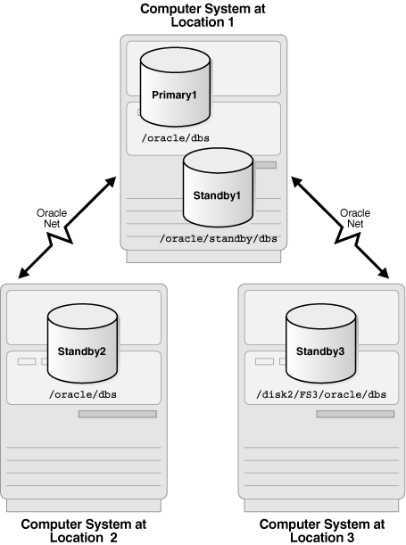

The information in this section describes how to get started using Oracle Data Guard.

See the following topics:

### Standby Database Types

A standby database is a transactionally consistent copy of an Oracle production database that is initially created from a backup copy of the primary database.

Once the standby database is created and configured, Oracle Data Guard automatically maintains the standby database by transmitting primary database redo data to the standby system, where the redo data is applied to the standby database.

A standby database can be one of these types: a physical standby database, a logical standby database, or a snapshot standby database. If needed, either a physical or a logical standby database can assume the role of the primary database and take over production processing. An Oracle Data Guard configuration can include any combination of these types of standby databases.

#### Physical Standby Databases

A physical standby database is an exact, block-for-block copy of a primary database.

A physical standby is maintained as an exact copy through a process called Redo Apply, in which redo data received from a primary database is continuously applied to a physical standby database using the database recovery mechanisms.

A physical standby database can be opened for read-only access and used to offload queries from a primary database. If a license for the Oracle Active Data Guard option has been purchased, Redo Apply can be active while the physical standby database is open, thus allowing queries to return results that are identical to what would be returned from the primary database. This capability is known as the real-time query feature.

See Also:

- " [Opening a Physical Standby Database](managing-oracle-data-guard-physical-standby-databases.md) "
- [Oracle Database Licensing Information](https://docs.oracle.com/pls/topic/lookup?ctx=en/database/oracle/oracle-database/21/sbydb&id=DBLIC-GUID-AB56CEE3-955E-4E56-8B44-6075E889C283) for more information about Oracle Active Data Guard

Benefits of a Physical Standby Database

A physical standby database provides the following benefits:

- Disaster recovery and high availability
	A physical standby database is a robust and efficient disaster recovery and high availability solution. Easy-to-manage switchover and failover capabilities allow easy role reversals between primary and physical standby databases, minimizing the downtime of the primary database for planned and unplanned outages.
- Data protection
	A physical standby database can prevent data loss, even in the face of unforeseen disasters. A physical standby database supports all datatypes, and all DDL and DML operations that the primary database can support. It also provides a safeguard against data corruptions and user errors. Storage level physical corruptions on the primary database are not propagated to a standby database. Similarly, logical corruptions or user errors that would otherwise cause data loss can be easily resolved.
- Reduction in primary database workload
	Oracle Recovery Manager (RMAN) can use a physical standby database to off-load backups from a primary database, saving valuable CPU and I/O cycles.
	A physical standby database can also be queried while Redo Apply is active, which allows queries to be offloaded from the primary to a physical standby, further reducing the primary workload.
- Performance
	The Redo Apply technology used by a physical standby database is the most efficient mechanism for keeping a standby database updated with changes being made at a primary database because it applies changes using low-level recovery mechanisms which bypass all SQL level code layers.

#### Logical Standby Databases

A logical standby database is initially created as an identical copy of the primary database, but it later can be altered to have a different structure.

The logical standby database is updated by executing SQL statements. The flexibility of a logical standby database lets you upgrade Oracle Database software (patch sets and new Oracle Database releases) and perform other database maintenance in rolling fashion with almost no downtime. From Oracle Database 11g onward, the transient logical database rolling upgrade process can also be used with existing physical standby databases.

Oracle Data Guard automatically applies information from the archived redo log file or standby redo log file to the logical standby database by transforming the data in the log files into SQL statements and then executing the SQL statements on the logical standby database. Because the logical standby database is updated using SQL statements, it must remain open. Although the logical standby database is opened in read/write mode, its target tables for the regenerated SQL are available only for read-only operations. While those tables are being updated, they can be used simultaneously for other tasks such as reporting, summations, and queries.

A logical standby database has some restrictions on data types, types of tables, and types of DDL and DML operations. See [Data Type and DDL Support on a Logical Standby Database](data-type-ddl-support-on-logical-standby-databases.md) for information on data type and DDL support on logical standby databases.

Benefits of a Logical Standby Database

A logical standby database is ideal for high availability (HA) while still offering data recovery (DR) benefits. Compared to a physical standby database, a logical standby database provides significant additional HA benefits:

- Minimizing downtime on software upgrades
	A logical standby database is ideal for upgrading an Oracle Data Guard configuration in a rolling fashion. Logical standby can be used to greatly reduce downtime associated with applying patchsets and new software releases. A logical standby can be upgraded to the new release and then switched over to become the active primary. This allows full availability while the old primary is converted to a logical standby and the patchset is applied. Logical standbys provide the underlying platform for the `DBMS_ROLLING` PL/SQL package, which provides functionality that allows you to make your Oracle Data Guard configuration highly available in the context of rolling upgrades and other storage reorganization.
- Support for reporting and decision support requirements
	A key benefit of logical standby is that significant auxiliary structures can be created to optimize the reporting workload; structures that could have a prohibitive impact on the primary's transactional response time. A logical standby can have its data physically reorganized into a different storage type with different partitioning, have many different indexes, have on-demand refresh materialized views created and maintained, and can be used to drive the creation of data cubes and other OLAP data views. However, a logical standby database does not allow for any transformation of your data (such as replicating only a subset of columns or allowing additional columns on user tables). For those types of reporting activities, Oracle GoldenGate is Oracle's preferred solution.

#### Snapshot Standby Databases

A snapshot standby database is a type of updatable standby database that provides full data protection for a primary database.

A snapshot standby database receives and archives, but does not apply, redo data from its primary database. Redo data received from the primary database is applied when a snapshot standby database is converted back into a physical standby database, after discarding all local updates to the snapshot standby database.

A snapshot standby database diverges from its primary database over time because redo data from the primary database is not applied as it is received. Local updates to the snapshot standby database cause additional divergence. The data in the primary database is fully protected however, because a snapshot standby can be converted back into a physical standby database at any time, and the redo data received from the primary is then applied.

Benefits of a Snapshot Standby Database

A snapshot standby database is a fully updatable standby database that provides disaster recovery and data protection benefits that are similar to those of a physical standby database. Snapshot standby databases are best used in scenarios where the benefit of having a temporary, updatable snapshot of the primary database justifies the increased time to recover from primary database failures.

The benefits of using a snapshot standby database include the following:

- It provides an exact replica of a production database for development and testing purposes, while maintaining data protection at all times. You can use the Oracle Real Application Testing option to capture primary database workload and then replay it for test purposes on the snapshot standby.
- It can be easily refreshed to contain current production data by converting to a physical standby and resynchronizing.

The ability to create a snapshot standby, test, resynchronize with production, and then again create a snapshot standby and test, is a cycle that can be repeated as often as desired. The same process can be used to easily create and regularly update a snapshot standby for reporting purposes where read/write access to data is required.

See Also:

- [Oracle Database Testing Guide](https://docs.oracle.com/pls/topic/lookup?ctx=en/database/oracle/oracle-database/21/sbydb&id=RATUG101) for more information about Oracle Real Application Testing and the license required to use it

### User Interfaces for Administering Oracle Data Guard Configurations

Oracle Data Guard provides several interfaces that you can use to configure, implement, and manage an Oracle Data Guard configuration.

- Oracle Enterprise Manager Cloud Control
	Oracle Enterprise Manager Cloud Control provides a GUI interface for the Oracle Data Guard broker that automates many of the tasks involved in creating, configuring, and monitoring an Oracle Data Guard environment. See the Oracle Enterprise Manager Cloud Control online Help for information about the GUI and its wizards.
- SQL\*Plus Command-line interface
	Several SQL\*Plus statements use the `STANDBY` keyword to specify operations on a standby database. Other SQL statements do not include standby-specific syntax, but they are useful for performing operations on a standby database. See [SQL Statements Relevant to Oracle Data Guard](sql-statements-used-by-oracle-data-guard.md) for a list of the relevant statements.
- Initialization parameters
	Several initialization parameters are used to define the Oracle Data Guard environment. See [Initialization Parameters](oracle-initialization-parameters-used-by-oracle-data-guard.md) for a list of the relevant initialization parameters.
- Oracle Data Guard broker command-line interface (DGMGRL)
	The DGMGRL command-line interface is an alternative to using Oracle Enterprise Manager Cloud Control. The DGMGRL command-line interface is useful if you want to use the broker to manage an Oracle Data Guard configuration from batch programs or scripts. See [Oracle Data Guard Broker](https://docs.oracle.com/pls/topic/lookup?ctx=en/database/oracle/oracle-database/21/sbydb&id=DGBKR585) for complete information.

### Oracle Data Guard Operational Prerequisites

The use of Oracle Data Guard requires certain hardware and software prerequisites.

- Hardware and Operating System Requirements
- Oracle Software Requirements

#### Hardware and Operating System Requirements

The same release of Oracle Database Enterprise Edition must be installed on the primary database and all standby databases, except during rolling database upgrades using logical or transient logical standby databases.

As of Oracle Database 11g, Oracle Data Guard provides increased flexibility for Oracle Data Guard configurations in which the primary and standby systems may have different CPU architectures, operating systems (for example, Windows and Linux), operating system binaries (32-bit/64-bit), or Oracle database binaries (32-bit/64-bit).

This increased mixed-platform flexibility is subject to the current restrictions documented in the My Oracle Support notes 413484.1 and 1085687.1 at [`http://support.oracle.com`](http://support.oracle.com/).

Note 413484.1 discusses mixed-platform support and restrictions for physical standbys.

Note 1085687.1 discusses mixed-platform support and restrictions for logical standbys.

See Also:

- [Using SQL Apply to Upgrade the Oracle Database](using-sql-apply-to-perform-rolling-upgrade.md) for information about rolling database upgrades

#### Oracle Software Requirements

To use Oracle Data Guard, you must meet certain Oracle software requirements.

- Oracle Data Guard is available only as a feature of Oracle Database Enterprise Edition. It is not available with Oracle Database Standard Edition.
	Note:
	It is possible to simulate a standby database environment with databases running Oracle Database Standard Edition. You can do this by manually transferring archived redo log files using an operating system copy utility or using custom scripts that periodically send archived redo log files from one database to the other, registering them, and using media recovery to roll forward the copy of the database at the disaster recovery site. Such a configuration does not provide the ease-of-use, manageability, performance, and disaster-recovery capabilities available with Oracle Data Guard.
- In general, a physical standby database must have the same Database Home version as the primary database including Patch Set Exceptions (PSEs), Critical Patch Updates (CPUs), and Patch Set Updates (PSUs), unless an Oracle Data Guard Standby-First Patch Apply process is in progress (as described in My Oracle Support note 1265700.1 at [`http://support.oracle.com`](http://support.oracle.com/).
	Additionally, as of Oracle Database 11g Release 2 (11.2.0.1), a physical standby database can be used to install eligible one-off patches, patch set updates (PSUs), and critical patch updates (CPUs), in rolling fashion. For more information about this functionality, see the My Oracle Support note 1265700.1 at [`http://support.oracle.com`](http://support.oracle.com/).
- Using Oracle Data Guard SQL Apply, you can perform a rolling upgrade of the Oracle database software from patch set release n (minimally, this must be release 10.1.0.3) to any higher versioned patch set or major version release. During a rolling upgrade, you can run different releases of the Oracle database on the primary and logical standby databases while you upgrade them, one at a time. For complete information, see [Using SQL Apply to Upgrade the Oracle Database](using-sql-apply-to-perform-rolling-upgrade.md) and the ReadMe file for the applicable Oracle Database 10g patch set release.
- The `COMPATIBLE` database initialization parameter must be set to the same value on all databases in an Oracle Data Guard configuration, except when using a logical standby database, which can have a higher `COMPATIBLE` setting than the primary database.
- The primary database must run in `ARCHIVELOG` mode. See [Oracle Database Administrator's Guide](https://docs.oracle.com/pls/topic/lookup?ctx=en/database/oracle/oracle-database/21/sbydb&id=ADMIN008) for more information.
- The primary database can be a single instance database or an Oracle Real Application Clusters (Oracle RAC) database. The standby databases can be single instance databases or Oracle RAC databases, and these standby databases can be a mix of physical, logical, and snapshot types.
- Each primary database and standby database must have its own control file.
- If a standby database is located on the same system as the primary database, the archival directories for the standby database must use a different directory structure than the primary database. Otherwise, the standby database may overwrite the primary database files.
- To protect against unlogged direct writes in the primary database that cannot be propagated to the standby database, turn on `FORCE LOGGING` at the primary database before performing data file backups for standby creation. Keep the database in `FORCE LOGGING` mode as long as the standby database is required.
- The user accounts you use to manage the primary and standby database instances must have either the `SYSDG` or `SYSDBA` administrative privilege.
- For operational simplicity, Oracle recommends that when you set up Oracle Automatic Storage Management (Oracle ASM) and Oracle Managed Files (OMF) in an Oracle Data Guard configuration that you set it up symmetrically on the primary and standby database(s). If any database in the Oracle Data Guard configuration uses Oracle ASM, OMF, or both, then every database in the configuration should use Oracle ASM, OMF, or both, respectively, unless you are purposely implementing a mixed configuration for migration or maintenance purposes. See the scenario in [Creating a Standby Database That Uses OMF or Oracle ASM](examples-of-using-oracle-data-guard.md) for more information.
	Note:
	Because some applications that perform updates involving time-based data cannot handle data entered from multiple time zones, consider setting the time zone for the primary and remote standby systems to be the same to ensure the chronological ordering of records is maintained after a role transition.

### Standby Database Directory Structure Considerations

The directory structure of the various standby databases is important because it determines the path names for the standby data files, archived redo log files, and standby redo log files.

If possible, the data files, log files, and control files on the primary and standby systems should have the same names and path names and use Optimal Flexible Architecture (OFA) naming conventions. The archival directories on the standby database should also be identical between sites, including size and structure. This strategy allows other operations such as backups, switchovers, and failovers to execute the same set of steps, reducing the maintenance complexity.

See Also:

Your operating system-specific Oracle documentation for more information about Optimal Flexible Architecture (OFA)

Otherwise, you must set the filename conversion parameters (as shown in Table 2-1) or rename the data file. Nevertheless, if you need to use a system with a different directory structure or place the standby and primary databases on the same system, you can do so with a minimum of extra administration.

The three basic configuration options are illustrated in Figure 2-1. These include:

- A standby database on the same system as the primary database that uses a different directory structure than the primary system. This is illustrated in Figure 2-1 as `Standby1`.
	If you have a standby database on the same system as the primary database, you must use a different directory structure. Otherwise, the standby database attempts to overwrite the primary database files.
- A standby database on a separate system that uses the same directory structure as the primary system. This is illustrated in Figure 2-1 as `Standby2`. This is the recommended method.
- A standby database on a separate system that uses a different directory structure than the primary system. This is illustrated in Figure 2-1 as `Standby3`.
	Note:
	For operational simplicity, Oracle recommends that when you set up Oracle Automatic Storage Management (Oracle ASM) and Oracle Managed Files (OMF) in an Oracle Data Guard configuration that you set it up symmetrically on the primary and standby database(s). If any database in the Oracle Data Guard configuration uses Oracle ASM, OMF, or both, then every database in the configuration should use Oracle ASM, OMF, or both, respectively, unless you are purposely implementing a mixed configuration for migration or maintenance purposes. See the scenario in [Creating a Standby Database That Uses OMF or Oracle ASM](examples-of-using-oracle-data-guard.md) for more information.

Figure 2-1 Possible Standby Configurations

> This illustration shows the three basic configuration options:
>
> The computer system at location 1 (Standby 1) shows a configuration in which the primary and standby databases are located on the same system. The computer system at location 2 shows a standby database (Standby2) located on a separate system that uses the same directory structure as the primary system. The computer system at location 3 shows a standby database (Standby3) located on a separate system that uses a different directory structure from the primary system.

Table 2-1 describes possible configurations of primary and standby databases and the consequences of each.

Table 2-1 Standby Database Location and Directory Options

| Standby System | Directory Structure | Consequences |
| --- | --- | --- |
| Same as primary system | Different than primary system (required) | - You can either manually rename files or set up the `DB_FILE_NAME_CONVERT` and `LOG_FILE_NAME_CONVERT` initialization parameters on the standby database to automatically update the path names for primary database data files and archived redo log files and standby redo log files in the standby database control file. (See [Set Primary Database Initialization Parameters](creating-oracle-data-guard-physical-standby.md).) - The standby database does not protect against disasters that destroy the system on which the primary and standby databases reside, but it does provide switchover capabilities for planned maintenance. |
| Separate system | Same as primary system | - You do not need to rename primary database files, archived redo log files, and standby redo log files in the standby database control file, although you can still do so if you want a new naming scheme (for example, to spread the files among different disks). - By locating the standby database on separate physical media, you safeguard the data on the primary database against disasters that destroy the primary system. |
| Separate system | Different than primary system | - You can either manually rename files or set up the `DB_FILE_NAME_CONVERT` and `LOG_FILE_NAME_CONVERT` initialization parameters on the standby database to automatically rename the data files (see [Set Primary Database Initialization Parameters](creating-oracle-data-guard-physical-standby.md)). - By locating the standby database on separate physical media, you safeguard the data on the primary database against disasters that destroy the primary system. |

### Moving the Location of Online Data Files

You can move the location of an online data file from one physical file to another physical file while the database is actively accessing the file.

To move the location of the file, you use the SQL statement `ALTER DATABASE MOVE DATAFILE`.

An operation performed with the `ALTER DATABASE MOVE DATAFILE` statement increases the availability of the database because it does not require that the database be shut down to move the location of an online data file.

You can perform an online move data file operation independently on the primary and on the standby (either physical or logical). The standby is not affected when a data file is moved on the primary, and vice versa.

On a physical standby, an online move data file operation can be executed while standby recovery is running if the instance that opens the database is in read-only mode. This functionality requires an Oracle Active Data Guard license.

#### Restrictions When Moving the Location of Online Data Files

There are restrictions when you move the location of online data files.

- You cannot use the SQL `ALTER DATABASE MOVE DATAFILE` command to rename or relocate an online data file on a physical standby that is a fast-start failover target if the standby is mounted, but not open.
- The online move data file operation cannot be executed on physical standby while standby recovery is running in a mounted but not open instance.
- The online move data file operation may get terminated if the standby recovery process takes the data file offline, shrinks the file, or drops the tablespace.
- On a primary database, the online move data file operation cannot be run on a file that belongs to a pluggable database (PDB) that has been closed on all instances of the primary database.

See Also:

- [Oracle Database Administrator's Guide](https://docs.oracle.com/pls/topic/lookup?ctx=en/database/oracle/oracle-database/21/sbydb&id=ADMIN13837) for more information about renaming and relocating online data files
- [Oracle Database SQL Language Reference](https://docs.oracle.com/pls/topic/lookup?ctx=en/database/oracle/oracle-database/21/sbydb&id=SQLRF55823) for more information about the `ALTER DATABASE MOVE DATAFILE` statement