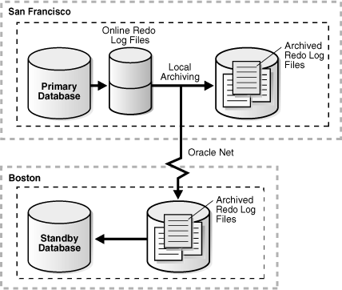
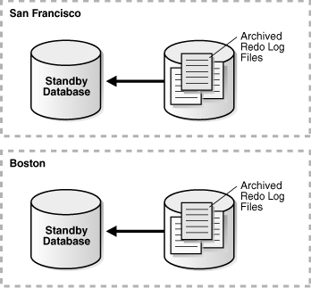
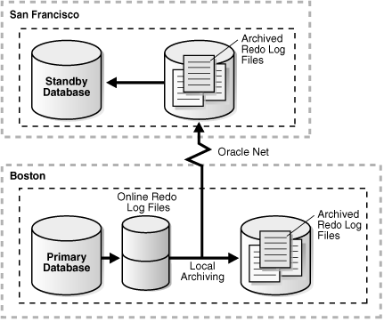

An Oracle Data Guard configuration consists of one database that functions in the primary role and one or more databases that function in the standby role.

To see the current role of the databases, query the `DATABASE_ROLE` column in the `V$DATABASE` view.

The number, location, and type of standby databases in an Oracle Data Guard configuration and the way in which redo data from the primary database is propagated to each standby database determine the role-management options available to you in response to a primary database outage.

See the following topics for information about how to manage role transitions in an Oracle Data Guard configuration:

Note:

These topics describe how to perform role transitions manually, using SQL statements. Do not use these manual procedures to perform role transitions in an Oracle Data Guard configuration that is managed by the broker. Use the role transition procedures provided in [Oracle Data Guard Broker](https://docs.oracle.com/pls/topic/lookup?ctx=en/database/oracle/oracle-database/21/sbydb&id=DGBKR330) instead.

See Also:

[Oracle Data Guard Broker](https://docs.oracle.com/pls/topic/lookup?ctx=en/database/oracle/oracle-database/21/sbydb&id=DGBKR330) for information about using the Oracle Data Guard broker to:

- Simplify switchovers and failovers by allowing you to invoke them using either a single key click in Oracle Enterprise Manager Cloud Control or a single command in the DGMGRL command-line interface.
- Enable **fast-start failover** to fail over automatically when the primary database becomes unavailable. When fast-start failover is enabled, the Oracle Data Guard broker determines if a failover is necessary and initiates the failover to the specified target standby database automatically, with no need for DBA intervention.

### Introduction to Role Transitions

A database operates in one of the following mutually exclusive roles: primary or standby.

Oracle Data Guard enables you to change these roles dynamically by using SQL statements, or by using either of the Oracle Data Guard broker's interfaces. Oracle Data Guard supports the following role transitions:

- Switchover
	Allows the primary database to switch roles with one of its standby databases. There is no data loss during a switchover. After a switchover, each database continues to participate in the Oracle Data Guard configuration with its new role.
- Failover
	Changes a standby database to the primary role in response to a primary database failure. If the primary database was not operating in either maximum protection mode or maximum availability mode before the failure, some data loss may occur. If Flashback Database is enabled on the primary database, it can be reinstated as a standby for the new primary database once the reason for the failure is corrected.

Starting with Oracle Database Release 21c, you can perform switchover or failover for a pluggable database (PDB) within a multitenant container database (CDB). This functionality is supported only with Oracle Data Guard broker.

See Also:

- Preparing for a Role Transition for information that helps you choose the role transition that best minimizes downtime and risk of data loss
- Switchovers for more information about switchovers.
- Failovers for more information about failovers
- [Oracle Data Guard Broker](https://docs.oracle.com/pls/topic/lookup?ctx=en/database/oracle/oracle-database/21/sbydb&id=DGBKR3425) for information about event notification and database connection failover support available to database clients when a broker-managed failover occurs

#### Preparing for a Role Transition

Before starting any role transitions, you must verify that each database is properly configured and that there are no redo transport errors or redo gaps at the standby database.

- Verify that each database is properly configured for the role that it is about to assume. See [Creating a Physical Standby Database](creating-oracle-data-guard-physical-standby.md) and [Creating a Logical Standby Database](creating-oracle-data-guard-logical-standby.md) for information about how to configure database initialization parameters, `ARCHIVELOG` mode, standby redo logs, and online redo logs on primary and standby databases.
	Note:
	You must define the `LOG_ARCHIVE_DEST_` `n` and `LOG_ARCHIVE_DEST_STATE_` `n` parameters on each standby database so that when a switchover or failover occurs, all standby sites continue to receive redo data from the new primary database.
- Verify that there are no redo transport errors or redo gaps at the standby database by querying the `V$ARCHIVE_DEST_STATUS` view on the primary database.
	For example, the following query would be used to check the status of the standby database associated with `LOG_ARCHIVE_DEST_2`:
	```
	SQL> SELECT STATUS, GAP_STATUS FROM V$ARCHIVE_DEST_STATUS WHERE DEST_ID = 2;
	 
	STATUS GAP_STATUS
	--------- ------------------------
	VALID NO GAP
	```
	Do not proceed until the value of the `STATUS` column is `VALID` and the value of the `GAP_STATUS` column is `NOGAP`, for the row that corresponds to the standby database.
- Ensure temporary files exist on the standby database that match the temporary files on the primary database.
- Remove any delay in applying redo that may be in effect on the standby database that is set to become the new primary database. Not removing the delay results in a longer switchover time, and may cause the switchover to be disallowed.
- Before performing a switchover to a physical standby database that is in real-time query mode, consider bringing all instances of that standby database to the mounted but not open state to achieve the fastest possible role transition and to cleanly terminate any user sessions connected to the physical standby database prior to the role transition.
- When you perform a switchover from an Oracle RAC primary database to a physical standby database, it is not necessary to shut down all but one primary database instance.

#### Choosing a Target Standby Database for a Role Transition

For an Oracle Data Guard configuration with multiple standby databases, there are a number of factors to consider when choosing the target standby database for a role transition.

These include the following:

- Locality of the standby database.
- The capability of the standby database (hardware specifications—such as the number of CPUs, I/O bandwidth available, and so on).
- The time it takes to perform the role transition. This is affected by how far behind the standby database is in applying redo data, and how much flexibility you have in terms of trading off application availability with data loss.
- Standby database type.

The type of standby chosen as the role transition target determines how other standby databases in the configuration behave after the role transition. If the new primary was a physical standby before the role transition, then all other standby databases in the configuration become standbys of the new primary. If the new primary was a logical standby before the role transition, then all other logical standbys in the configuration become standbys of the new primary, but physical standbys in the configuration continue to be standbys of the old primary and therefore, do not protect the new primary. In the latter case, a future switchover or failover back to the original primary database returns all standbys to their original role as standbys of the current primary. For the reasons described above, a physical standby is generally the best role transition target in a configuration that contains both physical and logical standbys.

Note:

A snapshot standby cannot be the target of a role transition. To use a snapshot standby database as a target for a role transition, first convert it to a physical standby database and allow all redo received from the primary database to be applied. See [Converting a Snapshot Standby Database into a Physical Standby Database](managing-oracle-data-guard-physical-standby-databases.md).

Oracle Data Guard provides the `V$DATAGUARD_STATS` view, which you can use to evaluate each standby database in terms of the currency of the data in the standby database, and the time needed to perform a role transition if all available redo data is applied to the standby database. For example:

```
SQL> COLUMN NAME FORMAT A24
SQL> COLUMN VALUE FORMAT A16     
SQL> COLUMN DATUM_TIME FORMAT A24
SQL> SELECT NAME, VALUE, DATUM_TIME FROM V$DATAGUARD_STATS;
 
NAME                     VALUE            DATUM_TIME
------------------------ ---------------- ------------------------
transport lag            +00 00:00:00     06/18/2009 12:22:06
apply lag                +00 00:00:00     06/18/2009 12:22:06
apply finish time        +00 00:00:00.000
estimated startup time   9
```

This query output shows that the standby database has received and applied all redo generated by the primary database. These statistics were computed using data received from the primary database as of 12:22.06 on 06/18/09.

The `apply` `lag` and `transport` `lag` metrics are computed based on data received from the primary database. These metrics become stale if communications between the primary and standby database are disrupted. An unchanging value in the `DATUM_TIME` column for the `apply` `lag` and `transport` `lag` metrics indicates that these metrics are not being updated and have become stale, possibly due to a communications fault between the primary and standby databases.

#### Switchovers

A switchover is typically used to reduce primary database downtime during planned outages.

Planned outages are events such as operating system or hardware upgrades, or rolling upgrades of the Oracle database software and patch sets.

A switchover takes place in two phases. In the first phase, the existing primary database undergoes a transition to a standby role. In the second phase, a standby database undergoes a transition to the primary role.

Figure 9-1 shows a two-site Oracle Data Guard configuration before the roles of the databases are switched. The primary database is in San Francisco, and the standby database is in Boston.

Figure 9-1 Oracle Data Guard Configuration Before Switchover



> This illustration shows a Data Guard configuration consisting of a primary database named San Francisco and a standby database named Boston.
>
> On the primary database in San Francisco, online redo logs are being archived locally and over Oracle Net services to the standby database in Boston. At the Boston standby location, the archived redo logs are being applied to the standby database.


Figure 9-2 shows the Oracle Data Guard environment after the original primary database was switched over to a standby database, but before the original standby database has become the new primary database. At this stage, the Oracle Data Guard configuration temporarily has two standby databases.

Figure 9-2 Standby Databases Before Switchover to the New Primary Database



> This illustration shows a Data Guard configuration during a switchover operation. The San Francisco database (originally the primary database) has changed to the standby role, but the Boston database has not yet changed to the primary role. At this point in time, both the San Francisco and Boston databases are operating in the standby role.
>
> No redo logs are being sent or received over the Oracle Net network. Both of the standby databases are capable of operating in read-only mode.


Figure 9-3 shows the Oracle Data Guard environment after a switchover took place. The original standby database became the new primary database. The primary database is now in Boston, and the standby database is now in San Francisco.

Figure 9-3 Oracle Data Guard Environment After Switchover



> This illustration shows a Data Guard configuration after a switchover operation has occurred. The San Francisco database (originally the primary database) is now operating as the standby database and the Boston database is now operating as the primary database.


Preparing for a Switchover

Ensure the prerequisites listed in Preparing for a Role Transition are satisfied. In addition, the following prerequisites must be met for a switchover:

- For switchovers involving a physical standby database, verify that the primary database is open and that Redo Apply is active on the standby database.
- For switchovers involving a logical standby database, verify that both the primary and standby database instances are open and that SQL Apply is active.

See Also:

- [Using SQL Apply to Upgrade the Oracle Database](using-sql-apply-to-perform-rolling-upgrade.md)
- [Applying Redo Data to Physical Standby Databases](oracle-data-guard-redo-apply-services.md) for more information about Redo Apply
- [Applying Redo Data to Logical Standby Databases](oracle-data-guard-redo-apply-services.md) for more information about SQL Apply

#### Failovers

A failover is typically used only when the primary database becomes unavailable, and there is no possibility of restoring it to service within a reasonable period of time.

The specific actions performed during a failover vary based on whether a logical or a physical standby database is involved in the failover, the state of the Oracle Data Guard configuration at the time of the failover, and on the specific SQL statements used to initiate the failover.

Figure 9-4 shows the result of a failover from a primary database in San Francisco to a physical standby database in Boston.

Figure 9-4 Failover to a Standby Database


> This illustration shows a two-site Data Guard configuration after a system or software failure occurred. In this figure, the primary site (in San Francisco) is crossed out to indicate that the site is no longer operational. The Boston site that was originally a standby site is now operating as the new primary site. The Boston site is writing to online redo logs and local archived redo logs.


Preparing for a Failover

Note:

If managed standby recovery at a physical standby database chosen for failover has stopped with error `ORA-752` or `ORA-600` `[3020]`, then proceed directly to [Recovering From Lost-Write Errors on a Primary Database](examples-of-using-oracle-data-guard.md).

If possible, before performing a failover, transfer as much of the available and unapplied primary database redo data as possible to the standby database.

Ensure the prerequisites listed in Preparing for a Role Transition are satisfied. In addition, the following prerequisites must be met for a failover:

- If a standby database currently running in maximum protection mode is involved in the failover, then first place it in maximum performance mode by issuing the following statement on the standby database:
	```
	SQL> ALTER DATABASE SET STANDBY DATABASE TO MAXIMIZE PERFORMANCE;
	```
	Then, if appropriate standby databases are available, you can reset the desired protection mode on the new primary database after the failover completes.
	This is required because you cannot fail over to a standby database that is in maximum protection mode. In addition, if a primary database in maximum protection mode is still actively communicating with the standby database, then issuing the `ALTER DATABASE` statement to change the standby database from maximum protection mode to maximum performance mode does not succeed. Because a failover removes the original primary database from the Oracle Data Guard configuration, these features serve to protect a primary database operating in maximum protection mode from the effects of an unintended failover.
	Note:
	Do not fail over to a standby database to test whether or not the standby database is being updated correctly. Instead:
	- See [Verify the Physical Standby Database Is Performing Properly](creating-oracle-data-guard-physical-standby.md)
	- See [Verify the Logical Standby Database Is Performing Properly](creating-oracle-data-guard-logical-standby.md)

#### Role Transition Triggers

The `DB_ROLE_CHANGE` system event is signaled whenever a role transition occurs.

This system event is signaled immediately if the database is open when the role transition occurs, or the next time the database is opened if it is closed when a role transition occurs.

The `DB_ROLE_CHANGE` system event can be used to fire a trigger that performs a set of actions whenever a role transition occurs.

### Role Transitions Involving Physical Standby Databases

The procedures to perform switchovers and failovers to a physical standby database have been simplified if you are running Oracle Database 12c Release 1 (12.1) or later.

The former procedures are still supported, however Oracle recommends that you use the new procedures as described in the following sections:

- Performing a Switchover to a Physical Standby Database
- Performing a Failover to a Physical Standby Database

Note:

As of Oracle Database 18c, the database buffer cache state is maintained on an Active Data Guard standby during a role transition so that application performance is not affected by physical blocks read from disk to populate the buffer cache. This results in improved application performance on the new primary after a role transition.

Keeping Physical Standby Sessions Connected During Role Transition

As of Oracle Database 12 `c` Release 2 (12.2.0.1), when a physical standby database is converted into a primary you have the option to keep any sessions connected to the physical standby connected, without disruption, during the switchover/failover.

To enable this feature, set the `STANDBY_DB_PRESERVE_STATES` initialization parameter in your ` init.ora` file before the standby instance is started. This parameter applies to physical standby databases only. The allowed values are:

- `NONE` — No user sessions or current buffers on the standby are retained during a switchover/failover. This is the default value.
- `ALL` — Both user sessions and current buffers are retained during switchover/failover.
- `SESSION` — User sessions are retained during switchover/failover.
- `BUFFER` — Current buffers are retained during switchover/failover.

See Also:

- [Troubleshooting Oracle Data Guard](troubleshooting-oracle-data-guard.md) for information about how to troubleshoot problems you might encounter when performing role transitions to a physical standby database
- [Performing Role Transitions Using Old Syntax](performing-oracle-data-guard-role-transitions.md) for information about the procedures used in prior releases, and a comparison of old and new syntax
- [Oracle Database Reference](https://docs.oracle.com/pls/topic/lookup?ctx=en/database/oracle/oracle-database/21/sbydb&id=REFRN-GUID-8D332556-30B7-4C45-8557-50988DC2219E) for a complete description of the `STANDBY_DB_PRESERVE_STATES` initialization parameter.

#### Performing a Switchover to a Physical Standby Database

These steps describe how to perform a switchover to a physical standby database.

Note:

If there is a far sync instance (or a combination of preferred and alternate far sync instances) connecting the primary and standby databases, then the procedure to switchover to the standby is the same as described in this topic. Whether the far sync instances are available or unavailable does not affect switchover. During switchover, the primary and standby must be able to communicate directly with each other and perform the switchover role transition steps oblivious of the far sync instances. See “Using Far Sync Instances” in Oracle Data Guard Concepts and Administration for examples of how to set up such configurations correctly so that the far sync instances can service the new roles of the two databases after switchover.

1. Verify that the target standby database is ready for switchover.
	The switchover statement has a `VERIFY` option that results in checks being performed of many conditions required for switchover. Some of the items checked are: whether Redo Apply is running on the switchover target; whether the release version of the switchover target is 12.1 or later; whether the switchover target is synchronized; and whether it has MRP running.
	Suppose the primary database has a `DB_UNIQUE_NAME` of `BOSTON` and the switchover target standby database has a `DB_UNIQUE_NAME` of `CHICAGO`. On the primary database `BOSTON`, issue the following SQL statement to verify that the switchover target, `CHICAGO`, is ready for switchover:
	```
	SQL> ALTER DATABASE SWITCHOVER TO CHICAGO VERIFY;
	ERROR at line 1:
	ORA-16470: Redo Apply is not running on switchover target
	```
	If this operation had been successful, a `Database                             Altered` message would have been returned but in this example an `ORA-16470` error was returned. This error means that the switchover target `CHICAGO` is not ready for switchover. Redo Apply must be started before the switchover operation.
	After Redo Apply is started, issue the following statement again:
	```
	SQL> ALTER DATABASE SWITCHOVER TO CHICAGO VERIFY;
	ERROR at line 1:
	ORA-16475: succeeded with warnings, check alert log for more details
	```
	The switchover target, `CHICAGO`, is ready for switchover. However, the warnings indicated by the `ORA-16475` error may affect switchover performance. The alert log contains messages similar to the following:
	```
	SWITCHOVER VERIFY WARNING: switchover target has dirty online redo logfiles that require clearing. It takes time to clear online redo logfiles. This may slow down switchover process.
	```
	You can fix the problems or if switchover performance is not important, those warnings can be ignored. After making any fixes you determine are necessary, issue the following SQL statement again:
	```
	SQL> ALTER DATABASE SWITCHOVER TO CHICAGO VERIFY;
	Database altered.
	```
	The switchover target, `CHICAGO`, is now ready for switchover.
2. Initiate the switchover on the primary database, `BOSTON`, by issuing the following SQL statement:
	```
	SQL> ALTER DATABASE SWITCHOVER TO CHICAGO;
	Database altered.
	```
	If this statement completes without any errors, proceed to Step 3.
	If an error occurs, mount the old primary database (`BOSTON`) and the old standby database (`CHICAGO`). On both databases, query `DATABASE_ROLE` from `V$DATABASE`. There are three possible combinations of database roles for `BOSTON` and `CHICAGO`. The following table describes these combinations and provides the likely cause and a high level remedial action for each situation. For details on specific error situations, see “Troubleshooting Oracle Data Guard” in Oracle Data Guard Concepts and Administration.
	| Value of DATABASE\_ROLE column in V$DATABASE | Cause and Remedial Action |
	| --- | --- |
	| `BOSTON` database is primary, `CHICAGO` database is standby | Cause: The `BOSTON` database failed to convert to a standby database role.  Action: See the alert log for details on the error that prevented `BOSTON` from switching to a standby role, take the necessary actions to fix the error, reopen one of the nodes of `BOSTON` if necessary, and repeat the switchover process from Step 1. |
	| `BOSTON` database is standby, `CHICAGO` database is standby | Cause: The `CHICAGO` database failed to convert to a primary database role.  Action: Issue the following SQL statement to convert either `BOSTON` or `CHICAGO` to a primary database:  ``` SQL> ALTER DATABASE SWITCHOVER TO target_db_name FORCE; ```  For example:  - On the `CHICAGO` database, issue the following SQL statement to convert it to a primary database: 	``` 	ALTER DATABASE SWITCHOVER TO CHICAGO FORCE; 	``` - On the `BOSTON` database, issue the following SQL statement to convert it to a primary database: 	``` 	ALTER DATABASE SWITCHOVER TO BOSTON FORCE; 	```  If the SQL statement fails with an `ORA-16473` error, then you must start Redo Apply before reissuing the command.  Restart Redo Apply as follows:  ``` SQL> ALTER DATABASE RECOVER MANAGED STANDBY DATABASE DISCONNECT; ```  Reissue the switchover command as follows:  ``` SQL> ALTER DATABASE SWTICHOVER TO BOSTON FORCE; Database altered. ``` |
	| `BOSTON` database is standby, `CHICAGO` database is primary | Cause: The `BOSTON` and `CHICAGO` databases have successfully switched to their new roles, but there was an error communicating the final success status back to `BOSTON`.  Action: Continue to Step 3 to finish the switchover operation. |
3. Issue the following SQL statement on the new primary database, `CHICAGO`, to open it.
	```
	SQL> ALTER DATABASE OPEN;
	```
4. Issue the following SQL statement to mount the new physical standby database, `BOSTON`:
	```
	SQL> STARTUP MOUNT;
	```
	Or, if `BOSTON` is an Oracle Active Data Guard physical standby database, then issue the following SQL statement to open it read only:
	```
	SQL> STARTUP;
	```
5. Start Redo Apply on the new physical standby database. For example:
	```
	SQL> ALTER DATABASE RECOVER MANAGED STANDBY DATABASE DISCONNECT FROM SESSION;
	```

#### Performing a Failover to a Physical Standby Database

These steps describe how to perform a failover to a physical standby database.

1. If the primary database can be mounted, then flush any unsent archived and current redo from the primary database to the standby database. If this operation is successful, a zero data loss failover is possible even if the primary database is not in a zero data loss data protection mode.
	First, ensure that Redo Apply is active at the target standby database. Then mount, but do not open the primary database. If the primary database cannot be mounted, go to Step 2.
	If not already done, then set up the remote `LOG_ARCHIVE_DEST_` `n` configured at the primary to point to the target destination. (You may not have any remote `LOG_ARCHIVE_DEST_` `n` configured if the target destination was serviced by a far sync instance, or was a terminal standby in a cascaded configuration.) Also, ensure that the primary can connect to the target destination by verifying that the `NET_ALIAS_TARGET_DB_NAME` is valid and properly established.
	```
	SQL> ALTER SYSTEM SET LOG_ARCHIVE_DEST_6='SERVICE=NET_ALIAS_TARGET_DB_NAME -
	> ASYNC VALID_FOR=(online_logfile, primary_role) -
	> DB_UNIQUE_NAME="target_db_unique_name"' SCOPE=memory;
	```
	```
	SQL> ALTER SYSTEM SET LOG_ARCHIVE_DEST_STATE_6=ENABLE;
	```
	It is also assumed that the `LOG_ARCHIVE_CONFIG` specification includes the `DB_UNIQUE_NAME` of the target destination at the primary (and `LOG_ARCHIVE_CONFIG` at the target destination includes the `DB_UNIQUE_NAME` of the primary). If not, then add that information to the `LOG_ARCHIVE_CONFIG` at the primary and target destination as required.
	Issue the following SQL statement at the primary database:
	```
	SQL> ALTER SYSTEM FLUSH REDO TO target_db_name;
	```
	For `target_db_name`, specify the `DB_UNIQUE_NAME` of the standby database that is to receive the redo flushed from the primary database.
	This statement flushes any unsent redo from the primary database to the standby database, and waits for that redo to be applied to the standby database.
	If this statement completes without any errors, go to Step 5.If the statement completes with any error, or if it must be stopped because you cannot wait any longer for the statement to complete, continue with Step 2.
2. Query the `V$ARCHIVED_LOG` view on the target standby database to obtain the highest log sequence number for each redo thread.
	For example:
	```
	SQL> SELECT UNIQUE THREAD# AS THREAD, MAX(SEQUENCE#) -
	> OVER (PARTITION BY thread#) AS LAST from V$ARCHIVED_LOG;
	    THREAD       LAST
	---------- ----------
	         1        100
	```
	If possible, copy the most recently archived redo log file for each primary database redo thread to the standby database if it does not exist there, and register it. This must be done for each redo thread.
	For example:
	```
	SQL> ALTER DATABASE REGISTER PHYSICAL LOGFILE 'filespec1';
	```
3. Query the `V$ARCHIVE_GAP` view on the target standby database to determine if there are any redo gaps on the target standby database.
	For example:
	```
	SQL> SELECT THREAD#, LOW_SEQUENCE#, HIGH_SEQUENCE# FROM V$ARCHIVE_GAP;
	THREAD#    LOW_SEQUENCE# HIGH_SEQUENCE#
	---------- ------------- --------------
	         1            90             92
	```
	In this example, the gap comprises archived redo log files with sequence numbers 90, 91, and 92 for thread 1.
	If possible, copy any missing archived redo log files to the target standby database from the primary database and register them at the target standby database. This must be done for each redo thread.
	For example:
	```
	SQL> ALTER DATABASE REGISTER PHYSICAL LOGFILE 'filespec1';
	```
4. The query executed in Step 3 displays information for the highest gap only. After resolving a gap, you must repeat the query until no more rows are returned.
	If, after performing Step 2 through Step 4, you are not able to resolve all gaps in the archived redo log files (for example, because you do not have access to the system that hosted the failed primary database), then you can expect some data loss during the failover.
5. Issue the following SQL statement on the target standby database:
	```
	SQL> ALTER DATABASE RECOVER MANAGED STANDBY DATABASE CANCEL;
	```
6. Issue the following SQL statement on the target standby database:
	```
	SQL> ALTER DATABASE FAILOVER TO target_db_name;
	```
	For example, suppose the target standby database is named `CHICAGO`:
	```
	SQL> ALTER DATABASE FAILOVER TO CHICAGO;
	```
	If this statement completes without any errors, proceed to Step 10.
	If there are errors, go to Step 7.
7. If an error occurs, try to resolve the cause of the error and then reissue the statement.
	- If successful, go to Step 10.
	- If the error still occurs and it involves a far sync instance, go to Step 8.
	- If the error still occurs and there is no far sync instance involved, go to Step 9.
8. This step is for far sync instance error cases only. If the error involves a far sync instance (for example, it is unavailable) and you have tried resolving the issue and reissuing the statement without success, then you can use the `FORCE` option. For example:
	```
	SQL> ALTER DATABASE FAILVOVER TO CHICAGO FORCE;
	```
	The `FORCE` option instructs the failover to ignore any failures encountered when interacting with the far sync instance and proceed with the failover, if at all possible. (The `FORCE` option has meaning only when the failover target is serviced by a far sync instance.)
	If the `FORCE` option is successful, go to Step 10.
	If the `FORCE` option is unsuccessful, go to Step 9.
9. Perform a data loss failover.
	If an error condition cannot be resolved, a failover can still be performed (with some data loss) by issuing the following SQL statement on the target standby database:
	```
	SQL> ALTER DATABASE ACTIVATE PHYSICAL STANDBY DATABASE;
	```
	In the following example, the failover operation fails with an `ORA-16472` error. That error means the database is configured in MaxAvailability or MaxProtection mode but data loss is detected during failover.
	```
	SQL> ALTER DATABASE FAILOVER TO CHICAGO;
	ERROR at line 1:
	ORA-16472: failover failed due to data loss
	```
	You can complete the data loss failover by issuing the following SQL statement:
	```
	SQL> ALTER DATABASE ACTIVATE PHYSICAL STANDBY DATABASE;
	Database altered.
	```
10. ```
	SQL> ALTER DATABASE OPEN;
	```
11. Oracle recommends that you perform a full backup of the new primary database.
12. If Redo Apply has stopped at any of the other physical standby databases in your Data Guard configuration, then restart it. For example:
	```
	SQL> ALTER DATABASE RECOVER MANAGED STANDBY DATABASE DISCONNECT;
	```
13. After a failover, the original primary database can be converted into a physical standby database of the new primary database using the method described in [Converting a Failed Primary Into a Standby Database Using Flashback Database](examples-of-using-oracle-data-guard.md) or [Converting a Failed Primary into a Standby Database Using RMAN Backups](examples-of-using-oracle-data-guard.md), or it can be re-created as a physical standby database from a backup of the new primary database using the method described in [Step-by-Step Instructions for Creating a Physical Standby Database](creating-oracle-data-guard-physical-standby.md).
	Once the original primary database is running in the standby role, a switchover can be performed to restore it to the primary role.

### Role Transitions Involving Logical Standby Databases

Role transition steps differ depending on whether you are performing a switchover or a failover.

See the following topics for information on how to perform switchovers and failovers involving a logical standby database:

- Performing a Switchover to a Logical Standby Database
- Performing a Failover to a Logical Standby Database

Note:

Logical standby does not replicate database services. In the event of a failover or switchover to a logical standby, mid-tiers connecting to services in the primary are not able to connect (since the creation of the service is not replicated), or connect to an incorrect edition (since the modification of the service attribute is not replicated).

Oracle Clusterware does not replicate the services it manages to logical standbys. You must manually keep them synchronized between the primary and standby. See [Oracle Clusterware Administration and Deployment Guide](https://docs.oracle.com/pls/topic/lookup?ctx=en/database/oracle/oracle-database/21/sbydb&id=CWADD1111) for more information about Oracle Clusterware.

#### Performing a Switchover to a Logical Standby Database

When you perform a switchover that changes roles between a primary database and a logical standby database, always initiate the switchover on the primary database and complete it on the logical standby database.

For the switchover to succeed, these steps must be performed in the order in which they are described.

1. On the current primary database, query the `SWITCHOVER_STATUS` column of the `V$DATABASE` fixed view on the primary database to verify it is possible to perform a switchover.
	For example:
	```
	SQL> SELECT SWITCHOVER_STATUS FROM V$DATABASE;
	SWITCHOVER_STATUS
	-----------------
	TO STANDBY
	1 row selected
	```
	A value of `TO STANDBY` or `SESSIONS ACTIVE` in the `SWITCHOVER_STATUS` column indicates that it is possible to switch the primary database to the logical standby role. If one of these values is not displayed, then verify the Oracle Data Guard configuration is functioning correctly (for example, verify all `LOG_ARCHIVE_DEST_` `n` parameter values are specified correctly). See [Oracle Database Reference](https://docs.oracle.com/pls/topic/lookup?ctx=en/database/oracle/oracle-database/21/sbydb&id=REFRN30047) for information about other valid values for the `SWITCHOVER_STATUS` column of the `V$DATABASE` view.
2. To prepare the current primary database for a logical standby database role, issue the following SQL statement on the primary database:
	```
	SQL> ALTER DATABASE PREPARE TO SWITCHOVER TO LOGICAL STANDBY;
	```
	This statement notifies the current primary database that it will soon switch to the logical standby role and begin receiving redo data from a new primary database. You perform this step on the primary database in preparation to receive the LogMiner dictionary to be recorded in the redo stream of the current logical standby database, as described in Step 3.
	The value `PREPARING SWITCHOVER` is displayed in the `V$DATABASE.SWITCHOVER_STATUS` column if this operation succeeds.
3. Use the following statement to build a LogMiner dictionary on the logical standby database that is the target of the switchover:
	```
	SQL> ALTER DATABASE PREPARE TO SWITCHOVER TO PRIMARY;
	```
	This statement also starts redo transport services on the logical standby database that begins transmitting its redo data to the current primary database and to other standby databases in the Oracle Data Guard configuration. The sites receiving redo data from this logical standby database accept the redo data but they do not apply it.
	The `V$DATABASE.SWITCHOVER_STATUS` on the logical standby database initially shows `PREPARING DICTIONARY` while the LogMiner dictionary is being recorded in the redo stream. Once this has completed successfully, the `SWITCHOVER_STATUS` column shows `PREPARING SWITCHOVER`.
4. Before you can complete the role transition of the primary database to the logical standby role, verify the LogMiner dictionary was received by the primary database by querying the `SWITCHOVER_STATUS` column of the `V$DATABASE` fixed view on the primary database. Without the receipt of the LogMiner dictionary, the switchover cannot proceed, because the current primary database must be able to interpret the redo records sent from the future primary database. The `SWITCHOVER_STATUS` column shows the progress of the switchover.
	When the query returns the `TO LOGICAL STANDBY` value, you can proceed with Step 5. For example:
	```
	SQL> SELECT SWITCHOVER_STATUS FROM V$DATABASE;
	SWITCHOVER_STATUS
	-----------------
	TO LOGICAL STANDBY
	1 row selected
	```
	Note:
	You can cancel the switchover operation by issuing the following statements in the order shown:
	1. Cancel switchover on the primary database:
		```
		SQL> ALTER DATABASE PREPARE TO SWITCHOVER CANCEL;
		```
	2. Cancel the switchover on the logical standby database:
		```
		SQL> ALTER DATABASE PREPARE TO SWITCHOVER CANCEL;
		```
5. To complete the role transition of the primary database to a logical standby database, issue the following SQL statement:
	```
	SQL> ALTER DATABASE COMMIT TO SWITCHOVER TO LOGICAL STANDBY;
	```
	This statement waits for all current transactions on the primary database to end, prevents any new users from starting new transactions, and establishes a point in time for the switchover to be committed.
	Executing this statement also prevents users from making any changes to the data being maintained in the logical standby database. To ensure faster execution, ensure the primary database is in a quiet state with no update activity before issuing the switchover statement (for example, have all users temporarily log off the primary database). You can query the `V$TRANSACTION` view for information about the status of any current in-progress transactions that could delay execution of this statement.
	The primary database has now undergone a role transition to run in the standby database role.
	When a primary database undergoes a role transition to a logical standby database role, you do not have to shut down and restart the database.
6. After you complete the role transition of the primary database to the logical standby role and the switchover notification is received by the standby databases in the configuration, verify the switchover notification was processed by the target standby database by querying the `SWITCHOVER_STATUS` column of the `V$DATABASE` fixed view on the target standby database. Once all available redo records are applied to the logical standby database, SQL Apply automatically shuts down in anticipation of the expected role transition.
	The `SWITCHOVER_STATUS` value is updated to show progress during the switchover. When the status is `TO PRIMARY`, you can proceed with Step 7.
	For example:
	```
	SQL> SELECT SWITCHOVER_STATUS FROM V$DATABASE;
	SWITCHOVER_STATUS
	-----------------
	TO PRIMARY
	1 row selected
	```
	See [Oracle Database Reference](https://docs.oracle.com/pls/topic/lookup?ctx=en/database/oracle/oracle-database/21/sbydb&id=REFRN30047) for information about other valid values for the `SWITCHOVER_STATUS` column of the `V$DATABASE ` view.
7. On the logical standby database that you want to switch to the primary role, use the following SQL statement to switch the logical standby database to the primary role:
	```
	SQL> ALTER DATABASE COMMIT TO SWITCHOVER TO PRIMARY;
	```
	There is no need to shut down and restart any logical standby databases that are in the Oracle Data Guard configuration. As described in Choosing a Target Standby Database for a Role Transition, all other logical standbys in the configuration become standbys of the new primary, but any physical standby databases remain standbys of the original primary database.
8. On the new logical standby database, start SQL Apply:
	```
	SQL> ALTER DATABASE START LOGICAL STANDBY APPLY IMMEDIATE;
	```

#### Performing a Failover to a Logical Standby Database

A failover role transition involving a logical standby database necessitates taking corrective actions on the failed primary database and on all bystander logical standby databases.

This topic describes how to perform failovers involving a logical standby database. If Flashback Database was not enabled on the failed primary database, you must re-create the database from backups taken from the current primary database. Otherwise, you can follow the procedure described in [Converting a Failed Primary Into a Standby Database Using Flashback Database](examples-of-using-oracle-data-guard.md) to convert a failed primary database to be a logical standby database for the new primary database.

Depending on the protection mode for the configuration and the attributes you chose for redo transport services, it might be possible to automatically recover all or some of the primary database modifications.

1. If the primary database can be mounted, then flush any unsent archived and current redo from the primary database to the standby database. If this operation is successful, a zero data loss failover is possible even if the primary database is not in a zero data loss data protection mode.
	First, ensure that Redo Apply is active at the target standby database. Then mount, but do not open the primary database.
	Issue the following SQL statement at the primary database:
	```
	SQL> ALTER SYSTEM FLUSH REDO TO target_db_name;
	```
	For `target_db_name`, specify the `DB_UNIQUE_NAME` of the standby database that is to receive the redo flushed from the primary database.
	This statement flushes any unsent redo from the primary database to the standby database, and waits for that redo to be applied to the standby database.
2. Depending on the condition of the components in the configuration, you might have access to the archived redo log files on the primary database. If so, do the following:
	1. Determine if any archived redo log files are missing on the logical standby database.
		2. Copy missing log files from the primary database to the logical standby database.
		3. Register the copied log files.
	You can register an archived redo log file with the logical standby database by issuing the following statement, for example:
	```
	SQL> ALTER DATABASE REGISTER LOGICAL LOGFILE -
	> '/disk1/oracle/dbs/log-%r_%s_%t.arc';
	Database altered.
	```
3. If you have not previously configured role-based destinations, identify the initialization parameters that correspond to the remote logical standby destinations for the new primary database, and manually enable archiving of redo data for each of these destinations.
	For example, to enable archiving for the remote destination defined by the `LOG_ARCHIVE_DEST_2` parameter, issue the following statement:
	```
	SQL> ALTER SYSTEM SET LOG_ARCHIVE_DEST_STATE_2=ENABLE SCOPE=BOTH;
	```
	To ensure that this change persists if the new primary database is later restarted, update the appropriate text initialization parameter file or server parameter file. In general, when the database operates in the primary role, you must enable archiving to remote destinations, and when the database operates in the standby role, you must disable archiving to remote destinations.
4. Issue the following statement on the target logical standby database (that you are transitioning to the new primary role):
	```
	SQL> ALTER DATABASE ACTIVATE LOGICAL STANDBY DATABASE FINISH APPLY;
	```
	This statement stops the remote file server (RFS) process, applies remaining redo data in the standby redo log file before the logical standby database becomes a primary database, stops SQL Apply, and activates the database in the primary database role.
	If the `FINISH APPLY` clause is not specified, then unapplied redo from the current standby redo log file is not applied before the standby database becomes the primary database.
5. Follow the method described in [Configuring Logical Standby Databases After a Failover](examples-of-using-oracle-data-guard.md) to ensure existing logical standby databases can continue to provide protection for the new primary database.
6. Back up the new primary database immediately after the Oracle Data Guard database failover. Immediately performing a backup is a necessary safety measure, because you cannot recover changes made after the failover without a complete backup copy of the database.
7. After a failover, the original primary database can be converted into a logical standby database of the new primary database using the method described in [Converting a Failed Primary Into a Standby Database Using Flashback Database](examples-of-using-oracle-data-guard.md) or [Converting a Failed Primary into a Standby Database Using RMAN Backups](examples-of-using-oracle-data-guard.md), or it can be recreated as a logical standby database from a backup of the new primary database as described in [Creating a Logical Standby Database](creating-oracle-data-guard-logical-standby.md) .
	Once the original primary database has been converted into a standby database, a switchover can be performed to restore it to the primary role.

### Using Flashback Database After a Role Transition

After a role transition, you can optionally use the `FLASHBACK DATABASE` command to revert the databases to a point in time or system change number (SCN) prior to when the role transition occurred.

If you flash back a primary database, you must flash back all of its standby databases to either the same (or earlier) SCN or time.When flashing back primary or standby databases in this way, you do not have to be aware of past switchovers. Oracle can automatically flashback across past switchovers if the SCN/time is before any past switchover.

Note:

Flashback Database must be enabled on the databases before the role transition occurs. See [Oracle Database Backup and Recovery User's Guide](https://docs.oracle.com/pls/topic/lookup?ctx=en/database/oracle/oracle-database/21/sbydb&id=BRADV71000) for more information

#### Using Flashback Database After a Switchover

After a switchover, you can return databases to a time or system change number (SCN) prior to when the switchover occurred using the `FLASHBACK DATABASE` command.

If the switchover involved a physical standby database, the primary and standby database roles are preserved during the flashback operation. The role in which the database is running does not change when the database is flashed back to the target SCN or time to which you flashed back the database. A database running in the physical standby role after the switchover but prior to the flashback still runs in the physical standby database role after the Flashback Database operation.

If the switchover involved a logical standby database, flashing back changes the role of the standby database to what it was at the target SCN or time to which you flashed back the database.

#### Using Flashback Database After a Failover

You can use Flashback Database to convert the failed primary database to a point in time before the failover occurred and then convert it into a standby database.

See [Converting a Failed Primary Into a Standby Database Using Flashback Database](examples-of-using-oracle-data-guard.md) for the complete step-by-step procedure.