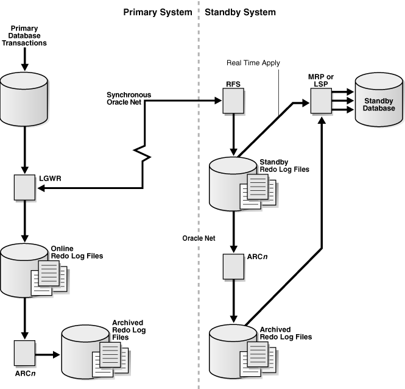

### Introduction to Apply Services

Apply services automatically apply redo to standby databases to maintain synchronization with the primary database and allow transactionally consistent access to the data.

By default, apply services waits for a standby redo log file to be archived before applying the redo that it contains. However, you can enable real-time apply, which allows apply services to apply the redo in the current standby redo log file as it is being filled. Real-time apply is described in more detail in Using Real-Time Apply to Apply Redo Data Immediately.

Apply services use the following methods to maintain physical and logical standby databases:

- Redo Apply (physical standby databases only)
	Uses media recovery to keep the primary and physical standby databases synchronized.
- SQL Apply (logical standby databases only)
	Reconstitutes SQL statements from the redo received from the primary database and executes the SQL statements against the logical standby database.

### Apply Services Configuration Options

You can apply redo data immediately or you can specify a time delay to apply archived redo log files.

See the following topics:

- Using Real-Time Apply to Apply Redo Data Immediately
- Specifying a Time Delay for the Application of Archived Redo Log Files

#### Using Real-Time Apply to Apply Redo Data Immediately

If the real-time apply feature is enabled, then apply services can apply redo data as it is received, without waiting for the current standby redo log file to be archived.

This results in faster switchover and failover times because the standby redo log files have already been applied to the standby database by the time the failover or switchover begins. It also enables real-time reporting on an Oracle Active Data Guard standby by keeping it more closely synchronized with the primary database.

Use the `ALTER DATABASE` statement to enable the real-time apply feature.

For example:

- For physical standby databases, issue the `ALTER DATABASE RECOVER MANAGED STANDBY DATABASE` statement. (As of Oracle Database 12c Release 1 (12.1), the `USING CURRENT LOGFILE` clause is deprecated and no longer necessary to start real-time apply.)
- For logical standby databases, issue the `ALTER DATABASE START LOGICAL STANDBY APPLY IMMEDIATE` statement.

Real-time apply requires a standby database that is configured with a standby redo log and that is in ARCHIVELOG mode.

Figure 8-1 shows an Oracle Data Guard configuration with a local destination and a standby destination. As the remote file server (RFS) process writes the redo data to standby redo log files on the standby database, apply services can recover redo from standby redo log files as they are being filled.

Figure 8-1 Applying Redo Data to a Standby Destination Using Real-Time Apply



> The illustration is described in the paragraph preceding the figure.


#### Specifying a Time Delay for the Application of Archived Redo Log Files

In some cases, you may want to create a time lag between the time when redo data is received from the primary site and when it is applied to the standby database.

You can specify a time interval (in minutes) to protect against the application of corrupted or erroneous data to the standby database. When you set a `DELAY` interval, it does not delay the transport of the redo data to the standby database. Instead, the time lag you specify begins when the redo data is completely archived at the standby destination.

Note:

If you define a delay for a destination that has real-time apply enabled, the delay is ignored. If you define a delay as described in the following paragraph, then you must start the apply using the `USING ARCHIVED LOGFILE` clause as shown in Starting Redo Apply .

Specifying a Time Delay

You can set a time delay on primary and standby databases using the `DE` `LAY=` `minutes` attribute of the `LOG_ARCHIVE_DEST_` `n` initialization parameter to delay applying archived redo log files to the standby database. By default, there is no time delay. If you specify the `DELAY` attribute without specifying a value, then the default delay interval is 30 minutes.

Canceling a Time Delay

You can cancel a specified delay interval as follows:

- For physical standby databases, use the `NODELAY` keyword of the `RECOVER MANAGED STANDBY DATABASE` clause:
	```
	SQL> ALTER DATABASE RECOVER MANAGED STANDBY DATABASE NODELAY;
	```
- For logical standby databases, specify the following SQL statement:
	```
	SQL> ALTER DATABASE START LOGICAL STANDBY APPLY NODELAY;
	```

These commands result in apply services immediately beginning to apply archived redo log files to the standby database, before the time interval expires.

##### Using Flashback Database as an Alternative to Setting a Time Delay

As an alternative to setting an apply delay, you can use Flashback Database to recover from the application of corrupted or erroneous data to the standby database.

Flashback Database can quickly and easily flash back a standby database to an arbitrary point in time.

See [Oracle Data Guard Scenarios](examples-of-using-oracle-data-guard.md) for scenarios showing how to use Oracle Data Guard with Flashback Database, and [Oracle Database Backup and Recovery User's Guide](https://docs.oracle.com/pls/topic/lookup?ctx=en/database/oracle/oracle-database/21/sbydb&id=BRADV71000) for more information about enabling and using Flashback Database.

### Applying Redo Data to Physical Standby Databases

When performing Redo Apply, a physical standby database can use the real-time apply feature to apply redo directly from the standby redo log files as they are being written by the remote file server (RFS) process.

This section contains the following topics:

- Starting Redo Apply
- Stopping Redo Apply
- Monitoring Redo Apply on Physical Standby Databases

#### Starting Redo Apply

To start apply services on a physical standby database, ensure the physical standby database is started and mounted and then start Redo Apply.

Start apply services on a physical standby database as follows:

```
SQL> ALTER DATABASE RECOVER MANAGED STANDBY DATABASE;
```

This also automatically enables real-time apply provided the standby database is configured with a standby redo log and is in `ARCHIVELOG` mode.

Redo Apply can be run either as a foreground session or as a background process. To start Redo Apply in the foreground, issue the following SQL statement:

```
SQL> ALTER DATABASE RECOVER MANAGED STANDBY DATABASE;
```

If you start a foreground session, control is not returned to the command prompt until recovery is canceled by another session.

To start Redo Apply in the background, include the `DISCONNECT` keyword on the SQL statement. For example:

```
SQL> ALTER DATABASE RECOVER MANAGED STANDBY DATABASE DISCONNECT;
```

or

```
SQL> ALTER DATABASE RECOVER MANAGED STANDBY DATABASE USING ARCHIVED LOGFILE DISCONNECT;
```

This statement starts a detached server process and immediately returns control to the user. While the managed recovery process is performing recovery in the background, the foreground process that issued the `RECOVER` statement can continue performing other tasks. This command does not disconnect the current SQL session.

#### Stopping Redo Apply

Use an `ALTER DATABASE` SQL statement to stop Redo Apply.

For example, issue the following SQL statement:

```
SQL> ALTER DATABASE RECOVER MANAGED STANDBY DATABASE CANCEL;
```

#### Monitoring Redo Apply on Physical Standby Databases

You can monitor the status of apply services on a physical standby database.

See [Using Views to Monitor Primary\_ Physical\_ and Snapshot Standby Databases](managing-oracle-data-guard-physical-standby-databases.md). You can also monitor the standby database using Oracle Enterprise Manager Cloud Control.

### Applying Redo Data to Logical Standby Databases

SQL Apply converts the data from the archived redo log or standby redo log into SQL statements and then executes these SQL statements on the logical standby database.

Because the logical standby database remains open, tables that are maintained can be used simultaneously for other tasks such as reporting, summations, and queries.

See the following topics:

- Starting SQL Apply
- Stopping SQL Apply on a Logical Standby Database
- Monitoring SQL Apply on Logical Standby Databases

#### Starting SQL Apply

Use an `ALTER DATABASE` SQL statement to start SQL Apply.

For example, to start SQL Apply, start the logical standby database and issue the following statement:

```
SQL> ALTER DATABASE START LOGICAL STANDBY APPLY;
```

To start real-time apply on the logical standby database to immediately apply redo data from the standby redo log files on the logical standby database, include the `IMMEDIATE` keyword as shown in the following statement:

```
SQL> ALTER DATABASE START LOGICAL STANDBY APPLY IMMEDIATE;
```

#### Stopping SQL Apply on a Logical Standby Database

Use an `ALTER DATABASE` SQL statement to stop SQL Apply on a logical standby database.

For example, issue the following statement on the logical standby database:

```
SQL> ALTER DATABASE STOP LOGICAL STANDBY APPLY;
```

When you issue this statement, SQL Apply waits until it has committed all complete transactions that were in the process of being applied. Thus, this command may not stop the SQL Apply processes immediately.

#### Monitoring SQL Apply on Logical Standby Databases

There are views that provide information you can use to manage and monitor SQL Apply on logical standby databases.

See [Views Related to Managing and Monitoring a Logical Standby Database](managing-oracle-data-guard-logical-standby-databases.md). You can also monitor the standby database using Oracle Enterprise Manager Cloud Control. See [Troubleshooting Oracle Data Guard](troubleshooting-oracle-data-guard.md).

### Standby Considerations When Removing or Renaming a PDB at a Primary

Restrictions apply when you are removing or renaming a pluggable database (PDB) at the primary, if the primary is a multitenant container database (CDB).

- To perform DDL `UNPLUG` and `DROP` operations on a PDB, the PDB must first be closed on the primary as well as on all standby databases.
- To perform a DDL `RENAME` operation on a PDB, the PDB must first be put in open restricted mode on the primary, and closed on all standby databases.

If you do not close the PDB at the standby before removing it or renaming it at the primary database, then the standby stops the recovery process for all PDBs. You must close the dropped PDB at the standby and then restart recovery using the following SQL statement:

```
SQL> ALTER DATABASE RECOVER MANAGED STANDBY DATABASE;
```