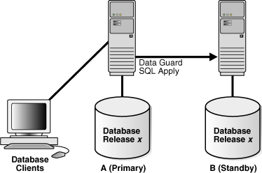
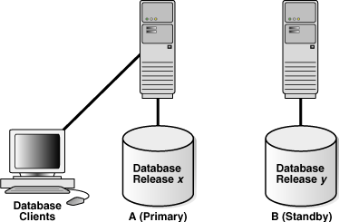
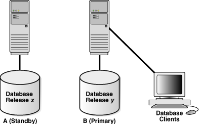
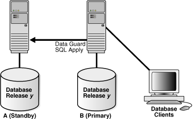

You can use a logical standby database to perform a rolling upgrade of Oracle Database software.

During a rolling upgrade, you can run different releases of Oracle Database on the primary and logical standby databases while you upgrade them, one at a time, incurring minimal downtime on the primary database.

For databases originating with the first patch set of Oracle Database 12c Release 1 (12.1), the preferred method for performing a rolling upgrade with an existing physical standby database is to use the `DBMS_ROLLING` PL/SQL package, as described in [Using DBMS\_ROLLING to Perform a Rolling Upgrade](using-DBMS_ROLLING-to-perform-rolling-upgrade.md) .

The following topics describe how to minimize downtime while upgrading an Oracle database:

Note:

These topics describe an alternative to the usual upgrade procedure involving longer downtime, as described in [Upgrading and Downgrading Databases in an Oracle Data Guard Configuration](upgrading-patching-downgrading-oracle-data-guard-configuration.md). Do not attempt to combine steps from the two procedures.

### Benefits of a Rolling Upgrade Using SQL Apply

These are the advantages of performing a rolling upgrade with SQL Apply.

- Your production database incurs very little downtime. The overall downtime can be as little as the time it takes to perform a switchover.
- You eliminate application downtime due to PL/SQL recompilation.
- You can validate the upgraded database release without affecting the primary database.
- A logical standby accepts archived logs while the upgrade is taking place, which provides an added level of disaster protection.

Note:

- As of Oracle Database 12c Release 1 (12.1), Oracle XML DB Repository supports Oracle Data Guard rolling upgrades. See [Oracle XML DB Developer's Guide](https://docs.oracle.com/pls/topic/lookup?ctx=en/database/oracle/oracle-database/21/sbydb&id=ADXDB5703) for more information about considerations and restrictions to keep in mind with regard to this support.
- As of Oracle Database 12c Release 1 (12.1), you can upgrade databases that use Oracle Database Vault to new Oracle Database releases and patch sets by using Oracle Data Guard database rolling upgrades with a transient logical standby and the PL/SQL package, `DBMS_ROLLING`.
- As of Oracle Database 12c Release 1 (12.1), you can upgrade databases that use Oracle Label Security (OLS) to new Oracle Database releases and patch sets by using Oracle Data Guard database rolling upgrades using a transient logical standby database and the PL/SQL package, `DBMS_ROLLING`.

### Requirements to Perform a Rolling Upgrade Using SQL Apply

These are the requirements for performing a rolling upgrade using SQL Apply.

- If the database is part of an Oracle Data Guard broker configuration, then disable the broker configuration before the rolling upgrade. See [Oracle Data Guard Broker](https://docs.oracle.com/pls/topic/lookup?ctx=en/database/oracle/oracle-database/21/sbydb&id=DGBKR630) for information about disabling a broker configuration.
- The Oracle Data Guard protection mode must be set to either maximum availability or maximum performance. Query the `PROTECTION_LEVEL` column in the `V$DATABASE` view to find out the current protection mode setting.
- To ensure the primary database can proceed while the logical standby database is being upgraded, the `LOG_ARCHIVE_DEST_` `n` initialization parameter for the logical standby database destination must not be set to `MANDATORY`.
- The `COMPATIBLE` initialization parameter set on the primary database must match the software release prior to the upgrade. Therefore, a rolling upgrade from release x to release y requires that the `COMPATIBLE` initialization parameter be set to release x on the primary database. The rolling upgrade standby database must have its `COMPATIBLE` initialization parameter set to x or higher.

### Figures and Conventions Used in the Upgrade Instructions

This background information will help you better understand instructions given for performing upgrades.

Figure 13-1 shows an Oracle Data Guard configuration before the upgrade begins, with the primary and logical standby databases both running the same Oracle Database software release.

Figure 13-1 Oracle Data Guard Configuration Before Upgrade



> The illustration shows a Data Guard configuration before the upgrade begins, with the primary and logical standby databases both running the same Oracle Database software release. In the figure, the primary and standby databases are both running at version "x" and SQL Apply is actively transporting redo from the primary to logical standby database.


During the upgrade process, the Oracle Data Guard configuration operates with mixed database releases at several points in this process. Data protection is not available across releases. During these steps, consider having a second standby database in the Oracle Data Guard configuration to provide data protection.

The steps and figures describing the upgrade procedure refer to the databases as Database A and Database B rather than as the primary database and standby database. This is because the databases switch roles during the upgrade procedure. Initially, Database A is the primary database and Database B is the logical standby database, as shown in Figure 13-1.

The following sections describe scenarios in which you can use the SQL Apply rolling upgrade procedure:

- Performing a Rolling Upgrade By Creating a New Logical Standby Database
- Performing a Rolling Upgrade With an Existing Logical Standby Database
- Performing a Rolling Upgrade With an Existing Physical Standby Database

### Performing a Rolling Upgrade By Creating a New Logical Standby Database

This scenario assumes you do not have an existing Oracle Data Guard configuration, but you are going to create a logical standby database solely for the purpose of performing a rolling upgrade of the Oracle Database.

Table 13-1 lists the steps to prepare the primary and standby databases for upgrading.

Table 13-1 Steps to Perform a Rolling Upgrade by Creating a New Logical Standby

| Step | Description |
| --- | --- |
| Step 1 | Identify unsupported data types and storage attributes |
| Step 2 | Create a logical standby database |
| Step 3 | Perform a rolling upgrade |

1. Identify unsupported database objects on the primary database and decide how to handle them by doing the following:
	- Review the list of supported data types and storage attributes provided in [Data Type and DDL Support on a Logical Standby Database](data-type-ddl-support-on-logical-standby-databases.md).
	- Query the `DBA_LOGSTDBY_UNSUPPORTED` and `DBA_LOGSTDBY_SKIP` views on the primary database. Changes that are made to the listed tables and schemas on the primary database are not applied on the logical standby database. Use the following query to see a list of unsupported tables:
		```
		SQL> SELECT DISTINCT OWNER, TABLE_NAME FROM DBA_LOGSTDBY_UNSUPPORTED;
		```
		Use the following query to see a list of unsupported internal schemas:
		```
		SQL> SELECT OWNER FROM DBA_LOGSTDBY_SKIP -
		>  WHERE STATEMENT_OPT = 'INTERNAL SCHEMA';
		```
2. Create a logical standby database, following the instructions in [Creating a Logical Standby Database](creating-oracle-data-guard-logical-standby.md).
	Note:
	Before you start SQL Apply for the first time, make sure you capture information about transactions running on the primary database that will not be supported by a logical standby database. Run the following procedures to capture and record the information as events in the `DBA_LOGSTDBY_EVENTS` view:
	```
	EXECUTE DBMS_LOGSTDBY.APPLY_SET('MAX_EVENTS_RECORDED',
	 DBMS_LOGSTDBY.MAX_EVENTS);
	EXECUTE DBMS_LOGSTDBY.APPLY_SET('RECORD_UNSUPPORTED_OPERATIONS',
	 'TRUE');
	```
	Oracle recommends configuring a standby redo log on the logical standby database to minimize downtime.
3. Perform a rolling upgrade now that you have created a logical standby database. Follow the procedure described in Performing a Rolling Upgrade With an Existing Logical Standby Database, which assumes that you have a logical standby running the same Oracle software.

### Performing a Rolling Upgrade With an Existing Logical Standby Database

These steps show how to perform a rolling upgrade of Oracle Database on the logical standby database and the primary database.

Table 13-2 lists the steps.

Table 13-2 Steps to Perform a Rolling Upgrade With an Existing Logical Standby

| Step | Description |
| --- | --- |
| Step 1 | Prepare for rolling upgrade |
| Step 2 | Upgrade the logical standby database |
| Step 3 | Restart SQL Apply on the upgraded logical standby database |
| Step 4 | Monitor events on the upgraded standby database |
| Step 5 | Begin a switchover |
| Step 6 | Import any tables that were modified during the upgrade |
| Step 7 | Complete the switchover and activate user applications |
| Step 8 | Upgrade the old primary database |
| Step 9 | Start SQL Apply on the old primary database |
| Step 10 | Optionally, raise the compatibility level on both databases |
| Step 11 | Monitor events on the new logical standby database |
| Step 12 | Optionally, perform another switchover |

1. Follow these steps to prepare to perform a rolling upgrade of Oracle Software:
	1. Stop SQL Apply by issuing the following statement on the logical standby database (Database B):
		```
		SQL> ALTER DATABASE STOP LOGICAL STANDBY APPLY;
		```
		2. Set compatibility, if needed, to the highest value.
		Ensure the `COMPATIBLE` initialization parameter specifies the release number for the Oracle Database software running on the primary database prior to the upgrade.
		For example, if the primary database is running release 11.1, then set the `COMPATIBLE` initialization parameter to 11.1 on both databases. Be sure to set the `COMPATIBLE` initialization parameter on the standby database first before you set it on the primary database.
2. Upgrade Oracle database software on the logical standby database (Database B) to release y. While the logical standby database is being upgraded, it does not accept redo data from the primary database.
	To upgrade Oracle Database software, refer to the Oracle Database Upgrade Guide for the applicable Oracle Database release.
	Figure 13-2 shows Database A running release x, and Database B running release y. During the upgrade, redo data accumulates on the primary system.
	Figure 13-2 Upgrade the Logical Standby Database Release
	

> The illustration shows Database A running release x, and Database B running release y. During the upgrade, redo transport services are not transmitting data from the primary database to the standby database, so redo data is accumulating on the primary system.

3. Restart SQL Apply and operate with release x on Database A and release y on Database B. To start SQL Apply, issue the following statement on Database B:
	```
	SQL> ALTER DATABASE START LOGICAL STANDBY APPLY IMMEDIATE;
	```
	The redo data that was accumulating on the primary system is automatically transmitted and applied on the newly upgraded logical standby database. The Oracle Data Guard configuration can run the mixed releases shown in Figure 13-3 for an arbitrary period while you verify that the upgraded Oracle Database software release is running properly in the production environment.
	Figure 13-3 Running Mixed Releases
	

> The illustration shows a configuration that is running mixed releases. In this configuration, redo transport services are started and the redo data that was accumulating on the primary system is being transmitted and applied on the newly upgraded logical standby database. The Data Guard configuration is running in a mixed release environment, such that the primary database is running release x and the standby database is running release y.

	To monitor how quickly Database B is catching up to Database A, query the `V$LOGSTDBY_PROGRESS` view on Database B. For example:
	```
	SQL> ALTER SESSION SET NLS_DATE_FORMAT = 'DD-MON-YY HH24:MI:SS';
	Session altered.
	SQL> SELECT SYSDATE, APPLIED_TIME FROM V$LOGSTDBY_PROGRESS;
	SYSDATE            APPLIED_TIME
	------------------ ------------------
	27-JUN-05 17:07:06 27-JUN-05 17:06:50
	```
4. It is recommended that you frequently query the `DBA_LOGSTDBY_EVENTS` view to learn if there are any DDL and DML statements that have not been applied on Database B.
	```
	SQL> SET LONG 1000
	SQL> SET PAGESIZE 180
	SQL> SET LINESIZE 79
	SQL> SELECT EVENT_TIMESTAMP, EVENT, STATUS FROM DBA_LOGSTDBY_EVENTS -
	> ORDER BY EVENT_TIMESTAMP;
	EVENT_TIMESTAMP
	---------------------------------------------------------------------------
	EVENT
	--------------------------------------------------------------------------------
	STATUS
	--------------------------------------------------------------------------------
	…
	24-MAY-05 05.18.29.318912 PM
	CREATE TABLE SYSTEM.TST (one number)
	ORA-16226: DDL skipped due to lack of support
	 
	24-MAY-05 05.18.29.379990 PM
	"SYSTEM"."TST"
	ORA-16129: unsupported dml encountered
	```
	In the preceding example:
	- The `ORA-16226` error shows a DDL statement that could not be supported. In this case, it could not be supported because it belongs to an internal schema.
		- The `ORA-16129` error shows that a DML statement was not applied.
	These types of errors indicate that not all of the changes that occurred on Database A have been applied to Database B. At this point, you must decide whether or not to continue with the upgrade procedure. If you are certain that this difference between the logical standby database and the primary database is acceptable, then continue with the upgrade procedure. If not, discontinue and reinstantiate Database B and perform the upgrade procedure at another time.
5. When you are satisfied that the upgraded database software is operating properly, perform a switchover to reverse the database roles by issuing the following statement on Database A:
	```
	SQL> ALTER DATABASE COMMIT TO SWITCHOVER TO LOGICAL STANDBY;
	```
	This statement must wait for existing transactions to complete. To minimize the time it takes to complete the switchover, users still connected to Database A should log off immediately and reconnect to Database B.
	Note:
	The usual two-phased prepared switchover described in [Performing a Switchover to a Logical Standby Database](managing-oracle-data-guard-role-transitions.md) cannot be used because it requires both primary and standby databases to be running the same version of the Oracle software and at this point, the primary database is running a lower version of the Oracle software. Instead, the single-phased unprepared switchover procedure documented above is used. The unprepared switchover should only be used in the context of a rolling upgrade using a logical standby database.
	Note:
	If you suspended activity to unsupported tables or packages on Database A when it was the primary database, you must continue to suspend the same activities on Database B while it is the primary database if you eventually plan to switch back to Database A.
6. Step 4 described how to list unsupported tables that are being modified. If unsupported DML statements were issued on the primary database, then import the latest version of those tables using an import utility such as Oracle Data Pump.
	For example, the following import command truncates the `scott.emp` table and populates it with data matching the former primary database (A):
	```
	impdp SYSTEM NETWORK_LINK=databasea TABLES=scott.emp TABLE_EXISTS_ACTION=TRUNCATE
	```
	This command prompts you for the `impdp` password before executing.
7. When you are satisfied that the upgraded database software is operating properly, complete the switchover to reverse the database roles:
	1. On Database B, query the `SWITCHOVER_STATUS` column of the `V$DATABASE` view, as follows:
		```
		SQL> SELECT SWITCHOVER_STATUS FROM V$DATABASE;
		SWITCHOVER_STATUS
		--------------------
		TO PRIMARY
		```
		2. When the `SWITCHOVER_STATUS` column displays `TO PRIMARY`, complete the switchover by issuing the following statement on Database B:
		```
		SQL> ALTER DATABASE COMMIT TO SWITCHOVER TO PRIMARY;
		```
		Note:
		The usual two-phased prepared switchover described in [Performing a Switchover to a Logical Standby Database](managing-oracle-data-guard-role-transitions.md) cannot be used because it requires both primary and standby databases to be running the same version of the Oracle software and at this point, the primary database is running a lower version of the Oracle software. Instead, the single-phased unprepared switchover procedure documented above is used. The unprepared switchover should only be used in the context of a rolling upgrade using a logical standby database.
		3. Activate the user applications and services on Database B, which is now running in the primary database role.
	After the switchover, you cannot send redo data from the new primary database (B) that is running the new database software release to the new standby database (A) that is running an older software release. This means the following:
	- Redo data is accumulating on the new primary database.
		- The new primary database is unprotected at this time.
	Figure 13-4 shows Database B, the former standby database (running release y), is now the primary database, and Database A, the former primary database (running release x), is now the standby database. The users are connected to Database B.
	If Database B can adequately serve as the primary database and your business does not require a logical standby database to support the primary database, then you have completed the rolling upgrade process. Allow users to log in to Database B and begin working there, and discard Database A when it is convenient. Otherwise, continue with Step 8.
	Figure 13-4 After a Switchover
	

> The illustration shows the Data Guard configuration running in mixed-version mode after a switchover has occurred. In the figure, the standby database is running release x and the primary database is running release y. SQL Apply is not running because Database A, which is still running release x, cannot apply redo data from Database B until Database is upgraded and SQL Apply is started.

8. Database A is still running release x and cannot apply redo data from Database B until you upgrade it and start SQL Apply.
	For more information about upgrading Oracle Database software, see the [Oracle Database Upgrade Guide](https://docs.oracle.com/pls/topic/lookup?ctx=en/database/oracle/oracle-database/21/sbydb&id=UPGRD003).
	Figure 13-5 shows the system after both databases have been upgraded.
	Figure 13-5 Both Databases Upgraded
	

> The illustration shows the Data Guard configuration after both databases have been upgraded to release y. SQL Apply has been started so that redo that was accumulating on the primary database (B) is now being sent to the logical standby database (A).

9. Issue the following statement to start SQL Apply on Database A and, if necessary, create a database link to Database B:
	```
	SQL> ALTER DATABASE START LOGICAL STANDBY APPLY IMMEDIATE NEW PRIMARY db_link_to_b;
	```
	Note:
	You must create a database link (if one has not already been set up) and to use the `NEW PRIMARY` clause, because in Step 4 the single-phased unprepared switchover was used to turn Database A into a standby database.
	You must connect as user `SYSTEM` or with an account with a similar level of privileges.
	When you start SQL Apply on Database A, the redo data that is accumulating on the primary database (B) is sent to the logical standby database (A). The primary database is protected against data loss once all the redo data is available on the standby database.
10. Raise the compatibility level of both databases by setting the `COMPATIBLE` initialization parameter. You must raise the compatibility level at the logical standby database before you raise it at the primary database. Set the `COMPATIBLE` parameter on the standby database before you set it on the primary database. See [Oracle Database Reference](https://docs.oracle.com/pls/topic/lookup?ctx=en/database/oracle/oracle-database/21/sbydb&id=REFRN10019) for more information about the `COMPATIBLE` initialization parameter.
11. To ensure that all changes performed on Database B are properly applied to the logical standby database (A), you should frequently query the `DBA_LOGSTDBY_EVENTS` view, as you did for Database A in step 4.
	If changes were made that invalidate Database A as a copy of your existing primary database, you can discard Database A and create a new logical standby database in its place. See [Creating a Logical Standby Database](creating-oracle-data-guard-logical-standby.md) for complete information.
12. Optionally, perform another switchover of the databases so Database A is once again running in the primary database role (as shown in Figure 13-1).
	Note:
	You use the two-phased prepared switchover described in [Performing a Switchover to a Logical Standby Database](managing-oracle-data-guard-role-transitions.md) since at this time, both Database A and Database B are running the same version of the Oracle software.

### Performing a Rolling Upgrade With an Existing Physical Standby Database

These steps show how to perform a rolling upgrade of Oracle Database software and then get back to your original configuration in which A is the primary database and B is the physical standby database, and both of them are running the upgraded Oracle software.

Note:

These steps assume that you have a primary database (A) and a physical standby database (B) already set up and using Oracle Database release 11.1 or later.

Table 13-3 summarizes the steps involved.

Table 13-3 Steps to Perform a Rolling Upgrade With an Existing Physical Standby

| Step | Description |
| --- | --- |
| Step 1 | Prepare the primary database for a rolling upgrade (perform these steps on Database A) |
| Step 2 | Convert the physical standby database into a logical standby database (perform these steps on Database B) |
| Step 3 | Upgrade the logical standby database and catch up with the primary database (perform these steps on Database B) |
| Step 4 | Flashback Database A to the guaranteed restore point (perform these steps on Database A) |
| Step 5 | Mount Database A using the new version of Oracle software |
| Step 6 | Convert Database A to a physical standby |
| Step 7 | Start managed recovery on Database A |
| Step 8 | Perform a switchover to make Database A the primary database |
| Step 9 | Clean up the guaranteed restore point created in Database A |

1. Prepare the primary database for a rolling upgrade (perform these steps on Database A)
	1. Enable Flashback Database, if it is not already enabled:
		```
		SQL> SHUTDOWN IMMEDIATE;
		SQL> STARTUP MOUNT;
		SQL> ALTER DATABASE FLASHBACK ON;
		SQL> ALTER DATABASE OPEN;
		```
		2. Create a guaranteed restore point:
		```
		SQL> CREATE RESTORE POINT pre_upgrade GUARANTEE FLASHBACK DATABASE;
		```
2. Convert the physical standby database into a logical standby database (perform these steps on Database B).
	1. Follow the steps outlined in [Creating a Logical Standby Database](creating-oracle-data-guard-logical-standby.md) except for the following difference. In [Convert to a Logical Standby Database](creating-oracle-data-guard-logical-standby.md) you must use a different command to convert the logical standby database. Instead of `ALTER DATABASE RECOVER TO LOGICAL STANDBY db_name`, issue the following command:
		```
		SQL> ALTER DATABASE RECOVER TO LOGICAL STANDBY KEEP IDENTITY;
		SQL> ALTER DATABASE OPEN;
		```
		2. You must take the following actions before you start SQL Apply for the first time:
		1. Disable automatic deletion of foreign archived logs at the logical standby, as follows:
			```
			SQL> EXECUTE DBMS_LOGSTDBY.APPLY_SET('LOG_AUTO_DELETE', 'FALSE');
			```
			Note:
			Do not delete any remote archived logs processed by the logical standby database (Database B). These remote archived logs are required later during the rolling upgrade process. If you are using the recovery area to store the remote archived logs, you must ensure that it has enough space to accommodate these logs without interfering with the normal operation of the logical standby database.
				2. Make sure you capture information about transactions running on the primary database that will not be supported by a logical standby database. Run the following procedures to capture and record the information as events in the `DBA_LOGSTDBY_EVENTS` table:
			```
			SQL> EXECUTE DBMS_LOGSTDBY.APPLY_SET('MAX_EVENTS_RECORDED', -
			> DBMS_LOGSTDBY.MAX_EVENTS);
			 
			SQL> EXECUTE DBMS_LOGSTDBY.APPLY_SET('RECORD_UNSUPPORTED_OPERATIONS', 'TRUE');
			```
				3. Start SQL Apply for the first time, as follows:
			```
			SQL> ALTER DATABASE START LOGICAL STANDBY APPLY IMMEDIATE;
			```
		See Also:
		- [Customizing Logging of Events in the DBA\_LOGSTDBY\_EVENTS View](managing-oracle-data-guard-logical-standby-databases.md) for more information about the `DBA_LOGSTDBY_EVENTS` view
		- [Oracle Database PL/SQL Packages and Types Reference](https://docs.oracle.com/pls/topic/lookup?ctx=en/database/oracle/oracle-database/21/sbydb&id=ARPLS363) for complete information about the `DBMS_LOGSTDBY` package
3. You can now follow Steps 1 through 7 as described in Performing a Rolling Upgrade With an Existing Logical Standby Database . At the end of these steps, Database B is your primary database running the upgraded version of the Oracle software, and Database A becomes your logical standby database.
	Move on to the next step to turn Database A into the physical standby for Database B.
4. Flashback Database A to the guaranteed restore point (perform these steps on Database A).
	```
	SQL> SHUTDOWN IMMEDIATE;
	SQL> STARTUP MOUNT;
	SQL> FLASHBACK DATABASE TO RESTORE POINT pre_upgrade;
	SQL> SHUTDOWN IMMEDIATE;
	```
5. At this point, switch Database A to use the higher version of the Oracle software. You do not run the upgrade scripts, since Database A is turned into a physical standby, and upgraded automatically as it applies the redo data generated by Database B.
	Mount Database A, as follows:
	```
	SQL> STARTUP MOUNT;
	```
6. Convert Database A to a physical standby.
	```
	SQL> ALTER DATABASE CONVERT TO PHYSICAL STANDBY;
	SQL> SHUTDOWN IMMEDIATE;
	```
7. Start managed recovery on Database A.
	Database A is upgraded automatically as it applies the redo data generated by Database B. Managed recovery waits until the new incarnation branch from the primary is registered before it starts applying redo.
	```
	SQL> STARTUP MOUNT;
	SQL> ALTER DATABASE RECOVER MANAGED STANDBY DATABASE - 
	>  DISCONNECT FROM SESSION;
	```
	Note:
	When Redo Apply restarts, it waits for a new incarnation from the current primary database (Database B) to be registered.
8. At this point, Database B is your primary database and Database A is your physical standby, both running the higher version of the Oracle software. To make Database A the primary database, follow the steps described in " [Performing a Switchover to a Physical Standby Database](managing-oracle-data-guard-role-transitions.md) ".
9. To preserve disk space, drop the existing guaranteed restore point created in Database A:
	```
	SQL> DROP RESTORE POINT PRE_UPGRADE;
	```

See Also:

The "Database Rolling Upgrade Using Transient Logical Standby: Oracle Data Guard 11g" best practices technical brief available on the Oracle Maximum Availability Architecture (MAA) home page at:

[`http://www.oracle.com/goto/maa`](http://www.oracle.com/goto/maa)