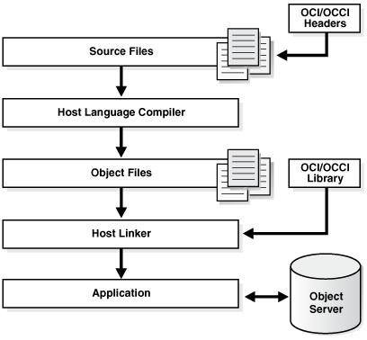

To choose a programming environment for a development project, read:

- The topics in this chapter and the documents to which they refer.
- The platform-specific documents that explain which compilers and development tools your platforms support.

Sometimes the choice of programming environment is obvious, for example:

- Pro\*COBOL does not support ADTs or collection types, while Pro\*C/C++ does.

If no programming language provides all the features you need, you can use multiple programming languages, because:

- Every programming language in this chapter can invoke PL/SQL and Java stored subprograms. (Stored subprograms include triggers and ADT methods.)
- PL/SQL, Java, SQL, and Oracle Call Interface (OCI) can invoke external C subprograms.
- External C subprograms can access Oracle Database using SQL, OCI, or Pro\*C (but not C++).

Topics:

See Also:

[Developing Applications with Multiple Programming Languages](external-procedures.md) for more information about multilanguage programming

### 21.1 Overview of Application Architecture

In this topic, application architecture refers to the computing environment in which a database application connects to an Oracle Database.

Topics:

#### 21.1.1 Client/Server Architecture

In a traditional client/server program, your application code runs on a client system; that is, a system other than the database server. Database calls are transmitted from the client system to the database server. Data is transmitted from the client to the server for insert and update operations and returned from the server to the client for query operations. The data is processed on the client system. Client/server programs are typically written by using precompilers, whereas SQL statements are embedded within the code of another language such as C, C++, or COBOL.

See Also:

[Oracle Database Concepts](https://docs.oracle.com/pls/topic/lookup?ctx=en/database/oracle/oracle-database/21/adfns&id=CNCPT701) for more information about client/server architecture

#### 21.1.2 Server-Side Programming

You can develop application logic that resides entirely inside the database by using triggers that are executed automatically when changes occur in the database or stored subprograms that are invoked explicitly. Off-loading the work from your application lets you reuse code that performs verification and cleanup and control database operations from a variety of clients. For example, by making stored subprograms invocable through a web server, you can construct a web-based user interface that performs the same functions as a client/server application.

See Also:

[Oracle Database Concepts](https://docs.oracle.com/pls/topic/lookup?ctx=en/database/oracle/oracle-database/21/adfns&id=CNCPT036) for more information about server-side programming

#### 21.1.3 Two-Tier and Three-Tier Architecture

Client/server computing is often referred to as a **two-tier model**: your application communicates directly with the database server. In the **three-tier model**, a separate application server processes the requests. The application server might be a basic web server, or might perform advanced functions like caching and load-balancing. Increasing the processing power of this middle tier lets you lessen the resources needed by client systems, resulting in a thin client configuration in which the client system might need only a web browser or other means of sending requests over the TCP/IP or HTTP protocols.

See Also:

[Oracle Database Concepts](https://docs.oracle.com/pls/topic/lookup?ctx=en/database/oracle/oracle-database/21/adfns&id=CNCPT702) for more information about multitier architecture

### 21.2 Overview of the Program Interface

The program interface is the software layer between a database application and Oracle Database. The program interface:

- Provides a security barrier, preventing destructive access to the SGA by client user processes
- Acts as a communication mechanism, formatting information requests, passing data, and trapping and returning errors
- Converts and translates data, particularly between different types of computers or to external user program data types

The Oracle code acts as a server, performing database tasks on behalf of an application (a client), such as fetching rows from data blocks. The program interface consists of several parts, provided by both Oracle Database software and operating system-specific software.

See Also:

[Oracle Database Concepts](https://docs.oracle.com/pls/topic/lookup?ctx=en/database/oracle/oracle-database/21/adfns&id=CNCPT906) for more information about the program interface

Topics:

- User Interface
- Stateful and Stateless User Interfaces

#### 21.2.1 User Interface

The user interface is what your application displays to end users. It depends on the technology behind the application and the needs of the users themselves. Experienced users can enter SQL statements that are passed on to the database. Novice users can be shown a graphical user interface that uses the graphics libraries of the client system (such as Windows or X-Windows). Any traditional user interface can also be provided in a web browser through HTML and Java.

#### 21.2.2 Stateful and Stateless User Interfaces

In traditional client/server applications, the application can keep a record of user actions and use this information over the course of one or more sessions. For example, past choices can be presented in a menu so that they not be entered again. When the application can save information in this way, the application is considered **stateful**.

Web or thin-client applications that are **stateless** are easier to develop. Stateless applications gather all the required information, process it using the database, and then start over with the next user. This is a popular way to process single-screen requests such as customer registration.

There are many ways to add stateful action to web applications that are stateless by default. For example, an entry form on one web page can pass information to subsequent web pages, enabling you to construct a wizard-like interface that remembers user choices through several different steps. You can use cookies to store small items of information about the client system, and retrieve them when the user returns to a website. You can use servlets to keep a database session open and store variables between requests from the same client.

### 21.3 Overview of PL/SQL

PL/SQL, the Oracle procedural extension of SQL, is a completely portable, high-performance transaction-processing language. PL/SQL lets you manipulate data with SQL statements; control program flow with conditional selection and loops; declare constants and variables; define subprograms; define types, subtypes, and ADTs and declare variables of those types; and trap runtime errors.

Applications written in any Oracle Database programmatic interface can invoke PL/SQL stored subprograms and send blocks of PL/SQL code to Oracle Database for execution. Third-generation language (3GL) applications can access PL/SQL scalar and composite data types through host variables and implicit data type conversion. A 3GL language is easier than assembler language for a human to understand and includes features such as named variables. Unlike a fourth-generation language (4GL), it is not specific to an application domain.

You can use PL/SQL to develop stored procedures that can be invoked by a web client.

See Also:

- [Oracle Database PL/SQL Language Reference](https://docs.oracle.com/pls/topic/lookup?ctx=en/database/oracle/oracle-database/21/adfns&id=LNPLS001) for information about the advantages, main features, and architecture of PL/SQL

### 21.4 Overview of Oracle Database Java Support

This section provides an overview of Oracle Database features that support Java applications. The database includes the core JDK libraries such as `java`.`lang`, `java`.`io`, and so on. The database supports client-side Java standards such as JDBC and SQLJ, and provides server-side JDBC driver that enables data-intensive Java code to run within the database.

Topics:

- Overview of Oracle JVM
- Overview of Oracle JDBC
- Overview of Oracle SQLJ
- Comparison of Oracle JDBC and Oracle SQLJ
- Overview of Java Stored Subprograms
- Overview of Oracle Database Web Services

See Also:

- [Oracle Database Java Developer’s Guide](https://docs.oracle.com/pls/topic/lookup?ctx=en/database/oracle/oracle-database/21/adfns&id=JJDEV-GUID-912A14D4-2621-4955-85BD-A04E17EE6D21)
- [Oracle Database JDBC Developer’s Guide](https://docs.oracle.com/pls/topic/lookup?ctx=en/database/oracle/oracle-database/21/adfns&id=JJDBC-GUID-864DB502-5E50-4044-8132-33D6AAF8927A)

#### 21.4.1 Overview of Oracle JVM

Oracle JVM, the Java Virtual Machine provided with the Oracle Database, is compliant with the J2SE version 1.5.x specification and supports the database session architecture.

Any database session can activate a dedicated JVM. All sessions share the same JVM code and statics; however, private states for any given session are held, and subsequently garbage collected, in an individual session space.

This design provides these benefits:

- Java applications have the same session isolation and data integrity as SQL operations.
- You need not run Java in a separate process for data integrity.
- Oracle JVM is a robust JVM with a small memory footprint.
- The JVM has the same linear Symmetric Multiprocessing (SMP) scalability as the database and can support thousands of concurrent Java sessions.

Oracle JVM works consistently with every platform supported by Oracle Database. Java applications that you develop with Oracle JVM can easily be ported to any supported platform.

Oracle JVM includes a deployment-time native compiler that enables Java code to be compiled once, stored in executable form, shared among users, and invoked more quickly and efficiently.

Security features of the database are also available with Oracle JVM. Java classes must be loaded in a database schema (by using Oracle JDeveloper, a third-party IDE, SQL\*Plus, or the `loadjava` utility) before they can be called. Java class calls are secured and controlled through database authentication and authorization, Java 2 security, and invoker's rights (IR) or definer's rights (DR).

Effective with Oracle Database 12c Release 1 (12.1.0.1), Oracle JVM provides complete support for the latest Java Standard Edition. Compatibility with latest Java standards increases application portability and enables direct execution of client-side Java classes in the database.

See Also:

- [Oracle Database Concepts](https://docs.oracle.com/pls/topic/lookup?ctx=en/database/oracle/oracle-database/21/adfns&id=CNCPT820) for additional general information about Oracle JVM
- [Oracle Database Java Developer's Guide](https://docs.oracle.com/pls/topic/lookup?ctx=en/database/oracle/oracle-database/21/adfns&id=JJDEV13553) for information about support for the latest Java Standard Edition

#### 21.4.2 Overview of Oracle JDBC

Java Database Connectivity (JDBC) is an Applications Programming Interface (API) that enables Java to send SQL statements to an object-relational database such as Oracle Database.

Oracle Database includes these extensions to the JDBC 1.22 standard:

- Support for Oracle data types
- Performance enhancement by row prefetching
- Performance enhancement by execution batching
- Specification of query column types to save round trips
- Control of `DatabaseMetaData` calls

Oracle Database supports all APIs from the JDBC 2.0 standard, including the core APIs, optional packages, and numerous extensions. Some highlights include datasources, JTA, and distributed transactions.

Oracle Database supports these features from the JDBC 3.0 standard:

- Support for JDK 1.5.
- Toggling between local and global transactions.
- Transaction savepoints.
- Reuse of prepared statements by connection pools.

Note:

JDBC code and SQLJ code interoperate.

Topics:

- Oracle JDBC Drivers
- Sample JDBC 2.0 Program
- Sample Pre-2.0 JDBC Program

See Also:

- [Oracle Database Concepts](https://docs.oracle.com/pls/topic/lookup?ctx=en/database/oracle/oracle-database/21/adfns&id=CNCPT616) for additional general information about Java support in Oracle Database
- Comparison of Oracle JDBC and Oracle SQLJ

##### 21.4.2.1 Oracle JDBC Drivers

The JDBC standard defines four types of JDBC drivers:

| Type | Description |
| --- | --- |
| 1 | A JDBC-ODBC bridge. Software must be installed on client systems. |
| 2 | Native methods (calls C or C++) and Java methods. Software must be installed on the client. |
| 3 | Pure Java. The client uses sockets to call middleware on the server. |
| 4 | The most pure Java solution. Talks directly to the database by using Java sockets. |

JDBC is based on Part 3 of the SQL standard, "Call-Level Interface."

You can use JDBC to do dynamic SQL. In dynamic SQL, the embedded SQL statement to be executed is not known before the application is run and requires input to build the statement.

The drivers that are implemented by Oracle have extensions to the capabilities in the JDBC standard that was defined by Sun Microsystems.

Topics:

- JDBC Thin Driver
- JDBC OCI Driver
- JDBC Server-Side Internal Driver

See Also:

- [Oracle Database Concepts](https://docs.oracle.com/pls/topic/lookup?ctx=en/database/oracle/oracle-database/21/adfns&id=CNCPT825) for additional general information about JDBC drivers
- [Oracle Database JDBC Developer's Guide](https://docs.oracle.com/pls/topic/lookup?ctx=en/database/oracle/oracle-database/21/adfns&id=JJDBC-GUID-864DB502-5E50-4044-8132-33D6AAF8927A) for more information about JDBC

###### 21.4.2.1.1 JDBC Thin Driver

The JDBC Thin driver is a Type 4 (100% pure Java) driver that uses Java sockets to connect directly to a database server. It has its own implementation of a Two-Task Common (TTC), a lightweight implementation of TCP/IP from Oracle Net. It is written entirely in Java and is therefore platform-independent.

The thin driver does not require Oracle software on the client side. It does need a TCP/IP listener on the server side. Use this driver in Java applets that are downloaded into a web browser or in applications for which you do not want to install Oracle client software. The thin driver is self-contained, but it opens a Java socket, and thus can run only in a browser that supports sockets.

###### 21.4.2.1.2 JDBC OCI Driver

The JDBC OCI driver is a Type 2 JDBC driver. It makes calls to OCI written in C to interact with Oracle Database, thus using native and Java methods.

The OCI driver provides access to more features than the thin driver, such as Transparent Application Fail-Over, advanced security, and advanced LOB manipulation.

The OCI driver provides the highest compatibility between different Oracle Database versions. It also supports all installed Oracle Net adapters, including IPC, named pipes, TCP/IP, and IPX/SPX.

Because it uses native methods (a combination of Java and C) the OCI driver is platform-specific. It requires a client installation of version Oracle8i or later including Oracle Net, OCI libraries, CORE libraries, and all other dependent files. The OCI driver usually runs faster than the thin driver.

The OCI driver is not appropriate for Java applets, because it uses a C library that is platform-specific and cannot be downloaded into a web browser. It is usable in J2EE components running in middle-tier application servers, such as Oracle Application Server. Oracle Application Server provides middleware services and tools that support access between applications and browsers.

###### 21.4.2.1.3 JDBC Server-Side Internal Driver

The JDBC server-side internal driver is a Type 2 driver that runs inside the database server, reducing the number of round trips needed to access large amounts of data. The driver, the Java server VM, the database, the Java native compiler (which speeds execution by as much as 10 times), and the SQL engine all run within the same address space.

This driver provides server-side support for any Java program used in the database. You can also call PL/SQL stored subprograms and triggers.

The server driver fully supports the same features and extensions as the client-side drivers.

##### 21.4.2.2 Sample JDBC 2.0 Program

This example shows the recommended technique for looking up a data source using JNDI in JDBC 2.0:

```
// import the JDBC packages 
import java.sql.*; 
import javax.sql.*; 
import oracle.jdbc.pool.*; 
...
   InitialContext ictx = new InitialContext(); 
   DataSource ds = (DataSource)ictx.lookup("jdbc/OracleDS"); 
   Connection conn = ds.getConnection(); 
   Statement stmt = conn.createStatement(); 
   ResultSet rs = stmt.executeQuery("SELECT last_name FROM employees"); 
   while ( rs.next() ) { 
   out.println( rs.getString("ename") + "<br>"); 
   } 
conn.close();
```

##### 21.4.2.3 Sample Pre-2.0 JDBC Program

This source code registers an Oracle JDBC thin driver, connects to the database, creates a `Statement` object, runs a query, and processes the result set.

The `SELECT` statement retrieves and lists the contents of the `last_name` column of the `hr`.`employees` table.

```
import java.sql.*
import java.math.*
import java.io.*
import java.awt.*

class JdbcTest { 
  public static void main (String args []) throws SQLException { 
    // Load Oracle driver
    DriverManager.registerDriver (new oracle.jdbc.OracleDriver());
     
    // Connect to the local database
    Connection conn = 
      DriverManager.getConnection ("jdbc:oracle:thin:@myhost:1521:orcl", 
                                   "hr", "password");

    // Query the employee names 
    Statement stmt = conn.createStatement (); 
    ResultSet rset = stmt.executeQuery ("SELECT last_name FROM employees");

    // Print the name out 
    while (rset.next ())
      System.out.println (rset.getString (1));
    // Close the result set, statement, and the connection
    rset.close();
    stmt.close();
    conn.close();
  } 
}
```

One Oracle Database extension to the JDBC drivers is a form of the `getConnection()` method that uses a `Properties` object. The `Properties` object lets you specify user, password, database information, row prefetching, and execution batching.

To use the OCI driver in this code, replace the `Connection` statement with this code, where `MyHostString` is an entry in the `tnsnames`.`ora` file:

```
Connection conn = DriverManager.getConnection ("jdbc:oracle:oci8:@MyHostString",
    "hr", "password");
```

If you are creating an applet, then the `getConnection()` and `registerDriver()` strings are different.

#### 21.4.3 Overview of Oracle SQLJ

Note:

In this guide, SQLJ refers to Oracle SQLJ and its extensions.

SQLJ is an ANSI SQL-1999 standard for embedding SQL statements in Java source code. SQLJ provides a simpler alternative to JDBC for client-side SQL data access from Java.

A SQLJ source file contains Java source with embedded SQL statements. Oracle SQLJ supports dynamic and static SQL. Support for dynamic SQL is an Oracle extension to the SQLJ standard.

The Oracle SQLJ translator performs these tasks:

- Translates SQLJ source to Java code with calls to the SQLJ runtime driver. The SQLJ translator converts the source code to pure Java source code and can check the syntax and semantics of static SQL statements against a database schema and verify the type compatibility of host variables with SQL types.
- Compiles the generated Java code with the Java compiler.
- (Optional) Creates profiles for the target database. SQLJ generates "profile" files with customization specific to Oracle Database.

SQLJ is integrated with JDeveloper. Source-level debugging support for SQLJ is available in JDeveloper.

This is an example of a simple SQLJ executable statement, which returns one value because `employee_id` is unique in the `employee` table:

```
String name;
#sql  { SELECT first_name INTO :name FROM employees WHERE employee_id=112 };
System.out.println("Name is " + name + ", employee number = " + employee_id);
```

Each host variable (or qualified name or complex Java host expression) included in a SQL expression is preceded by a colon (:). Other SQLJ statements declare Java types. For example, you can declare an iterator (a construct related to a database cursor) for queries that retrieve many values, as follows:

```
#sql iterator EmpIter (String EmpNam, int EmpNumb);
```

See Also:

[Oracle Database SQLJ Developer's Guide](https://docs.oracle.com/pls/topic/lookup?ctx=en/database/oracle/oracle-database/21/adfns&id=JSQLJ137) for more examples and details about Oracle SQLJ syntax

Topics:

- Benefits of SQLJ

See Also:

[Oracle Database Concepts](https://docs.oracle.com/pls/topic/lookup?ctx=en/database/oracle/oracle-database/21/adfns&id=CNCPT826) for additional general information about SQLJ

##### 21.4.3.1 Benefits of SQLJ

Oracle SQLJ extensions to Java enable rapid development and easy maintenance of applications that perform database operations through embedded SQL.

In particular, Oracle SQLJ does this:

- Provides a concise, legible mechanism for database access from static SQL. Most SQL in applications is static. SQLJ provides more concise and less error-prone static SQL constructs than JDBC does.
- Provides an SQL Checker module for verification of syntax and semantics at translate time.
- Provides flexible deployment configurations, which makes it possible to implement SQLJ on the client, or middle tier.
- Supports a software standard. SQLJ is an effort of a group of vendors and is supported by all of them. Applications can access multiple database vendors.
- Provides source code portability. Executables can be used with all of the vendor DBMSs if the code does not rely on vendor-specific features.
- Enforces a uniform programming style for the clients and the servers.
- Integrates the SQLJ translator with **Oracle JDeveloper**, a graphical IDE that provides SQLJ translation, Java compilation, profile customizing, and debugging at the source code level, all in one step.
- Includes Oracle Database type extensions.

#### 21.4.4 Comparison of Oracle JDBC and Oracle SQLJ

JDBC code and SQLJ code interoperate, enabling dynamic SQL statements in JDBC to be used with both static and dynamic SQL statements in SQLJ. A SQLJ iterator class corresponds to the JDBC result set.

Some differences between JDBC and SQLJ are:

- JDBC provides a complete dynamic SQL interface from Java to databases. It gives developers full control over database operations. SQLJ simplifies Java database programming to improve development productivity.
- JDBC provides fine-grained control of the execution of dynamic SQL from Java, whereas SQLJ provides a higher-level binding to SQL operations in a specific database schema.
- SQLJ source code is more concise than equivalent JDBC source code.
- SQLJ uses database connections to type-check static SQL code. JDBC, being a completely dynamic API, does not.
- SQLJ provides strong typing of query outputs and return parameters and provides type-checking on calls. JDBC passes values to and from SQL without compile-time type checking.
- SQLJ programs enable direct embedding of Java bind expressions within SQL statements. JDBC requires a separate get or set statement for each bind variable and specifies the binding by position number.
- SQLJ provides simplified rules for calling SQL stored subprograms.
	For example, the following four examples show, on successive lines, how to call a stored procedure or a stored function using either JDBC escape syntax or Oracle JDBC syntax:
	```
	prepStmt.prepareCall("{call fun(?,?)}");       //stored proc. JDBC esc.
	prepStmt.prepareCall("{? = call fun(?,?)}");   //stored func. JDBC esc.
	prepStmt.prepareCall("begin fun(:1,:2);end;"); //stored proc. Oracle
	prepStmt.prepareCall("begin :1 := fun(:2,:3);end;"); //stored func. Oracle
	```
	The SQLJ equivalent is:
	```
	#sql {call fun(param_list) };  //Stored procedure
	// Declare x
	...
	#sql x = {VALUES(fun(param_list)) };  // Stored function
	// where VALUES is the SQL construct
	```

These benefits are common to SQLJ and JDBC:

- SQLJ source files can contain JDBC calls. SQLJ and JDBC are interoperable.
- PL/SQL and Java stored subprograms can be used interchangeably.

#### 21.4.5 Overview of Java Stored Subprograms

Java stored subprograms enable you to implement programs that run in the database server and are independent of programs that run in the middle tier. Structuring applications in this way reduces complexity and increases reuse, security, performance, and scalability.

For example, you can create a Java stored subprogram that performs operations that require data persistence and a separate program to perform presentation or business logic operations.

Java stored subprograms interface with SQL using an execution model similar to that of PL/SQL.

See Also:

- [Oracle Database Concepts](https://docs.oracle.com/pls/topic/lookup?ctx=en/database/oracle/oracle-database/21/adfns&id=CNCPT1805) for additional general information about Java stored subprograms
- [Oracle Database Java Developer's Guide](https://docs.oracle.com/pls/topic/lookup?ctx=en/database/oracle/oracle-database/21/adfns&id=JJDEV01530) for complete information about Java stored subprograms

#### 21.4.6 Overview of Oracle Database Web Services

Web services represent a distributed computing paradigm for Java application development that is an alternative to earlier Java protocols such as JDBC, and which enable applications to interact through the XML and web protocols. For example, an electronics parts vendor can provide a web-based programmatic interface to its suppliers for inventory management. The vendor can invoke a web service as part of a program and automatically order stock based on the data returned.

The key technologies used in web services are:

- Web Services Description Language (WSDL), which is a standard format for creating an XML document. WSDL describes what a web service can do, where it resides, and how to invoke it. Specifically, it describes the operations and parameters, including parameter types, provided by a web service. Also, a WSDL document describes the location, the transport protocol, and the invocation style for the web service.
- Simple Object Access Protocol (SOAP) messaging, which is an XML-based message protocol used by web services. SOAP does not prescribe a specific transport mechanism such as HTTP, FTP, SMTP, or JMS; however, most web services accept messages that use HTTP or HTTPS.
- Universal Description, Discovery, and Integration (UDDI) business registry, which is a directory that lists web services on the internet. The UDDI registry is often compared to a telephone directory, listing unique identifiers (white pages), business categories (yellow pages), and instructions for binding to a service protocol (green pages).

Web services can use a variety of techniques and protocols. For example:

- Dispatching can occur in a synchronous (typical) or asynchronous manner.
- You can invoke a web service in an RPC-style operation in which arguments are sent and a response returned, or in a message style such as a one-way SOAP document exchange.
- You can use different encoding rules: literal or encoded.

You can invoke a web service statically, when you might know everything about it beforehand, or dynamically, in which case you can discover its operations and transport endpoints while using it.

Oracle Database can function as either a web service provider or as a web service consumer. When used as a provider, the database enables sharing and disconnected access to stored subprograms, data, metadata, and other database resources such as the queuing and messaging systems.

As a web service provider, Oracle Database provides a disconnected and heterogeneous environment that:

- Exposes stored subprograms independently of the language in which the subprograms are written
- Exposes SQL Queries and XQuery

See Also:

[Oracle Database Concepts](https://docs.oracle.com/pls/topic/lookup?ctx=en/database/oracle/oracle-database/21/adfns&id=CNCPT1271) for additional general information about Oracle Database as a web service provider

### 21.5 Choosing PL/SQL or Java

PL/SQL and Java interoperate in the server. You can run a PL/SQL package from Java or PL/SQL can be invoked from Java, so that either one can be invoked from distributed CORBA and Enterprise Java Beans clients.

Table 21-1 shows PL/SQL packages and their Java equivalents.

Table 21-1 PL/SQL Packages and Their Java Equivalents

| PL/SQL Package | Java Equivalent |
| --- | --- |
| `DBMS_ALERT` | Call package with JDBC. |
| `DBMS_DDL` | JDBC has this functionality. |
| `DBMS_JOB` | Schedule a job that has a Java stored subprogram. |
| `DBMS_LOCK` | Call with JDBC. |
| `DBMS_MAIL` | Use JavaMail. |
| `DBMS_OUTPUT` | Use subclass `oracle`.`aurora`.`rdbms`.`OracleDBMSOutputStream` or Java stored subprogram `DBMS_JAVA`.`SET_STREAMS`. |
| `DBMS_PIPE` | Call with JDBC. |
| `DBMS_SESSION` | Use JDBC to run an `ALTER` `SESSION` statement. |
| `DBMS_SNAPSHOT` | Call with JDBC. |
| `DBMS_SQL` | Use JDBC. |
| `DBMS_TRANSACTION` | Use JDBC to run an `ALTER` `SESSION` statement. |
| `DBMS_UTILITY` | Call with JDBC. |
| `UTL_FILE` | Grant the `JAVAUSERPRIV` privilege and then use Java I/O entry points. |

Topics:

- Similarities of PL/SQL and Java
- PL/SQL Advantages Over Java
- Java Advantages Over PL/SQL

#### 21.5.1 Similarities of PL/SQL and Java

Both PL/SQL and Java provide packages and libraries.

Both PL/SQL and Java have object-oriented features:

- Both have inheritance.
- PL/SQL has **type evolution**, the ability to change methods and attributes of a type while preserving subtypes and table data that use the type.
- Java has polymorphism and component models for developing distributed systems.

#### 21.5.2 PL/SQL Advantages Over Java

As an extension of SQL, PL/SQL supports all SQL data types, data encapsulation, information hiding, overloading, and exception-handling. Therefore:

- SQL data types are easier to use in PL/SQL than in Java.
- SQL operations are faster with PL/SQL than with Java, especially when a large amount of data is involved, when mostly database access is done, or when bulk operations are used.
	Some advanced PL/SQL capabilities are unavailable for Java in Oracle9i (for example, autonomous transactions and the dblink facility for remote databases).

Code development is usually faster in PL/SQL than in Java; however, this really depends upon the development tool or development environment you are using.

PL/SQL is preferred when your data logic is SQL intensive. That is, the data processing or data validation requirements of your application are high.

Also, there is a large user base with Oracle-supplied packages and third party libraries that can draw upon for development.

#### 21.5.3 Java Advantages Over PL/SQL

Java is used for open distributed applications, and many Java-based development tools are available throughout the industry. Java has native mechanisms that are unavailable in PL/SQL. For example, Java has built-in security mechanisms, an automatic Garbage Collector, type safety mechanisms, byte-code verifier, and Java 2 security. Also, Java provides built-in rapid development features, such as, built-in automatic bounds checking on arrays, built-in network access classes, and APIs that contain many useful and ready-to-use classes. Java has a vast set of class libraries, tools, and third-party class libraries that can be reused in the database. Java has a richer type system than PL/SQL. Java can use CORBA (which can have many different computer languages in its clients) and Enterprise Java Beans. PL/SQL packages can be invoked from CORBA or Enterprise Java Beans clients. You can run XML tools, the Internet File System, or JavaMail from Java.

If you application must interact with ERP systems, RMI servers, Java/J2EE, and web services, Java is preferred because none of these things can be accomplished with PL/SQL. Java is also preferred if you must develop part of your application in the middle-tier because your business logic is complex or compute intensive with little to moderate direct SQL access, you are implementing a middle-tier-driven presentation logic, your application requires transparent Java persistence, or your application requires container-managed infrastructure services. Thus, when needing to partition your application between the database tier and middle tier, migrate that part of your application as needed to the middle tier and use Java/J2EE.

### 21.6 Overview of Precompilers

Client/server programs are typically written using precompilers, which are programming tools that let you embed SQL statements in high-level programs written in languages such as C, C++, or COBOL. Because the client application hosts the SQL statements, it is called a host program, and the language in which it is written is called the host language.

A precompiler accepts the host program as input, translates the embedded SQL statements into standard database runtime library calls, and generates a source program that you can compile, link, and run in the usual way.

Topics:

- Overview of the Pro\*C/C++ Precompiler
- Overview of the Pro\*COBOL Precompiler

See Also:

[Oracle Database Concepts](https://docs.oracle.com/pls/topic/lookup?ctx=en/database/oracle/oracle-database/21/adfns&id=CNCPT1765) for additional general information about Oracle precompilers

#### 21.6.1 Overview of the Pro\*C/C++ Precompiler

For the Pro\*C/C++ precompiler, the host language is either C or C++. Some features of the Pro\*C/C++ precompiler are:

- You can write multithreaded programs if your platform supports a threads package. Concurrent connections are supported in either single-threaded or multithreaded applications.
- You can improve performance by embedding PL/SQL blocks. These blocks can invoke subprograms in Java or PL/SQL that are written by you or provided in Oracle Database packages.
- Using precompiler options, you can check the syntax and semantics of your SQL or PL/SQL statements during precompilation, and at runtime.
- You can invoke stored PL/SQL and Java subprograms. Modules written in COBOL or in C can be invoked from Pro\*C/C++. External C subprograms in shared libraries can be invoked by your program.
- You can conditionally precompile sections of your code so that they can run in different environments.
- You can use arrays, or structures, or arrays of structures as host and indicator variables in your code to improve performance.
- You can deal with errors and warnings so that data integrity is guaranteed. As a programmer, you control how errors are handled.
- Your program can convert between internal data types and C language data types.
- The Oracle Call Interface (OCI) and Oracle C++ Call Interface (OCCI), lower-level C and C++ interfaces, are available for use in your precompiler source.
- Pro\*C/C++ supports dynamic SQL, a technique that enables users to input variable values and statement syntax.
- Pro\*C/C++ can use special SQL statements to manipulate tables containing user-defined object types. An Object Type Translator (OTT) maps the ADTs and named collection types in your database to structures and headers that you include in your source.
- Three kinds of collection types: associative arrays, nested tables and `VARRAY`, are supported with a set of SQL statements that give you a high degree of control over data.
- Large Objects are accessed by another set of SQL statements.
- A new ANSI SQL standard for dynamic SQL is supported for new applications, so that you can run SQL statements with a varying number of host variables. An older technique for dynamic SQL is still usable by pre-existing applications.
- Globalization support lets you use multibyte characters and UCS2 Unicode data.
- Using scrollable cursors, you can move backward and forward through a result set. For example, you can fetch the last row of the result set, or jump forward or backward to an absolute or relative position within the result set.
- A connection pool is a group of physical connections to a database that can be shared by several named connections. Enabling the connection pool option can help optimize the performance of Pro\*C/C++ application. The connection pool option is not enabled by default.

See Also:

[Pro\*C/C++ Programmer's Guide](https://docs.oracle.com/pls/topic/lookup?ctx=en/database/oracle/oracle-database/21/adfns&id=LNPCC-GUID-20CBCC27-EC6B-4651-92CC-7E008BD73611) for complete information about the Pro\*C/C++ precompiler

Example 21-1 is a code fragment from a C source program that queries the table `employees` in the schema `hr`.

Example 21-1 Pro\*C/C++ Application

```
...
#define  UNAME_LEN   10
...
int   emp_number;
/* Define a host structure for the output values of a SELECT statement. */
/* No declare section needed if precompiler option MODE=ORACLE          */
struct {
    VARCHAR  last_name[UNAME_LEN];
    float    salary;
    float    commission_pct;
} emprec;
/* Define an indicator structure to correspond to the host output structure. */
struct {
    short emp_name_ind;
    short sal_ind;
    short comm_ind;
} emprec_ind;
...
/* Select columns last_name, salary, and commission_pct given the user's input 
/* for employee_id. */
    EXEC SQL SELECT last_name, salary, commission_pct
        INTO :emprec INDICATOR :emprec_ind
        FROM employees
        WHERE employee_id = :emp_number;
...
```

The embedded `SELECT` statement differs slightly from the interactive (SQL\*Plus) `SELECT` statement. Every embedded SQL statement begins with `EXEC` `SQL`. The colon (:) precedes every host (C) variable. The returned values of data and indicators (set when the data value is `NULL` or character columns were truncated) can be stored in structs (such as in the preceding code fragment), in arrays, or in arrays of structs. Multiple result set values are handled very simply in a manner that resembles the case shown, where there is only one result, because of the unique employee number. Use the actual names of columns and tables in embedded SQL.

Either use the default precompiler option values or enter values that give you control over the use of resources, how errors are reported, the formatting of output, and how cursors (which correspond to a particular connection or SQL statement) are managed. Cursors are used when there are multiple result set values.

Enter the options either in a configuration file, on the command line, or inline inside your source code with a special statement that begins with `EXEC` `ORACLE`. If there are no errors found, you can compile, link, and run the output source file, like any other C program that you write.

Use the precompiler to create server database access from clients that can be on many different platforms. Pro\*C/C++ gives you the freedom to design your own user interfaces and to add database access to existing applications.

Before writing your embedded SQL statements, you can test interactive versions of the SQL in SQL\*Plus and then make minor changes to start testing your embedded SQL application.

#### 21.6.2 Overview of the Pro\*COBOL Precompiler

For the Pro\*COBOL precompiler, the host language is COBOL. Some features of the Pro\*COBOL precompiler are:

- You can invoke stored PL/SQL or Java subprograms. You can improve performance by embedding PL/SQL blocks. These blocks can invoke PL/SQL subprograms written by you or provided in Oracle Database packages.
- Precompiler options enable you to define how cursors, errors, syntax-checking, file formats, and so on, are handled.
- Using precompiler options, you can check the syntax and semantics of your SQL or PL/SQL statements during precompilation, and at runtime.
- You can conditionally precompile sections of your code so that they can run in different environments.
- Use tables, or group items, or tables of group items as host and indicator variables in your code to improve performance.
- You can program how errors and warnings are handled, so that data integrity is guaranteed.
- Pro\*COBOL supports dynamic SQL, a technique that enables users to input variable values and statement syntax.
	See Also:
	[Pro\*COBOL Programmer's Guide](https://docs.oracle.com/pls/topic/lookup?ctx=en/database/oracle/oracle-database/21/adfns&id=LNPCB-GUID-2F2833F4-62F3-4FC7-8FC1-B742E44727B0) for complete information about the Pro\*COBOL precompiler

Example 21-2 is a code fragment from a COBOL source program that queries the table `employees` in the schema `hr`.

Example 21-2 Pro\*COBOL Application

```
...
 WORKING-STORAGE SECTION.
*
* DEFINE HOST INPUT AND OUTPUT HOST AND INDICATOR VARIABLES.
* NO DECLARE SECTION NEEDED IF MODE=ORACLE.
*
 01  EMP-REC-VARS.
     05  EMP-NAME    PIC X(10) VARYING.
     05  EMP-NUMBER  PIC S9(4) COMP VALUE ZERO.
     05  SALARY      PIC S9(5)V99 COMP-3 VALUE ZERO.
     05  COMMISSION  PIC S9(5)V99 COMP-3 VALUE ZERO.
     05  COMM-IND    PIC S9(4) COMP VALUE ZERO.
...
 PROCEDURE DIVISION.
...
     EXEC SQL
         SELECT last_name, salary, commission_pct
         INTO :EMP-NAME, :SALARY, :COMMISSION:COMM-IND
         FROM employees
         WHERE employee_id = :EMP-NUMBER
     END-EXEC.
...
```

The embedded `SELECT` statement is only slightly different from an interactive (SQL\*Plus) `SELECT` statement. Every embedded SQL statement begins with EXEC SQL. The colon (:) precedes every host (COBOL) variable. The SQL statement is terminated by `END-EXEC`. The returned values of data and indicators (set when the data value is `NULL` or character columns were truncated) can be stored in group items (such as in the preceding code fragment), in tables, or in tables of group items. Multiple result set values are handled very simply in a manner that resembles the case shown, where there is only one result, given the unique employee number. Use the actual names of columns and tables in embedded SQL.

Use the default precompiler option values, or enter values that give you control over the use of resources, how errors are reported, the formatting of output, and how cursors are managed (cursors correspond to a particular connection or SQL statement).

Enter the options in a configuration file, on the command line, or inline inside your source code with a special statement that begins with EXEC ORACLE. If there are no errors found, you can compile, link, and run the output source file, like any other COBOL program that you write.

Use the precompiler to create server database access from clients that can be on many different platforms. Pro\*COBOL gives you the freedom to design your own user interfaces and to add database access to existing COBOL applications.

The embedded SQL statements available conform to an ANSI standard, so that you can access data from many databases in a program, including remote servers networked through Oracle Net.

Before writing your embedded SQL statements, you can test interactive versions of the SQL in SQL\*Plus and then make minor changes to start testing your embedded SQL application.

### 21.7 Overview of OCI and OCCI

The Oracle Call Interface (OCI) and Oracle C++ Call Interface (OCCI) are application programming interfaces (APIs) that enable you to create applications that use native subprogram invocations of a third-generation language to access Oracle Database and control all phases of SQL statement execution. These APIs provide:

- Improved performance and scalability through the efficient use of system memory and network connectivity
- Consistent interfaces for dynamic session and transaction management in a two-tier client/server or multitier environment
- N-tiered authentication
- Comprehensive support for application development using Oracle Database objects
- Access to external databases
- Ability to develop applications that service an increasing number of users and requests without additional hardware investments

OCI lets you manipulate data and schemas in a database using a host programming language, such as C. OCCI is an object-oriented interface suitable for use with C++. These APIs provide a library of standard database access and retrieval functions in the form of a dynamic runtime library that can be linked in an application at runtime. You need not embed SQL or PL/SQL within 3GL programs.

See Also:

For more information about OCI and OCCI calls:

- [Oracle Call Interface Programmer's Guide](https://docs.oracle.com/pls/topic/lookup?ctx=en/database/oracle/oracle-database/21/adfns&id=LNOCI-GUID-27645179-6957-4004-8BB8-38775266B038)
- [Oracle C++ Call Interface Programmer's Guide](https://docs.oracle.com/pls/topic/lookup?ctx=en/database/oracle/oracle-database/21/adfns&id=LNCPP-GUID-99077609-BFCC-4FF7-9D23-C45623DDD465)
- [Oracle Database Advanced Queuing User's Guide](https://docs.oracle.com/pls/topic/lookup?ctx=en/database/oracle/oracle-database/21/adfns&id=ADQUE0300)
- [Oracle Database Globalization Support Guide](https://docs.oracle.com/pls/topic/lookup?ctx=en/database/oracle/oracle-database/21/adfns&id=NLSPG-GUID-4530259E-9CA6-4FC3-A024-3EB6C2D90DAE)
- [Oracle Database Data Cartridge Developer's Guide](https://docs.oracle.com/pls/topic/lookup?ctx=en/database/oracle/oracle-database/21/adfns&id=ADDCI4180)

Topics:

#### 21.7.1 Advantages of OCI and OCCI

OCI and OCCI provide significant advantages over other methods of accessing Oracle Database:

- More fine-grained control over all aspects of the application design.
- High degree of control over program execution.
- Use of familiar 3GL programming techniques and application development tools such as browsers and debuggers.
- Support of dynamic SQL, method 4.
- Availability on the broadest range of platforms of all the Oracle Database programmatic interfaces.
- Dynamic bind and define using callbacks.
- Describe functionality to expose layers of server metadata.
- Asynchronous event notification for registered client applications.
- Enhanced array data manipulation language (DML) capability for arrays.
- Ability to associate a commit request with a statement execution to reduce round trips.
- Optimization for queries using transparent prefetch buffers to reduce round trips.
- Thread safety, so you do not have to implement mutual exclusion (mutex) locks on OCI and OCCI handles.
- The server connection in nonblocking mode means that control returns to the OCI code when a call is still running or cannot complete.

#### 21.7.2 OCI and OCCI Functions

Both OCI and OCCI have four kinds of functions:

| Kind of Function | Purpose |
| --- | --- |
| Relational | To manage database access and process SQL statements |
| Navigational | To manipulate objects retrieved from the database |
| Database mapping and manipulation | To manipulate data attributes of Oracle Database types |
| External subprogram | To write C callbacks from PL/SQL (OCI only) |

#### 21.7.3 Procedural and Nonprocedural Elements of OCI and OCCI Applications

OCI and OCCI enable you to develop applications that combine the nonprocedural data access power of SQL with the procedural capabilities of most programming languages, including C and C++. Procedural and nonprocedural languages have these characteristics:

- In a nonprocedural language program, the set of data to be operated on is specified, but what operations are performed and how the operations are to be carried out is not specified. The nonprocedural nature of SQL makes it an easy language to learn and to use to perform database transactions. It is also the standard language used to access and manipulate data in modern relational and object-relational database systems.
- In a procedural language program, the execution of most statements depends on previous or subsequent statements and on control structures, such as loops or conditional branches, which are unavailable in SQL. The procedural nature of these languages makes them more complex than SQL, but it also makes them very flexible and powerful.

The combination of both nonprocedural and procedural language elements in an OCI or OCCI program provides easy access to Oracle Database in a structured programming environment.

OCI and OCCI support all SQL data definition, data manipulation, query, and transaction control facilities that are available through Oracle Database. For example, an OCI or OCCI program can run a query against Oracle Database. The queries can require the program to supply data to the database using input (bind) variables, as follows:

```
SELECT name FROM employees WHERE empno = :empnumber
```

In the preceding SQL statement,:`empnumber` is a placeholder for a value to be supplied by the application.

Alternatively, you can use PL/SQL, Oracle's procedural extension to SQL. The applications you develop can be more powerful and flexible than applications written in SQL alone. OCI and OCCI also provide facilities for accessing and manipulating objects in Oracle Database.

#### 21.7.4 Building an OCI or OCCI Application

As Figure 21-1 shows, you compile and link an OCI or OCCI program in the same way that you compile and link a nondatabase application. There is no need for a separate preprocessing or precompilation step.

Figure 21-1 The OCI or OCCI Development Process



> This illustration shows the Source Files including the OCI/OCCI headers and then being processed by the Host Language Compiler, which produces object files.
>
> The object files are next linked by the host linker, with the OCI/OCCI Libraries, which outputs the application executable.
>
> The application can then communicate with the Oracle Server.


Note:

To properly link your OCI and OCCI programs, it might be necessary on some platforms to include other libraries, in addition to the OCI and OCCI libraries. Check your Oracle platform-specific documentation for further information about extra libraries that might be required.

### 21.8 Comparison of Precompilers and OCI

Precompiler applications typically contain less code than equivalent OCI applications, which can help productivity.

Some situations require detailed control of the database and are suited for OCI applications (either pure OCI or a precompiler application with embedded OCI calls):

- OCI provides more detailed control over multiplexing and migrating sessions.
- OCI provides dynamic bind and define using callbacks that can be used for any arbitrary structure, including lists.
- OCI has many calls to handle metadata.
- OCI enables asynchronous event notifications to be received by a client application. It provides a means for clients to generate notifications for propagation to other clients.
- OCI enables DML statements to use arrays to complete as many iterations as possible before returning any error messages.
- OCI calls for special purposes include Advanced Queuing, globalization support, Data Cartridges, and support of the date and time data types.
- OCI calls can be embedded in a Pro\*C/C++ application.

### 21.9 Overview of Oracle Data Provider for.NET (ODP.NET)

Oracle Data Provider for.NET (ODP.NET) is an implementation of a data provider for Oracle Database.

ODP.NET uses APIs native to Oracle Database to offer fast and reliable access from any.NET application to database features and data. It also uses and inherits classes and interfaces available in the Microsoft.NET Framework Class Library.

For programmers using Oracle Provider for OLE DB, ADO (ActiveX Data Objects) provides an automation layer that exposes an easy programming model. ADO.NET provides a similar programming model, but without the automation layer, for better performance. More importantly, the ADO.NET model enables native providers such as ODP.NET to expose specific features and data types specific to Oracle Database.

See Also:

[Oracle Data Provider for.NET Developer's Guide for Microsoft Windows](https://docs.oracle.com/pls/topic/lookup?ctx=en/database/oracle/oracle-database/21/adfns&id=ODPNT-GUID-635BAE6C-7D0B-4CF2-ADD8-8DB531B9C52E)

This is a simple C# application that connects to Oracle Database and displays its version number before disconnecting:

```
using System; 
using Oracle.DataAccess.Client; 

class Example 
{ 
  OracleConnection con; 

  void Connect() 
  { 
    con = new OracleConnection(); 
    con.ConnectionString = "User Id=hr;Password=password;Data Source=oracle"; 
    con.Open(); 
    Console.WriteLine("Connected to Oracle" + con.ServerVersion); 
  } 

  void Close() 
  { 
    con.Close(); 
    con.Dispose(); 
  } 
  
  static void Main() 
  { 
    Example example = new Example(); 
    example.Connect(); 
    example.Close(); 
  } 
}
```

Note:

Additional samples are provided in directory `ORACLE_BASE` `\` `ORACLE_HOME` `\ODP.NET\Samples`.

### 21.10 Overview of OraOLEDB

Oracle Provider for OLE DB (OraOLEDB) is an OLE DB data provider that offers high performance and efficient access to Oracle data by OLE DB consumers. In general, this developer's guide assumes that you are using OraOLEDB through OLE DB or ADO.

See Also:

[Oracle Provider for OLE DB Developer's Guide for Microsoft Windows](https://docs.oracle.com/pls/topic/lookup?ctx=en/database/oracle/oracle-database/21/adfns&id=OLEDB-GUID-6A223652-A623-4952-A341-62083A0AD587)